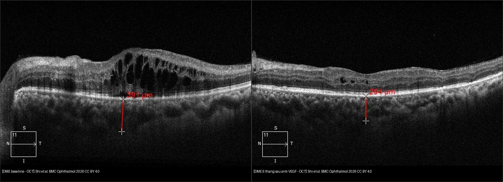
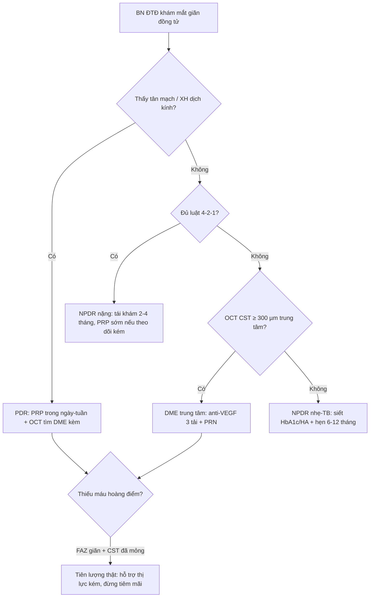
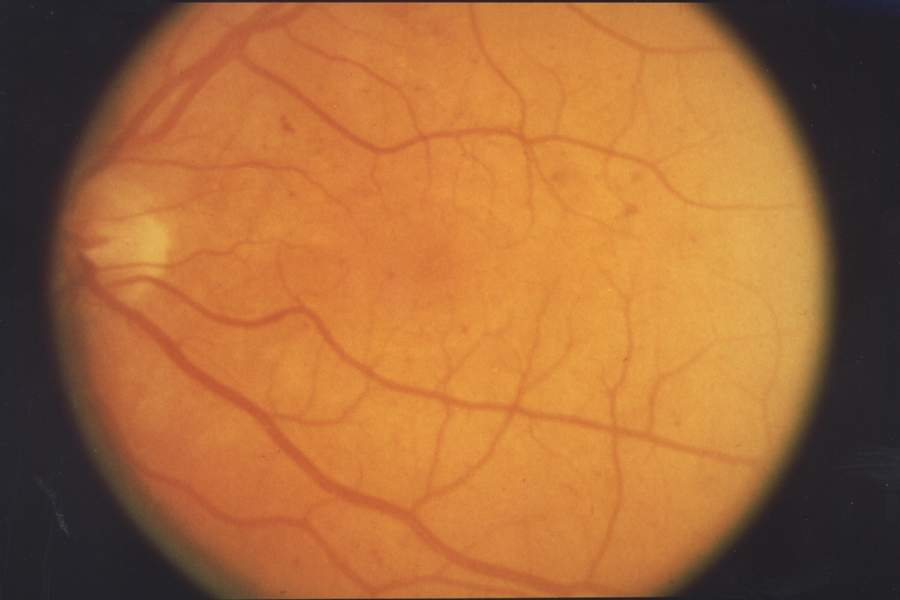

# 443 — Võng mạc đái tháo đường: phân độ ETDRS, phù hoàng điểm DME & OCTA / Diabetic retinopathy

**Tags:** `pattern:vong-mac-dai-thao-duong` `vung:vong-mac` `score:ETDRS` `protocol:OCT-OCTA`
**Mức chắc chắn (certainty):** tổng hợp y văn (literature synthesis) — nhóm tự biên từ 3 nguồn mở (BMC Ophthalmology 2026 CC BY 4.0 + NEI/NIH public domain + y văn ETDRS/DRCR), chưa gắn ca nguyên văn đơn lẻ.

## 1. Tổng quan — pericyte rụng trước, VEGF lên sau + số CMT nằm lòng

- Tăng đường huyết mạn làm **mất pericyte (pericyte loss) + dày màng đáy mao mạch** → vi phình mạch (microaneurysm) → vỡ hàng rào máu–võng mạc (blood-retinal barrier) → rò rỉ + thiếu máu → **VEGF tăng sinh mạch (neovascularization)**. DME (phù hoàng điểm đái tháo đường — diabetic macular edema) là nguyên nhân mờ mắt hàng đầu tuổi lao động và có thể gặp ở **mọi mức** võng mạc đái tháo đường (kể cả NPDR nhẹ).
- TẠI SAO OCT đọc được DME: dịch trong/ngoài võng mạc **tối (hyporeflective)** vì nước hấp thu tán xạ ít hơn mô; **xuất tiết cứng (hard exudate, lipid)** thì **sáng chói + bóng lưng** vì lipid tán xạ mạnh. Nang trong (intraretinal cysts) = rò rỉ mao mạch; dịch dưới võng mạc = RPE quá tải không bơm kịp.
- Số nằm lòng (Shi 2026, BMC Ophthalmology, 51 mắt DME trung tâm, Conbercept 0,5 mg phác đồ 3 mũi tải + PRN): CMT **466 ± 130 µm → 279 ± 72 µm sau 6 tháng**, thị lực logMAR **0,61 → 0,33** (p < 0,001). Ngưỡng nhớ: **CST ≥ 300 µm (máy spectral-domain)** ≈ phù trung tâm có ý nghĩa — khớp quy tắc bài 441.
- Số toàn thân quyết định mắt: mỗi **giảm 1% HbA1c → giảm ~37% nguy cơ biến chứng vi mạch (UKPDS)**; mục tiêu **HbA1c < 7% + HA < 130/80 mmHg** — không kiểm soát 2 số này thì tiêm mắt mãi vẫn tái phù.

## 2. Gamut theo mức ETDRS — đọc đáy mắt 30 giây xếp đúng mức

- **Chưa có (no apparent):** đáy mắt sạch — khám giãn định kỳ (ĐTĐ type 2 từ lúc chẩn đoán, type 1 sau 5 năm, mỗi 1–2 năm/lần).
- **NPDR nhẹ (mild):** chỉ **vi phình mạch (microaneurysm)** — theo dõi + siết đường/HbA1c.
- **NPDR trung bình (moderate):** vi phình + **xuất huyết đốm (dot-blot) + xuất tiết cứng/bông (hard exudate/cotton-wool)** — rút ngắn tái khám 6–9 tháng, OCT tìm DME.
- **NPDR nặng (severe):** luật **4-2-1** — xuất huyết/vi phình **≥ 20 ở cả 4 góc phần tư** + chuỗi hạt tĩnh mạch (venous beading) **≥ 2 góc** + bất thường vi mạch trong võng mạc IRMA (intraretinal microvascular abnormality) **≥ 1 góc**, mà **chưa có tân mạch** — soi sát mỗi 2–4 tháng, cân nhắc quang đông rải rác (PRP) sớm nếu theo dõi kém.
- **PDR (tăng sinh):** **tân mạch đĩa (NVD) hoặc nơi khác (NVE)** ± xuất huyết dịch kính/trước võng mạc — PRP trong **ngày–tuần**, không chờ.
- **DME:** dày hoàng điểm + vòng xuất tiết (circinate) — OCT đo CST, có thể kèm mọi mức trên.

## 3. Bảng so sánh phân biệt (ma trận đối chiếu)

| Thực thể (entity) | Hình ảnh điển hình | Chốt vào (rule-in) | Chốt loại (rule-out) | Gợi ý xác nhận |
|---|---|---|---|---|
| NPDR nhẹ–trung bình | **Vi phình + xuất huyết đốm + xuất tiết cứng**, chưa tân mạch | **ĐTĐ + tổn thương trong võng mạc thuần túy** | Tân mạch/XH dịch kính → PDR | Đáy mắt giãn + OCT (loại DME kèm) |
| NPDR nặng (4-2-1) | **XH ≥ 20/4 góc + beading ≥ 2 góc + IRMA**, chưa tân mạch | **Đủ luật 4-2-1 + chưa tân mạch** | Có NVD/NVE → đã là PDR | Tái khám 2–4 tháng / PRP sớm |
| PDR | **NVD/NVE + XH dịch kính/trước võng mạc hình thuyền** | **Tân mạch (rò FFA) hoặc XH dịch kính ở BN ĐTĐ** | Tổn thương chỉ trong võng mạc → NPDR | PRP 1200–1600 spots, mổ khi co kéo |
| DME trung tâm | **Nang trong + CST ≥ 300 µm** ± dịch dưới võng mạc (OCT) | **Dày trung tâm + ĐTĐ + OCT nang trong** | Dày ngoài trung tâm + thị lực còn tốt → laser khu trú | Anti-VEGF 3 tải + PRN (CMT 466→279 µm/6 tháng) |
| Thiếu máu hoàng điểm | **FAZ giãn + mao mạch rụng > 1 diện đĩa thị trên OCTA/FFA** | **Thị lực kém dù CST đã mỏng + FAZ giãn** | CST còn dày → phù chưa hết, chưa kết luận thiếu máu | Đừng tiêm mãi vô ích — tiên lượng + hỗ trợ thị lực kém |

*Trái: nang trong + dịch dưới võng mạc (baseline). Phải: 6 tháng sau Conbercept — nang xẹp gần hết, dịch hấp thu. Nguồn: Shi et al., BMC Ophthalmology 2026 Fig. 3–4, CC BY 4.0. Ảnh ghép letterbox. Lưu ý trung thực nguồn: vạch đỏ 391 µm → 294 µm là SFCT (dày hắc mạc dưới hõm), không phải CMT; CMT trung bình cả nhóm 466 → 279 µm.*

**Quiz composite:** che 2 nhãn, hỏi bên nào cần tiêm tiếp?

<b>Bấm để hiện đáp án</b>

- Trái = **DME đang hoạt động** (nang trong + dịch dưới võng mạc) → anti-VEGF tải liều + theo dõi CST.
- Phải = **đáp ứng tốt sau 6 tháng** (nang xẹp, dịch hết) → chuyển PRN theo OCT, đừng tiêm cố định mãi.
- Bẫy số: vạch đỏ là **SFCT (hắc mạc)**, không phải CMT — đọc nhầm là overcall/undercall phù.

### IRMA vs tân mạch NVE — ranh giới NPDR nặng/PDR hay sai nhất
- **IRMA:** vòng nối trong võng mạc, **không vượt màng giới hạn trong**, không rò mạnh trên FFA — vẫn là NPDR nặng.
- **NVE/NVD:** mạch bò **lên trên/vào dịch kính**, **rò mạnh thì muộn FFA** — đã là PDR, chỉ định PRP đổi hẳn.
- Cạm bẫy: IRMA cạnh NVE trên cùng một mắt ĐTĐ lâu năm — thấy 1 ổ tân mạch là cả mắt đã PDR, đừng ghi "NPDR nặng" rồi hẹn 3 tháng.

## 4. Protocol chụp + điều trị chuẩn

- **Sàng lọc:** đáy mắt giãn đồng tử (7 trường ETDRS hoặc widefield) — type 2 từ lúc chẩn đoán, type 1 sau 5 năm; **OCT hoàng điểm** mỗi lần nghi DME (macular cube + CST + DRIL/EZ); **OCTA/FFA** khi nghi tân mạch hoặc thiếu máu (FAZ giãn, rụng mao mạch).
- **DME trung tâm (CST ≥ 300 µm + mờ):** anti-VEGF nội nhãn first-line — **3 mũi tải hàng tháng + PRN theo OCT** (aflibercept/ranibizumab/conbercept 0,5 mg); steroid nội nhãn khi đáp ứng kém/chống chỉ định; laser grid chỉ cho DME ngoài trung tâm.
- **PDR:** quang đông toàn võng mạc **PRP 1200–1600 spots** trong ngày–tuần; xuất huyết dịch kính không tan sau ~1–3 tháng hoặc bong co kéo đe dọa hoàng điểm → cắt dịch kính (vitrectomy).
- **Song song toàn thân:** HbA1c < 7%, HA < 130/80, lipid máu — không có 3 số này thì mắt tái phát sau mọi can thiệp.

## 5. Biến thể bình thường và cạm bẫy

- **Xuất tiết bông (cotton-wool) vs cứng (hard):** bông = nhồi máu lớp sợi thần kinh (trắng xốp, che mạch, NPDR trung bình–nặng); cứng = lipid rò rỉ (vàng sắc, vòng quanh hoàng điểm = DME) — nhầm là sai mức.
- **Xuất huyết trong vs trước võng mạc:** đốm trong võng mạc (NPDR) vs **hình thuyền (boat-shaped) trước võng mạc / tỏa dịch kính (PDR)** — vị trí quyết định mức, không phải số lượng.
- **DRIL + đứt EZ:** phù hết mà thị lực không lên — tiên lượng thật với BN ngay từ OCT đầu, đừng hứa "tiêm là sáng".
- **Thiếu máu hoàng điểm bị bỏ sót:** cứ tiêm vì "còn mờ" trong khi CST đã về bình thường — OCTA/FFA một lần rẻ hơn 3 mũi tiêm vô ích.
- **Một mắt PDR + một mắt NPDR:** mức bệnh tính theo mắt nặng — mắt PDR laser ngay, đừng chờ "2 mắt cùng mức".

## 6. Tự lượng giá — Blind Quiz

**Ca 1 — ĐTĐ type 2 mới phát hiện, thị lực còn tốt. Nhìn đáy mắt, xếp mức?**

- Hỏi: tổn thương chính là gì? Mức ETDRS? Có cần PRP không?

<b>Bấm để hiện đáp án (findings + chẩn đoán)</b>

- Dấu hiệu (findings): **xuất huyết đốm (dot-blot) rải rác**, chưa thấy tân mạch hay xuất tiết nhiều.
- Chẩn đoán (diagnosis): **NPDR sớm (nhẹ–trung bình)** — vì chỉ có tổn thương trong võng mạc, chưa đủ luật 4-2-1, chưa tân mạch.
- Xử trí: **chưa PRP** — siết HbA1c/HA + OCT loại DME kèm + hẹn 6–9 tháng.
- Nguồn ảnh: National Eye Institute (NEI/NIH), public domain via Wikimedia Commons (EDA03).

**Ca 2 — ĐTĐ 15 năm, mờ mắt. Nhìn đáy mắt, có gì báo động?**

- Hỏi: vòng mạch lan từ đĩa thị là gì? Mức bệnh? Xử trí trong khung giờ nào?

<b>Bấm để hiện đáp án (findings + chẩn đoán)</b>

- Dấu hiệu (findings): **tân mạch đĩa (NVD — neovascularization at the disc)** lan tỏa + đốm bông (cotton-wool).
- Chẩn đoán (diagnosis): **PDR (tăng sinh)** — vì đã có tân mạch, bất kể số lượng xuất huyết.
- Xử trí: **PRP trong ngày–tuần** (1200–1600 spots) + OCT tìm DME kèm + cảnh báo xuất huyết dịch kính đột ngột.
- Nguồn ảnh: National Eye Institute (NEI/NIH), public domain via Wikimedia Commons (EDA01).

**Ca 3 — ĐTĐ mờ trung tâm, thị lực 20/80. Cặp đáy mắt + OCT này nói gì?**

- Hỏi: vòng vàng quanh hoàng điểm là gì? OCT có nang trong + CST tăng thì chẩn đoán nào? Thuốc gì đầu tay?

<b>Bấm để hiện đáp án (findings + chẩn đoán)</b>

- Dấu hiệu (findings): đáy mắt **vòng xuất tiết cứng (circinate hard exudates)** quanh hoàng điểm; OCT **nang trong (intraretinal cysts) + dịch dưới võng mạc**, CST tăng.
- Chẩn đoán (diagnosis): **DME trung tâm (center-involved DME)** — vì nang trong + dày trung tâm ở BN ĐTĐ.
- Xử trí: **anti-VEGF nội nhãn first-line (3 mũi tải + PRN)** — tham chiếu Shi 2026: CMT 466 → 279 µm, logMAR 0,61 → 0,33 sau 6 tháng Conbercept.
- Nguồn ảnh: đáy mắt NEI/NIH public domain; OCT Shi et al., BMC Ophthalmology 2026 Fig. 3, CC BY 4.0.

## Bài liên quan chéo
- [400 – Tổng quan Mắt](../400-tong-quan-mat-thi-giac/lesson.md)
- [441 – OCT hoàng điểm](../441-OCT-hoang-diem/lesson.md) (nang trong vs dịch dưới võng mạc/PED)
- [411 – Siêu âm nhãn cầu](../411-sieu-am-nhan-cau/lesson.md) (xuất huyết dịch kính PDR)
- [451 – Bệnh hệ thống ở mắt](../451-he-thong-mat/lesson.md) (ĐTĐ toàn thân)

## Ảnh
- `443_NPDR-som_Fundus_Wikimedia-NEI-EDA03.jpg`, `443_PDR_Fundus_Wikimedia-NEI-EDA01.jpg`, `443_DME-day-hoang-diem_Fundus_Wikimedia-NEI.jpg`, `443_PRP-seo-quang-dong_Fundus_Wikimedia-NEI-EDA09.jpg` — National Eye Institute (NEI/NIH), public domain via Wikimedia Commons.
- `443_DME-OCT-nen_OCT_PMC13182033-Fig3-CCBY.jpg`, `443_DME-OCT-sau-antiVEGF_OCT_PMC13182033-Fig4-CCBY.jpg` — Shi et al., BMC Ophthalmology 2026 (PMCID: PMC13182033), CC BY 4.0.
- Chi tiết giấy phép từng ảnh trong `images/CREDITS.md`. AuntMinnie: chỉ dẫn link, không tải.

> Không dùng để chẩn đoán độc lập khi chưa có người hướng dẫn.
