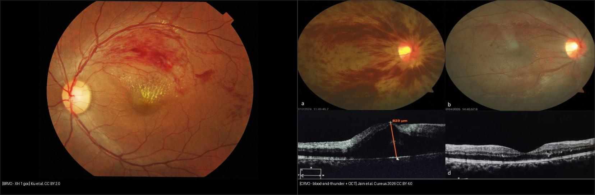
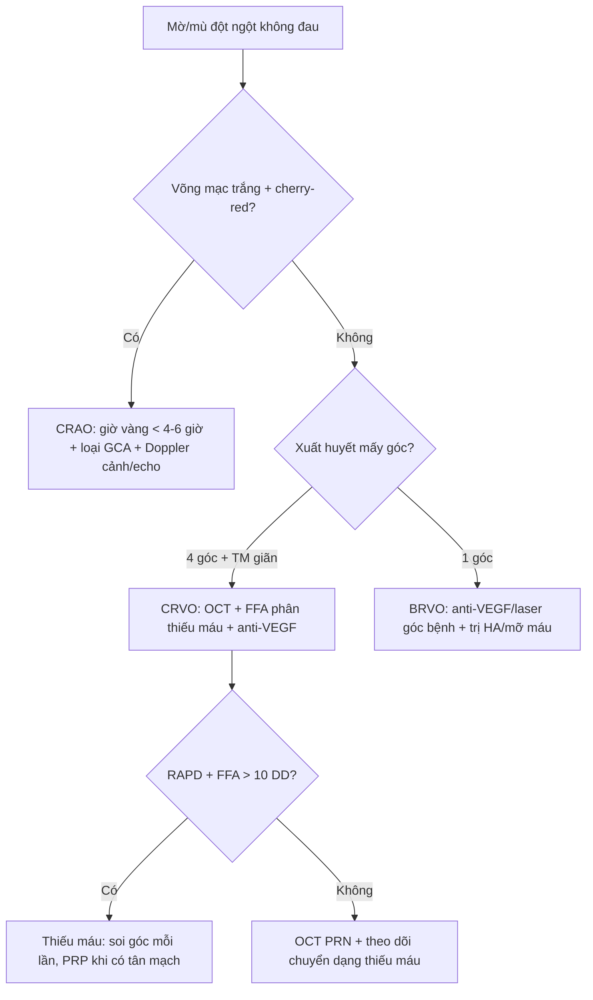
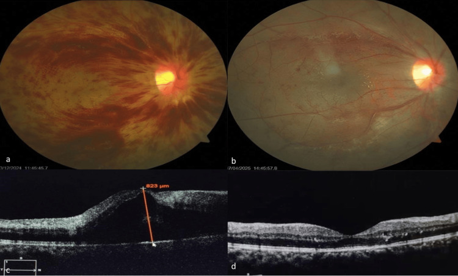
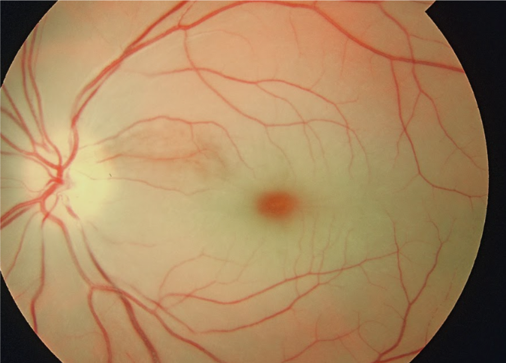

# 444 — Tắc mạch võng mạc: CRVO/BRVO vs CRAO — cherry-red & giờ vàng / Retinal vascular occlusions

**Tags:** `pattern:tac-mach-vong-mac` `vung:vong-mac` `protocol:FFA-OCT`
**Mức chắc chắn (certainty):** tổng hợp y văn (literature synthesis) — nhóm tự biên từ 2 ca mở (Cureus 2026 CC BY 4.0 + ảnh CC BY/BY-SA Wikimedia) và y văn tắc mạch, chưa gắn ca nguyên văn đơn lẻ.

## 1. Tổng quan — tĩnh mạch vỡ rò rỉ, động mạch trắng nhợt + số giờ vàng

- **CRVO (tắc tĩnh mạch trung tâm):** huyết khối tại **lá sàng (lamina cribrosa)** nơi ĐM/TM chung bao xơ → ứ tĩnh mạch → **xuất huyết + phù + thiếu máu** 4 góc (blood-and-thunder). Phù hoàng điểm là nguyên nhân mờ chính — và đáp ứng anti-VEGF rất tốt: CMT **823 → 275 µm sau 1 mũi bevacizumab** (Jain 2026, nam 23 tuổi, CRVO sau gắng sức).
- **BRVO (tắc nhánh):** tại **điểm bắt chéo động–tĩnh mạch (arteriovenous crossing)** — động mạch xơ cứng đè tĩnh mạch → chỉ **1 góc** bị (thường thái dương trên), còn lại bình thường.
- **CRAO (tắc động mạch trung tâm):** thuyên tắc (mảngnl cholesterol Hollenhorst, vôi, tiểu cầu) hoặc viêm (GCA) → võng mạc trong **trắng đục thiếu máu**, chỉ **hõm trung tâm (fovea)** còn đỏ vì nuôi bởi hắc mạc bên dưới → **cherry-red spot**. TẠI SAO giờ tính bằng giờ: võng mạc trong hoại tử không hồi phục sau **~90–240 phút** thiếu máu hoàn toàn — mọi can thiệp (mát-xa nhãn cầu, chọc tiền phòng, carbogen, tiêu sợi huyết) chỉ có ý nghĩa trong **< 4–6 giờ đầu**.
- Số nằm lòng: thiếu máu CRVO = **vùng không tưới máu > 10 diện đĩa thị trên FFA**; tân mạch mống mắt/glaucoma tân mạch thường bùng ở **~90–100 ngày** (100-day glaucoma) — soi góc + khám mống mắt mỗi lần tái khám CRVO thiếu máu.

## 2. Gamut mờ mắt đột ngột không đau — 3 câu chia 90% ca

- **Mờ + xuất huyết 4 góc + tĩnh mạch giãn ngoằn ngoèo:** CRVO — FFA phân thiếu máu/không, OCT đo phù, anti-VEGF.
- **Mờ + xuất huyết chỉ 1 góc + góc còn lại sạch:** BRVO — anti-VEGF/laser khu trú góc bệnh, tìm tăng HA/mỡ máu.
- **Mù gần hoàn toàn trong giây–phút + võng mạc trắng + cherry-red:** CRAO — cấp cứu giờ vàng + tầm soát nguồn thuyên tắc (cảnh, tim) + loại GCA.
- **Mờ 1 góc + mảng vàng óng trong động mạch:** BRAO + **mảng Hollenhorst** — cùng xử trí nguồn như CRAO nhưng tiên lượng góc tốt hơn.
- **Mờ + phù đĩa + xuất huyết (không trắng nhợt):** CRVO thể nặng — đừng nhầm CRAO (CRAO trắng, ít xuất huyết).

## 3. Bảng so sánh phân biệt (ma trận đối chiếu)

| Thực thể (entity) | Hình ảnh điển hình | Chốt vào (rule-in) | Chốt loại (rule-out) | Gợi ý xác nhận |
|---|---|---|---|---|
| CRVO | **XH 4 góc + TM giãn + phù đĩa + phù hoàng điểm OCT** | **Tắc tại đĩa → toàn võng mạc** | Chỉ 1 góc → BRVO | FFA (> 10 DD = thiếu máu), anti-VEGF |
| BRVO | **XH 1 góc thái dương + góc còn lại bình thường** | **Ranh giới đúng đường ngang + điểm bắt chéo** | 4 góc đều → CRVO | HA/mỡ máu + laser/anti-VEGF góc bệnh |
| CRAO | **Võng mạc trắng + cherry-red + ĐM nhỏ + boxcarring** | **Mù đột ngột + trắng nhợt + cherry-red** | XH nhiều + TM giãn → CRVO | Giờ vàng < 4–6 giờ + Doppler cảnh + echo |
| BRAO | Trắng 1 góc + **mảng Hollenhorst vàng óng** | **Mảng thuyên tắc thấy được + trắng theo vùng** | Cherry-red trung tâm → CRAO | Như CRAO (nguồn thuyên tắc) |
| CRVO thiếu máu | Như CRVO + **RAPD + thị lực kém + FFA > 10 DD** | **RAPD + không tưới máu rộng** | Không RAPD + thị lực còn → chưa thiếu máu | Soi góc/mống mắt mỗi lần (tân mạch ~90 ngày) |

*Trái: BRVO nhánh thái dương trên (Ku et al., CC BY 2.0). Phải: CRVO (a) nền blood-and-thunder, (b) hết xuất huyết sau bevacizumab, (c) OCT phù 823 µm, (d) còn 275 µm (Jain et al., Cureus 2026 Fig. 1, CC BY 4.0). Ảnh ghép letterbox.*

**Quiz composite:** che 2 nhãn, hỏi bên nào cần soi góc tìm tân mạch sát nhất?

<b>Bấm để hiện đáp án</b>

- Trái = **BRVO** — bệnh 1 góc, tân mạch võng mạc góc bệnh (laser khu trú khi có tân mạch/thiếu máu).
- Phải = **CRVO** — toàn võng mạc thiếu máu tiềm ẩn → **soi góc + mống mắt mỗi lần tái khám** (glaucoma tân mạch ~90–100 ngày).
- Cả hai đều phù hoàng điểm đáp ứng anti-VEGF, nhưng CRVO đe dọa toàn nhãn cầu hơn.

### Thiếu máu vs không thiếu máu — ranh giới quyết định laser hay tiêm
- **Không thiếu máu:** thị lực còn khá, không RAPD, FFA tưới máu còn — anti-VEGF trị phù + theo dõi (như ca Jain 23 tuổi: 6/18 → 6/9).
- **Thiếu máu:** RAPD +, thị lực kém, FFA > 10 diện đĩa không tưới máu — nguy cơ tân mạch mống mắt/góc → **quang đông rải rác (PRP) khi đã có tân mạch**, không PRP dự phòng mù quáng.
- Cạm bẫy: CRVO thiếu máu vẫn có thể "đẹp dần" trên đáy mắt trong khi tân mạch góc âm thầm mọc — bỏ soi góc là bỏ sót glaucoma tân mạch.

## 4. Protocol chụp + xử trí giờ vàng

- **OCT hoàng điểm:** đo CMT + nang trong/dưới võng mạc — quyết định tiêm nhắc lại (PRN theo OCT, như ca Jain: 823 → 275 µm).
- **FFA:** phân thiếu máu (> 10 DD), tìm tân mạch, loại viêm mạch; **OCTA** theo dõi vùng không tưới máu không cần thuốc nhuộm.
- **CRAO < 4–6 giờ:** mát-xa nhãn cầu + hạ nhãn áp cấp (chọc tiền phòng/thuốc) + carbogen + chuyển cấp cứu đột quỵ (não và mắt cùng nguồn!); **nghi GCA (tuổi > 50 + đau đầu + đau hàm + ấn thái dương đau + ESR/CRP cao) → methylprednisolone ngay, không chờ sinh thiết**.
- **Tầm soát nguồn:** Doppler động mạch cảnh + siêu âm tim (lỗ bầu dục, van) + HA/mỡ máu/đường — tắc mắt là cảnh báo đột quỵ não.
- **CRVO/BRVO:** anti-VEGF first-line cho phù; steroid nội nhãn khi đáp ứng kém; laser (grid/PRP) khi có tân mạch hoặc thiếu máu rộng.

## 5. Biến thể bình thường và cạm bẫy

- **Động–tĩnh mạch bắt chéo sinh lý** — không phải chỗ nào bắt chéo cũng là BRVO: phải có xuất huyết + phù đúng vùng hạ lưu mới kết luận.
- **Cherry-red giả:** hắc mạc đậm màu bẩm sinh ở da sẫm + võng mạc trong bình thường — không có trắng nhợt xung quanh thì không phải CRAO.
- **Cilioretinal sparing (~20% dân số):** CRAO nhưng thị lực trung tâm còn tốt vì bó mạch mi–võng mạc nuôi riêng — đừng vì "còn đọc được" mà loại CRAO khi võng mạc trắng.
- **CRVO sau gắng sức/Valsalva ở người trẻ** (ca Jain 23 tuổi): không HA/tiểu đường không có nghĩa không CRVO — hỏi gắng sức, thuốc, đông máu.
- **GCA bị bỏ sót:** BN > 50 tuổi mù 1 mắt + đau đầu mà chỉ nhỏ mắt hạ áp là sai lầm chết người (mắt còn lại + não) — ESR/CRP + steroid ngay.

## 6. Tự lượng giá — Blind Quiz

**Ca 1 — Mờ mắt 1 bên, đáy mắt xuất huyết 1 góc trên. Tắc gì?**

- Hỏi: xuất huyết mấy góc? Đâu là điểm tắc? CRVO hay BRVO?

<b>Bấm để hiện đáp án (findings + chẩn đoán)</b>

- Dấu hiệu (findings): **xuất huyết + phù khu trú góc thái dương trên**, các góc còn lại bình thường, hoàng điểm phù vàng.
- Chẩn đoán (diagnosis): **BRVO (tắc nhánh tĩnh mạch)** — vì bệnh đúng 1 góc hạ lưu điểm bắt chéo động–tĩnh mạch.
- Xử trí: anti-VEGF trị phù + tìm HA/mỡ máu; laser khu trú khi có tân mạch/thiếu máu góc bệnh.
- Nguồn ảnh: Ku et al., CC BY 2.0 via Wikimedia Commons.

**Ca 2 — Thanh niên 23 tuổi mờ đột ngột sau tập tạ nặng. Cặp đáy mắt + OCT này nói gì?**

- Hỏi: (a) blood-and-thunder + TM giãn là gì? (c) CMT 823 µm nghĩa gì? Kết quả sau 1 mũi tiêm?

<b>Bấm để hiện đáp án (findings + chẩn đoán)</b>

- Dấu hiệu (findings): (a) **xuất huyết 4 góc + tĩnh mạch giãn ngoằn ngoèo + phù đĩa**; (c) OCT **nang trong + CMT 823 µm**.
- Chẩn đoán (diagnosis): **CRVO không thiếu máu** — toàn võng mạc, thị lực còn 6/18, không RAPD, xét nghiệm toàn thân sạch.
- Kết quả: sau 1 mũi bevacizumab — (b) hết xuất huyết, (d) CMT còn 275 µm, thị lực 6/9.
- Nguồn ảnh: Jain et al., Cureus 2026 Fig. 1 (PMC13268218), CC BY 4.0.

**Ca 3 — Mù đột ngột 1 mắt trong vài phút, chỉ còn thấy bóng bàn tay. Nhìn đáy mắt, giây nào quyết định?**

- Hỏi: trắng + đỏ trung tâm là gì? Chẩn đoán? 3 việc phải làm trong giờ đầu?

<b>Bấm để hiện đáp án (findings + chẩn đoán)</b>

- Dấu hiệu (findings): **võng mạc trong trắng đục thiếu máu + cherry-red spot hõm trung tâm** (hắc mạc còn tưới máu lộ qua), mạch máu nhỏ lại.
- Chẩn đoán (diagnosis): **CRAO (tắc động mạch trung tâm)** — giờ vàng < 4–6 giờ, mỗi phút là tế bào hạch.
- Xử trí giờ đầu: hạ nhãn áp cấp (mát-xa/chọc tiền phòng) + **loại GCA nếu > 50 tuổi (ESR/CRP + steroid ngay)** + Doppler cảnh/echo tìm nguồn (cảnh báo đột quỵ não).
- Nguồn ảnh: Wikimedia Commons, CC BY-SA 4.0 (dùng nguyên bản, không cắt ghép).

## Bài liên quan chéo
- [400 – Tổng quan Mắt](../400-tong-quan-mat-thi-giac/lesson.md)
- [441 – OCT hoàng điểm](../441-OCT-hoang-diem/lesson.md) (phù hoàng điểm do tắc tĩnh mạch)
- [443 – Võng mạc đái tháo đường](../443-vong-mac-dai-thao-duong/lesson.md) (phân biệt xuất huyết ĐTĐ vs RVO)
- [430 – Đường thị giác](../430-duong-thi-giac/lesson.md) (CRVO trong DDx phù đĩa)

## Ảnh
- `444_BRVO_Fundus_Wikimedia-Ku-CCBY20.jpg` — Ku et al., CC BY 2.0 via Wikimedia Commons.
- `444_CRAO-cherry-red_Fundus_Wikimedia-18mlk7-CCBYSA40.png` — Wikimedia Commons, CC BY-SA 4.0 (giữ nguyên bản).
- `444_CRVO-da-mode_Fundus-OCT_PMC13268218-Fig1-CCBY.jpg` — Jain et al., Cureus 2026 (PMCID: PMC13268218), CC BY 4.0.
- Chi tiết giấy phép từng ảnh trong `images/CREDITS.md`. AuntMinnie: chỉ dẫn link, không tải.

> Không dùng để chẩn đoán độc lập khi chưa có người hướng dẫn.
