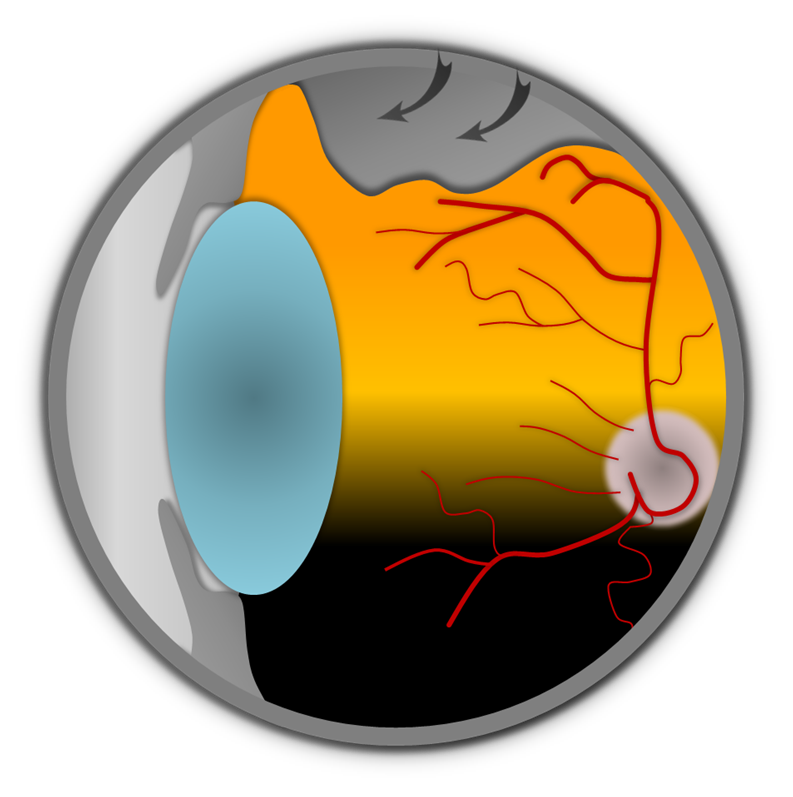
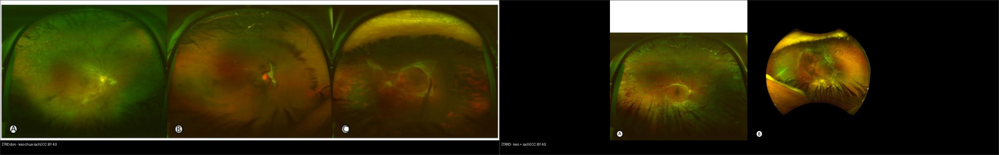
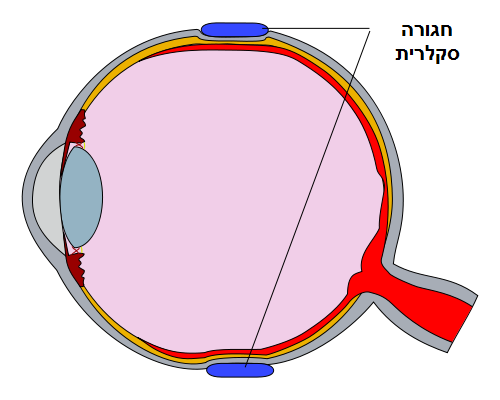
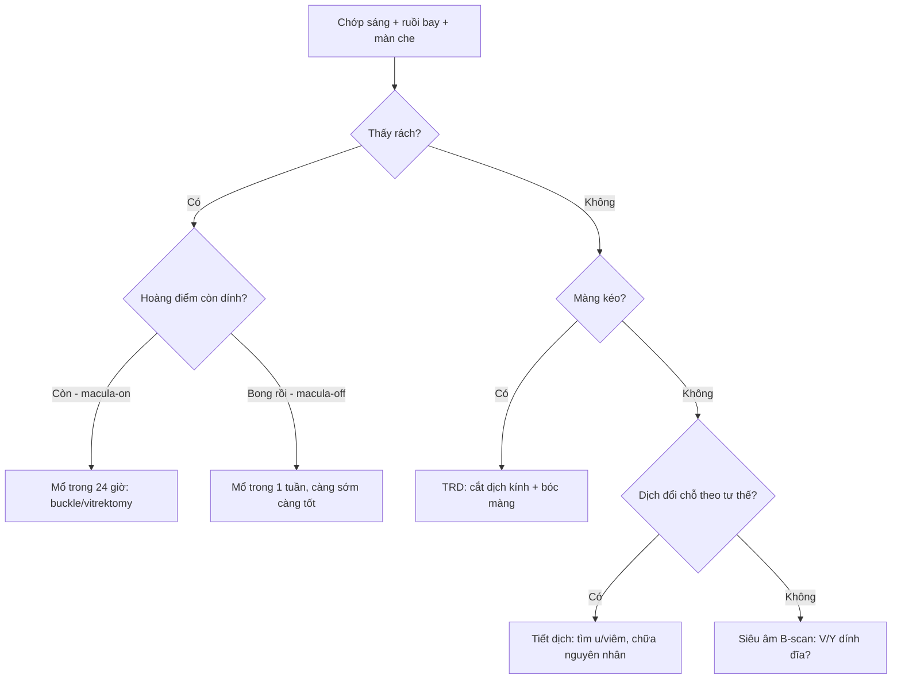
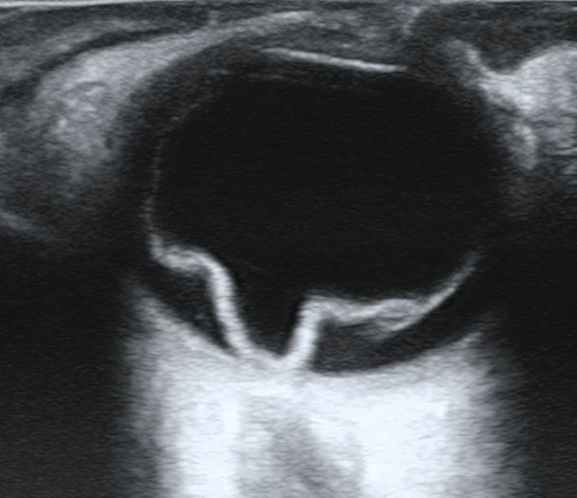
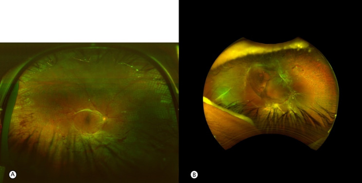

# 445 — Bong võng mạc: rách vs co kéo vs tiết dịch + PVR / Retinal detachment

**Tags:** `pattern:bong-vong-mac` `vung:vong-mac` `protocol:sieu-am-B-scan`
**Mức chắc chắn (certainty):** tổng hợp y văn (literature synthesis) — nhóm tự biên từ 1 nghiên cứu mở (CC BY 4.0) + ảnh CC BY/BY-SA Wikimedia, chưa gắn ca nguyên văn đơn lẻ.

## 1. Tổng quan — 3 cơ chế bong + số giờ mổ nằm lòng

- **Bong do rách (rhegmatogenous, RRD):** bong dịch kính sau (PVD) giật **rách võng mạc (horseshoe tear)** → dịch kính hóa lỏng chui qua rách, tách võng mạc cảm thụ khỏi RPE. TẠI SAO bong lan nhanh: khoang dưới võng mạc không có gì giữ, dịch chảy theo trọng lực — bong trên lan xuống hoàng điểm trong giờ–ngày.
- **Bong co kéo (tractional, TRD):** màng xơ–mạch (PDR, ROP, hồng cầu liềm) **kéo** võng mạc lên, **không có rách** — võng mạc căng như lều (tenting), ít di động. Khi màng kéo làm rách thêm → **kết hợp co kéo + rách (TRRD)** — vừa kéo vừa có dịch chui qua rách.
- **Bong tiết dịch (exudative):** dịch từ RPE/mạch (u hắc mạc, Coats, VKH, tăng HA ác tính) — **không rách, không kéo**, mặt bong nhẵn bóng, dịch **đổi chỗ theo tư thế (shifting fluid)**.
- Số nằm lòng: **hoàng điểm còn dính (macula-on) → mổ trong 24 giờ**; **hoàng điểm đã bong (macula-off) → mổ trong 1 tuần** (càng sớm càng tốt, bong tươi < 7 ngày thị lực hậu phẫu tốt hơn rõ); khí C3F8 trong mắt **6–8 tuần**, SF6 **~2 tuần** — BN không được bay cao/leo núi khi còn khí.

*Cơ chế PVD → rách: dịch kính co (mũi tên) giật rách võng mạc, dịch hóa lỏng chui qua. Nguồn: Sabine Sahr, CC BY 4.0 via Wikimedia Commons.*

## 2. Gamut chớp sáng + ruồi bay + màn che — hỏi 3 câu trước khi soi

- **Chớp sáng + ruồi bay tăng + màn che từ ngoại vi + bụi thuốc lá (Shafer sign):** RRD — tìm rách ngoại vi, phân macula-on/off.
- **ĐTĐ lâu năm + màng xơ + bong căng hình lều, ít di động:** TRD — mổ cắt dịch kính bóc màng, laser bổ sung.
- **Bong bóng nhẵn + dịch đổi chỗ khi đổi tư thế + không rách:** tiết dịch — tìm u/viêm (siêu âm + MRI hốc mắt), chữa nguyên nhân, không mổ võng mạc vội.
- **Bong cũ + nếp sao (star folds) + võng mạc cứng không duỗi:** PVR — mổ phức tạp (bóc màng + dầu silicon), tiên lượng dè dặt.
- **Mờ + siêu âm chữ V/Y dính đĩa thị:** bong võng mạc (chi tiết siêu âm bài 411); rung động sau cử động (aftermovement) = xuất huyết dịch kính kèm.

## 3. Bảng so sánh phân biệt (ma trận đối chiếu)

| Thực thể (entity) | Hình ảnh điển hình | Chốt vào (rule-in) | Chốt loại (rule-out) | Gợi ý xác nhận |
|---|---|---|---|---|
| RRD | **Rách móng ngựa + dịch dưới võng mạc + Shafer** | **Thấy rách + bong lan từ rách** | Không rách + mặt nhẵn → tiết dịch | Vẽ rách theo giờ + macula-on/off |
| TRD | **Màng xơ–mạch kéo, võng mạc căng lều, ít di động** | **Màng kéo + ĐTĐ/ROP + không rách** | Có rách → TRRD; dịch đổi chỗ → tiết dịch | Cắt dịch kính + bóc màng |
| TRRD | **Vừa màng kéo vừa rách + võng mạc sóng (corrugated)** | **Kéo + rách cùng tồn tại** | Chỉ kéo → TRD thuần | Mổ kết hợp (bóc màng + bịt rách) |
| Tiết dịch | **Mặt nhẵn bóng + shifting fluid + không rách** | **Dịch đổi chỗ theo tư thế** | Có rách/kéo → RRD/TRD | Siêu âm/MRI tìm u, chữa nguyên nhân |
| PVR | **Nếp sao + màng trên/dưới + võng mạc cứng** | **Bong cũ + màng co rút** | Bong tươi di động → chưa PVR | Dầu silicon + bóc màng, hẹn tái bong |

*Trái: TRD đơn theo giai đoạn (A–C). Phải: TRRD kết hợp cấp (A–B). Nguồn: nghiên cứu vitrectomy TRD/TRRD type 1 diabetes 2026 Fig. 1 + Fig. 3 (PMC13326397), CC BY 4.0. Ảnh ghép letterbox.*

**Quiz composite:** che 2 nhãn, hỏi bên nào chỉ cần bóc màng, bên nào phải bịt rách thêm?

<b>Bấm để hiện đáp án</b>

- Trái = **TRD đơn** — chỉ kéo, chưa rách → bóc màng + giải phóng co kéo (chưa cần bịt rách vì không có rách).
- Phải = **TRRD** — vừa kéo vừa rách → bóc màng + **bịt rách (laser/cryo + tamponade)** vì dịch vẫn chui qua rách.
- Thấy rách là đổi hẳn kế hoạch mổ — soi ngoại vi kỹ mọi TRD.

### Rách móng ngựa vs lỗ teo — 2 loại rách hay nhầm cách xử trí
- **Rách móng ngựa (horseshoe):** do PVD giật, có **nắp (flap) + dịch dưới võng mạc**, nguy cơ bong cao — laser bao quanh **ngay** kể cả chưa bong rộng.
- **Lỗ teo (atrophic hole, trong lattice):** không do kéo cấp, ít dịch — laser dự phòng khi có yếu tố nguy cơ (bong mắt còn lại, cận nặng, gia đình).
- Cạm bẫy: lattice ngoại vi không rách ở người không triệu chứng — soi vẽ bản đồ + hẹn, đừng laser hết mọi lattice.

## 4. Protocol chụp + chọn cách mổ

- **Soi giãn + vẽ đáy mắt theo giờ:** ghi rách (giờ, kích thước), dịch đến đâu, macula-on/off — tờ vẽ này quyết định mổ cấp hay hẹn.
- **Siêu âm B-scan (mờ đục môi trường):** chữ **V/Y dính đĩa = bong võng mạc**; aftermovement = máu dịch kính; T-sign = viêm củng mạc sau (tiết dịch) — chi tiết bài 411.
- **Rách chưa bong rộng:** laser/cryo bao quanh (barrage) — thủ thuật phòng mổ, không cần nằm viện.
- **RRD macula-on:** đai củng mạc (buckle) hoặc cắt dịch kính trong **24 giờ**; macula-off: trong **1 tuần**; rách trên + đơn độc + chưa PVR → bơm khí (pneumatic) + tư thế.
- **TRD/TRRD + PVR:** cắt dịch kính + bóc màng + laser + tamponade (khí/dầu silicon); dầu silicon cần mổ lấy ra sau vài tháng.

*Đai silicon (xanh) ép lõm thành mắt đúng vị trí rách — nguyên lý buckle: khép rách từ ngoài, không vào trong mắt. Nguồn: Wikimedia Commons (R. Milano), CC BY-SA 4.0, nhãn gốc tiếng Hebrew. Dùng nguyên bản.*

## 5. Biến thể bình thường và cạm bẫy

- **Bong dịch kính sau (PVD) đơn thuần:** chớp + ruồi bay nhưng **không rách, không Shafer, không màn che cố định** — soi 1 lần + dặn quay lại ngay khi có màn che, đừng hẹn 6 tháng.
- **Lattice ngoại vi:** mỏng võng mạc trắng lưới, hay gặp cận thị — không rách thì theo dõi, đừng laser dự phòng tràn lan.
- **Bong dưới (inferior) + rách trên:** dịch chui từ rách trên chảy xuống — bịt rách trên là khỏi, đừng mổ ồ ạt toàn bộ.
- **PVR bị bỏ sót:** bong cũ cứng không duỗi mà mổ như bong tươi (chỉ bơm khí) là tái bong chắc chắn — sờ nếp sao + đánh giá di động trước mổ.
- **Khí trong mắt + bay cao:** khí giãn nở theo độ cao → tắc ĐM trung tâm/mù — dặn BN đeo vòng tay "khí trong mắt" + cấm bay đến khi khí tan hết.

## 6. Tự lượng giá — Blind Quiz

**Ca 1 — Chớp sáng + ruồi bay + màn che thái dương. Soi rộng thấy gì?**

- Hỏi: tổn thương hình móng ngựa là gì? Có dịch kèm không? Bong do cơ chế nào?

<b>Bấm để hiện đáp án (findings + chẩn đoán)</b>

- Dấu hiệu (findings): **rách móng ngựa (horseshoe tear) có nắp + quầng dịch dưới võng mạc** quanh rách.
- Chẩn đoán (diagnosis): **RRD (bong do rách)** — vì có rách + dịch chui qua rách.
- Xử trí: phân macula-on/off ngay — on thì mổ 24 giờ; laser bao rách nếu bong còn khu trú.
- Nguồn ảnh: Wikimedia Commons (Amaris5), CC BY-SA 4.0 (dùng nguyên bản).

**Ca 2 — Mờ mắt, môi trường đục không soi được. Siêu âm này kết luận gì?**

- Hỏi: màng sáng hình gì, dính ở đâu? Bong võng mạc hay xuất huyết dịch kính?

<b>Bấm để hiện đáp án (findings + chẩn đoán)</b>

- Dấu hiệu (findings): **màng tăng âm hình chữ V/Y, đỉnh dính đĩa thị (ora–đĩa)** — không rung aftermovement mạnh.
- Chẩn đoán (diagnosis): **bong võng mạc trên siêu âm** — vì V/Y dính đĩa là chốt (máu dịch kính: aftermovement + không dính đĩa).
- Lưu ý trung thực nguồn: tên file gốc ghi "fundus" nhưng nội dung là **siêu âm B-scan** — đọc theo nội dung, không theo tên file.
- Nguồn ảnh: Wikimedia Commons (CheckDO), CC BY-SA 4.0 (dùng nguyên bản). Nối bài 411.

**Ca 3 — ĐTĐ type 1 lâu năm, màng xơ khắp nơi. Đây là TRD đơn hay đã kết hợp rách?**

- Hỏi: vừa kéo vừa có gì thêm? Kế hoạch mổ khác TRD đơn ở điểm nào?

<b>Bấm để hiện đáp án (findings + chẩn đoán)</b>

- Dấu hiệu (findings): **màng xơ–mạch kéo + võng mạc sóng (corrugated) + rách thứ phát** — đủ bộ kết hợp.
- Chẩn đoán (diagnosis): **TRRD (kết hợp co kéo + rách)** — vì có rách trên nền màng kéo.
- Xử trí: cắt dịch kính + bóc màng + **bịt rách + tamponade** (khác TRD đơn chỉ cần giải phóng co kéo).
- Nguồn ảnh: nghiên cứu vitrectomy TRD/TRRD 2026 Fig. 3 (PMC13326397), CC BY 4.0.

## Bài liên quan chéo
- [400 – Tổng quan Mắt](../400-tong-quan-mat-thi-giac/lesson.md)
- [411 – Siêu âm nhãn cầu](../411-sieu-am-nhan-cau/lesson.md) (V/Y dính đĩa vs máu dịch kính)
- [443 – Võng mạc đái tháo đường](../443-vong-mac-dai-thao-duong/lesson.md) (TRD trong PDR)
- [450 – Mắt nhi](../450-mat-nhi/lesson.md) (Coats/ROP gây bong tiết dịch/co kéo)
- [412 – U trong nhãn cầu](../412-u-trong-nhan-cau/lesson.md) (u hắc mạc gây bong tiết dịch)

## Ảnh
- `445_RRD_Fundus_Wikimedia-Amaris5-CCBYSA40.jpg`, `445_RD_Fundus_Wikimedia-CheckDO-CCBYSA40.jpg` (thực chất là siêu âm B-scan), `445_scleral-buckle_Diagram_Wikimedia-RMilano-CCBYSA40.png` — Wikimedia Commons, CC BY-SA 4.0 (giữ nguyên bản).
- `445_ablatio_Diagram_Wikimedia-Sahr-CCBY40.png` — Sabine Sahr, CC BY 4.0 via Wikimedia Commons (sơ đồ cơ chế PVD–rách).
- `445_TRD-don_Fundus_PMC13326397-Fig1-CCBY.jpg`, `445_TRRD_Fundus_PMC13326397-Fig3-CCBY.jpg` — nghiên cứu vitrectomy TRD/TRRD 2026 (PMCID: PMC13326397), CC BY 4.0.
- Chi tiết giấy phép từng ảnh trong `images/CREDITS.md`. AuntMinnie: chỉ dẫn link, không tải.

> Không dùng để chẩn đoán độc lập khi chưa có người hướng dẫn.
