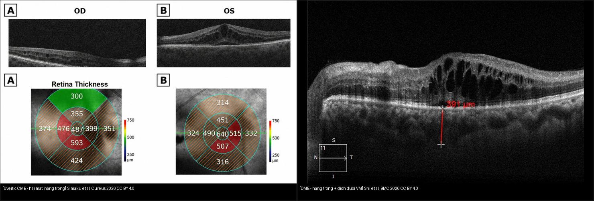
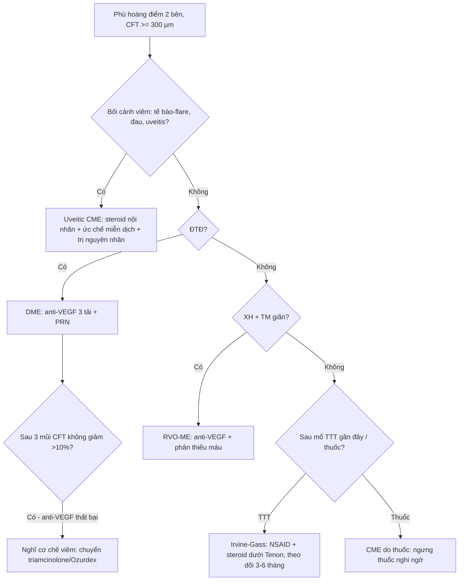
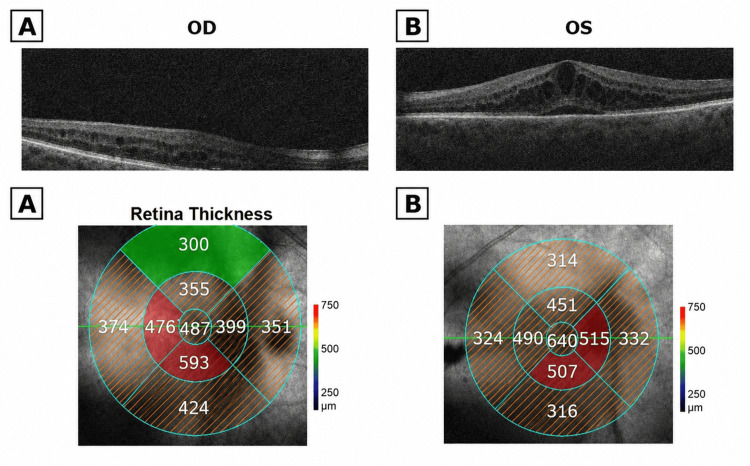
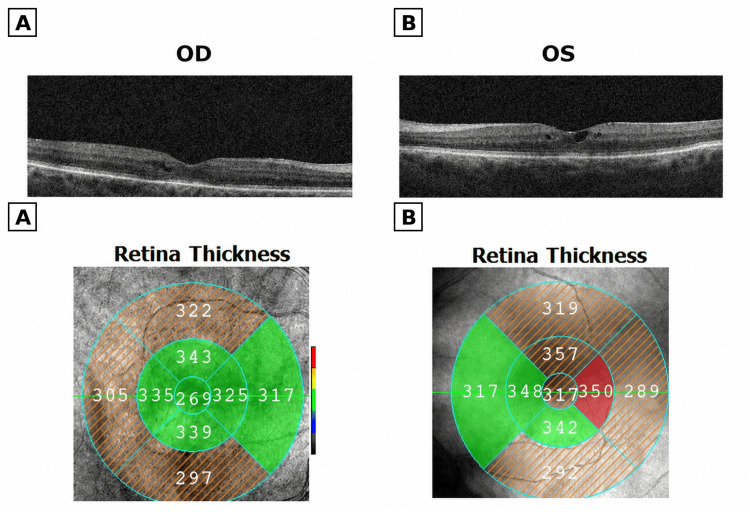
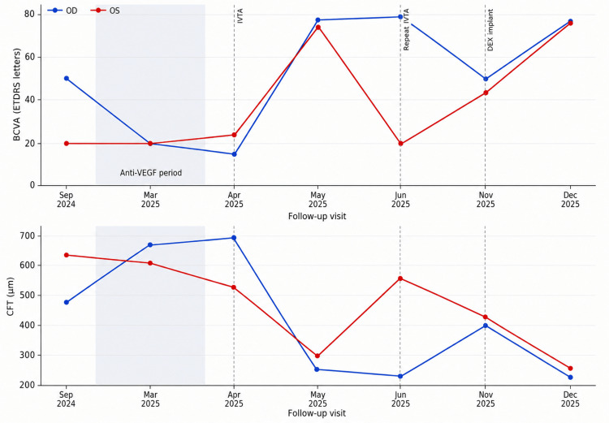

# 446 — Phù hoàng điểm viêm (uveitic CME) vs DME: khi anti-VEGF thất bại / Uveitic cystoid macular edema

**Tags:** `pattern:phu-hoang-diem-viem` `vung:hoang-diem` `protocol:OCT-hoang-diem`
**Mức chắc chắn (certainty):** ca nguyên văn (verbatim case) — theo dõi dọc 1 ca Simaku et al., Cureus 2026 (CC BY 4.0, PMCID PMC13270606); số liệu lấy nguyên từ bảng + OCT gốc, không suy diễn.

## 1. Tổng quan — viêm thì trị steroid, thiếu máu thì trị VEGF + số CFT nằm lòng

- **Phù hoàng điểm viêm (uveitic cystoid macular edema, CME):** viêm nội nhãn phá **hàng rào máu–võng mạc (blood-retinal barrier)** → dịch tích trong võng mạc tạo khoang nang. TẠI SAO khác DME: chất trung gian chính là **cytokine viêm (IL-6, TNF-α)** chứ không phải VEGF — nên **anti-VEGF đơn thuần thường không đủ**, phải ức chế viêm bằng **corticosteroid nội nhãn**.
- TẠI SAO OCT phân biệt được: cả hai đều nang **tối (hyporeflective)** vì nước hấp thu tán xạ ít — cái quyết định là **bối cảnh lâm sàng + đáp ứng điều trị**, không phải hình thái nang. Ca này chính là minh chứng: 3 mũi anti-VEGF **làm nặng thêm**.
- Số nằm lòng (ca Simaku 2026, nữ 66 tuổi, 2 mắt, theo dõi 15 tháng):
  - Nền: CFT **487 µm (OD) / 640 µm (OS)**, thị lực **50 / 20 ETDRS**, nhãn áp 13/12 mmHg.
  - Sau **3 mũi anti-VEGF**: CFT **tăng 673 / 612 µm**, thị lực **20/20** — thất bại (đúng 3 mũi tải hàng tháng, 10/2024–3/2025).
  - Trước khi đổi thuốc: CFT **699 / 535 µm**, thị lực **15/24** (đáy xấu nhất).
  - Sau **triamcinolone nội nhãn**: CFT **269 / 317 µm** (giảm **61% / 41%**), thị lực **77 / 74 ETDRS** — đáp ứng rõ.
  - Sau **Ozurdex (dexamethasone implant)**: CFT **243 / 278 µm**, thị lực **77 / 76** — kiểm soát bền (implant tác dụng **~4–6 tháng**).
- Ngưỡng nhớ: **CFT ≥ 300 µm trung tâm = phù có ý nghĩa** (khớp bài 441/443); giảm **> 10% CFT** hoặc tăng **≥ 5 chữ ETDRS** = đáp ứng điều trị thật.

## 2. Gamut phù hoàng điểm 2 mắt — 3 câu chia hướng điều trị

- **Viêm nội nhãn (mắt đỏ/đau, dạng uveitis, dấu tế bào–flare, viêm màng mạch):** uveitic CME — **steroid ± ức chế miễn dịch**, không phải anti-VEGF trước tiên.
- **Đái tháo đường + nang trong + 2 bên, không viêm:** DME — **anti-VEGF first-line**, đáp ứng tốt (bài 443).
- **Tắc tĩnh mạch (XH + giãn TM 1 góc hoặc 4 góc):** RVO-ME — **anti-VEGF ± steroid**, phân thiếu máu (bài 444).
- **Sau mổ đục thủy tinh thể (phakic/pseudophakic + dấu Irvine-Gass):** **CME giả đục thủy tinh thể** — NSAID tại chỗ ± steroid dưới Tenon, thường tự khỏi 3–6 tháng.
- **Thuốc (prostaglandin nhỏ mắt, acid nicotinic, thuốc chống ung thư):** CME do thuốc — ngưng thuốc nghi ngờ trước khi làm thủ thuật xâm lấn.

## 3. Bảng so sánh phân biệt (ma trận đối chiếu)

| Thực thể (entity) | Hình ảnh điển hình | Chốt vào (rule-in) | Chốt loại (rule-out) | Gợi ý xác nhận |
|---|---|---|---|---|
| Uveitic CME | **Nang trong 2 bên + dấu viêm (tế bào–flare) + đáp ứng steroid** | **Bối cảnh viêm + anti-VEGF thất bại + steroid hiệu quả** | Không dấu viêm + ĐTĐ → DME | Siêu âm sinh học/AS-OCT + steroid ± ức chế miễn dịch |
| DME | **Nang trong + vòng xuất tiết + ĐTĐ lâu** | **ĐTĐ + 2 bên đối xứng + anti-VEGF hiệu quả** | Có dấu viêm rõ → uveitic | HbA1c + anti-VEGF 3 tải + PRN (bài 443) |
| RVO-ME | **Phù + XH + TM giãn theo vùng** | **XH + TM giãn một bên** | 2 bên đối xứng → DME/uveitic | FFA/OCT + anti-VEGF (bài 444) |
| Irvine-Gass | **Sau mổ TTT + nang nhẹ + mắt ít viêm** | **Mổ TTT gần đây + CME tự khỏi 3–6 tháng** | Viêm nặng lan rộng → uveitic | NSAID tại chỗ ± steroid dưới Tenon |
| CME do thuốc | **Nang + tiền sử thuốc (PG, acid nicotinic)** | **Tiền sử thuốc + CME 2 bên không rõ nguyên nhân** | Ngưng thuốc mà hết → xác nhận | Ngưng thuốc nghi ngờ, theo dõi OCT |

*Trái: uveitic CME 2 bên, nang trong, mũi tên CFT 487 µm (OD) — Simaku et al., Cureus 2026 Fig. 1, CC BY 4.0. Phải: DME nang trong + dịch dưới võng mạc — Shi et al., BMC Ophthalmology 2026 Fig. 3, CC BY 4.0. Ảnh ghép letterbox. Hai hình thái nang gần như trùng nhau — **bối cảnh lâm sàng mới phân biệt, OCT một mình không đủ**.*

**Quiz composite:** che 2 nhãn, hỏi bên nào nên bắt đầu anti-VEGF, bên nào nên nghĩ steroid?

<b>Bấm để hiện đáp án</b>

- Trái = **uveitic CME** — cơ chế viêm chiếm ưu thế → **steroid nội nhãn ± ức chế miễn dịch** (ca này anti-VEGF 3 mũi còn làm nặng thêm).
- Phải = **DME** — VEGF chiếm ưu thế → **anti-VEGF first-line** (bài 443).
- Bẫy: nang trên OCT giống hệt nhau — quyết định bằng dấu viêm, tiền sử ĐTĐ, và đáp ứng thuốc, không bằng hình thái.

### "Thất bại anti-VEGF" — khi nào đổi sang steroid?
- **Thất bại** (định nghĩa thực dụng): sau **3 mũi tải hàng tháng** mà CFT **không giảm > 10%** hoặc thị lực không cải thiện — như ca này (CFT 487 → 673 µm: còn tệ hơn).
- **Đổi hướng:** nghĩ cơ chế viêm (cytokine) → **triamcinolone nội nhãn** (tác dụng nhanh) hoặc **dexamethasone implant** (duy trì 4–6 tháng) — ca này giảm CFT **61%/41%** ngay mũi đầu.
- **Cảnh giác steroid:** theo dõi nhãn áp (nguy cơ **tăng nhãn áp do steroid** — steroid responder) và đục thủy tinh thể ở mắt còn thể thủy tinh; ca này đã đặt TTT 2 mắt + nhãn áp luôn trong ngưỡng.

## 4. Protocol chụp + theo dõi

- **OCT hoàng điểm (macular cube + ETDRS grid):** đo CFT + thể tích võng mạc trung tâm mỗi lần — quyết định chích hay không (bơm theo OCT, không theo cảm giác).
- **Đánh giá viêm nền:** soi đèn khe (tế bào–flare), AS-OCT/siêu âm sinh học (thể mi–hoàng điểm), tìm nguyên nhân uveitis (nhiễm trùng, tự miễn, HLA-B27, sarcoid, lao).
- **Phác đồ ca này:** anti-VEGF × 3 (thất bại) → **triamcinolone × 2** → **Ozurdex 2 mắt** — mỗi bước đánh giá lại bằng OCT + thị lực; tái khám sát vì bệnh dao động 2 mắt không đối xứng.
- **Theo dõi steroid:** nhãn áp mỗi lần (nguy cơ glaucoma do steroid), đáy mắt, thị trường khi dùng dài — ngưng/đổi khi nhãn áp tăng dai dẳng.

## 5. Biến thể bình thường và cạm bẫy

- **Nang trên OCT giống hệt nhau giữa uveitic CME và DME** — đừng chẩn đoán bằng hình thái; hỏi viêm + ĐTĐ + RVO, và nhìn đáp ứng thuốc.
- **Anti-VEGF tiếp tục dù đã thất bại:** tiêm thêm nhiều mũi vô ích khi CFT còn tăng — nhận diện sau 3 mũi tải, đổi sang steroid (như ca này: 487 → 673 µm là dấu hiệu dừng lại).
- **Bệnh 2 mắt không đối xứng:** cùng điều trị, mắt trái tái phát trước/nặng hơn (CFT 566 µm ở tháng 9) — theo dõi và điều trị **theo từng mắt**, không giả định song hành.
- **Bỏ tái khám = bỏ tái phát:** ca này nghỉ tái khám rồi quay lại với CFT 414/439 + thị lực tụt 50/44 — bệnh viêm tái phát nhanh khi thuốc hết tác dụng.
- **Tăng nhãn áp do steroid bị bỏ qua:** bắt buộc đo nhãn áp mỗi lần sau tiêm steroid; mắt còn thể thủy tinh còn nguy cơ đục nhanh.
- **Bỏ sót nguyên nhân nhiễm trùng:** trước khi dùng steroid dài, loại nhiễm trùng (lao, toxoplasma, CMV) — steroid mù có thể làm bùng viêm nhiễm trùng.

## 6. Tự lượng giá — Blind Quiz

**Ca 1 — Nữ 66 tuổi, mờ mắt 2 bên, OCT nang trong 2 mắt. Đây là nguyên nhân gì, hướng điều trị?**

- Hỏi: CFT 2 mắt bao nhiêu? Nang trong hay dưới võng mạc? Điều trị đầu tay?

<b>Bấm để hiện đáp án (findings + chẩn đoán)</b>

- Dấu hiệu (findings): **nang trong (intraretinal cysts) 2 bên**; bản đồ độ dày trung tâm **487 µm (OD) / 640 µm (OS)**; mắt trái nặng hơn, khớp thị lực 50 / 20 ETDRS.
- Chẩn đoán (diagnosis): **phù hoàng điểm viêm (uveitic CME)** trong bối cảnh viêm nội nhãn — vì nang trong + dấu viêm, 2 bên.
- Xử trí: khác DME — nghĩ **steroid nội nhãn** (ức chế cytokine viêm), không anti-VEGF đơn thuần.
- Nguồn ảnh: Simaku et al., Cureus 2026 Fig. 1 (PMC13270606), CC BY 4.0.

**Ca 2 — Sau 3 mũi anti-VEGF, CFT còn tăng (673 µm). Bước tiếp theo?**

- Hỏi: ảnh cho thấy điều gì so với nền? Vì sao chuyển thuốc? Ngưỡng "thất bại" anti-VEGF?

<b>Bấm để hiện đáp án (findings + chẩn đoán)</b>

- Dấu hiệu (findings): nang xẹp gần hết — CFT **269 µm (OD) / 317 µm (OS)**; giảm **61%/41%** so với trước steroid (699/535 µm), thị lực 15/24 → **77/74 ETDRS**.
- Chẩn đoán (diagnosis): **uveitic CME đáp ứng steroid** — xác nhận cơ chế viêm chiếm ưu thế.
- Ngưỡng thất bại anti-VEGF: sau **3 mũi tải hàng tháng** CFT không giảm **> 10%** (ca này còn tăng 487 → 673 µm) → đổi triamcinolone/Ozurdex.
- Nguồn ảnh: Simaku et al., Cureus 2026 Fig. 4 (PMC13270606), CC BY 4.0.

**Ca 3 — Đồ thị theo dõi 15 tháng. Đọc 2 đường BCVA + CFT, chỉ ra giai đoạn nào thất bại và giai đoạn nào bền?**

- Hỏi: vùng nào là giai đoạn anti-VEGF? Mắt nào tái phát trước? Sau Ozurdex ra sao?

<b>Bấm để hiện đáp án (findings + chẩn đoán)</b>

- Dấu hiệu (findings): giai đoạn **anti-VEGF (10/2024–3/2025)** — CFT 2 mắt đi lên, BCVA đi xuống (thất bại); sau **IVTA** CFT tụt mạnh, BCVA tăng vọt; tháng 9/2025 **mắt trái (OS) tái phát** sớm/nặng (CFT 566 µm, BCVA về 20) trong khi OD ổn; sau **DEX implant** cả 2 mắt hội tụ về CFT 243/278 µm, BCVA 77/76.
- Chẩn đoán (diagnosis): **uveitic CME tái phát, tiến triển không đối xứng 2 mắt** — cần điều trị theo từng mắt + OCT-guided.
- Bài học: **missed follow-up** (11/2025) làm tái phát cả 2 mắt — theo dõi sát là phần của điều trị.
- Nguồn ảnh: Simaku et al., Cureus 2026 Fig. 8 (PMC13270606), CC BY 4.0 (đồ thị gốc).

## Bài liên quan chéo
- [400 – Tổng quan Mắt](../400-tong-quan-mat-thi-giac/lesson.md)
- [441 – OCT hoàng điểm](../441-OCT-hoang-diem/lesson.md) (nang trong vs dịch dưới — DME/AMD)
- [443 – Võng mạc đái tháo đường](../443-vong-mac-dai-thao-duong/lesson.md) (DME — đối chiếu chính)
- [444 – Tắc mạch võng mạc](../444-tac-mach-vong-mac/lesson.md) (RVO-ME trong gamut phù 2 mắt)
- [422 – Giả u viêm](../422-viem-gia-u/lesson.md) (bệnh viêm hốc mắt–nội nhãn)
- [451 – Bệnh hệ thống ở mắt](../451-he-thong-mat/lesson.md) (nguyên nhân uveitis toàn thân)

## Ảnh
- `446_uveitic-CME-nen_OCT_PMC13270606-Fig1-CCBY.jpg`, `446_uveitic-CME-sau-triamcinolone_OCT_PMC13270606-Fig4-CCBY.jpg`, `446_uveitic-CME-sau-Ozurdex_OCT_PMC13270606-Fig7-CCBY.jpg`, `446_uveitic-CME-dien-bien_OCT_PMC13270606-Fig8-CCBY.jpg` — Simaku et al., Cureus 2026 (PMCID: PMC13270606), CC BY 4.0.
- `446_DME-nang-trong_OCT_PMC13182033-Fig3-CCBY.jpg` — Shi et al., BMC Ophthalmology 2026 (PMCID: PMC13182033), CC BY 4.0 (ảnh đối chiếu DME).
- Chi tiết giấy phép từng ảnh trong `images/CREDITS.md`. AuntMinnie: chỉ dẫn link, không tải.

> Không dùng để chẩn đoán độc lập khi chưa có người hướng dẫn.
