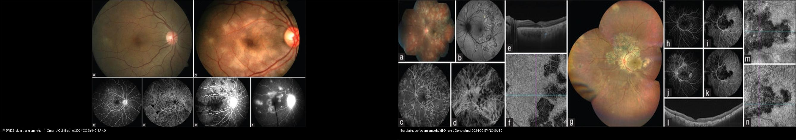
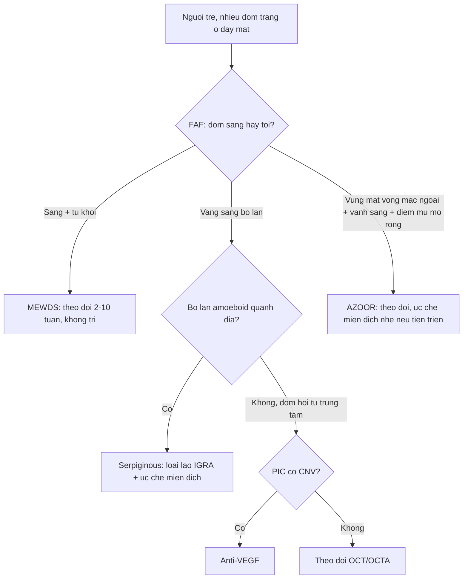
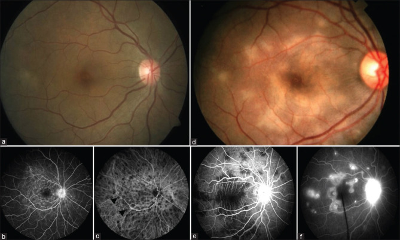
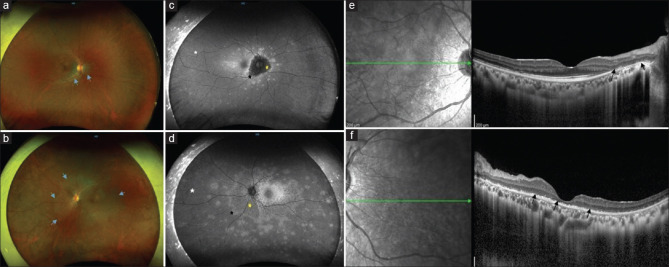

# 447 — Hội chứng đốm trắng (white dot syndromes): MEWDS, APMPPE, AZOOR, PIC / White dot syndromes

**Tags:** `pattern:dom-trang-vong-mac` `vung:vong-mac-hac-mac` `protocol:FAF-OCT`
**Mức chắc chắn (certainty):** tổng hợp y văn (literature synthesis) — nhóm tự biên từ tổng quan mở Sen et al., Oman J Ophthalmol 2024 (CC BY-NC-SA 4.0), chưa gắn ca nguyên văn đơn lẻ.

## 1. Tổng quan — đốm trắng là viêm võng mạc–hắc mạc ngoại vi mắc phải + số tuần tự khỏi

- **Hội chứng đốm trắng (white dot syndromes):** nhóm bệnh viêm **võng mạc ngoài – hắc mạc – biểu mô sắc tố (RPE)** đặc trưng bởi **nhiều đốm trắng/vàng** ở đáy mắt, hay gặp **nữ trẻ cận thị**, thị lực thường còn khá. TẠI SAO khó: hình thái đốm giống nhau, chẩn đoán dựa **đa phương thức (multimodal)**: đáy mắt + **tự phát sáng FAF** + **FFA/ICGA** + **OCT**.
- Phân nhóm theo **động học tổn thương**: **MEWDS/AZOOR** (tự khỏi, không cần ức chế miễn dịch) vs **serpiginous/birdshot/PIC** (tiến triển/tái phát, cần điều trị). Số nằm lòng:
  - **MEWDS:** đốm sáng rực trên **FAF (hyperautofluorescent)** + FFA **wreath-like**; tự khỏi trong **2–10 tuần**, không điều trị.
  - **AZOOR:** vùng mất võng mạc ngoài khu trú, **điểm mù mở rộng (enlarged blind spot)**, bờ hyperautofluorescent là **vành đang hoạt động**.
  - **Birdshot:** **HLA-A29 dương ~85–96%** (xác nhận sinh học mạnh nhất trong nhóm).
- TẠI SAO FAF quan trọng: tế bào RPE chứa lipofuscin — **đốm sáng (hyper) = RPE còn sống đang viêm/hồi phục**, **đốm tối (hypo) = RPE đã mất** — phân hoạt động vs sẹo chỉ bằng 1 ảnh **không cần thuốc nhuộm**.

## 2. Gamut theo tuổi–giới–hình thái (đọc 4 câu hỏi)

- **Nữ trẻ cận thị + tiền triệu virus + đốm vàng nhỏ 1 mắt:** MEWDS — tự khỏi 2–10 tuần, chỉ theo dõi (đừng ức chế miễn dịch).
- **Người trẻ 2 mắt + mảng dẹt vàng kem dạng placoid + đau đầu/meningismus:** APMPPE — loại nguyên nhân viêm (hội chứng với viêm mạch/viêm màng não).
- **Nữ > trẻ + điểm mù mở rộng 1 bên + vùng mất thị trường cố định:** AZOOR — theo dõi, một số cần ức chế miễn dịch nhẹ.
- **Nữ cận thị + đốm vàng nhỏ hội tụ trung tâm + nguy cơ CNV:** PIC — tìm **màng tân mạch hắc mạc (CNV)** → anti-VEGF.
- **Bờ lan kiểu chân giò/amoeboid quanh đĩa thị + tái phát:** serpiginous — **loại lao trước**, cần ức chế miễn dịch.
- **Đốm kem dạng trứng cá 4 góc, không liên quan hoàng điểm + HLA-A29:** birdshot — ức chế miễn dịch (chỉ định sớm khi đe dọa thị lực).

## 3. Bảng so sánh phân biệt (ma trận đối chiếu)

| Thực thể (entity) | Hình ảnh điển hình | Chốt vào (rule-in) | Chốt loại (rule-out) | Gợi ý xác nhận |
|---|---|---|---|---|
| MEWDS | **Đốm sáng FAF + FFA wreath-like + mắt cận thị** | **Nữ trẻ cận thị + tự khỏi 2–10 tuần** | Có CNV/bờ lan → PIC/serpiginous | FAF + FFA + OCT (theo dõi, không trị) |
| APMPPE | **Mảng placoid 2 bên: FFA chặn sớm (block) → ngấm muộn** | **Placoid + block sớm + đau đầu** | Đốm nhỏ rải rác → MEWDS | FFA 2 pha + MRI não nếu thần kinh |
| AZOOR | **Vùng mất võng mạc ngoài + vành hyper-auto + điểm mù mở rộng** | **Điểm mù mở rộng + FAF vành sáng** | Viêm màng mạch toàn bộ → khác | FAF + thị trường + mfERG |
| PIC | **Đốm vàng nhỏ hội tụ trung tâm + sẹo + CNV** | **Cận thị nữ + CNV (dịch/dưới võng mạc)** | Không CNV → theo dõi | OCT/FFA/OCTA + anti-VEGF nếu CNV |
| Serpiginous | **Tổn thương amoeboid bờ lan quanh đĩa (chừa hõm)** | **Bờ lan + tái phát + loại lao** | Tổn thương cố định → sẹo khác | IGRA/Quantiferon + ức chế miễn dịch |
| Birdshot | **Đốm kem ovoid 4 góc, không đụng hoàng điểm** | **HLA-A29 (+) ~85–96%** | Đốm hội tụ trung tâm → PIC | HLA-A29 + ICGA (đốm tối) |

*Trái: MEWDS đáy mắt + FFA wreath-like (tự khỏi). Phải: viêm màng mạch serpiginous — bờ lan amoeboid trên FAF (cần ức chế miễn dịch, loại lao). Nguồn: Sen et al., Oman J Ophthalmol 2024 Fig. 1 + Fig. 4, CC BY-NC-SA 4.0. Ảnh ghép letterbox.*

**Quiz composite:** che 2 nhãn, hỏi bên nào chỉ cần theo dõi, bên nào cần điều trị + loại lao?

<b>Bấm để hiện đáp án</b>

- Trái = **MEWDS** — tự khỏi 2–10 tuần, chỉ theo dõi OCT/FAF, không ức chế miễn dịch.
- Phải = **serpiginous** — bờ lan amoeboid → **loại lao (IGRA) + ức chế miễn dịch**, không để lan vào hõm.
- Bẫy: nhìn "nhiều đốm trắng" tưởng giống nhau — **động học tổn thương (tự khỏi vs lan) mới chia hướng điều trị**.

### Đốm sáng vs đốm tối trên FAF — chốt hoạt động vs sẹo
- **Hyperautofluorescent (sáng):** RPE còn sống nhưng **đang viêm/ứ lipofuscin** — tổn thương **hoạt động** (MEWDS, vành AZOOR, bờ serpiginous).
- **Hypoautofluorescent (tối):** RPE **đã mất** — **sẹo/vùng teo**, không hồi phục.
- Cạm bẫy: bệnh 2 mặt trận — **đốm tối là hậu quả, đốm sáng mới là nơi đang tiến triển** — điều trị nhắm vào vành sáng, không phải ổ tối.

## 4. Protocol chụp + theo dõi

- **Đa phương thức bắt buộc:** màu đáy mắt (color) + **FAF** + **FFA** (pha sớm/muộn) + **OCTA/ICGA** + **OCT hoàng điểm** (đứt ellipsoid zone) + **thị trường** (điểm mù).
- **MEWDS/AZOOR:** theo dõi định kỳ — mục tiêu loại trừ tiến triển và **không dùng thuốc oan**.
- **PIC có CNV:** **anti-VEGF** (dịch dưới võng mạc trên OCT/OCTA) — can thiệp sớm giữ thị lực.
- **Serpiginous/birdshot:** **loại lao (IGRA/Quantiferon + X-quang phổi) trước khi ức chế miễn dịch** + phác đồ steroid/ức chế miễn dịch, theo dõi FAF bờ lan.

## 5. Biến thể bình thường và cạm bẫy

- **Drusen hoàng điểm** (nhiều chấm vàng 2 bên) dễ nhầm "đốm trắng" — drusen ở **dưới RPE + già**, hội chứng đốm trắng ở **võng mạc ngoài + trẻ**.
- **Bệnh mắt bạch cầu trắng (white dot) bị nhầm với nấm/lao/giang mai** — bắt buộc tầm soát nhiễm trùng trước khi ức chế miễn dịch (steroid mù làm bùng nhiễm trùng).
- **MEWDS bị điều trị quá tay:** đốm nhiều → tưởng nặng → ức chế miễn dịch vô ích; MEWDS **tự khỏi**, chỉ theo dõi.
- **PIC bỏ sót CNV:** đốm nhỏ yên lặng nhưng **CNV là nguyên nhân mờ đột ngột** — OCT/OCTA mỗi lần nghi.
- **Serpiginous bỏ sót lao (TB):** điều trị steroid đơn thuần không loại lao → lan rộng; **IGRA trước**.
- **AZOOR nhầm teo quang/tổn thương thị thần kinh:** điểm mù mở rộng + FAF vành sáng mới là chốt — nối bài 430.

## 6. Tự lượng giá — Blind Quiz

**Ca 1 — Nữ 25 tuổi cận thị, mờ nhẹ 1 mắt sau cảm cúm. Đáy mắt + FFA này gợi gì?**

- Hỏi: FFA có đặc điểm gì? Bệnh tự khỏi hay cần điều trị?

<b>Bấm để hiện đáp án (findings + chẩn đoán)</b>

- Dấu hiệu (findings): đốm sáng rực trên **FAF** + FFA **wreath-like punctate hyperfluorescence** quanh đĩa; ICGA tối; đáy mắt màu gần bình thường (đốm nhỏ).
- Chẩn đoán (diagnosis): **MEWDS (multiple evanescent white dot syndrome)** — vì nữ trẻ cận thị + đốm thoáng qua + FFA wr.
- Xử trí: **tự khỏi 2–10 tuần, chỉ theo dõi** — không ức chế miễn dịch.
- Nguồn ảnh: Sen et al., Oman J Ophthalmol 2024 Fig. 1 (PMC11620295), CC BY-NC-SA 4.0.

**Ca 2 — Bệnh nhân có điểm mù mở rộng 1 bên, FAF này chốt gì?**

- Hỏi: đốm sáng bờ có ý nghĩa gì? Có phải đốm trắng tự khỏi không?

<b>Bấm để hiện đáp án (findings + chẩn đoán)</b>

- Dấu hiệu (findings): vùng **RPE biến đổi** + FAF **vành hyperautofluorescent ở bờ** (đang hoạt động) + điểm mù mở rộng.
- Chẩn đoán (diagnosis): **AZOOR (acute zonal occult outer retinopathy)** — vì vùng mất chức năng võng mạc ngoài khu trú + vành sáng.
- Lưu ý: không tự khỏi nhanh như MEWDS; một số cần ức chế miễn dịch nhẹ nếu lan.
- Nguồn ảnh: Sen et al., Oman J Ophthalmol 2024 Fig. 2 (PMC11620295), CC BY-NC-SA 4.0.

**Ca 3 — Hai bệnh nhân "nhiều đốm trắng". Bên nào phải loại lao + điều trị?**

<b>Bấm để hiện đáp án (findings + chẩn đoán)</b>

- Trái (MEWDS): đốm sáng FAF, tự khỏi — **theo dõi**.
- Phải (serpiginous): **bờ lan amoeboid** quanh đĩa, tái phát — **IGRA/Quantiferon loại lao + ức chế miễn dịch**.
- Chốt phân biệt: **động học** (tan nhanh vs bờ lan) trên FAF, không phải số lượng đốm.
- Nguồn ảnh: Sen et al., Oman J Ophthalmol 2024 Fig. 1 + Fig. 4 (PMC11620295), CC BY-NC-SA 4.0.

## Bài liên quan chéo
- [400 – Tổng quan Mắt](../400-tong-quan-mat-thi-giac/lesson.md)
- [441 – OCT hoàng điểm](../441-OCT-hoang-diem/lesson.md) (dịch dưới võng mạc/CNV)
- [446 – Phù hoàng điểm viêm](../446-phu-hoang-diem-viem/lesson.md) (viêm nội nhãn → bệnh viêm màng mạch)
- [451 – Bệnh hệ thống ở mắt](../451-he-thong-mat/lesson.md) (bệnh toàn thân, lao)
- [430 – Đường thị giác](../430-duong-thi-giac/lesson.md) (điểm mù mở rộng — AZOOR)

## Ảnh
- `447_MEWDS_Fundus-OCT_PMC11620295-Fig1-CCBYNCSA.jpg`, `447_AZOOR_Fundus-FAF_PMC11620295-Fig2-CCBYNCSA.jpg`, `447_PIC_Fundus_PMC11620295-Fig3-CCBYNCSA.jpg`, `447_serpiginous_Fundus-FAF_PMC11620295-Fig4-CCBYNCSA.jpg`, `composite_MEWDS-vs-serpiginous.jpg` — Sen et al., Oman J Ophthalmol 2024 (PMCID: PMC11620295), CC BY-NC-SA 4.0 (phi thương mại + chia sẻ tương tự).
- Chi tiết giấy phép từng ảnh trong `images/CREDITS.md`. AuntMinnie: chỉ dẫn link, không tải.

> Không dùng để chẩn đoán độc lập khi chưa có người hướng dẫn.
