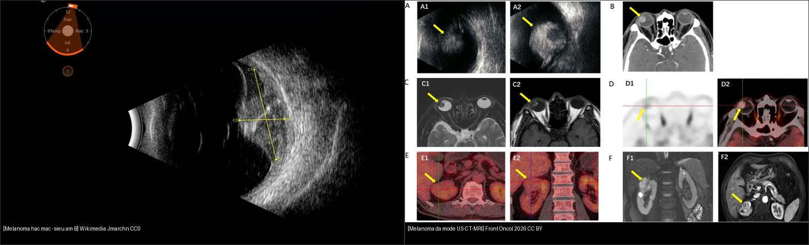
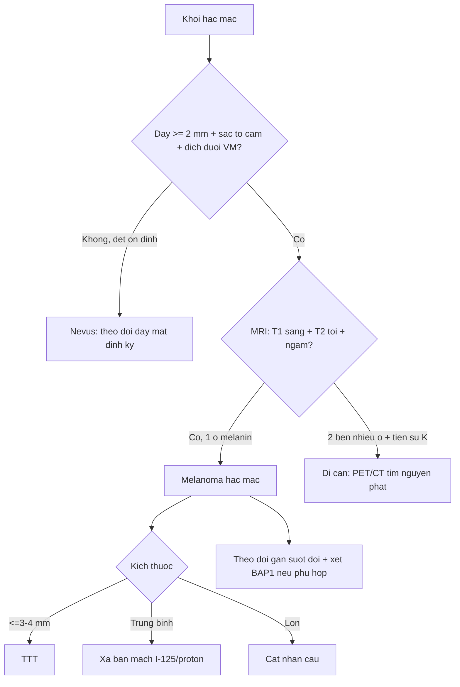
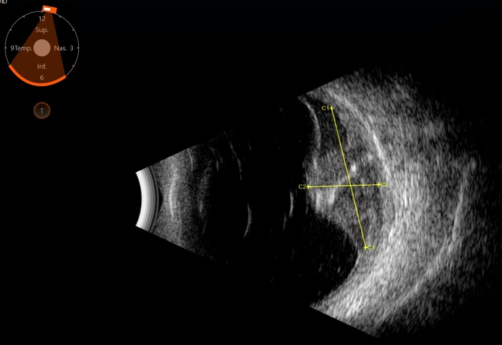
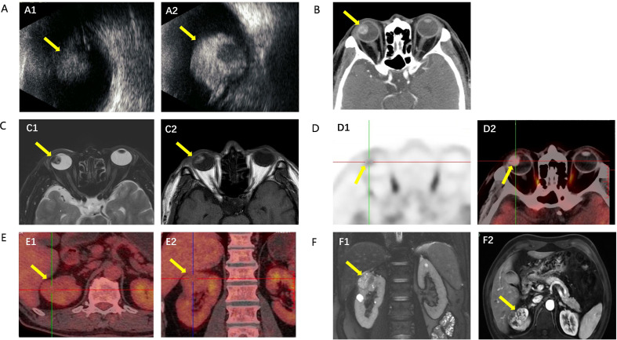

# 448 — U hắc mạc: melanoma vs nevus vs di căn — siêu âm A/B & MRI / Choroidal melanoma vs nevus vs metastasis

**Tags:** `pattern:u-hac-mac` `vung:hac-mac` `protocol:US-MRI-hac-mac`
**Mức chắc chắn (certainty):** tổng hợp y văn (literature synthesis) — nhóm tự biên từ ca mở Yu et al., Front Oncol 2026 (CC BY 4.0) + ảnh siêu âm melanoma CC0, chưa gắn ca nguyên văn đơn lẻ.

## 1. Tổng quan — melanin quyết định tín hiệu MRI + ngưỡng dày 2 mm

- **Melanoma hắc mạc (choroidal melanoma)** là **u nội nhãn nguyên phát hay gặp nhất ở người lớn**; khởi phát từ tế bào hắc tố hắc mạc. TẠI SAO MRI "sáng T1": **melanin là chất thuận từ (paramagnetic)** → rút ngắn T1 → **tăng tín hiệu trên T1W**, giảm trên T2W; u **ngấm cản quang mạnh** (giàu mạch).
- TẠI SAO siêu âm quan trọng: khối đặc **hồi âm thấp–trung bình đều** (tế bào chặt), hình **vòm (dome)**; khi phá **màng Bruch** → hình **nấm/cổ áo (mushroom/collar-stud)**; kèm **lõm hắc mạc (choroidal excavation)** + **bóng lưu âm**.
- **Ngưỡng định lượng (Shields):** dày **≥ 2 mm** + dịch dưới võng mạc + **sắc tố cam (orange pigment)** + triệu chứng + lõm → **nghi melanoma**; nevus lành thường **dày < 2 mm**, dẹt, có **drusen**. U cao **≤ 3–4 mm** cân nhắc **TTT (quang đông xuyên đồng tử)**; trung bình → **xạ bản mạch (I-125 plaque)**; lớn → **cắt nhãn cầu**.
- Số ca minh họa (Yu 2026): khối hắc mạc **đường kính nền 12 mm, dày 8 mm**, AJCC 8th **pT2aN0M0**; CT **nốt tăng đậm độ ~9 mm** ngấm trung bình; MRI **~1 cm**, T1 tăng/T2 giảm/ngấm mạnh.

## 2. Gamut khối hắc mạc (đọc hình dạng + tín hiệu)

- **Khối vòm/nấm hồi âm thấp–trung bình + melanin sáng T1 + dịch dưới VM:** melanoma — xạ/mổ theo kích thước.
- **Khối dẹt < 2 mm + drusen + không dịch, theo dõi ổn định:** nevus hắc mạc — lành, theo dõi định kỳ (đừng xạ oan).
- **Khối 2 bên/nhiều ổ + tiền sử K (vú/phổi) + tăng tín hiệu cả T1/T2:** di căn hắc mạc — tìm ung thư nguyên phát, điều trị toàn thân.
- **Khối tròn, thấu quang, "double circulation" trên OCT/A:** hemangioma hắc mạc (u mạch lành) — theo dõi ± anti-VEGF nếu phù.
- **Khối vôi hóa/canxi hóa dày đặc:** osteoma hắc mạc — lành, theo dõi.
- **Khối kèm bong võng mạc xuất tiết nhiều + viêm:** loại viêm/lao/u khác — nối bài 447/446.

## 3. Bảng so sánh phân biệt (ma trận đối chiếu)

| Thực thể (entity) | Hình ảnh điển hình | Chốt vào (rule-in) | Chốt loại (rule-out) | Gợi ý xác nhận |
|---|---|---|---|---|
| Melanoma hắc mạc | **Vòm/nấm + hồi âm thấp–TB + T1 sáng/T2 tối + ngấm mạnh** | **Dày ≥ 2 mm + sắc tố cam + dịch dưới VM** | Dẹt < 2 mm ổn định → nevus | Siêu âm A/B + MRI + xạ/ mổ (có ca nền 12 mm, dày 8 mm) |
| Nevus hắc mạc | **Dẹt < 2 mm + drusen + không dịch** | **Ổn định theo thời gian + drusen** | Tăng dày/1 sắc tố cam → melanoma | Theo dõi đáy mắt ảnh màu định kỳ |
| Di căn hắc mạc | **2 bên/nhiều ổ + T1&T2 tăng + tiền sử K** | **Tiền sử ung thư + nhiều ổ 2 bên** | 1 ổ đơn độc có melanin → melanoma | PET/CT tìm nguyên phát |
| Hemangioma hắc mạc | **Tròn, thấu quang, "double circulation"** | **Thấu quang + không melanin (T1 không sáng rõ)** | Có melanin/đặc → melanoma | OCT/ICGA + theo dõi |
| Osteoma hắc mạc | **Canxi hóa dày đặc quanh đĩa** | **Mảng xương dày trên CT** | Không vôi hóa → khác | FAF/CT theo dõi |

*Trái: khối melanoma hắc mạc trên siêu âm B (đo trục C). Phải: đa phương thức — (A) siêu âm B, (B) CT ngấm, (C) MRI T2/T1c, (D) PET; (E/F) khối đồng thời ở thận. Nguồn: trái Jmarchn, CC0 via Wikimedia; phải Yu et al., Front Oncol 2026 Fig. 1, CC BY 4.0. Ảnh ghép letterbox.*

**Quiz composite:** che 2 nhãn, hỏi dấu nào trên MRI khẳng định bản chất melanoma?

<b>Bấm để hiện đáp án</b>

- Trái = melanoma hắc mạc (siêu âm B) — khối hồi âm thấp–trung bình, đo được trục C1–C2.
- Phải = đa phương thức 1 ca melanoma (A US, B CT, C MRI T2/T1c, D PET).
- Chốt MRI: **T1W TĂNG tín hiệu + T2W giảm + ngấm mạnh** — do **melanin thuận từ** (khác di căn/hemangioma). Ca này kèm u thận đồng thời (E/F).

### Vì sao hình "nấm/cổ áo" chỉ melanoma (và phân biệt với di căn)
- **Dấu cổ áo (collar-stud/mushroom):** u phá **màng Bruch** rồi loe rộng trong khoang dưới võng mạc → thắt eo ở màng Bruch — gợi ý **melanoma** (di căn ít khi tạo hình này, thường dẹt/nhiều ổ).
- **Melanin = T1 sáng:** di căn (vú/phổi) thường **không** sáng T1 rõ; **hemangioma** thấu quang; **osteoma** vôi hóa.
- Cạm bẫy: u **không sắc tố (amelanotic)** mất lợi thế "T1 sáng" — khi đó dựa siêu âm + mô bệnh; đừng loại melanoma chỉ vì T1 không sáng.
- Cạm bẫy: **máu dưới võng mạc/melanin trong xuất huyết** cũng sáng T1 — đọc cùng bối cảnh.

## 4. Protocol chụp + điều trị

- **Siêu âm mắt A + B (đầu tay):** B-mode đo **chiều cao (mm)** + hình vòm/nấm + lõm hắc mạc; A-mode đánh giá **hồi âm nội bộ + dao động mạch**; đo lại theo thời gian (tăng dày = nghi ác).
- **MRI hốc mắt có tiêm:** **T1W fat-sat trước + sau tiêm** (melanin sáng + ngấm) + **T2W** (giảm); là chìa khóa phân biệt melanoma vs di căn/hemangioma.
- **CT hốc mắt:** khi nghi vôi hóa (osteoma) hoặc cần đánh giá xương; ít đặc hiệu cho melanoma (chỉ thấy nốt tăng đậm độ ngấm).
- **Sinh thiết:** chỉ khi ảnh không đặc hiệu và cần chẩn đoán mô học (nguy cơ gieo mầm — cân nhắc).
- **Điều trị theo kích thước:** TTT (≤ 3–4 mm) · **xạ bản mạch I-125/proton** (trung bình) · **cắt nhãn cầu** (lớn/biến chứng); **theo dõi di căn gan định kỳ suốt đời** (gan là nơi di căn chính), xét di truyền **BAP1** khi phù hợp.

## 5. Biến thể bình thường và cạm bẫy

- **Nevus hắc mạc dày giả do drusen/khối lành:** theo dõi bằng **ảnh màu + siêu âm đo dày** — chỉ chuyển xử trí khi **tăng dày/1 sắc tố cam/dịch mới**.
- **Melanoma không sắc tố (amelanotic)** mất "T1 sáng" — có thể bị đọc nhầm di căn/viêm; dựa siêu âm + mô bệnh.
- **Máu/melanin trong xuất huyết dưới võng mạc** cũng sáng T1 — đọc cùng hình thái và bối cảnh.
- **Di căn hắc mạc 2 bên** dễ bị chẩn đoán melanoma nguyên phát — luôn hỏi tiền sử ung thư + tìm ổ thứ phát.
- **Theo dõi di căn:** melanoma hắc mạc **di căn muộn (nhiều năm)** — theo dõi gan dài hạn kể cả sau điều trị thành công mắt (di căn không phụ thuộc u mắt còn hay hết).
- **Sinh thiết/u chọc tùy tiện** có nguy cơ gieo tế bào — chỉ khi cần mô học và có chỉ định rõ.

## 6. Tự lượng giá — Blind Quiz

**Ca 1 — Siêu âm B này: khối vòm hồi âm thấp–trung bình. Nghĩ gì? Đo gì?**

- Hỏi: hình dạng khối? Hồi âm nội bộ ra sao? Cần đo thêm gì để phân độ nguy cơ?

<b>Bấm để hiện đáp án (findings + chẩn đoán)</b>

- Dấu hiệu (findings): **khối vòm trong nhãn cầu, hồi âm thấp–trung bình đều**, bờ rõ.
- Chẩn đoán (diagnosis): **nghi melanoma hắc mạc** — vì khối đặc hồi âm thấp–trung bình (tế bào chặt).
- Đo thêm: **chiều cao (mm)** — ngưỡng **≥ 2 mm** nghi melanoma; tìm **lõm hắc mạc + dịch dưới võng mạc**; MRI phân biệt bản chất.
- Nguồn ảnh: Jmarchn, CC0 via Wikimedia Commons.

**Ca 2 — Đa phương thức US-CT-MRI-PET của khối hắc mạc. Dấu MRI nào chốt melanoma?**

- Hỏi: (C1/C2) T1/T2 khác nhau thế nào? Vì sao? Ca này còn phát hiện gì?

<b>Bấm để hiện đáp án (findings + chẩn đoán)</b>

- Dấu hiệu (findings): (A) siêu âm B khối hồi âm thấp–TB; (B) CT nốt tăng đậm độ ngấm; (C1) T2 **giảm**; (C2) T1 sau tiêm **ngấm mạnh** (và T1 trước tiêm **sáng**); (D) PET dương.
- Chẩn đoán (diagnosis): **melanoma hắc mạc** (nền 12 mm, dày 8 mm, AJCC T2a) — chốt MRI **melanin: T1 sáng + T2 tối + ngấm mạnh**.
- Phát hiện thêm: PET/CT (E) + MRI (F) **khối đồng thời ở thận** — u nguyên phát thứ hai (chẩn đoán sau mổ: ccRCC).
- Nguồn ảnh: Yu et al., Front Oncol 2026 Fig. 1 (PMC13472860), CC BY 4.0.

**Ca 3 — Hai khối hắc mạc: bên nào theo dõi, bên nào cần điều trị?**

<b>Bấm để hiện đáp án (findings + chẩn đoán)</b>

- Trái (siêu âm melanoma): khối vòm hồi âm thấp–TB đặc → **cần đo + điều trị theo kích thước**.
- Phải (đa phương thức): melanoma xác nhận bằng MRI/PET → xạ/mổ.
- Chốt: **dày ≥ 2 mm + sắc tố cam + dịch dưới VM** → điều trị; **dẹt < 2 mm có drusen, ổn định** → theo dõi (nevus).
- Nguồn ảnh: Jmarchn CC0 (trái) + Yu et al., Front Oncol 2026 Fig. 1 CC BY 4.0 (phải).

## Bài liên quan chéo
- [400 – Tổng quan Mắt](../400-tong-quan-mat-thi-giac/lesson.md)
- [412 – U trong nhãn cầu](../412-u-trong-nhan-cau/lesson.md) (retinoblastoma/Coats nhi — DDx u vôi hóa)
- [411 – Siêu âm nhãn cầu](../411-sieu-am-nhan-cau/lesson.md) (B-scan — bong võng mạc/máu dịch kính)
- [447 – Hội chứng đốm trắng](../447-dom-trang-vong-mac/lesson.md) (viêm màng mạch gây bong xuất tiết)
- [460 – Can thiệp mắt + xạ trị](../460-can-thiep-mat/lesson.md) (xạ bản mạch/hạt xạ)

## Ảnh
- `448_melanoma_US_B_mode_1_Wikimedia-Jmarchn-CC0.png`, `448_melanoma_US_B_mode_2_Wikimedia-Jmarchn-CC0.png` — Jmarchn, CC0 (public domain) via Wikimedia Commons.
- `448_melanoma-da-mode_US-CT-MRI_PMC13472860-Fig1-CCBY.jpg`, `composite_melanoma-US-vs-damode.jpg` — Yu et al., Front Oncol 2026 (PMCID: PMC13472860), CC BY 4.0.
- Chi tiết giấy phép từng ảnh trong `images/CREDITS.md`. AuntMinnie: chỉ dẫn link, không tải.

> Không dùng để chẩn đoán độc lập khi chưa có người hướng dẫn.
