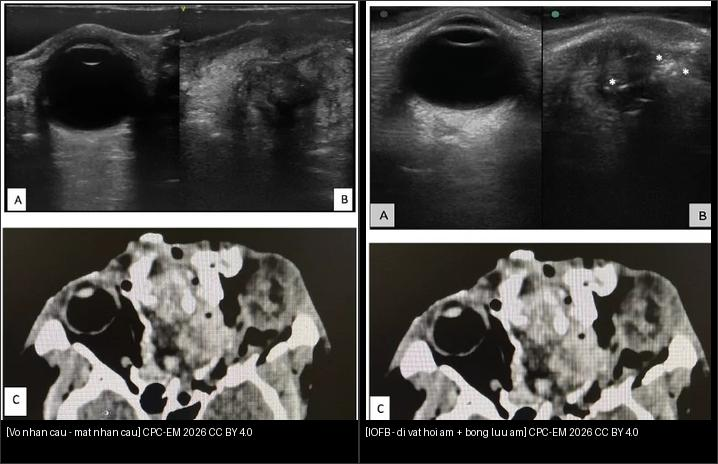
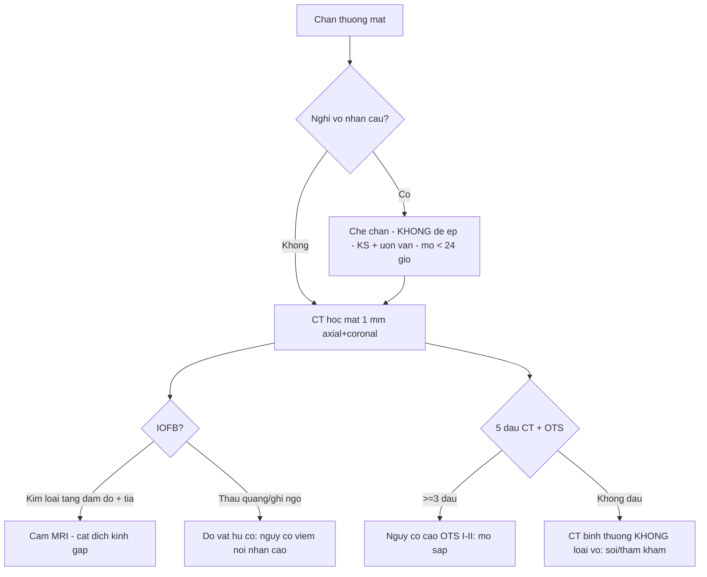
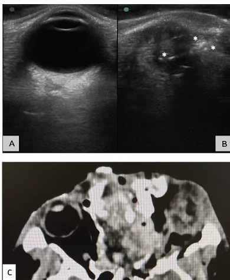
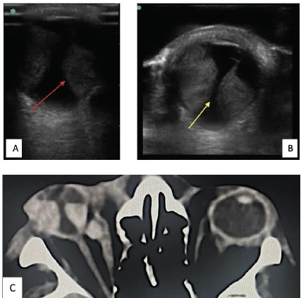

# 449 — Chấn thương mắt & dị vật nội nhãn (IOFB): CT 1 mm + thang OTS / Ocular trauma & intraocular foreign body

**Tags:** `pattern:chan-thuong-mat` `vung:nhan-cau-hoc-mat` `protocol:CT-1mm`
**Mức chắc chắn (certainty):** tổng hợp y văn (literature synthesis) — nhóm tự biên từ 3 nghiên cứu mở (Siêu âm trong chấn thương CPC-EM 2026 CC BY 4.0 + CT/OTS BMC Ophthalmol 2025 CC BY-NC-ND + hình thái IOFB Graefes Arch 2026 CC BY 4.0), chưa gắn ca nguyên văn đơn lẻ.

## 1. Tổng quan — vỡ nhãn cầu là tối khẩn, CT 1 mm là chuẩn đầu tay + số thang OTS

- **Chấn thương hở nhãn cầu (open globe injury, OGI):** rách toàn bộ thành mắt (giác mạc/củng mạc) — tối khẩn, dễ mù; **dị vật nội nhãn (intraocular foreign body, IOFB)** gặp ở **~1/3** ca chấn thương hở. TẠI SAO CT là đầu tay: nhanh, không cần BN hợp tác, loại IOFB/canxi/kim loại + xương, đánh giá **IOFB nhỏ tới 0,06 mm³** (sens > 65%, spec 90%).
- **TẠI SAO không được đè ép mắt nghi vỡ:** đè lên nhãn cầu vỡ làm **thoát dịch kính/tổ chức nội nhãn** — **siêu âm mắt chống chỉ định khi nghi vỡ nhãn cầu** (trừ kỹ thuật bồn nước — water bath — không đè).
- **Thang OTS (Ocular Trauma Score)** — 6 biến: thị lực đầu, vỡ nhãn cầu, viêm nội nhãn, chấn thương xuyên, bong võng mạc, RAPD — điểm **0–100**, chia **5 mức**:
  - Mức **V = 92–100**, **IV = 81–91**, **III = 66–80**, **II = 45–65**, **I = 0–44** (điểm càng thấp tiên lượng càng xấu).
- Số nằm lòng IOFB (39 ca phẫu thuật): **kim loại/từ tính 82%**, khối lượng trung bình **20,49 mg**, dài **4,02 mm** × rộng **1,40 mm** × dày **0,93 mm**; nguyên nhân hàng đầu **đục/đe kim (hammer chisel) 56,4%**.

## 2. Gamut dấu CT chấn thương hở nhãn cầu (đọc 5 dấu + số)

- **Bất thường củng mạc nặng/mất thể tích nhãn cầu (globe collapse) — 34,1%:** dấu **mạnh nhất liên quan OTS I–II** (OR 1,36, p = 0,006 trên đa biến) — mắt xẹp, bờ không đều.
- **Trật thủy tinh thể (dislocated lens) — 33,3%:** phổ biến nhất ở **OTS III**; đi kèm vỡ bao/Zonule.
- **Mật độ dịch kính bất thường (xuất huyết dịch kính) — 26,8%:** **OR 1,70, p < 0,001** với OTS I–II — dấu tiên lượng mạnh nhất.
- **Dị vật nội nhãn hoặc khí — 25,2%:** kim loại **rất tăng đậm độ + giả ảnh tia (streak artifact)**; gỗ/kính **thấu quang** (khó thấy).
- **Võng mạc–hắc mạc dày — 8,1%** (ít gặp); **27,6% không thấy dấu CT nào** — CT bình thường **KHÔNG loại** được vỡ nhãn cầu (phải soi/phẫu thuật).
- Cạm bẫy định khu: **≥ 3 dấu CT → nguy cơ OTS I–II tăng mạnh** (OR 6,82, p = 0,001); **không dấu nào → nguy cơ thấp** (OR 0,05).

## 3. Bảng so sánh phân biệt (ma trận đối chiếu)

| Thực thể (entity) | Hình ảnh điển hình | Chốt vào (rule-in) | Chốt loại (rule-out) | Gợi ý xác nhận |
|---|---|---|---|---|
| Vỡ nhãn cầu (globe rupture) | **Bờ củng mạc không đều + mất thể tích + XH dịch kính** | **Mắt xẹp + XH dịch kính + đau giảm thị lực nặng** | Nhãn cầu tròn đều + dịch kính trong → khả năng ít | CT + thăm khám dưới kính hiển vi |
| IOFB kim loại | **Nốt tăng đậm độ + giả ảnh tia (streak)** | **Tăng đậm độ + artifact tia + tiền sử đập kim/đe** | Thấu quang không tia → gỗ/kính/không IOFB | CT 1 mm + cắt dịch kính gắp |
| IOFB gỗ/kính | **Thấu quang/thấu quang một phần + khí cạnh** | **Đường vào + khí + không thấy kim loại** | Tăng đậm độ rõ → kim loại | Siêu âm B-scan (nếu an toàn) + thăm dò mổ |
| Trật thủy tinh thể | **TTT lệch khỏi trục + mất cân xứng 2 mắt** | **TTT lệch/ra khỏi vùng đồng tử** | Vị trí TTT bình thường → khác | CT + soi đèn khe |
| Rách củng mạc che lấp | **Dày củng mạc khu trú + máu dưới kết mạc** | **Máu dưới kết mạc + đồng tử méo** | Không máu + không đổi hình → theo dõi | Thăm khám mổ (CT có thể âm tính) |

*Trái: vỡ nhãn cầu mất thể tích (siêu âm A + CT C). Phải: vỡ nhãn cầu + **IOFB hồi âm mạnh (asterisk) + bóng lưu âm sau** (siêu âm B + CT C). Nguồn: Chawang et al., Clin Pract Cases Emerg Med 2026 Fig. 3 + Fig. 5 (PMC13518040), CC BY 4.0. Ảnh ghép letterbox.*

**Quiz composite:** che 2 nhãn, hỏi bên nào có dị vật, dấu siêu âm nào chốt?

<b>Bấm để hiện đáp án</b>

- Trái = **vỡ nhãn cầu đơn thuần** — mất thể tích, bờ không đều, không có cấu trúc hồi âm mạnh.
- Phải = **vỡ nhãn cầu + IOFB** — cấu trúc **hồi âm mạnh (echogenic)** kèm **bóng lưu âm sau (posterior acoustic shadowing)** là chốt của dị vật.
- Lưu ý an toàn: siêu âm chỉ khi đã loại/luôn cân nhắc vỡ nhãn cầu — kỹ thuật **bồn nước** giảm đè ép.

### Vì sao MRI nguy hiểm khi có IOFB kim loại + khi nào siêu âm được phép
- **MRI + IOFB kim loại = cấm:** từ trường kéo/ xoay dị vật **từ tính** → rách thêm võng mạc/xuất huyết — luôn **CT trước để loại kim loại/từ tính** (IOFB 82% là kim loại, phần lớn từ tính).
- **Siêu âm mắt trong chấn thương:** rất tốt cho **xuất huyết dịch kính, bong võng mạc, bong hắc mạc, IOFB** (sens ~93%, spec ~98% cho tổn thương phần mềm) — NHƯNG **chống chỉ định đè ép khi nghi vỡ nhãn cầu**.
- **Giải pháp an toàn (kỹ thuật bồn nước cải tiến):** găng tay chứa nước muối sinh lý đặt lên mi mắt + đầu dò linear tần số cao **6–13 MHz** trên găng (không chạm nhãn cầu) — vừa an toàn vừa ảnh nét hơn; giữ **thermal index < 1** và **SPTA < 50 mW/cm²**.

## 4. Protocol chụp + xử trí

- **CT hốc mắt 1 mm, không cản quang, axial + coronal** (đầu tay): tìm 5 dấu (mục 2) + IOFB/khí + gãy xương hốc mắt; **2 mm là độ dày thường dùng phù hợp** (nghiên cứu dùng 2 mm, cách nhau 1,5 mm) — lát mỏng ≤ 1 mm cho chi tiết củng mạc/IOFB nhỏ.
- **Nghi vỡ nhãn cầu:** che chắn nhãn cầu (shield) — **KHÔNG đè ép, không nhỏ thuốc gây áp lực, không siêu âm thường quy**; kháng sinh toàn thân + uốn ván + mổ khâu trong **< 24 giờ**.
- **IOFB:** **CT loại kim loại trước mọi MRI**; cắt dịch kính (vitrectomy) gắp dị vật + kháng sinh nội nhãn; IOFB hữu cơ (gỗ) → nguy cơ viêm nội nhãn cao hơn.
- **Tính OTS** để tiên lượng thị lực (mục 1) và tư vấn BN/gia đình.
- Cắt lớp kèm toàn thân: chấn thương mắt nặng thường kèm **chấn thương sọ não + gãy xương mặt** (ưu tiên khám toàn thân trước).

## 5. Biến thể bình thường và cạm bẫy

- **CT bình thường KHÔNG loại được vỡ nhãn cầu (27,6% không dấu).** Rách nhỏ vùng sau xích đạo có thể kín trên CT — thăm khám/soi mổ vẫn quyết định.
- **Máu dưới kết mạc (subconjunctival hemorrhage) + đồng tử méo:** dấu lâm sàng "rách củng mạc che lấp" — CT có thể chỉ thấy mắt dày nhẹ; đừng bỏ sót vì CT "sạch".
- **Giả ảnh tia (streak artifact) của IOFB kim loại** có thể che lấp tổn thương lân cận — đọc cả cửa sổ xương/mô mềm.
- **Nước mắt/nước muối trong bao mắt giả** giống tổn thương — hỏi tiền sử cắt nhãn cầu/đặt mắt giả.
- **Bỏ sót dị vật gỗ/kính thấu quang:** vết thương vào nhỏ + đau kéo dài → siêu âm/mổ tìm; gỗ gây mủ muộn.
- **Đè ép khi khám/siêu âm mắt nghi vỡ** = sai lầm chết mắt — luôn che chắn, không đè.

## 6. Tự lượng giá — Blind Quiz

**Ca 1 — Bệnh nhân chấn thương do pháo. Siêu âm + CT này chốt gì?**

- Hỏi: (B) cấu trúc hồi âm mạnh kèm bóng lưu âm sau là gì? Xử trí trước mọi thứ?

<b>Bấm để hiện đáp án (findings + chẩn đoán)</b>

- Dấu hiệu (findings): (A) mắt lành; (B) **vỡ nhãn cầu + cấu trúc hồi âm mạnh (asterisk)** với **bóng lưu âm sau** = IOFB; (C) CT khớp vỡ nhãn cầu.
- Chẩn đoán (diagnosis): **vỡ nhãn cầu + dị vật nội nhãn (IOFB)** — do chấn thương pháo.
- Xử trí: **cấm MRI nếu nghi kim loại**, kháng sinh + uốn ván, **mổ gắp dị vật + khâu trong < 24 giờ**; tránh đè ép.
- Nguồn ảnh: Chawang et al., CPC-EM 2026 Fig. 5 (PMC13518040), CC BY 4.0.

**Ca 2 — CT này là gì, mấy dấu, tiên lượng ra sao?**

- Hỏi: 5 dấu (A–E) là gì? Dấu nào liên quan mạnh nhất OTS I–II? ≥ 3 dấu nghĩa là gì?

<b>Bấm để hiện đáp án (findings + chẩn đoán)</b>

- Dấu hiệu (findings): **(A) bờ củng mạc không đều; (B) trật thủy tinh thể; (C) mật độ dịch kính bất thường; (D) dày võng mạc–hắc mạc; (E) dị vật nội nhãn.**
- Chốt tiên lượng: **XH dịch kính (OR 1,70) và bờ củng mạc không đều (OR 1,36)** liên quan mạnh nhất OTS I–II; **≥ 3 dấu → OR 6,82** nguy cơ cao.
- Chẩn đoán (diagnosis): **chấn thương hở nhãn cầu** với nhiều dấu CT → tổn thương nặng, tiên lượng xấu (OTS thấp).
- Nguồn ảnh: Karataş et al., BMC Ophthalmol 2025 Fig. 1 (PMC12220044), CC BY-NC-ND 4.0 (dùng nguyên bản, không cắt/ghép).

**Ca 3 — Mắt đau sau chấn thương, bờ củng mạc không đều. Chẩn đoán + điều cấm kỵ?**

- Hỏi: siêu âm cho thấy gì? Vì sao cấm đè ép/một số tình huống cấm MRI?

<b>Bấm để hiện đáp án (findings + chẩn đoán)</b>

- Dấu hiệu (findings): **bong hắc mạc (choroidal detachment)** trên siêu âm + nhãn cầu biến dạng nhẹ trên CT, lồi mắt nhẹ, dây thần kinh thị căng + máu sau nhãn cầu cạnh cơ trực trong.
- Chẩn đoán (diagnosis): **chấn thương hở nhãn cầu có bong hắc mạc**.
- Điều cấm kỵ: **không đè ép** mắt nghi vỡ (dễ thoát dịch kính); **không MRI nếu nghi IOFB kim loại** — CT loại kim loại trước.
- Nguồn ảnh: Chawang et al., CPC-EM 2026 Fig. 7 (PMC13518040), CC BY 4.0.

## Bài liên quan chéo
- [400 – Tổng quan Mắt](../400-tong-quan-mat-thi-giac/lesson.md)
- [410 – Giải phẫu hốc mắt](../410-giai-phau-hoc-mat/lesson.md)
- [420 – Vỡ sàn hốc mắt & hội chứng khoang](../420-vo-san-hoc-mat/lesson.md) (chấn thương hốc mắt)
- [411 – Siêu âm nhãn cầu](../411-sieu-am-nhan-cau/lesson.md) (B-scan — bong võng mạc/máu dịch kính)
- [445 – Bong võng mạc](../445-bong-vong-mac/lesson.md) (bong do chấn thương)

## Ảnh
- `449_globe-rupture-IOFB_US-CT_PMC13518040-Img5-CCBY.jpg`, `449_globe-rupture_US-CT_PMC13518040-Img3-CCBY.jpg`, `449_choroidal-detachment_US-CT_PMC13518040-Img7-CCBY.jpg`, `composite_vo-nhan-cau-vs-IOFB.jpg` — Chawang et al., Clin Pract Cases Emerg Med 2026 (PMCID: PMC13518040), CC BY 4.0 (gốc .webp → .jpg).
- `449_CT-findings-OGI_PMC12220044-Fig1-CCBYNCND.jpg` — Karataş et al., BMC Ophthalmology 2025 (PMCID: PMC12220044), CC BY-NC-ND 4.0 (dùng nguyên bản).
- Chi tiết giấy phép từng ảnh trong `images/CREDITS.md`. AuntMinnie: chỉ dẫn link, không tải.

> Không dùng để chẩn đoán độc lập khi chưa có người hướng dẫn.
