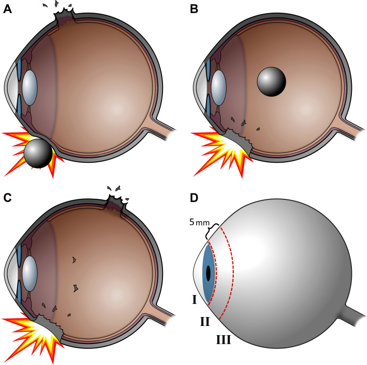
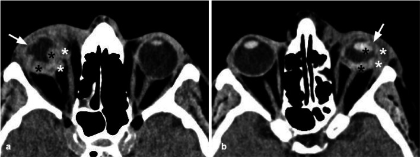
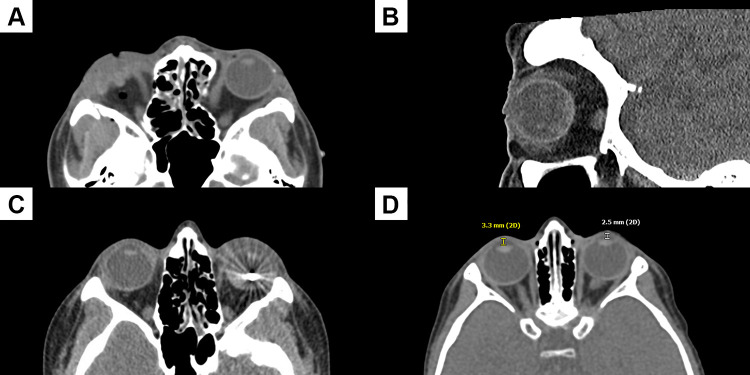
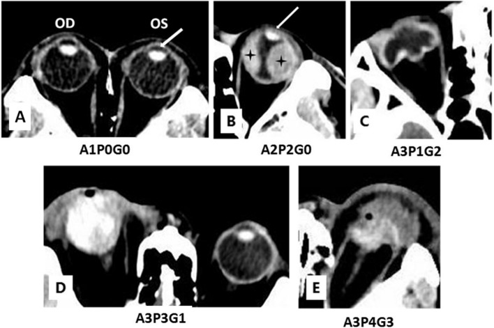
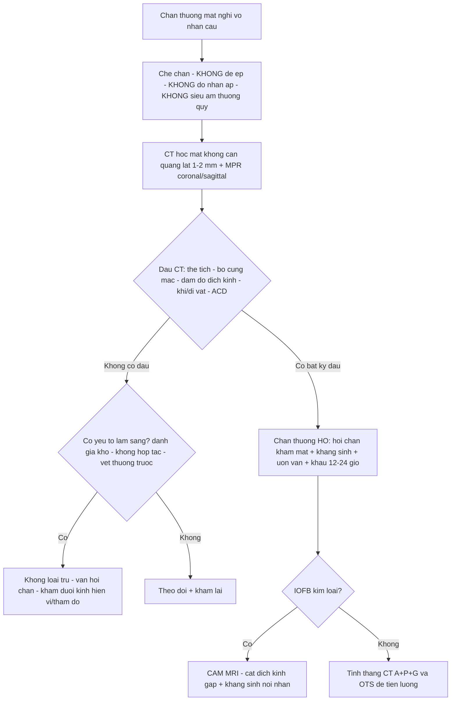
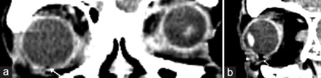
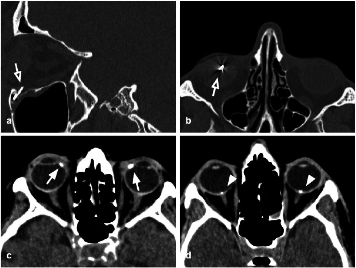
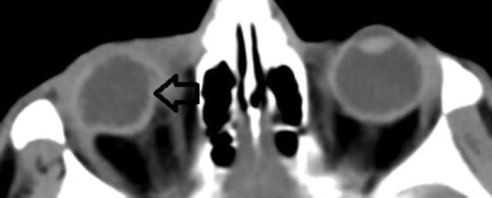

# 449 — Chấn thương hở nhãn cầu trên CT: BETT, 5 dấu chốt, thang điểm CT 0–10 & OTS / Open globe injury on CT

**Tags:** `pattern:vo-nhan-cau` `pattern:mat-the-tich` `pattern:be-cung-mac-gian-doan` `pattern:khi-noi-nhan` `pattern:di-vat-noi-nhan` `pattern:xuat-huyet-dich-kinh` `pattern:tien-phong-bat-doi-xung` `pattern:chan-thuong-mat` `vung:mat` `vung:nhan-cau-hoc-mat` `vung:hoc-mat` `protocol:CT-hoc-mat-1mm` `protocol:MPR` `score:OTS` `score:CT-OGI` `incidentaloma:khong`

**Mức chắc chắn (certainty):** tổng hợp y văn (literature synthesis) — dựng từ **1 tổng quan hệ thống + phân tích gộp 9 nghiên cứu/917 mắt** (*J Med Life* 2025, **PMC11891614**, CC BY 4.0), **1 hồi cứu 1.120 mắt** dựng thang điểm CT 0–10 (*BMC Ophthalmol* 2024, **PMC10759343**, CC BY 4.0), **1 nghiên cứu 190 nhãn cầu** đối chiếu mổ (*Saudi J Ophthalmol* 2025, **PMC12240278**, CC BY-NC-SA 4.0), **1 phân tích 200 bệnh nhân** về giá trị tiên lượng (*J Ophthalmol* 2022, **PMC9458393**, CC BY 4.0), **2 bài tổng quan** về phân loại BETT + xử trí (*Clin Ophthalmol* 2022, **PMC9379121**, CC BY-NC 4.0; *Eye (Lond)* 2024, **PMC11543839**, CC BY 4.0) và **1 pictorial essay CT hốc mắt chấn thương** (*Insights Imaging* 2022, **PMC8755868**, CC BY 4.0). Nhóm **không có bệnh nhân của mình**; chỗ chưa đủ chắc ghi "chưa rõ". **Không ghi tên tác giả** — attribution dùng tạp chí + năm + PMCID.

> **Câu chốt:** CT **rất đặc hiệu nhưng không nhạy**: gộp 917 mắt cho **độ nhạy 77%** (KTC 95% 72–81) và **độ đặc hiệu 94%** (92–96), **AUC 0,91** (PMC11891614). Ba con số phải thuộc: **(1)** **"mất thể tích + bờ củng mạc gián đoạn" và "xuất huyết dịch kính" đặc hiệu > 98%** cho chấn thương hở (PMC9379121); **(2)** **20%** ca vỡ nhãn cầu chỉ có **một dấu** trên CT (11/54, PMC12240278) — nên **CT âm tính không loại trừ**; **(3)** thang CT **0–10**: điểm **0** → **89,7%** đạt thị lực ≥ 0,3; điểm **10** → **64,5%** phải **múc nội nhãn** (PMC10759343). Cạm bẫy hay gặp nhất: **khí nội nhãn giả** (khí do phẫu thuật/bơm gas) và **dị vật nằm trên mặt nhãn cầu** bị đọc thành xuyên nhãn cầu.

## 1. Tổng quan bệnh học – cơ chế hình ảnh

### 1.1 Thành mắt mỏng 0,3 mm: vì sao chỗ vỡ hay nằm sau chỗ bám cơ trực

**Vỏ mắt (eyewall) = giác mạc + củng mạc** — theo BETT, **chấn thương hở (open globe)** là **khiếm khuyết toàn bộ chiều dày vỏ mắt**, bất kể cơ chế. Củng mạc dày không đều: dày nhất quanh thị thần kinh, **mỏng nhất chỉ ~0,3 mm ngay sau chỗ bám cơ trực**; các điểm yếu khác là **rìa giác mạc (limbus), quanh lỗ thị và vết mổ cũ** (PMC9379121). Vì thế:

- **Vỡ (rupture)** do **vật tù đập** (bóng, nắm đấm, chấn thương thể thao): nhãn áp vọt lên rồi **vỡ từ trong ra (inside-out)** ở điểm yếu nhất — thường **sau chỗ bám cơ trực**, nơi không nhìn thấy khi khám bàn ngoài.
- **Rách (laceration)** do **vật sắc/đạn** xuyên **từ ngoài vào (outside-in)**; nếu có **một đường vào, không có đường ra** = **xuyên (penetrating)**; **có cả đường vào và đường ra** = **xuyên thủng (perforating)**; có **dị vật nội nhãn (IOFB)** là thể riêng (Hình 1, sơ đồ BETT).

### 1.2 TẠI SAO nhãn cầu "xẹp" — cơ học của một quả cầu đầy dịch

Nhãn cầu là **quả cầu kín ~6,5 mL, áp suất 10–21 mmHg**; vỏ mắt chỉ giữ hình nhờ **áp lực trong lòng**. Khi có lỗ toàn chiều dày:

1. **Dịch thoát** — tiền phòng (0,25 mL) qua vết giác mạc, dịch kính (4 mL) qua vết củng mạc sau.
2. **Áp lực trong giảm** → **củng mạc trùng lại**, bờ **gãy góc, mép vết rách hở** → hình **"lốp xẹp" (flat tire)** hoặc **"mũ nấm" (mushroom sign)** khi dịch kính bị đẩy ra sau mí.
3. **Thể tích giảm** là dấu mạnh nhất và **bất đối xứng** — luôn **so với mắt bên kia** trên cùng lát cắt.

**Tiền phòng (ACD) dịch chuyển theo vị trí vết rách** — đây là logic định vị mà ít bài nhắc:

| Vị trí vết rách | Cơ chế | Tiền phòng trên CT |
|---|---|---|
| **Trước** (giác mạc, rìa) | Thoát **thủy dịch** | **Nông** — ví dụ **2,5 mm** so với **3,3 mm** ở mắt lành (PMC9379121) |
| **Sau** (củng mạc sau xích đạo) | Mất **dịch kính**, màng mống–thể thủy tinh bị kéo ra sau | **Sâu bất thường** |
| **Rách nhỏ, tự bít** | Không đổi thể tích | **ACD có thể bình thường** — bẫy |

### 1.3 TẠI SAO trông sáng/tối như vậy (vật lý HU)

- **Dịch kính bình thường ≈ 0–20 HU**, gần như **đồng nhất** hai bên.
- **Máu cấp 50–70 HU** (cục máu đông cao hơn): xuất huyết dịch kính làm **dịch kính tăng đậm độ**, có khi **lắng thành lớp** ở phía thấp → trông như **"củng mạc dày"** (PMC9379121).
- **Khí −1.000 HU**: đốm đen tuyệt đối trong nhãn cầu = **khí nội nhãn** — dấu **đặc hiệu cao** nhưng **không độc quyền** cho vỡ (xem mục 5).
- **Kim loại > 1.000 HU** + **giả ảnh tia (streak/beam-hardening)**: dị vật kim loại; **gỗ/kính thấu quang** thường **không thấy**.
- **Dầu silicone > 100 HU** sau mổ bong võng mạc: **bắt chước máu** — đây là lý do phải hỏi tiền sử mổ (PMC8755868).
- **Vôi hóa > 100 HU**: **mảng củng mạc (scleral plaque)** ở người già **bắt chước IOFB** (PMC9379121).

### 1.4 Ngưỡng định lượng nằm lòng

| Chỉ số | Ngưỡng / giá trị | Nguồn |
|---|---|---|
| Độ dày củng mạc mỏng nhất | **~0,3 mm** sau chỗ bám cơ trực | PMC9379121 |
| Phân vùng tổn thương | **Zone I** giác mạc–limbus; **Zone II** ≤ **5 mm** sau limbus; **Zone III** > **5 mm** sau limbus | PMC11543839 |
| Độ nhạy / đặc hiệu CT (gộp) | **77%** (72–81) / **94%** (92–96); **AUC 0,91**; 9 nghiên cứu, **917 mắt** | PMC11891614 |
| Sens / spec / PPV / NPV / accuracy (1 trung tâm) | **71,3% / 98,5% / 83,6% / 95,75% / 94,9%** (54 vỡ / 190 mắt) | PMC12240278 |
| Ca chỉ có **1 dấu** CT | **11/54 = 20%** | PMC12240278 |
| Đặc hiệu của **bờ nhãn cầu biến dạng** và **xuất huyết dịch kính** | **> 98%** | PMC9379121 |
| Thang CT tổng | **0–10** (A 0–3 + P 0–4 + G 0–3) | PMC10759343 |
| Tương quan thang CT | với **chiều dài vết rách r = 0,798**; với **thị lực cuối r = 0,799** | PMC10759343 |
| Cửa sổ khâu chính | **12–24 giờ** đầu | PMC9379121 |
| Viêm nội nhãn sau chấn thương hở | tới **16,5%** | PMC11543839 |
| Cắt dịch kính sớm giảm PVR | trong **4–7 ngày** đầu | PMC11543839 |
| Hệ quả nặng | **viêm nội nhãn, viêm màng não, áp-xe não** (nhất là IOFB hữu cơ) | PMC12240278 |

## 2. Mẫu hình + chẩn đoán phân biệt theo BETT & theo vùng

### 2.1 Sơ đồ phân loại BETT — chìa khóa để không gọi sai tên

*BETT bằng hình cắt dọc: (A) **vỡ (rupture)** — lực tù, vỡ từ trong ra; (B) **xuyên (penetrating)** — một đường vào + dị vật; (C) **xuyên thủng (perforating)** — có đường vào và đường ra; (D) **phân vùng I–III** tính từ limbus, mốc **5 mm**. Nguồn: Clin Ophthalmol 2022 (PMC9379121), CC BY-NC 4.0, nguyên bản.*

### 2.2 Gamut theo cơ chế (BETT) — mỗi thể có dấu CT riêng

- **Vỡ (rupture, lực tù):** **mất thể tích + bờ củng mạc gãy góc + tiền phòng nông**; hay kèm **gãy xương hốc mắt** (10% trong loạt 190 mắt — thành trong 63%, sàn 37%).
- **Rách xuyên (penetrating):** **đường vào rõ**, có thể **khí nội nhãn**, **mảnh kim loại**; nếu vật sắc nhỏ (gỗ, kính) → **CT âm tính**.
- **Xuyên thủng (perforating):** **hai lỗ** — dấu gián tiếp là **đường hầm khí/dị vật xuyên qua nhãn cầu**, tiên lượng xấu nhất.
- **IOFB:** **nốt > 1.000 HU + giả ảnh tia**; **82%** là kim loại/từ tính (nhóm 39 ca mổ), khối lượng trung bình **20,49 mg**, **4,02 × 1,40 × 0,93 mm**; nguyên nhân đầu **đục/đe kim 56,4%** (PMC13197236).
- **Chấn thương kín (closed globe):** **không** có dấu xuyên thủng nhưng có thể **xuất huyết tiền phòng, trật thủy tinh thể, phù cơ trực** — **không đồng nghĩa lành**.

### 2.3 Gamut theo vùng (Zone I–III) — vùng càng sau càng xấu

- **Zone I (giác mạc–limbus):** sẹo giác mạc trục thị giác, **tiền phòng nông**; nguy cơ **mất thủy dịch** và **tổn thương thể thủy tinh**.
- **Zone II (≤ 5 mm sau limbus):** vùng **thể mi–đáy dịch kính**, dễ **bong thể mi, hạ áp kéo dài** (nối bài [1484](../1484-bong-hac-mac-sau-mo-mat/lesson.md)).
- **Zone III (> 5 mm, tới hậu cực):** **tổn thương võng mạc**, **IOFB võng mạc**, tiên lượng xấu nhất; IGATES xác định **Zone IIIb (sau xích đạo) tiên lượng xấu nhất** (PMC11543839).

## 3. Bảng so sánh phân biệt (ma trận đối chiếu)

| Thực thể (entity) | Hình ảnh điển hình | Chốt vào (rule-in) | Chốt loại (rule-out) | Gợi ý xác nhận |
|---|---|---|---|---|
| **Vỡ nhãn cầu (rupture)** | Nhãn cầu **mất thể tích**, bờ **gãy góc/gián đoạn**, tiền phòng **nông** hơn mắt lành | **Mất thể tích + bờ củng mạc không liên tục** (đặc hiệu > 98%) | Nhãn cầu **tròn đều, đối xứng**, dịch kính trong → **không loại trừ** nếu rách nhỏ | Khám dưới kính hiển vi + mổ thăm dò |
| **Rách xuyên (penetrating)** | **Đường vào** + **khí nội nhãn** + xuất huyết dịch kính khu trú | **Khí nội nhãn + đường vào** | Khí **đối xứng/ở đáy** sau bơm gas → **giả** | Hỏi tiền sử mổ 4–8 tuần |
| **IOFB kim loại** | Nốt **> 1.000 HU** + **giả ảnh tia** | **Tăng đậm độ + tia + tiền sử đập kim** | **Mảng củng mạc vôi hóa** đối xứng hai bên, không tia | CT cửa sổ xương + cắt dịch kính gắp |
| **IOFB gỗ/kính** | **Thấu quang**, có thể chỉ thấy **khí/đường vào** | **Đường vào + khí + không thấy kim loại** | Không có đường vào, không khí → khả năng thấp | Hỏi vật liệu; siêu âm bồn nước nếu an toàn |
| **Chấn thương kín (contusion)** | Xuất huyết tiền phòng, trật thủy tinh thể, nhãn cầu **còn thể tích** | **Nhãn cầu đủ thể tích + XH tiền phòng** | Bờ gián đoạn + mất thể tích → **đã hở** | Khám + CT để loại hở |
| **Khí do phẫu thuật / bơm gas** | Bóng khí **tròn** ở **đỉnh nhãn cầu**, bệnh nhân **tỉnh, không chấn thương** | **Tiền sử mổ bong võng mạc < 8 tuần** | Khí + **mất thể tích/bờ gián đoạn** → **khí do chấn thương** | So phim cũ, hỏi tiền sử |
| **Dầu silicone** | Dịch kính **tăng đậm độ toàn bộ**, **> 100 HU**, bờ nhãn cầu **nguyên** | **Tiền sử mổ bong võng mạc + bờ nguyên** | Tăng đậm độ **khu trú/lắng lớp** → máu | Hỏi tiền sử; so mắt bên kia |

*CT ngang cửa sổ mô mềm, hai bệnh nhân: nhãn cầu **méo, mất thể tích** (a nặng hơn b), **bờ củng mạc gián đoạn (dấu *)** — nơi vỏ mắt hở, **mặt trước nhãn cầu dẹt (mũi tên)**, **xuất huyết dịch kính tăng đậm độ không đều (dấu * đen)**. Nguồn: Insights Imaging 2022 (PMC8755868), CC BY 4.0, nguyên bản.*

**Bốn dấu CT kinh điển trên một hình — dùng để dạy đọc:**

*(A) **"Mũ nấm" (mushroom sign)** + **khí trong nón cơ**; (B) **xuất huyết dịch kính lắng lớp** ở phía thấp; (C) **IOFB kim loại** với **giả ảnh tia**; (D) **tiền phòng nông**: mắt phải **3,3 mm**, mắt trái **2,5 mm**. Nguồn: Clin Ophthalmol 2022 (PMC9379121), CC BY-NC 4.0, nguyên bản.*

## 4. Protocol chụp + hệ phân độ/điểm chuẩn hóa

### 4.1 Protocol

- **CT hốc mắt không cản quang, lát ≤ 1 mm, axial + tái tạo coronal/sagittal (MPR)** — độ dày hợp lý **1–2 mm**; **cửa sổ mô mềm + cửa sổ xương** (PMC9458393, PMC12240278). Đây là điểm chết người: **CT sọ thường quy 10 mm** trong chấn thương đa chấn thương **bỏ sót** phần lớn dấu nhãn cầu — **phải xin đúng protocol hốc mắt**.
- **Không cản quang** là đủ: cản quang không giúp thấy vết rách, còn **giả ảnh kim loại** thì tăng.
- **Trước khi chụp:** **che chắn (shield), KHÔNG đè ép, KHÔNG đo nhãn áp, KHÔNG siêu âm thường quy** — đè lên nhãn cầu vỡ làm **thoát nội nhãn**; siêu âm chỉ dùng **kỹ thuật bồn nước/găng nước** khi đã cân nhắc và không đè (PMC9379121, PMC13518040).
- **MRI: chống chỉ định** khi chưa loại **dị vật kim loại/từ tính** — từ trường làm dị vật **di chuyển, rách thêm võng mạc** (PMC12240278).
- **Đọc hệ thống 5 dấu:** (1) **hình dạng–thể tích nhãn cầu**, (2) **bờ củng mạc**, (3) **đậm độ dịch kính**, (4) **khí/dị vật nội nhãn**, (5) **độ sâu tiền phòng so mắt bên kia**; cộng thêm **xương hốc mắt, cơ trực, dây thị giác**.

### 4.2 Thang điểm CT chấn thương hở nhãn cầu 0–10 (A + P + G)

Thang dựng trên **1.120 mắt** (PMC10759343), chia 3 trục: **A = đoạn trước**, **P = đoạn sau**, **G = hình dạng–thể tích**.

| Điểm | A — đoạn trước | P — đoạn sau | G — hình dạng/thể tích |
|---|---|---|---|
| 0 | Bình thường | Bình thường | Bình thường |
| 1 | ACD lệch nhẹ, đậm độ bất thường trong tiền phòng | Bọt khí/ổ tăng đậm độ **< 1/3** dịch kính | Bờ hơi không đều, thể tích **≥ 4/5** |
| 2 | Khí, ACD lệch rõ, **thủy tinh thể lệch** | Tăng đậm độ **1/3–4/5** dịch kính | Bờ không đều vừa, thể tích **1/3–4/5** |
| 3 | **Tiền phòng dẹt**, biến dạng bờ, **mất/thoát thủy tinh thể** | Tăng đậm độ **≥ 4/5** dịch kính | **Biến dạng**, thể tích **≤ 1/3** |
| 4 | — | **Cấu trúc đảo lộn**, đậm độ không đồng nhất toàn dịch kính | — |

**Cách dùng trong thực hành:** cộng A + P + G (0–10); ghi **kèm** thang OTS (OTS cần **thị lực đầu vào** — CT không thay được OTS, nhưng **thang CT bổ sung tiên lượng khi bệnh nhân không đo được thị lực**).

*Năm mức tăng dần: **A1P0G0** (ACD lệch nhẹ) → **A2P2G0** (khí + thủy tinh thể lệch) → **A3P1G2** → **A3P3G1** → **A3P4G3** (cấu trúc đảo lộn, thể tích ≤ 1/3). Nguồn: BMC Ophthalmol 2024 (PMC10759343), CC BY 4.0, nguyên bản.*

### 4.3 Xử trí cấp (điều phối với nhãn khoa)

- **Khâu chính trong 12–24 giờ** — chậm làm tăng **viêm nội nhãn** và **xuất huyết hắc mạc** (PMC9379121).
- **Kháng sinh toàn thân** (**cephalosporin thế hệ 3**, ví dụ ceftazidime **50 mg/kg**, tối đa **2 g**) + **uốn ván**; **IOFB hữu cơ/đất** → cân nhắc **kháng nấm** (PMC9379121).
- **Cắt dịch kính trong 4–7 ngày** làm giảm **PVR** sau chấn thương; **không có thuốc nào thay thế** (PMC11543839).
- **Tư vấn tiên lượng bằng số:** điểm CT **0** → **89,7%** thị lực ≥ 0,3; điểm **10** → **64,5%** múc nội nhãn (PMC10759343); **nhãn cầu xẹp/đảo lộn** trên CT làm **HR 47,72** (6,13–371,62) cho thị lực xấu, **tổn thương ống thị giác/dây thị giác HR 21,62** (4,73–98,78) (PMC9458393).

## 5. Biến thể bình thường và cạm bẫy

- **Khí nội nhãn "giả" sau mổ:** bơm **C3F8/SF6** để lại **bóng khí 4–8 tuần**, tròn, ở **đỉnh nhãn cầu**, **bờ nhãn cầu nguyên** — đọc thành vỡ nhãn cầu là **mổ oan**. Hình dưới là ca **dương tính giả** đã được mổ kiểm chứng: **không có vỡ**.
- **Dị vật "trong" nhãn cầu thực ra nằm trên mặt củng mạc:** trên một bình diện không phân biệt được **trong hay ngoài** — phải xem **đủ 3 bình diện** và **cửa sổ xương**; loạt 190 mắt có **≥ 2 ca dương tính giả** kiểu này (PMC12240278).
- **Mảng củng mạc vôi hóa** (người > 60 tuổi, **đối xứng hai bên**, không tia) **bắt chước IOFB**; **dầu silicone > 100 HU** bắt chước xuất huyết; **giả ảnh tia** của kim loại che lấp tổn thương lân cận.
- **CT sọ 10 mm** trong đa chấn thương: **bỏ sót** hầu hết dấu nhãn cầu — luôn xin **protocol hốc mắt 1–2 mm** (PMC9458393).
- **"Satisfaction of search":** thấy **gãy xương hốc mắt** (10% trong loạt 190 mắt) rồi **dừng đọc** — nhãn cầu vẫn có thể đã vỡ.
- **Rách nhỏ vùng sau xích đạo** có thể **không có dấu nào** (20% chỉ một dấu; NPV 95,75% **không phải 100%**) → **quyết định vẫn là khám + mổ thăm dò**.
- **Nhãn cầu nhỏ một bên mạn tính** (phthisis bulbi, nhược thị bẩm sinh, cận thị cao mắt bên kia) — so **bờ, đậm độ và tiền phòng**, không chỉ so kích thước.

*Ca **dương tính giả** (30 tuổi): (a) coronal và (b) sagittal có **đốm khí trong nhãn cầu (mũi tên trắng)** — nhưng **mổ xác nhận không vỡ**, khí là **giả ảnh/khí tồn lưu**. Bài học: khí phải đi kèm **bờ gián đoạn hoặc mất thể tích** mới đủ chốt. Nguồn: Saudi J Ophthalmol 2025 (PMC12240278), CC BY-NC-SA 4.0, nguyên bản.*

*(a) dị vật **ngoài nhãn cầu** trong sàn hốc mắt; (b) **IOFB kim loại** với **giả ảnh tia** hình sao; (c, d) **mảng củng mạc vôi hóa hai bên** — **bắt chước IOFB** nhưng **đối xứng, không tia**. Nguồn: Insights Imaging 2022 (PMC8755868), CC BY 4.0, nguyên bản.*

## 6. Tự lượng giá — Blind Quiz

**Ca 1 — Nam 26 tuổi, tai nạn lao động, mắt phải đau, không đếm được ngón tay. CT này nói gì?**

- Gợi ý lâm sàng: chấn thương tù, mi sưng nhiều, không mở được mắt để khám.
- Câu hỏi: Dấu hiệu chính? Vì sao đây là **chấn thương hở** chứ không phải "mắt bị đụng"? Bước tiếp theo **không được** làm?

<b>Bấm để hiện đáp án (findings + chẩn đoán)</b>

- Dấu hiệu (findings): **nhãn cầu phải mất thể tích**, nhỏ hơn rõ so với mắt trái trên cùng lát cắt (**mũi tên đen**); bờ nhãn cầu **không đều**; dịch kính **tăng đậm độ nhẹ**.
- Chẩn đoán (diagnosis): **vỡ nhãn cầu (rupture) — chấn thương hở**, vì mất thể tích chỉ xảy ra khi **dịch thoát ra ngoài** qua lỗ toàn chiều dày.
- Không được làm: **đè ép, đo nhãn áp, siêu âm thường quy**; cần **che chắn + kháng sinh + khâu trong 12–24 giờ**.
- Nguồn ảnh: Saudi J Ophthalmol 2025, Fig. 5 (PMC12240278), CC BY-NC-SA 4.0.

**Ca 2 — Nam 40 tuổi, chấn thương do mảnh kim loại; trên CT có nốt sáng và vệt tỏa.**

- Gợi ý: nghề hàn/đập kim, đau nhẹ nhưng thị lực giảm.
- Câu hỏi: Dấu hiệu nào chốt **dị vật kim loại**? Vì sao **không** được chụp MRI? Hai "kẻ bắt chước" hay gặp là gì?

<b>Bấm để hiện đáp án (findings + chẩn đoán)</b>

- Dấu hiệu (findings): **nốt > 1.000 HU** kèm **giả ảnh tia (streak)** hình sao = **IOFB kim loại** (ô b).
- Chẩn đoán (diagnosis): **chấn thương hở + dị vật nội nhãn kim loại**; cấm MRI đến khi loại kim loại (từ trường kéo dị vật, rách thêm võng mạc).
- Kẻ bắt chước: **mảng củng mạc vôi hóa** (đối xứng, không tia — ô c, d) và **dầu silicone > 100 HU**; **gỗ/kính thấu quang** thì CT có thể **không thấy**.
- Nguồn ảnh: Insights Imaging 2022, Fig. 21 (PMC8755868), CC BY 4.0.

**Ca 3 — Bệnh nhân sau mổ bong võng mạc 3 tuần, đau mắt; CT có đốm khí trong nhãn cầu. Có phải vỡ nhãn cầu?**

- Gợi ý: đã bơm gas/dầu, mắt đỏ, không chấn thương mới.
- Câu hỏi: Vì sao **khí đơn độc không đủ** kết luận? Cần thấy thêm gì? Xử trí khác gì ca chấn thương thật?

<b>Bấm để hiện đáp án (findings + chẩn đoán)</b>

- Dấu hiệu (findings): **đốm khí trong nhãn cầu** (mũi tên trắng) nhưng **bờ nhãn cầu liên tục, thể tích bình thường** → phù hợp **khí tồn lưu/giả ảnh**, ca này **mổ xác nhận không vỡ**.
- Chẩn đoán (diagnosis): **dương tính giả** — khí phải đi kèm **bờ gián đoạn hoặc mất thể tích** mới đủ chốt chấn thương hở.
- Xử trí: **không mổ cấp cứu vì "khí"**; hỏi tiền sử bơm gas (**4–8 tuần**), so phim cũ, khám lại; nếu có **đau tăng + tiền phòng nông** mới nghi rò vết mổ.
- Nguồn ảnh: Saudi J Ophthalmol 2025, Fig. 9 (PMC12240278), CC BY-NC-SA 4.0.

## Bài liên quan chéo
- [400 – Tổng quan Mắt & thị giác](../400-tong-quan-mat-thi-giac/lesson.md)
- [401 – Phương thức chẩn đoán hình ảnh mắt](../401-phuong-thuc-mat/lesson.md) (chọn CT/B-scan/MRI)
- [410 – Giải phẫu hốc mắt](../410-giai-phau-hoc-mat/lesson.md)
- [420 – Vỡ sàn hốc mắt & hội chứng khoang](../420-vo-san-hoc-mat/lesson.md)
- [411 – Siêu âm nhãn cầu](../411-sieu-am-nhan-cau/lesson.md) (B-scan — chỉ khi an toàn)
- [445 – Bong võng mạc](../445-bong-vong-mac/lesson.md) · [1484 – Bong hắc mạc sau mổ mắt](../1484-bong-hac-mac-sau-mo-mat/lesson.md)
- [429 – Độ trục nhãn cầu trên MRI/CT](../429-do-truc-nhan-cau-bang-mri-ct/lesson.md) (nhãn cầu nhỏ một bên)

## Ảnh
- `449_globe-rupture-IOFB_US-CT_PMC13518040-Img5-CCBY.jpg`, `449_globe-rupture_US-CT_PMC13518040-Img3-CCBY.jpg`, `449_choroidal-detachment_US-CT_PMC13518040-Img7-CCBY.jpg`, `composite_vo-nhan-cau-vs-IOFB.jpg` — *Clin Pract Cases Emerg Med* 2026 (**PMC13518040**), CC BY 4.0.
- `449_CT-findings-OGI_PMC12220044-Fig1-CCBYNCND.jpg` — *BMC Ophthalmol* 2025 (**PMC12220044**), CC BY-NC-ND 4.0 (nguyên bản, không cắt/ghép).
- `449_BETT-so-do_PMC9379121.jpg`, `449_CT_bon-dau-hieu_PMC9379121.jpg` — *Clin Ophthalmol* 2022 (**PMC9379121**), CC BY-NC 4.0.
- `449_CT_cung-mac-gian-doan_PMC8755868.jpg`, `449_CT_IOFB-va-gia-vat_PMC8755868.jpg` — *Insights Imaging* 2022 (**PMC8755868**), CC BY 4.0.
- `449_CT_diem-APG_PMC10759343.jpg` — *BMC Ophthalmol* 2024 (**PMC10759343**), CC BY 4.0.
- `449_CT_gia-khi_PMC12240278.jpg`, `449_CT_mat-the-tich_PMC12240278.jpg` — *Saudi J Ophthalmol* 2025 (**PMC12240278**), CC BY-NC-SA 4.0.
- Không tạo composite mới: ảnh mới thuộc **5 bài, 4 loại giấy phép** (có **BY-NC-SA** và **BY-NC-ND**) → ghép sẽ tạo tác phẩm phái sinh trái điều kiện **ND** và làm mất chú giải gốc. Chi tiết từng ảnh trong `images/CREDITS.md`.
- AuntMinnie: chỉ dẫn link, không tải.

> Không dùng để chẩn đoán độc lập khi chưa có người hướng dẫn.
