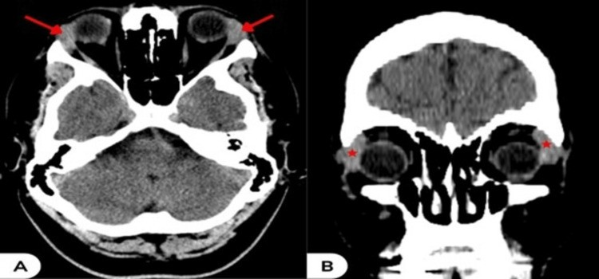
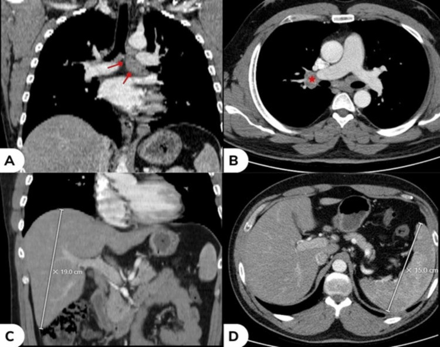
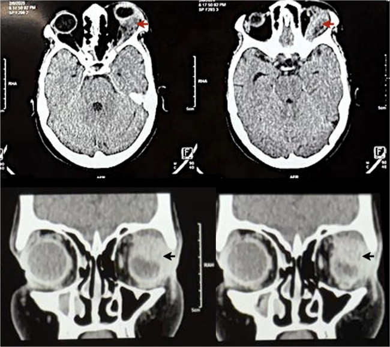
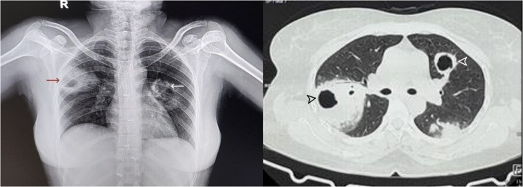
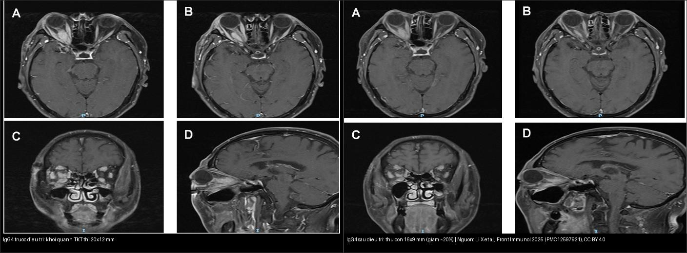
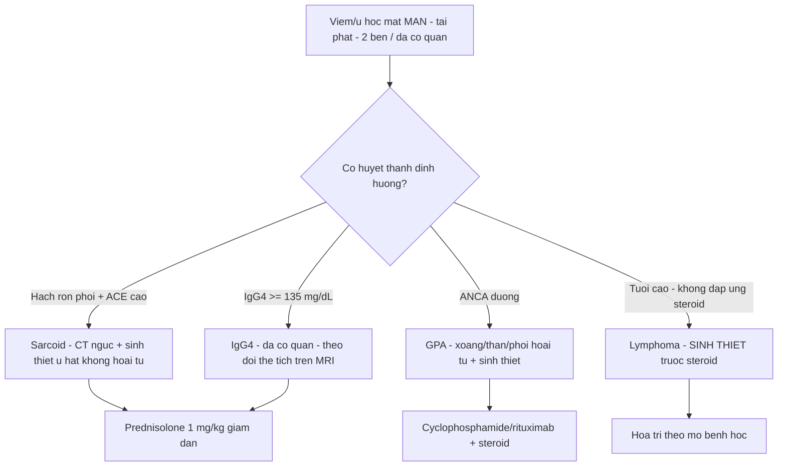
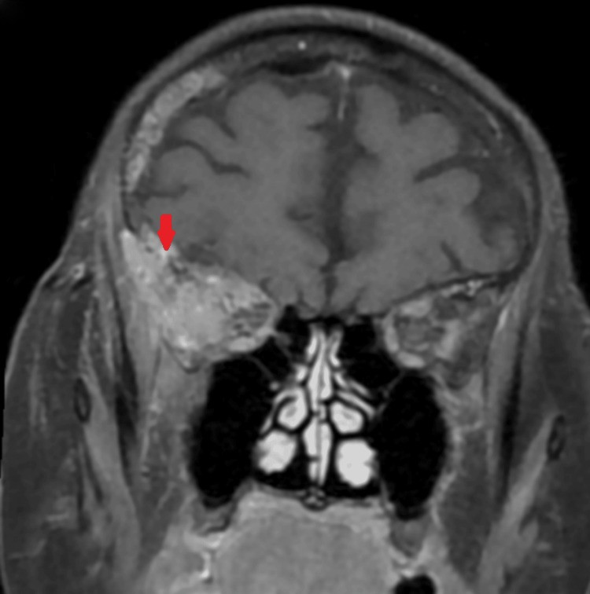

# 451 — Biểu hiện mắt của bệnh hệ thống / Systemic diseases in the eye

**Tags:** `pattern:toan-than-mat` `vung:hoc-mat` `score:IgG4` `protocol:CT-MRI-hoc-mat` `protocol:sinh-thiet`
**Mức chắc chắn (certainty):** tổng hợp y văn (literature synthesis) — nhóm tự biên từ y văn mở 2023–2025 (Cureus CC BY + BMC Ophthalmol CC BY + Front Immunol CC BY), chưa gắn ca nguyên văn đơn lẻ.

## 1. Tổng quan — mắt là "cửa sổ toàn thân", kháng thể định hướng trước sinh thiết

- Viêm/u hốc mắt **mạn, tái phát, hai bên hoặc đa cơ quan** thường là **biểu hiện của bệnh hệ thống** (sarcoid, viêm mạch ANCA/GPA, IgG4, lymphoma) chứ không phải bệnh mắt đơn thuần.
- **TẠI SAO kháng thể + tổng thể trước sinh thiết:** **ANCA (GPA)**, **IgG4 huyết thanh**, **ACE + CT ngực (sarcoid)**, **TRAb (Graves)** rẻ, ít xâm lấn và định hướng chẩn đoán; sinh thiết chỉ khi **không điển hình/kháng trị** — nhưng **không được để steroid che mờ lymphoma**.
- **Số nằm lòng:** **IgG4 huyết thanh ≥ 135 mg/dL** + mô **> 10 tương bào/HPF**; **sarcoid** hay có **hạch rốn phổi + hạch trung thất hai bên** + **ACE tăng**; **GPA** với **ANCA (+) + tổn thương xoang/thận/phổi hoại tử**; **tocilizumab/rituximab** là liệu pháp tiết kiệm steroid theo bệnh.
- **Orbital sarcoidosis** là thể **hiếm, thường MỘT bên**, có thể tổn thương **tuyến lệ, thần kinh thị, cơ vận nhãn, mí mắt**; chẩn đoán phân biệt **GPA, bệnh tuyến giáp, IgG4, viêm xơ hốc mắt**.

## 2. Mẫu hình + chẩn đoán phân biệt theo mẫu hình (gamut)

- **Tuyến lệ to hai bên, không đau + hạch trung thất → sarcoid** (bài 424).
- **Khối hốc mắt "xâm lấn xuyên khoang" (cả ngoài + trong nón) + mũi xoang/thận/phổi → GPA** (ANCA).
- **Khối quanh thần kinh thị/cơ, đa cơ quan, đáp ứng steroid → IgG4**.
- **Khối già không đau, không đáp ứng steroid, tái phát như "cellulitis" → lymphoma** (sinh thiết chốt).
- Gợi nhớ **"S-G-I-L"**: **S**arcoid (hạch rốn phổi) · **G**PA (ANCA) · **I**gG4 (đa cơ quan) · **L**ymphoma (già, kháng trị).

## 3. Bảng so sánh phân biệt (ma trận đối chiếu)

| Thực thể (entity) | Hình ảnh + toàn thân | Chốt vào (rule-in) | Chốt loại (rule-out) | Gợi ý xác nhận |
|---|---|---|---|---|
| **Sarcoid** | **Tuyến lệ to hai bên** + cơ/hốc mắt; **hạch rốn phổi/subcarinal hai bên**; gan–lách to | **Hạch rốn phổi hai bên + ACE tăng + tổn thương không hoại tử** | Hoại tử xoang + ANCA → GPA | CT ngực + ACE + sinh thiết (u hạt không hoại tử) |
| **GPA** | Khối hốc mắt **xuyên khoang (ngoài + trong nón)**, bờ không rõ + **xoang hoại tử, nốt phổi hang** | **ANCA (+) + hoại tử + đa cơ quan (mũi/thận/phổi)** | Không hoại tử, ANCA âm → sarcoid/IgG4 | ANCA + sinh thiết xoang/phổi |
| **IgG4** | Khối **quanh thần kinh thị/cơ** + đa cơ quan, **hai bên, đáp ứng steroid** | **IgG4 máu ≥ 135 mg/dL + > 10 tương bào/HPF + đa cơ quan** | Đau cấp một bên, một ổ → giả u/cellulitis | IgG4 huyết thanh + sinh thiết |
| **Lymphoma** | Khối **già, một bên**, không đau; **tái phát như "cellulitis"**, **không đáp ứng steroid** | **Tuổi cao + kháng trị + tái phát cùng chỗ** | Đáp ứng nhanh steroid → viêm | **Sinh thiết (tránh steroid trước)** + huyết học |

*Trên: **sarcoid hốc mắt** — tuyến lệ **to hai bên** (A: axial; B: coronal). Dưới: cùng bệnh nhân — **hạch dưới carina + hạch rốn phổi phải** + **gan–lách to** (A–D): biểu hiện mắt chỉ là "phần nổi" của bệnh hệ thống. Nguồn: Saifi M et al., Cureus 2023 (PMC10696406), CC BY 4.0.*

*Trái: **GPA** — khối đặc **xuyên khoang (extra + intraconal)**, bờ không rõ ở hốc mắt trái, gây lồi mắt trục. Phải: **HRCT ngực** — nhiều **nốt hang** ở phổi. Bộ đôi "hốc mắt + phổi hang" + ANCA = chốt GPA (không hoại tử thì nghĩ sarcoid/IgG4). Nguồn: Bhatia S et al., BMC Ophthalmol 2025 (PMC12542495), CC BY 4.0.*

*Trái: **IgG4** — khối dạng **hình thoi quanh thần kinh thị phải (20 × 12 mm)** từ đoạn nội ống. Phải: **sau điều trị steroid/ức chế miễn dịch** — khối co còn **16 × 9 mm (~20%)**, bờ rõ hơn. Nguồn: Li X et al., Front Immunol 2025 (PMC12597921), CC BY 4.0. Ảnh ghép letterbox.*

**Quiz composite:** hai bệnh nhân khối hốc mắt đáp ứng steroid khác nhau thế nào — ai cần **sinh thiết trước**, ai cần **xét nghiệm máu trước**?

<b>Bấm để hiện đáp án</b>

- **IgG4** (trái/phải kèm nhau): đáp ứng steroid rõ → **xét nghiệm IgG4 huyết thanh (≥ 135 mg/dL)** + tìm tổn thương đa cơ quan **trước** khi cân nhắc sinh thiết; theo dõi thể tích khối trên MRI.
- **Nếu khối già không đáp ứng steroid** → nghĩ **lymphoma**, phải **sinh thiết** (tránh cho steroid vì che mờ mô bệnh).
- Chốt: **đáp ứng steroid + đa cơ quan = IgG4**; **kháng trị + tuổi cao = lymphoma**.

## 4. Protocol chụp & xét nghiệm

- **Hình ảnh một lượt:** **CT + MRI hốc mắt (T1 fat-sat sau tiêm + T2 fat-sat)** để định vị trong/ngoài nón, xuyên khoang; **CT ngực** (hạch rốn phổi/nốt hang) + **siêu âm/CT bụng** khi nghi sarcoid/IgG4 đa cơ quan.
- **Xét nghiệm định hướng:** **ANCA** (GPA) · **IgG4 huyết thanh ≥ 135 mg/dL** + **> 10 tương bào/HPF** (IgG4) · **ACE + canxi** (sarcoid) · **TRAb/TSH** (Graves) · **LDH/tủy** (lymphoma).
- **Sinh thiết** khi **không điển hình/kháng trị/không đáp ứng steroid** — lấy mô **trước khi cho steroid** nếu nghi lymphoma.
- **Thuốc:** sarcoid/IgG4 → **prednisolone 1 mg/kg** rồi giảm dần; GPA → **cyclophosphamide/rituximab + steroid**; lymphoma → **hóa trị theo mô bệnh học**.

## 5. Cạm bẫy

- **Steroid che mờ lymphoma** — sinh thiết **trước** khi cho steroid khi nghi u (tuổi già + không đáp ứng).
- **Lao hốc mắt** giả sarcoid/GPA — **AFB/PCR + tiền sử tiếp xúc** trước khi kết luận.
- **Thuốc ức chế điểm kiểm soát miễn dịch (ICI)** gây viêm giống Graves/IgG4 (bài 421) — hỏi **ung thư + thuốc miễn dịch**.
- **Một bên ≠ loại trừ hệ thống:** orbital sarcoidosis **thường một bên** — vẫn phải tầm soát toàn thân.
- **"Cellulitis hốc mắt" tái phát cùng chỗ** ở người lớn tuổi = **lymphoma cho tới khi loại trừ**.

## 6. Tự lượng giá — Blind Quiz

**Ca 1 — Nữ 40 tuổi, sưng mí trên hai bên không đau. CT hốc mắt + CT ngực:**

- Hỏi: tổn thương hốc mắt là gì? Dấu hiệu toàn thân nào chốt hướng chẩn đoán? Hai phân biệt chính?

<b>Bấm để hiện đáp án (findings + chẩn đoán)</b>

- Dấu hiệu (findings): **tuyến lệ to hai bên** (A axial, B coronal) + **hạch dưới carina, hạch rốn phổi phải**, **gan–lách to**.
- Chẩn đoán (diagnosis): **sarcoidosis hốc mắt** — vì **tuyến lệ hai bên + hạch rốn phổi hai bên + tổn thương không hoại tử** (u hạt).
- Phân biệt: **GPA** (ANCA + hoại tử) và **IgG4** (IgG4 huyết thanh + đa cơ quan).
- Xử trí: **prednisolone 1 mg/kg giảm dần** + CT ngực theo dõi; **ACE** hỗ trợ.
- Nguồn ảnh: Saifi M et al., Cureus 2023 (PMC10696406) Fig. 2–3, CC BY 4.0.

**Ca 2 — Ông 55 tuổi lồi mắt trục trái + nốt phổi hang. CT hốc mắt + HRCT:**

- Hỏi: mô tả khối hốc mắt (trong/ngoài nón)? Bộ đôi "hốc mắt + phổi" gợi chẩn đoán nào? Xét nghiệm chốt?

<b>Bấm để hiện đáp án (findings + chẩn đoán)</b>

- Dấu hiệu (findings): khối đặc **xuyên khoang (extra + intraconal)**, bờ không rõ, hốc mắt trái; **nhiều nốt hang hai phổi**.
- Chẩn đoán (diagnosis): **GPA (viêm mạch u hạt)** — vì **hoại tử xoang/phổi + tổn thương hốc mắt** đa cơ quan.
- Xét nghiệm chốt: **ANCA** (c-ANCA/PR3) + **sinh thiết** (viêm mạch hoại tử u hạt).
- Xử trí: **cyclophosphamide hoặc rituximab + corticoid**.
- Nguồn ảnh: Bhatia S et al., BMC Ophthalmol 2025 (PMC12542495) Fig. 3–4, CC BY 4.0.

**Ca 3 — Nam 50 tuổi lồi mắt phải. MRI trước và sau điều trị:**

- Hỏi: khối nằm ở đâu? Hướng chẩn đoán? Xét nghiệm máu nào + vì sao theo dõi bằng MRI?

<b>Bấm để hiện đáp án (findings + chẩn đoán)</b>

- Dấu hiệu (findings): khối **hình thoi quanh thần kinh thị phải**, **20 × 12 mm** (trước) → **16 × 9 mm** (sau, ~20%); bờ rõ hơn sau điều trị.
- Chẩn đoán (diagnosis): **bệnh hốc mắt liên quan IgG4 (IgG4-ROD)** — khối quanh thần kinh thị, đáp ứng điều trị, đa cơ quan.
- Xét nghiệm: **IgG4 huyết thanh ≥ 135 mg/dL** + **> 10 tương bào/HPF** ở mô; **theo dõi thể tích khối bằng MRI** để đánh giá đáp ứng.
- Nguồn ảnh: Li X et al., Front Immunol 2025 (PMC12597921) Fig. 2–3, CC BY 4.0.

**Ca 4 — Cụ bà 72 tuổi sưng/đỏ hốc mắt phải tái phát nhiều lần, "cellulitis" không khỏi. MRI coronal:**

- Hỏi: vì sao không nghĩ giả u/cellulitis đơn thuần? Bước tiếp bắt buộc là gì?

<b>Bấm để hiện đáp án (findings + chẩn đoán)</b>

- Dấu hiệu (findings): **khối đặc hốc mắt phải** (MRI coronal) ở người **lớn tuổi**, tiền sử **tái phát cùng chỗ như "cellulitis"**.
- Chẩn đoán (diagnosis): **lymphoma hốc mắt** — vì **tuổi cao + tái phát + không đáp ứng điều trị thông thường**.
- Bước tiếp: **sinh thiết (trước khi cho steroid)** + phối hợp huyết học; **tránh steroid che mờ** mô bệnh.
- Nguồn ảnh: Ishak F et al., Cureus 2024 (PMC11531250) Fig. 4, CC BY 4.0.

## Bài liên quan chéo
- [400 – Tổng quan Mắt](../400-tong-quan-mat-thi-giac/lesson.md)
- [422 – Viêm giả u hốc mắt](../422-viem-gia-u/lesson.md) (loại trừ nhiễm khuẩn/giả u)
- [424 – Tuyến lệ: viêm vs u](../424-tuyen-le/lesson.md) (IgG4, sarcoid dacryoadenitis)
- [421 – Lồi mắt Graves](../421-loi-mat-Graves/lesson.md) (TED — chừa gân)
- [435 – GCA & AAION vs NAION](../435-gca-va-naion-aion/lesson.md) (viêm mạch lớn người già)

## Ảnh
- `451_sarcoid-lacrimal-gland_CT_PMC10696406-Fig2-CCBY.jpg`, `451_sarcoid-hach-trung-that_CT_PMC10696406-Fig3-CCBY.jpg` — Saifi M et al., Cureus 2023 (PMCID: PMC10696406), CC BY 4.0.
- `451_gpa-o-mat-trans-spatial_CT_PMC12542495-Fig3-CCBY.jpg`, `451_gpa-phoi-hang_HRCT_PMC12542495-Fig4-CCBY.jpg` — Bhatia S et al., BMC Ophthalmol 2025 (PMCID: PMC12542495), CC BY 4.0.
- `451_igg4-u-quanh-tk-thi_MRI_PMC12597921-Fig2-CCBY.jpg`, `451_igg4-sau-dieu-tri_MRI_PMC12597921-Fig3-CCBY.jpg`, `composite_IgG4-truoc-sau.jpg` — Li X et al., Front Immunol 2025 (PMCID: PMC12597921), CC BY 4.0.
- `451_lymphoma-o-mat_MRI_PMC11531250-Fig4-CCBY.jpg` — Ishak F et al., Cureus 2024 (PMCID: PMC11531250), CC BY 4.0.
- Chi tiết giấy phép từng ảnh trong `images/CREDITS.md`. AuntMinnie: chỉ dẫn link, không tải.

> Không dùng để chẩn đoán độc lập khi chưa có người hướng dẫn.
