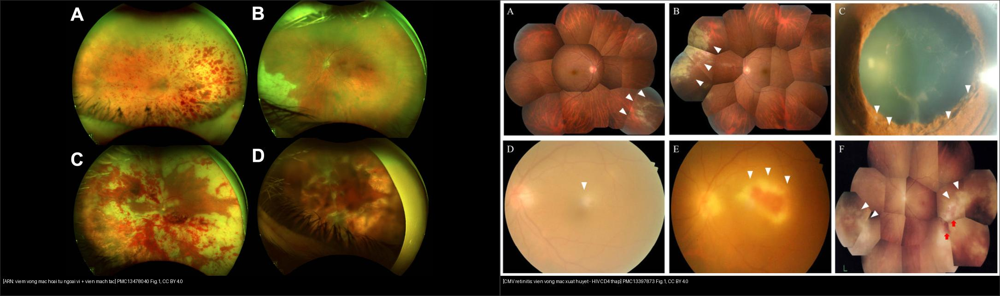
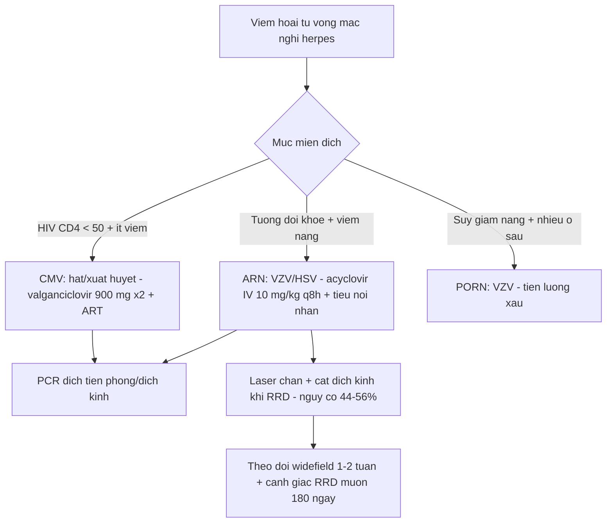
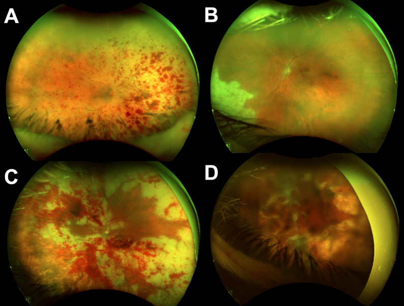
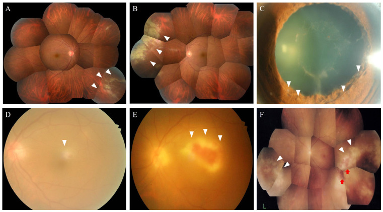

# 452 — Hoại tử võng mạc cấp (ARN) & viêm võng mạc CMV: cấp cứu mù nhanh / Acute retinal necrosis & CMV retinitis

**Tags:** `pattern:hoai-tu-vong-mac` `vung:vong-mac` `protocol:PCR-dich-thuy` `protocol:widefield`
**Mức chắc chắn (certainty):** tổng hợp y văn (literature synthesis) — nhóm tự biên từ 4 nghiên cứu mở (JOII 2025 & 2026 CC BY 4.0 + IDR 2026 CC BY 4.0 + JCM 2026 CC BY 4.0), chưa gắn ca nguyên văn đơn lẻ.

## 1. Tổng quan — mức miễn dịch quyết định "chân dung" viêm hoại tử

- **Viêm hoại tử võng mạc (necrotizing retinitis)** do **virus herpes** gây ly giải tế bào toàn chiều dày võng mạc → **mảng trắng đục (retinal whitening)** + **tắc mạch võng mạc** → xuất huyết. **Cùng họ virus, khác mức miễn dịch → 3 chân dung khác nhau** (ARN, CMV, PORN); đây là **chìa khóa phân biệt**, không chỉ hình thái.
- **TẠI SAO miễn dịch quyết định hình thái:** đề kháng virus chủ yếu do **tế bào T CD4/CD8**. Khi còn miễn dịch tương đối (ARN) → **phản ứng viêm mạnh**: tiền phòng có tế bào, **viêm dịch kính nổi bật (vitritis)**, **viêm tắc mạch (occlusive vasculitis)**. Khi suy giảm T nặng (CMV, CD4 thấp) → **viêm rất ít** nhưng virus **lan không cản trở**: tổn thương **hạt/xuất huyết**, ít viêm → dễ bỏ sót.
- **Số nằm lòng (miễn dịch ↔ chân dung):** CMV retinitis nguy cơ cao nhất khi **CD4 < 50 tế bào/µL** (loạt mới: CD4 46–141); ARN gặp cả người **miễn dịch bình thường**. Tác nhân ARN: **VZV ~56%, HSV ~40%** (huyết thanh dịch tiền phòng/aqueous, PMC13478040); PCR dịch nội nhãn **dương 96%** ở loạt Canada và **22/28 mắt** ở loạt Saudi (PMC12214190).
- **Biến chứng quyết định thị lực — bong võng mạc (RRD):** **44%** (loạt Canada; trung bình **105 ngày**, khoảng 14–180 ngày) và **56,3%** (loạt Saudi); nguy cơ RRD tăng khi **viêm dịch kính nặng (OR 3,8)**, viêm **lan tỏa/đa ổ**, **diện tổn thương lớn**. Nửa số mắt kết cục **thị lực < 20/200**.
- **Điều trị nền tảng:** ARN → **acyclovir IV 10 mg/kg mỗi 8 giờ**; CMV → **valganciclovir 900 mg × 2/ngày** (hoặc ganciclovir IV **5 mg/kg mỗi 12 giờ**); cả hai phối hợp **tiêm nội nhãn** + kiểm soát miễn dịch; **corticoid chỉ sau khi đã khống chế virus**.

## 2. Mẫu hình + chẩn đoán phân biệt theo mức miễn dịch (gamut)

- **Miễn dịch tương đối tốt + viêm nặng:** **ARN (acute retinal necrosis)** — VZV>HSV, 1 bên (1/3 hai bên), đau, viêm dịch kính nổi, viêm tắc mạch, **hoại tử ngoại vi lan về phía sau**.
- **Suy giảm miễn dịch nặng (HIV CD4 thấp, ghép tạng):** **CMV retinitis** — **"bánh pizza"/hạt–xuất huyết**, tổn thương **lang theo mạch ("brushfire")**, võng mạc lành giữa các tổn thương; tiền phòng/vitritis **rất ít**.
- **Suy giảm miễn dịch cực nặng:** **PORN (progressive outer retinal necrosis)** — VZV, **nhiều ổ đục sâu (deep retinal opacification)** ở cực sau, **"bùn nứt/other world"**, viêm gần như không có, tiến triển **tính bằng ngày**, tiên lượng rất xấu.
- **Bắt chước (masquerade):** **lao** (giả ARN — cần loại trừ, PMC13474008), **giang mai** (viêm võng mạc hoại tử + ban), **toxoplasmosis** (ổ đơn độc sát sẹo cũ + viêm dịch kính), **lymphoma nội nhãn**, **bệnh Behçet**, **frosted branch angiitis** (mạch bọc sương, gặp trong CMV/HIV, SLE).

## 3. Bảng so sánh phân biệt (ma trận đối chiếu)

| Thực thể (entity) | Hình ảnh điển hình | Chốt vào (rule-in) | Chốt loại (rule-out) | Gợi ý xác nhận |
|---|---|---|---|---|
| ARN (VZV/HSV) | **Hoại tử ngoại vi lan về sau** + **viêm tắc mạch + viêm dịch kính nổi + tiền phòng có tế bào**; đau | **Viêm nặng (vitritis) + viêm tắc mạch + 1 bên ở người tương đối khỏe** | Viêm rất ít + CD4 thấp → CMV; nhiều ổ sâu → PORN | **PCR dịch tiền phòng (VZV/HSV)**; điều trị acyclovir IV |
| CMV retinitis | **Hạt–xuất huyết ("bánh pizza")**, lang theo mạch, **ít viêm**; hay ở cực sau | **HIV CD4 < 50 + ít viêm + tổn thương hạt/xuất huyết** | Viêm nặng + người khỏe → ARN | **PCR CMV dịch nội nhãn**; valganciclovir |
| PORN (VZV) | **Nhiều ổ đục sâu cực sau**, ranh giới rõ, tiến triển nhanh, **không viêm** | **Suy giảm miễn dịch nặng + tổn thương sâu đa ổ + lan nhanh trong ngày** | Hoại tử toàn chiều dày ngoại vi → ARN | PCR VZV; tiên lượng rất xấu |
| Lao giả ARN | Mảng trắng + viêm mạch, có thể giống ARN | **Bối cảnh lao + tổn thương không lan điển hình + PCR virus âm** | PCR virus dương → ARN/CMV | PCR virus âm + IGRA/phản ứng lao; theo dõi điều trị lao |
| Toxoplasmosis | **Ổ vàng–trắng sát sẹo hắc mạc cũ** + viêm dịch kính | **Ổ đơn độc cạnh sẹo cũ (satellite) + viêm dịch kính** | Hoại tử ngoại vi lan/dải → ARN | Lâm sàng ± PCR; pyrimethamine–sulfadiazine |

*Trái: 4 mắt ARN, hình chụp góc rộng — mảng hoại tử trắng lan + xuất huyết, viêm mạch tắc (PMC13478040 Fig. 1, CC BY 4.0). Phải: montage CMV retinitis ở HIV mới chẩn đoán — vùng hoại tử trắng kèm xuất huyết (tam giác trắng), tổn thương quanh mạch (PMC13397873 Fig. 1, CC BY 4.0). Ảnh ghép letterbox.*

**Quiz composite:** che 2 nhãn, hỏi dấu lâm sàng nào (viêm dịch kính) giúp phân bên trái/bên phải?

<b>Bấm để hiện đáp án</b>

- Trái = **ARN** — viêm dịch kính **nổi bật** + viêm tắc mạch + hoại tử **ngoại vi lan về sau**, người tương đối khỏe → **acyclovir IV 10 mg/kg q8h** + tiêm nội nhãn.
- Phải = **CMV retinitis** — tổn thương **hạt/xuất huyết**, **ít viêm**, ở bệnh nhân **HIV CD4 thấp** → **valganciclovir** + điều trị HIV (ART).
- Chốt phân biệt: **mức viêm (vitritis) tỷ lệ nghịch với mức suy giảm miễn dịch** — cùng virus herpes nhưng chân dung ngược nhau.

### Vì sao "bánh pizza" gợi CMV, còn "hoại tử ngoại vi lan" gợi ARN
- **CMV ("pizza pie"/"kool-aid"):** virus theo **mạch máu võng mạc** lan dần → hoại tử + xuất huyết dọc mạch, võng mạc **giữa các tổn thương còn lành**; ít viêm vì thiếu tế bào T.
- **ARN:** tổn thương **liên tục, từ ngoại vi lan về phía sau** + **viêm tắc mạch rõ** + **viêm dịch kính** — do miễn dịch còn phản ứng mạnh.
- Cạm bẫy: **ARN 2 bên khoảng 1/3** — mắt còn lại bình thường lúc khám vẫn phải theo dõi sát (tổn thương có thể xuất hiện vài tuần sau).

## 4. Protocol chụp + tiêu chuẩn chẩn đoán ARN + xử trí

- **Khám + hình ảnh:** soi đáy mắt giãn đồng tử + **chụp góc rộng (widefield)** theo dõi diện tổn thương; **OCT hoàng điểm** (phù, dịch, dính dịch kính–võng mạc); siêu âm B khi không thấy đáy mắt (bài 411).
- **Tiêu chuẩn ARN (chuẩn hóa 2021):** cần đủ 4 — (1) **viêm tiền phòng**, (2) **hoại tử võng mạc ngoại vi**, (3) **viêm tắc mạch (động mạch)**, (4) **viêm dịch kính nổi bật**; **xác nhận bằng PCR dich tiền phòng/dịch kính** (VZV, HSV-1/2, CMV, EBV).
- **PCR là chốt tác nhân:** dịch **tiền phòng** an toàn + đủ (dương ~96% trong loạt ARN); âm không loại trừ (điều trị theo lâm sàng); phân biệt ARN/CMV/PORN để chọn thuốc.
- **Điều trị ARN:** **acyclovir IV 10 mg/kg mỗi 8 giờ** (7–10 ngày) → **valacyclovir uống** duy trì (≥ 3 tháng), **tiêm nội nhãn foscarnet/ganciclovir** (chú ý độc thận), **corticoid sau khi đã có kháng virus**; **laser chắn (barrier) dự phòng RRD** ở vùng hoại tử + **cắt dịch kính** khi RRD/đục dịch kính.
- **Điều trị CMV:** **valganciclovir 900 mg × 2/ngày** (cảm ứng) hoặc **ganciclovir IV 5 mg/kg mỗi 12 giờ**; **tiêm nội nhãn** khi đe dọa hoàng điểm; **khởi động ART** cho HIV (đề phòng **viêm mắt hồi phục miễn dịch — IRU**); theo dõi công thức máu (độc tủy).
- **Theo dõi:** soi đáy mắt + chụp góc rộng mỗi 1–2 tuần đến khi tổn thương **ngừng lan và bờ bắt đầu co**; cảnh giác **RRD muộn (đến 180 ngày)**.

## 5. Biến thể bình thường và cạm bẫy

- **Masquerade quan trọng nhất — lao và giang mai:** bệnh cảnh giống ARN nhưng **PCR virus âm** — luôn gửi lao/giang mai, tránh dùng corticoid đơn thuần (làm bùng phát).
- **Corticoid trước kháng virus = tai họa:** làm hoại tử lan nhanh — chỉ dùng **sau khi đã khống chế virus**.
- **Viêm dịch kính ít không loại được CMV**, cũng **không** loại ARN sớm — đọc theo **toàn cảnh miễn dịch + tiến triển**.
- **RRD muộn:** ARN có thể bong **nhiều tháng sau** khi viêm đã "lặng" (trung bình 105 ngày) — giải thích cho bệnh nhân + hẹn tái khám dài hạn.
- **IRU (viêm mắt hồi phục miễn dịch):** sau khi ART làm CD4 hồi phục, viêm **tăng lên tưởng như xấu đi** — nhận biết để không tăng nhầm thuốc; theo dõi OCT/đáy mắt.
- **Giữ võng mạc giữa các tổn thương trong CMV** dễ khiến đánh giá thấp diện tổn thương — dùng **chụp góc rộng** thay vì soi 1 vùng.

## 6. Tự lượng giá — Blind Quiz

**Ca 1 — Bệnh nhân lao/khỏe mạnh, đau mắt, viêm dịch kính nổi, đáy mắt hoại tử trắng lan từ ngoại vi. Hình góc rộng:**

- Hỏi: mẫu hình tổn thương? Dấu lâm sàng nào chốt ARN? Xử trí + nguy cơ lớn nhất?

<b>Bấm để hiện đáp án (findings + chẩn đoán)</b>

- Dấu hiệu (findings): **mảng trắng đục (hoại tử) ở ngoại vi lan về phía sau** + **xuất huyết/viêm tắc mạch**; kèm viêm tiền phòng + **viêm dịch kính nổi bật**.
- Chẩn đoán (diagnosis): **ARN (acute retinal necrosis)** — VZV > HSV; chốt bằng **PCR dịch tiền phòng/dịch kính**.
- Xử trí: **acyclovir IV 10 mg/kg q8h** → valacyclovir uống; tiêm nội nhãn; **laser chắn**; nguy cơ lớn nhất = **bong võng mạc (44–56%)**, có thể muộn đến ~180 ngày.
- Nguồn ảnh: JOII 2026 (PMC13478040) Fig. 1, CC BY 4.0.

**Ca 2 — Nam trẻ HIV mới chẩn đoán, CD4 60/µL, nhìn mờ nhẹ 1 bên, đáy mắt dưới đây:**

- Hỏi: kiểu tổn thương gì? Mức viêm ra sao và vì sao? Điều trị?

<b>Bấm để hiện đáp án (findings + chẩn đoán)</b>

- Dấu hiệu (findings): **vùng hoại tử trắng kèm xuất huyết (tam giác trắng)**, tổn thương **quanh mạch**, **rất ít viêm**; mắt có võng mạc lành xen kẽ.
- Chẩn đoán (diagnosis): **CMV retinitis** trên **HIV mới chẩn đoán, suy giảm miễn dịch nặng (CD4 46–141/µL)** — **PCR CMV dịch nội nhãn** dương.
- Điều trị: **valganciclovir 900 mg × 2/ngày** (hoặc ganciclovir IV 5 mg/kg q12h) + tiêm nội nhãn + **khởi động ART**; cảnh giác **IRU** khi CD4 hồi phục và **RRD**.
- Nguồn ảnh: Infect Dis Rep 2026 (PMC13397873) Fig. 1, CC BY 4.0.

**Ca 3 — Sơ đồ tiếp cận viêm võng mạc CMV theo mức miễn dịch. Nhìn hình, kể các nhánh quyết định điều trị:**

- Hỏi: yếu tố nào phân tầng nguy cơ? Khi nào cân nhắc tiêm nội nhãn thay vì đường toàn thân?

<b>Bấm để hiện đáp án (findings + chẩn đoán)</b>

- Sơ đồ phân tầng theo **tình trạng miễn dịch (CD4), hoạt tính và vị trí tổn thương (đe dọa hoàng điểm), độ chắc chắn chẩn đoán**.
- **Tiêm nội nhãn** khi tổn thương **đe dọa hoàng điểm/tức thì** hoặc để bổ trợ khi toàn thân chưa đủ nồng độ — chú ý độc thận/toàn thân.
- Chốt: điều trị **phải song song với phục hồi miễn dịch (ART)**; theo dõi **IRU** sau hồi phục CD4.
- Nguồn ảnh: JCM 2026 (PMC13665908) Fig. 1, CC BY 4.0.

## Bài liên quan chéo
- [400 – Tổng quan Mắt](../400-tong-quan-mat-thi-giac/lesson.md)
- [446 – Phù hoàng điểm viêm vs DME](../446-phu-hoang-diem-viem/lesson.md) (viêm nội nhãn — CME do viêm)
- [447 – Hội chứng đốm trắng](../447-dom-trang-vong-mac/lesson.md) (viêm võng mạc–hắc mạc; phân biệt theo tiến triển)
- [443 – Võng mạc đái tháo đường](../443-vong-mac-dai-thao-duong/lesson.md) (xuất huyết võng mạc — phân biệt theo bối cảnh)
- [449 – Chấn thương mắt & IOFB](../449-chan-thuong-mat-dich-vat/lesson.md) (viêm nội nhãn sau chấn thương — phân biệt)
- [451 – Bệnh hệ thống ở mắt](../451-he-thong-mat/lesson.md) (HIV, lao, giang mai ảnh hưởng mắt)

## Ảnh
- `452_arn_Fundus_PMC13478040-Fig1-CCBY.jpg` — JOII 2026 (PMCID: PMC13478040), CC BY 4.0.
- `452_cmv-hiv_Fundus_PMC13397873-Fig1-CCBY.jpg` — Infect Dis Rep 2026 (PMCID: PMC13397873), CC BY 4.0.
- `452_cmv-bench-do_PMC13665908-Fig1-CCBY.jpg`, `composite_vong-mac_ARN-vs-CMV.jpg` — JCM 2026 (PMCID: PMC13665908), CC BY 4.0.
- Chi tiết giấy phép từng ảnh trong `images/CREDITS.md`. AuntMinnie: chỉ dẫn link, không tải.

> Không dùng để chẩn đoán độc lập khi chưa có người hướng dẫn.
