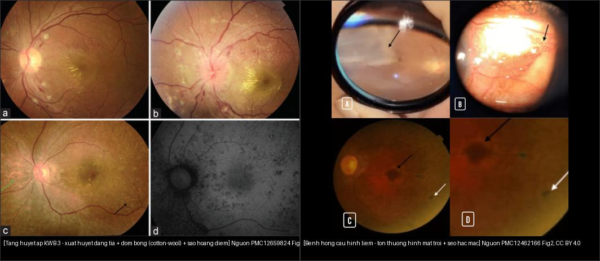
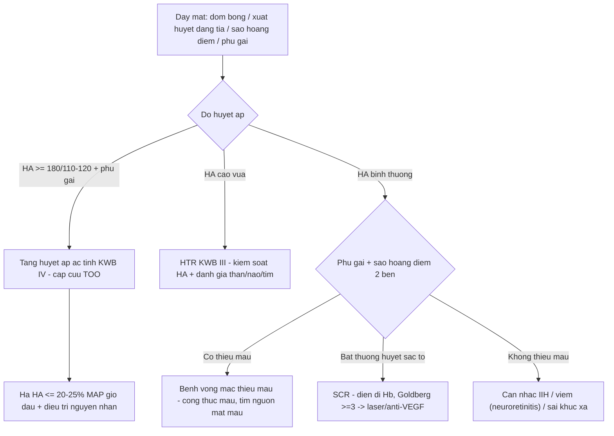
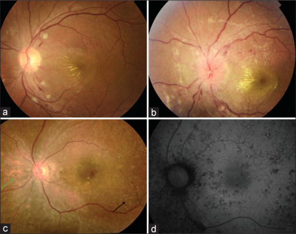
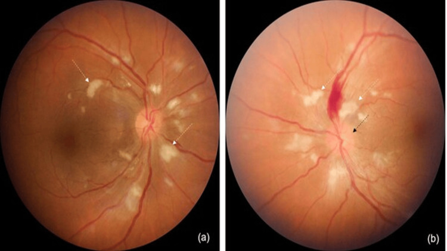
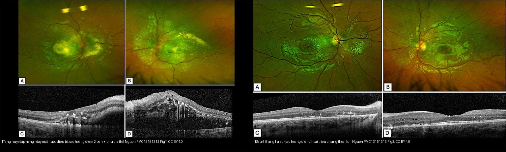
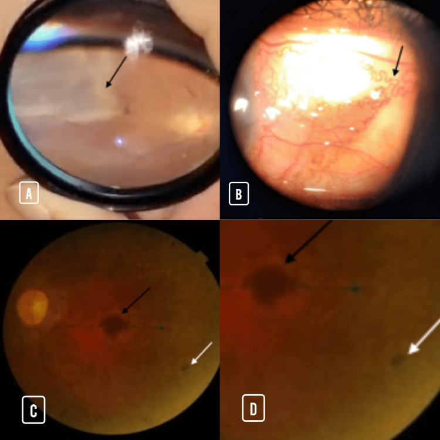
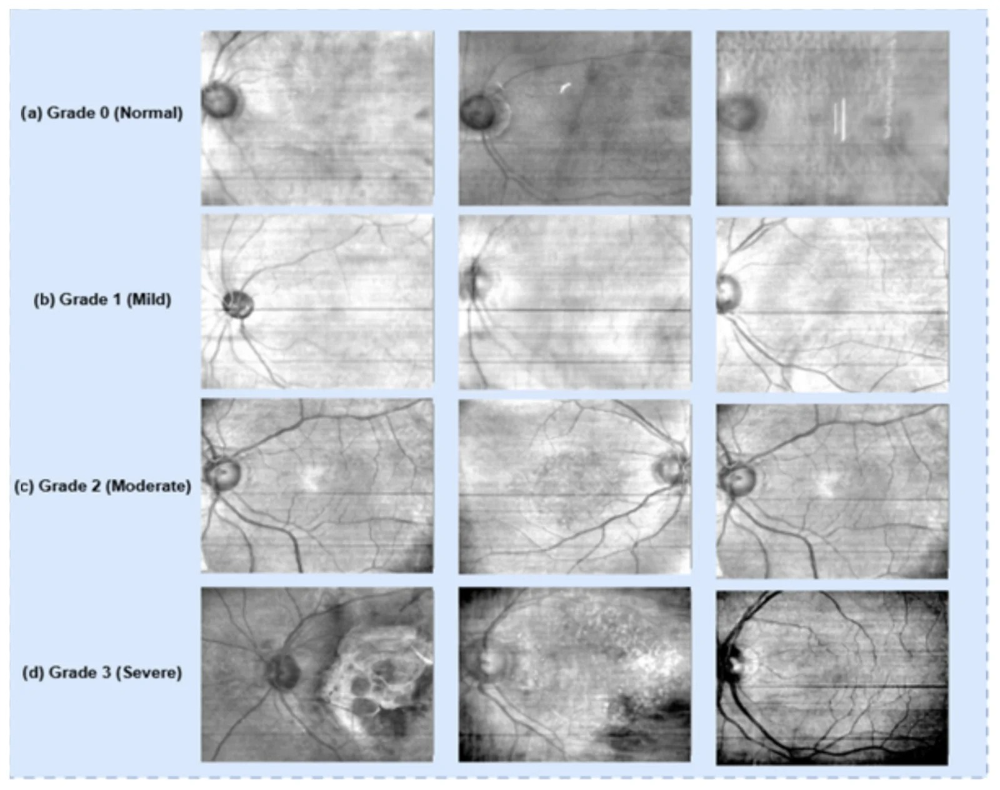

# 453 — Bệnh võng mạc do tăng huyết áp & bệnh máu / Hypertensive & hematologic (anemic) retinopathy

**Tags:** `pattern:benh-vong-mac-tang-huyet-ap` `vung:vong-mac` `score:Keith-Wagener` `score:Goldberg` `protocol:soi-day-mat`
**Mức chắc chắn (certainty):** tổng hợp y văn (literature synthesis) — nhóm tự biên từ 6 nguồn mở (Indian J Ophthalmol 2025 CC BY-NC-SA + Cureus 2025 CC BY + BMC Ophthalmol 2026 CC BY + Diagnostics 2026 CC BY + Bioengineering 2026 CC BY + J Clin Med/Cureus CC BY), chưa gắn ca nguyên văn đơn lẻ.

## 1. Tổng quan — cùng một đáy mắt "tăng áp/thoát huyết tương", hai cơ chế khác nhau

- **Nguyên lý gộp (bản chất):** cả **tăng huyết áp (hypertension — HTN)** và **bệnh máu (thiếu máu/hemoglobinopathy/leukemia)** đều làm **hàng rào máu–võng mạc (blood–retinal barrier) vỡ** và **tắc các mạch nhỏ tiền mao mạch** → chung một "bộ dấu" gồm **co/nick tiểu động mạch, đốm bông, xuất huyết, phù**. Phân biệt **không dựa vào một dấu đơn lẻ** mà dựa vào **bối cảnh hệ thống (huyết áp? công thức máu?)** + **kiểu/thời điểm tổn thương**.
- **Cơ chế tăng huyết áp (vì sao ra hình ảnh):**
  - Tăng áp lực nội mạch phá **tự điều hòa (autoregulation)** → giai đoạn **co mạch (vasoconstrictive)** rồi **xơ hóa thành mạch (arteriolosclerosis)** → **nick động–tĩnh mạch (arteriovenous nicking)** khi tiểu động mạch xơ đè tĩnh mạch tại giao thoa.
  - **Đốm bông (cotton-wool spot)** = **nhồi máu lớp sợi thần kinh (retinal nerve fiber layer — RNFL)** → ứ **vật liệu vận chuyển trục (axoplasmic transport)** → đám trắng mờ bờ tua.
  - **Xuất huyết dạng tia (flame/splinter hemorrhage)** nằm **nông ở lớp sợi thần kinh** nên **xòe ngang theo sợi** — khác **xuất huyết chấm–đốm (dot-blot)** ở **lớp sâu** (sâu hơn → tròn, gặp trong đái tháo đường).
  - **Sao hoàng điểm (macular star):** dịch **giàu lipid** thoát vào **lớp rối ngoài dày (Henle)** → lắng đọng **hình nan hoa/cánh sao quanh hoàng điểm**; phù đĩa ở giai đoạn ác tính là **bệnh thần kinh thị do thiếu máu (ischemic optic neuropathy)** chứ **không** phải tăng áp nội sọ.
- **Cơ chế thiếu máu (vì sao ra hình ảnh):** giảm hemoglobin → **giảm vận chuyển oxy** → võng mạc thiếu oxy → **giãn mạch + tăng lưu lượng + tổn thương nội mô** → xuất huyết, đốm bông, **tĩnh mạch giãn/vằn (venous tortuosity)**. **Roth spot** = xuất huyết có **trung tâm trắng** (cục fibrin/đốm bông nằm giữa ổ xuất huyết).
- **Ngưỡng định lượng nằm lòng:**
  - Xếp độ **Keith–Wagener–Barker (KWB)** I–IV; **tăng huyết áp ác tính (malignant HTN)** = huyết áp tâm thu **≥ 180 mmHg** hoặc tâm trương **110–120 mmHg** + phù gai; **phù gai (= KWB IV)** là **cấp cứu nội khoa**, tổn thương cơ quan đích (TOO) gồm mắt–thận–não–tim.
  - **Bệnh võng mạc thiếu máu (anemic retinopathy):** **Hb < 8,95 g/dL** dự báo có bệnh võng mạc (Se **85,8%**, Sp **68,9%**); **hematocrit < 30,5%** (Se **80%**); nên **soi đáy mắt khi Hb < 10 g/dL**; Hb trung bình nhóm bệnh võng mạc **7,82 ± 1,64 g/dL**.

## 2. Mẫu hình + chẩn đoán phân biệt theo cơ chế (gamut)

- **Tăng huyết áp cấp/thoát huyết tương (exudative):** đốm bông + xuất huyết dạng tia + phù võng mạc/**sao hoàng điểm** + có thể **phù gai** → HTN nặng (KWB III–IV), hội chứng não sau có hồi phục (**PRES**), tiền sản giật.
- **Tăng huyết áp mạn/xơ mạch (sclerotic):** co tiểu động mạch, **nick AV**, động mạch "dây đồng/dây bạc" → không đặc hiệu, gặp cả ở người **già bình thường**.
- **Thiếu máu/bệnh máu (hemorrhagic-anemic):** xuất huyết dạng tia + đốm bông + **Roth spot** + tĩnh mạch giãn, **giảm thị lực đột ngột** do xuất huyết hoàng điểm.
- **Bệnh hồng cầu hình liềm (sickle cell retinopathy — SCR):** tắc tiền mao mạch ngoại vi → **NPSR** (mảng cá hồi/salmon patch, đốm óng ánh, **đốm mặt trời đen/black sunburst**) → **PSR** với **"quạt biển" (sea fan)** tân mạch, tự nhồi máu thành quạt trắng.
- **Đái tháo đường (gamut chéo — bài 443):** xuất huyết **chấm–đốm sâu** + **phù hoàng điểm** + **MAs/HE**; tăng huyết áp hay **đi kèm** (thường phải chủ động tìm HTR khi đọc DR).
- **Tắc mạch võng mạc (gamut chéo — bài 444):** ổ **tím sẫm** một vùng (nhồi máu) ± **cherry-red spot**, diễn tiến **giờ–ngày**, khác HTR/thiếu máu lan tỏa hai bên.

## 3. Bảng so sánh phân biệt (ma trận đối chiếu)

| Thực thể (entity) | Hình ảnh điển hình | Chốt vào (rule-in) | Chốt loại (rule-out) | Gợi ý xác nhận |
|---|---|---|---|---|
| HTR mạn KWB I–II | Co tiểu động mạch nhẹ, **nick AV**, "dây đồng/bạc" | **HA tăng kéo dài + nick AV hai bên** | Nick AV đơn độc ở người già → **không** gọi bệnh võng mạc | Đo HA nhiều lần, theo dõi định kỳ |
| HTR cấp/ác tính KWB III–IV | **Đốm bông + xuất huyết dạng tia + sao hoàng điểm**, KWB IV có **phù gai** | **HA ≥ 180/110–120 mmHg + phù gai/sao hoàng điểm** | HA bình thường → tìm **thiếu máu**/IIH/viêm | Đo HA tức thì, CBC, (nghi ngờ) MRI não nếu PRES |
| Bệnh võng mạc thiếu máu | Xuất huyết dạng tia + đốm bông + **Roth spot**, tĩnh mạch giãn | **Hb < 8,95 g/dL hoặc Hct < 30,5% + hai bên** | Hồng cầu bình thường + HA cao → HTR | **Công thức máu** (Hb, Hct), nội soi/tìm nguồn máu |
| Sickel cell (SCR) | **NPSR:** mảng cá hồi/đốm mặt trời; **PSR:** **quạt biển** | **Bệnh hồng cầu hình liềm + tổn thương ngoại vi/quạt biển** | Tổn thương trung tâm đơn độc → nghĩ khác | Điện di Hb, soi đáy mắt góc rộng định kỳ |
| Bệnh máu (leukemia) | **Xuất huyết hoàng điểm đột ngột** ± Roth spot, giảm thị lực nhanh | **Thiếu máu + giảm tiểu cầu ± tăng bạch cầu** | Công thức máu bình thường → loại | CBC + tủy đồ, khám huyết học |
| Viêm (neuroretinitis — bắt chước) | Phù gai + **sao hoàng điểm**, hội chứng nhiễm trùng/viêm | **Bối cảnh viêm + (HA có thể bình thường)** | **HA rất cao + thận** → HTR giả neuroretinitis | Huyết thanh/nội soi đáy mắt; **đo HA trước khi kết luận** |

*Trái: sao hoàng điểm + xuất huyết dạng tia + đốm bông (PMC12659824 Fig. 1, CC BY-NC-SA). Phải: tổn thương "mặt trời" (mũi tên đen) + sẹo hắc mạc (mũi tên trắng) trong bệnh hồng cầu hình liềm (PMC12462166 Fig. 2, CC BY 4.0). Ảnh ghép letterbox.*

**Quiz composite:** che 2 nhãn, hỏi dấu nào (sao hoàng điểm hai bên vs tổn thương ngoại vi hình mặt trời) phân biệt trái/phải?

<b>Bấm để hiện đáp án</b>

- **Trái = bệnh võng mạc tăng huyết áp (HTR):** tổn thương **trung tâm/hoàng điểm** — sao hoàng điểm (dịch giàu lipid ở lớp Henle) + xuất huyết dạng tia (nông) + đốm bông (nhồi RNFL); **hai bên**, kèm **HA tăng**.
- **Phải = bệnh võng mạc hồng cầu hình liềm:** tổn thương **ngoại vi** — đốm "mặt trời" (black sunburst, tăng sắc tố quanh mạch tắc) + **sẹo hắc mạc**; bệnh cảnh **thiếu máu tán huyết**.
- **Chốt phân biệt:** **vị trí + bối cảnh hệ thống** — trung tâm/hoàng điểm + HA cao = HTR; ngoại vi + hemoglobinopathy = SCR.

## 4. Protocol chụp + hệ phân độ (KWB, Goldberg) & tiếp cận

- **Bước 0 — luôn ĐO HUYẾT ÁP** ở mọi bệnh nhân **phù gai / sao hoàng điểm / xuất huyết võng mạc hai bên** (kể cả trẻ em — đo HA theo tuổi/bách phân vị).
- **Khám:** soi đáy mắt giãn đồng tử hai bên; **chụp đáy mắt/ảnh góc rộng (widefield)** để theo dõi; **OCT hoàng điểm** (phù/dịch dưới võng mạc, sao hoàng điểm); **FFA/ICG** khi nghi viêm–thiếu máu; **OCT-RNFL** khi nghi bệnh thần kinh thị (bài 442/433).
- **Phân độ Keith–Wagener–Barker (KWB):**
  - **I:** co tiểu động mạch nhẹ, có thể vằn nhẹ.
  - **II:** co rõ + **nick AV** + thay đổi xơ mạch ("dây đồng/bạc").
  - **III:** II + **đốm bông, xuất huyết dạng tia, hard exudate (sao hoàng điểm)** = bệnh võng mạc "thực sự" (−)về mặt hình ảnh).
  - **IV:** III + **phù gai (papilledema)** = **tăng huyết áp ác tính → cấp cứu (TOO)**.
- **Phân độ Goldberg (bệnh hồng cầu hình liềm — SCR):** **1** tắc tiểu động mạch ngoại vi; **2** thông nối tiểu động–tĩnh mạch ngoại vi; **3** tân mạch/xơ (**sea fan**); **4** xuất huyết dịch kính; **5** bong võng mạc. NPSR ≈ mảng cá hồi/đốm mặt trời **không** tân mạch; điều trị khi **Goldberg ≥ 3** (laser tán/cản hoặc anti-VEGF, cắt dịch kính khi biến chứng).
- **Xử trí tăng huyết áp ác tính:** hạ HA **có kiểm soát** (không tụt quá nhanh — giảm MAP khoảng **≤ 20–25% trong giờ đầu**) để tránh nhồi máu thần kinh thị/não; điều trị nguyên nhân (bệnh thận, hẹp động mạch thận, tiền sản giật).

## 5. Biến thể bình thường và cạm bẫy

- **Phù gai + sao hoàng điểm bị nhầm "viêm thần kinh thị võng mạc (neuroretinitis)" → cho corticoid oan.** Ca trẻ **9 tuổi** (HA **165/118 mmHg**, hẹp động mạch thận một bên, thận thiểu sản) khởi đầu được chẩn đoán neuroretinitis; **hạ HA 6 tháng** làm sạch sao hoàng điểm + phù gai, thị lực hồi phục (PMC13151313). **Luôn đo HA trước khi kết luận viêm.**
- **HA rất cao giả "phù gai do tăng áp nội sọ/IIH"** — cùng chân dung nhưng cơ chế khác hoàn toàn (đọc bối cảnh + HA).
- **Nick AV ở người già là biến thể của lão hóa mạch**, không đủ gọi bệnh võng mạc — tránh overcall KWB I–II.
- **Đọc độ sâu xuất huyết:** nông/xòe tia (HTR, thiếu máu, tăng áp) vs sâu/chấm-đốm (đái tháo đường) — nhưng cả hai có thể **đi kèm** ở bệnh nhân đái tháo đường + tăng huyết áp; không gán một nguyên nhân.
- **Bệnh võng mạc thiếu máu có thể chỉ điểm bệnh nền tiềm ẩn** (ung thư, loét chảy máu, thalassemia) → **đi tìm nguồn thiếu máu**, không dừng ở mắt.
- **Hai bên nhưng không đối xứng** (ca PRES: phải KWB 3, trái KWB 4) vẫn tính là **bệnh hệ thống** — đừng loại vì một mắt "nhẹ".

## 6. Tự lượng giá — Blind Quiz

**Ca 1 — Nữ, huyết áp không được kiểm soát, mờ mắt hai bên. Đáy mắt dưới đây:**

- Gợi ý lâm sàng: người lớn, HA cao, nhìn mờ hai bên.
- Hỏi: mô tả các dấu chính? Đây là bệnh võng mạc gì và xếp độ nào? Nếu thêm **phù gai** thì đổi xếp độ/xử trí ra sao?

<b>Bấm để hiện đáp án (findings + chẩn đoán)</b>

- Dấu hiệu (findings): **xuất huyết dạng tia (splinter)** + **đốm bông (cotton-wool)** + **sao hoàng điểm/tiết dịch hoàng điểm** đang thoái triển.
- Chẩn đoán (diagnosis): **bệnh võng mạc tăng huyết áp KWB III**.
- Nếu **thêm phù gai** → **KWB IV = tăng huyết áp ác tính**, **cấp cứu** (tổn thương cơ quan đích), phải hạ HA có kiểm soát + tìm nguyên nhân (thận/tiền sản giật).
- Nguồn ảnh: Indian J Ophthalmol 2025 (PMC12659824) Fig. 1, CC BY-NC-SA.

**Ca 2 — Bệnh nhân HA 240/120 mmHg, co giật, đáy mắt một bên có phù gai:**

- Hỏi: dấu nào cho thấy KWB IV? Hội chứng thần kinh đi kèm là gì? Nguyên tắc hạ HA?

<b>Bấm để hiện đáp án (findings + chẩn đoán)</b>

- Dấu hiệu (findings): **đốm bông hai bên** (mũi tên trắng) + **xuất huyết dạng tia** + **phù gai (disc edema, mũi tên đen)** mắt trái.
- Chẩn đoán (diagnosis): **bệnh võng mạc tăng huyết áp KWB IV** trong **tăng huyết áp ác tính**; MRI não cho **PRES** (tăng tín hiệu T2/FLAIR vỏ–dưới vỏ hai bên) kèm **co giật**.
- Xử trí: nhập ICU, **hạ HA có kiểm soát** (≤ 20–25% MAP giờ đầu) + theo dõi thần kinh/thận; thị lực thường hồi phục khi HA ổn.
- Nguồn ảnh: Cureus 2025 (PMC12095965) Fig. 1, CC BY 4.0.

**Ca 3 — Bé gái 9 tuổi, mờ mắt hai bên nặng, được nghĩ "neuroretinitis". Đáy mắt (trái) và đáy mắt sau điều trị (phải):**

- Hỏi: vì sao KHÔNG nên kết luận neuroretinitis ngay? Xét nghiệm nào bị bỏ sót? Nhìn cặp ảnh trước–sau rút ra điều gì?

<b>Bấm để hiện đáp án (findings + chẩn đoán)</b>

- Dấu hiệu (findings): **phù gai + sao hoàng điểm hai bên** + xuất huyết dạng tia (dễ nhầm neuroretinitis/papilledema).
- Chẩn đoán (diagnosis): **bệnh võng mạc tăng huyết áp giả neuroretinitis ở trẻ** — bệnh nhân **HA 165/118 mmHg**, **hẹp động mạch thận một bên + thận thiểu sản** (chỉ đóng góp **7%** chức năng thận).
- Bài học: trẻ có **phù gai/sao hoàng điểm phải ĐO HUYẾT ÁP** (dù hiếm); hạ HA (amlodipine/enalapril/acebutolol) **hồi phục thị lực + thoái lui ổ dịch trong 6 tháng** — nguồn ảnh: BMC Ophthalmol 2026 (PMC13151313) Fig. 1 & 3, CC BY 4.0.

**Ca 4 — Bệnh nhân thiếu máu/hemoglobinopathy, tổn thương ngoại vi + sẹo hắc mạc; phân độ theo Goldberg:**

- Hỏi: đây là nhóm NPSR hay PSR? Phân độ Goldberg gồm những mốc nào? Khi nào cần can thiệp?

<b>Bấm để hiện đáp án (findings + chẩn đoán)</b>

- Dấu hiệu (findings): **tổn thương "mặt trời" (black sunburst — mũi tên đen)** + **sẹo hắc mạc (mũi tên trắng)** ở ngoại vi → tổn thương tắc mạch nhỏ ngoại vi (**NPSR**).
- Phân độ **Goldberg 1–5**: 1 tắc tiểu động mạch → 2 thông nối động–tĩnh mạch → **3 quạt biển (sea fan, tân mạch)** → 4 xuất huyết dịch kính → 5 bong võng mạc.
- Ngưỡng hành động: **Goldberg ≥ 3** → cân nhắc **laser tán/cản** hoặc **anti-VEGF**, cắt dịch kính khi xuất huyết dịch kính/bong võng mạc co kéo.
- Nguồn ảnh: Cureus 2025 (PMC12462166) Fig. 2, CC BY 4.0.

**Ca 5 — Sơ đồ en-face OCT xếp độ bệnh võng mạc tăng huyết áp (Grade 0–3). Nhìn hình, đọc thứ tự độ:**

- Hỏi: hình nào là độ nặng nhất? Công cụ này hỗ trợ gì cho phân độ KWB?

<b>Bấm để hiện đáp án</b>

- Panel: **(a) Grade 0 bình thường → (b) 1 nhẹ → (c) 2 trung bình → (d) 3 nặng** theo sơ đồ "lấy cảm hứng KWB".
- **En-face OCT** phản ánh tổn thương **mạch máu võng mạc theo bản đồ phẳng (mật độ mạch)** — hỗ trợ **khách quan hóa/chuẩn hóa phân độ** (đặc biệt cho trí tuệ nhân tạo), bổ sung cho soi đáy mắt lâm sàng.
- Nguồn ảnh: Bioengineering 2026 (PMC13603191) Fig. 1, CC BY 4.0.

## Bài liên quan chéo
- [400 – Tổng quan Mắt & thị giác](../400-tong-quan-mat-thi-giac/lesson.md) (bảng DDx mắt)
- [443 – Võng mạc đái tháo đường](../443-vong-mac-dai-thao-duong/lesson.md) (xuất huyết chấm–đốm sâu; HA hay đi kèm)
- [444 – Tắc mạch võng mạc (CRVO/BRVO/CRAO)](../444-tac-mach-vong-mac/lesson.md) (nhồi máu vùng, cherry-red)
- [451 – Biểu hiện mắt của bệnh hệ thống](../451-he-thong-mat/lesson.md) (bệnh hệ thống → mắt)
- [433 – Phù đĩa thị vs drusen](../433-phu-dia-thi-drusen/lesson.md) (phù gai không do HA)
- [430 – Đường thị giác](../430-duong-thi-giac/lesson.md) (phù gai thật vs giả)

## Ảnh
- Tên file: `453_slug_Modality_SourceID.jpg`; nguồn + giấy phép từng ảnh trong `images/CREDITS.md`.
- Ảnh CC BY-NC-SA (PMC12659824) giữ **nguyên bản** trong composite, **không crop/kéo giãn**.
- AuntMinnie (Case of the Day): chỉ dẫn link, không tải.

> Không dùng để chẩn đoán độc lập khi chưa có người hướng dẫn.
