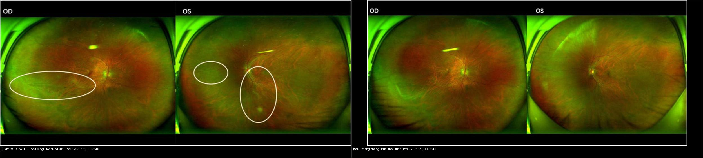
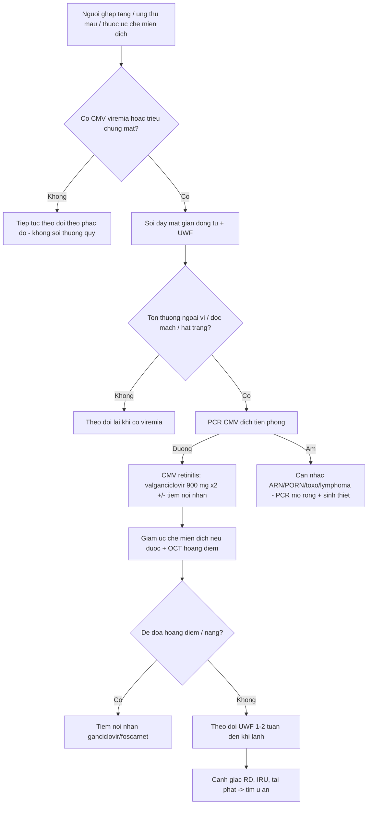
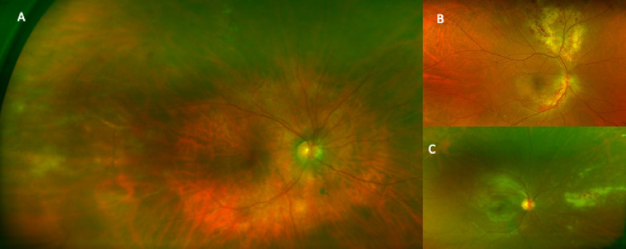
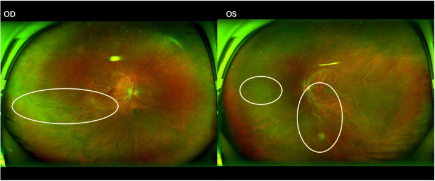
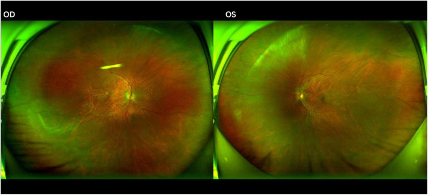
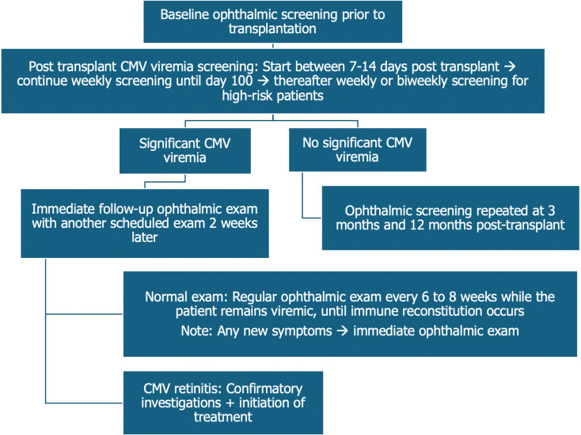
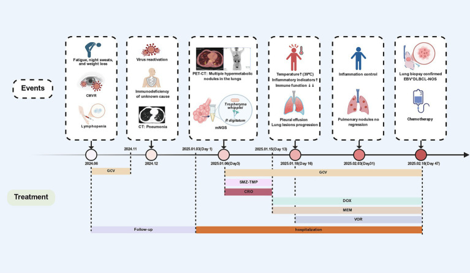

# 454 — Viêm võng mạc–màng mạch ở người suy giảm miễn dịch KHÔNG HIV: CMV sau ghép tạng/ung thư máu / CMV retinitis in non-HIV immunocompromised hosts

**Tags:** `pattern:hoai-tu-vong-mac` `vung:vong-mac` `protocol:UWF` `protocol:PCR-dich-tien-phong` `incidentaloma:CMV-sau-ghep`
**Mức chắc chắn (certainty):** tổng hợp y văn (literature synthesis) — nhóm tự biên từ 5 nghiên cứu mở (JOII 2026 CC BY 4.0; Front Med 2025 CC BY 4.0; World J Stem Cells 2025 CC BY-NC 4.0; Front Med 2026 CC BY 4.0; Ther Adv Ophthalmol 2026 CC BY-NC 4.0), chưa gắn ca nguyên văn đơn lẻ.

## 1. Tổng quan — cùng một virus, nhưng "chân dung" khác hẳn HIV

- **Bệnh học (pathology):** *Cytomegalovirus* (CMV, họ Herpesviridae) lây theo đường máu tới **võng mạc** và **biểu mô sắc tố võng mạc (RPE)**, gây **hoại tử toàn chiều dày võng mạc** + **viêm mạch (vasculitis)** → mảng trắng đục + xuất huyết dọc mạch. Ở người **suy giảm miễn dịch không HIV** (ghép tạng, ung thư máu, thuốc ức chế miễn dịch, bệnh tự miễn, suy giảm bẩm sinh, đái tháo đường typ 2 kiểm soát kém), khiếm khuyết chủ yếu là **tế bào T CD4/CD8** — virus thoát kiểm soát dù không có HIV.
- **TẠI SAO hình thái khác HIV:** ở HIV giai đoạn muộn, **CD4 rất thấp** nên **viêm rất ít**, tổn thương thiên về **hạt/xuất huyết ("bánh pizza")**. Ở người ghép/ung thư máu, miễn dịch **ức chế nhưng không triệt để** → **viêm dịch kính nhiều hơn**: loạt 117 mắt cho thấy **viêm dịch kính độ +2 gặp 34,8% ở HIV âm tính vs 19,7% ở HIV dương tính (p = 0,009)**, trong khi thị lực nền lại **tốt hơn** ở nhóm HIV âm tính (**1,31 ± 1,17 logMAR vs 1,85 ± 1,14 logMAR, p = 0,045**). Vì vậy nhóm không HIV **dễ bị nhầm với ARN (acute retinal necrosis)** hơn.
- **Ngưỡng định lượng nằm lòng:**
  - **CD4 trung vị 167 tế bào/µL** ở loạt 6 bệnh nhân CMV retinitis sau **ghép tế bào gốc tự thân (auto-HCT)**; **102 tế bào/µL** ở ca CMV retinitis khởi phát của u lympho ẩn (EBV+ DLBCL).
  - **Tỷ lệ CMV retinitis sau ghép tế bào gốc ở trẻ ~4%**, xuất hiện **6 tuần – 6 tháng sau ghép** (cửa sổ tái tạo miễn dịch).
  - Sàng lọc **chụp võng mạc góc rộng (UWF, Optomap ~200°)** ở 39 người ghép tế bào gốc đồng loài có CMV tái hoạt: phát hiện **1 ca không triệu chứng (2,6%)** — tổn thương **viêm quanh tĩnh mạch ngoại vi + xuất huyết** ở **ngày 251 sau ghép**; **CMV PCR máu âm tính tại thời điểm chẩn đoán**, chỉ **PCR dịch tiền phòng dương**.
  - **66,7% hai mắt** và **66,7% có CMV DNAemia** trong loạt auto-HCT; **tử vong do mọi nguyên nhân 83,3% (5/6)** vì nhiễm trùng/nặng bệnh nền.
- **TẠI SAO OCT/ảnh đáy mắt (không phải CT/MRI):** tổn thương là **bề mặt võng mạc–hắc mạc**, không nằm trong hộp sọ; **OCT** đo **phù hoàng điểm (macular edema)**, **mỏng/hoại tử võng mạc**, bất thường **giao diện dịch kính–võng mạc**. **Siêu âm B** chỉ dùng khi phương tiện trong suốt kém (bài 411).

## 2. Mẫu hình + chẩn đoán phân biệt theo mức miễn dịch & hình thái (gamut)

- **Theo loại suy giảm miễn dịch (117 mắt/91 bệnh nhân, 2009–2024):** **ung thư máu** (19 mắt), **thuốc ức chế miễn dịch** (20 mắt — sau ghép hoặc điều trị tự miễn), **ghép tạng đặc/bệnh tự miễn/suy giảm bẩm sinh/ĐTĐ typ 2** (7 mắt), còn lại là **HIV dương tính** (71 mắt). Nhóm **thuốc ức chế miễn dịch** có **viêm bao mạch võng mạc (vascular sheathing) 30% vs 0%** so với nhóm ung thư máu.
- **Theo hình thái trên UWF (3 kiểu):**
  - **Viêm quanh tĩnh mạch (periphlebitis):** viêm quanh mạch ngoại vi + xuất huyết trong võng mạc — **kiểu sớm nhất, thường không triệu chứng** (ca được phát hiện bằng sàng lọc).
  - **Thể tối cấp (fulminant/"brush-fire"):** hoại tử lan rộng + xuất huyết hình ngọn lửa dọc **cung mạch (vascular arcades)** — giống ARN.
  - **Thể hạt (granular):** nhiều **nốt trắng nhỏ rải rác ở võng mạc ngoại vi**, **ít xuất huyết** — dễ bỏ sót vì ngoại vi.
- **Gamut chẩn đoán phân biệt:** **CMV** (chính), **ARN do VZV/HSV**, **PORN (progressive outer retinal necrosis)**, **toxoplasmosis**, **giang mai**, **nấm Candida nội nhãn**, **u lympho nội nhãn (masquerade)**, **bệnh Behçet**.
- **Gợi nhớ "CMV-NEGATIVE":** **C**D4 thấp/ghép tạng, **M**ột hoặc hai mắt, **V**iêm dịch kính (nhiều hơn HIV), **N**goại vi + dọc mạch, **E**arly = quanh tĩnh mạch, **G**ranular/fulminant, **A**queous PCR, **T**ransplant/hematologic malignancy, **I**mmunosuppressive drugs, **V**alganciclovir, **E**xamine cả hai mắt.

## 3. Bảng so sánh phân biệt (ma trận đối chiếu)

| Thực thể (entity) | Hình ảnh điển hình | Chốt vào (rule-in) | Chốt loại (rule-out) | Gợi ý xác nhận |
|---|---|---|---|---|
| **CMV retinitis — không HIV** (ghép/ung thư máu/thuốc) | **Viêm quanh tĩnh mạch ngoại vi**, hạt trắng ngoại vi, hoặc **"brush-fire" dọc cung mạch** + xuất huyết; **viêm dịch kính nhiều hơn HIV** | **Bối cảnh ghép/ung thư máu/thuốc ức chế miễn dịch + CD4 thấp + tổn thương dọc mạch/ngoại vi**; **PCR CMV dịch tiền phòng dương** | Viêm rất ít + tế bào khổng lồ/hoại tử sâu đa ổ → PORN; tổn thương **sát sẹo cũ đơn độc** → toxoplasmosis | **PCR CMV dịch tiền phòng/dịch kính**; **UWF**; OCT hoàng điểm; **không dựa vào PCR máu** |
| ARN (VZV/HSV) | **Hoại tử ngoại vi lan về sau** + **viêm tắc mạch + viêm dịch kính nổi** + viêm tiền phòng | **Viêm nặng + viêm tắc mạch + 1 bên ở người tương đối khỏe** | PCR CMV dương + bối cảnh ghép → CMV | PCR dịch tiền phòng (VZV/HSV/CMV); acyclovir IV nếu ARN |
| PORN (VZV) | **Nhiều ổ đục sâu cực sau**, ranh giới rõ, **tiến triển tính bằng ngày**, gần như **không viêm** | **Suy giảm miễn dịch nặng + đa ổ sâu + lan nhanh** | Hoại tử toàn chiều dày ngoại vi → ARN/CMV | PCR VZV; tiên lượng rất xấu |
| Toxoplasmosis | **Ổ vàng–trắng sát sẹo hắc mạc cũ (satellite)** + viêm dịch kính | **Ổ đơn độc cạnh sẹo cũ** | Tổn thương lan dọc mạch/ngoại vi → CMV | Lâm sàng ± PCR; pyrimethamine–sulfadiazine |
| Nấm Candida nội nhãn | **Nốt mủ (fluff ball) trong dịch kính** + viêm màng bồ đào; đáy mắt mờ | **Bối cảnh nhiễm nấm huyết/đường truyền tĩnh mạch + nốt trong dịch kính** | Tổn thương **dính võng mạc** + dọc mạch → CMV | Cấy máu, dịch kính; kháng nấm |
| U lympho nội nhãn (masquerade) | **Thâm nhiễm màu vàng kem dưới RPE** + viêm dịch kính **dai dẳng**, **không đáp ứng kháng virus** | **Tái phát nhiều lần + không đáp ứng thuốc + bối cảnh ung thư máu** | Đáp ứng rõ với valganciclovir → CMV | PCR/cytology dịch kính, PET-CT, sinh thiết |

*Trái: tổn thương hoại tử vàng–trắng + xuất huyết lan dọc cung mạch, cả hai mắt (Front Med 2025, PMC12575373 Fig. 1, CC BY 4.0). Phải: sau 1 tháng điều trị kháng CMV, tổn thương co lại, bờ rõ, bắt đầu sắc tố (Fig. 2, CC BY 4.0). Ảnh ghép letterbox, giữ nguyên tỷ lệ.*

### Vì sao "nhiều viêm hơn HIV" lại là cạm bẫy
- Ở **HIV**, CD4 rất thấp → **ít viêm** → dễ nhận ra "CMV điển hình". Ở **người ghép/ung thư máu**, phản ứng viêm còn một phần → **viêm dịch kính + viêm bao mạch rõ**, hình ảnh **giống ARN**; nếu chỉ dựa vào "thấy viêm là ARN" sẽ **dùng sai acyclovir** và bỏ sót CMV.
- **PCR dịch tiền phòng là chốt tác nhân**, không phải mức viêm. Đặc biệt ca **không triệu chứng**: **PCR máu âm tính** mà **PCR dịch tiền phòng dương**.

## 4. Protocol chụp + sàng lọc + xử trí

- **Ai cần soi đáy mắt:** người **ghép tạng/ghép tế bào gốc** có **CMV tái hoạt (viremia)**; **ung thư máu** đang hóa trị/ức chế miễn dịch; **thuốc ức chế miễn dịch** liều cao; **suy giảm miễn dịch bẩm sinh**; **ĐTĐ typ 2 kiểm soát kém** kèm triệu chứng mắt.
- **Kỹ thuật:**
  - **Soi đáy mắt giãn đồng tử** (gold standard lâm sàng) + **chụp võng mạc góc rộng (UWF, Optomap ~200°)** — cần để thấy **tổn thương ngoại vi** mà soi thường bỏ sót.
  - **OCT hoàng điểm** đánh giá phù hoàng điểm, mỏng võng mạc, dính dịch kính–võng mạc.
  - **Siêu âm B** khi đục dịch kính/xuất huyết (bài 411).
  - **PCR CMV dịch tiền phòng (aqueous humor)** — ít xâm lấn, **chốt tác nhân**; dịch kính khi cần.
- **Lịch sàng lọc gợi ý (từ loạt ghép):**
  - **Trước ghép:** xét nghiệm **CMV-IgG** (dương tính = nguy cơ tái hoạt).
  - **Sau ghép:** theo dõi **CMV DNAemia** theo phác đồ trung tâm; **soi đáy mắt/khám mắt khi có viremia**; ở trẻ ghép tế bào gốc, cửa sổ nguy cơ **6 tuần – 6 tháng**.
  - **Theo dõi UWF** ở người có tổn thương ngoại vi đã điều trị, vì **tổn thương ngoại vi có thể tiến triển âm thầm**.
- **Điều trị:**
  - **Toàn thân:** **valganciclovir 900 mg × 2/ngày** (cảm ứng) hoặc **ganciclovir IV 5 mg/kg mỗi 12 giờ**; thời gian tùy mức ức chế miễn dịch và đáp ứng.
  - **Tiêm nội nhãn (intravitreal) ganciclovir/foscarnet:** khi tổn thương **đe dọa hoàng điểm** hoặc để bổ trợ; loạt auto-HCT dùng **tiêm nội nhãn là chính**.
  - **Giảm ức chế miễn dịch** khi có thể; ở trẻ kháng trị cân nhắc **liệu pháp tế bào T thích ứng (adoptive T-cell therapy)**.
  - **Corticoid chỉ sau khi đã khống chế virus**; cảnh giác **bong võng mạc (RD)** và **IRU** khi miễn dịch hồi phục.

## 5. Biến thể bình thường và cạm bẫy

- **PCR CMV máu âm tính KHÔNG loại trừ CMV retinitis:** ca sàng lọc có **PCR máu âm tại thời điểm chẩn đoán**, chỉ **dịch tiền phòng dương** — vì vậy **quyết định dựa trên đáy mắt + PCR dịch tiền phòng**, không dựa vào xét nghiệm máu.
- **"Nhiều viêm" không đồng nghĩa ARN:** nhóm không HIV có **viêm dịch kính + viêm bao mạch nhiều hơn HIV** → dễ nhầm ARN; luôn gửi **PCR đa tác nhân** trước khi chốt.
- **Hai mắt là quy luật, không phải ngoại lệ:** **66,7% hai mắt** ở loạt auto-HCT → **luôn khám cả hai mắt**, kể cả mắt không triệu chứng.
- **Tổn thương ngoại vi dễ bị bỏ sót:** soi đáy mắt thường chỉ thấy cực sau; **UWF** là công cụ để không bỏ sót. Thể **hạt** có **ít xuất huyết** nên càng dễ bỏ qua.
- **Tái phát CMV = tìm u ẩn:** ca EBV+ DLBCL khởi phát bằng **CMV retinitis tái phát 5 tháng** + nốt phổi; **CD4 102/µL**. Khi gặp **suy giảm miễn dịch không giải thích + CMV tái phát**, phải **tìm ung thư máu** (PET-CT, sinh thiết).
- **Không chọc/điều trị mù khi chưa loại trừ u lympho nội nhãn:** tổn thương **dai dẳng, không đáp ứng kháng virus** → sinh thiết dịch kính/cytology.
- **Corticoid đơn thuần:** làm bùng phát hoại tử — chỉ dùng sau kháng virus.
- **Bong võng mạc muộn:** theo dõi dài hạn sau khi tổn thương "lặng".

## 6. Tự lượng giá — Blind Quiz

**Ca 1 — Người ghép tế bào gốc đồng loài, không triệu chứng mắt, được chụp UWF vì CMV tái hoạt. Ba kiểu hình thái dưới đây:**

- Gợi ý lâm sàng: không đau, không nhìn mờ; sàng lọc chủ động.
- Hỏi: mô tả 3 kiểu hình thái (A/B/C)? Kiểu nào dễ bỏ sót nhất và vì sao? Xét nghiệm nào chốt tác nhân?

<b>Bấm để hiện đáp án (findings + chẩn đoán)</b>

- Dấu hiệu (findings): **(A) viêm quanh tĩnh mạch** ngoại vi + xuất huyết trong võng mạc — kiểu **sớm/không triệu chứng**; **(B) thể tối cấp "brush-fire"** — hoại tử lan rộng + xuất huyết ngọn lửa dọc cung mạch; **(C) thể hạt** — nốt trắng nhỏ rải rác ngoại vi, **ít xuất huyết**.
- Chẩn đoán (diagnosis): **CMV retinitis** ở người ghép tế bào gốc đồng loài. Kiểu **hạt** và **quanh tĩnh mạch** dễ bỏ sót vì ở **ngoại vi** và **ít xuất huyết** → cần **UWF**.
- Chốt tác nhân: **PCR CMV dịch tiền phòng** (PCR máu có thể âm).
- Nguồn ảnh: J Ophthalmic Inflamm Infect 2026 (PMC13265437) Fig. 1, CC BY 4.0.

**Ca 2 — Bệnh nhân sau ghép tế bào gốc tự thân, nhìn mờ hai mắt. Đáy mắt:**

- Hỏi: mô tả tổn thương? Vì sao đây là CMV chứ không phải ARN? Điều trị và theo dõi?

<b>Bấm để hiện đáp án (findings + chẩn đoán)</b>

- Dấu hiệu (findings): **tổn thương hoại tử vàng–trắng + xuất huyết lan dọc cung mạch**, **hai mắt**; bờ tổn thương chưa rõ.
- Chẩn đoán (diagnosis): **CMV retinitis sau auto-HCT** — bối cảnh ức chế miễn dịch kéo dài, **CD4 trung vị 167/µL**; **PCR CMV dịch tiền phòng** chốt.
- Điều trị: **valganciclovir 900 mg × 2/ngày** hoặc ganciclovir IV ± **tiêm nội nhãn**; giảm ức chế miễn dịch khi có thể; theo dõi UWF/OCT.
- Đối chiếu sau 1 tháng:

- Tổn thương **co lại, bờ rõ, bắt đầu sắc tố** = đáp ứng điều trị; giai đoạn muộn để lại **sẹo teo hắc mạc–võng mạc**.
- Nguồn ảnh: Front Med 2025 (PMC12575373) Fig. 1–2, CC BY 4.0.

**Ca 3 — Trẻ sau ghép tế bào gốc, khi nào và sàng lọc thế nào?**

- Hỏi: cửa sổ nguy cơ? Tỷ lệ gặp? Có nên sàng lọc thường quy mọi bệnh nhi?

<b>Bấm để hiện đáp án (findings + chẩn đoán)</b>

- Dấu hiệu (findings): lưu đồ nêu **thời điểm và tần suất sàng lọc** sau ghép tế bào gốc ở trẻ.
- Chẩn đoán/bối cảnh: CMV retinitis gặp **~4%** bệnh nhi ghép tế bào gốc, thường **6 tuần – 6 tháng sau ghép** (trùng **tái tạo miễn dịch**); triệu chứng **âm thầm** → khám đáy mắt **khi có CMV viremia**.
- Kết luận: **sàng lọc thường quy mọi bệnh nhi còn tranh luận** (tỷ lệ thấp, tốn nguồn lực); **sàng lọc nhắm mục tiêu** ở nhóm nguy cơ cao (viremia, ghép đồng loài, ức chế miễn dịch mạnh).
- Nguồn ảnh: World J Stem Cells 2025 (PMC12305170) Fig. 1, **CC BY-NC 4.0 — giữ nguyên bản, không cắt/ghép**.

**Ca 4 — Nam 66 tuổi, CMV retinitis tái phát sau 5 tháng, kèm nốt phổi. Diễn tiến:**

- Hỏi: vì sao phải tìm bệnh nền? Dấu hiệu nào gợi u lympho? Công cụ nào giúp?

<b>Bấm để hiện đáp án (findings + chẩn đoán)</b>

- Dấu hiệu (findings): **CMV retinitis tái phát** + **nốt phổi mới**, **CD4 102/µL**, CMV DNA máu và dịch tiền phòng cao; tổn thương phổi **không đáp ứng kháng sinh thường**.
- Chẩn đoán (diagnosis): **CMV retinitis tái phát do suy giảm miễn dịch từ u lympho ẩn (EBV+ DLBCL-NOS)**; **PET-CT** phát hiện tổn thương **tăng chuyển hóa** phổi/hạch, **sinh thiết** xác nhận.
- Bài học: **CMV tái phát + suy giảm miễn dịch không giải thích** → tìm **ung thư máu**; **mNGS** hữu ích cho đồng nhiễm hiếm nhưng **chẩn đoán xác định vẫn là mô bệnh học**.
- Nguồn ảnh: Front Med 2026 (PMC12945748) Fig. 2, CC BY 4.0.

## Bài liên quan chéo
- [400 – Tổng quan Mắt & thị giác](../400-tong-quan-mat-thi-giac/lesson.md)
- [452 – Hoại tử võng mạc cấp (ARN) & CMV retinitis ở HIV](../452-hoai-tu-vong-mac-ARN-CMV/lesson.md) (so sánh trực tiếp: HIV vs không HIV)
- [451 – Bệnh hệ thống ở mắt](../451-he-thong-mat/lesson.md) (bệnh tự miễn, thuốc ức chế miễn dịch)
- [446 – Phù hoàng điểm viêm vs DME](../446-phu-hoang-diem-viem/lesson.md) (OCT hoàng điểm)
- [447 – Hội chứng đốm trắng](../447-dom-trang-vong-mac/lesson.md) (viêm võng mạc–hắc mạc)
- [448 – U hắc mạc](../448-u-hac-mac/lesson.md) (masquerade/u nội nhãn)
- [411 – Siêu âm nhãn cầu](../411-sieu-am-nhan-cau/lesson.md) (khi không thấy đáy mắt)

## Ảnh
- `454_cmvr-UWF_Fundus_PMC13265437-Fig1-CCBY.jpg` — J Ophthalmic Inflamm Infect 2026 (PMCID: PMC13265437), CC BY 4.0.
- `454_cmvr-HCT_Fundus_PMC12575373-Fig1-CCBY.jpg`, `454_cmvr-HCT-sau-dieu-tri_Fundus_PMC12575373-Fig2-CCBY.jpg`, `454_cmvr-HCT-seo_Fundus_PMC12575373-Fig3-CCBY.jpg` — Front Med 2025 (PMCID: PMC12575373), CC BY 4.0.
- `454_sang-loc-CMV-sau-ghep_PMC12305170-Fig1-CCBYNC.jpg` — World J Stem Cells 2025 (PMCID: PMC12305170), **CC BY-NC 4.0 (nguyên bản)**.
- `454_dien-tien-dieu-tri-lymphoma_PMC12945748-Fig2-CCBY.jpg` — Front Med 2026 (PMCID: PMC12945748), CC BY 4.0.
- `composite_CMVR-truoc-vs-sau.jpg` — ghép Fig. 1 + Fig. 2 (PMC12575373) bằng `tools/make_composite.py`, CC BY 4.0 (kế thừa).
- Chi tiết giấy phép từng ảnh trong `images/CREDITS.md`. AuntMinnie: chỉ dẫn link, không tải.

> Không dùng để chẩn đoán độc lập khi chưa có người hướng dẫn.
