# 455 — Viêm mạch hệ thống khác ở mắt: Behçet & lupus / Ocular Behçet disease & lupus retinopathy — retinal vasculitis

**Tags:** `pattern:viem-mach-vong-mac` `vung:vong-mac` `protocol:FFA` `protocol:OCT` `protocol:OCTA`
**Mức chắc chắn (certainty):** tổng hợp y văn (literature synthesis) — nhóm tự biên từ y văn mở 2025–2026 (Saudi J Ophthalmol 2025 CC BY-NC-SA + Cureus 2025 CC BY 4.0 + Front Immunol 2025 CC BY 4.0), chưa gắn một ca nguyên văn đơn lẻ xuyên suốt.

## 1. Tổng quan — hai cơ chế khác nhau, cùng tạo "viêm mạch võng mạc"

- **Behçet (bệnh Behçet, Behçet syndrome/BS)** là **viêm mạch hệ thống ảnh hưởng mọi cỡ mạch, ưu thế tĩnh mạch**, cơ chế viêm tự miễn–tăng bạch cầu trung tính. Ở mắt, biểu hiện là **viêm màng bồ đào không u hạt tái phát + viêm mạch võng mạc (retinal vasculitis)** trên nền các đợt bùng phát xen kẽ giai đoạn lui bệnh.
- **Lupus ban đỏ hệ thống (systemic lupus erythematosus, SLE)** gây tổn thương mắt chủ yếu qua **bệnh vi mạch do phức hợp miễn dịch** — mạch máu nhỏ bị lắng đọng phức hợp miễn dịch → **tắc vi mạch, thiếu máu võng mạc**, dẫn tới **đốm bông (cotton wool spots)** và xuất huyết; thể nặng lan rộng và tắc nghẽn nhiều mao mạch gọi là **bệnh võng mạc thể Purtscher (Purtscher-like retinopathy)**.
- **TẠI SAO hai bệnh "khác" lại nhìn "giống" trên ảnh:** cả hai đều đụng vào **thành mạch võng mạc** → trên **chụp mạch huỳnh quang (fundus fluorescein angiography, FFA)** thành mạch **ngấm/thoát thuốc (leakage)**, vùng **giảm tưới máu mao mạch (capillary non-perfusion)** và có thể tân mạch; OCT thấy **phù hoàng điểm (macular edema)**. Khác nhau ở **dịch kính** (Behçet thường có **viêm dịch kính/vitritis**, đục thể kính) và ở **bối cảnh toàn thân** (loét miệng–sinh dục/tổn thương da vs ban cánh bướm/kháng thể kháng nhân).
- **Cơ chế hình ảnh chi tiết:**
  - **FFA = tiêu chuẩn vàng đánh giá hoạt tính**: **thoát thuốc mao mạch lan tỏa kiểu "hình dương xỉ" (fern-like)** đặc trưng của Behçet; **ngấm thành mạch lớn/đĩa thị**, **thiếu máu vùng**, **phù hoàng điểm**, **tân mạch** là các dấu khác. Vì FFA nhìn **hiện tượng "rò" (leakage)** nên là xét nghiệm số một để **xác nhận lui bệnh trước khi giảm thuốc**.
  - **OCT** đo **độ dày/độ phản quang võng mạc** → phát hiện **phù hoàng điểm dạng nang (CME)** và các khuyết nội võng mạc do đợt viêm cũ; **OCTA** thấy **vùng mất tưới máu mao mạch, giãn vùng không mạch trung tâm (FAZ), tổn thương đám rối sâu** nhưng **KHÔNG thấy leakage** — nên **không thay thế FFA** khi cần chứng minh viêm còn hoạt động.
- **Ngưỡng định lượng nằm lòng:**
  - **Behçet:** tổn thương mắt thường xuất hiện **trong vòng 5 năm** sau chẩn đoán BS; **10–15%** ca mắt là **biểu hiện ĐẦU TIÊN**; **loét miệng có thể vắng ở 1–10%**; **hai mắt** (khởi phát một bên rồi lan hai bên); **nam và người trẻ** bệnh nặng hơn.
  - **Yếu tố tiên lượng xấu (Behçet mắt):** **nam giới**, tuổi trẻ, **tổn thương đoạn sau**, đợt **đe dọa thị lực**, thị lực nền kém → cần **sinh học (biologics) sớm**.
  - **Lupus:** **bệnh võng mạc lupus (lupus retinopathy)** là biến chứng mắt **thường gặp và nặng**; nhóm có LR có **SLEDAI trung bình 18 vs 9** (p < 0,001) so với nhóm không LR, kèm **viêm màng phổi 40% vs 20,4%** (p = 0,044) và **hemoglobin thấp hơn** — tức LR đi cùng **bệnh hoạt động mạnh**.

## 2. Mẫu hình + chẩn đoán phân biệt theo vị trí (gamut)

**Câu hỏi lọc 1 — có viêm dịch kính (vitritis) không?**
- **Có vitritis rõ + viêm mạch võng mạc tái phát + loét miệng/sinh dục/da** → **Behçet**.
- **Ít/không vitritis + đốm bông, xuất huyết, bệnh vi mạch ở BN SLE** → **bệnh võng mạc lupus**.

**Câu hỏi lọc 2 — vị trí và tính chất tổn thương:**
- **Ngoại vi, hai bên, thoát thuốc "dương xỉ"** → Behçet; **quanh hoàng điểm/hoàng điểm + thiếu máu tắc nghẽn lan tỏa** → lupus (thể Purtscher-like).
- **Đoạn sau (màng bồ đào sau/võng mạc)** nặng hơn **đoạn trước**; **hypopyon** ("mủ tiền phòng") hầu như luôn đi kèm **tổn thương đoạn sau** — dấu hiệu báo động.

**Gamut "viêm mạch võng mạc" theo nguyên nhân:**
- **Tự miễn–hệ thống:** **Behçet** · **lupus (SLE)** · **sarcoid** · bệnh **GPA/ANCA** · viêm khớp tự phát thiếu niên kèm viêm màng bồ đào · **IBD**.
- **TKTW–thần kinh thị:** **MS** kèm viêm mạch võng mạc (ít gặp) · viêm mạch võng mạc liên quan **nhiễm trùng** (giang mai, lao, toxoplasma, **CMV/ARN** — xem 452).
- **Bệnh mạch nội sinh (không viêm):** **IRVAN**, **Coats** (một bên, xuất tiết lipid), **bệnh Eales** (tân mạch ngoại vi), **bệnh võng mạc tăng huyết áp/thiếu máu** (xem 453).
- **Bắt chước (masquerade):** **u lympho nội nhãn (primary vitreoretinal lymphoma)** — thâm nhiễm dưới biểu mô sắc tố dai dẳng, không đáp ứng kháng virus (xem 452/447).
- **Cạm bẫy "giả lao mắt" ở lupus:** tổn thương lupus thể hạt/chorioretinitis có thể **đọc nhầm thành lao mắt hoặc toxoplasma** — bối cảnh SLE + huyết thanh/xét nghiệm quyết định.

## 3. Bảng so sánh phân biệt (ma trận đối chiếu)

| Thực thể (entity) | Hình ảnh điển hình (đáy mắt/FFA/OCT) | Chốt vào (rule-in) | Chốt loại (rule-out) | Gợi ý xác nhận |
|---|---|---|---|---|
| **Behçet** | **Viêm mạch võng mạc + vitritis**; đáy mắt có ổ viêm võng mạc/xuất huyết; **FFA: thoát thuốc "dương xỉ" lan tỏa**, ngấm đĩa thị, thiếu máu; OCT: **CME** | **Loét miệng/sinh dục tái phát + viêm mạch võng mạc hai mắt + vitritis + đáp ứng với ức chế miễn dịch** | Không vitritis + đốm bông ở BN SLE → lupus | Tiêu chuẩn ISG/ICBD lâm sàng; **FFA**; OCT |
| **Lupus — bệnh vi mạch (nhẹ)** | **Đốm bông (cotton wool)** + xuất huyết dạng tia + **ít vitritis**; FFA: **thiếu máu mao mạch rải rác**, ngấm thành mạch | **SLE hoạt động (SLEDAI cao) + đốm bông hai mắt + ANA/anti-dsDNA (+)** | Viêm võng mạc đặc/ổ kèm vitritis → Behçet/nhiễm trùng | Xét nghiệm miễn dịch, đánh giá hoạt tính SLE |
| **Lupus — thể tắc nghẽn (Purtscher-like)** | **Thiếu máu mao mạch lan tỏa**, **phù hoàng điểm**, xuất huyết, **nối thông ĐM–TM hoàng điểm**, có thể **xuất huyết dịch kính**; thị lực giảm nặng | **SLE + mất thị lực nặng hai bên + tắc nghẽn mao mạch lan tỏa trên FFA** | Chấn thương/viêm tụy (Purtscher kinh điển) — nhưng ảnh giống nhau | FFA + OCT; điều trị ức chế miễn dịch tích cực |
| **Sarcoid** | Viêm mạch võng mạc + **viêm màng bồ đào u hạt**, "nến nhỏ giọt" **candle-wax dripping**, đĩa thị/hạch | **Hạch rốn phổi hai bên + u hạt nến nhỏ giọt** | Không tổn thương toàn thân → Behçet/lupus | CT ngực, ACE, sinh thiết hạch |
| **U lympho nội nhãn (masquerade)** | **Thâm nhiễm dưới RPE dai dẳng**, tế bào dịch kính, **không đáp ứng kháng virus**; MRI não có thể có ổ | **Tổn nhiễm dưới RPE + IL-10 cao trong dịch kính** | Đáp ứng tốt với ức chế miễn dịch/kháng virus → không phải lymphoma | **Sinh thiết dịch kính** (cytokine/IL-10, MYD88) |

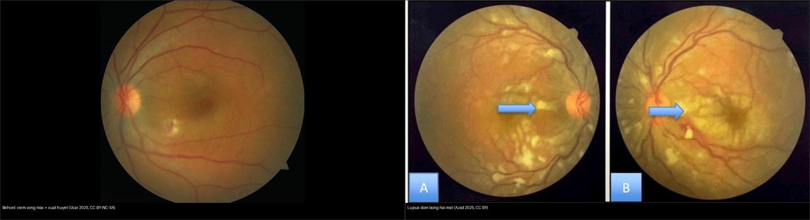
*Trái: **Behçet** — ổ viêm võng mạc kèm xuất huyết (viêm mạch võng mạc). Phải: **lupus SLE** — nhiều **đốm bông (cotton wool)** ở cả hai mắt, dấu hiệu bệnh vi mạch. Nguồn: Ucar D, Esatoglu SN, Saudi J Ophthalmol 2025 (PMC11964342), CC BY-NC-SA 4.0 (trái); Azad MAK et al., Cureus 2025 (PMC12373494), CC BY 4.0 (phải). Ảnh ghép letterbox.*

**Quiz composite:** Cùng là "viêm mạch võng mạc" nhưng hai chân dung. Bên nào gợi ý Behçet, bên nào gợi ý lupus — và dấu hiệu nào tách hai bên về mặt hình ảnh?

<b>Bấm để hiện đáp án</b>

- **Trái = Behçet:** ổ **viêm võng mạc + xuất huyết** kèm nổi bật **viêm dịch kính**; trên FFA là **thoát thuốc "dương xỉ" lan tỏa**.
- **Phải = lupus:** **đốm bông hai mắt** (vi mạch tắc nghẽn) với **ít viêm dịch kính**.
- **Chốt phân biệt hình ảnh:** **mức viêm dịch kính** + **kiểu thoát thuốc trên FFA**; chốt lâm sàng: **loét miệng/sinh dục & tổn thương da (Behçet)** vs **ban/kháng thể ANA–anti-dsDNA (SLE)**.

## 4. Protocol chụp–chẩn đoán + theo dõi + xử trí

**Protocol hình ảnh ở BN nghi viêm mạch võng mạc (Behçet/lupus):**
- **FFA (đường đầu tiên, tiêu chuẩn vàng):** chụp **góc rộng, hai mắt**, ghi các thì; tìm **thoát thuốc mao mạch ("dương xỉ")**, **ngấm thành mạch/đĩa thị**, **thiếu máu mao mạch**, **phù hoàng điểm**, **tân mạch**. FFA dùng để **xác nhận hoạt tính, đánh giá đáp ứng, và chứng minh lui bệnh trước khi giảm/ngừng thuốc**.
- **OCT (theo dõi cấu trúc):** phát hiện và theo dõi **phù hoàng điểm dạng nang (CME)** và tổn thương cấu trúc do đợt viêm cũ; **OCTA** đánh giá **hiện tượng mất tưới máu mao mạch/FAZ** nhưng **không thấy leakage** ⇒ không thay FFA khi cần chứng minh viêm hoạt động.
- **Đánh giá toàn thân song song:** **Behçet** — tiêu chuẩn lâm sàng (loét miệng/sinh dục, tổn thương da, viêm mạch máu lớn/TKTW); **lupus** — ANA/anti-dsDNA, bổ thể, SLEDAI, đánh giá thận/TKTW.
- **Chẩn đoán phân biệt bằng xét nghiệm/mô bệnh** khi cần: huyết thanh/Mantoux/nội soi phế quản (lao/sarcoid), huyết thanh giang mai, **sinh thiết dịch kính** (loại trừ lymphoma masquerade).

**Điều trị & theo dõi (khung):**
- **Behçet viêm đoạn sau:** **glucocorticoid + ức chế miễn dịch**; **azathioprine 2–2,5 mg/kg** (khởi hiệu sau ~3 tháng nên phải **dùng kèm corticoid ban đầu**) và/hoặc **cyclosporine**; **sinh học** (kháng TNF-α như infliximab/adalimumab, **interferon-alpha**, **tocilizumab**; JAK inhibitor là lựa chọn mới) — **ưu tiên sớm ở nam, người trẻ, tổn thương đoạn sau/đe dọa thị lực**. **Giảm corticoid về ≤ 10 mg trong 3 tháng** để giảm tác dụng phụ; không có đồng thuận rõ về khi nào ngừng hẳn → theo dõi FFA.
- **Lupus:** kiểm soát **hoạt tính SLE** là gốc; **methylprednisolone TM** rồi **prednisolone uống 1 mg/kg/ngày**; kèm **ức chế miễn dịch** (cyclophosphamide/tháng, **mycophenolate**, hoặc **rituximab** — đặc biệt khi kèm viêm thần kinh thị); **hydroxychloroquine** nền tảng; điều trị bệnh võng mạc tắc nghẽn nặng phối hợp chuyên khoa.
- **Theo dõi dài hạn:** cả hai bệnh **tái phát đợt** ⇒ cần **FFA định kỳ** + OCT; sàng lọc tổn thương toàn thân (thần kinh, mạch máu lớn, thận) và các biến chứng mắt (tân mạch, phù hoàng điểm, teo thần kinh thị).

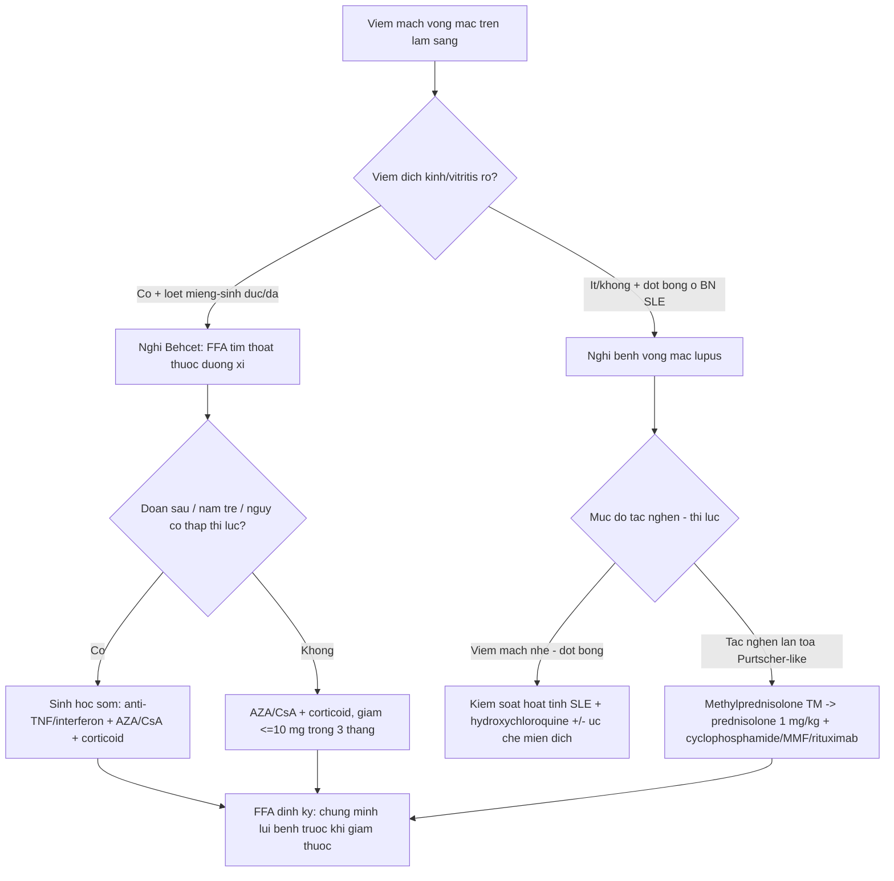

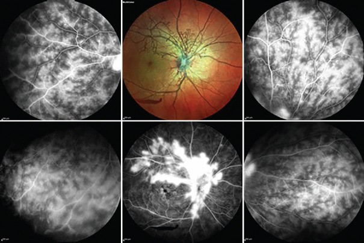
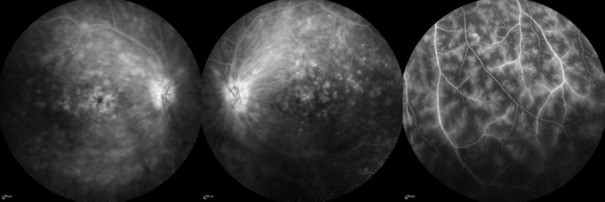
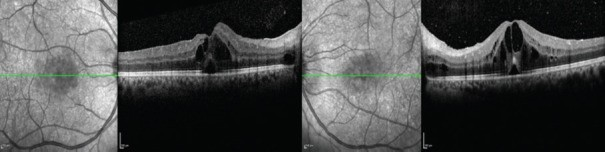
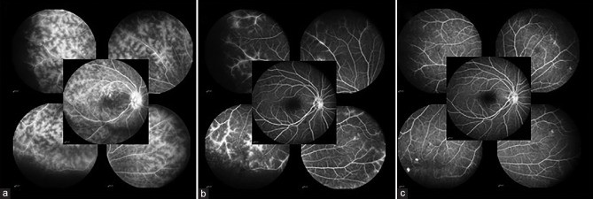
*Hàng 1: Behçet — ảnh multicolor + FFA cho thấy **tân mạch đĩa thị** do viêm dai dẳng, kèm thoát thuốc lan tỏa (Fig. 1, PMC12685267) và **thoát thuốc mao mạch kiểu "dương xỉ"** + ngấm đĩa thị (Fig. 2, PMC11964342). Hàng 2: OCT **phù hoàng điểm hai bên** (Fig. 3, PMC11964342) và FFA **trước và sau 3 tháng điều trị** — thoát thuốc/ngấm đĩa thị giảm rõ (Fig. 4, PMC12685267). Nguồn: Ucar D & Esatoglu SN; Eser-Ozturk H & Tugal-Tutkun I, Saudi J Ophthalmol 2025, CC BY-NC-SA 4.0.*

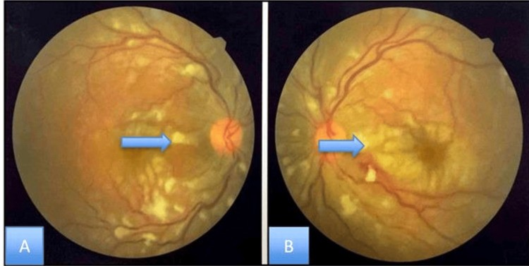
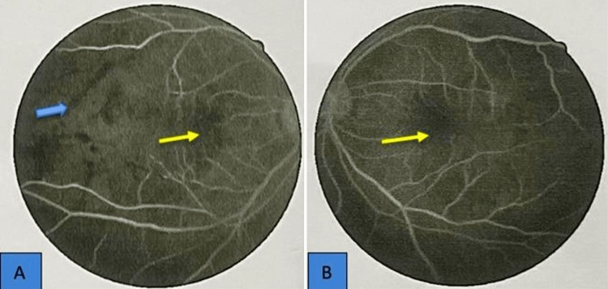
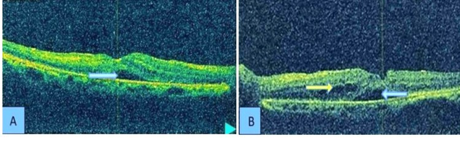
*SLE: **đốm bông (cotton wool) hai mắt** (Fig. 6), FFA viêm mạch võng mạc với **vùng thiếu máu hoàng điểm** (Fig. 3), OCT **phù hoàng điểm dạng nang + dịch dưới võng mạc** (Fig. 4). Nguồn: Azad MAK et al., Cureus 2025 (PMC12373494), CC BY 4.0.*

## 5. Biến thể bình thường và cạm bẫy

- **Behçet có thể "yên lặng" giữa các đợt:** mắt có thể **không còn dấu hiệu viêm lâm sàng** nhưng FFA vẫn còn **thoát thuốc dưới lâm sàng** ⇒ **FFA bắt buộc trước khi giảm/ngừng thuốc**; đừng tin "mắt sạch" bằng soi đáy mắt đơn thuần.
- **OCTA KHÔNG thay FFA:** OCTA thấy mất tưới máu/FAZ nhưng **không thấy leakage** — dùng OCTA để "loại trừ viêm hoạt động" là sai.
- **Đốm bông ở lupus giống nhiều bệnh:** tăng huyết áp, thiếu máu, nhiễm trùng, **Purtscher do chấn thương/viêm tụy** — đốm bông **không đặc hiệu cho lupus**, phải đặt trong bối cảnh SLE hoạt động.
- **Lupus giả lao mắt / giả toxoplasma:** tổn thương lupus dạng hạt hoặc chorioretinitis có thể bị đọc nhầm thành **lao mắt hoặc toxoplasma** (đã có ca lupus retinopathy **giả lao mắt**) ⇒ tránh điều trị kháng lao oan; dựa vào miễn dịch–bối cảnh và đáp ứng điều trị.
- **"Hypopyon" không phải luôn là bệnh riêng của Behçet:** mủ tiền phòng gặp cả trong viêm nội nhãn nhiễm trùng/masquerade — nhưng trong bệnh cảnh Behçet, hypopyon **hầu như luôn kèm tổn thương đoạn sau**, cần soi đáy mắt/FFA ngay.
- **Điều trị chỉ bằng corticoid là bẫy:** Behçet/lupus **tái phát** — corticoid đơn thuần **không duy trì lui bệnh**; cần **ức chế miễn dịch/sinh học nền** và giảm corticoid sớm.
- **Cạm bẫy trung thực nguồn:** các con số dịch tễ (tần suất lupus retinopathy, thời điểm xuất hiện) **khác nhau giữa các nghiên cứu**; bài này ghi rõ nguồn từng số và các số chưa kiểm chứng để "chưa rõ".

## 6. Tự lượng giá — Blind Quiz

**Ca 1 — Nam 28 tuổi, loét miệng tái phát và loét sinh dục, đau mắt đỏ từng đợt, nay nhìn mờ. Đáy mắt:**
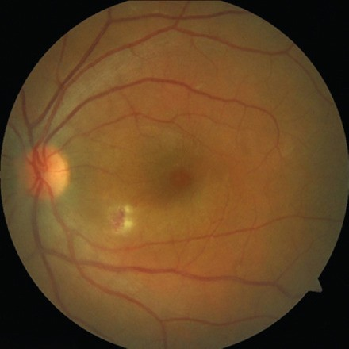

- Hỏi: mô tả tổn thương? Bệnh hệ thống nào nghĩ đến đầu tiên? Xét nghiệm hình ảnh nào cần làm để đánh giá hoạt tính?

<b>Bấm để hiện đáp án (findings + chẩn đoán)</b>

- Dấu hiệu (findings): **viêm võng mạc có xuất huyết** (retinitis with hemorrhage) kèm **viêm dịch kính**.
- Chẩn đoán (diagnosis): **Behçet** — gợi ý bởi **loét miệng + loét sinh dục tái phát + viêm mạch võng mạc**; nguy cơ nặng hơn ở **nam trẻ**.
- Cần làm: **FFA** (đánh giá hoạt tính, tìm thoát thuốc "dương xỉ"/thiếu máu/ngấm đĩa thị) + **OCT** (phù hoàng điểm); khởi **ức chế miễn dịch nền**, cân nhắc **sinh học sớm**.
- Nguồn ảnh: Ucar D & Esatoglu SN, Saudi J Ophthalmol 2025 (PMC11964342) Fig. 1, CC BY-NC-SA 4.0.

**Ca 2 — Cùng bệnh nhân Behçet, FFA dưới đây:**

- Hỏi: gọi tên kiểu thoát thuốc đặc trưng? Các dấu FFA khác có thể gặp? Vì sao FFA quan trọng trước khi giảm thuốc?

<b>Bấm để hiện đáp án (findings + chẩn đoán)</b>

- Dấu hiệu (findings): **thoát thuốc mao mạch lan tỏa kiểu "dương xỉ" (fern-like)**; **ngấm đĩa thị** và ngấm thành mạch lớn; có thể kèm **thiếu máu, phù hoàng điểm, tân mạch**.
- Ý nghĩa: đây là **dấu đặc trưng của Behçet uveitis**; vì mắt có thể yên lặng về lâm sàng giữa các đợt, **FFA xác nhận lui bệnh (hết leakage)** trước khi giảm/ngừng ức chế miễn dịch.
- Nguồn ảnh: Ucar D & Esatoglu SN (PMC11964342) Fig. 2, CC BY-NC-SA 4.0.

**Ca 3 — Behçet, FFA của một mắt trước và sau 3 tháng điều trị:**

- Hỏi: so sánh hai thì? Điều này dạy gì về "thời điểm giảm thuốc"?

<b>Bấm để hiện đáp án (findings + chẩn đoán)</b>

- Dấu hiệu (findings): **trước điều trị** — thoát thuốc mao mạch lan tỏa + ngấm đĩa thị; **sau 3 tháng** — **giảm rõ thoát thuốc và ngấm đĩa thị**.
- Ý nghĩa: FFA là **công cụ theo dõi đáp ứng** và **chứng minh lui bệnh**; chỉ giảm ức chế miễn dịch khi **FFA hết leakage**, không chỉ khi hết triệu chứng.
- Nguồn ảnh: Eser-Ozturk H & Tugal-Tutkun I, Saudi J Ophthalmol 2025 (PMC12685267) Fig. 4, CC BY-NC-SA 4.0.

**Ca 4 — Nữ 26 tuổi SLE, giảm thị lực tiến triển. Đáy mắt:**
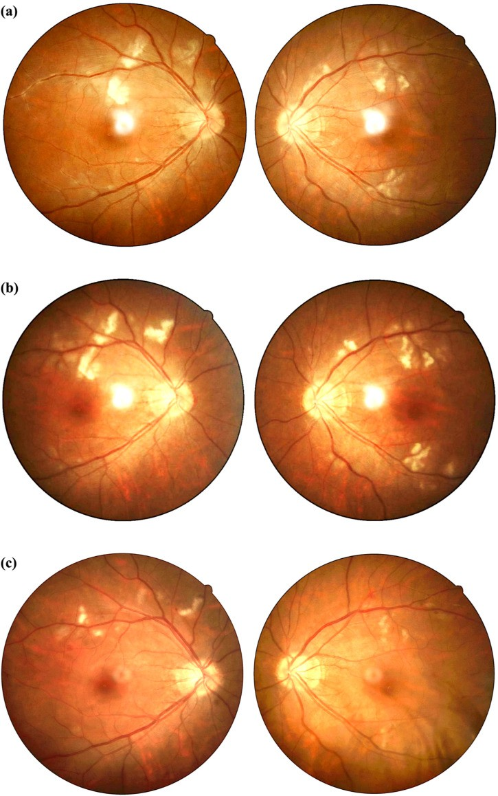

- Hỏi: dấu hiệu? Nghĩ bệnh võng mạc lupus hay viêm mạch Behçet? Vì sao cần soi toàn thân?

<b>Bấm để hiện đáp án (findings + chẩn đoán)</b>

- Dấu hiệu (findings): **phù đĩa thị + tổn thương võng mạc hai bên** (đốm bông/xuất huyết); ca này kèm **viêm thần kinh thị hai bên**.
- Chẩn đoán (diagnosis): **viêm mạch võng mạc + viêm thần kinh thị trong SLE** — nghĩ lupus hơn Behçet vì có **viêm thần kinh thị + SLE mới chẩn đoán**, **ít viêm dịch kính**; điều trị **methylprednisolone + rituximab**.
- Lưu ý: lupus thể này có thể **giả lao mắt/toxoplasma**; đánh giá miễn dịch–toàn thân để tránh điều trị oan.
- Nguồn ảnh: Jin D et al., Front Immunol 2025 (PMC12399518) Fig. 1, CC BY 4.0.

**Ca 5 — Một bệnh nhân SLE khác: FFA và OCT dưới đây:**

- Hỏi: gọi tên tổn thương? Cơ chế tắc nghẽn mao mạch? Điều trị nền tảng?

<b>Bấm để hiện đáp án (findings + chẩn đoán)</b>

- Dấu hiệu (findings): FFA — **thoát thuốc thành mạch + vùng thiếu máu mao mạch quanh hoàng điểm**; OCT — **phù hoàng điểm dạng nang + dịch dưới võng mạc**.
- Cơ chế: **lắng đọng phức hợp miễn dịch ở mạch máu nhỏ** → tắc vi mạch → thiếu máu → thoát dịch; đốm bông là **nhồi máu sợi trục (khoảng chất trắng sợi võng mạc)**.
- Điều trị: **kiểm soát hoạt tính SLE** (hydroxychloroquine nền + glucocorticoid + ức chế miễn dịch); các ca này **methylprednisolone TM rồi prednisolone 1 mg/kg + cyclophosphamide/tháng**.
- Nguồn ảnh: Azad MAK et al., Cureus 2025 (PMC12373494) Fig. 3, 4, CC BY 4.0.

## Bài liên quan chéo
- [400 – Tổng quan Mắt & thị giác](../400-tong-quan-mat-thi-giac/lesson.md)
- [446 – Phù hoàng điểm viêm vs DME](../446-phu-hoang-diem-viem/lesson.md) (CME do viêm — quyết định steroid vs anti-VEGF)
- [447 – Hội chứng đốm trắng võng mạc](../447-dom-trang-vong-mac/lesson.md) (viêm võng mạc–hắc mạc, DDx viêm màng bồ đào)
- [451 – Biểu hiện mắt của bệnh hệ thống](../451-he-thong-mat/lesson.md) (sarcoid, GPA, IgG4, lymphoma — masquerade)
- [452 – Hoại tử võng mạc cấp (ARN) & CMV](../452-hoai-tu-vong-mac-ARN-CMV/lesson.md) (viêm võng mạc nhiễm trùng — DDx quan trọng)
- [453 – Bệnh võng mạc tăng huyết áp & thiếu máu](../453-benh-vong-mac-tang-huyet-ap-va-thieu-mau/lesson.md) (đốm bông không đặc hiệu cho lupus)

## Ảnh
- `455_behcet-retinitis_Fundus_PMC11964342-Fig1-CCBYNCSA.jpg`, `455_behcet-ffa-leakage_FFA_PMC11964342-Fig2-CCBYNCSA.jpg`, `455_behcet-oct-macular-edema_OCT_PMC11964342-Fig3-CCBYNCSA.jpg` — Ucar D, Esatoglu SN, Saudi J Ophthalmol 2025 (PMCID: PMC11964342), CC BY-NC-SA 4.0.
- `455_behcet-disc-neovascularization_PMC12685267-Fig1-CCBYNCSA.jpg`, `455_behcet-ffa-truoc-sau_FFA_PMC12685267-Fig4-CCBYNCSA.jpg` — Eser-Ozturk H, Tugal-Tutkun I, Saudi J Ophthalmol 2025 (PMCID: PMC12685267), CC BY-NC-SA 4.0.
- `455_lupus-cotton-wool_Fundus_PMC12373494-Fig6-CCBY.jpg`, `455_lupus-ffa-vasculitis_FFA_PMC12373494-Fig3-CCBY.jpg`, `455_lupus-oct-macular-edema_OCT_PMC12373494-Fig4-CCBY.jpg` — Azad MAK et al., Cureus 2025 (PMCID: PMC12373494), CC BY 4.0.
- `455_lupus-retinal-vasculitis_PMC12399518-Fig1-CCBY.jpg` — Jin D et al., Front Immunol 2025 (PMCID: PMC12399518), CC BY 4.0.
- `composite_behcet-vs-lupus.jpg` — ghép 2 ảnh (Fig. 1 PMC11964342 và Fig. 6 PMC12373494) bằng `tools/make_composite.py`.
- Chi tiết giấy phép từng ảnh trong `images/CREDITS.md`. AuntMinnie: chỉ dẫn link, không tải.

> Không dùng để chẩn đoán độc lập khi chưa có người hướng dẫn.
