# 456 — Bệnh võng mạc trẻ sinh non (ROP): zone–stage–plus & AP-ROP / Retinopathy of prematurity

**Tags:** `pattern:rop` `vung:vong-mac` `score:ICROP` `protocol:sang-loc-ROP`
**Mức chắc chắn (certainty):** tổng hợp y văn (literature synthesis) — nhóm tự biên từ y văn mở (Community Eye Health 2017 CC BY-NC; Sci Rep 2020 CC BY; Eye and Vision 2020 CC BY; Clin Exp Pediatr 2022 CC BY-NC; Turk Pediatri Ars 2018 CC BY-NC-SA), chưa gắn ca nguyên văn đơn lẻ.

## 1. Tổng quan — bệnh của mạch máu CHƯA kịp mọc: hai thì sinh bệnh học

- **Bối cảnh (pathology):** mạch máu võng mạc mọc dần từ đĩa thị ra ngoại vi, **hoàn tất ở khoảng tuần 40 sau kinh cuối**. Trẻ càng non, **diện võng mạc ngoại vi vô mạch** càng lớn — đây là "mảnh đất" của ROP. Vì vậy ROP **không có ở trẻ đủ tháng** (trừ bệnh giả ROP bẩm sinh, mục 2).
- **Hai thì (two-phase) — TẠI SAO ra hình ảnh:**
  - **Thì 1 — "độc tính oxy" (từ sinh → ~32 tuần PMA):** bình thường nồng độ oxy trong tử cung thấp; ra đời (kể cả khí trời, nặng hơn khi thở oxy) là **tăng oxy tương đối** → **giảm yếu tố tăng sinh mạch nội mô (VEGF)** qua con đường HIF → **mạch máu võng mạc NGỪNG mọc** → giữ lại vùng vô mạch ngoại vi.
  - **Thì 2 — "thiếu oxy → VEGF" (từ ~32 tuần PMA):** võng mạc vô mạch **thiếu oxy** → **tăng VEGF** → **tân mạch bất thường** mọc ngay ở **ranh giới mạch/vô mạch** (gờ), xuyên vào dịch kính → xơ + co kéo → **bong võng mạc (tractional retinal detachment)**.
  - Hệ quả lâm sàng: ROP nặng lên theo **mức non + oxy liệu pháp**, và **zone càng gần đĩa thị (zone I) càng dễ tiến triển ác tính** (vùng vô mạch rộng + mật độ yếu tố tăng sinh cao) — ROP zone III hiếm khi nặng.
- **Ngưỡng định lượng nằm lòng (theo ICROP / AAP–AAO–AAPOS):**
  - **Sàng lọc:** mọi trẻ **tuổi thai ≤ 30 tuần VÀ/HOẶC cân nặng lúc sinh ≤ 1500 g**; mở rộng cho trẻ **30–32 tuần hoặc 1500–2000 g có bệnh cảnh nặng** (hỗ trợ hô hấp/tim mạch, cần theo dõi theo bác sĩ sơ sinh).
  - **Tần suất bệnh:** tỷ lệ ROP ở trẻ non nhẹ cân ~10–40% tùy quốc gia; tỷ lệ **cần điều trị** chỉ ~1–2% (Thụy Sĩ 1,2%). Theo giai đoạn (Thụy Điển, < 31 tuần): stage 1 **9,5%**, stage 2 **11,6%**, stage 3 **10,4%**, stage 4 **0,2%**, stage 5 **0,2%**.
  - **Ngưỡng điều trị Type 1 (ETROP):** zone I bất kỳ giai đoạn **có plus**; zone I **stage 3**; zone II **stage 2 hoặc 3 có plus**. Điều trị **trong vòng 48–72 giờ** kể từ khi phát hiện.

## 2. Mẫu hình + chẩn đoán phân biệt theo vùng (gamut theo zone)

ICROP (International Classification of Retinopathy of Prematurity) mô tả 4 trục độc lập: **vùng (zone)**, **giai đoạn (stage)**, **mức lan (clock hours)**, **plus/pre-plus**; riêng **AP-ROP** là chân dung đặc biệt.

- **Theo ZONE (vùng) — vùng quyết định tiên lượng, đo bằng ĐƠN VỊ ĐĨA–HOÀNG ĐIỂM (disc–fovea, 1 DF = khoảng cách đĩa–hoàng điểm):**
  - **Zone I:** vòng tròn bán kính **2 DF** quanh đĩa thị (nội tiếp hoàng điểm). **Nặng nhất, dễ điếc thị lực.**
  - **Zone II:** từ rìa zone I tới **ora serrata phía mũi** (và đến kinh tuyến 3/9 giờ phía thái dương).
  - **Zone III:** **liềm thái dương** còn lại — **hiếm khi nặng, tiên lượng tốt nhất**.

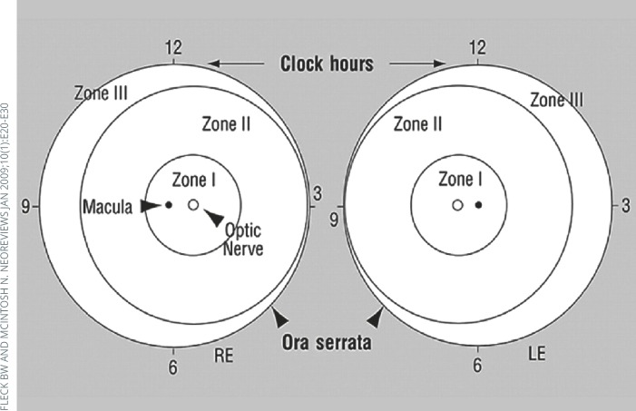
*Zone I quanh đĩa thị, zone II tới ora phía mũi, zone III là liềm thái dương; 12 mốc giờ đồng hồ ghi mức lan theo góc (clock hours). Nguồn: Molinari A et al., Community Eye Health 2017, PMC5806220 Fig. 6, CC BY-NC 4.0.*

- **Theo STAGE (giai đoạn) — mức độ tăng sinh:**
  - **1:** đường ranh giới (demarcation line) trắng giữa võng mạc mạch hóa và vô mạch.
  - **2:** ranh giới **nhô lên thành gờ (ridge)** có thể có "bọt ngô" (popcorn) — chồi tân mạch nhỏ.
  - **3:** gờ + **tăng sinh xơ-mạch ngoài võng mạc (extraretinal fibrovascular proliferation)** mọc vào dịch kính — bắt đầu có nguy cơ co kéo.
  - **4A/4B:** **bong võng mạc một phần**, phân biệt **4A chưa/4B đã bắt hoàng điểm**.
  - **5:** **bong võng mạc toàn bộ** — hình **"trắng đồng tử" (leukocoria)** ở trẻ (bài 450).
- **Theo PLUS / PRE-PLUS:**
  - **Plus disease:** giãn tĩnh mạch + **vằn xoắn tiểu động mạch** ở **cực sau**, **≥ 2 góc phần tư** — dấu hiệu **shunt mạch, bệnh tiến triển**.
  - **Pre-plus:** bất thường mạch nhiều hơn bình thường nhưng **chưa đủ tiêu chuẩn plus** — "tiền thân" cần theo dõi sát.
- **AP-ROP (aggressive posterior ROP, "bệnh rầm rộ"):** gần như luôn ở **zone I / zone II sau**; tân mạch **phẳng, khó thấy, KHÔNG có gờ rõ**, **plus mạnh chiếm 4 góc**; có thể **nhảy thẳng sang stage 4–5 mà không qua tuần tự 1→3** → **điều trị cấp cứu, không chờ phân giai đoạn**.
- **Gamut bệnh "giả ROP" (mimics — trẻ ĐỦ tháng, KHÔNG có tiền sử sinh non):** **FEVR** (familial exudative vitreoretinopathy), **Coats**, **PHPV/PFV**, **incontinentia pigmenti**, **Norrie** — cùng chân dung tân mạch/bong võng mạc nhưng **không do sinh non** (bài 450).

## 3. Bảng so sánh phân biệt (ma trận đối chiếu)

| Thực thể (entity) | Hình ảnh điển hình | Chốt vào (rule-in) | Chốt loại (rule-out) | Gợi ý xác nhận |
|---|---|---|---|---|
| ROP nhẹ (stage 1–2, không plus) | **Đường phân cách / gờ** ở ranh giới mạch-vô mạch, không vằn mạch cực sau | **Sinh non + gờ nhẹ ở zone II–III + không plus** | Mạch cực sau vằn xoắn rõ → đã plus/AP-ROP | Soi đáy mắt 1–2 tuần (zone I: 1 tuần) |
| ROP stage 3 (nguy cơ) | **Gờ + xơ-mạch mọc vào dịch kính**, có thể kèm plus | **Tăng sinh ngoài võng mạc + zone I hoặc plus** | Gờ phẳng không mạch → stage 2 | Type 1 (zone I/II + plus) → điều trị 48–72 giờ |
| Plus / pre-plus | **Vằn xoắn tiểu động mạch + giãn tĩnh mạch cực sau** | **≥ 2 góc phần tư vằn + giãn rõ = plus** | Vằn ít, chưa đủ tiêu chuẩn → pre-plus | Ảnh đáy mắt góc rộng; đối chiếu ảnh chuẩn |
| AP-ROP | **Tân mạch phẳng vùng cực sau (zone I), plus mạnh, KHÔNG gờ** | **Zone I/II sau + tân mạch phẳng + plus 4 góc** | Có gờ rõ, tiến triển tuần tự → ROP thường | Điều trị cấp cứu, không chờ phân giai đoạn |
| Bong võng mạc ROP (stage 4–5) | **Bong một phần (4A/4B) hoặc toàn bộ (5)**, hình phễu/leukocoria | **Tân mạch co kéo + bong VM** | Bong do rách nguyên phát → khác (bài 445) | Siêu âm B-scan khi mờ đục môi trường |
| Bệnh giả ROP (FEVR, Coats, PHPV) | Tân mạch/bong VM ở trẻ **đủ tháng**, có thể hai bên/gia đình | **Đủ tháng + tiền sử gia đình + không sinh non** | **Sinh non + bệnh cảnh oxy → ROP** | FA, gene (NDP/FZD4/LRP5), bài 450 |

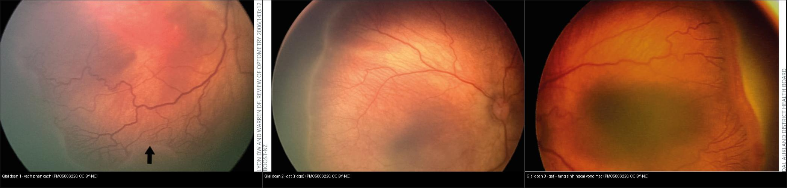
*Ba giai đoạn đầu của ROP cùng chuỗi đáy mắt màu (fundus). Nguồn: Molinari A et al., Community Eye Health 2017, PMC5806220 Fig. 1–3, CC BY-NC 4.0. Ảnh ghép letterbox, giữ nguyên bản (không crop/kéo giãn).*

**Quiz composite:** che 3 nhãn — giai đoạn nào có tăng sinh mạch mọc khỏi mặt võng mạc?

<b>Bấm để hiện đáp án</b>

- **Panel phải = stage 3:** đã có **mạch máu mọc trong gờ** (tăng sinh xơ-mạch ngoài võng mạc) — đây là giai đoạn bắt đầu co kéo và là mốc nguy cơ.
- **Panel trái = stage 1:** chỉ **đường phân cách** (demarcation line) — chưa có gờ.
- **Panel giữa = stage 2:** **gờ (ridge)** nhô lên nhưng mạch chưa mọc khỏi mặt võng mạc.
- Chốt phân biệt: **stage 3 là mốc tăng sinh** — kèm zone I hoặc plus → **Type 1, phải điều trị**.

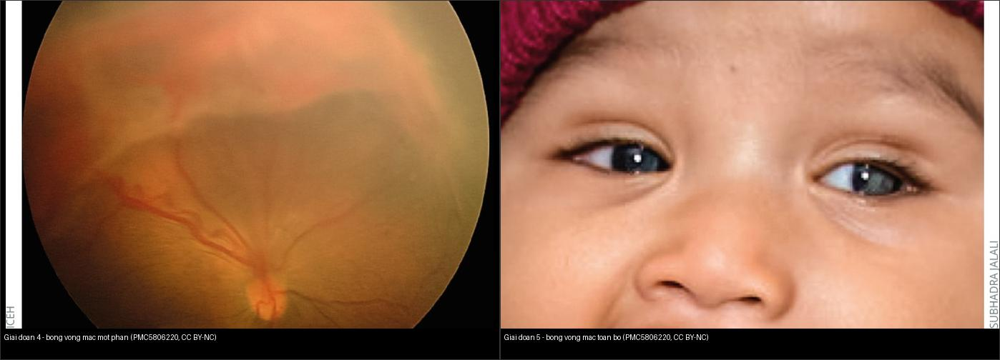
*Khi tân mạch co kéo đủ mạnh: võng mạc bị kéo bong — một phần (stage 4) rồi toàn bộ (stage 5). Nguồn: Molinari A et al., Community Eye Health 2017, PMC5806220 Fig. 4–5, CC BY-NC 4.0. Ảnh ghép letterbox, giữ nguyên bản.*

## 4. Protocol: sàng lọc theo lịch + ngưỡng điều trị ETROP

- **Sàng lọc (screening):**
  - **Đối tượng:** trẻ **≤ 30 tuần** hoặc **≤ 1500 g**; cân nhắc **30–32 tuần / 1500–2000 g có bệnh cảnh nặng**.
  - **Khám đầu tiên:** **tuần 31–33 sau kinh** (postmenstrual age) **hoặc 4 tuần tuổi thực**, **lấy mốc MUỘN HƠN**. Bảng theo tuổi thai (thứ tự tăng dần lịch khám): 22–27 tuần → khám ở **31–32 tuần PMA** (tuổi thực 4–9 tuần); 28–31 tuần → **32–35 tuần PMA**; ≥ 32 tuần → **36 tuần PMA / 4 tuần tuổi thực**.
  - **Khoảng tái khám:** **zone I: mỗi 1 tuần**; **zone II: ≥ 2 tuần**; **zone III: 2–3 tuần**.
  - **Kết thúc sàng lọc:** mạch máu đã **mọc hết tới zone III** + không có ROP zone I/II); đặc biệt thận trọng ở trẻ đã dùng **anti-VEGF** (mạch có thể không mọc hết, tái hoạt muộn).
- **Ngưỡng điều trị (ETROP — "Type 1"):** zone I bất kỳ giai đoạn **có plus**; zone I **stage 3** (có/không plus); zone II **stage 2 hoặc 3 có plus**; **AP-ROP**. → **điều trị trong 48–72 giờ**.
  - **Type 2 (theo dõi):** zone I stage 1–2 **không plus**; zone II stage 3 **không plus**.
  - **Ngưỡng cũ "threshold"** (ít dùng, hiểu lịch sử): stage 3 tổ chức liền **5 giờ đồng hồ** hoặc **8 giờ cộng dồn** + plus ở zone I/II = **nguy cơ bong 50%** nếu không điều trị.
- **Điều trị:**
  - **Laser quang đông vùng võng mạc vô mạch** (chuẩn vàng; đốt vô mạch, **không đốt vào mạch ROP**). Tác dụng phụ: **cận thị**, **hẹp thị trường**, hiếm **thiếu máu đoạn trước** (đặc biệt AP-ROP).
  - **Anti-VEGF (bevacizumab/ranibizumab)** — ưu thế cho **zone I/AP-ROP**, dễ làm tại giường; **BẤT LỢI LỚN: tái hoạt muộn** → phải theo dõi **đến ≥ 65 tuần PMA**, cảnh giác giai đoạn nguy cơ cao **45–55 tuần PMA** (BEAT-ROP: tái phát 7,2% sau 5 năm; ranibizumab được chấp thuận EU 2019 cho zone I stage 1+/2+/3 ± , zone II stage 3+, AP-ROP).
  - **Phẫu thuật:** **bong võng mạc stage 4–5** — **đai/thắt vòng củng mạc (scleral buckle)** hoặc **cắt dịch kính (vitrectomy, ưu tiên cắt dịch kính bảo tồn thể thủy tinh ở stage 4 zone II)**.
- **Chẩn đoán hình ảnh:** ROP là bệnh **chẩn đoán bằng soi đáy mắt/ảnh đáy mắt góc rộng (widefield, RetCam/smartphone)** — **KHÔNG dùng CT/MRI thường quy**. **Siêu âm B-scan** khi môi trường mờ đục (xuất huyết dịch kính) để đánh giá bong võng mạc.

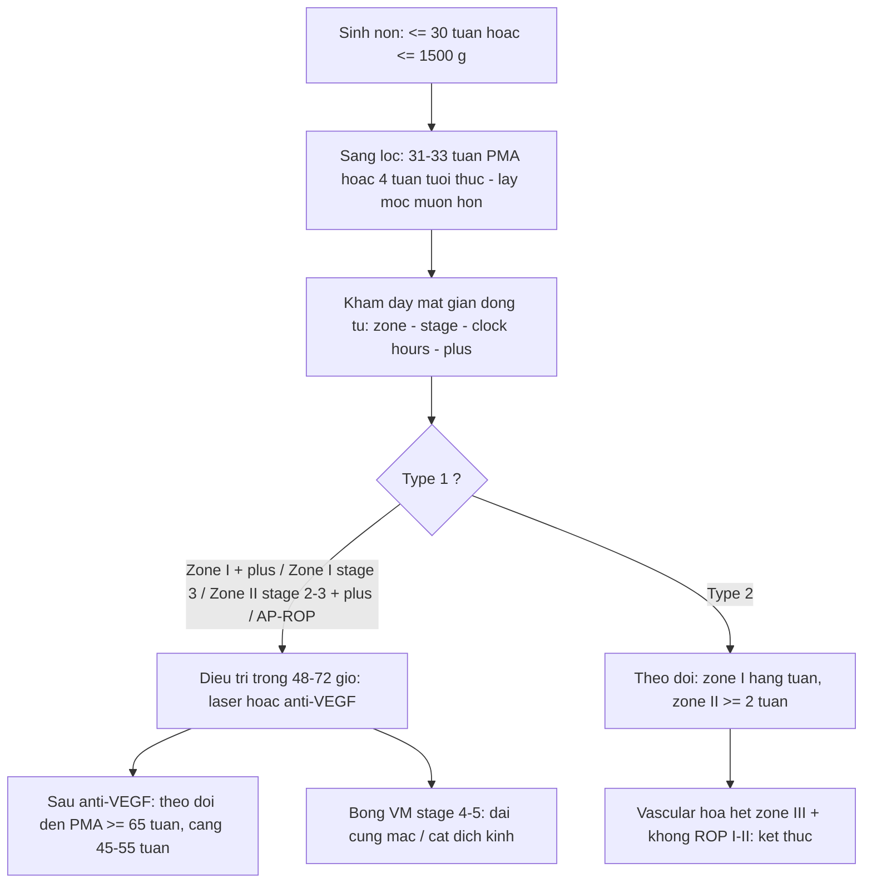

## 5. Biến thể bình thường và cạm bẫy

- **AP-ROP "phẳng" dễ bị bỏ sót** vì **không có gờ rõ như ROP thường** — nếu chỉ tìm gờ sẽ bỏ qua; chốt là **plus mạnh + tân mạch phẳng vùng cực sau**. Khi nghi AP-ROP **điều trị ngay, không mất thời gian phân giai đoạn**.
- **Plus vs pre-plus: dao động giữa người đọc (inter-observer)** — cùng một đáy mắt, chẩn đoán plus có thể khác nhau; vì vậy cần **ảnh đáy mắt góc rộng lưu lại + ảnh chuẩn** và **chụp lại theo chuỗi** để so tiến triển, không "đoán mắt".
- **Cạm bẫy "gờ giả":** có thể nhầm **gờ ROP** với **vùng nếp/mạch bình thường ở zone III**, hoặc với **bệnh giả ROP ở trẻ đủ tháng** (FEVR/Coats) — luôn xác nhận **tiền sử sinh non**.
- **Bỏ theo dõi quá sớm sau anti-VEGF:** mạch ngoại vi **có thể chưa mọc hết**, bệnh **tái hoạt muộn** (đến > 65 tuần PMA) → **bong võng mạc muộn**. Trẻ anti-VEGF phải theo dõi **dài hơn** laser.
- **Trẻ sinh non ≤ 30 tuần KHÔNG được sàng lọc** = cạm bẫy nặng nhất; bệnh có thể **im lặng** cho tới khi đã **bong võng mạc**. Không chờ "trắng đồng tử" (đó đã là stage 5).
- **Stage 5 (leukocoria):** phân biệt với **retinoblastoma** (vôi hóa thô, < 5 tuổi) và **Coats/PHPV** — đây là các đáp án của **bệnh giả ROP** (bài 450), cần **siêu âm + MRI** chứ không phải soi ROP.
- **Cận thị do điều trị:** cả laser lẫn anti-VEGF đều gây **cận thị** (laser nặng hơn) — trẻ có tiền sử ROP **bất kể mức độ** cần **khám khúc xạ/thị lực định kỳ** đến tuổi đi học.
  
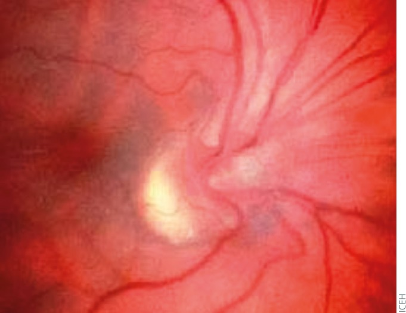
*Di chứng sau ROP: đĩa thị/bó mạch bị kéo lệch, dải xơ võng mạc — nguồn gốc cận thị, lác, nhược thị cần theo dõi dài hạn. Nguồn: Molinari A et al., Community Eye Health 2017, PMC5806220 Fig. 9, CC BY-NC 4.0.*

## 6. Tự lượng giá — Blind Quiz

**Ca 1 — Trẻ sinh non 27 tuần, khám sàng lọc. Nhìn đáy mắt, mô tả trước:**

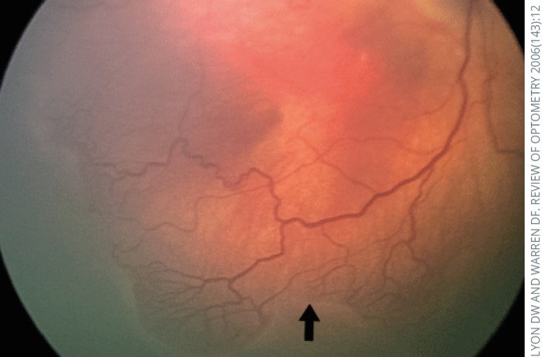

- Gợi ý lâm sàng: trẻ non tháng, khám theo lịch sàng lọc ROP.
- Hỏi: dấu chính là gì? Đây là giai đoạn nào? Có cần điều trị không?

<b>Bấm để hiện đáp án (findings + chẩn đoán)</b>

- Dấu hiệu (findings): **đường phân cách (demarcation line)** trắng giữa võng mạc có mạch và vùng vô mạch ngoại vi (mũi tên).
- Chẩn đoán (diagnosis): **ROP giai đoạn 1** — chưa có tăng sinh, thường **tự thoái triển**; **không cần điều trị**, **tái khám theo lịch** (zone I: 1 tuần; zone II: ≥ 2 tuần).
- Nguồn ảnh: Molinari A et al., Community Eye Health 2017, PMC5806220 Fig. 1, CC BY-NC 4.0.

**Ca 2 — Trẻ non tháng, đáy mắt có gờ và mạch mọc vào gờ ở vùng cực sau. Sàng lọc hay điều trị?**

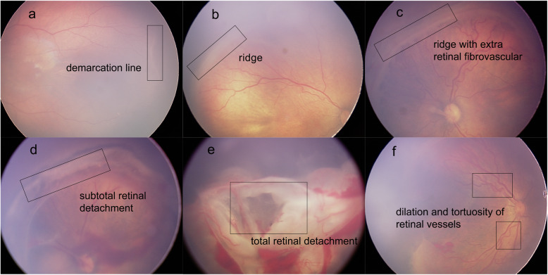

- Hỏi: panel nào là **stage 3**? Panel nào là **plus**? Vì sao stage 3 ở zone I/II kèm plus là **cấp cứu**?

<b>Bấm để hiện đáp án (findings + chẩn đoán)</b>

- Panel: **(a)** đường phân cách = stage 1; **(b)** gờ = stage 2; **(c)** gờ + **tăng sinh xơ-mạch ngoài võng mạc** = **stage 3**; **(d)** bong võng mạc một phần = stage 4; **(e)** bong toàn bộ = stage 5; **(f)** **giãn + vằn xoắn mạch = plus**.
- Chẩn đoán (diagnosis): **stage 3 + plus (Type 1)** → **điều trị trong 48–72 giờ** (laser hoặc anti-VEGF) để tránh **bong võng mạc co kéo**.
- Nguồn ảnh: Tong Y et al., Eye and Vision 2020, PMC7395360 Fig. 2, CC BY 4.0.

**Ca 3 — Trẻ rất non, mạch cực sau vằn mạnh, KHÔNG thấy gờ rõ:**

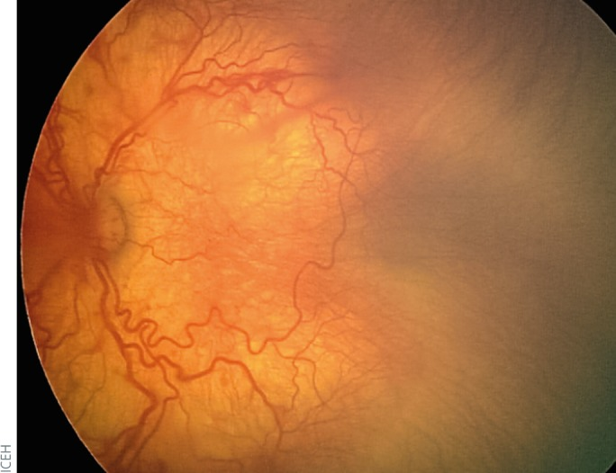

- Hỏi: đây có phải "ROP thường"? Vì sao nguy hiểm? Xử trí?

<b>Bấm để hiện đáp án (findings + chẩn đoán)</b>

- Dấu hiệu (findings): **tân mạch phẳng vùng cực sau (zone I)** + **giãn/vằn xoắn mạch mạnh (plus)**; **không có gờ kinh điển**.
- Chẩn đoán (diagnosis): **AP-ROP (aggressive posterior ROP)** — có thể **nhảy thẳng sang stage 4–5** mà không qua tuần tự; **điều trị cấp cứu ngay** (không chờ phân giai đoạn).
- Nguồn ảnh: Molinari A et al., Community Eye Health 2017, PMC5806220 Fig. 8, CC BY-NC 4.0.

**Ca 4 — Đọc sơ đồ vùng, xác định ranh giới zone I:**

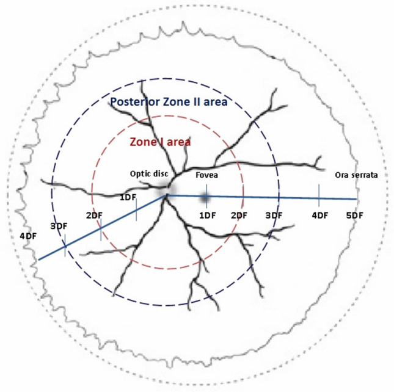

- Hỏi: bán kính zone I bằng bao nhiêu? Vì sao ROP zone I nặng nhất? Vùng nào tiên lượng tốt nhất?

<b>Bấm để hiện đáp án (findings + chẩn đoán)</b>

- Dấu hiệu (findings): **Zone I** = vòng bán kính **2 DF** (DF = khoảng cách đĩa thị–hoàng điểm); **posterior zone II** ở ngoài tới ~3 DF.
- Chẩn đoán/ý nghĩa: **zone càng gần cực sau càng dễ tiến triển nặng** (vùng vô mạch rộng, VEGF cao); **zone III (liềm thái dương) tiên lượng tốt nhất**.
- Nguồn ảnh: Jang JH et al., Sci Rep 2020, PMC7582165 Fig. 3, CC BY 4.0.

**Ca 5 — Trẻ sinh non nặng, hai mắt có vùng trắng đục sau đồng tử, không thấy đáy mắt rõ:**

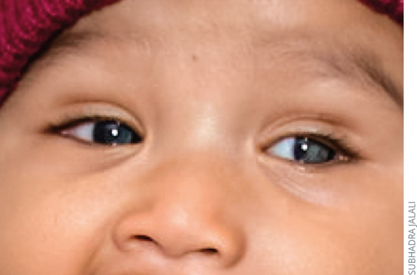

- Hỏi: giai đoạn nào? Vì sao **không thấy đáy mắt** lại là tin xấu? Bước tiếp theo?

<b>Bấm để hiện đáp án (findings + chẩn đoán)</b>

- Dấu hiệu (findings): **bong võng mạc toàn bộ = stage 5**, lệch trục/leukocoria; **đáy mắt mờ do bong + môi trường đục**.
- Chẩn đoán (diagnosis): **ROP stage 5** — nếu ánh đồng tử trắng ở trẻ **chưa rõ sinh non**, phải **loại trừ retinoblastoma/Coats/PHPV** (bài 450).
- Xử trí: **siêu âm B-scan** đánh giá bong; cân nhắc **cắt dịch kính**; tiên lượng kém dù mổ.
- Nguồn ảnh: Molinari A et al., Community Eye Health 2017, PMC5806220 Fig. 5, CC BY-NC 4.0.

**Ca 6 — Đối chiếu plus vs AP-ROP: nhìn hai đáy mắt, đọc thứ tự nặng:**

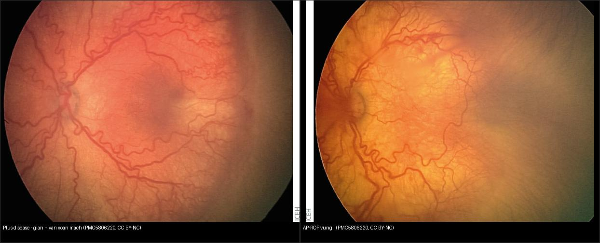

- Hỏi: panel nào là AP-ROP? Dấu nào phân biệt **plus disease đơn thuần** với **AP-ROP**? Khác nhau về xử trí?

<b>Bấm để hiện đáp án (findings + chẩn đoán)</b>

- **Trái = plus disease:** **giãn tĩnh mạch + vằn xoắn tiểu động mạch** ở cực sau (dấu shunt), thường đi kèm ROP có gờ.
- **Phải = AP-ROP:** **tân mạch PHẲNG vùng zone I + plus mạnh**, **không gờ rõ**.
- **Chốt phân biệt:** AP-ROP = **plus + tân mạch phẳng không gờ** → **điều trị cấp cứu**; plus đơn thuần chỉ nâng mức nguy cơ, xử trí theo **type/zone/stage**.
- Nguồn ảnh: Molinari A et al., Community Eye Health 2017, PMC5806220 Fig. 7–8, CC BY-NC 4.0. Ảnh ghép letterbox.

**Ca 7 — Trẻ sinh non 25 tuần, mạch vằn cực sau tăng dần qua các lần chụp; đánh giá lịch theo dõi:**

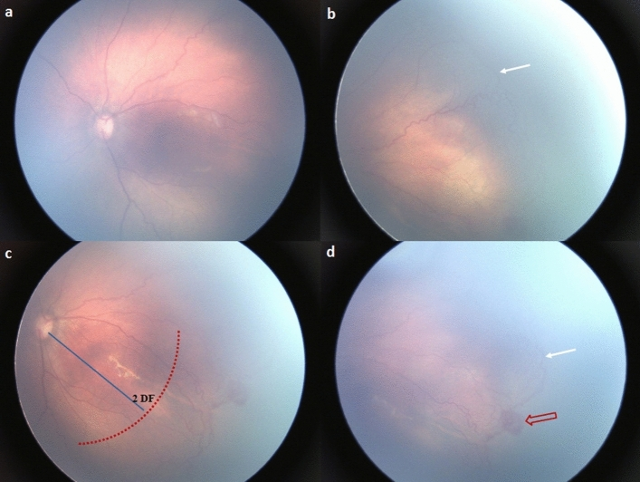

- Hỏi: dấu nào gợi **pre-plus → plus**? Vì sao cần **chuỗi ảnh** thay vì một lần khám? Ngưỡng theo dõi zone I?

<b>Bấm để hiện đáp án (findings + chẩn đoán)</b>

- Dấu hiệu (findings): chuỗi ảnh cho thấy **mạch ngoại vi mọc chậm/chuyển sang vằn rõ dần** (pre-plus → plus), cùng vùng tân mạch ở ranh giới.
- Bài học: **so sánh chuỗi ảnh** giúp phát hiện **tiến triển** mà một lần khám dễ bỏ sót; **zone I theo dõi mỗi 1 tuần**.
- Nguồn ảnh: Jang JH et al., Sci Rep 2020, PMC7582165 Fig. 4, CC BY 4.0.

## Bài liên quan chéo
- [400 – Tổng quan Mắt & thị giác](../400-tong-quan-mat-thi-giac/lesson.md) (bảng DDx mắt)
- [450 – Mắt nhi: ROP, Coats, PHPV](../450-mat-nhi/lesson.md) (leukocoria + bệnh giả ROP)
- [443 – Võng mạc đái tháo đường](../443-vong-mac-dai-thao-duong/lesson.md) (tân mạch võng mạc ở người lớn — cùng VEGF)
- [445 – Bong võng mạc](../445-bong-vong-mac/lesson.md) (co kéo vs rách nguyên phát)
- [411 – Siêu âm nhãn cầu](../411-sieu-am-nhan-cau/lesson.md) (B-scan khi mờ môi trường)
- [412 – U trong nhãn cầu](../412-u-trong-nhan-cau/lesson.md) (retinoblastoma — phân biệt stage 5)
- [610 – Suy hô hấp sơ sinh](../610-suy-ho-hap-so-sinh-va-di-dang-phoi/lesson.md) (oxy liệu pháp — yếu tố nguy cơ)

## Ảnh
- Tên file: `456_rop-*_Fundus_PMC<haimột>-Fig*-CCBY*.jpg`; nguồn + giấy phép từng ảnh trong `images/CREDITS.md`.
- Ảnh gốc PMC5806220 (CC BY-NC 4.0) và các ảnh ghép **giữ nguyên bản**, không crop/kéo giãn (letterbox nền đen).
- AuntMinnie (Case of the Day): chỉ dẫn link, không tải.

> Không dùng để chẩn đoán độc lập khi chưa có người hướng dẫn.
