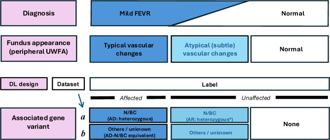
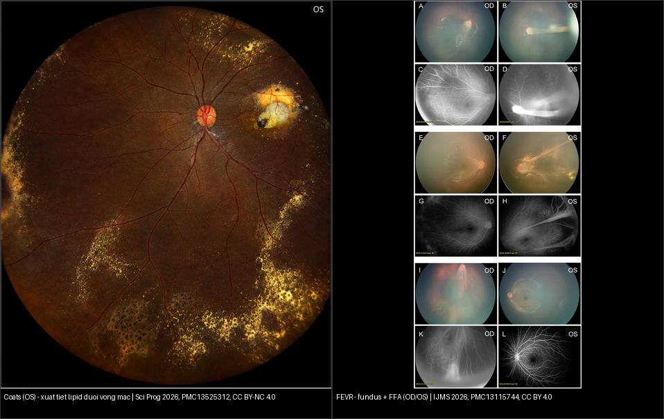
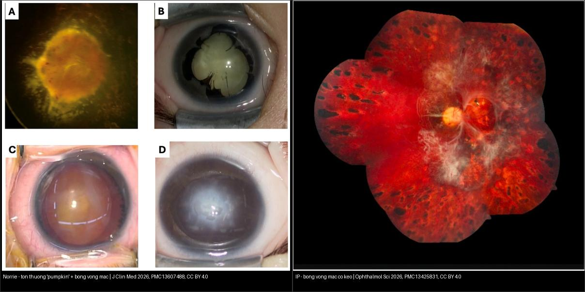
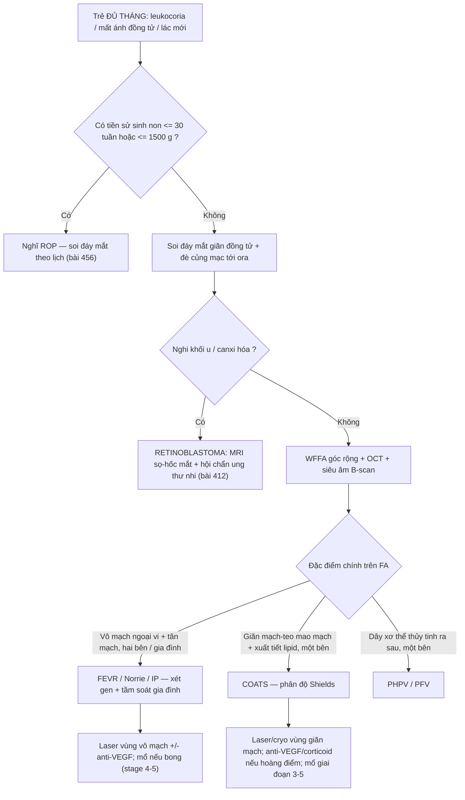
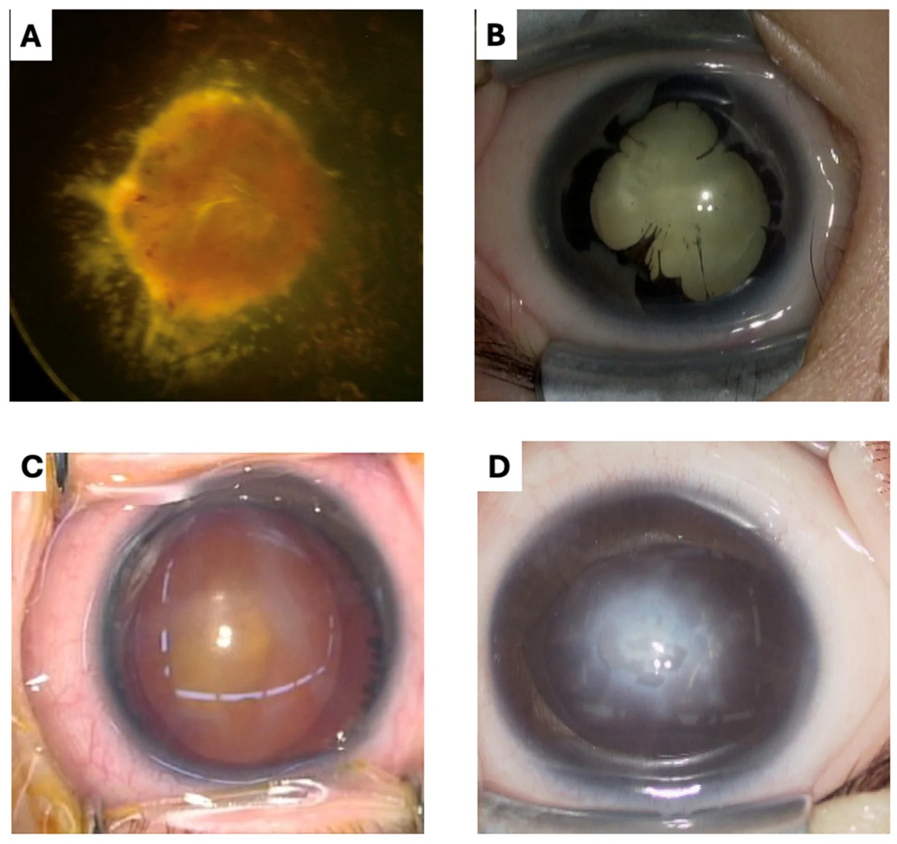
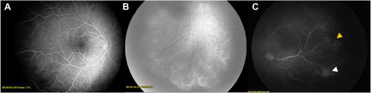
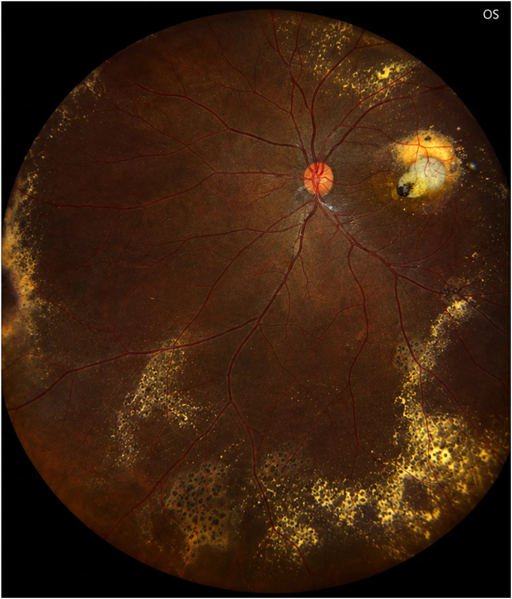
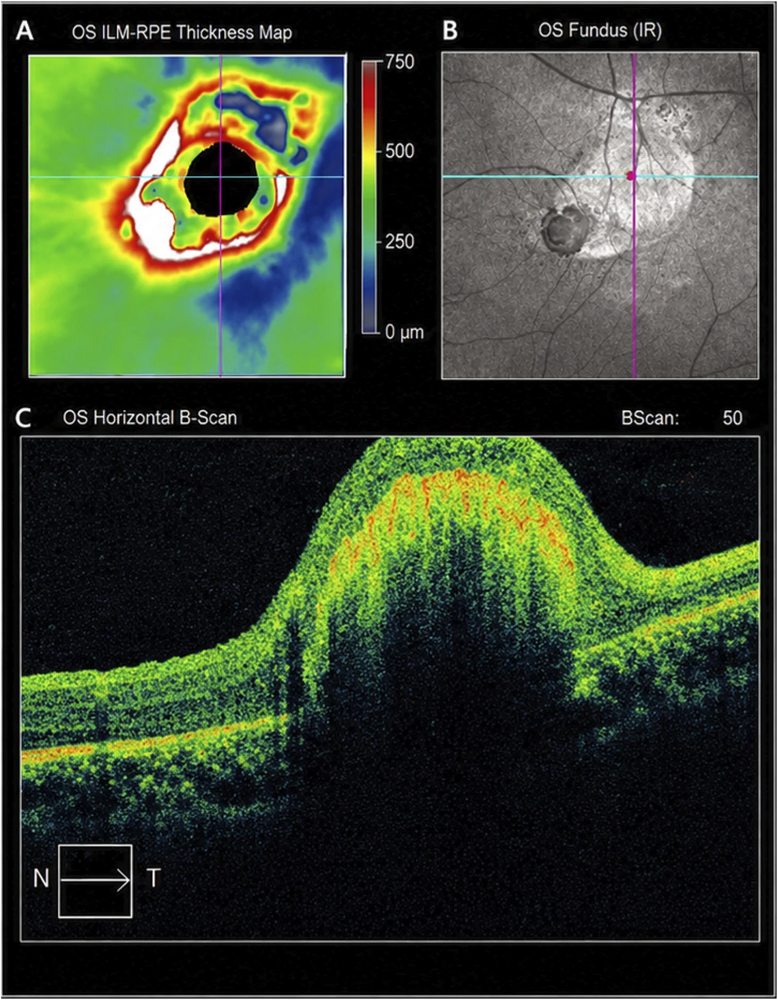
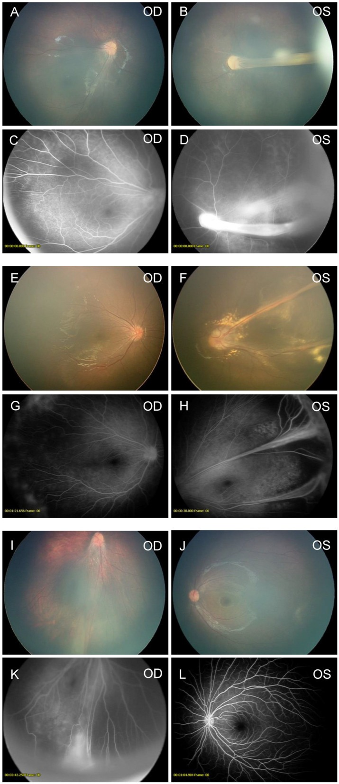
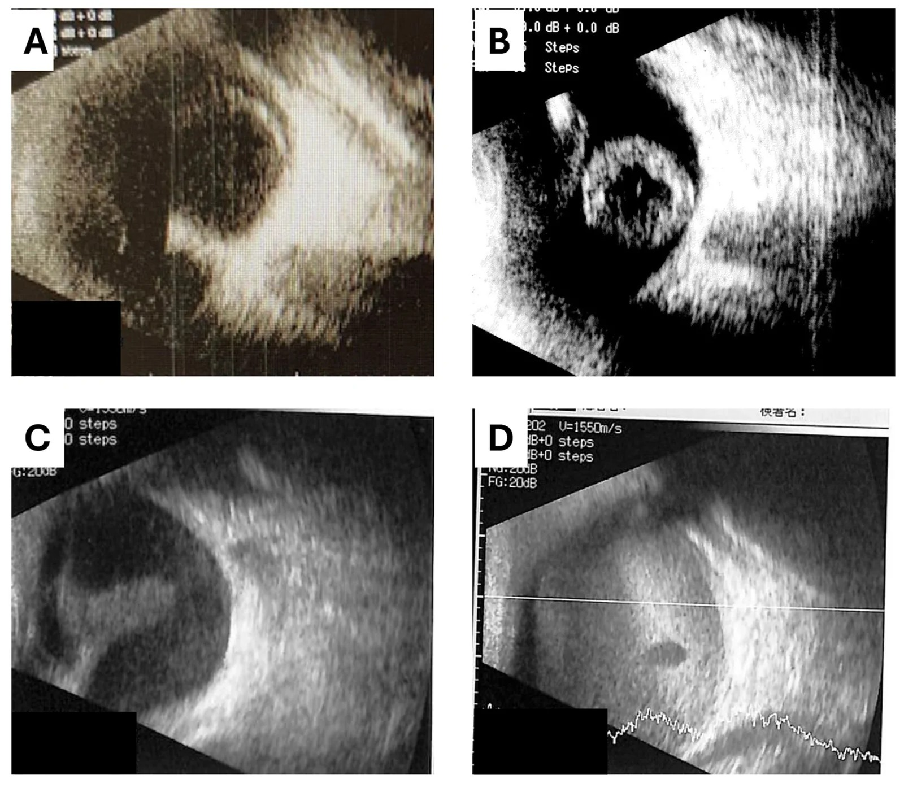

# 457 — Bệnh "giả ROP" ở trẻ đủ tháng: FEVR, Norrie, incontinentia pigmenti & Coats / Pseudoretinopathy of prematurity in term infants

**Tags:** `pattern:gia-rop` `pattern:tan-mach-vong-mac` `pattern:bong-vong-mac` `vung:vong-mac` `vung:tre-du-thang` `score:Shields` `protocol:WFFA` `protocol:sieu-am-B-scan`
**Mức chắc chắn (certainty):** tổng hợp y văn (literature synthesis) — tổng hợp từ y văn mở 2022–2026 (IJMS 2026 CC BY; Sci Rep 2026 CC BY-NC-ND; J Clin Med 2026 CC BY; Ophthalmol Sci 2026 CC BY; Sci Prog 2026 CC BY-NC); có gắn hình thái ca nguyên văn từ các bài gốc nhưng nội dung nhóm tự biên.

## 1. Tổng quan — cùng "con đường cuối" như ROP nhưng **KHÔNG do sinh non**

- **Định nghĩa (pathology):** "bệnh giả ROP" (pseudoretinopathy of prematurity) là nhóm bệnh gây **thiếu máu võng mạc ngoại vi → tân mạch → bong võng mạc** ở trẻ **đủ tháng / không có tiền sử sinh non**. Chân dung nhìn giống ROP (gờ, tân mạch, bong co kéo, `leukocoria`) nhưng **cơ chế và gen hoàn toàn khác** (bài 456). Đây là **cạm bẫy chết người**: gọi "ROP" ở trẻ đủ tháng = bỏ sót bệnh di truyền + bỏ sót tầm soát gia đình + bỏ sót **retinoblastoma** (khối u đe dọa tính mạng).
- **Hai con đường sinh bệnh — TẠI SAO ra hình ảnh:**
  - **Bất thường phát triển mạch máu (developmental vascular failure):** tín hiệu **Norrin–β-catenin/Wnt** (gen *NDP* → norrin; *FZD4*, *LRP5*, *TSPAN12*, *CTNNB1*) và các gen liên quan (*KIF11*, *DOCK6*) bị đột biến → mạch máu **không mọc hết ra ngoại vi** → **võng mạc vô mạch ngoại vi** → thiếu oxy → **VEGF** → tân mạch tại ranh giới → co kéo. Đây là cơ chế của **FEVR, Norrie, incontinentia pigmenti (IP)**.
  - **Giãn mạch–teo mao mạch (telangiectasia):** mạch võng mạc giãn, phình túi ("light bulb") gây rò huyết tương → **xuất tiết lipid** thấm vào võng mạc và dưới võng mạc → bong võng mạc **xuất tiết**. Đây là **Coats** (và Leber miliary aneurysms cùng phổ).
  - **TẠI SAO thấy được trên ảnh:** trên **chụp mạch huỳnh quang (FA)** — vùng võng mạc vô mạch **không ngấm thuốc** (vì không có mạch để dẫn thuốc, hàng rào máu–võng mạc còn nguyên) nên tối; còn tân mạch **rò thuốc** nên sáng muộn. Trên **siêu âm B-scan** — bong võng mạc là dải **tăng echo hình phễu** (mở/đóng) vì võng mạc + máu/xơ tăng hồi âm mạnh; **canxi hóa** (retinoblastoma) cho tăng echo kèm **bóng sau**. Trên **MRI** — Coats có dịch dưới võng mạc T1/T2 tăng do bản chất lipid–protein đậm đặc, không ngấm mạnh, khác khối u đặc của retinoblastoma.
- **Ngưỡng định lượng & dịch tễ (theo y văn làm nguồn):**
  - **Norrie (Futami *J Clin Med* 2026):** 28 mắt/14 BN, tuổi trung vị lúc khám đầu **2,5 tháng**; **82% mắt đã bong võng mạc stage 5** khi chẩn đoán, chỉ 18% còn stage 2/4 → **cửa sổ can thiệp cực hẹp**. Gần như toàn bộ mắt stage 5 **mất hoàn toàn tri giác ánh sáng** (chỉ 2 mắt stage 4 đã laser giữ được chút).
  - **Incontinentia pigmenti (Moon *Ophthalmol Sci* 2026):** prevalence ~**1,2/100 000**; **70–80%** do mất đoạn **11,7 kb gen IKBKG (NEMO)**, ~**20%** không tìm thấy đột biến; **> 70%** trẻ có dấu tổn thương võng mạc trên **WFFA** dù soi đáy mắt thường có thể bình thường.
  - **Coats (Almutairi *Sci Prog* 2026):** tỷ lệ mới mắc ~**0,09/100 000**; **nam >> nữ**, **thường một bên** (không được lấy "một bên" làm cớ loại trừ tuyệt đối — có ca hai bên/Leber miliary aneurysms).
  - **FEVR (Naruse *Int J Mol Sci* 2026, 281 bệnh nhân):** **85% không kèm hệ thống (non-syndromic)**, **15% có biểu hiện hệ thống (syndromic)**; biến thể gen Norrin/β-catenin ở **54%** non-syndromic vs **29%** syndromic; **71%** ca syndromic tìm được đột biến. Syndrome hay gặp gen **KIF11, NDP, CTNNB1, DOCK6, TSPAN12, LRP5**; syndromic đối xứng hơn (67% vs 39%, p = 0,0012) và chẩn đoán ở nhũ nhi nhiều hơn (95% vs 57%).
  - **Đối chiếu ROP:** ROP chỉ xuất hiện ở trẻ **non tháng rất non** (bài 456) — nếu trẻ **không non** thì KHÔNG được mặc định là ROP.

## 2. Mẫu hình + chẩn đoán phân biệt theo tuổi/cơ chế (Gamut)

- **Mẫu hình cửa vào:** trẻ nhũ nhi **đủ tháng** có **mất ánh đồng tử đỏ / leukocoria / xanthocoria**, **lác mới xuất hiện**, **rung giật nhãn cầu**, **đục giác mạc / bóng trắng sau đồng tử**, hoặc **tiền sử gia đình** FEVR/Norrie/IP.
- **Gamut theo cơ chế (xếp thứ tự phải loại trừ):**
  1. **Khối u (BẮT BUỘC loại trừ trước tiên):** **retinoblastoma** (canxi hóa thô, < 5 tuổi, gen *RB1*) — bài 412; hiếm hơn: hemangioblastoma (VHL), u nguyên bào tủy.
  2. **Bất thường phát triển mạch:** **FEVR** (thể nhẹ có thể không triệu chứng, khám sàng lọc gia đình), **Norrie** (X-linked, **chậm phát triển trí tuệ + điếc** + bong võng mạc hai bên), **incontinentia pigmenti** (da–răng–tóc–TKTW, nữ, X-linked dominant), **PHPV/PFV** (dây xơ thể thủy tinh).
  3. **Giãn mạch–xuất tiết:** **Coats**, **Leber miliary aneurysms**, "Coats-like" kèm thoái hóa võng mạc di truyền / **Coats plus** (RETINAL + thần kinh).
  4. **Viêm/nhiễm:** **toxocariasis** (u hạt, một mắt, tiếp xúc chó–mèo), viêm nội nhãn.
  5. **Thoái hóa:** bệnh võng mạc sắc tố có kèm tổn thương dạng Coats.
- **Mnemonic "PAX-FIT" cho trẻ đủ tháng có bệnh cảnh giả ROP:** **P**hoto (mất ánh đồng tử/leukocoria) · **A**ge (đủ tháng — loại ROP) · **X**-linked/mạch (FEVR–Norrie–IP) · **F**amily (tầm soát gia đình) · **I**nflammation (toxocara) · **T**umor (retinoblastoma **loại trừ trước**).

*Sơ đồ tóm tắt chẩn đoán – hình thái đáy mắt – gen của FEVR thể nhẹ: người mang gen có thể chỉ có dấu hiệu đáy mắt rất kín đáo — đây là lý do **FA ngoại vi là bắt buộc**, ảnh màu một mình bỏ sót nhiều (mô hình học sâu chỉ đạt độ nhạy 31,6% trên ảnh màu đơn thuần). Nguồn: Watanabe W et al., Sci Rep 2026, PMC13219455 Fig. 1, CC BY-NC-ND 4.0 (giữ nguyên bản, không ghép).*

## 3. Bảng so sánh phân biệt (ma trận đối chiếu)

| Thực thể (entity) | Hình ảnh điển hình | Chốt vào (rule-in) | Chốt loại (rule-out) | Gợi ý xác nhận |
|---|---|---|---|---|
| **FEVR** | Ảnh màu: kéo võng mạc/mạch về phía thái dương ngoại vi, **nếp võng mạc**; FA: **vô mạch ngoại vi** + tân mạch, có thể chỉ kín đáo | **Vô mạch ngoại vi trên FA (hai bên, không đối xứng) + tiền sử gia đình**, không sinh non | Thiếu máu **một bên** + xuất tiết lipid nhiều → nghiêng Coats | WFFA + gen (*FZD4/LRP5/NDP/TSPAN12/CTNNB1*), **tầm soát bố mẹ/anh chị em** |
| **Norrie (NDP, X-linked lặn)** | **"Pumpkin" lesion** (loạn sản võng mạc dạng khối vàng cam) + bong võng mạc; B-scan: phễu mở/đóng, cuống giống PFV | **Bé TRA + bong võng mạc hai bên rất sớm (< 2–3 tháng) + điếc + chậm phát triển** | Có tiền sử sinh non/oxy → ROP | Gen *NDP*; **audiometry**; MRI não; khám bà mẹ mang gen |
| **Incontinentia pigmenti (IKBKG, X-linked trội)** | Da giai đoạn bọng nước→tăng sắc tố dạng "vệt xoáy", rụng tóc, răng dị dạng; **WFFA: vô mạch + tân mạch, có thể bình thường trên ảnh màu** | **Bé GÁI + tổn thương da đặc trưng + WFFA bất thường** (FA > soi đáy mắt) | Bé trai (gần như chỉ gặp ở nữ; hiếm ở nam có bất thường NST) | **WFFA trong 1–3 tháng đầu**; gen *IKBKG*; khám TKTW/răng/mắt |
| **Coats** | Ảnh góc siêu rộng: **giãn mạch-teo mao mạch (light bulb) + xuất tiết lipid vàng** dưới/vào võng mạc; OCT: dày hoàng điểm, tăng phản xạ có bóng | **Bé nam, một bên, xuất tiết lipid vùng dưới/thái dương-dưới + giãn mạch phình túi** | **Canxi hóa thô / khối đặc ngấm** → retinoblastoma | FA góc rộng (vùng vô mạch), OCT; **loại trừ RB** trước laser |
| **PHPV/PFV** | **Dây xơ trắng từ sau thủy tinh thể ra sau**, có thể đục thủy tinh thể, nhãn cầu nhỏ | Dây xơ nối thể thủy tinh–đĩa thị, **một bên**, đủ tháng | Hai bên + điếc + tiền sử gia đình → Norrie | Siêu âm B-scan; MRI khi cần |
| **Retinoblastoma (loại trừ TRƯỚC)** | **Khối đặc trong nhãn cầu + canxi hóa THÔ** trên CT/US; < 5 tuổi | **Canxi hóa trong khối ở trẻ nhỏ = RB tới khi loại trừ** | Không canxi hóa + xuất tiết lipid + giãn mạch → Coats | **MRI sọ–hốc mắt + hội chẩn ung thư nhi** trước mọi can thiệp |

*Trái: Coats — xuất tiết lipid vàng lan rộng, giãn mạch-teo mao mạch (thể "xuất tiết"). Phải: FEVR — fundus + FFA cho thấy vô mạch ngoại vi và kéo võng mạc/mạch về phía thái dương (thể "thiếu máu → tân mạch"). Hai cơ chế khác nhau, cùng đích là bong võng mạc. Nguồn: Almutairi F et al. Sci Prog 2026 (PMC13525312) Fig. 1 CC BY-NC 4.0 + Naruse S et al. Int J Mol Sci 2026 (PMC13115744) Fig. 1 CC BY 4.0; ảnh ghép letterbox, giữ nguyên bản.*

*Trái: Norrie — tổn thương "pumpkin" (loạn sản võng mạc) kèm bong võng mạc một phần. Phải: incontinentia pigmenti — bong võng mạc co kéo ở người lớn đã laser. Cùng là bệnh mạch di truyền ở trẻ đủ tháng nhưng khác gen và khác biểu hiện ngoài mắt. Nguồn: Futami T et al. J Clin Med 2026 (PMC13607488) Fig. 1 CC BY 4.0 + Moon JY et al. Ophthalmol Sci 2026 (PMC13425831) Fig. 2 CC BY 4.0; ảnh ghép letterbox, giữ nguyên bản.*

## 4. Protocol chụp + hệ phân độ/điểm chuẩn hóa

- **Khám và chụp (giao thức):**
  - **Soi đáy mắt giãn đồng tử** có **đè củng mạc (scleral depression)** để thấy tới **ora serrata** — bắt buộc, không thể chỉ nhìn cực sau.
  - **WFFA (chụp mạch huỳnh quang góc rộng / widefield FA)** là **tiêu chuẩn** để phát hiện vô mạch ngoại vi và tân mạch — **nhạy hơn soi đáy mắt** (ở IP, > 70% trẻ có dấu FA dù ảnh màu có thể bình thường). Thường làm dưới **gây mê (EUA)** ở nhũ nhi.
  - **Siêu âm B-scan** khi môi trường mờ đục (đục giác mạc, xuất huyết dịch kính) hoặc để đánh giá **bong võng mạc dạng phễu**.
  - **MRI sọ–hốc mắt** khi nghi retinoblastoma hoặc có biểu hiện thần kinh/da (IP, Norrie, Coats plus).
  - **Xét nghiệm gen** + **tầm soát gia đình** (bố mẹ, anh chị em) — đặc biệt FEVR/IP/Norrie.
- **Các hệ phân độ (grading/scoring) — phiên bản & ngưỡng xử trí:**
  - **Coats — phân độ Shields (5 giai đoạn):** **1** giãn mạch-teo mao mạch đơn thuần (thường không triệu chứng); **2** kèm xuất tiết (2A ngoài hoàng điểm / 2B **đã tới hoàng điểm**); **3** bong võng mạc xuất tiết (3A **bán phần** / 3B **toàn bộ**); **4** bong toàn bộ + **glaucoma**; **5** giai đoạn cuối, mắt **mù đau**. **Xử trí theo giai đoạn:** 1 theo dõi; 2 laser quang đông/cryo vùng giãn mạch; 3–5 có thể cần anti-VEGF, corticoid, phẫu thuật; giai đoạn 5 cân nhắc **cắt bỏ nhãn cầu** để kiểm soát đau.
  - **FEVR — 5 giai đoạn (+ R):** **1** vô mạch ngoại vi; **2** tân mạch ngoài võng mạc; **3** bong võng mạc **chưa/đã tới hoàng điểm**; **4** bong **toàn bộ** võng mạc; **5** bong toàn bộ + **khối xơ sau thể thủy tinh**; **R** = bong **rhegmatogenous** (do rách). Điều trị: **laser vùng vô mạch** ± anti-VEGF; phẫu thuật cho giai đoạn 4–5.
  - **Incontinentia pigmenti — phân độ theo WFFA (đồng thuận ICIP 2025, *Ophthalmol Sci* 2026):** **0** không bệnh; **1** vô mạch/bất thường mạch (có/không rò); **2** **tân mạch ngoài võng mạc** (chưa bong); **3** **bong võng mạc** (có/không tới hoàng điểm). **Xử trí:** 0 theo dõi; 1 **chưa đủ bằng chứng** để laser/anti-VEGF thường quy (theo dõi: khám ≥ mỗi **3 tháng**, WFFA ≥ mỗi **6 tháng**, trong **1–2 năm**); 2 **laser vùng vô mạch** (một số thêm anti-VEGF); 3 **hội chẩn võng mạc nhi ngay** để mổ.
  - **Sàng lọc IP (nhũ nhi):** khám giãn đồng tử có đè củng mạc **trong vòng 1 tháng** từ khi chẩn đoán; nếu bất thường → **WFFA sớm, lý tưởng trong 1 tháng**; nếu soi đáy mắt bình thường → vẫn **WFFA trong 3 tháng**.
  - **Norrie — phân độ (FEVR cải tiến + ICROP3 cho stage 5):** **1** vô mạch ngoại vi; **2** vô mạch + tân mạch; **3** bong một phần **chưa** hoàng điểm; **4** bong một phần **đã** hoàng điểm; **5** bong **toàn bộ** — **5A** còn thấy đĩa thị, **5B** đĩa bị che bởi mô xơ sau thể thủy tinh / phễu đóng, **5C** giai đoạn cuối + glaucoma/đục giác mạc. Điều trị (laser/mổ) chỉ có ý nghĩa ở **stage 4**; stage 5 tiên lượng rất xấu.

## 5. Biến thể bình thường và cạm bẫy

- **Cạm bẫy lớn nhất: gọi "ROP" ở trẻ đủ tháng.** ROP là bệnh của **trẻ non tháng** — nếu trẻ không non, phải nghĩ gamut giả ROP (FEVR/Norrie/IP/Coats/PHPV) và **loại trừ retinoblastoma**.
- **Bệnh giả ROP là bệnh LƯỠNG NHÃN & DI TRUYỀN (FEVR/IP/Norrie)** — phải **khám cả hai mắt** và **tầm soát gia đình**, kể cả khi chỉ một mắt có triệu chứng. Ngược lại, **Coats thường một bên**; nhưng "một bên" không loại trừ tuyệt đối (có ca hai bên/Leber miliary aneurysms → khi đó phải tìm bệnh nền di truyền/toàn thân).
- **Ảnh màu bình thường KHÔNG loại trừ bệnh:** ở IP, **> 70%** trẻ có dấu bệnh trên **FA** dù soi/ảnh màu có thể bình thường; ở FEVR, người mang gen có thể chỉ có dấu hiệu ở ngoại vi rất kín đáo — mô hình học sâu trên ảnh màu đơn thuần chỉ đạt độ nhạy **31,6%** (độ đặc hiệu 96,4%). → **FA ngoại vi (WFFA) mới là chốt**.
- **Coats vs retinoblastoma:** cả hai đều có thể `leukocoria`/bong võng mạc xuất tiết. **Canxi hóa thô trong khối ở trẻ < 5 tuổi = RB tới khi loại trừ**; Coats có **xuất tiết lipid + giãn mạch phình túi**, **không canxi hóa điển hình**. **Không laser/đốt mắt khi chưa loại trừ RB** (nguy cơ gieo rắc u).
- **Norrie cực nhanh:** đa số đã **bong võng mạc toàn bộ trong 2 tháng đầu đời**; laser chỉ còn giá trị ở stage 4 → **chẩn đoán sớm bằng gen là then chốt**. Nhớ **điếc** (audiometry) và **chậm phát triển trí tuệ** — đây là các dấu hiệu hệ thống giúp phân biệt.
- **IP ở bé trai:** IP là X-linked **trội, gây chết ở bào thai nam** → gần như chỉ gặp ở **nữ**; nam mắc phải cảnh giác **bất thường nhiễm sắc thể (hội chứng Klinefelter)** hoặc dạng lặn.
- **Bỏ sót khi thấy tổn thương "lạnh":** tổn thương Coats/FEVR thường ở **ngoại vi** — nếu chỉ khám cực sau/ảnh góc hẹp sẽ **bỏ sót diện vô mạch lan rộng**; bắt buộc soi tới **ora serrata** + ảnh góc rộng.

## 6. Tự lượng giá — Blind Quiz

**Ca 1 — Trẻ trai 3 tháng, sinh đủ tháng, bố mẹ thấy "mắt trắng" hai bên; đáy mắt phải có khối vàng cam trung tâm:**

- Gợi ý lâm sàng: bé trai, đủ tháng, giảm thính lực, chậm phát triển.
- Hỏi: dấu chính là gì? Bệnh nào và di truyền theo kiểu nào? Vì sao tiên lượng thường tối?

<b>Bấm để hiện đáp án (findings + chẩn đoán)</b>

- Dấu hiệu (findings): **tổn thương "pumpkin" vàng cam** (loạn sản võng mạc) kèm **bong võng mạc một phần** ở mắt phải (panel A); panel B–D là mắt giai đoạn muộn (dính đồng tử sau, giãn đồng tử do **glaucoma tân mạch**, đục giác mạc).
- Chẩn đoán (diagnosis): **Norrie disease** — X-linked lặn, gen ***NDP*** (norrin); tam chứng **bong võng mạc hai bên + điếc + chậm phát triển**. Tiên lượng tối vì **82% mắt đã stage 5** ngay khi chẩn đoán (tuổi trung vị 2,5 tháng) — laser chỉ còn giá trị ở stage 4.
- Nguồn ảnh: Futami T et al., J Clin Med 2026, PMC13607488 Fig. 1, CC BY 4.0.

**Ca 2 — Bé gái có tổn thương da dạng vệt xoáy + bất thường răng; WFFA hai mắt:**

- Hỏi: panel nào là bình thường? Panel nào có tân mạch ngoài võng mạc? Phân độ theo đồng thuận mới và xử trí?

<b>Bấm để hiện đáp án (findings + chẩn đoán)</b>

- Dấu hiệu (findings): **(A) stage 0** — FA bình thường; **(B) stage 1** — rò + vùng vô mạch lớn phía dưới; **(C) stage 2** — chậm đổ thuốc thái dương + **giãn mao mạch bất thường (mũi tên vàng)**, rò muộn + **tân mạch ngoài võng mạc vùng dưới (mũi tên trắng)** + vô mạch ngoại vi.
- Chẩn đoán (diagnosis): **bệnh võng mạc do incontinentia pigmenti** — phân độ **ICIP 2025: 0/1/2/3** (3 = bong võng mạc). **Stage 2 → laser vùng vô mạch** (một số thêm anti-VEGF); **stage 3 → hội chẩn võng mạc nhi mổ ngay**. Nhớ: FA **nhạy hơn** soi đáy mắt (> 70% trẻ có dấu FA).
- Nguồn ảnh: Moon JY et al., Ophthalmol Sci 2026, PMC13425831 Fig. 5, CC BY 4.0.

**Ca 3 — Bé trai 5 tuổi, một mắt, phát hiện lác; ảnh đáy mắt góc siêu rộng:**

- Hỏi: dấu chính? Ba chẩn đoán phân biệt + dấu nào chốt? Phải làm gì TRƯỚC khi can thiệp?

<b>Bấm để hiện đáp án (findings + chẩn đoán)</b>

- Dấu hiệu (findings): **xuất tiết lipid vàng** dưới/vào võng mạc lan rộng vùng dưới và thái dương-dưới + tổn thương hoàng điểm; mạch giãn bất thường (nhìn kỹ vùng giãn mạch-teo mao mạch).
- Chẩn đoán (diagnosis): **Coats disease** — phân độ **Shields** (giai đoạn 2B/3 tùy mức xuất tiết/hoàng điểm). DDx: **retinoblastoma** (loại trừ trước: tìm **canxi hóa thô**), FEVR, toxocariasis. **PHẢI loại trừ RB (MRI/US) trước khi laser.**
- OCT hoàng điểm của mắt này (dày hoàng điểm + tổn thương tăng phản xạ nổi cao có bóng phía sau):

- Nguồn ảnh: Almutairi F et al., Sci Prog 2026, PMC13525312 Fig. 1–2, CC BY-NC 4.0.

**Ca 4 — Bé gái 8 tháng, đủ tháng, tiền sử gia đình "mù bẩm sinh"; fundus + FFA đối chiếu:**

- Hỏi: tìm **vùng vô mạch** trên FA; dấu hiệu nào cho biết võng mạc bị **co kéo**? Bước tiếp theo không thể bỏ?

<b>Bấm để hiện đáp án (findings + chẩn đoán)</b>

- Dấu hiệu (findings): ảnh màu cho thấy **kéo võng mạc/mạch về phía thái dương ngoại vi + nếp võng mạc** (Case #21–23, OD/OS); FFA cho thấy **vô mạch ngoại vi** và mạch bị kéo.
- Chẩn đoán (diagnosis): **FEVR** (đây là đột biến **CTNNB1**; Case #21 còn có *FZD4*). Bước tiếp theo **không thể bỏ**: **WFFA hai mắt + xét gen + tầm soát bố mẹ/anh chị em** (di truyền trội/lặn, người mang gen có thể chỉ kín đáo).
- Nguồn ảnh: Naruse S et al., Int J Mol Sci 2026, PMC13115744 Fig. 1, CC BY 4.0.

**Ca 5 — Trẻ mất ánh đồng tử, đáy mắt không thấy rõ do môi trường đục; siêu âm B-scan:**

- Hỏi: mô tả hình thái bong võng mạc? Khi nào B-scan giúp ích nhất? Cần gì thêm để định hướng nguyên nhân?

<b>Bấm để hiện đáp án (findings + chẩn đoán)</b>

- Dấu hiệu (findings): **(A)** bong võng mạc một phần kèm **cuống giống PFV**; **(B)** bong **phễu mở**; **(C)** bong **phễu đóng**; **(D)** **tăng echo lan tỏa** do thoái hóa dịch kính–võng mạc nặng + xuất huyết dưới võng mạc (khó đánh giá cấu hình võng mạc).
- Ý nghĩa: B-scan **không thể thiếu** khi môi trường đục; hướng đến **Norrie** (kèm điếc/chậm phát triển) — cần **gen *NDP***, audiometry, MRI não.
- Nguồn ảnh: Futami T et al., J Clin Med 2026, PMC13607488 Fig. 3, CC BY 4.0.

**Ca 6 — Hai đáy mắt ở hai trẻ đủ tháng: gọi tên cơ chế của mỗi bên và nêu cách xác nhận:**

- Hỏi: bên nào là **thể xuất tiết**? Bên nào là **thể thiếu máu → tân mạch**? Xác nhận bằng gì?

<b>Bấm để hiện đáp án (findings + chẩn đoán)</b>

- **Trái = Coats:** **xuất tiết lipid vàng** lan rộng + giãn mạch-teo mao mạch → cơ chế **giãn mạch/rò huyết tương**, thường **một bên**, xác nhận bằng **FA góc rộng + OCT**.
- **Phải = FEVR:** **vô mạch ngoại vi** + kéo võng mạc/mạch → cơ chế **thiếu máu → tân mạch**, thường **hai bên/gia đình**, xác nhận bằng **WFFA + xét gen + tầm soát gia đình**.
- **Chốt phân biệt:** xuất tiết lipid nhiều + một bên = Coats; vô mạch + tân mạch đối xứng + tiền sử gia đình = FEVR. Luôn **loại trừ retinoblastoma** trước.
- Nguồn: Almutairi F et al. Sci Prog 2026 (PMC13525312) CC BY-NC 4.0 + Naruse S et al. Int J Mol Sci 2026 (PMC13115744) CC BY 4.0.

## Bài liên quan chéo
- [400 – Tổng quan Mắt & thị giác](../400-tong-quan-mat-thi-giac/lesson.md) (bảng DDx mắt)
- [450 – Mắt nhi: ROP, Coats, PHPV](../450-mat-nhi/lesson.md)
- [456 – Bệnh võng mạc trẻ sinh non (ROP)](../456-benh-vong-mac-tre-sinh-non/lesson.md) (phân biệt: sinh non vs đủ tháng)
- [445 – Bong võng mạc](../445-bong-vong-mac/lesson.md) (co kéo vs rách nguyên phát)
- [412 – U trong nhãn cầu](../412-u-trong-nhan-cau/lesson.md) (retinoblastoma — loại trừ trước)
- [411 – Siêu âm nhãn cầu](../411-sieu-am-nhan-cau/lesson.md) (B-scan khi mờ môi trường)
- [448 – U hắc mạc](../448-u-hac-mac/lesson.md) (Phân biệt khối đặc trong nhãn cầu)
- [454 – Viêm võng mạc–màng mạch ở người suy giảm miễn dịch](../454-viem-vong-mac-suy-giam-mien-dich/lesson.md)

## Ảnh
- Tên file: `457_gia-ROP_<Bệnh>_<Modality>_PMC*-Fig*-CCBY*.jpg`; nguồn + giấy phép từng ảnh trong `images/CREDITS.md`.
- Ảnh **CC BY-NC-ND** (PMC13219455) giữ **nguyên bản** — không ghép/crop. Ảnh ghép chỉ dùng nguồn **CC BY / CC BY-NC** (letterbox, giữ nguyên bản).
- AuntMinnie (Case of the Day): **chỉ dẫn link, không tải** (xem `sources.md`).

> Không dùng để chẩn đoán độc lập khi chưa có người hướng dẫn.
