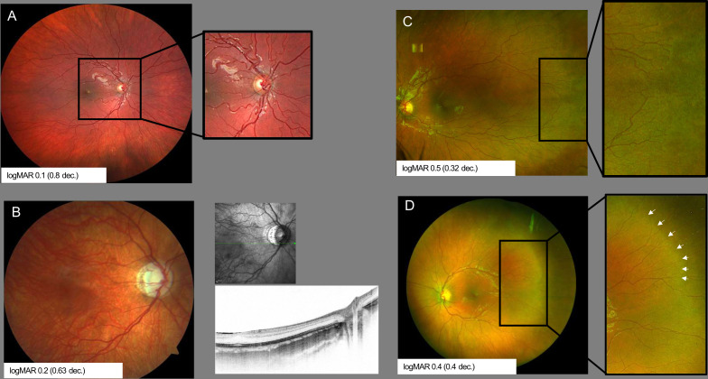
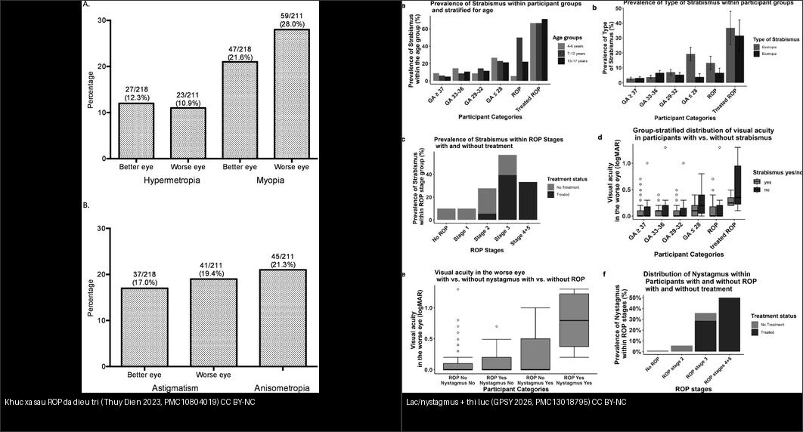
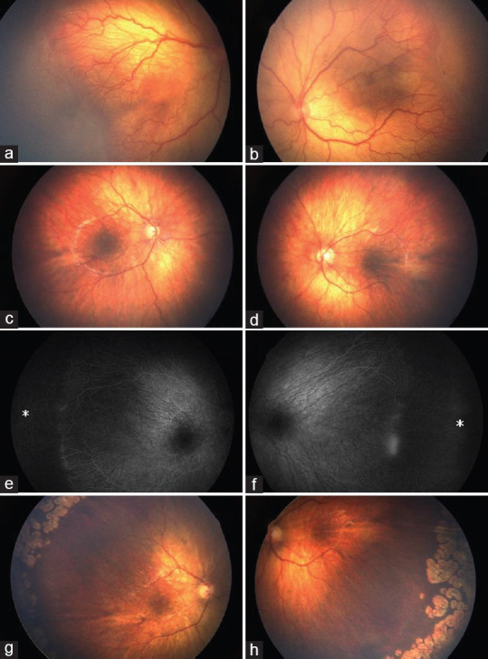
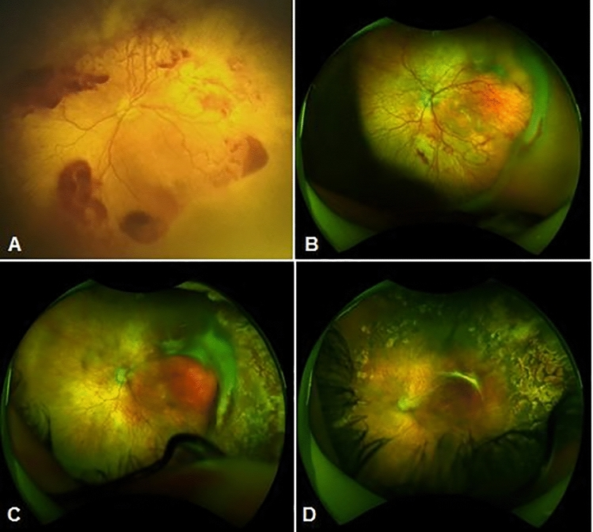
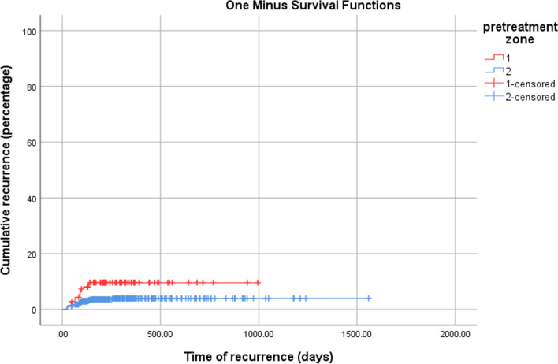
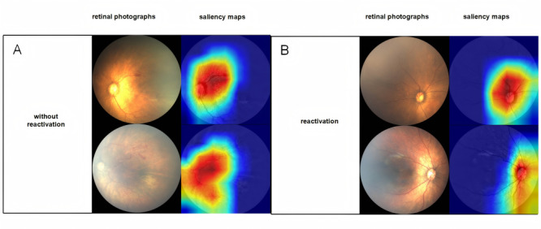
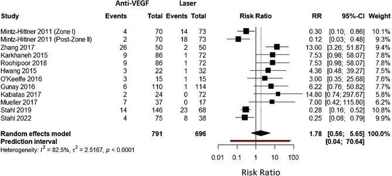
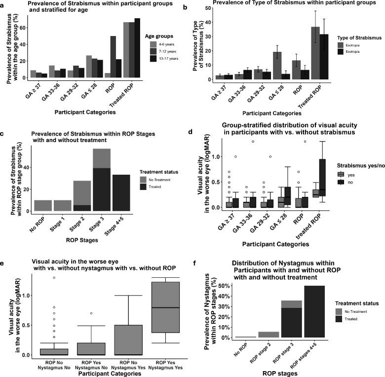
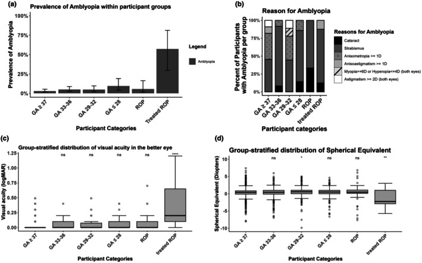

# 458 — Di chứng & theo dõi dài hạn sau ROP: tái hoạt sau anti-VEGF, cận thị/lác/nhược thị & khúc xạ / Long-term sequelae & follow-up after ROP

**Tags:** `pattern:di-chung-rop` `pattern:tai-hoat-rop` `vung:vong-mac` `score:ICROP` `protocol:theo-doi-sau-rop`
**Mức chắc chắn (certainty):** tổng hợp y văn (literature synthesis) — nhóm tự biên từ y văn mở (Sci Rep 2026 CC BY-NC-ND; BMJ Open Ophthalmol 2025 CC BY-NC; Int J Retina Vitreous 2022/2026 CC BY; Br J Ophthalmol 2023/2026 CC BY-NC; Acta Ophthalmol 2025 CC BY; J Med Internet Res 2025 CC BY; Saudi J Ophthalmol 2022 CC BY-NC-SA).

## 1. Tổng quan — bệnh KHÔNG kết thúc ở tuần 40: hai con đường gây mù muộn

- **Nguyên lý (pathology):** ROP (retinopathy of prematurity) là bệnh của **mạch máu võng mạc chưa mọc hết** (bài 456). Dù đa số thoái triển, **cả bệnh lẫn điều trị đều để lại dấu vết suốt đời**, theo hai cơ chế khác nhau — vì vậy phải theo dõi **lâu dài, không dừng khi qua tuần 40**:
  1. **Đường XƠ CỐ ĐỊNH (cicatricial):** tân mạch → xơ → **co kéo** đĩa thị/bó mạch/võng mạc (macular dragging), để lại **cận thị nặng, loạn thị, lác**; có thể **bong võng mạc co kéo (TRD) muộn** ở tuổi học đường.
  2. **Đường TÁI HOẠT sau anti-VEGF (reactivation):** thuốc **ức chế VEGF tạm thời** — vùng võng mạc **vô mạch vẫn còn**, mạch ngoại vi **có thể không bao giờ mọc hết** → **bệnh tái hoạt muộn** (gờ tái xuất/plus tái xuất) → **bong võng mạc muộn (crunch syndrome)**.
- **TẠI SAO laser và anti-VEGF để lại di chứng KHÁC nhau (cơ chế):**
  - **Laser quang đông:** đốt cháy vùng vô mạch nhưng **phá hủy mô + viêm** quanh hoàng điểm, ảnh hưởng **sự phát triển trục nhãn** → **cận thị cao + loạn thị** nhiều hơn (đáy mắt xơ co kéo do co kéo trực tiếp).
  - **Anti-VEGF:** ít phá mô → **ít cận thị hơn**, nhưng **mạch ngoại vi mọc chậm/ngừng** → **tái hoạt muộn** đòi hỏi theo dõi dài hơn; OCT cho thấy **thể vàng mất lõm** (macular hypoplasia) do hoàng điểm chưa trưởng thành.
- **Ngưỡng định lượng nằm lòng:**
  - **Di chứng đáy mắt muộn (CARE-ROP 5 năm, ranibizumab):** **17/28 mắt (60,7%) có ≥ 1 bất thường đáy mắt** (nhợt/teo đĩa thị, đổi sắc tố RPE, **vằn mạch tồn dư persistent tortuosity**, **thiểu sản hoàng điểm**); **19/26 mắt** đạt **BCVA ≤ 0,3 logMAR** (thị lực tốt); **khúc xạ trung bình −0,9 D (SD ± 3,4 D)** — **cận thị cao chỉ ở 2 mắt của 1 trẻ**.
  - **Tái hoạt/tái điều trị (Akıdan, 550 mắt/284 trẻ):** tiêm mũi đầu **99,8%**, **tái điều trị 9,6%** (lúc 35–60 tuần); **laser bổ sung 15,8%**; **bong võng mạc 1,8%** (xuất hiện **38–120 tuần**, mắt bong được tiêm **sớm hơn** có ý nghĩa) → tái hoạt/bong là **biến cố của nửa cuối năm đầu, không phải vài tuần đầu**.
  - **So anti-VEGF vs laser (meta-analysis 15 nghiên cứu/1784 mắt):** tái phát **RR 1,78 (95% CI 0,56–5,65)** và tái điều trị **RR 1,80 (0,54–5,94)** — **không khác biệt có ý nghĩa**; nhưng phân nhóm: **zone I tái phát THẤP hơn với anti-VEGF (RR 0,52)** còn **zone II tái phát CAO hơn (RR 3,42)**; **ranibizumab tái phát nhiều hơn**; tái phát xảy ra **7 đến > 50 tuần sau điều trị** (độ biến thiên lớn).
  - **Di chứng chức năng (GPSY, 949 trẻ):** lác — đủ tháng **6%**, non không ROP **10–23%** (tùy tuổi thai), **ROP điều trị 68%**; **nystagmus:** đủ tháng **0,8%** → **ROP điều trị 47%**; **nhược thị** liên quan **tuổi thai ≤ 28 tuần (OR 2,92)**, **suy nhau thai (OR 3,84)**, **điều trị ROP (OR 15,71)**; lác liên quan **loạn thị (OR 2,48)** và **viễn thị (OR 2,09)**.
  - **Di chứng khúc xạ (Thụy Điển 6,5 tuổi, trẻ ROP đã điều trị):** **cận thị 21,6% mắt tốt – 28,0% mắt xấu** (28% ở mắt xấu), loạn thị **17,0–19,4%**, **anisometropia (lệch khúc xạ hai mắt) 21,3%** — đây là ổ **nhược thị** cần bắt sớm.


*(A) vằn xoắn mạch cực sau tồn dư; (B) nhợt/teo đĩa thị kèm OCT; (C) vùng võng mạc vô mạch tồn dư (chưa mọc hết); (D) tàn dư gờ cũ (mũi tên trắng). Đây là các dấu hiệu "ổn định" cần phân biệt với **tái hoạt tiến triển**. Nguồn: Stahl A et al., BMJ Open Ophthalmol 2025, PMC12382488 Fig. 2, CC BY-NC 4.0.*

## 2. Mẫu hình + chẩn đoán phân biệt theo DÒNG THỜI GIAN (gamut theo tuổi)

Di chứng sau ROP đọc theo **mốc tuổi** — mỗi giai đoạn có chân dung riêng:

- **Pha 1 — trong/ngay sau điều trị (0–6 tháng tuổi thực): tái hoạt (reactivation).** Gờ **tái xuất hoặc bồi thêm**, **plus tái xuất** ở mạch cực sau, vùng vô mạch **chưa mọc hết**. **Chốt bằng chuỗi ảnh** (so lần chụp trước–sau), KHÔNG bằng một lần nhìn. **Vì sao chụp lại mới thấy:** tái hoạt là **thay đổi theo thời gian** (mạch vằn tăng dần) — ảnh đơn độc không phân biệt được trạng thái **ổn định** với **đang tiến triển**.
- **Pha 2 — tuổi học đường (4–12 tuổi): khúc xạ – lác – nhược thị – đáy mắt cố định.** Cận thị/lệch khúc xạ, lác (đặc biệt **esotropia**), nystagmus, **macular dragging**, **nếp võng mạc (retinal fold)**; đáy mắt **xơ co kéo CỐ ĐỊNH** (không đổi theo thời gian).
- **Pha 3 — vị thành niên/người lớn: biến chứng muộn nặng.** **Bong võng mạc muộn** (co kéo TRD, rách RRD ở vùng teo/lỗ hoàng điểm do co kéo, hoặc tiết dịch), **glaucoma góc đóng** (nhãn cầu nhỏ + mống mắt-phôi dịch kính dày), **cataract**, **xuất huyết dịch kính**, **võng mạc thoái hóa lỗ hoàng điểm**.
- **Chân dung di chứng xơ cố định (cicatricial ROP) — theo mức:** từ nhẹ (**mạch thẳng bất thường, kéo nhẹ đĩa**), vừa (**macular dragging/dị thường hoàng điểm**), đến nặng (**nếp võng mạc kiểu "thắt lưng" — falciform fold**, khối xơ, bong võng mạc có thể tự khỏi thành dính).
- **Mnemonic "3R muộn" (theo dõi 3R):** **R**efraction (khúc xạ), **R**etina (đáy mắt — co kéo/bong/cataract/glaucoma), **R**elation-alignment (lác/nystagmus).
- **Đối chiếu hai ngả điều trị (gamut theo cách xử trí):**
  - **Laser đã làm** → nghiêng về **cận thị cao + loạn thị + màng cận hoàng điểm**; tái hoạt **hiếm** sau khi mạch mọc hết (vùng vô mạch đã đốt).
  - **Anti-VEGF đã tiêm** → nghiêng về **khúc xạ trung tính hơn**, NHƯNG **vùng vô mạch còn lại → tái hoạt muộn** và **cần theo dõi dài hơn** (quan trọng với zone I).


*Trái: cận thị/viễn thị/loạn thị/anisometropia ở trẻ ROP đã điều trị (6,5 tuổi, Thụy Điển 2023). Phải: lác/nystagmus tăng vọt ở nhóm **ROP đã điều trị** (GPSY 2026) — lác ~68% và nystagmus ~47% so với đủ tháng 6%/0,8%. Nguồn: Larsson E et al., Br J Ophthalmol 2023, PMC10804019 Fig. 2 CC BY-NC 4.0 & Fieß A et al., Br J Ophthalmol 2026, PMC13018795 Fig. 2 CC BY-NC 4.0 (ảnh ghép letterbox).*

## 3. Bảng so sánh phân biệt (ma trận đối chiếu)

| Thực thể (entity) | Hình ảnh điển hình | Chốt vào (rule-in) | Chốt loại (rule-out) | Gợi ý xác nhận |
|---|---|---|---|---|
| **Tái hoạt sau anti-VEGF** | Gờ **tái xuất/bồi thêm**, **plus tái xuất**, mạch cực sau **vằn tăng dần**; vô mạch chưa mọc hết | **So chuỗi ảnh thấy TIẾN TRIỂN** + plus mới/vằn tăng; xuất hiện ~4–16 tuần sau mũi, có ca tới **50+ tuần** | Mạch đã mọc hết zone III + **không đổi qua các lần chụp** → di chứng ổn định, không phải tái hoạt | Ảnh đáy mắt góc rộng (UWF) chuỗi; theo dõi ≥ 65 tuần PMA |
| **Di chứng xơ cố định (cicatricial)** | **Đĩa thị/bó mạch kéo lệch** (dragged disc), mạch thẳng bất thường, **nếp võng mạc**, macular dragging | Đĩa thị kéo về **thái dương**, mạch kéo thẳng thành "nan hoa"; **bất biến/nhích không đổi** giữa các lần | **Thay đổi tiến triển theo thời gian** (+ plus mới) → tái hoạt, không phải di chứng | So ảnh cũ; OCT (mất lõm hoàng điểm) |
| **Bong võng mạc muộn (TRD/RRD)** | Đám trắng đục/màng co kéo, **"crunch syndrome"** vùng cực sau; hoặc bong do rách vs tiết dịch | Co kéo + **bong võng mạc có tính TIẾN TRIỂN**; mờ dịch kính | Bong **ổn định kiểu dính sẹo cũ** → mô tả di chứng, cân nhắc theo dõi | Siêu âm B-scan khi mờ môi trường; so ảnh |
| **Cận thị/loạn thị + anisometropia** | Nhãn cầu dài (myopia), **lệch khúc xạ hai mắt** | **SE âm tăng dần** + loạn thị; **anisometropia 21,3%** | Đồng đều hai mắt, không lệch → ít nguy cơ nhược thị | **Khúc xạ liệt điều tiết (cycloplegic refraction)** định kỳ |
| **Lác/nystagmus** | Mắt lệch (esotropia), **nystagmus** | **ROP đã điều trị + lác sớm** (esotropia lúc nhũ nhi ~70%) | Lác đơn thuần < 6 tháng tuổi chưa loại trừ ROP → phải khám đáy mắt | Khám chỉnh thị + khúc xạ; va kính lăng kính |
| **Glaucoma góc đóng muộn / cataract** | Nhãn cầu nhỏ, **góc tiền phòng hẹp**; đục thể thủy tinh | **Nhãn cầu nhỏ + tiền phòng nông** + nhãn áp tăng (glaucoma góc đóng ở người lớn trẻ) | Nhãn áp bình thường, tiền phòng sâu → loại trừ | Nhãn áp, soi góc (gonioscopy), siêu âm sinh trắc (AL) |


*Ca minh hoạ (trẻ sinh 22+5 tuần, 542 g, tiêm aflibercept hai mắt cho A-ROP): tàn dư vùng vô mạch/mạch bất thường (a–d), rối loạn tưới máu trên FA (e–f), và các vết laser quanh chu biên (g–h) — minh hoạ rằng **di chứng vẫn hiện diện nhiều năm sau điều trị**. Nguồn: Özdemir HB, Özdek S, Saudi J Ophthalmol 2022, PMC9583352 Fig. 2, CC BY-NC-SA 4.0 (nguyên bản, không cắt ghép).*

## 4. Protocol: lịch theo dõi dài hạn + ngưỡng hành động

- **Kết thúc sàng lọc ROP, KHÔNG kết thúc theo dõi:** sau khi mạch đã mọc hết tới zone III, **cả trẻ ROP đã điều trị lẫn ROP không điều trị đều cần khám mắt định kỳ** (theo 456). Trẻ **điều trị anti-VEGF phải theo dõi tới ≥ 65 tuần PMA** (chú ý cửa sổ nguy cơ **45–55 tuần PMA**) vì tái hoạt muộn.
- **Theo dõi tái hoạt (ngay sau điều trị):** ảnh đáy mắt góc rộng **mỗi 1–2 tuần** tuỳ zone tới khi ổn định; **bất kỳ plus mới + gờ tái xuất** → soi kỹ, cân nhắc **tiêm lại ± laser bổ sung**. Thời điểm tái hoạt thường **~150 ngày** nhưng trải rộng **7 đến > 50 tuần**.
- **Theo dõi dài hạn theo tuổi:**
  - **Nhũ nhi — tuổi học đường:** đo **khúc xạ liệt điều tiết** + khám **chỉnh thị (alignment) + nhược thị**; theo dõi lác/nystagmus; **đo AL (axial length)** khi cận thị tiến triển.
  - **Đo OCT hoàng điểm** khi nghi thiểu sản/di chứng hoàng điểm.
  - **Tầm soát biến chứng muộn** (vị thành niên/người lớn): **nhãn áp + soi góc** (glaucoma góc đóng), **soi đáy mắt tìm bong võng mạc/lỗ**, kiểm tra **thể thủy tinh**.
- **Ngưỡng/hành động chốt:**
  - **RETREATMENT khi tái hoạt:** gờ tái xuất + plus, đặc biệt **zone I** (nguy cơ tái phát ~2× zone II) → **tiêm lại**; sau đó tiếp tục theo dõi dài hạn.
  - **Bong võng mạc stage 4–5:** **scleral buckle hoặc cắt dịch kính (ưu tiên lens-sparing)** — xử trí cấp.
  - **Lác/nhược thị:** **đeo kính chỉnh khúc xạ + bịt mắt (occlusion)/atropine** sớm trước tuổi học để tối ưu thị lực; báo **cửa sổ vàng của nhược thị (thường < 7–8 tuổi)**.
- **Chẩn đoán hình ảnh:** ưu thế **ảnh đáy mắt màu góc rộng (RetCam/UWF, điện thoại có đèn)**; **siêu âm B-scan** khi mờ môi trường; **OCT** cho hoàng điểm/RNFL; **máy học đa phương thức (multimodal ML)** đang hỗ trợ dự báo tái hoạt (AUC ~0,82 ở mô hình kết hợp) — chưa thay thế lâm sàng.

```mermaid
flowchart TD
  A[ROP da dieu tri (laser hoac anti-VEGF)] --> B{Mach da moc het zone III ?}
  B -->|Chua / tren anti-VEGF| C[Theo doi tich cuc: anh UWF moi 1-2 tuan; anti-VEGF toi >= 65 tuan PMA, cang 45-55 tuan]
  C --> D{Go tai xuat + plus moi tren CHUOI anh ?}
  D -->|Co = tai hoat| E[Tiem lai anti-VEGF +- laser bo sung]
  D -->|Khong| F[Di chung on dinh]
  B -->|Da moc het, da on dinh| F
  F --> G[Theo doi dai han theo tuoi: khu xa liet dieu tiet + chinh thi + nhuoc thi]
  G --> H{Lac / nystagmus / nhuoc thi / can thi ?}
  H -->|Co| I[Kinh chinh + bit mat/atropine som; theo doi AL]
  H -->|Khong| J[Tiep tuc kham dinh ky]
  E --> G
  G --> K[Tam soat bien chung muon: nhan ap + soi goc + day mat tim bong/lac]
  K --> L{Bong VM muon hoac glaucoma goc dong?}
  L -->|Bong| M[Dai cung mac / cat dich kinh cap]
  L -->|Glaucoma/cataract| N[Xu tri chuyen khoa]
```

## 5. Biến thể bình thường và cạm bẫy

- **Cạm bẫy số 1 — "trông ổn" ≠ an toàn:** mạch **vằn tồn dư (persistent tortuosity)** và **mất lõm hoàng điểm** là **di chứng ổn định**, KHÁC với **tái hoạt tiến triển**. Chốt phân biệt = **chuỗi ảnh**, không phải một lần nhìn. Bỏ theo dõi quá sớm sau anti-VEGF là cạm bẫy chết người (bong võng mạc muộn tới 50+ tuần).
- **Cạm bẫy số 2 — đọc tái hoạt khi mạch chỉ mới mọc:** vùng vô mạch bình thường vẫn còn khi mạch **đang mọc dần**; chỉ gọi tái hoạt khi có **gờ/plus mới** so với lần trước. **Ghi nhãn ảnh theo ngày** và lưu ảnh gốc.
- **Cạm bẫy số 3 — lác/nhược thị bị bỏ qua:** phụ huynh thấy **lác** mới đi khám (thường đã có **leukocoria/co kéo nặng**). Trẻ non **phải được khám khúc xạ liệt điều tiết + chỉnh thị**, không chờ triệu chứng. **Anisometropia 21,3%** âm thầm gây nhược thị.
- **Cạm bẫy số 4 — "ROP nhẹ thì không sao":** ngay ROP **không điều trị** vẫn có thể có **cận thị/lác/nystagmus** (nystagmus 5% ở nhóm non ≤ 32 tuần có ROP không điều trị, so với 0,8% trẻ đủ tháng) → mọi trẻ non tháng cần theo dõi.
- **Cạm bẫy số 5 — glaucoma góc đóng:** nhãn cầu nhỏ (microphthalmos) sau ROP + tiền phòng nông → **glaucoma góc đóng muộn**; không chỉ để ý đáy mắt mà **phải đo nhãn áp + soi góc**.
- **Cạm bẫy số 6 — tưởng laser đã "đốt sạch bệnh":** sau laser vẫn có thể **bong võng mạc muộn** (TRD/RRD) và **màng trước võng mạc**; theo dõi suốt đời.
- **Biến thể bình thường dễ nhầm (từ bài 456):** gờ giả vùng zone III; mạch thái dương chéo bình thường; **nếp võng mạc bẩm sinh** ở trẻ đủ tháng (bài 457). Luôn xác nhận **tiền sử sinh non**.

## 6. Tự lượng giá — Blind Quiz

**Ca 1 — Trẻ non tháng, sau tiêm anti-VEGF đã thoái triển; chụp lại thấy trung tâm có tổn thương vàng cam vùng hoàng điểm. Nhìn chuỗi A→D, mô tả trước:**



- Gợi ý lâm sàng: ROP type 1 mắt trái, tiêm ranibizumab mũi 1, sau đó là mũi 2 + laser.
- Hỏi: A→B có gì thay đổi? C và D nói lên biến chứng gì? Vì sao phải chụp lại liên tục?

<details><summary><b>Bấm để hiện đáp án (findings + chẩn đoán)</b></summary>

- **(A)** ROP type 1 (bệnh lý vùng cực sau); **(B)** **tái hoạt sau mũi ranibizumab đầu** (mạch/gờ bất thường tái xuất); **(C)** tuần thứ 5 — **bong võng mạc co kéo "crunch syndrome"** sau mũi 2 + laser; **(D)** **võng mạc áp trở lại sau phẫu thuật cắt dịch kính bảo tồn thể thủy tinh (LSV)**.
- **Chốt:** tái hoạt sau anti-VEGF là **thay đổi ĐỘNG** → chỉ thấy khi **so chuỗi ảnh**; bỏ theo dõi giữa chừng có thể dẫn tới **bong võng mạc muộn**.
- Nguồn ảnh: Akıdan M et al., Sci Rep 2026, PMC13370030 Fig. 1, CC BY-NC-ND 4.0 (nguyên bản).
</details>

**Ca 2 — 239 trẻ tiêm anti-VEGF để điều trị ROP; đọc biểu đồ tái hoạt: khi nào nguy cơ cao nhất?**



- Hỏi: đường nào là zone I (đỏ) và zone II (xanh)? Phần lớn tái hoạt rơi vào khoảng nào? Vì sao cần theo dõi ≥ 65 tuần PMA?

<details><summary><b>Bấm để hiện đáp án (findings + chẩn đoán)</b></summary>

- **Đỏ = zone I:** tái phát **~11%**; **Xanh = zone II:** **~5%** → **zone I tái phát cao gấp ~2 lần**. Phần lớn tái phát trong **150 ngày đầu** nhưng vẫn có ca kéo dài.
- **Hệ quả:** mắt **zone I** phải theo dõi sát và lâu (≥ 65 tuần PMA; cửa sổ nguy cơ cao 45–55 tuần) — không được thả sớm khi thấy thoái triển ban đầu.
- Nguồn ảnh: Mirghorbani M et al., Int J Retina Vitreous 2022, PMC8864602 Fig. 2, CC BY 4.0.
</details>

**Ca 3 — Đối chiếu hai đáy mắt + bản đồ "chú ý" (saliency) của mô hình AI: mắt nào sắp tái hoạt?**



- Hỏi: panel A hay B là "không tái hoạt"? Vì sao vùng saliency tập trung ở cực sau? Hạn chế của AI trong bài toán này là gì?

<details><summary><b>Bấm để hiện đáp án (findings + chẩn đoán)</b></summary>

- **(A) = không tái hoạt**; **(B) = tái hoạt** — vùng saliency (đỏ) tập trung ở **cực sau/gờ mạch**, nơi mô hình "nhìn" để dự báo tái hoạt.
- **Bối cảnh:** 239 ca, **90 (37,66%) tái hoạt**; mô hình kết hợp (fusion) **AUC 0,822** — hỗ trợ nhưng **chưa thay thế** đánh giá lâm sàng chuỗi ảnh.
- Nguồn ảnh: Wu R et al., J Med Internet Res 2025, PMC12063557 Fig. 5, CC BY 4.0.
</details>

**Ca 4 — Đọc forest plot: anti-VEGF có làm tái phát nhiều hơn laser không?**



- Hỏi: kết quả gộp RR và CI bao nhiêu? Vì sao heterogeneity lớn? Phân nhóm zone nói gì?

<details><summary><b>Bấm để hiện đáp án (findings + chẩn đoán)</b></summary>

- Kết quả gộp: **RR 1,78 (95% CI 0,56–5,65)** — **không khác biệt có ý nghĩa** giữa anti-VEGF và laser; **I² = 82,5%** (rất lớn) nên kết luận "yếu" (GRADE thấp).
- Phân nhóm: **zone I tái phát THẤP hơn** với anti-VEGF (RR 0,52); **zone II tái phát CAO hơn** (RR 3,42). Vì vậy "chọn cho ai" quan trọng hơn "cái nào tốt hơn".
- Nguồn ảnh: Krungkraipetch L et al., Int J Retina Vitreous 2026, PMC12875000 Fig. 2, CC BY 4.0.
</details>

**Ca 5 — Trẻ non tháng được hỏi vì mắt nhìn "chếch vào trong" ở tuổi đi học. Tỉ lệ lác/khúc xạ theo mức ROP ra sao?**



- Hỏi: nhóm nào lác cao nhất? Nystagmus cao nhất ở đâu? Vì sao cần đo khúc xạ liệt điều tiết?

<details><summary><b>Bấm để hiện đáp án (findings + chẩn đoán)</b></summary>

- **Lác:** tăng dần theo mức non và **cao nhất ở nhóm ROP ĐÃ ĐIỀU TRỊ (~68%**, so với 6% trẻ đủ tháng). Theo giai đoạn ROP, **stage 3 Lao ~40%**, **stage 4–5 ~33%**.
- **Nystagmus:** **ROP đã điều trị ~47%** (đủ tháng 0,8%). **Thị lực mắt xấu giảm rõ** khi có lác và/hoặc nystagmus.
- **Hệ quả:** lác liên quan **loạn thị (OR 2,48)** và **viễn thị (OR 2,09)** → phải **đo khúc xạ liệt điều tiết + bịt mắt/kính sớm** để cứu thị lực.
- Nguồn ảnh: Fieß A et al., Br J Ophthalmol 2026, PMC13018795 Fig. 2, CC BY-NC 4.0.
</details>

**Ca 6 — Đọc biểu đồ nhược thị/hình thái khúc xạ của đoàn hệ GPSY (949 trẻ): 3 yếu tố liên quan mạnh nhất với nhược thị?**



- Hỏi: nhược thị tăng ở nhóm nào? Yếu tố nào có odds ratio cao nhất?

<details><summary><b>Bấm để hiện đáp án (findings + chẩn đoán)</b></summary>

- **Nhược thị** gắn với **tuổi thai ≤ 28 tuần (OR 2,92)**, **suy nhau thai (OR 3,84)** và mạnh nhất là **ROP ĐÃ ĐIỀU TRỊ (OR 15,71)**; thị lực giảm theo mức non tháng + mức ROP.
- **Hệ quả:** ưu tiên **khám chỉnh thị + khúc xạ** cho trẻ cực non/đã điều trị ROP — đây là nhóm cửa sổ vàng của nhược thị.
- Nguồn ảnh: Fieß A et al., Acta Ophthalmol 2025, PMC12531598 Fig. 1, CC BY 4.0.
</details>

**Ca 7 — So hai thế hệ theo dõi: CARE-ROP (ranibizumab) và ca A-ROP (aflibercept). Mô tả tàn dư chung còn lại:**


- Hỏi: tàn dư nào thuộc nhóm "ổn định" (không phải tái hoạt)? Đâu là dấu hiệu chỉ điểm nguy cơ bong võng mạc muộn?

<details><summary><b>Bấm để hiện đáp án (findings + chẩn đoán)</b></summary>

- **Vằn mạch tồn dư, nhợt đĩa thị, vô mạch tồn dư, tàn dư gờ cũ** — tất cả là **di chứng ỔN ĐỊNH** khi **không tiến triển** qua các lần chụp (khác **tái hoạt** phải có gờ/plus MỚI).
- Dấu hiệu nguy cơ bong muộn: **co kéo đĩa/bó mạch (dragged disc) + vùng vô mạch dài + tàn dư gờ/gờ xơ**; theo dõi suốt đời.
- Nguồn ảnh: Stahl A et al., BMJ Open Ophthalmol 2025, PMC12382488 Fig. 2, CC BY-NC 4.0.
</details>

## Bài liên quan chéo
- [400 – Tổng quan Mắt & thị giác](../400-tong-quan-mat-thi-giac/lesson.md) (bảng DDx mắt)
- [456 – Bệnh võng mạc trẻ sinh non (ROP): ICROP & AP-ROP](../456-benh-vong-mac-tre-sinh-non/lesson.md) (chẩn đoán & ngưỡng điều trị)
- [457 – Bệnh "giả ROP" ở trẻ đủ tháng](../457-benh-gia-rop-tre-du-thang/lesson.md) (phân biệt ở trẻ đủ tháng)
- [450 – Mắt nhi: leukocoria](../450-mat-nhi/lesson.md) (đục/di chứng nặng, phân biệt retinoblastoma)
- [445 – Bong võng mạc](../445-bong-vong-mac/lesson.md) (co kéo vs rách nguyên phát vs tiết dịch)
- [446 – Phù hoàng điểm](../446-phu-hoang-diem-viem/lesson.md) (OCT hoàng điểm)
- [411 – Siêu âm nhãn cầu](../411-sieu-am-nhan-cau/lesson.md) (B-scan khi mờ môi trường)
- [610 – Suy hô hấp sơ sinh](../610-suy-ho-hap-so-sinh-va-di-dang-phoi/lesson.md) (oxy liệu pháp — yếu tố nguy cơ ROP)

## Ảnh
- Tên file: `458_*_PMC<id>-Fig*-CCBY*.jpg`; nguồn + giấy phép từng ảnh trong `images/CREDITS.md`.
- Ảnh **CC BY-NC-ND** (PMC13370030) giữ **nguyên bản**, không crop/ghép. Ảnh ghép chỉ dùng nguồn cho phép tạo tác phẩm phái sinh (CC BY / CC BY-NC).
- AuntMinnie (Case of the Day): chỉ dẫn link, không tải.

> Không dùng để chẩn đoán độc lập khi chưa có người hướng dẫn.
