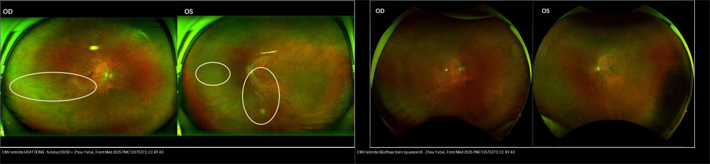
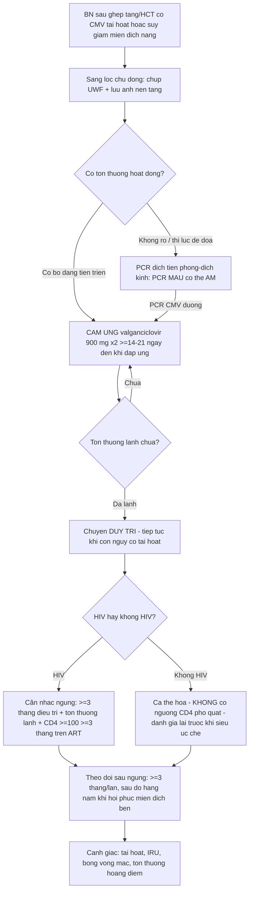
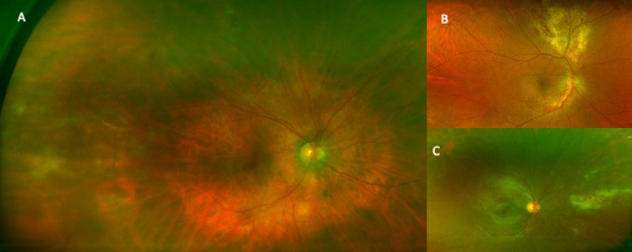
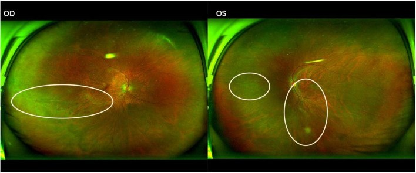
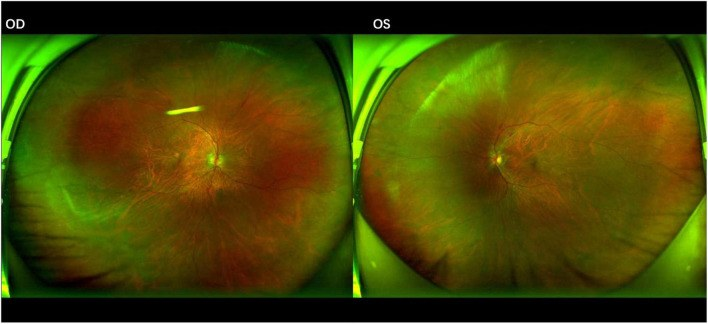
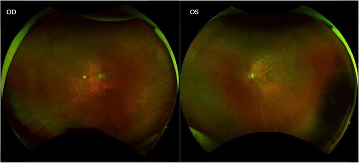
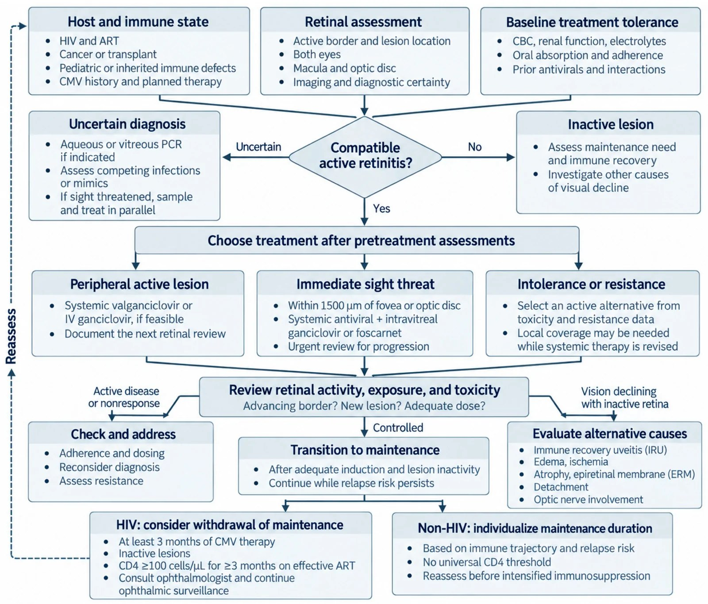

# 459 — Theo dõi dài hạn & tái hoạt CMV retinitis sau ghép: lịch sàng lọc UWF, ngưỡng CD4/viremia, khi nào ngừng kháng virus / Long-term monitoring & reactivation of CMV retinitis after transplantation

**Tags:** `pattern:hoai-tu-vong-mac` `vung:vong-mac` `protocol:UWF` `protocol:PCR-dich-tien-phong` `protocol:theo-doi-sau-ghep` `incidentaloma:CMV-sau-ghep`
**Mức chắc chắn (certainty):** tổng hợp y văn (literature synthesis) — nhóm tự biên từ y văn mở (J Clin Med 2026 CC BY 4.0; J Ophthalmic Inflamm Infect 2026 CC BY 4.0; Front Med 2025 CC BY 4.0; Ther Adv Ophthalmol 2026 CC BY-NC 4.0; World J Stem Cells 2025 CC BY-NC 4.0), chưa gắn một ca nguyên văn đơn lẻ xuyên suốt.

> **Vì sao bài này quan trọng:** bài **452** (ARN & CMV retinitis) và **454** (viêm võng mạc–màng mạch ở người suy giảm miễn dịch KHÔNG HIV) dừng ở **chẩn đoán + điều trị cảm ứng (induction)**. Nhưng CMV retinitis là **bệnh của cả một hành trình miễn dịch**: nguy cơ **tái hoạt muộn**, **viêm mắt hồi phục miễn dịch (IRU)**, **bong võng mạc (RRD)** và câu hỏi **"khi nào được ngừng thuốc"** quyết định thị lực suốt đời. Đây là phần "sau khi tổn thương đã lành" mà người đọc phim/bệnh án dễ bỏ qua nhất.

## 1. Tổng quan — vì sao tái hoạt "bùng" đúng lúc miễn dịch thay đổi, và tại sao PCR máu có thể âm

- **CMV retinitis (viêm võng mạc do cytomegalovirus)** là nhiễm trùng cơ hội **muộn**, xảy ra khi **tế bào T (đặc biệt CD4)** suy giảm nặng. Sau **ghép tế bào gốc (HCT)** hoặc **ghép tạng**, nguy cơ đến từ **ức chế miễn dịch iatrogenic** + **CMV huyết thanh dương trước ghép** + **thuốc ức chế tế bào T/monoclonal antibody**.
- **Cơ chế hình ảnh (TẠI SAO):** CMV theo máu đến võng mạc → **hoại tử võng mạc** + **viêm mạch** + **xuất huyết** → đám **vàng–trắng kèm xuất huyết, lan dọc mạch ("brushfire")**, ít thâm nhiễm dịch kính. Vì **miễn dịch suy** nên **ít viêm** — khác hẳn **ARN** (phản ứng viêm mạnh). Hoạt tính trên ảnh = "bờ đang tiến triển"; lành = **teo–sẹo võng mạc bờ rõ**.
- **Số liệu nằm lòng:**
  - **Sàng lọc chủ động bằng chụp võng mạc góc siêu rộng (UWF) sau ghép tế bào gốc đồng loài (allo-HSCT):** 39 bệnh nhân có CMV tái hoạt được chụp UWF → **1 ca CMVR không triệu chứng (2,6%)**, xuất hiện **251 ngày sau ghép**; **PCR CMV máu ÂM tại thời điểm chẩn đoán võng mạc** nhưng **PCR dịch tiền phòng (aqueous) xác định CMV** → phát hiện sớm, điều trị kịp, tổn thương lành hoàn toàn.
  - **Loạt auto-HCT (ghép tế bào gốc tự thân):** 6 ca CMVR, **tuổi trung vị 63**; **100% CMV-IgG dương trước ghép**; **CMV DNAemia 66,7%**; **hai mắt 66,7%**; **66,67% dùng corticoid liều cao**; **83,33% dùng monoclonal antibody** trước phát bệnh; điểm chung là **lymphopenia kéo dài + CD4 rất thấp**.
  - **Ngưỡng CD4 (HIV):** nguy cơ **6,89/100 người–năm** khi CD4 **< 50 tế bào/µL**, **HR 136** (95% CI 30–605) cho CMVR về sau; rất ít ca xảy ra khi CD4 **≥ 50**.
  - **Khác biệt HIV vs không HIV:** phân tích **117 mắt/91 bệnh nhân** (71 mắt/58 ca HIV+; **46 mắt/33 ca HIV−**) — nhóm **không HIV không có một ngưỡng CD4 đồng nhất**; **giảm IgG (hypogammaglobulinemia)** là bất thường miễn dịch hay gặp **hơn** cả CD4 thấp.
- **Hệ quả thực hành:** với bệnh nhân **không HIV**, **không thể dựa vào một con số CD4** để quyết định sàng lọc/ngừng thuốc — phải **đánh giá toàn bộ quỹ đạo miễn dịch** (lymphocyte, IgG, mức ức chế miễn dịch, tiền sử CMV) và **theo dõi hình ảnh chủ động**.

## 2. Mẫu hình + chẩn đoán phân biệt theo mức miễn dịch (gamut)

**Câu hỏi lọc:** *"Tổn thương hoại tử võng mạc — viêm nhiều hay ít?"* → **viêm ít + suy giảm T nặng = CMV**; **viêm nhiều + người tương đối khỏe = ARN**.

**Gamut "hoại tử võng mạc ở người suy giảm miễn dịch":**
- **CMV retinitis** — HIV CD4 < 50; **sau HCT/ghép tạng** (thể non-HIV, ít CD4 thấp hơn nhưng giảm IgG); **trẻ sau ghép**; thể **"bờ hoạt động"** (advancing border) vs **"teo–sẹo lành"** (inactive).
- **ARN (hoại tử võng mạc cấp, VZV/HSV)** — **viêm dịch kính + viêm tắc mạch nổi bật**, tổn thương **ngoại vi liên tục lan** (bài 452).
- **PORN (hoại tử võng mạc tiến triển ngoài mắt)** — nhiều ổ sâu, tiên lượng xấu.
- **Viêm võng mạc do Toxoplasma/syphilis/lao** — nhiều ổ, có thể kèm viêm màng bồ đào.
- **Nấm nội nhãn (Candida)** — nốt "fluff-ball" trong dịch kính, bối cảnh nhiễm khuẩn huyết/đường truyền (bài 451).
- **Lymphoma nội nhãn (masquerade)** — thâm nhiễm dưới biểu mô sắc tố dai dẳng, **không đáp ứng kháng virus** (một lỗ hổng còn lại — xem BACKLOG).
- **Vị trí gợi ý:** CMV hay ở **cực sau/dọc mạch ("bánh pizza")** và **vùng quanh mạch (periphlebitis)**; ARN hay **ngoại vi lan về trung tâm**.

## 3. Bảng so sánh phân biệt (ma trận đối chiếu)

| Tình trạng (entity) | Hình ảnh điển hình (UWF đáy mắt / OCT) | Chốt vào (rule-in) | Chốt loại (rule-out) | Gợi ý xác nhận |
|---|---|---|---|---|
| **CMV retinitis — bờ HOẠT ĐỘNG** | Đám **vàng–trắng + xuất huyết dọc mạch ("brushfire")**, **ít viêm dịch kính**; bờ đang tiến triển | **Suy giảm miễn dịch nặng (CD4 < 50 / sau ghép) + ít viêm + tổn thương dọc mạch** | Viêm dịch kính nổi bật + viêm tắc mạch → ARN | **PCR CMV dịch tiền phòng/dịch kính** (PCR máu có thể ÂM); UWF |
| **CMV retinitis — LÀNH/SẸO** | Vùng **teo–sẹo bờ rõ, mất tế bào sắc tố**, **không xuất huyết mới** | **Tổn thương ổn định qua 2 lần chụp + bờ không tiến triển + không xuất huyết mới** | Bờ đang rộng ra / xuất huyết mới → **tái hoạt** | So ảnh UWF nối tiếp theo thời gian |
| **ARN (VZV/HSV)** | **Hoại tử ngoại vi liên tục** + **viêm dịch kính + viêm tắc mạch**; đau | **Viêm nặng + viêm tắc mạch + người tương đối khỏe/1 bên** | Ít viêm + CD4 thấp → CMV | PCR VZV/HSV dịch tiền phòng (bài 452) |
| **IRU (viêm mắt hồi phục miễn dịch)** | Viêm **tăng lên trong lúc CD4 hồi phục (ART)**, dịch kính/hoàng điểm phù, trên nền tổn thương CMV đã lành | **Tổn thương CMV đang lành + CD4 tăng nhanh + viêm mới không do virus nhân lên** | Tổn thương hoại tử mới/rộng ra → tái hoạt CMV thật | Loại trừ tái hoạt (PCR), OCT; **không tăng kháng virus mù** |
| **Nấm nội nhãn (Candida)** | Nốt trắng "fluff-ball" nhô vào dịch kính, tổn thương nhỏ nhiều ổ | **Bối cảnh nhiễm nấm huyết/catheter + nốt dịch kính** | Bờ hoại tử dọc mạch rộng → CMV/ARN | Soi/cấy máu, PCR nội nhãn |

*Trái: **hoạt động** — tổn thương hoại tử bờ đang tiến triển theo mạch (khoanh trắng), OD & OS (Zhou Y et al., Front Med 2025, PMC12575373, CC BY 4.0). Phải: **seo/quiescent** — võng mạc teo lành, không xuất huyết mới (cùng nguồn). Chốt theo dõi = **so ảnh nối tiếp theo thời gian**, không đọc "một ảnh đơn". Ảnh ghép letterbox.*

**Quiz composite:** hai ảnh là **cùng một bệnh nhân ở hai thời điểm**. Ảnh nào chứng minh "còn hoạt động"? Muốn chứng minh ảnh phải là "tái phát" (relapse) chứ không phải "di chứng ổn định" thì cần gì?

<b>Bấm để hiện đáp án</b>

- **Trái = đang hoạt động** (bờ hoại tử + xuất huyết mới dọc mạch); **Phải = sẹo ổn định** (teo lành, không xuất huyết).
- **"Tái hoạt" (reactivation)** = **tiến triển so với lần chụp trước** (bờ rộng ra, xuất huyết/tổn thương mới), **không phải** chỉ "thấy tổn thương cũ". → Phải có **so sánh chuỗi UWF theo thời gian** (đây là lý do bắt buộc lưu ảnh nền tảng).
- Phân biệt với **IRU**: viêm tăng khi CD4 hồi phục nhưng tổn thương CMV vẫn lành — đừng tăng kháng virus mù.

## 4. Protocol theo dõi + tiêu chuẩn ngừng kháng virus + xử trí

**Theo dõi hình ảnh — "chụp bằng gì, bao lâu":**
- **Chụp võng mạc góc siêu rộng (UWF, ultra-widefield):** công cụ **sàng lọc chủ động** ở nhóm nguy cơ cao (HCT/ghép tạng có **CMV tái hoạt**); **phát hiện tổn thương ngoại vi mà soi đáy mắt thường bỏ sót**; **lưu ảnh nền tảng** để so sánh lần sau.
- **PCR dịch tiền phòng/dịch kính:** khi nghi ngờ/không rõ hoặc thị lực đe dọa → **lấy mẫu song song điều trị**; **PCR CMV máu có thể ÂM** dù tổn thương võng mạc đang tiến triển (**không loại trừ CMVR**).
- **OCT hoàng điểm + siêu âm B** (khi không thấy đáy mắt): theo dõi tổn thương **hoàng điểm**, **dính dịch kính–võng mạc**, **bong võng mạc**.
- **Theo dõi lâm sàng–miễn dịch:** CD4 (HIV), **IgG/lymphocyte**, mức ức chế miễn dịch, CMV DNAemia định lượng; theo dõi **IRU**, **RRD**, thiếu máu võng mạc.

**Điều trị & thời điểm ngừng (khung):**
- **Cảm ứng (induction):** **valganciclovir 900 mg × 2/ngày** (hoặc ganciclovir IV 5 mg/kg q12h) **tối thiểu 14–21 ngày và tới khi đáp ứng võng mạc đủ** — **"một khoảng thời gian lịch" không đủ để chuyển duy trì**; tổn thương đe dọa hoàng điểm (trong **1500 µm** quanh hoàng điểm/đĩa thị) → **phối hợp tiêm nội nhãn** + đánh giá khẩn.
- **Duy trì (maintenance):** valganciclovir liều duy trì, chỉnh theo chức năng thận; tiếp tục **chừng nào còn nguy cơ tái hoạt**.
- **Ngừng duy trì — khác nhau theo chủ thể:**
  - **HIV:** có thể xét ngừng khi **đã điều trị kháng CMV ≥ 3 tháng** + **tổn thương võng mạc không còn hoạt động** + **CD4 ≥ 100 tế bào/µL duy trì ≥ 3 tháng** nhờ ART, có đồng thuận nhãn khoa (hướng dẫn NIH).
  - **Không HIV (ghép tạng/HCT):** **cá thể hóa**, **không có ngưỡng CD4 phổ quát**; dựa vào **quỹ đạo miễn dịch và nguy cơ tái phát**; **đánh giá lại trước khi siêu ức chế miễn dịch** (thường phải duy trì lâu hơn).
- **Sau khi ngừng:** **theo dõi mắt ít nhất mỗi 3 tháng lúc đầu**, có thể **chuyển hàng năm** khi miễn dịch hồi phục bền và ổn định lâm sàng.

## 5. Biến thể bình thường và cạm bẫy

- **PCR CMV máu âm không loại trừ CMVR:** đã gặp ca **PCR máu âm nhưng PCR dịch tiền phòng dương** (ngày 251 sau allo-HSCT) → **nghi cao thì lấy dịch nội nhãn**, không dừng ở PCR máu.
- **Tổn thương ngoại vi bị bỏ sót:** soi đáy mắt/ảnh chụp hẹp bỏ sót tổn thương **ra ngoài rìa** → **UWF** và **chụp góc rộng** là chìa khóa; luôn khám **hai mắt** (66,7% hai mắt trong loạt auto-HCT).
- **IRU giả "thất bại điều trị":** viêm tăng khi CD4 hồi phục **không phải** virus kháng thuốc → **không tăng kháng virus mù**; phân biệt bằng bờ tổn thương + PCR.
- **Không có ngưỡng CD4 phổ quát ở người không HIV:** áp ngưỡng CD4 của HIV cho bệnh nhân ghép tạng/HCT (giảm IgG, lymphopenia) → **bỏ sót hoặc ngừng thuốc quá sớm**.
- **"Ít ca nên khỏi cần sàng lọc"?** Incidence CMVR không triệu chứng thấp (2,6%) nhưng **hậu quả mù không hồi phục**; sàng lọc hướng nhóm **nguy cơ cao** (CMV tái hoạt, corticoid liều cao, monoclonal antibody) — cân nhắc nguồn lực (chưa có khoảng sàng lọc chuẩn cho trẻ).
- **Sẹo cũ bị đọc nhầm tái hoạt:** chỉ gọi **tái hoạt** khi có **tiến triển so với ảnh trước** (bờ rộng ra/xuất huyết mới) — nếu không có ảnh nền tảng, dễ tăng thuốc oan.
- **Sau khi ngừng kháng virus:** nguy cơ **RRD, IRU, tổn thương hoàng điểm** vẫn tiếp diễn → **theo dõi tiếp**, không "xong bệnh".

## 6. Tự lượng giá — Blind Quiz

**Ca 1 — Bệnh nhân allo-HSCT, có CMV tái hoạt, không triệu chứng mắt, được sàng lọc UWF. Đáy mắt:**

- Hỏi: mô tả tổn thương? Vì sao chụp UWF lại phát hiện được? Nếu chỉ làm PCR máu thì sao?

<b>Bấm để hiện đáp án (findings + chẩn đoán)</b>

- Dấu hiệu (findings): **(A)** kiểu **viêm quanh mạch (periphlebitis)** ngoại vi + xuất huyết trong võng mạc; các kiểu khác (B, C) — tổn thương hoại tử ngoại vi.
- Chẩn đoán (diagnosis): **CMV retinitis không triệu chứng** — phát hiện nhờ **UWF sàng lọc**; ca gốc xuất hiện **251 ngày sau allo-HSCT**, **PCR CMV máu ÂM**, xác định bằng **PCR dịch tiền phòng**.
- Ý nghĩa: **sàng lọc chủ động ở nhóm nguy cơ cao** + **UWF** bắt được tổn thương ngoại vi mà khám thường bỏ sót.
- Nguồn ảnh: Moll-Udina A et al., J Ophthalmic Inflamm Infect 2026 (PMC13265437) Fig. 1, CC BY 4.0.

**Ca 2 — Bệnh nhân auto-HCT, nhìn mờ, tổn thương đáy mắt hai bên đang hoạt động:**

- Hỏi: tổn thương ở đâu (khoanh trắng)? Nghĩ bệnh gì? Cần hỏi gì về tiền sử ghép?

<b>Bấm để hiện đáp án (findings + chẩn đoán)</b>

- Dấu hiệu (findings): tổn thương **dọc mạch (khoanh trắng, cả OD & OS)**, bờ đang tiến triển — kiểu **hao mòn/xuất huyết ("hemorrhagic") lan theo arcade mạch**.
- Chẩn đoán (diagnosis): **CMV retinitis sau auto-HCT** (loạt 6 ca: tuổi trung vị 63; 100% CMV-IgG+; 66,67% corticoid liều cao; 83,33% monoclonal antibody; lyphopenia + CD4 thấp).
- Cần hỏi: **thời điểm ghép, thuốc ức chế miễn dịch, CMV DNAemia, IgG** — vì **không có ngưỡng CD4 phổ quát** ở người không HIV.
- Nguồn ảnh: Zhou Y et al., Front Med 2025 (PMC12575373) Fig. 1, CC BY 4.0.

**Ca 3 — Cùng bệnh nhân sau 1 tháng kháng virus:**

- Hỏi: so với lần trước thay đổi gì? Đã được chuyển duy trì hay ngừng thuốc chưa?

<b>Bấm để hiện đáp án (findings + chẩn đoán)</b>

- Dấu hiệu (findings): **giảm diện hoại tử và xuất huyết**, bờ **thoái triển** so với ảnh hoạt động → đang đáp ứng điều trị.
- Ý nghĩa: vẫn **DUY TRÌ** — chuyển/ngừng chỉ khi **tổn thương lành** và (nếu HIV) **CD4 ≥ 100 trong ≥ 3 tháng trên ART**; người không HIV **cá thể hóa**.
- Nguồn ảnh: Zhou Y et al. (PMC12575373) Fig. 2, CC BY 4.0.

**Ca 4 — Đáy mắt giai đoạn muộn, không xuất huyết mới:**

- Hỏi: đây là hoạt động hay di chứng? Làm sao khẳng định "không tái hoạt"? Còn cảnh giác gì dù đã lành?

<b>Bấm để hiện đáp án (findings + chẩn đoán)</b>

- Dấu hiệu (findings): **teo–sẹo võng mạc bờ rõ, tế bào sắc tố mất**, **không xuất huyết/tổn thương mới** → **giai đoạn không hoạt động (quiescent)**.
- Khẳng định không tái hoạt: **so ảnh UWF nối tiếp** (bờ không tiến triển, không tổn thương mới) + ổn định miễn dịch.
- Còn cảnh giác: **IRU, bong võng mạc (RRD), tổn thương hoàng điểm, thiếu máu võng mạc** — theo dõi tiếp sau khi ngừng kháng virus (**≥ 3 tháng/lần lúc đầu → hàng năm** khi miễn dịch hồi phục bền).
- Nguồn ảnh: Zhou Y et al. (PMC12575373) Fig. 3, CC BY 4.0.

**Ca 5 — Bệnh nhân suy giảm miễn dịch, đang hoạt động — quyết định điều trị & theo dõi:**

- Hỏi: lưu đồ phân biệt "thoát duy trì ở HIV" và "không HIV" thế nào? Sau khi ngừng, theo dõi ra sao?

<b>Bấm để hiện đáp án (findings + chẩn đoán)</b>

- Khung: (1) đánh giá **tình trạng miễn dịch + hoạt tính võng mạc + dung nạp thuốc**; (2) chọn điều trị theo **tổn thương ngoại vi / đe dọa thị lực (trong 1500 µm) / kháng thuốc–dung nạp**; (3) chuyển **duy trì** khi tổn thương lành; (4) **HIV: xét ngừng khi ≥ 3 tháng điều trị + tổn thương lành + CD4 ≥ 100 ≥ 3 tháng trên ART**; **không HIV: cá thể hóa, không ngưỡng CD4 phổ quát**.
- Sau ngừng: theo dõi **≥ 3 tháng/lần lúc đầu → hàng năm** khi miễn dịch hồi phục bền; cảnh giác tái hoạt, **IRU, RRD**.
- Nguồn ảnh: J Clin Med 2026 (PMC13665908) Fig. 1, CC BY 4.0 (không ghi tên tác giả — Europe PMC không trả authorString).

## Bài liên quan chéo
- [400 – Tổng quan Mắt & thị giác](../400-tong-quan-mat-thi-giac/lesson.md)
- [452 – Hoại tử võng mạc cấp (ARN) & CMV retinitis](../452-hoai-tu-vong-mac-ARN-CMV/lesson.md) (chẩn đoán + điều trị cảm ứng)
- [454 – Viêm võng mạc–màng mạch ở người suy giảm miễn dịch KHÔNG HIV](../454-viem-vong-mac-suy-giam-mien-dich/lesson.md) (ghép tạng, ung thư máu)
- [451 – Biểu hiện mắt của bệnh hệ thống](../451-he-thong-mat/lesson.md) (nấm nội nhãn, lymphoma masquerade)
- [411 – Siêu âm nhãn cầu](../411-sieu-am-nhan-cau/lesson.md) (khi không thấy đáy mắt)

## Ảnh
- `459_uwf-periphlebitis_PMC13265437-Fig1-CCBY.jpg` — Moll-Udina A et al., J Ophthalmic Inflamm Infect 2026 (PMCID: PMC13265437) Fig. 1, CC BY 4.0.
- `459_cmv-hoat-dong_Fundus_PMC12575373-Fig1-CCBY.jpg` — Zhou Y et al., Front Med 2025 (PMCID: PMC12575373) Fig. 1, CC BY 4.0.
- `459_cmv-thoai-trien_Fundus_PMC12575373-Fig2-CCBY.jpg` — Zhou Y et al. (PMC12575373) Fig. 2, CC BY 4.0.
- `459_cmv-seo_Fundus_PMC12575373-Fig3-CCBY.jpg` — Zhou Y et al. (PMC12575373) Fig. 3, CC BY 4.0.
- `459_lo-trinh-cmvr_PMC13665908-Fig1-CCBY.jpg` — J Clin Med 2026 (PMCID: PMC13665908) Fig. 1, CC BY 4.0 (không ghi tên tác giả).
- `composite_cmv-hoat-dong-vs-seo.jpg` — ghép Fig. 1 + Fig. 3 (PMC12575373) bằng `tools/make_composite.py`.
- Chi tiết giấy phép từng ảnh trong `images/CREDITS.md`. AuntMinnie: chỉ dẫn link, không tải.

> Không dùng để chẩn đoán độc lập khi chưa có người hướng dẫn.
