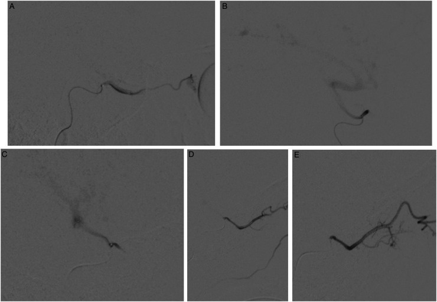
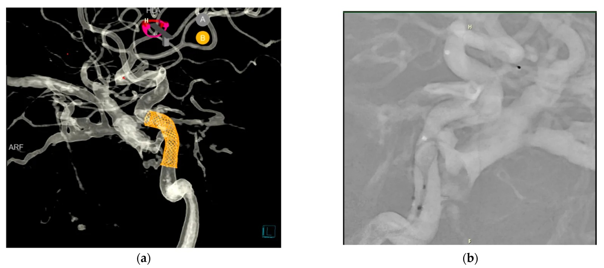
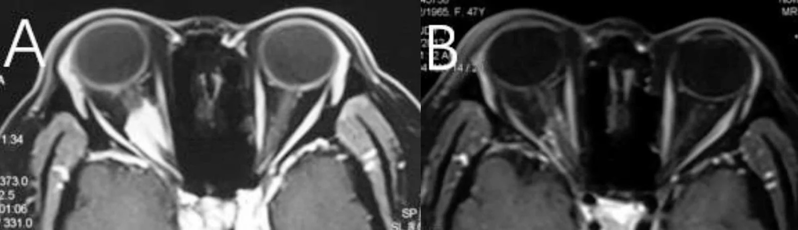
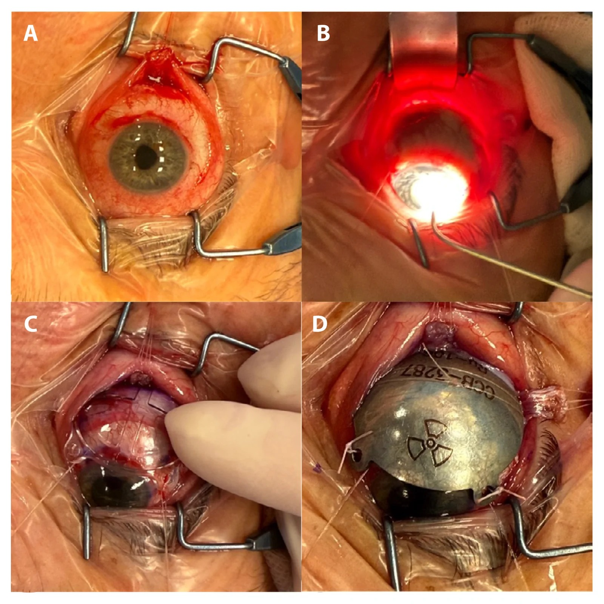

# 460 — Can thiệp mạch mắt + xạ trị / Intervention & Radiotherapy imaging

**Tags:** `pattern:can-thiep-mat` `vung:mat`
**Mức chắc chắn (certainty):** tổng hợp y văn (literature synthesis) — nhóm tự biên từ y văn mở, chưa gắn ca nguyên văn đơn lẻ.

## 1. Tổng quan — nút mạch + xạ lập thể giữ thị lực

- **Nút mạch CCF:** DSA + coil/bóng qua ĐM cảnh trong, giữ dòng chính — hết tiếng thổi + xẹp SOV (bài 423).
- **Xạ lập thể ONSM:** SRS 25 Gy/5 phân liều (mẫu), kiểm soát ~96–100%, giữ thị lực còn lại (bài 431).
- **Xạ u hắc mạc:** proton áp sát + siêu âm/OCT theo dõi (teo u + biến chứng khô mắt/đục thủy tinh thể).
- TẠI SAO hình ảnh dẫn đường sống còn: DSA thấy dòng fistula realtime; MRI đo thể tích u trước/sau xạ (giảm 44% mẫu ONSM).

## 2. Gamut can thiệp theo bệnh

- **CCF dòng cao:** nút mạch cấp cứu (coil) — DSA + giữ ĐM cảnh.
- **ONSM tiến triển:** SRS 25 Gy/5 — MRI thể tích + thị lực.
- **U hắc mạc:** proton/brachytherapy — siêu âm/OCT + di căn gan.
- **RB tiến triển:** hóa chất nội động mạch mắt (IAC) — DSA + MRI đáp ứng.

## 3. Bảng chỉ định – theo dõi (ma trận đối chiếu)

| Can thiệp | Chỉ định hình ảnh | Liều/mốc | Theo dõi hình ảnh | Chốt vào (rule-in) | Chốt loại (rule-out) |
|---|---|---|---|---|---|
| Nút CCF (coil/flow-diverter) | SOV giãn + đổ đầy sớm | Coil/stent đến hết shunt | Hết tiếng thổi + xẹp SOV | **Tiếng thổi + SOV giãn + đổ đầy sớm** | Không tiếng thổi + **khuyết thuốc trong xoang** → huyết khối (không nút) |
| SRS ONSM | U quanh TK + thị lực còn | **25 Gy/5** | Thể tích + thị lực 6 tháng | **U ngấm dọc bao TK ("tram-track")** | Tổn thương lan ra mô mềm ngoài bao → u/viêm khác |
| Proton/plaque u hắc mạc | Khối + chưa di căn | Áp sát u (plaque ruthenium) | Siêu âm/OCT + PET gan | **Khối hắc mạc dày ≥ 2 mm, T1 sáng, tỏa hình nấm** | Tổn thương phẳng, không dày → nevus hắc mạc |
| IAC (RB) | RB tiến triển, một bên | Melphalan qua ĐM mắt | MRI đáp ứng + mắt còn lại | **Đảo chiều dòng ĐM mắt khi bơm chọn lọc** | Không chọn được ĐM mắt → đường bàng hệ (IMAX) |

*Hóa chất nội động mạch (IAC) cho RB: DSA cho thấy **dòng ĐM mắt xuôi chiều (A)** và **đảo chiều, reflux vào ĐM cảnh trong (B)** — hướng dòng quyết định thuốc có tới được mắt hay không. Nguồn: Feldman M et al., Interv Neuroradiol 2025, PMC12475354 Fig. 2, CC BY-NC 4.0.*

*CCF chấn thương hai bên: (a) DSA 3D + mô hình hóa flow-diversion, **giãn tĩnh mạch mắt trên (SOV)**; (b) stent flow-diverter đặt tại lỗ rò. Nguồn: Placek O et al., Reports (MDPI) 2026, PMC13510772 Fig. 2, CC BY 4.0.*

## 4. Protocol

- **Định hướng theo can thiệp — ảnh đối chiếu:**
  - **ONSM trước/sau xạ lập thể:** MRI T1 cản quang lát mỏng cho thấy khối ngấm quanh thần kinh thị **thoái triển sau xạ** (đối chiếu trước – 6 tháng).
  - **U hắc mạc — brachytherapy (plaque ruthenium):** đặt plaque đúng nền u (tháo chèn cơ → đánh dấu nền u qua xuyên sáng → plaque giả kiểm tra vị trí) là điều kiện để đủ liều vào u mà chừa thần kinh thị.

*ONSM (meningioma bao thần kinh thị): (A) MRI T1 cản quang trước xạ — khối ngấm quanh thần kinh thị phải; (B) **6 tháng sau xạ lập thể** — u thoái triển. Mục tiêu SRS là **kiểm soát u + giữ thị lực còn lại**. Nguồn: Yang Y et al., Radiat Oncol 2026, PMC13555848 Fig. 3, CC BY-NC-ND 4.0 (giữ nguyên bản).*

*Brachytherapy u hắc mạc: (A) tháo chèn cơ, (B) đánh dấu nền u trên củng mạc qua xuyên sáng, (C) đặt plaque giả để kiểm tra vị trí trước khi cố định. Nguồn: Deja A et al., Rep Pract Oncol Radiother 2026, PMC13544059 Fig. 2, CC BY-NC-ND 4.0 (giữ nguyên bản).*

- **DSA:** bản đồ fistula + test tắc bóng (chịu được mới nút ĐM chính).
- **MRI lập kế hoạch SRS:** T1 cản quang lát mỏng + giới hạn TK/giao thoa/thể thủy tinh.
- Sau can thiệp: MRI + thị lực + nhãn áp định kỳ (biến chứng muộn).

## 5. Cạm bẫy

- **Nút nhầm ĐM nuôi TK thị** → mù — test tắc + DSA siêu chọn lọc.
- **Xạ quá liều thể thủy tinh** → đục sớm — giới hạn liều + che chắn.
- **Tái phát sau nút/xạ** — DSA/MRI định kỳ, đừng coi khỏi hẳn.

## 6. Tự lượng giá — Blind Quiz

**Ca 1 — Bé trai 2 tuổi, RB một bên, được hóa chất nội động mạch (IAC). Nhìn DSA, mô tả hướng dòng:**

- Hỏi: panel nào dòng **xuôi chiều**, panel nào **đảo chiều**? Vì sao hướng dòng quyết định hiệu quả?

<b>Bấm để hiện đáp án</b>

- (A) **dòng ĐM mắt xuôi chiều** (thuốc đi vào mắt); (B) **đảo chiều, reflux vào ĐM cảnh trong** — khi đó thuốc có thể không tới mắt đủ.
- Chốt: phải **bơm chọn lọc** và xác nhận hướng dòng; nếu không chọn được ĐM mắt → đường bàng hệ (IMAX). Theo dõi **MRI đáp ứng + mắt còn lại**.
- Nguồn ảnh: Feldman M et al., Interv Neuroradiol 2025, PMC12475354 Fig. 2, CC BY-NC 4.0.

**Ca 2 — Bệnh nhân CCF chấn thương hai bên: đọc DSA và cho biết "chốt vào" để nút mạch:**

- Hỏi: dấu hiệu nào chốt CCF? Chốt loại CCF (nghĩ huyết khối) là gì? Can thiệp gì?

<b>Bấm để hiện đáp án</b>

- (a) DSA 3D + mô hình flow-diversion, **giãn tĩnh mạch mắt trên (SOV)** = chốt vào; (b) **stent flow-diverter** đặt tại lỗ rò.
- Chốt loại: **không tiếng thổi + khuyết thuốc trong xoang** → huyết khối xoang hang (kháng sinh + kháng đông, không nút).
- Theo dõi: hết tiếng thổi + xẹp SOV; DSA/CTA kiểm tra shunt tồn dư (tái thông vẫn xảy ra).
- Nguồn ảnh: Placek O et al., Reports (MDPI) 2026, PMC13510772 Fig. 2, CC BY 4.0.

**Ca 3 — Bệnh nhân nữ 47 tuổi, ONSM phải, xạ lập thể phân liều; đọc MRI trước – sau:**

- Hỏi: dấu hiệu "chốt vào" của ONSM? Sau 6 tháng u thoái triển nhưng thị lực không cải thiện — thành công không?

<b>Bấm để hiện đáp án</b>

- Chốt vào: **u ngấm dọc bao thần kinh thị ("tram-track")** trên T1 cản quang lát mỏng; (A) trước xạ → (B) 6 tháng sau xạ, u thoái triển.
- **Có (kiểm soát u + hết đau/lồi):** mục tiêu SRS (**25 Gy/5**) là giữ hiện trạng + diệt u, không phục hồi thị lực đã mất.
- Nguồn ảnh: Yang Y et al., Radiat Oncol 2026, PMC13555848 Fig. 3, CC BY-NC-ND 4.0 (giữ nguyên bản).

## Bài liên quan chéo
- [400 – Tổng quan Mắt](../400-tong-quan-mat-thi-giac/lesson.md)
- [423 – Fistula xoang hang](../423-fistula-xoang-hang/lesson.md) (nút mạch CCF)
- [431 – U TK thị](../431-u-than-kinh-thi/lesson.md) (SRS ONSM)
- [412 – U trong nhãn cầu](../412-u-trong-nhan-cau/lesson.md) (retinoblastoma — IAC)
- [448 – U hắc mạc](../448-u-hac-mac/lesson.md) (proton/brachytherapy u hắc mạc)
- [457 – Bệnh "giả ROP" ở trẻ đủ tháng](../457-benh-gia-rop-tre-du-thang/lesson.md) (rối loạn mạch võng mạc — bối cảnh điều trị)

## Ảnh
- Tên file: `460_can-thiep-mat_<Can thiệp>_<Modality>_PMC*-Fig*-CCBY*.jpg`; nguồn + giấy phép từng ảnh trong `images/CREDITS.md`.
- Ảnh **CC BY-NC-ND** (PMC13555848, PMC13544059) giữ **nguyên bản** — không ghép/crop.
- AuntMinnie (Case of the Day): **chỉ dẫn link, không tải** (xem `sources.md`).

> Không dùng để chẩn đoán độc lập khi chưa có người hướng dẫn.
