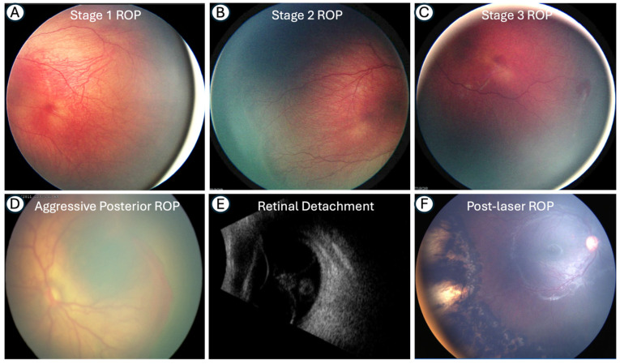
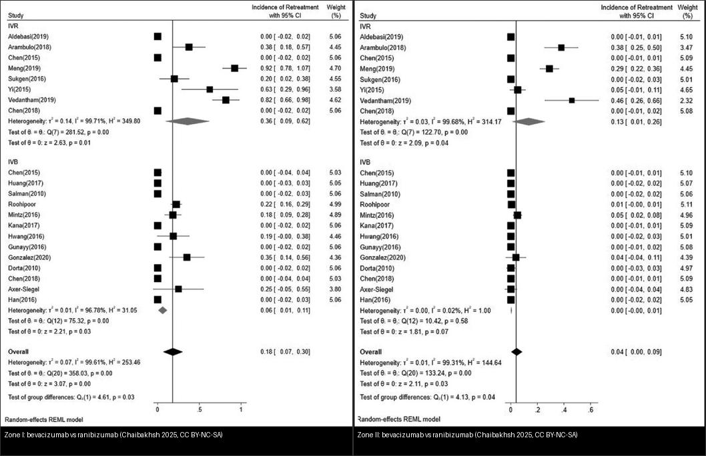
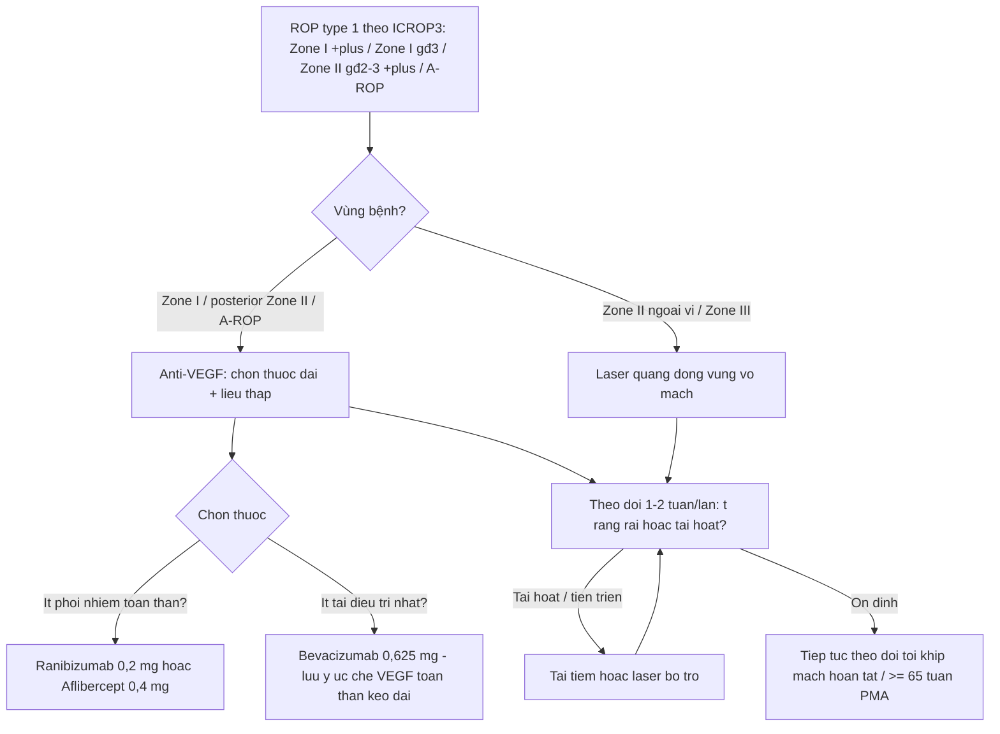
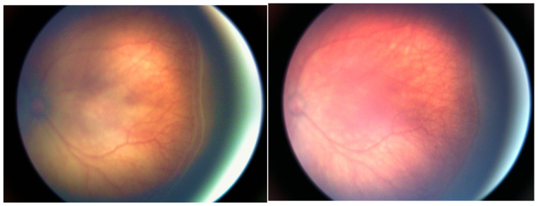
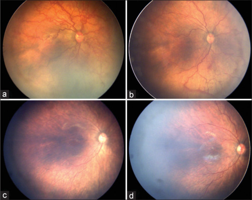
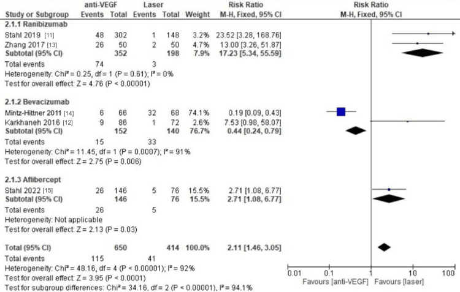
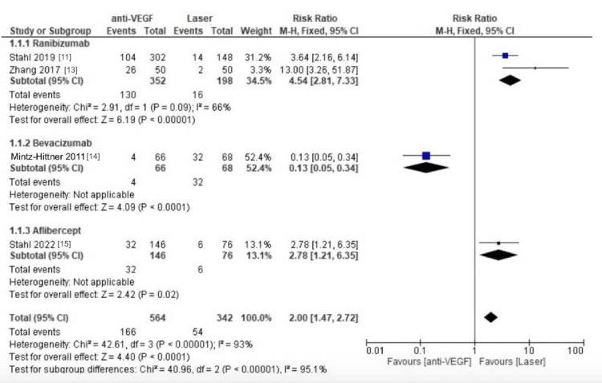
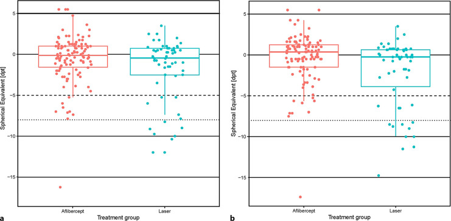
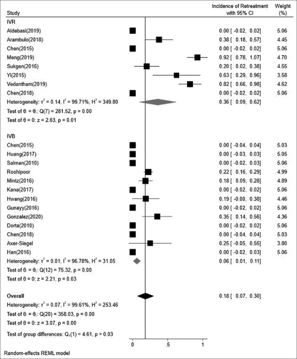

# 461 — Chọn thuốc & phác đồ anti-VEGF cho ROP: bevacizumab vs ranibizumab vs aflibercept, liều, khoảng tái tiêm & khi nào chuyển laser / Anti-VEGF agent choice & regimen for retinopathy of prematurity

**Tags:** `pattern:rop` `pattern:tan-mach-vong-mac` `vung:vong-mac` `score:ICROP` `protocol:anti-VEGF-noi-nhan` `protocol:laser` `protocol:theo-doi-sau-tiem`
**Mức chắc chắn (certainty):** tổng hợp y văn (literature synthesis) — tổng hợp từ RCT/registry/meta-analysis mở 2024–2026 (Cureus CC BY; J Curr Ophthalmol CC BY-NC-SA; J Clin Med CC BY; Neonatology CC BY-NC; Indian J Ophthalmol CC BY-NC-ND; Front Med CC BY; Ophthalmol Sci CC BY); có gắn hình thái ca nguyên văn từ bài gốc nhưng nội dung nhóm tự biên.

## 1. Tổng quan — vì sao anti-VEGF "hiệu quả nhanh nhưng dai dẳng" hơn laser

- **Sinh bệnh học (pathophysiology):** ở trẻ sinh non, mạch võng mạc **chưa mọc hết ra ngoại vi** → võng mạc ngoại vi **thiếu oxy** → tăng yếu tố tăng trưởng nội mô mạch máu (**VEGF**) → **tân mạch** tại ranh giới võng mạc có mạch/vô mạch (ranh giới Doppler) → co kéo, gờ, plus disease, rồi bong võng mạc (bài [456](../456-benh-vong-mac-tre-sinh-non/lesson.md)). Hai lựa chọn điều trị nhắm đúng cơ chế này theo hai cách khác nhau:
  - **Laser quang đông vùng vô mạch (photocoagulation):** đốt phá võng mạc ngoại vi thiếu oxy → **giảm nguồn sản xuất VEGF**; hiệu quả tức thì, **ít tái hoạt**, nhưng **phá vĩnh viễn võng mạc ngoại vi** → **cận thị cao, thu hẹp thị trường**.
  - **Tiêm nội nhãn kháng VEGF (anti-VEGF):** trung hòa VEGF trong dịch kính → **thoái triển nhanh**, **bảo tồn võng mạc ngoại vi đang mọc** (nhờ đó **giảm cận thị cao**, thị trường rộng hơn), nhưng **thuốc bị đào thải dần** → khi nồng độ tụt, VEGF tăng lại → **tái hoạt (reactivation)/cần tái điều trị (retreatment)**. Đây là **bản chất thuốc quyết định** (không phải lỗi kỹ thuật).
- **TẠI SAO chọn thuốc lại quan trọng — thời gian tác dụng (durability) khác nhau:** thuốc có **thời gian bán thải nội nhãn dài** giữ VEGF bị khóa lâu hơn → tái hoạt **muộn hơn, ít hơn**. Theo thực hành mở (tổng hợp trong Kumawat *Indian J Ophthalmol* 2026, PMC13225330):
  - **Bevacizumab (BCZ)** hiệu quả nhưng **thời gian bán thải toàn thân dài** → **ức chế VEGF toàn thân kéo dài** (lo ngại phát triển thần kinh–thể chất).
  - **Ranibizumab (RBZ)** hệ thống ngắn (**ít ức chế VEGF toàn thân**) nhưng **tái hoạt sớm và thường xuyên**.
  - **Aflibercept (AFL)** là **"VEGF-trap"** (gắn VEGF ái lực cao) → **tác dụng nội nhãn kéo dài**, được kỳ vọng **giảm tái hoạt**; nhưng liều cao (1 mg) lại **tái điều trị nhiều hơn**, trong khi **liều thấp 0,4 mg** (FIREFLEYE) cân bằng hơn.
- **Ngưỡng định lượng cốt lõi (dùng để chọn & theo dõi):**
  - **Liều "chuẩn" hay dùng:** bevacizumab **0,625 mg** ; ranibizumab **0,2 mg** (RAINBOW) hoặc **0,25 mg** ; aflibercept **0,4 mg** (FIREFLEYE/BUTTERFLEYE) hoặc **1 mg** (nghiên cứu cũ) ; conbercept **0,25 mg**.
  - **Tỷ lệ tái điều trị (IR) gộp theo thuốc** (Chaibakhsh *J Curr Ophthalmol* 2025, PMC12668653): tổng **19% (95% CI 15–23%)**; **IVR 27% (19–35%)** và **IVA 27% (6–47%)** cao nhất, **IVC 16% (13–20%)**, **IVB 11% (7–14%)** thấp nhất.
  - **Theo vùng (zone):** **Zone I** tái điều trị nhiều hơn hẳn Zone II. Với **Zone I**: **IVR 36% vs IVB 6%** (p = 0,03); **Zone II**: **IVR 13% vs IVB ~0%** (p = 0,03).
  - **Khoảng trung vị đến tái điều trị** (Ortiz-Seller, trích trong Kumawat 2026): **BCZ 6,72 tuần · RBZ 3,13 tuần · conbercept 2,48 tuần · AFL 1 mg 8,65 tuần** — càng ngắn thì lịch theo dõi càng phải dày.
  - **Tái hoạt trên chuỗi ảnh thực tế:** IVR **10,4%** và IVC **12,6%**, thời điểm trung bình **~8,9 tuần** (Liu Q *Front Med* 2026, PMC12960177); riêng **sau IVB** có ca tái hoạt tới **30,3%** (Gül *BMC Ophthalmol* 2026, PMC13536656) — **không có thuốc nào "miễn nhiễm" tái hoạt**.
  - **Biến chứng nặng:** **bong võng mạc (RD) sau anti-VEGF gộp 1,4% (95% CI 0,5–2,7%)**, 27 nghiên cứu/5.598 mắt (Liu G *J Clin Med* 2026, PMC13666268).
  - **An toàn thần kinh:** dùng anti-VEGF ở trẻ rất non **không** làm tăng rõ rệt rối loạn phát triển thần kinh trong 6 năm đầu (**71,4% vs 58,1%; OR 1,4; 95% CI 0,8–2,4; p = 0,31** so với laser/cryo — Ben Ghezala *Ophthalmol Sci* 2026, PMC13654026) — nhưng bằng chứng **còn giới hạn**, cần theo dõi dài hạn.

## 2. Mẫu hình + chẩn đoán phân biệt theo vùng/cơ chế (Gamut)

- **Ai được tiêm anti-VEGF (theo ICROP3 2021):** **ROP type 1** — **Zone I bất kỳ giai đoạn nào kèm plus**; **Zone I giai đoạn 3 không plus**; **Zone II giai đoạn 2 hoặc 3 kèm plus**; và **AP-ROP (aggressive posterior ROP)**. Anti-VEGF nay là **chuẩn cho Zone I, Zone II sau (posterior) và AP-ROP**; laser vẫn rất hiệu quả cho **Zone II–III ngoại vi**.
- **Mẫu hình điều trị (pattern) — theo vùng (zone):**
  - **Zone I / posterior Zone II / AP-ROP:** ưu tiên **anti-VEGF** (bảo tồn mạc ngoại vi chưa mọc hết; laser ở vùng này dễ phá hoại và gây co kéo).
  - **Zone II ngoại vi / Zone III:** **laser** thường đủ và ít tái hoạt.
  - **Bệnh tái hoạt sau anti-VEGF:** thường **gieo lại ở ranh giới mạch máu–vô mạch**, có thể **nhanh và kèm kéo võng mạc** → tái tiêm hoặc **laser bổ trợ (adjunctive laser)**.
- **Gamut phân biệt "thất bại/tái hoạt" so với các nguyên nhân khác:**

| Mẫu hình | Vị trí (zone) | Gamut chính | Phân biệt nhanh |
|---|---|---|---|
| Tân mạch tiến triển lại | Ranh giới mạch/vô mạch | **Tái hoạt ROP** | So **chuỗi ảnh** thấy tiến triển (không phải sẹo cũ) |
| Gờ/rách mới, bong co kéo | Ngoại vi | Biến chứng của tái hoạt | B-scan/réclinoscopy; đe dọa hoàng điểm = cấp cứu |
| Đục thủy tinh thể non | Thể thủy tinh | Biến chứng tiêm (hiếm) | Đục tiến triển sau tiêm |
| Phù/đục giác mạc do glaucoma | Góc tiền phòng | Glaucoma tân mạch góc đóng | IOP cao, giác mạc mờ |

*(A–C) ROP giai đoạn 1–3 (gờ → gờ có tân mạch → tân mạch ngoài võng mạc + plus); (D) **A-ROP** — tân mạch phẳng, không gờ; (E) bong võng mạc dạng phễu trên siêu âm; (F) mắt sau laser. Nguồn: Coughlin E et al., Medicina 2026, PMC13208618 Fig. 2, CC BY 4.0.*

## 3. Bảng so sánh phân biệt (ma trận đối chiếu) — chọn thuốc & phương thức

| Thực thể (entity) | Liều & đặc điểm | Chốt vào (rule-in) | Chốt loại (rule-out) | Gợi ý xác nhận |
|---|---|---|---|---|
| **Bevacizumab (IVB)** | **0,625 mg**; bán thải toàn thân dài | **Tái điều trị thấp nhất (11%)**; Zone I IR 6% | Muốn ít phơi nhiễm hệ thống ở trẻ cực non → nghĩ RBZ/AFL liều thấp | Cân nhắc vì ức chế VEGF toàn thân kéo dài |
| **Ranibizumab (IVR)** | **0,2 mg** (RAINBOW) / 0,25 mg; bán thải hệ thống ngắn | **Tái hoạt cao nhất (27%)**, sớm (**~3,1 tuần**); Zone I IR **36%** | Zone II ngoại vi đơn thuần → laser thường đủ | Theo dõi dày hơn, sẵn sàng tái tiêm |
| **Aflibercept (IVA)** | **0,4 mg** (FIREFLEYE) hoặc 1 mg; VEGF-trap | **Tác dụng dai, tái hoạt muộn hơn RBZ**; **liều 1 mg tái điều trị nhiều** | Lo ngại tái hoạt sớm → AFL thay thế hợp lý | FIREFLEYE/BUTTERFLEYE: kiểm soát ổn định tới 3 năm |
| **Conbercept (IVC)** | 0,25 mg | IR 16%, khoảng tái điều trị **~2,5 tuần** (ngắn) | — | So với IVR: tái hoạt tương đương (10,4% vs 12,6%) |
| **Laser quang đông** | Toàn bộ vùng vô mạch | **Tái hoạt/tái điều trị THẤP nhất** (gộp RR ~2 lần so anti-VEGF) | Cần bảo tồn mạc ngoại vi (Zone I) → hạn chế | Nhược điểm: **cận thị cao, thị trường hẹp** |

> **Đọc bảng:** không có "thuốc tốt nhất" tuyệt đối — chọn theo **vùng bệnh + cân nhắc an toàn toàn thân + khả năng theo dõi**. Xu hướng: **Zone I/A-ROP → anti-VEGF** (ưu tiên thuốc dai, liều thấp), **Zone II–III → laser** (nếu chưa tiêm), **tái hoạt → tái tiêm ± laser bổ trợ**.

*Trái: **Zone I** — ranibizumab tái điều trị cao hơn hẳn bevacizumab. Phải: **Zone II** — bevacizumab gần như không tái điều trị, ranibizumab vẫn ~13%. Nguồn: Chaibakhsh S et al., J Curr Ophthalmol 2025, PMC12668653 Fig. 6–7, CC BY-NC-SA 4.0; ảnh ghép letterbox, giữ nguyên bản.*

## 4. Protocol & phác đồ (khi nào tiêm, liều, khoảng theo dõi, khi nào laser)

- **Chỉ định (ICROP3 2021 — điều trị type 1 ROP):**
  - **Zone I:** bất kỳ giai đoạn **kèm plus**; hoặc **giai đoạn 3 không plus**.
  - **Zone II:** **giai đoạn 2 hoặc 3 kèm plus**.
  - **AP-ROP** (bất kể vùng): tân mạch phẳng + plus, tiến triển nhanh → cấp cứu.
- **Chuẩn bị & kỹ thuật tiêm:** gây tê tại chỗ ± an thần; **sát khuẩn** povidone-iodine; dùng **kim/khóa 30G**; tiêm cách rìa **~1,0–1,5 mm** (tránh thủy tinh thể); liều theo thuốc ở mục 3.
- **Thuốc & liều (thực hành phổ biến):** xem mục 3. **Xu hướng hiện nay:** dùng **liều thấp** cho aflibercept (0,4 mg) và ranibizumab (0,2 mg) để giảm phơi nhiễm.
- **Theo dõi sau tiêm (safety-net):** khám/soi đáy mắt **1–2 tuần** rồi **mỗi 1–2 tuần** tùy vùng, **tới khi mạch máu hoàn tất** hoặc **≥ 65 tuần tuổi sau kinh (PMA)** (bài [458](../458-di-chung-theo-doi-dai-han-sau-rop/lesson.md)); cảnh giác tái hoạt muộn.
- **Khi nào chuyển/phối hợp laser:** **tái hoạt/tiến triển** vùng vô mạch còn lại → **laser bổ trợ**; với **Zone II–III ngoại vi** có thể laser ngay là đủ; **AFL 1 mg/RBZ** có tái điều trị cao → cân nhắc laser bổ trợ sớm.
- **Hệ phân độ:** **ICROP3 (2021)** — vùng I–III, giai đoạn 1–5, **plus disease/pre-plus**, **A-ROP**; **type 1/type 2** theo chỉ định điều trị.

## 5. Biến thể bình thường và cạm bẫy

- **"Thoái triển" ≠ "khỏi":** sau tiêm, gờ/tân mạch **giảm nhanh** nhưng **vùng vô mạch ngoại vi vẫn còn (persistent avascular retina — PAR)** → **vẫn phải theo dõi tới khi mạch hoàn tất**; đừng ngừng theo dõi khi mắt "trông sạch".
- **Tái hoạt muộn sau anti-VEGF** (đặc biệt RBZ/AFL): có thể **nhanh (RBZ ~3 tuần)** hoặc **muộn (AFL/BCZ)** → lịch theo dõi phải theo **thuốc**, không dùng một mốc chung cho mọi thuốc.
- **Sàng lọc không được "quên" vì đã tiêm:** tái hoạt có thể **nặng, kèm bong võng mạc** (gộp 1,4%) — giáo dục cha mẹ + hẹn tái khám chặt.
- **A-ROP ≠ ROP thường:** A-ROP **không có gờ rõ**, tân mạch phẳng + plus, **tiến triển rất nhanh** → **không chờ**, tiêm ngay.
- **Cảnh giác toàn thân:** bevacizumab **ức chế VEGF toàn thân kéo dài** — cần theo dõi tăng trưởng/phát triển; dù dữ liệu 6 năm đầu chưa cho thấy tăng rối loạn phát triển thần kinh (OR 1,4; p = 0,31), **bằng chứng còn giới hạn**.
- **Cạm bẫy "một mũi là xong":** tái hoạt **thường gặp** (IR gộp 19%) — hãy **coi mũi tiêm là mở đầu một chuỗi theo dõi**, có kế hoạch cho mũi 2.

## 6. Tự lượng giá — Blind Quiz

**Ca 1 — Trẻ rất non, mắt phải trước và 7 ngày sau tiêm aflibercept nội nhãn:**

- Gợi ý lâm sàng: sinh cực non cân nặng rất thấp, ROP type 1/A-ROP, tuổi sau kinh muộn.
- Hỏi: sau tiêm 7 ngày thấy thay đổi gì? Vì sao mắt vẫn phải theo dõi tiếp?

<b>Bấm để hiện đáp án (findings + chẩn đoán)</b>

- Dấu hiệu (findings): trước tiêm — **tân mạch + plus**; sau 7 ngày — **plus giảm rõ, tân mạch thoái triển**.
- Chẩn đoán (diagnosis): **ROP được điều trị bằng aflibercept** — hiệu quả nhanh nhờ trung hòa VEGF. **Nhưng vùng vô mạch ngoại vi vẫn còn** → phải theo dõi tiếp vì nguy cơ **tái hoạt** khi thuốc thải hết (bài 458).
- Nguồn ảnh: Szwajkowska M et al., J Clin Med 2026, PMC12985830 Fig. 2, CC BY 4.0.

**Ca 2 — Trẻ 29 tuần, 1.100 g, Zone I; đáy mắt trước tiêm và tiến triển mạch máu về sau:**

- Hỏi: panel (a) mô tả gì? Panel (b) khác gì? Vì sao đây là lý do chọn anti-VEGF thay vì laser?

<b>Bấm để hiện đáp án (findings + chẩn đoán)</b>

- Dấu hiệu (findings): **(a)** **aggressive ROP Zone I**, hoàng điểm chỉ mới mạch hóa một phần; **(b)** 1 tuần sau tiêm aflibercept — **plus giảm đáng kể**; các mốc (c)(d) cho thấy **mạch máu mọc dần vào Zone II (10 tuần, 16 tuần)**.
- Chẩn đoán (diagnosis): **AP-ROP Zone I** — chỉ định anti-VEGF. Lý do: **bảo tồn võng mạc ngoại vi đang mọc** (laser ở Zone I dễ phá hủy và gây cận thị cao).
- Nguồn ảnh: Kumawat D et al., Indian J Ophthalmol 2026, PMC13225330 Fig. 1, CC BY-NC-ND 4.0 (giữ nguyên bản, không ghép).

**Ca 3 — Hai forest plot: tái điều trị và tái hoạt laser vs anti-VEGF:**

- Hỏi: bên nào tái điều trị/tái hoạt ít hơn? Điều đó có nghĩa "nên chọn laser cho mọi ca" không?

<b>Bấm để hiện đáp án (findings + chẩn đoán)</b>

- Dấu hiệu (findings): **laser** có tỷ lệ **tái điều trị** và **tái hoạt THẤP hơn** anti-VEGF — gộp **RR ~2,1** (tái điều trị) và **RR ~2,0** (tái hoạt).
- Chẩn đoán/kết luận: **KHÔNG** có nghĩa chọn laser cho mọi ca — laser **tái hoạt ít nhưng phá mạc ngoại vi** (cận thị cao, thị trường hẹp); với **Zone I/A-ROP**, anti-VEGF **bảo tồn mạc ngoại vi** nên vẫn được ưu tiên, chỉ cần **theo dõi sát tái hoạt**.
- Nguồn ảnh: Alghamdi A et al., Cureus 2025, PMC12497353 Fig. 3–4, CC BY 4.0.

**Ca 4 — So sánh khúc xạ 3 năm: aflibercept vs laser:**

- Hỏi: nhóm nào cận thị cao ít hơn? Đánh đổi (trade-off) chính khi chọn anti-VEGF?

<b>Bấm để hiện đáp án (findings + chẩn đoán)</b>

- Dấu hiệu (findings): **aflibercept** có **cận thị cao ít hơn laser** (8,9% vs 24,1%); thị lực hai mắt ≥ 20/40: **66,7% (AFL) vs 47,8% (laser)**.
- Kết luận: chọn anti-VEGF để **giảm cận thị cao/thị trường rộng** nhưng **phải chấp nhận theo dõi tái hoạt lâu**; **không tái hoạt sau 50 tuần tuổi** trong FIREFLEYE next.
- Nguồn ảnh: Stahl A et al., Neonatology 2026, PMC12885499 Fig. 2, CC BY-NC 4.0.

**Ca 5 — Trên chuỗi theo dõi, mắt đã tiêm có tái hoạt: phân biệt "sẹo cũ" vs "tái hoạt thật":**

- Hỏi: vì sao ranibizumab cần tái điều trị nhiều hơn ở Zone I? Khi nào thì phải tái tiêm/laser bổ trợ?

<b>Bấm để hiện đáp án (findings + chẩn đoán)</b>

- Dấu hiệu (findings): **Zone I — IVR tái điều trị 0,36 vs IVB 0,06** (p = 0,03); khoảng tái điều trị trung bình **RBZ ~3,1 tuần** so với **BCZ ~6,7 tuần**.
- Chẩn đoán/hướng xử trí: **ranibizumab tác dụng ngắn hơn → tái hoạt sớm hơn**; khi thấy **tiến triển so ảnh nền** (tân mạch/gờ mới, plus quay lại) → **tái tiêm hoặc laser bổ trợ**. Luôn so **chuỗi ảnh**, không kết luận theo một ảnh đơn lẻ.
- Nguồn ảnh: Chaibakhsh S et al., J Curr Ophthalmol 2025, PMC12668653 Fig. 6, CC BY-NC-SA 4.0.

## Bài liên quan chéo
- [400 – Tổng quan Mắt & thị giác](../400-tong-quan-mat-thi-giac/lesson.md)
- [456 – Bệnh võng mạc trẻ sinh non (ROP): ICROP zone–stage–plus & AP-ROP](../456-benh-vong-mac-tre-sinh-non/lesson.md) (phân độ, chỉ định)
- [458 – Di chứng & theo dõi dài hạn sau ROP: tái hoạt sau anti-VEGF, cận thị/lác/nhược thị](../458-di-chung-theo-doi-dai-han-sau-rop/lesson.md) (theo dõi)
- [457 – Bệnh "giả ROP" ở trẻ đủ tháng: FEVR, Norrie, IP, Coats](../457-benh-gia-rop-tre-du-thang/lesson.md) (phân biệt "giả ROP")
- [460 – Can thiệp mắt](../460-can-thiep-mat/lesson.md) (kỹ thuật tiêm nội nhãn)
- [450 – Mắt nhi](../450-mat-nhi/lesson.md)

## Ảnh
- Tên file: `461_antiVEGF_<nội dung>_<PMCID>-Fig<n>-<License>.jpg`; nguồn + giấy phép từng ảnh trong `images/CREDITS.md`.
- Ảnh **CC BY-NC-ND** (PMC13225330) giữ **nguyên bản** — không ghép/crop. Ảnh ghép chỉ dùng nguồn cho phép tạo tác phẩm phái sinh (CC BY / CC BY-NC-SA — **giữ nguyên bản, ghi nguồn**).

> Không dùng để chẩn đoán độc lập khi chưa có người hướng dẫn.
