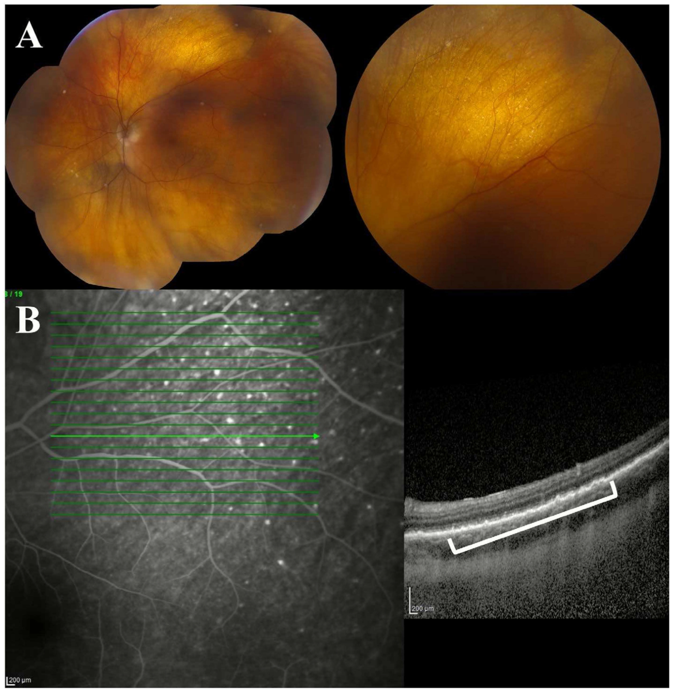
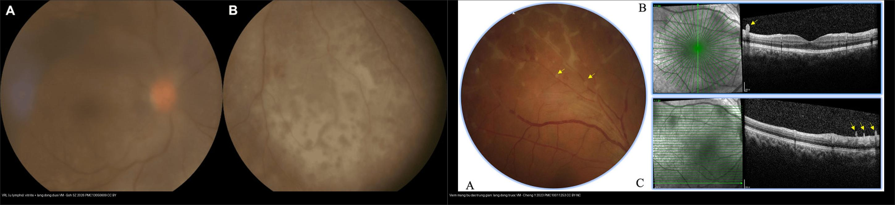
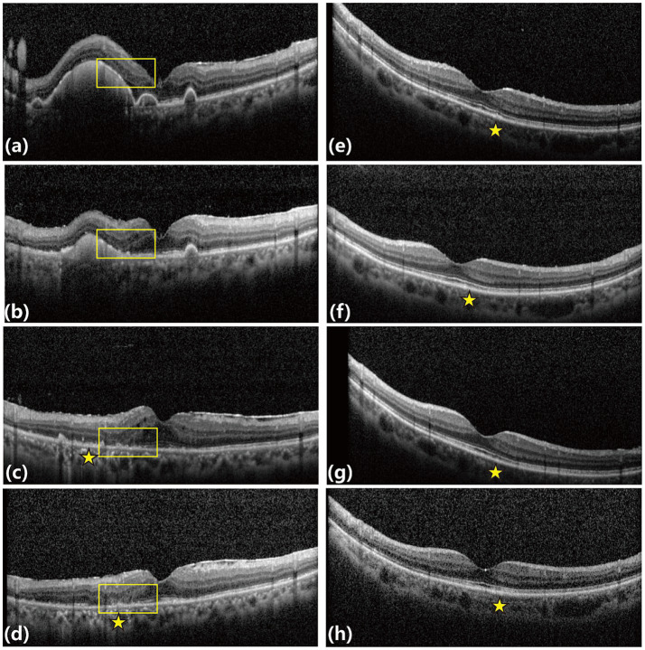
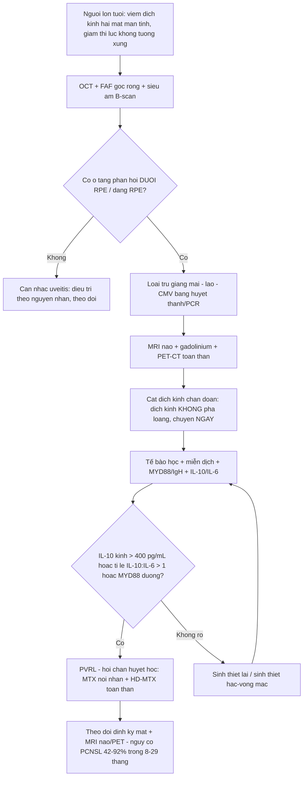
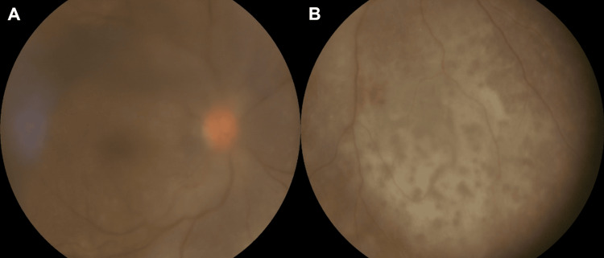
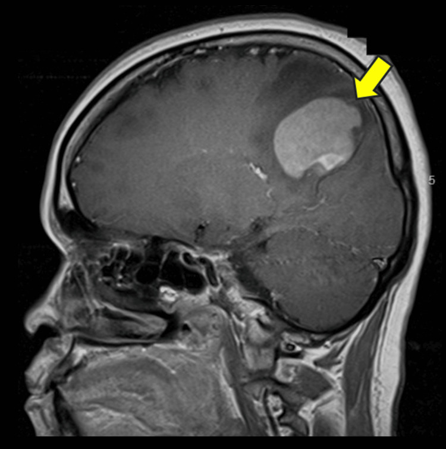
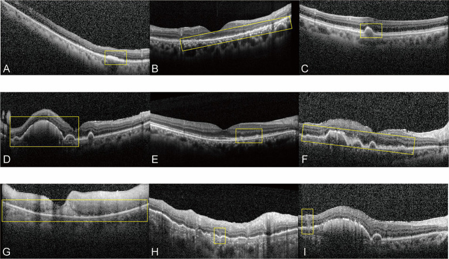
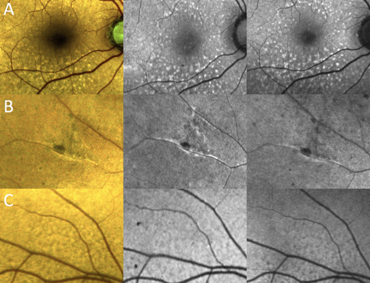
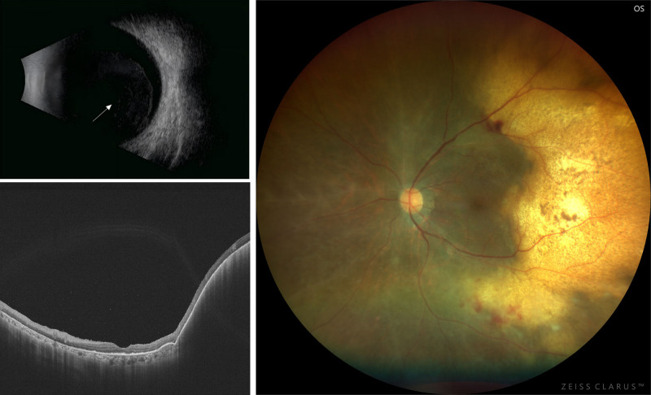

# 462 — U lympho nội nhãn (primary vitreoretinal lymphoma, PVRL) vs viêm màng bồ đào giả danh (masquerade uveitis): IL-10/MYD88 trong dịch kính + PET-CT / Primary vitreoretinal lymphoma vs masquerade uveitis

**Tags:** `pattern:u-lympho-noi-nhan` `pattern:lang-dong-duoi-RPE` `pattern:viet-dich-kinh` `vung:vong-mac` `vung:than-kinh-trung-uong` `score:IL-10-IL-6` `protocol:sinh-thiet-dich-kinh` `protocol:OCT` `protocol:FAF` `protocol:MRI-nao-PET-CT`
**Mức chắc chắn (certainty):** tổng hợp y văn (literature synthesis) — nhóm tự biên từ y văn mở (Blood Sci 2025 CC BY 4.0; Clin Exp Ophthalmol 2026 CC BY 4.0; Front Med 2026 CC BY 4.0; Cureus 2026 CC BY 4.0; Ophthalmol Ther 2026 CC BY-NC 4.0; Ophthalmol Ther 2023 CC BY-NC 4.0), chưa gắn một ca nguyên văn đơn lẻ xuyên suốt.

> **Vì sao bài này quan trọng:** bài **451** (biểu hiện mắt của bệnh hệ thống) và **452/454/459** (CMV/ARN ở người suy giảm miễn dịch) đã nhắc "lymphoma nội nhãn là **masquerade**" nhưng chỉ một dòng. Trong thực hành đáy mắt, đây là chẩn đoán **bị bỏ sót nhiều nhất**: hơn **60%** ca bị chẩn đoán sai, phần lớn là **viêm màng bồ đào (uveitis)**, và **corticoid làm tổn thương thoái triển tạm thời → làm mất tế bào ung thư → sinh thiết âm tính giả**. Hệ quả không chỉ là **mù mắt**: **1/3 ca đã có tổn thương thần kinh trung ương (CNS) lúc chẩn đoán**, **42–92% tiến triển thành u lympho não (PCNSL)** trong **8–29 tháng** — bệnh cảnh đe dọa tính mạng, cần thầy thuốc hình ảnh nhận diện **trước khi có kết quả mô bệnh**.

## 1. Tổng quan — vì sao tế bào lympho "đọng" dưới biểu mô sắc tố và tại sao hình ảnh nhỏ lại có ý nghĩa lớn

- **U lympho nội nhãn tiên phát (primary vitreoretinal lymphoma, PVRL)** là u lympho **không Hodgkin tế bào B lớn lan tỏa (diffuse large B-cell lymphoma, DLBCL)** — chiếm **~95%** PVRL — **khu trú trong mắt**, và được coi là **thể của u lympho hệ thần kinh trung ương tiên phát (primary CNS lymphoma, PCNSL)** vì cùng nguồn gốc miễn dịch đặc quyền (immune privilege: mắt–não–tinh hoàn) và cùng **đột biến MYD88 L265P**.
- **Cơ chế hình ảnh (TẠI SAO):** tế bào lympho ác xâm nhập **dịch kính → võng mạc → khoang dưới biểu mô sắc tố (sub-RPE)** và **quanh mạch**. Vì **tế bào u bám chặt khoang dưới RPE**, mắt thấy các **ổ vàng–kem sâu dưới võng mạc**; trên **OCT** các tế bào này tạo **khối tăng phản hồi (hyperreflective) dưới RPE = dày RPE/bong RPE khu trú (PED)**; trong dịch kính chúng tạo **đục dịch kính mờ, ô "quả cầu tuyết/aurora borealis"**; còn **thoát tế bào ra dịch kính** gây phản ứng viêm **rất nghèo** (đặc trưng: **ít viêm so với hoại tử**) — ngược với ARN/viêm nhiễm.
- **Dịch tễ & tiên lượng nằm lòng:**
  - Tỉ lệ mắc **0,23/1.000.000 dân/năm** ở Mỹ (điều chỉnh tuổi), **đang tăng** trong 3 thập niên; **tuổi trung vị khi chẩn đoán > 63 tuổi**, **> 20% bệnh nhân > 80 tuổi**.
  - **Hai mắt 50–80%** (thường không đối xứng); chỉ **~20–50%** một mắt.
  - **CNS lúc chẩn đoán ~1/3**; **42–92% tiến triển PCNSL** trong **8–29 tháng**; ngược lại **15–25%** bệnh nhân PCNSL có thâm nhiễm mắt.
  - **Chẩn đoán sai tới ~64%**; **trễ chẩn đoán 8–21 tháng** (một số loạt tới **12–24 tháng**).
- **Ngưỡng định lượng phải nhớ (4 cửa Argon):**
  - **Cytokine dịch nội nhãn — chốt phân biệt:** **IL-10 > 50 pg/mL** trong **dịch tiền phòng (aqueous)** (độ nhạy **89%**, độ đặc hiệu **93%**) và **IL-10 > 400 pg/mL** trong **dịch kính (vitreous)** (độ nhạy **80%**, độ đặc hiệu **99%**); **tỉ lệ IL-10 : IL-6 > 1** gợi ý u lympho còn **< 1** gợi ý viêm màng bồ đào. (IL-10 do tế bào B ác tiết, IL-6 do tế bào viêm tiết.)
  - **Di truyền:** **MYD88 L265P ~69–88%** PVRL (nhiều hơn hẳn **CD79B ~35%**); **NGS dịch kính** có độ nhạy ~**0,85**; chỉ cần **~4 tế bào** cho PCR MYD88 (không như tế bào học cần nhiều tế bào nguyên vẹn).
  - **Tế bào học dịch kính** là **tiêu chuẩn vàng** nhưng độ nhạy chỉ **45–81%** — **âm tính giả 30–45%**.
  - **OCT:** ổ dưới RPE (sub-RPE deposits) là dấu **hay gặp nhất — 92,1%**; thể dày RPE 45,7%; ổ dưới võng mạc 65,8%; ổ trong võng mạc 23,7%. Mô hình dự đoán đa biến đạt **AUC 0,929** (Se **92,9%**, Sp **91,7%**).
  - **Độ đặc hiệu cao (rất ít gặp ở uveitis):** **tế bào dịch kính** Se **93%**; **ổ trước võng mạc (preretinal) Sp 92,5%**; **thâm nhiễm lan trong võng mạc (diffuse intraretinal) Sp 100%**; **kiểu "dọc đầy đủ/dọc hỗn hợp" (vertical complete/mixed) Sp 100%**; **diện thâm nhiễm dưới võng mạc ~81%**; **"leopard spot" 9–21%**; **"aurora borealis" ~34%**.

## 2. Mẫu hình + chẩn đoán phân biệt theo vị trí (gamut)

**Câu hỏi lọc:** *"Viêm màng bồ đào ở **người lớn tuổi**, **hai mắt**, **mạn tính**, **đáp ứng corticoid một phần rồi tái phát**, thị lực **giảm không tương xứng** — có phải u lympho không?"* → nếu có **ổ vàng sâu dưới RPE + đục dịch kính ít viêm** thì phải **loại trừ PVRL**.

**Gamut theo vị trí tổn thương:**
- **Dịch kính (vitreous):** **PVRL** (đục mờ, ô "aurora borealis", viêm nghèo) vs **viêm màng bồ đào trung gian (intermediate uveitis)/pars planitis** (viêm rõ, "snowbank") vs **viêm nội nhãn nấm (Candida)** vs **viêm nội nhãn do vi khuẩn** (mủ, đau) vs **u lympho T/NK** (hiếm).
- **Dưới RPE (sub-RPE)/võng mạc (retina):** **PVRL** (ổ vàng–kem sub-RPE, dày/bong RPE) vs **bệnh hắc võng mạc đa ổ (MFC)** vs **bệnh giang mai hậu nhãn (placoid)** vs **lao hắc võng mạc** vs **loạn dưỡng RPE**.
- **Hắc mạc (choroid):** **u lympho hắc mạc (choroidal lymphoma)** — khối/dày hắc mạc, **trễ chẩn đoán tới 2 năm**; vs **di căn**, **u hắc mạc (melanoma)**, **hemangioma**.
- **Cực sau/đĩa thị & thần kinh:** thâm nhiễm đĩa thị–thần kinh thị; vs **viêm thần kinh thị**, **bệnh ác tính hệ thống khác**.
- **Nhóm giả danh khác (masquerade):** **amyloidosis**, **di căn nội nhãn**, **u hắc mạc**, **phản ứng dị vật/IOFB cũ**, **hoại tử nội nhãn (retinoblastoma ở trẻ)**, **nhiễm virus (CMV, ARN)**.

## 3. Bảng so sánh phân biệt (ma trận đối chiếu)

| Thực thể (entity) | Hình ảnh điển hình (fundus / OCT / đa phương thức) | Chốt vào (rule-in) | Chốt loại (rule-out) | Gợi ý xác nhận |
|---|---|---|---|---|
| **PVRL (u lympho nội nhãn)** | **Ổ vàng–kem sâu dưới RPE** hai bên, **đục dịch kính ít viêm**, **dày RPE/bong RPE khu trú**; OCT ổ tăng phản hồi **dưới RPE (92,1%)** | **Tuổi > 60 + hai mắt + tổn thương dưới RPE + đáp ứng corticoid một phần rồi tái phát** | **Đục dịch kính nhiều viêm + đau đỏ** + nhạy corticoid → uveitis | **IL-10 dịch kính > 400 pg/mL** (Sp 99%), **IL-10:IL-6 > 1**, **MYD88 L265P**; sinh thiết dịch kính |
| **Viêm màng bồ đào trung gian (pars planitis)** | Đục dịch kính **dày**, "snowbank" phần dưới, **ổ trước võng mạc mờ**; OCT phù hoàng điểm | **Trẻ hơn, một/hai mắt, viêm nghẽn rõ, IL-10:IL-6 < 1** | **Ổ vàng sâu dưới RPE rải rác** → nghĩ PVRL | IL-10 thấp; tổn thương **con thoi** đáp ứng corticoid |
| **Bệnh hắc võng mạc đa ổ (MFC)** | Đốm vàng nhỏ **tầng nông/ngoài**, sẹo tăng sắc tố, **VN sẹo** | **Người trẻ, cận thị, sẹo tăng sắc tố, không u** | Tổ đặc dưới RPE dày lên → làm sinh thiết | OCT: tổn thương **nông**, không tạo khối dưới RPE |
| **Bệnh giang mai hậu nhãn (placoid)** | Mảng **vàng nhạt dẹt** cực sau, **OCT "vertical"** giống PVRL | **RPR/TPHA dương, đáp ứng penicillin** | **Huyết thanh giang mai âm + hai mắt tái phát dưới corticoid** → nghi PVRL | Huyết thanh giang mai (RPR, TPHA); tổn thương đáp ứng kháng sinh |
| **U lympho hắc mạc** | **Dày hắc mạc lan/khu trú**, có thể rất kín đáo, không đau | **Dày hắc mạc hai bên ở người già + u lympho toàn thân** | Hắc mạc **bình thường/không dày** → ít nghĩ hắc mạc | Siêu âm 10–20 MHz, MRI hốc mắt; **theo dõi trễ tới 2 năm** |
| **Nấm nội nhãn (Candida)** | Nốt trắng "fluff-ball" nhô vào dịch kính, nhiều ổ | **Nhiễm nấm huyết/catheter + dịch kính đục rõ** | Tổ **dưới RPE rải rác** → PVRL | Cấy máu, PCR nội nhãn (bài 451) |
| **Amyloidosis/khối nội nhãn khác** | Đục dịch kính dai dẳng, mảng trắng | **Bệnh hệ thống + sinh thiết mô khác** | Bệnh cảnh đơn độc + IL-10 cao → PVRL | Sinh thiết toàn thân trước |

*Trên: đáy mắt màu — các **ổ kem–vàng nằm sâu dưới võng mạc**, khó thấy vì kín đáo. Dưới: OCT — **khối tăng phản hồi dưới RPE (khung trắng)** làm **dày/bong RPE**, tương ứng vị trí ổ vàng trên ảnh màu. Đây là dấu **hay gặp nhất (92,1%)** và là lý do **OCT là bước sàng lọc bắt buộc** khi nghi PVRL. Nguồn: Ibrahim A et al., Clin Exp Ophthalmol 2026 (PMC12863966) Fig. 5, CC BY 4.0.*

*Trái: **PVRL** — đục dịch kính dày (3+ haze, che chi tiết võng mạc) kèm **dải thâm nhiễm dưới võng mạc dẹt, loang lổ** dọc cung mạch mũi–dưới (Goh SZ et al., Cureus 2026, PMC13050609, Fig. 1, CC BY 4.0). Phải: **viêm màng bồ đào trung gian không rõ nguyên nhân** — cũng có **ổ trước võng mạc xám–trắng (mũi tên vàng)** ở người 49 tuổi (Cheng Y et al., Ophthalmol Ther 2023, PMC10011253, Fig. 1, CC BY-NC 4.0). Vì **dấu "ổ trước võng mạc" xuất hiện ở cả hai**, phải phối hợp **bối cảnh tuổi + đa phương thức + IL-10/IL-6 + MYD88**, không chốt bằng một dấu hiệu. Ảnh ghép letterbox.*

## 4. Protocol chẩn đoán + theo dõi + sơ đồ quyết định

**Bước 1 — Nghi ngờ trên hình ảnh (không xâm lấn):**
- **OCT (bắt buộc):** tìm **ổ tăng phản hồi dưới RPE** (dày RPE/BED), ổ dưới võng mạc, ổ trong võng mạc, dày RPE lan, mất lớp ellipsoid (EZ); đo **chiều rộng tổn thương (µm)** để theo dõi.
- **Chụp màu góc rộng (widefield) + FAF (kể cả FAF mã hóa màu):** ổ **tăng tự huỳnh quang dưới RPE**; **FAF bất thường** phân biệt tổn thương **hoạt động vs không hoạt động** (Se **68,75%**, Sp **100%**).
- **Siêu âm B-scan (10–20 MHz):** **đục dịch kính lan tỏa**, dày hắc mạc, loại u.
- **CT/MRI hốc mắt:** dày hắc mạc/củng mạc, tổn thương trong nhãn; **MRI não + gadolinium** và/hoặc **PET/CT toàn thân** để tìm **PCNSL/ổ ngoài mắt** (**~1/3** đã có CNS lúc chẩn đoán).

**Bước 2 — Lấy mẫu nội nhãn (chẩn đoán xác định):**
- **Cắt dịch kính chẩn đoán (diagnostic pars plana vitrectomy):** lấy **dịch kính không pha loãng trước**, rồi dịch pha loãng; chuyển **ngay, không cố định** (tế bào lympho **mỏng manh, dễ ly giải**).
- Gửi **đồng thời 4 nhóm:** (1) **tế bào học/khối tế bào**, (2) **miễn dịch tế bào (CD20, CD79a, PAX5, Ki-67)**/dòng chảy tế bào, (3) **sinh học phân tử (IgH PCR, MYD88 L265P, CD79B, NGS)**, (4) **cytokine (IL-10, IL-6; tỉ lệ > 1)**.
- **Nếu âm tính mà vẫn nghi ngờ:** **sinh thiết lại** (giá trị tăng theo số lần) — **không bỏ sót vì một lần âm**. Cân nhắc **sinh thiết hắc võng mạc (chorioretinal biopsy)** khi tổn thương khu trú.

**Bước 3 — Điều trị & theo dõi (khung):**
- **Tại mắt:** **methotrexate (MTX) nội nhãn** ± **rituximab nội nhãn**; **xạ trị mắt (EBRT) 35–40 Gy** khi hai mắt/tổn thương đe dọa, nhưng **không ngăn tái phát CNS**.
- **Toàn thân:** **MTX liều cao tĩnh mạch** ± rituximab, phối hợp hóa trị; **ghép tế bào gốc tự thân (ASCT)** cho tái phát/kháng trị; **rituximab–lenalidomide (R2)** là lựa chọn mới.
- **Số liệu để tư vấn:** MTX nội nhãn đơn thuần đạt **CHR ~64,6%** (trung vị **3 mũi**, **7 mắt tái phát** trong loạt 48 mắt); phác đồ **R-MPV + xạ toàn não liều giảm (rdWBRT)** → **tiến triển CNS 4 năm chỉ 10,0%**, **PFS 4 năm 72,7%**; **sống không u lympho CNS 2 năm** ghép MTX nội nhãn + HD-MTX **58,3%** so với **37,5%** khi chỉ MTX nội nhãn; **R2** đạt **CR 35%** ở ca tái phát/kháng trị.
- **Theo dõi:** **khám mắt + OCT/FAF định kỳ**, **MRI não/PET theo lịch** (nguy cơ CNS tồn tại nhiều năm) — **"mắt lành" không đồng nghĩa "não lành"**.

*Hai ca (cột trái và cột phải) được chụp OCT dọc thời gian quá trình điều trị **MTX nội nhãn**: các ổ tăng phản hồi dưới RPE/trong–dưới võng mạc (khung vàng, ngôi sao) **thoái triển và tái cấu trúc võng mạc** sau điều trị. Đây là cách **theo dõi khách quan đáp ứng** — thay đổi **"trước–sau"** mới là chốt, không đọc một ảnh đơn. Nguồn: Wang X et al., Front Med 2026 (PMC13318726) Fig. 4, CC BY 4.0.*

## 5. Biến thể bình thường và cạm bẫy

- **Corticoid trước sinh thiết = bẫy chí mạng:** bệnh nhân thường được chẩn đoán "viêm màng bồ đào" và **điều trị corticoid**, tổn thương **thoái triển tạm thời** nhưng **tế bào u ly giải → sinh thiết âm tính giả**. Quy tắc: **nghi PVRL thì lấy mẫu TRƯỚC hoặc ngừng corticoid hợp lý** và gửi **cytokine + MYD88 song song**.
- **Đục dịch kính ít viêm bị đọc là "viêm nhẹ":** PVRL có **phản ứng viêm nghèo** nên dễ bị coi nhẹ; điều bất thường là **thị lực giảm nặng hơn mức đục dịch kính**.
- **Ổ dưới RPE rất kín đáo:** nếu không chụp **OCT/FAF**, bỏ sót **dấu hay gặp nhất (92,1%)**; ổ có thể chỉ dày RPE **khu trú** nhìn như "drusen".
- **Tế bào học âm không loại trừ:** **âm tính giả 30–45%** do **quá ít tế bào, tế bào dễ vỡ**; **PCR MYD88 chỉ cần ~4 tế bào** → **luôn phối hợp**. **Sinh thiết lại** làm tăng độ nhạy.
- **Phù hoàng điểm (CME) không loại trừ PVRL:** CME gặp ở cả uveitis lẫn PVRL — **đừng vì "có CME" mà chốt lành**.
- **Dấu hiệu đơn độc không đủ:** **ổ trước võng mạc** và kiểu OCT "vertical" có **độ đặc hiệu cao nhưng vẫn gặp ở uveitis giang mai/MFC** (xem ảnh ghép) → luôn dùng **bối cảnh + cytokine + di truyền**.
- **IL-10 tăng cũng gặp trong một số viêm/nhiễm trùng:** dùng **tỉ lệ IL-10:IL-6** và **ngưỡng theo dịch** (tiền phòng **50 pg/mL** vs dịch kính **400 pg/mL**) — **không dùng lẫn ngưỡng**.
- **U lympho hắc mạc trễ chẩn đoán tới 2 năm:** dày hắc mạc đơn độc, kín đáo → cần **siêu âm + MRI** và nghi ngờ khi có u lympho hệ thống.

## 6. Tự lượng giá — Blind Quiz

**Ca 1 — Nam 62 tuổi, nhìn mờ hai mắt 4 tháng, được điều trị "viêm màng bồ đào" bằng corticoid, đỡ rồi tái phát. Ảnh đáy mắt góc rộng mắt phải:**

- Hỏi: mô tả 2 thành phần bất thường? Vì sao **không** chốt là viêm màng bồ đào? Dấu hiệu nào buộc phải sinh thiết dịch kính?

<b>Bấm để hiện đáp án (findings + chẩn đoán)</b>

- Dấu hiệu (findings): **A** — đục dịch kính dày (**3+ haze**) che chi tiết võng mạc; **B** — **nhiều ổ dẹt, loang lổ, giảm sắc tố dưới võng mạc** dọc cung mạch mũi–dưới.
- Chẩn đoán (diagnosis): **PVRL** (u lympho tế bào B lớn) biểu hiện như **giả viêm màng bồ đào** ở người lớn tuổi, **đáp ứng corticoid một phần rồi tái phát**. Ca gốc: sinh thiết dịch kính ít tế bào nhưng **miễn dịch tế bào xác nhận lymphoma tế bào B lớn (CD20, CD79a, PAX5)**.
- Vì sao buộc sinh thiết: **ổ dưới võng mạc + người lớn tuổi + tái phát sau corticoid** = **loại trừ PVRL**; kết hợp **IL-10:IL-6 > 1** và **MYD88 L265P** để tránh âm tính giả.
- Nguồn ảnh: Goh SZ et al., Cureus 2026 (PMC13050609) Fig. 1, CC BY 4.0.

**Ca 2 — Cùng bệnh nhân Ca 1, được chụp MRI não sau tiêm gadolinium:**

- Hỏi: mô tả khối? Vì sao phải chụp MRI não ngay khi nghi PVRL?

<b>Bấm để hiện đáp án (findings + chẩn đoán)</b>

- Dấu hiệu (findings): **khối trong trục (intra-axial), ngấm thuốc mạnh, đồng nhất, ở thùy đỉnh–chẩm phải cạnh xoang dọc trên** (mũi tên vàng), ranh giới rõ, ít phù quanh u — kiểu điển hình của **u lympho não (PCNSL)**.
- Chẩn đoán (diagnosis): **PCNSL có thâm nhiễm mắt (PVRL)** — chẩn đoán toàn thân; **~1/3 ca PVRL đã có CNS lúc chẩn đoán**, **42–92% tiến triển trong 8–29 tháng**.
- Vì sao chụp ngay: quyết định **điều trị toàn thân (HD-MTX/ASCT/rdWBRT)** chứ không chỉ điều trị tại mắt; **bỏ sót CNS = sai phác đồ**.
- Nguồn ảnh: Goh SZ et al. (PMC13050609) Fig. 2, CC BY 4.0.

**Ca 3 — Bệnh nhân PVRL, OCT hoàng điểm nhiều vị trí: dấu nào hay gặp nhất?**

- Hỏi: phân loại các kiểu tổn thương trên OCT? Kiểu nào **hay gặp nhất** và kiểu nào **đặc hiệu nhất**?

<b>Bấm để hiện đáp án (findings + chẩn đoán)</b>

- Dấu hiệu (findings): các khối **tăng phản hồi (hyperreflective)** theo **khoang giải phẫu** — **(A–E)** ổ **dưới RPE** (dày RPE khu trú/lan, bong RPE nông và lớn), **(F–H)** ổ **trước võng mạc** và **trong/dưới võng mạc**, **(I)** tổn thương hỗn hợp/ở mép.
- Số liệu: **ổ dưới RPE hay gặp nhất — 92,1%** (thể **dày RPE** 45,7%); **ổ dưới võng mạc 65,8%**, **trong võng mạc 23,7%**; **thâm nhiễm lan trong võng mạc đặc hiệu 100%**; **"dọc đầy đủ/hỗn hợp" đặc hiệu 100%**.
- Ứng dụng: **OCT là công cụ sàng lọc không xâm lấn**; mô hình kết hợp đạt **AUC 0,929** (Se 92,9%, Sp 91,7%) → **nâng nghi ngờ trước sinh thiết**, không thay thế mô bệnh.
- Nguồn ảnh: Wang X et al., Front Med 2026 (PMC13318726) Fig. 1, CC BY 4.0.

**Ca 4 — Bệnh nhân PVRL, FAF mã hóa màu (colour-coded):**

- Hỏi: 3 cột ảnh là gì? Hàng A–C khác nhau thế nào? FAF giúp gì cho "hoạt động vs không hoạt động"?

<b>Bấm để hiện đáp án (findings + chẩn đoán)</b>

- Cột: **trái = FAF mã hóa màu (colour-coded)**, **giữa = FAF xanh lá (green)**, **phải = FAF xanh dương (blue)**.
- Hàng: **A** — **ổ tăng tự huỳnh quang dưới RPE** (chấm sáng rải rác); **B** — **cụm/chùm tăng tự huỳnh quang** (clumps) phối hợp teo; **C** — **teo RPE** (nền lốm đốm, giảm tự huỳnh quang).
- Ý nghĩa: FAF giúp **phát hiện tổn thương RPE kín đáo** và phân biệt **hoạt động vs không hoạt động** — **FAF bất thường** phân biệt 2 trạng thái với **Se 68,75%, Sp 100%**.
- Nguồn ảnh: Marchese A et al., Ophthalmol Ther 2026 (PMC13315427) Fig. 2, **CC BY-NC 4.0** — **giữ nguyên bản, không crop/ghép**.

**Ca 5 — Hai bệnh nhân cùng có "ổ trước võng mạc". Ca nào là u lympho?**

- Hỏi: vì sao **không thể chốt** chỉ bằng dấu "ổ trước võng mạc"? Cần bổ sung gì để phân biệt?

<b>Bấm để hiện đáp án (findings + chẩn đoán)</b>

- **Trái = PVRL** (62 tuổi, hai mắt, tổn thương **dưới võng mạc + dưới RPE**, đục dịch kính, tái phát sau corticoid).
- **Phải = viêm màng bồ đào trung gian** (49 tuổi) — cũng có **ổ trước võng mạc xám–trắng** với **OCT tăng phản hồi trên bề mặt võng mạc**. Vì **"ổ trước võng mạc" không phải dấu riêng của u lympho**, cần bối cảnh (**tuổi, hai mắt, không đáp ứng corticoid**) + **IL-10 dịch kính > 400 pg/mL**/**tỉ lệ IL-10:IL-6 > 1** + **MYD88 L265P** + **mô bệnh**.
- Nguồn: ghép Fig. 1 (Goh SZ et al., Cureus 2026, PMC13050609, CC BY 4.0) và Fig. 1 (Cheng Y et al., Ophthalmol Ther 2023, PMC10011253, CC BY-NC 4.0).

**Ca 6 — Nữ 75 tuổi, chẩn đoán PVRL: đa phương thức siêu âm B + OCT + đáy mắt.**

- Hỏi: mỗi ô ảnh cho thấy gì? Tổn thương nào (ô phải) gợi ý u lympho hơn là viêm?

<b>Bấm để hiện đáp án (findings + chẩn đoán)</b>

- **Ô trái–trên (siêu âm B-scan):** **đục dịch kính lan tỏa dạng "hạt"** (mũi tên trắng).
- **Ô trái–dưới (OCT):** **bong RPE dạng vòm liên tục (confluent RPE detachment)** ở vùng thái dương — dấu gợi ý mạnh PVRL.
- **Ô phải (fundus mắt trái):** các **ổ mảng vàng–kem dưới võng mạc** lan rộng quanh hoàng điểm, phối hợp xuất tiết — tương ứng **ổ dưới RPE**.
- Chẩn đoán: **PVRL** trên đa phương thức; xác định bằng sinh thiết dịch kính + cytokine/di truyền.
- Nguồn ảnh: Wang SY et al., Blood Sci 2025 (PMC12047895) Fig. 1, CC BY 4.0.

## Bài liên quan chéo
- [400 – Tổng quan Mắt & thị giác](../400-tong-quan-mat-thi-giac/lesson.md)
- [451 – Biểu hiện mắt của bệnh hệ thống (sarcoid/GPA/IgG4/lymphoma)](../451-he-thong-mat/lesson.md)
- [452 – Hoại tử võng mạc cấp (ARN) & CMV retinitis](../452-hoai-tu-vong-mac-ARN-CMV/lesson.md)
- [454 – Viêm võng mạc–màng mạch ở người suy giảm miễn dịch không HIV](../454-viem-vong-mac-suy-giam-mien-dich/lesson.md) (masquerade nhiễm trùng)
- [455 – Viêm mạch hệ thống khác ở mắt: Behçet & lupus](../455-behcet-lupus-mat/lesson.md) (viêm màng bồ đào giả danh)
- [411 – Siêu âm nhãn cầu](../411-sieu-am-nhan-cau/lesson.md) (khi không thấy đáy mắt)

## Ảnh
- `462_pvrl-fundus_WF_PMC13050609-Fig1-CCBY.jpg` — Goh SZ et al., Cureus 2026 (PMCID: PMC13050609) Fig. 1, CC BY 4.0.
- `462_pvrl-nao-MRI_PMC13050609-Fig2-CCBY.jpg` — Goh SZ et al. (PMC13050609) Fig. 2, CC BY 4.0.
- `462_pvrl-OCT-dac-diem_PMC13318726-Fig1-CCBY.jpg` — Wang X et al., Front Med 2026 (PMCID: PMC13318726) Fig. 1, CC BY 4.0.
- `462_pvrl-OCT-theo-doi_PMC13318726-Fig4-CCBY.jpg` — Wang X et al. (PMC13318726) Fig. 4, CC BY 4.0.
- `462_pvrl-lang-dong-duoi-RPE_PMC12863966-Fig5-CCBY.jpg` — Ibrahim A et al., Clin Exp Ophthalmol 2026 (PMCID: PMC12863966) Fig. 5, CC BY 4.0.
- `462_pvrl-FAF-mau_PMC13315427-Fig2-CCBYNC.jpg` — Marchese A et al., Ophthalmol Ther 2026 (PMCID: PMC13315427) Fig. 2, **CC BY-NC 4.0** (giữ nguyên bản).
- `462_pvrl-da-phuong-thuc_PMC12047895-Fig1-CCBY.jpg` — Wang SY et al., Blood Sci 2025 (PMCID: PMC12047895) Fig. 1, CC BY 4.0.
- `composite_vrl-vs-viem-mang-bu-dao.jpg` — ghép Fig. 1 (PMC13050609, CC BY) + Fig. 1 (PMC10011253, Cheng Y et al., Ophthalmol Ther 2023, CC BY-NC 4.0) bằng `tools/make_composite.py`.
- Chi tiết giấy phép từng ảnh trong `images/CREDITS.md`. AuntMinnie/Retina Image Bank: **chỉ dẫn link, không tải**.

> Không dùng để chẩn đoán độc lập khi chưa có người hướng dẫn.
