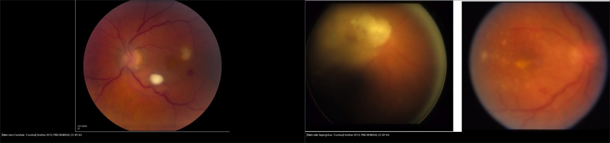
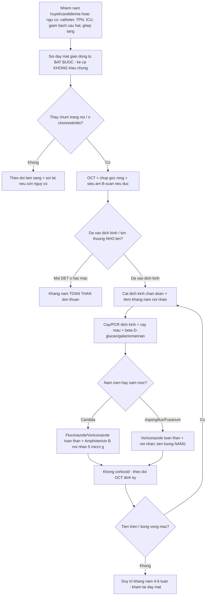
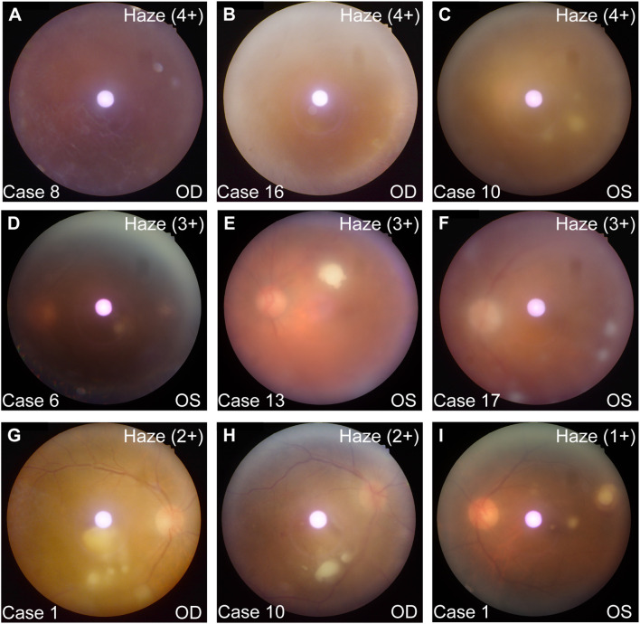
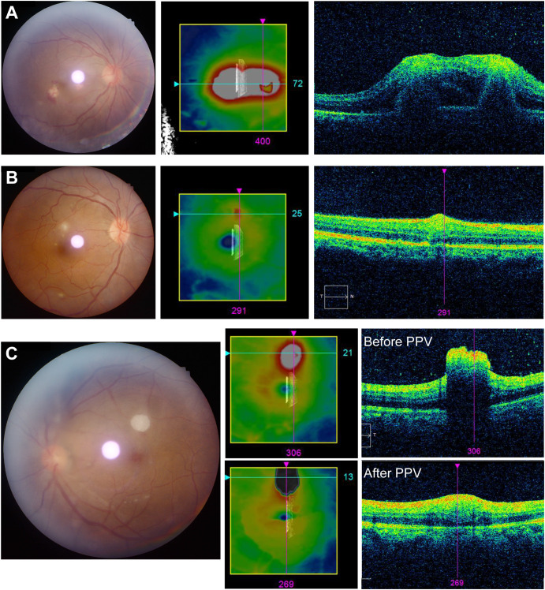
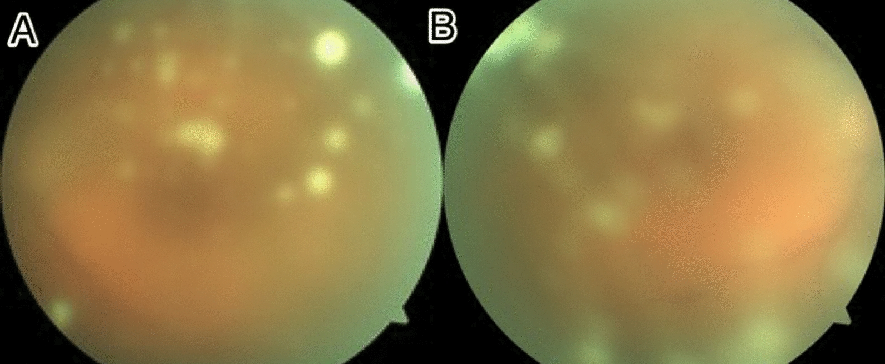
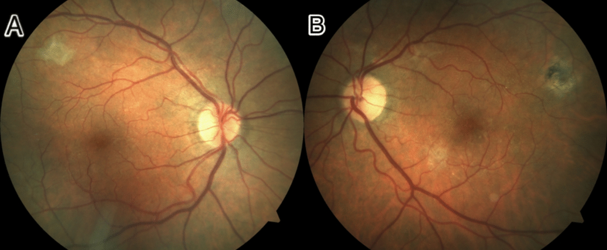
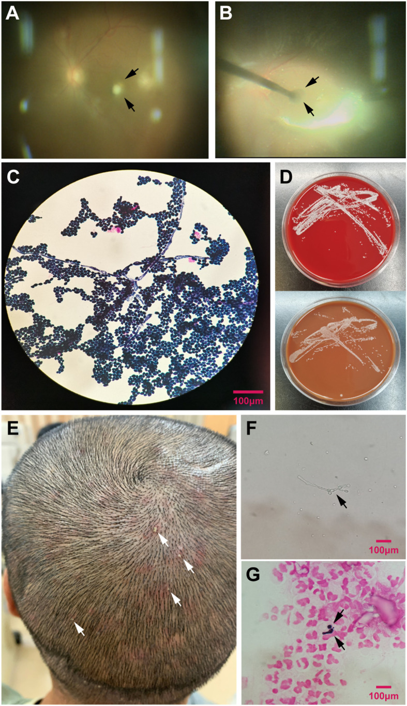

# 463 — Viêm nội nhãn nội sinh do nấm (Candida/Aspergillus): "fluff ball" & "chuỗi ngọc trai" / Endogenous fungal endophthalmitis

**Tags:** `pattern:viem-noi-nhan` `pattern:fluff-ball` `pattern:viet-dich-kinh-noi-sinh` `vung:vong-mac` `vung:dich-kinh` `vung:hac-mac` `anatomy:the-thuy-tinh` `protocol:soi-day-mat` `protocol:PCR-dich-kinh` `protocol:khang-nam-toan-than` `incidentaloma:viem-noi-nhan-nam`
**Mức chắc chắn (certainty):** tổng hợp y văn (literature synthesis) — nhóm tự biên từ y văn mở: đồng thuận quốc tế APVRS/AAPPO/APSOII 2025 (CC BY 4.0, PMC12516872), hai loạt đoàn hệ candidemia 2026 (CC BY 4.0 PMC13028201; CC BY-NC-ND PMC12888813), loạt nấm men vs nấm mốc Sridhar 2013 (CC BY, PMC3848556), ổ dịch Candida albicans 2026 (CC BY, PMC13153087) và ca nguyên văn nội sinh (CC BY, PMC3848556, PMC12516872; CC BY-NC-ND, PMC12542003).

> **Vì sao bài này quan trọng:** bài **454** (viêm võng mạc–màng mạch ở người suy giảm miễn dịch không HIV) và **462** (u lympho nội nhãn) đã nhắc "nấm nội nhãn" nhưng chỉ **một hàng** trong bảng giả danh (masquerade). Viêm nội nhãn nội sinh do nấm (endogenous fungal endophthalmitis, EFE) là chẩn đoán **bị bỏ sót vì bệnh nhân thường KHÔNG có triệu chứng mắt**: trong hai loạt candidemia năm 2026, **phần lớn ca có tổn thương mắt hoàn toàn không than phiền** (Thái Lan **~89%** không triệu chứng; Hà Lan **60%** không triệu chứng/không kể được). Bỏ sót nghĩa là **mất thị lực vĩnh viễn hoặc mất cả nhãn cầu** (nấm mốc **enucleation 25%**). Nguy hiểm kép: **dùng corticoid sai chẩn đoán làm bệnh bùng phát** — trong ổ dịch Candida 2026, **2 bệnh nhân tiêm steroid nội nhãn đúng lúc đang nhiễm nấm đã mất thị lực hoàn toàn (NLP)**. Với thầy thuốc hình ảnh, đây là bài "nhìn ảnh dịch kính/đáy mắt để gọi tên nấm trước khi có cấy".

## 1. Tổng quan — vì sao nấm đi vào mắt và tại sao mắt thấy "chùm trắng nổi"

- **Phân loại:** viêm nội nhãn do nấm chia **ngoại sinh (exogenous)** — sau mổ nội nhãn/chấn thương/viêm giác mạc nấm loét lan — và **nội sinh (endogenous)** — nấm **lan theo đường máu (fungemia)** tới mắt. Nội sinh **hiếm hơn** nhưng là bài toán của **nội khoa/ICU/hồi sức**: nấm mốc chiếm ưu thế ở **ngoại sinh (Aspergillus)**, còn **nấm men Candida** chiếm ưu thế ở **nội sinh** (đồng thuận APVRS/AAPPO/APSOII 2025).
- **Cơ chế hình ảnh (TẠI SAO) — đọc theo trình tự giải phẫu:**
  1. Nấm trong máu **bám vào hắc mạc** và **phá vỡ hàng rào máu–võng mạc ngoài (outer blood–retinal barrier)** — thực nghiệm trên chuột cho thấy *Candida albicans* xuyên qua đúng hàng rào này (PMC9431129). Vì nguồn từ hắc mạc, tổn thương **sớm nhất là viêm hắc mạc dẹt (flat choroiditis)**: ổ **vàng–kem nằm sâu**, chưa thấy trên nền võng mạc.
  2. Khi ổ **nhô lên (raised chorioretinitis)**, khối nấm + bạch cầu trung tính đùn **vào dịch kính** → mắt thấy **chùm trắng nổi ("fluff ball"/"quả cầu tuyết")**, có thể xếp thành **"chuỗi ngọc trai" (string of pearls)** hoặc **"chuỗi hạt" (snowballs)**.
  3. TẠI SAO trắng–đục: dịch kính là **gel vô mạch, trong suốt**; nấm + tế bào viêm là **các hạt phản xạ/tán xạ ánh sáng** → đục mức độ "haze". Trên **OCT**, chùm tế bào đặc này là **khối tăng phản hồi (hyperreflective) đồng nhất = dấu "đám mây mưa" (rain cloud sign)**; phân biệt kiểu **hắc–võng mạc (chorioretinal, dưới võng mạc/hắc mạc)** và kiểu **trong võng mạc (intraretinal, lớp trong)**.
  4. **Vì sao nấm mốc khác nấm men:** *Aspergillus* **xâm lấn thành mạch (angioinvasive)** → tắc/nhồi máu hắc mạc–võng mạc → **hoại tử nhanh, hypopyon, thị lực rất kém**, còn *Candida* tiến triển **chậm hơn, ưu thế viêm**. Bảng dưới (Sridhar 2013) là chốt định lượng.
- **Dịch tễ & ngưỡng định lượng nằm lòng:**
  - Viêm nội nhãn do nấm chiếm **~15–19%** tổng số viêm nội nhãn toàn cầu; ở Ấn Độ nhóm **nội sinh là 18%** tổng số viêm nội nhãn (đồng thuận 2025).
  - **Candidemia → tổn thương mắt:** phân tích gộp ~**10%**; **đoàn hệ Thái Lan 337 ca (2026): tổn thương mắt chung 2,7% cả đoàn hệ, 13,4% trong số được khám**; **đoàn hệ Hà Lan 402 ca (2026): 4,9% trong số được soi đáy mắt** (chorioretinitis 3,9%, endophthalmitis 1,0%). **Chỉ 19,9% (Thái Lan) và 76,4% (Hà Lan)** bệnh nhân candidemia **được soi đáy mắt** → khoảng trống sàng lọc rất lớn.
  - **Phần lớn KHÔNG triệu chứng:** chỉ **11,4%** ca có tổn thương có than phiền thị giác (Thái Lan); **60%** không triệu chứng/không kể được (Hà Lan). **Hai mắt 77,8%**. Kết quả soi đáy mắt **đổi phác đồ kháng nấm ở 77,8%** (Thái Lan) tới **100%** (Hà Lan) — soi đáy mắt **có giá trị điều trị**, không chỉ để gọi tên.
  - **Nấm men vs nấm mốc (Sridhar 2013, 67 mắt/53 ca):** thời gian có triệu chứng trước chẩn đoán **nấm mốc 3,8 ngày vs nấm men 21,0 ngày** (p=0,002); **hypopyon 37,5% vs 6,0%** (p=0,001); **thị lực logMAR lúc đầu 1,80 vs 1,15** (p=0,008) và **cuối 1,97 vs 1,05** (p=0,005); **enucleation 25% vs 0%**; **suy giảm miễn dịch do điều trị 57,1% vs 7,7%**; **tiền sử ghép tạng 35,7% vs 2,6%**; **bong võng mạc 12,5% vs 30,6%** (khác biệt **không** có ý nghĩa).
- **Yếu tố nguy cơ nội sinh (nhớ theo cơ chế "nhiễm nấm huyết"):** catheter tĩnh mạch trung tâm/đường truyền bẩn, **nuôi ăn tĩnh mạch hoàn toàn (TPN)**, kháng sinh phổ rộng kéo dài, hậu phẫu bụng, tiêm chích ma túy, **giảm bạch cầu hạt (neutropenia)**, ghép tạng/tủy, corticoid liều cao (kể cả **hậu COVID-19**), đái tháo đường, trẻ đẻ non.

## 2. Mẫu hình + chẩn đoán phân biệt theo vị trí (gamut)

**Câu hỏi lọc:** *"Bệnh nhân đang/đã có nhiễm nấm huyết (hoặc nguy cơ), **dịch kính đục nhiều hơn đau**, có **chùm vàng–trắng nổi** — có phải viêm nội nhãn nội sinh do nấm không?"* → soi đáy mắt giãn đồng tử **bắt buộc**, kể cả khi **không triệu chứng**.

**Gamut theo vị trí tổn thương:**
- **Dịch kính (vitreous):** **EFE** (chùm trắng "fluff ball", "chuỗi ngọc trai", "quả cầu tuyết", viêm dịch kính) vs **CMV retinitis** (HIV CD4 < 50, tổn thương dạng "bánh pizza"/xuất huyết, **viêm dịch kính ít**) vs **u lympho nội nhãn (462**, ổ dưới biểu mô sắc tố + viêm nghèo, người lớn tuổi) vs **viêm màng bồ đào trung gian/sarcoid** vs **viêm nội nhãn nội sinh do vi khuẩn** (Klebsiella — thường kèm áp-xe gan, hay gặp châu Á; tiến triển **giờ–ngày**, mủ nhiều).
- **Hắc mạc–võng mạc (choroid–retina):** ổ viêm hắc mạc dẹt (sớm) → nhô lên (chorioretinitis) của **EFE** vs **toxoplasmosis** (ổ tái phát cạnh sẹo cũ) vs **lao/giang mai** vs **nấm hắc mạc nguyên phát khác**.
- **Tiền phòng (anterior chamber):** **hypopyon** + hạt keratic — hypopyon **gợi nấm mốc hơn** (37,5% vs 6,0%).
- **Củng mạc/hốc mắt (panophthalmitis):** nặng, có thể phải **enucleation**.

**Gamut theo tác nhân nấm (quyết định kháng nấm):**
- **Nấm men:** *Candida albicans* (hay nhất; ổ dịch Thái Lan: C. albicans 55,6% + *C. tropicalis* 44,4%), *C. glabrata*/*C. krusei* (nhạy **fluconazole kém** → chọn voriconazole), *C. auris* (đa kháng, dễ định danh sai).
- **Nấm mốc:** *Aspergillus* (giảm bạch cầu hạt, ghép tạng, bệnh phổi mạn), *Fusarium* (lan từ viêm giác mạc; Ấn Độ), *Mucor* (bùng phát trong đại dịch SARS-CoV-2 ở Ấn Độ), *Scedosporium*.

## 3. Bảng so sánh phân biệt (ma trận đối chiếu)

| Thực thể (entity) | Hình ảnh điển hình (đáy mắt / OCT / siêu âm) | Chốt vào (rule-in) | Chốt loại (rule-out) | Gợi ý xác nhận |
|---|---|---|---|---|
| **EFE do nấm men (Candida)** | **Chùm vàng–kem nổi "fluff ball"/"quả cầu tuyết"/"chuỗi ngọc trai"** + viêm dịch kính; **hai mắt 77,8%**; **~89% không triệu chứng** | **Bối cảnh candidemia/catheter/TPN/ICU + tổn thương đáy mắt ở BN KHÔNG than phiền thị giác** | **Hypopyon nhiều + tiến triển giờ–ngày** → nghĩ vi khuẩn/mốc; **ổ dưới RPE ở người già** → u lympho (462) | Cấy/PCR dịch kính + **cấy máu**; β-D-glucan |
| **EFE do nấm mốc (Aspergillus/Fusarium)** | **Hoại tử hắc–võng mạc nhanh**, hypopyon, tổn thương ít "tròn đẹp" hơn; **thị lực rất kém** (logMAR 1,80) | **Giảm bạch cầu hạt/ghép tạng + triệu chứng chỉ 3,8 ngày + hypopyon** | **Bệnh cảnh chậm, không hypopyon, có "chuỗi ngọc trai"** → nghĩ Candida | **Galactomannan**, cấy/PCR; **tiên lượng nặng, enucleation 25%** |
| **CMV retinitis** | Vùng hoại tử võng mạc **dọc mạch ("bánh pizza"/xuất tiết)** + xuất huyết, **viêm dịch kính RẤT ít** | **HIV CD4 < 50 + tổn thương dọc mạch, người bệnh ít đau** | **Chùm trắng nổi trong dịch kính nhiều** → nghĩ nấm | PCR dịch tiền phòng/dịch kính; soi đáy mắt góc rộng (452) |
| **Viêm nội nhãn nội sinh vi khuẩn (Klebsiella)** | Mủ đặc, hypopyon sớm; **ổ nguyên nhân áp-xe gan/đường mật** | **Bệnh cảnh cấp (giờ–ngày) + ổ nhiễm khuẩn bụng + đái tháo đường** | **Tiến triển chậm nhiều ngày–tuần + chùm trắng** → nghĩ nấm | Cấy máu/dịch kính; **không chờ kết quả mới tiêm** |
| **U lympho nội nhãn (PVRL, 462)** | **Ổ vàng–kem sâu dưới biểu mô sắc tố (sub-RPE)** + viêm dịch kính **nghèo**, người lớn tuổi | **> 60 tuổi + hai mắt + tổn thương dưới RPE + tái phát sau corticoid** | **Bối cảnh candidemia + chùm trắng nổi** → nghĩ nấm | IL-10/IL-6 dịch kính > 1, MYD88 L265P |
| **Toxoplasmosis** | **Ổ hoại tử võng mạc cạnh sẹo tăng sắc tố cũ** + viêm dịch kính dạng "đèn sương mù" | **Sẹo cũ lân cận + IgM/IgG Toxoplasma** | **Hai mắt + không sẹo cũ + bối cảnh nhiễm nấm** → nghĩ EFE | Huyết thanh toxo; đáp ứng thuốc |
| **Viêm màng bồ đào giả danh (masquerade khác)** | Viêm màng bồ đào "điều trị hoài không khỏi" | **Không đáp ứng corticoid, tiến triển** | **Đáp ứng corticoid rồi tái phát** → vẫn phải loại trừ nấm/u lympho | Sinh thiết dịch kính khi nghi ngờ |

*Trái: **nấm men (Candida albicans)** — ổ chorioretinitis **vàng–kem, tròn, bờ tương đối rõ** để lại sẹo nhỏ (Sridhar J et al., 2013, PMC3848556 Fig. 1, CC BY 4.0). Phải: **nấm mốc (Aspergillus glaucus)** — tổn thương **hoại tử lan, mờ đục, không giới hạn rõ** ở hoàng điểm, thị lực chỉ còn đếm ngón tay (Sridhar J et al., 2013, PMC3848556 Fig. 2, CC BY 4.0). Chốt phân biệt không nằm một mình ở ảnh: **thời gian triệu chứng (3,8 vs 21,0 ngày) + hypopyon (37,5% vs 6,0%) + cấy/định danh nấm**. Ảnh ghép letterbox.*

### Dấu hiệu đặc trưng phải đọc đúng tên
- **"Fluff ball" (quả cầu lông):** chùm trắng xốp nổi trong dịch kính, xuất phát từ ổ viêm hắc–võng mạc — dấu nội soi **kinh điển** của *Candida*.
- **"String of pearls" (chuỗi ngọc trai):** nhiều nốt trắng **xếp thành hàng** dọc theo trục/sợi dịch kính; gặp **11/26 mắt** trong ổ dịch 2026 (PMC13153087).
- **"Snowballs" (quả cầu tuyết):** chùm trắng tròn rải rác — **6/26 mắt**.
- **"Rain cloud sign" (đám mây mưa):** trên **OCT**, ổ **tăng phản hồi đồng nhất** dạng vòm trước khi cắt dịch kính; **sau cắt dịch kính chuyển thành kiểu trong võng mạc** (PMC13153087).

## 4. Protocol chụp/xét nghiệm + sơ đồ quyết định + phác đồ

**Bước 1 — Sàng lọc (không xâm lấn):**
- **Soi đáy mắt giãn đồng tử bắt buộc ở MỌI candidemia**, **kể cả không triệu chứng** (chỉ 11,4% ca tổn thương có than phiền thị giác). Vì 89% không triệu chứng, **"bệnh nhân không kêu mắt" KHÔNG loại trừ**.
- **Chụp đáy mắt góc rộng (UWF)** + **OCT** (đo chiều rộng/chiều cao tổn thương để theo dõi; tìm **rain cloud sign**, kiểu hắc–võng mạc vs trong võng mạc).
- **Siêu âm B-scan 10–20 MHz** khi **không thấy đáy mắt** (đục dịch kính/cataract dày): phát hiện chùm đục dịch kính và **bong võng mạc (RD)**.
- **Xét nghiệm toàn thân:** **cấy máu** (đồng thời), **β-D-glucan**, **galactomannan** (nghi mốc), soi/cấy dịch kính, **PCR nội nhãn**.

**Bước 2 — Lấy mẫu nội nhãn (chẩn đoán xác định):**
- **Chọc hút dịch kính (vitreous tap)** hoặc **cắt dịch kính chẩn đoán (diagnostic pars plana vitrectomy)**: gửi **soi trực tiếp + nhuộm Gram/Giemsa/KOH + cấy + PCR**; nếu cấy âm mà vẫn nghi → **sinh thiết dưới võng mạc (subretinal biopsy)** (ca *Scedosporium* chỉ chẩn đoán được nhờ sinh thiết dưới võng mạc).
- **Không tiêm nội nhãn khi chỉ mới nghi ngờ** — cân nhắc theo mức tổn thương (xem sơ đồ).

**Bước 3 — Phác đồ (chốt định lượng):**

| Đường dùng | Nấm men (Candida) | Nấm mốc (Aspergillus) |
|---|---|---|
| **Tiêm nội nhãn** | Amphotericin B **5 µg/0,1 mL**; hoặc voriconazole **100 µg/0,1 mL** | Voriconazole **100 µg/0,1 mL** ± amphotericin B 5 µg |
| **Toàn thân** | **Fluconazole 200 mg** (nếu nhạy) hoặc **voriconazole 6 mg/kg q12h (liều nạp) → 4 mg/kg q12h** | **Voriconazole** (chọn đầu tay); amphotericin B IV **0,5–1,0 mg/kg** |
| **Thời gian** | **4–6 tuần** (đồng thuận: ngừng theo đáp ứng, không theo lịch cứng) | 4–6 tuần hoặc hơn |

- **Nguyên tắc "đa đường" (consensus 4.2, 85% đồng thuận):** dùng kháng nấm **cả nội nhãn + tại chỗ + toàn thân** — hệ thống **luôn** có vai trò trong thể nội sinh.
- **Chỉ toàn thân khi tổn thương còn DẸT, khu trú ở hắc mạc** (chưa vượt hàng rào máu–võng mạc ngoài); **thêm đường nội nhãn ngay khi tổn thương NHÔ lên (chorioretinitis) hoặc đã vào dịch kính (endophthalmitis)**.
- **Cắt dịch kính (vitrectomy):** consensus 4.1 (90%) — **cắt dịch kính sớm và trọn vẹn cho kết quả tốt hơn**; trong loạt **730 ca cấy dương** (Ấn Độ), **tất cả đều cần cắt dịch kính** và **trung bình 2 lần tiêm kháng nấm**; **tiêm nội nhãn lặp lại gần như là quy tắc**.
- **Corticoid: KHÔNG khuyến cáo** — consensus 4.4 chỉ **25%** đồng thuận; **tiêm/sử dụng corticoid nội nhãn và toàn thân thường KHÔNG dùng** trong viêm nội nhãn do nấm (nguy cơ bùng phát). Đây là **cạm bẫy chí mạng** (xem mục 5).

## 5. Biến thể bình thường và cạm bẫy

- **Corticoid trước chẩn đoán = bẫy chí mạng:** bệnh nhân bị chẩn đoán nhầm **viêm màng bồ đào** rồi **tiêm corticoid nội nhãn** → nấm bùng phát. Ổ dịch 2026 (PMC13153087): **2 bệnh nhân tiêm steroid nội nhãn đúng lúc đang nhiễm nấm đã mất thị lực hoàn toàn (NLP)**. **Quy tắc: nghi nấm thì không dùng corticoid nội nhãn.**
- **"Bệnh nhân không kêu mắt" KHÔNG loại trừ:** **~89%** (Thái Lan) và **60%** (Hà Lan) ca tổn thương **không có triệu chứng** → nếu chỉ soi khi có than phiền sẽ **bỏ sót gần hết**. Soi đáy mắt **thường quy** ở candidemia.
- **Chọc hút/cấy dịch kính âm tính không loại trừ:** ca 80 tuổi (PMC12516872) **tap âm tính** nhưng **sinh thiết dưới võng mạc** mới ra *Candida*; ca *Scedosporium* phải sinh thiết cả hai mắt. → **âm tính phải sinh thiết lại/sinh thiết dưới võng mạc**, không kết luận "không nhiễm trùng".
- **Đoán tác nhân theo ngoại hình là bẫy:** **"chuỗi ngọc trai"/"quả cầu tuyết" rất gợi ý** nhưng **không định danh được loài**; trong ổ dịch, **2 mắt cấy âm vẫn có tổn thương nấm rõ**. Luôn cấy + PCR.
- **Candida kháng azole & Candida auris:** *C. glabrata*/*C. krusei* **nhạy fluconazole kém** → chuyển **voriconazole**; ***C. auris*** **đa kháng, dễ bị định danh nhầm** — một ca đã **enucleation và tử vong**. Kết quả kháng sinh đồ điều khiển chọn thuốc.
- **Bong võng mạc (RD) khác nhau theo nhóm:** **nấm men 30,6% > nấm mốc 12,5%** (p=0,201) → đừng lấy "có RD" để loại nấm men.
- **Nhiễm khuẩn và nấm có thể cùng tồn tại / nấm là "kẻ thứ hai":** bệnh nhân ICU dùng kháng sinh phổ rộng có thể có **đồng nhiễm**; điều trị theo cấy chứ không theo suy đoán.
- **Vi khuẩn nội sinh cần xử trí song song:** *Klebsiella* tiến triển **giờ–ngày**, không chờ cấy mới tiêm — nhưng nếu bối cảnh **candidemia** thì ưu tiên kháng nấm.

## 6. Tự lượng giá — Blind Quiz

**Ca 1 — Bệnh nhân đang điều trị candidemia, mắt KHÔNG đau, thị lực còn tốt. 9 ô đáy mắt theo mức đục dịch kính:**

- Hỏi: các dấu trắng trong dịch kính được gọi tên gì? Mức đục dịch kính nào kèm dấu nào? Vì sao vẫn phải soi đáy mắt khi bệnh nhân không kêu mắt?

<b>Bấm để hiện đáp án (findings + chẩn đoán)</b>

- Dấu hiệu (findings): **(A–C) đục dịch kính 4+** — thấy **"quả cầu tuyết" (snowballs)** trắng ở (C); **(D–F) 3+** — snowballs (F) + **ổ xốp trắng "fluff ball"** (D, E); **(G–H) 2+** — **"chuỗi ngọc trai" (string of pearls)** ở (G) + fluff ball; **(I) 1+** — một ổ fluff ball trắng.
- Chẩn đoán (diagnosis): **viêm nội nhãn nội sinh do nấm — Candida albicans** (ổ dịch có **26 mắt/17 người**, cấy dịch kính dương **19/26 mắt**, tất cả *C. albicans*).
- Vì sao soi dù không triệu chứng: tổn thương mắt ở candidemia **phần lớn không triệu chứng** (Thái Lan ~89%, Hà Lan 60%) → soi đáy mắt giãn đồng tử **thay đổi phác đồ ở 77,8–100%** ca.
- Nguồn ảnh: Zhang X et al., Front Cell Infect Microbiol 2026 (PMC13153087) Fig. 1, CC BY 4.0.

**Ca 2 — Cùng nhóm bệnh nhân, OCT các tổn thương võng mạc:**

- Hỏi: ba kiểu OCT (A, B, C) tương ứng lớp giải phẫu nào? Dấu "rain cloud" thuộc kiểu nào và thay đổi thế nào sau cắt dịch kính?

<b>Bấm để hiện đáp án (findings + chẩn đoán)</b>

- **(A) kiểu hắc–võng mạc (chorioretinal):** tổn thương dưới võng mạc + liên quan hắc mạc.
- **(B) kiểu trong võng mạc (intraretinal):** chỉ lớp võng mạc trong.
- **(C) dấu "đám mây mưa" (rain cloud sign):** khối **tăng phản hồi đồng nhất** dạng vòm; **sau cắt dịch kính (PPV)** đám mây này **tiêu biến** và kiểu OCT **chuyển thành trong võng mạc**.
- Ý nghĩa: nguồn tổn thương **từ hắc mạc đi ra** → OCT "hắc–võng mạc" là hình thái **sớm/đặc trưng**, còn "trong võng mạc" gặp **sau can thiệp**; OCT dùng để **định lượng chiều rộng/chiều cao** và theo dõi.
- Nguồn ảnh: Zhang X et al., Front Cell Infect Microbiol 2026 (PMC13153087) Fig. 2, CC BY 4.0.

**Ca 3 — Hai ổ chorioretinitis: ổ nào do nấm men, ổ nào do nấm mốc?**

- Hỏi: mô tả khác biệt hình thái? Ngoài ảnh, cần thêm dữ liệu gì để phân biệt (thời gian, tiền sử, mắt)?

<b>Bấm để hiện đáp án (findings + chẩn đoán)</b>

- **Trái = nấm men (Candida albicans):** ổ **vàng–kem, tròn, khu trú**, ít lan (nữ 34 tuổi, HIV+); cấy dịch kính *C. albicans*.
- **Phải = nấm mốc (Aspergillus glaucus):** tổn thương **hoại tử lan, mờ đục** ở hoàng điểm, viêm dịch kính; nam 39 tuổi **tiêm chích ma túy**, cấy ra *Aspergillus glaucus*.
- Dữ liệu cần thêm (Sridhar 2013): **thời gian triệu chứng 3,8 (mốc) vs 21,0 (men) ngày**, **hypopyon 37,5% vs 6,0%**, **suy giảm miễn dịch do điều trị 57,1% vs 7,7%**, **ghép tạng 35,7% vs 2,6%**; **enucleation 25% (mốc) vs 0%**.
- Nguồn ảnh: Sridhar J et al., J Ophthalmic Inflamm Infect 2013 (PMC3848556) Fig. 1 và Fig. 2, CC BY 4.0 (ghép bằng `tools/make_composite.py`).

**Ca 4 — Nam 64 tuổi, hậu COVID-19 dùng corticoid kéo dài, mờ hai mắt 7 ngày; rồi sau 1 tháng điều trị:**

- Hỏi: dấu "fluff ball"/"chuỗi ngọc trai" gợi ý gì? Yếu tố nguy cơ nội sinh ở bệnh nhân này?

<b>Bấm để hiện đáp án (findings + chẩn đoán)</b>

- Dấu hiệu (findings): **(A) mắt phải** và **(B) mắt trái** — đục dịch kính mức trung bình + **nhiều ổ vàng–kem dạng "fluff ball"/"chuỗi ngọc trai"** ở vùng sau và ngoại vi.
- Chẩn đoán (diagnosis): **viêm nội nhãn nội sinh do *Candida albicans*** ở bệnh nhân **hậu COVID-19 dùng dexamethasone kéo dài** (yếu tố nguy cơ: **corticoid liều cao + nằm ICU + kháng sinh phổ rộng + đường truyền**). Thị lực vào viện **20/200 hai mắt**.
- Đáp ứng điều trị (sau 1 tháng, voriconazole nội nhãn + toàn thân + cắt dịch kính):

- **Võng mạc áp hoàn toàn + sẹo hắc–võng mạc** tại nơi nhiễm; thị lực hồi phục **20/25**.
- Nguồn ảnh: Leyva JL et al., J Med Case Rep 2025 (PMC12542003) Fig. 1 và Fig. 5, **CC BY-NC-ND 4.0 — giữ nguyên bản, không crop/ghép**.

**Ca 5 — Trong mổ cắt dịch kính, lấy tổn thương bằng kẹp màng giới hạn trong; soi và cấy:**

- Hỏi: ảnh (C) và (D) chứng minh điều gì? Vì sao soi tươi/nhuộm + cấy dịch kính quan trọng hơn "đoán theo hình dạng ổ"?

<b>Bấm để hiện đáp án (findings + chẩn đoán)</b>

- **(A)** tổn thương trong mổ (mũi tên đen); **(B)** kẹp màng giới hạn trong (ILM forceps) **gắp chùm nấm**; **(C)** nhuộm **Gram** ra **vô số tế bào nấm men (Candida albicans)**; **(D)** **cấy dịch kính** trên thạch máu và thạch chocolate đều **mọc khuẩn lạc *C. albicans***. (E–G) tổn thương **mụn mủ ở da đầu** cùng chủng *C. albicans* — bằng chứng **ổ dịch do nhiễm khuẩn đường truyền**.
- Ý nghĩa: **soi + cấy/PCR** là cách duy nhất **định danh loài và kháng thuốc** (chọn fluconazole vs voriconazole, phát hiện *C. auris* đa kháng); hình dạng ổ **không đủ** để chốt tác nhân.
- Nguồn ảnh: Zhang X et al., Front Cell Infect Microbiol 2026 (PMC13153087) Fig. 4, CC BY 4.0.

**Ca 6 — 80 tuổi, thị lực chỉ còn nhận biết ánh sáng (LP) một mắt; chọc hút dịch kính ÂM TÍNH:**

- Hỏi: tap dịch kính âm tính thì "loại trừ" nhiễm nấm được chưa? Bước tiếp theo là gì?

<b>Bấm để hiện đáp án (findings + chẩn đoán)</b>

- Dấu hiệu (findings): **(a)** ảnh góc rộng hai mắt — tổn thương hắc–võng mạc kín đáo hai bên; **(b)** các mắt có **exudate dưới võng mạc + viêm dịch kính** lan rộng (mắt trái nặng hơn).
- Chẩn đoán (diagnosis): **(a) viêm nội nhãn nội sinh do *Candida albicans*** (80 tuổi, **tap âm tính** nhưng **sinh thiết exudate dưới võng mạc** xác nhận; điều trị voriconazole nội nhãn + toàn thân → **hết exudate nhưng thị lực chỉ còn đếm ngón tay**). **(b)** ca **viêm nội nhãn nội sinh do *Scedosporium apiospermum*** (72 tuổi, corticoid vì COPD) — cắt dịch kính + soi/cấy/PCR ban đầu **âm tính**, phải **sinh thiết dưới võng mạc** mới ra tác nhân.
- Bài học: **tap âm tính KHÔNG loại trừ**; **sinh thiết dưới võng mạc** là bước tiếp theo khi nghi ngờ cao.
- Nguồn ảnh: Das T et al., Eye Vis 2025 (PMC12516872) Fig. 5, CC BY 4.0.

## Bài liên quan chéo
- [400 – Tổng quan Mắt & thị giác](../400-tong-quan-mat-thi-giac/lesson.md)
- [450 – Mắt nhi (bệnh cảnh mắt trẻ em)](../450-mat-nhi/lesson.md)
- [451 – Biểu hiện mắt của bệnh hệ thống (sarcoid/GPA/IgG4/lymphoma)](../451-he-thong-mat/lesson.md) (viêm màng bồ đào giả danh)
- [452 – Hoại tử võng mạc cấp (ARN) & CMV retinitis](../452-hoai-tu-vong-mac-ARN-CMV/lesson.md) (phân biệt nhiễm trùng nội nhãn ở người suy giảm miễn dịch)
- [454 – Viêm võng mạc–màng mạch ở người suy giảm miễn dịch không HIV](../454-viem-vong-mac-suy-giam-mien-dich/lesson.md)
- [462 – U lympho nội nhãn (PVRL) vs viêm màng bồ đào giả danh](../462-u-lympho-noi-nhan-PVRL/lesson.md) (masquerade dưới RPE)
- [411 – Siêu âm nhãn cầu](../411-sieu-am-nhan-cau/lesson.md) (khi không thấy đáy mắt: B-scan)

## Ảnh
- `463_efe-fundus-haze_Fundus_PMC13153087-Fig1-CCBY.jpg` — Zhang X et al., Front Cell Infect Microbiol 2026 (PMC13153087) Fig. 1, CC BY 4.0.
- `463_efe-OCT-kieu-ton-thuong_OCT_PMC13153087-Fig2-CCBY.jpg` — Zhang X et al. (PMC13153087) Fig. 2, CC BY 4.0.
- `463_efe-vi-sinh_PMC13153087-Fig4-CCBY.jpg` — Zhang X et al. (PMC13153087) Fig. 4, CC BY 4.0.
- `463_efe-nam-men_Fundus_PMC3848556-Fig1-CCBY.jpg` — Sridhar J et al., J Ophthalmic Inflamm Infect 2013 (PMC3848556) Fig. 1, CC BY 4.0.
- `463_efe-nam-moc_Fundus_PMC3848556-Fig2-CCBY.jpg` — Sridhar J et al. (PMC3848556) Fig. 2, CC BY 4.0.
- `463_efe-noi-sinh-ket-cuc_Fundus_PMC12516872-Fig5-CCBY.jpg` — Das T et al., Eye Vis 2025 (PMC12516872) Fig. 5, CC BY 4.0.
- `463_efe-fluffballs-truoc-dieu-tri_Fundus_PMC12542003-Fig1-CCBYNCND.jpg` — Leyva JL et al., J Med Case Rep 2025 (PMC12542003) Fig. 1, **CC BY-NC-ND 4.0** (giữ nguyên bản).
- `463_efe-sau-dieu-tri-1-thang_Fundus_PMC12542003-Fig5-CCBYNCND.jpg` — Leyva JL et al. (PMC12542003) Fig. 5, **CC BY-NC-ND 4.0** (giữ nguyên bản).
- `composite_nam-men-vs-nam-moc.jpg` — ghép Fig. 1 + Fig. 2 (Sridhar J et al., PMC3848556, CC BY 4.0) bằng `tools/make_composite.py`.
- Chi tiết giấy phép từng ảnh trong `images/CREDITS.md`. AuntMinnie/Retina Image Bank: **chỉ dẫn link, không tải**.

> Không dùng để chẩn đoán độc lập khi chưa có người hướng dẫn.
