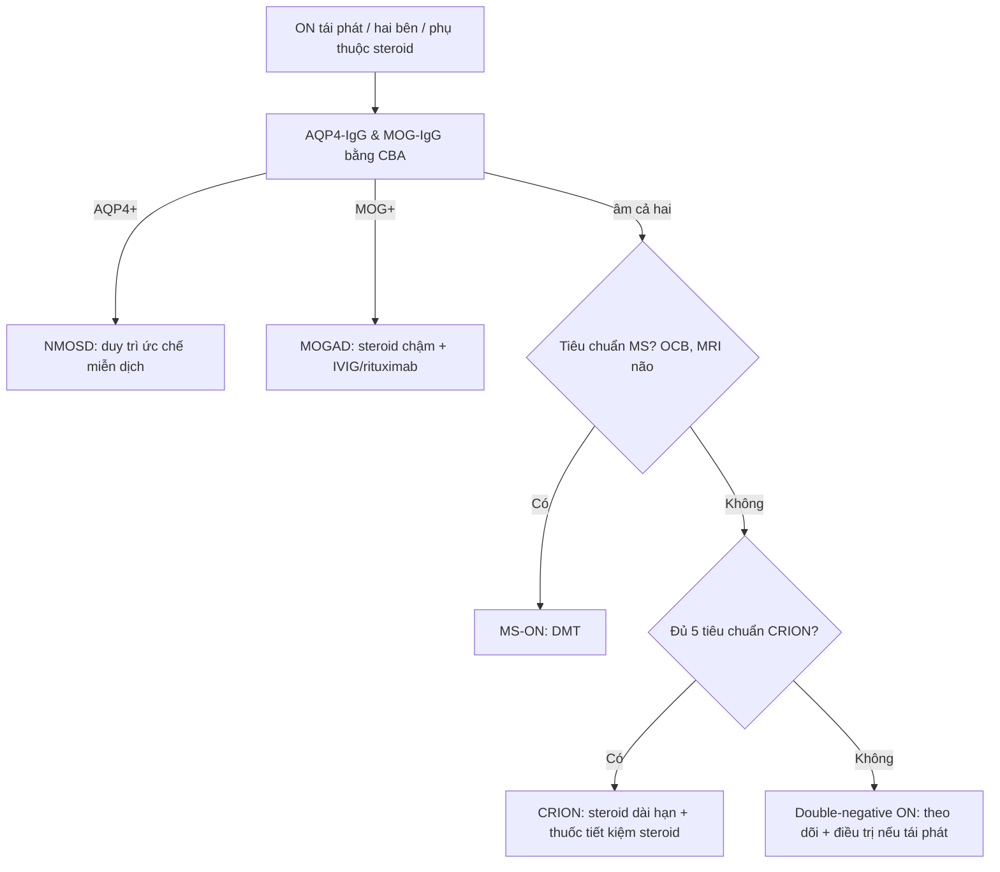

# 464 — Viêm thần kinh thị tái phát (CRION) & thể “âm tính kép”: phụ thuộc steroid, loại trừ AQP4/MOG / Chronic relapsing inflammatory optic neuropathy (CRION) & double-negative optic neuritis

**Tags:** `pattern:viem-TK-thi` `pattern:tai-phat` `pattern:phu-dia-thi` `vung:than-kinh-thi` `score:OCT-GCL` `protocol:MRI-hoc-mat` `protocol:OCT-thi-truong`
**Mức chắc chắn (certainty):** tổng hợp y văn (literature synthesis) — số liệu từ review 2026 (PMC12938181), cohort CRION/MOG (PMC6208174), OCT so sánh (PMC9497092) và cohort double-negative (PMC11514904); **ca lâm sàng trong quiz là ca nguyên văn (verbatim case)** của Raimundo M et al. (PMC6031225), giữ đúng tuổi – mắt – diễn tiến.

## 1. Tổng quan bệnh học – cơ chế hình ảnh (TẠI SAO)

- **CRION (chronic relapsing inflammatory optic neuropathy)** là thể **viêm thần kinh thị (optic neuritis, ON) tái phát, đau, đáp ứng corticosteroid nhưng tái phát khi giảm/ngừng steroid**. Bệnh thường gặp ở **30–50 tuổi**, đau **trước hoặc cùng lúc** với mất thị lực, mức mất thị lực nặng hơn ON trong MS (Eslami M et al., Brain Sci 2022, PMC9497092).
- **5 tiêu chuẩn chẩn đoán CRION (Petzold 2014, cập nhật trong review 2026):**
  1. **Có ≥ 1 cơn ON và ≥ 1 lần tái phát**;
  2. **Bằng chứng khách quan mất chức năng thị giác** (thị lực, thị trường, VEP);
  3. **AQP4-IgG âm**;
  4. **Ngấm thuốc của thần kinh thị viêm trên MRI hốc mắt**;
  5. **Đáp ứng với điều trị ức chế miễn dịch và tái phát khi ngừng/giảm liều** (Lana-Peixoto MA et al., Biomedicines 2026, PMC12938181).
- **CRION không còn là “vô căn”:** trong cohort Seoul, **11/12 (92%)** bệnh nhân đủ tiêu chuẩn CRION **dương tính MOG-IgG**; tỷ lệ này là **0%** ở RION và **29%** ở ON đơn pha (Lee HJ et al., J Neuroinflammation 2018, PMC6208174). Vì vậy **CRION phần lớn là một biểu hiện của phổ MOGAD**, nhưng vẫn có nhóm **âm tính kép (double-negative)** thật sự.
- **TẠI SAO MRI thấy ngấm thuốc:** viêm làm **hở hàng rào máu-mô** → gadolinium rò vào mô kẽ; gadolinium rút ngắn T1 → **tăng tín hiệu trên T1 fat-sat sau tiêm**. Phù viêm làm **T2 tăng tín hiệu**; tổn thương thường **dài ≥ 1/2 chiều dài thần kinh thị** (longitudinally extensive), khác ổ ngắn của MS-ON.
- **TẠI SAO OCT thấy mỏng:** sau mỗi cơn, sợi trục tổn thương thoái hóa → **pRNFL mỏng**; tế bào hạch võng mạc (GCL) mất **sớm hơn** và phản ánh mất sợi trục ngược dòng. Trong CRION, **pRNFL trung bình chỉ 39,33 ± 1,8 µm**, mỏng hơn rõ so với NMOSD **81,67 µm**, RRMS+ON **86,4 µm** và người khỏe **92,0 µm** (PMC9497092).
- **Ngưỡng định lượng nằm lòng:**
  - **Số cơn tái phát trung vị 3–6**, khoảng cách giữa các cơn **4–6 tháng** (PMC12938181).
  - **Thị lực cuối trung bình 20/33**; tới **40% mắt còn di chứng** dù đáp ứng steroid ban đầu (PMC12938181).
  - Trong cohort **double-negative IDD** (98 BN, 20,4% khởi đầu bằng ON): **47,5% đơn pha** trong trung vị **39,5 tháng**; **duy trì miễn dịch làm giảm tái phát HR 0,361 (0,150–0,869)**; **kháng thể anti-astrocyte HR 2,243** và **≥ 4 tổn thương não lúc đầu HR 2,494** là yếu tố nguy cơ (Jiang F et al., Ann Clin Transl Neurol 2024, PMC11514904).
  - **CRION chiếm ~6%** các ca ON tái phát; **double-negative RON chiếm 41%** trong một cohort chuyên khoa (PMC12938181).

## 2. Mẫu hình + chẩn đoán phân biệt theo bối cảnh (Gamut)

- **Theo tuổi – mức đau – đáp ứng steroid:**
  - **Trẻ/nữ, đau nhiều, tái phát khi giảm steroid, MRI dài ≥ 1/2 thần kinh thị:** **CRION/MOG-ON**.
  - **Nữ trung niên, đau, tổn thương dài, bệnh nặng, có area postrema/chiasmal:** **AQP4-ON (NMOSD)**.
  - **Nữ trẻ, đau nhẹ, ổ ngắn < 1/2 thần kinh thị, OCB (+), tổn thương não quanh não thất:** **MS-ON**.
  - **> 50 tuổi, không đau, mất thị trường trên/dưới (altitudinal), đĩa phù, yếu tố mạch máu:** **NAION**.
  - **Đau tăng khi liếc, đĩa phù, song phương, hồi phục tốt nhưng tái phát:** **MOG-ON**.
  - **Không đau, tiến triển chậm, teo đĩa, tiền sử độc chất/thuốc:** **ON do độc/chuyển hóa**; **LHON** (nam trẻ, mất thị lực trung tâm hai mắt cách nhau vài tuần–tháng).
  - **Bất thường toàn thân:** sarcoid (tuyến lệch to, hạch rốn phổi), lupus/Sjögren, giang mai, HIV, bệnh Behçet.
- **Theo hình thái tổn thương trên MRI:**
  - **Dài + ngấm toàn bộ + màng nuôi thần kinh:** CRION/MOG.
  - **Dài + dày + ngấm mạnh, có thể chiasm:** AQP4.
  - **Ngắn, ổ khu trú, một bên:** MS.
  - **Không ngấm, đĩa phù, không tổn thương thần kinh thị:** NAION (thường không có ngấm thần kinh thị; ngấm mỡ quanh thần kinh có thể gặp).
- **Mnemonic “STEROID”:** **S**evere pain · **T**ái phát khi giảm liều · **E**nhancement dài · **R**esponse nhanh với steroid · **O**ptic disc phù/pallor · **I**gG AQP4 âm · **D**ouble-negative phải theo dõi.

## 3. Bảng so sánh phân biệt (ma trận đối chiếu)

| Thực thể (entity) | Hình ảnh điển hình | Chốt vào (rule-in) | Chốt loại (rule-out) | Gợi ý xác nhận |
|---|---|---|---|---|
| **CRION** | MRI: **ngấm thuốc dài ≥ 1/2 thần kinh thị**, có thể hai bên; brain MRI thường bình thường; OCT pRNFL **39,33 µm** | **ON tái phát + đau + đáp ứng steroid + tái phát khi giảm liều + AQP4 âm** | Không tái phát khi ngừng steroid / có tổn thương não đặc hiệu MS → không CRION | AQP4/MOG-IgG (CBA), MRI hốc mắt trước điều trị, OCT, thị trường |
| **MOG-ON** | **Hai bên, dài, ngấm màng nuôi thần kinh (perineural)**, đĩa phù; hồi phục tốt nhưng tái phát | **MOG-IgG (+) + đĩa phù + tổn thương dài/perineural** | MOG-IgG âm + ổ ngắn + OCB (+) → MS-ON | MOG-IgG CBA; MRI hốc mắt + não; OCT |
| **AQP4-ON (NMOSD)** | **Dài, dày, ngấm mạnh**, chiasm/area postrema; thị lực nặng, hồi phục kém | **AQP4-IgG (+) + tổn thương dài/chiasm + area postrema** | AQP4 âm + ổ ngắn + OCB (+) → MS | AQP4-IgG CBA; MRI não/tủy; OCT |
| **MS-ON** | **Ổ ngắn < 1/2 thần kinh thị**, một bên, ngấm khu trú; tổn thương não quanh não thất | **OCB (+) + ổ ngắn + tổn thương não đặc hiệu MS** | Tổn thương dài + không OCB + brain MRI bình thường → không MS | MRI não + tủy, OCB, MOG/AQP4 |
| **Double-negative ON/RION** | MRI dài hoặc ngắn, **AQP4 và MOG đều âm**; không tổn thương não đặc hiệu | **ON tái phát + AQP4/MOG âm + loại trừ MS/NMOSD/MOGAD** | Có AQP4/MOG (+) hoặc tiêu chuẩn MS → xếp nhóm khác | CBA lặp lại; MRI theo dõi; duy trì miễn dịch nếu tái phát |
| **NAION** | Đĩa **phù lan tỏa, không ngấm thần kinh thị**; thị trường **altitudinal**; mạch máu nhỏ | **> 50 tuổi, không đau, altitudinal, đĩa phù, yếu tố mạch máu** | Đau khi liếc + ngấm thần kinh thị + trẻ → không NAION | Soi đáy mắt, thị trường, MRI loại trừ, CRP/ESR nếu nghi GCA |
| **ON do độc/chuyển hóa & LHON** | Thần kinh thị **không ngấm**, teo đĩa hai bên; LHON có phù đĩa giả | **Tiền sử thuốc/rượu/B12 thấp; LHON: nam trẻ, mất thị lực trung tâm hai mắt** | Ngấm thuốc mạnh + đau + tái phát khi giảm steroid → viêm | B12, folate, thuốc, DNA ty thể (LHON), OCT |

*Soi đáy mắt cùng một bệnh nhân: (A) mắt phải đang tái phát — **phù đĩa thị lan tỏa, bờ mờ, sung huyết**; (B) mắt trái — **teo đĩa thị, bờ rõ, nhợt** sau các cơn trước. Sự tương phản “phù đang hoạt động vs teo sau cơn” là chìa khóa của bệnh tái phát. Nguồn: Raimundo M et al., Am J Ophthalmol Case Rep 2018 (PMC6031225), Fig. 2, CC BY-NC-ND 4.0 — ảnh giữ nguyên bản.*

## 4. Protocol chụp + hệ phân độ/điểm chuẩn hóa

- **MRI hốc mắt + não (bắt buộc trước khi dùng steroid):**
  - **T1 fat-sat sau gadolinium** (lát **1–2 mm** qua thần kinh thị, coronal + axial) — tìm **ngấm thuốc dài, màng nuôi, chiasm**.
  - **T2 fat-sat** — phù/tăng tín hiệu; **DWI** nếu cần loại nhồi máu/u.
  - **Brain MRI** — tìm tổn thương quanh não thất/OCB (MS), area postrema (AQP4), tổn thương thân não.
- **Xét nghiệm:** **AQP4-IgG và MOG-IgG bằng cell-based assay (CBA)** — bắt buộc với mọi ON tái phát/hai bên; **OCB** trong DNT; **ACE, lysozyme, chest CT** nếu nghi sarcoid; **B12, folate, TSH, RPR/HIV**; **ANA, anti-SSA/SSB**.
- **OCT:** **pRNFL + GCL/IPL** (theo dõi mất sợi trục); đo lúc chẩn đoán và mỗi **3–6 tháng**; pRNFL có thể **bình thường sớm** vì phù che lấp, mỏng dần sau **3–6 tháng**.
- **Thị trường Humphrey 24-2 + VEP** — bằng chứng khách quan và theo dõi.
- **Điều trị:**
  - **Cơn cấp:** **methylprednisolone IV 1 g/ngày × 3–5 ngày**, sau đó **prednisone uống giảm liều chậm** (tháng, không ngày).
  - **Duy trì:** **azathioprine, mycophenolate, rituximab, IVIG** (CRION/MOG); **không ngừng đột ngột** vì tái phát trong **vài tuần–vài tháng**.
  - **MOG-IgG (+):** đáp ứng steroid tốt nhưng hay phụ thuộc; cân nhắc **IVIG** và tránh giảm liều nhanh.
  - **Double-negative tái phát:** duy trì ức chế miễn dịch (HR 0,361); theo dõi chuyển sang MS/NMOSD/MOGAD.

*Sơ đồ gốc: phân nhánh theo RAPD, hình ảnh MRI, AQP4/MOG, OCB và đáp ứng điều trị — dùng để định vị CRION trong phổ ON. Nguồn: Lana-Peixoto MA et al., Biomedicines 2026 (PMC12938181), Fig. 5, CC BY 4.0.*

## 5. Biến thể bình thường và cạm bẫy

- **Corticosteroid gây bệnh võng mạc trung tâm thanh dịch (CSCR):** bệnh nhân CRION đang dùng steroid có thể **mất thị lực không đau** do **bong thanh dịch hoàng điểm** — không phải tái phát ON. Ca nguyên văn: nữ 42 tuổi, CRION mắt trái, đợt cấp mắt phải, **2 tháng sau** mất thị lực không đau do CSCR, **tự hồi phục sau 4 tháng** dù tiếp tục steroid (PMC6031225). **OCT hoàng điểm** là chốt.
- **Đáp ứng steroid không đặc hiệu:** NAION, u chèn ép, bệnh lý mạch máu cũng có thể “đỡ” thoáng qua; không được dùng đáp ứng steroid để chốt CRION.
- **MRI sau steroid có thể hết ngấm:** chụp **trước** khi truyền methylprednisolone nếu có thể; nếu đã điều trị, đừng loại trừ CRION chỉ vì MRI âm.
- **MOG dương không đồng nghĩa CRION:** MOGAD có tiêu chuẩn riêng; CRION là **kiểu hình lâm sàng**, không phải chẩn đoán song song.
- **Double-negative không phải “không bệnh”:** vẫn tái phát; duy trì miễn dịch giảm tái phát (HR 0,361); theo dõi chuyển đổi chẩn đoán.
- **OCT sớm có thể bình thường:** phù đĩa che lấp mỏng sợi trục; đo lại sau **3–6 tháng**.
- **Giảm steroid quá nhanh** là nguyên nhân tái phát phổ biến nhất — tapering phải kéo dài **nhiều tháng**, theo dõi thị lực/thị trường.

## 6. Tự lượng giá — Blind Quiz

**Ca 1 — Nữ 42 tuổi, tiền sử viêm thần kinh thị mắt trái; nay đau và mờ mắt phải. Nhìn đáy mắt, so sánh hai mắt.**

- Gợi ý: đau tăng khi liếc; mắt trái đã từng bị nhiều đợt.
- Hỏi: mô tả đĩa thị mỗi mắt? Chẩn đoán? Vì sao mắt trái nhợt?

<b>Bấm để hiện đáp án (findings + chẩn đoán)</b>

- **Findings:** (A) mắt phải **phù đĩa thị lan tỏa, bờ mờ, sung huyết** = đợt cấp; (B) mắt trái **đĩa nhợt, bờ rõ** = teo thị sau các đợt trước.
- **Chẩn đoán:** **CRION** — ON tái phát, đau, đáp ứng steroid, tái phát khi giảm liều; mắt trái đã tích lũy mất sợi trục.
- **Vì sao nhợt:** mất sợi trục sau nhiều cơn → pRNFL/GCL mỏng → đĩa teo.
- **Nguồn ảnh:** Raimundo M et al., Am J Ophthalmol Case Rep 2018 (PMC6031225), Fig. 2, CC BY-NC-ND 4.0 — ảnh giữ nguyên bản.

**Ca 2 — Cùng bệnh nhân, MRI hốc mắt coronal T2. Tổn thương nằm ở đâu và gợi ý gì?**

- Gợi ý: đau khi vận nhãn; không có tổn thương não.
- Hỏi: mô tả tín hiệu thần kinh thị? Phân biệt với MS-ON?

<b>Bấm để hiện đáp án (findings + chẩn đoán)</b>

- **Findings:** **tăng tín hiệu đồng nhất, dày thần kinh thị phải** trên T2 coronal, kèm tăng thể tích dịch quanh thần kinh thị trái (chú thích gốc).
- **Chẩn đoán:** **viêm thần kinh thị cấp** trong CRION; tổn thương **dài/đồng nhất** khác ổ ngắn của MS.
- **Cần làm:** AQP4/MOG-IgG, OCB, MRI não; chụp **trước** steroid nếu có thể.
- **Nguồn ảnh:** Raimundo M et al., Am J Ophthalmol Case Rep 2018 (PMC6031225), Fig. 3, CC BY-NC-ND 4.0 — ảnh giữ nguyên bản.

**Ca 3 — Bảng MRI đa thể: nhận diện kiểu ngấm thuốc của CRION giữa MS, MOG và AQP4.**

- Gợi ý: ảnh gồm 4 nhóm bệnh; chú ý chiều dài tổn thương và màng nuôi thần kinh.
- Hỏi: nhóm nào là CRION? Dấu hiệu nào phân biệt với MS-ON?

<b>Bấm để hiện đáp án (findings + chẩn đoán)</b>

- **Findings theo chú thích gốc:** (A, B) **MS-ON** — ổ ngắn, khu trú thần kinh thị trái; (C, D) **CRION âm tính MOG** — **ngấm thuốc dài, hai bên**; (E–G) **MOG-ON** — ngấm màng nuôi thần kinh và mô quanh thần kinh sau hốc mắt; (H–L) **AQP4-ON** — thần kinh thị dày, ngấm dài, có thể tới chiasm.
- **Chốt:** **CRION = ngấm dài + brain MRI bình thường + AQP4 âm + phụ thuộc steroid**; MS = ổ ngắn + OCB/tổn thương não.
- **Nguồn ảnh:** Lana-Peixoto MA et al., Biomedicines 2026 (PMC12938181), Fig. 3, CC BY 4.0.

**Ca 4 — Bệnh nhân CRION đang uống prednisone, đột ngột mờ mắt KHÔNG đau. Chẩn đoán nào ngoài tái phát ON?**

- Gợi ý: mất thị lực không đau, đang dùng steroid kéo dài.
- Hỏi: biến chứng do điều trị nào cần nghĩ? Cận lâm sàng nào chốt?

<b>Bấm để hiện đáp án (findings + chẩn đoán)</b>

- **Chẩn đoán:** **bệnh võng mạc trung tâm thanh dịch (CSCR) do corticosteroid** — nguyên nhân mất thị lực không đau ở bệnh nhân CRION đang điều trị.
- **Chốt:** **OCT hoàng điểm** thấy **bong thanh dịch dưới võng mạc**; có thể tự hồi phục sau **4 tháng** dù tiếp tục steroid (ca nguyên văn PMC6031225).
- **Xử trí:** giảm/ngừng steroid khi có thể, phối hợp chuyên khoa; phân biệt với tái phát ON (đau, ngấm thuốc thần kinh thị).
- **Nguồn ảnh:** Lana-Peixoto MA et al., Biomedicines 2026 (PMC12938181), Fig. 5, CC BY 4.0 (sơ đồ thuật toán).

## Bài liên quan chéo
- [430 – Đường thị giác: viêm vs thiếu máu vs chèn ép](../430-duong-thi-giac/lesson.md)
- [431 – U thần kinh thị](../431-u-than-kinh-thi/lesson.md)
- [433 – Phù đĩa thị vs drusen đĩa](../433-phu-dia-thi-drusen/lesson.md)
- [434 – Teo thị thần kinh thị do độc & LHON](../434-teo-thi-than-kinh-thi-doc-va-LHON/lesson.md)
- [435 – GCA & NAION/AION](../435-gca-va-naion-aion/lesson.md)
- [439 – Teo thị di truyền (DOA/OPA1, Wolfram)](../439-teo-thi-di-truyen/lesson.md)

> Không dùng để chẩn đoán độc lập khi chưa có người hướng dẫn.
