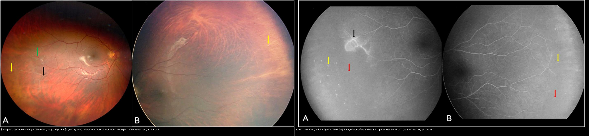
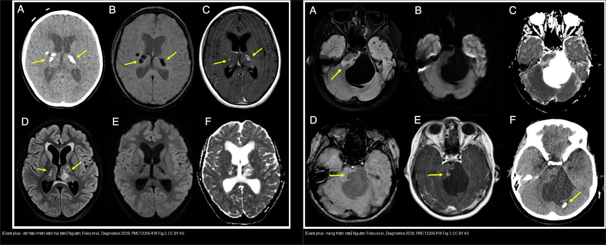
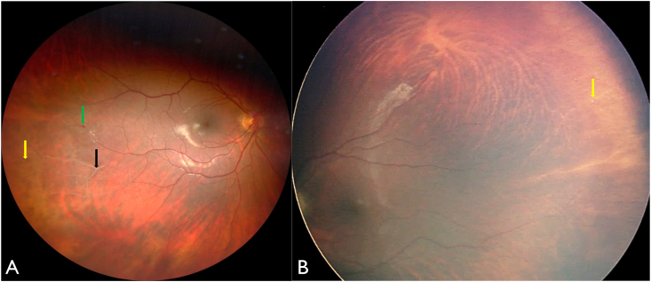
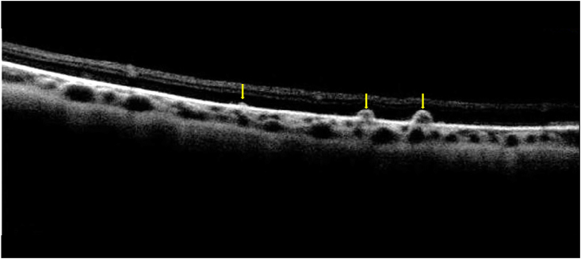
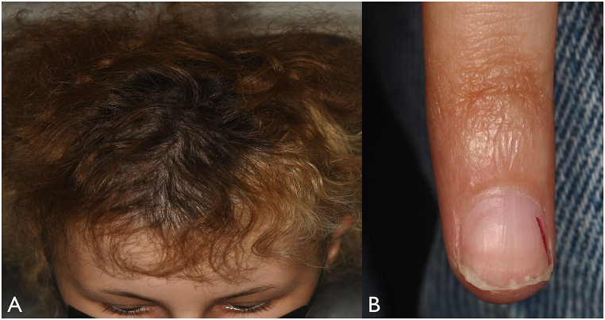
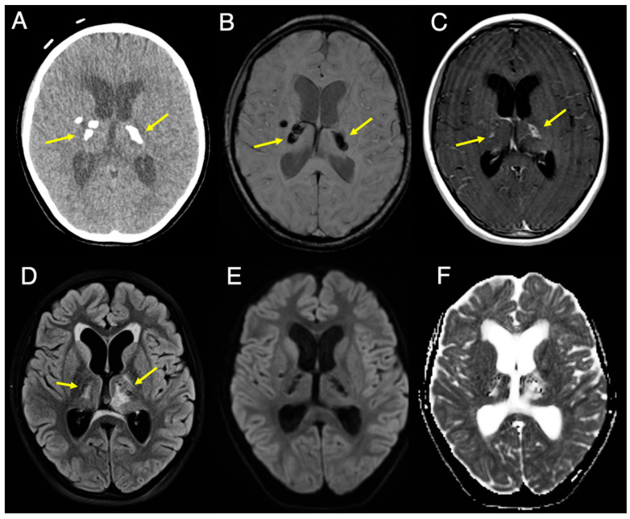
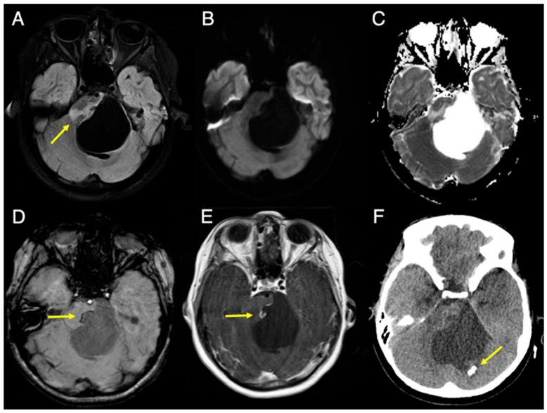
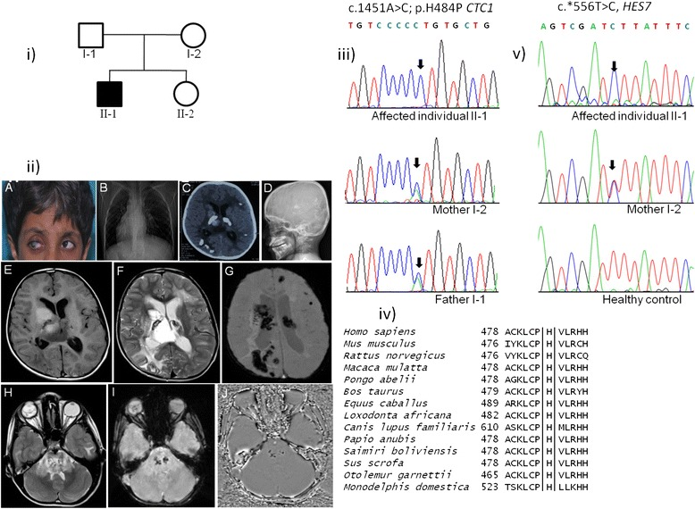
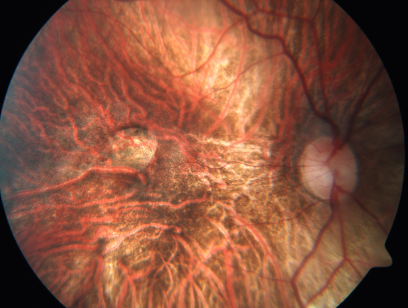

# 465 — Coats plus syndrome (CTC1/CRMCC): bệnh võng mạc giống Coats hai bên + vôi hóa–nang não & chảy máu tiêu hóa / Coats plus syndrome (cerebroretinal microangiopathy with calcifications and cysts)

**Tags:** `pattern:gia-coats` `pattern:xuat-tiet-vong-mac` `pattern:voi-hoa-nao` `vung:vong-mac` `vung:nao` `score:Shields` `protocol:FA` `protocol:MRI`
**Mức chắc chắn (certainty):** tổng hợp y văn + ca nguyên văn (literature synthesis + verbatim case) — tổng hợp từ y văn mở (Am J Ophthalmol Case Rep 2022; Diagnostics 2026; BMC Med Genet 2015; BMC Pediatrics 2022; Cureus 2024; Clin Exp Ophthalmol 2025), có gắn hình thái ca nguyên văn.

## 1. Tổng quan — "Coats hai bên + não + ruột": telomere ngắn gây thoái hóa vi mạch tại nhiều cơ quan

- **Định nghĩa (pathology):** **Coats plus syndrome (CPS)** — còn gọi **CRMCC** (cerebroretinal microangiopathy with calcifications and cysts) — là bệnh **di truyền lặn** do đột biến **hai alen gen *CTC1*** (conserved telomere maintenance component 1, **nhiễm sắc thể 17p13.1**), thuộc nhóm **rối loạn sinh học telomere (telomere biology disorders — TBD)**. Đây là **thể nặng của dyskeratosis congenita**, khác hẳn **bệnh Coats** kinh điển (tự phát, một bên, không kèm bệnh hệ thống) — bài 457.
- **Tam chứng hình ảnh nằm lòng:**
  1. **Bệnh võng mạc "giống Coats" HAI BÊN:** telangiectasia (giãn mạch) + **vô mạch ngoại vi** + **xuất tiết dưới võng mạc** (coats-like exudative retinopathy). **Gần như luôn hai bên.**
  2. **Vôi hóa nội sọ** (đối xứng, nhân xám/thalamus) **và nang nhu mô não** (điển hình thân não/cầu não).
  3. **Bệnh chất trắng (leukoencephalopathy)** — T2/FLAIR tăng tín hiệu.
  Kèm ngoài thần kinh: **chảy máu tiêu hóa do giãn mạch (vascular ectasia)**, **loãng xương/dễ gãy xương**, **suy tủy xương/thiếu máu bất sản**, tóc bạc sớm/loạn dưỡng móng, chậm phát triển, đầu nhỏ, tăng áp lực cửa.
- **TẠI SAO ra hình ảnh này (cơ chế):**
  - **Telomere là "đầu bảo vệ" đầu mút NST.** Khi **CTC1** hỏng, phức hợp CST (CTC1–STN1–TEN1) không bảo vệ được telomere → telomere ngắn dần → tế bào **ngừng phân chia/già sớm (senescence)** ở các mô **sinh sản nhanh** (tủy xương, niêm mạc, vi mạch).
  - **Ở võng mạc:** vi mạch ngoại vi thoái hóa → **vô mạch ngoại vi** → thiếu oxy → **VEGF** → **telangiectasia/phình túi mạch** rò huyết tương → **xuất tiết lipid và dịch dưới võng mạc**. Trên **chụp mạch huỳnh quang (FA)**: vùng vô mạch **tối (không ngấm thuốc)**, telangiectasia **rò thuốc sáng muộn**, vùng xuất tiết **tăng huỳnh quang khuếch tán**.
  - **Ở não:** vi mạch não thoái hóa → **lắng đọng canxi quanh mạch nhỏ** (đối xứng nhân xám) + **tăng tính thấm/dịch hóa** thành **nang** (nhất là thân não) + mất myelin do thiếu máu vi mạch → **T2/FLAIR tăng tín hiệu chất trắng**. Vôi hóa "đen" trên FLAIR/DWI, "sáng" trên CT và **nhậy từ tính (blooming) trên SWI**.
  - **Ở tiêu hóa:** vi mạch niêm mạc thoái hóa → **giãn mạch (angiodysplasia/ectasia)** ruột non, dạ dày, gan → chảy máu nặng/tái phát, tăng áp lực cửa.
- **Ngưỡng & số liệu định lượng (từ nguồn làm chuẩn):**
  - **Gen:** *CTC1* ở **17p13.1**; **> 20 đột biến lặn** đã mô tả; kiểu **compound heterozygous** điển hình (một đột biến protein-truncating + một missense); Anderson mô tả **10 gia đình** CPS đầu tiên.
  - **Tuổi khởi phát rất sớm:** bệnh võng mạc có thể xuất hiện từ **18 tháng tuổi** (Netravathi, ca bé trai 8 tuổi); nang não lớn có thể gây triệu chứng lúc **9 tuổi** (nang **4,9 × 5,0 cm** ở cầu não gây úng thủy tắc nghẽn); ca 15 tuổi (Shields) được chẩn đoán sau **nhiều gãy xương tự phát**.
  - **Độ dài telomere** có thể đo bằng Southern/qPCR–flow-FISH; ca Netravathi: bố mẹ **10 kb** vs bệnh nhân **8 kb**. Tuy nhiên **telomere có thể còn bình thường trên xét nghiệm** (ca Shields) → **không loại trừ CPS dựa vào độ dài telomere**.
  - **Đe dọa tính mạng:** chảy máu tiêu hóa (Hb tụt còn **6,5 g/dL**, phải **truyền hồng cầu mỗi 2–3 tuần**) và **tăng áp lực cửa**; nguy cơ ung thư (AML, lymphoma, ung thư biểu mô đầu–cổ, da).

## 2. Mẫu hình + chẩn đoán phân biệt theo bệnh cảnh (Gamut)

- **Mẫu hình cửa vào:** trẻ nhũ nhi–thiếu niên có **bệnh võng mạc giống Coats HAI BÊN** hoặc **một bên rõ + bên kia chỉ thấy trên FA**, kèm **một trong các dấu hiệu hệ thống**: cân nặng/chiều cao **< bách phân vị 3**, đầu nhỏ, tóc bạc sớm, loạn dưỡng móng, gãy xương tự phát, thiếu máu/xuất huyết tiêu hóa, co giật, yếu nửa người.
- **Gamut theo thứ tự phải loại trừ:**
  1. **Khối u (loại trừ TRƯỚC):** **retinoblastoma** (vôi hóa thô, < 5 tuổi) — bài 412; và **u/nang não** (nang CPS có thể giả u thân não → đừng mổ cắt "u" — bài 213).
  2. **Cùng phổ TBD:** **Revesz syndrome** (**TINF2**, trội — bệnh võng mạc xuất tiết hai bên + canxi hóa nội sọ + thiếu máu bất sản + thiểu sản tiểu não), **dyskeratosis congenita** (bộ ba móng–da–niêm mạc miệng), **Hoyeraal–Hreidarsson** (suy tủy + thiểu sản tiểu não + suy giảm miễn dịch), **Labrune/LCC** (bệnh chất trắng + canxi hóa + nang, **không** bệnh võng mạc).
  3. **Bệnh mạch võng mạc di truyền khác:** **FEVR, Norrie, incontinentia pigmenti** (do Norrin/β-catenin, thường **vô mạch + tân mạch co kéo** hơn là xuất tiết); **Coats disease** kinh điển (**một bên**); **Leber miliary aneurysms**.
  4. **Khác:** bệnh võng mạc do bệnh hệ thống (lupus/Behçet — bài 455), bệnh võng mạc do xạ, viêm nội nhãn giả u.
- **Mnemonic "Coats-plus 3C–BGH":** **C**oats-like **HAI BÊN** · **C**alcium (vôi hóa nhân xám đối xứng) · **C**yst (nang thân não) · **B**one (loãng xương/gãy xương) · **G**I bleeding (giãn mạch ruột) · **H**air/nail (lão hóa sớm).


*Trái: đáy mắt — mạch võng mạc xơ (mũi tên đen), telangiectasia (mũi tên xanh), lắng đọng dạng drusen (mũi tên vàng). Phải: FA — vô mạch ngoại vi rộng (mũi tên đỏ), rò nhẹ dọc mạch thái dương, chấm ngấm ở các nốt dạng drusen. Nguồn: Agrawal, Kalafatis & Shields, Am J Ophthalmol Case Rep 2022, PMC9513731 Fig. 1 & 3, CC BY 4.0; ảnh ghép letterbox, giữ nguyên bản.*

## 3. Bảng so sánh phân biệt (ma trận đối chiếu)

| Thực thể (entity) | Hình ảnh điển hình | Chốt vào (rule-in) | Chốt loại (rule-out) | Gợi ý xác nhận |
|---|---|---|---|---|
| **Coats plus (CTC1, CRMCC)** | **Võng mạc giống Coats HAI BÊN** (telangiectasia + vô mạch ngoại vi + xuất tiết) + **vôi hóa nhân xám + nang thân não + bệnh chất trắng** | **Coats-like hai bên (FA) + vôi hóa/nang não + (loãng xương / gãy xương / chảy máu tiêu hóa / tóc–móng bất thường)** | Bệnh võng mạc **một bên** + không dấu hệ thống → Coats disease | Gen ***CTC1*** (biallelic, 17p13.1); MRI/CT não; nội soi tiêu hóa khi thiếu máu; DEXA; CBC |
| **Bệnh Coats (kinh điển)** | **Một bên**, nam, giãn mạch-teo mao mạch + xuất tiết lipid, **không** dấu thần kinh/tiêu hóa | **Bé nam + một bên + xuất tiết lipid + không bệnh hệ thống** | **Hai bên / kèm vôi hóa–nang não → Coats plus** | FA góc rộng; **loại trừ retinoblastoma** trước can thiệp |
| **Revesz (TINF2, trội)** | Bệnh võng mạc xuất tiết hai bên + **canxi hóa nội sọ** + thiểu sản tiểu não, thiếu máu bất sản | **Xuất tiết hai bên + canxi hóa nội sọ + thiếu máu bất sản** (không loãng xương/chảy máu ruột) | Có loãng xương + chảy máu tiêu hóa → **Coats plus** | Gen ***TINF2*** (di truyền **trội**) vs *CTC1* (lặn) |
| **Dyskeratosis congenita** | Bộ ba **loạn dưỡng móng + tăng sắc tố lưới da + bạch sản niêm mạc miệng**; võng mạc có thể vô mạch ngoại vi | **Bộ ba móng–da–niêm mạc + suy tủy** | Coats-like hai bên + vôi hóa/nang não → Coats plus | Panel gen TBD (*DKC1/TERC/TERT/RTEL1/CTC1/TINF2*), độ dài telomere |
| **FEVR / Norrie / IP** | **Vô mạch ngoại vi + tân mạch co kéo**, hai bên, tiền sử gia đình; Norrie kèm điếc/chậm phát triển | **Vô mạch + tân mạch co kéo + gia đình** | Xuất tiết lipid nhiều + bất thường não/xương → Coats plus | FA + gen (*FZD4/LRP5/NDP/IKBKG*) + tầm soát gia đình |
| **Retinoblastoma (loại trừ TRƯỚC)** | **Khối đặc + vôi hóa THÔ**, < 5 tuổi, leukocoria | **Vôi hóa trong khối ở trẻ nhỏ = RB tới khi loại trừ** | Không khối đặc + vô mạch/xuất tiết → Coats plus | MRI sọ–hốc mắt (tránh CT) + hội chẩn ung thư nhi |


*Trái: CT + MRI — vôi hóa thô đối xứng vùng nhân xám (chủ yếu thalamus), ngấm viền nhẹ, đen trên FLAIR/DWI và sáng trên SWI. Phải: nang lớn ở cầu não (4,9 × 5,0 cm) gây hiệu ứng khối, dịch trong nang bị triệt trên FLAIR. Cùng một bệnh, hai dấu hiệu chốt của tam chứng hình ảnh. Nguồn: Foley et al., Diagnostics 2026, PMC13205418 Fig. 1–2, CC BY 4.0; ảnh ghép letterbox, giữ nguyên bản.*

## 4. Protocol chụp + hệ phân độ/điểm chuẩn hóa

- **Mắt (bắt buộc hai mắt):**
  - **Soi đáy mắt giãn đồng tử + đè củng mạc tới ora serrata.**
  - **FA góc rộng (WFFA) HAI MẮT** — tiêu chuẩn vàng: **một mắt có thể trông bình thường trên ảnh màu nhưng vẫn có vô mạch ngoại vi trên FA** (đây chính là chìa khóa chẩn đoán CPS). Thường làm dưới **gây mê (EUA)** ở nhũ nhi.
  - **OCT** (phù hoàng điểm, bong biểu mô sắc tố dạng drusen) và **siêu âm B-scan** khi môi trường đục (bài 411).
- **Não:** **MRI 3T** (T2/FLAIR fat-sat, DWI/ADC, **SWI** tìm vôi hóa/vi xuất huyết, T1 sau tiêm) + **CT não (cửa sổ xương/não)** khi cần xác nhận vôi hóa (SWI "blooming" gợi ý, CT khẳng định). Nang thân não: theo dõi kích thước, hiệu ứng khối, úng thủy.
- **Tầm soát hệ thống (đa cơ quan):** CBC + tủy xương (suy tủy), **nội soi tiêu hóa** (giãn mạch — nội soi trên/dưới thường âm → có thể cần **nội soi ruột non**), men gan + siêu âm/Doppler cửa (tăng áp lực cửa), **DEXA** (loãng xương), chức năng phổi (xơ phổi), khám da/tóc/móng.
- **Gen & di truyền:** **giải trình tự gen *CTC1*** (panel TBD), tư vấn di truyền **lặn, nguy cơ tái phát 25%** cho anh chị em; tầm soát người thân. Đo **độ dài telomere** (qPCR/flow-FISH/Southern; bình thường **không loại trừ**).
- **Phân độ bệnh võng mạc — Shields (áp cho bệnh võng mạc Coats-like):** **1** giãn mạch-teo mao mạch đơn thuần; **2** kèm xuất tiết (**2A** ngoài hoàng điểm / **2B** tới hoàng điểm); **3** bong võng mạc xuất tiết (**3A** bán phần / **3B** toàn bộ); **4** bong toàn bộ + **glaucoma**; **5** giai đoạn cuối (mắt mù đau). **Xử trí theo giai đoạn:** 1 theo dõi; 2–3 **laser quang đông/cryo** vùng telangiectasia ± vô mạch (± anti-VEGF, corticoid); 3–5 phẫu thuật dẫn lưu bong xuất tiết; glaucoma/phthisis → cân nhắc **cắt bỏ nhãn cầu** kiểm soát đau.
- **Nguyên tắc điều trị toàn thân:** đa chuyên khoa (mắt + huyết học + tiêu hóa + thần kinh); **tránh bức xạ ion hóa lặp lại và tránh hóa–xạ trị gây tổn thương DNA** (tế bào đã nhạy cảm do telomere ngắn) — ưu tiên kỹ thuật không bức xạ khi có thể.

```mermaid
flowchart TD
  A[Trẻ có bệnh võng mạc xuất tiết / leukocoria HOẶC bất thường thần kinh - xương - tiêu hóa] --> B{Loại trừ khối u trước}
  B -->|Khối đặc + vôi hóa thô, < 5 tuổi| C[RETINOBLASTOMA - MRI + hội chẩn ung thư nhi]
  B -->|Không| D[Soi đáy mắt + FA GÓC RỘNG HAI MẮT]
  D --> E{Vô mạch ngoại vi + telangiectasia hai bên?}
  E -->|Không, một bên| F[Bệnh Coats kinh điển - phân độ Shields]
  E -->|Có, hai bên| G[MRI/CT não: tìm vôi hóa nhân xám + nang + bệnh chất trắng]
  G --> H{Có vôi hóa/nang não hoặc dấu hệ thống?}
  H -->|Không| I[FEVR / Norrie / IP / Revesz - xét gen + tầm soát gia đình]
  H -->|Có: loãng xương, chảy máu tiêu hóa, tóc-móng| J[COATS PLUS (CRMCC) - gen CTC1]
  J --> K[Laser/cryo vùng telangiectasia; tầm soát tủy xương, tiêu hóa, xương, phổi]
  K --> L[Tư vấn di truyền lặn - nguy cơ 25% - tầm soát anh chị em]
```

## 5. Biến thể bình thường và cạm bẫy

- **Cạm bẫy số 1 — "Coats là một bên nên loại Coats plus":** Coats plus **gần như luôn hai bên**, nhưng có thể **không đối xứng** và mắt "lành" chỉ lộ vô mạch trên **FA**. → **Luôn FA hai mắt**, đừng kết luận CPS/loại CPS bằng soi đáy mắt đơn thuần.
- **Cạm bẫy số 2 — não bình thường không loại trừ:** ca Shields có **MRI não bình thường** và **telomere bình thường** nhưng vẫn xác nhận CPS bằng gen. Bệnh **tiến triển theo thời gian** (ca Han: thiếu máu + Coats lúc **9 tháng**, gen dương lúc **7 tuổi**) → **theo dõi định kỳ**, đừng "chốt lành".
- **Cạm bẫy số 3 — nang não giả u:** nang CPS (thân não) có thể gây hiệu ứng khối + úng thủy như u thân não → ca 9 tuổi **bị mổ** vì tưởng u, mô bệnh chỉ thấy **chất đạm vô bào, không tế bào u**. Nhận diện **vôi hóa nhân xám đối xứng cùng lúc** để tránh mổ cắt "u".
- **Cạm bẫy số 4 — chảy máu tiêu hóa "nội soi âm":** nội soi dạ dày–đại tràng thường chỉ thấy viêm nhẹ, trong khi nguồn chảy máu là **giãn mạch ruột non** → cần **nội soi ruột non/laparoscopy-assisted**; chảy máu tái phát nguy hiểm tính mạng.
- **Cạm bẫy số 5 — bức xạ:** bệnh nhân TBD nhạy cảm với tổn thương DNA → **hạn chế CT lặp lại**, cân nhắc MRI/SWI thay thế; đồng thời **loại trừ retinoblastoma trước** mọi can thiệp mắt.
- **Cạm bẫy số 6 — nhầm Labrune/LCC và Revesz:** LCC **không có** bệnh võng mạc; Revesz là **trội (TINF2)** và không có loãng xương/chảy máu ruột đặc trưng của CPS.

## 6. Tự lượng giá — Blind Quiz

**Ca 1 — Bé gái 15 tuổi, thấp lùn, đầu nhỏ, tóc bạc sớm, tiền sử gãy xương tự phát nhiều lần. Soi đáy mắt hai bên:**







- Hỏi: dấu đáy mắt? OCT xác nhận gì? Vì sao phải chụp FA **cả hai mắt**? Chẩn đoán và bước xác nhận?

<details><summary><b>Bấm để hiện đáp án (findings + chẩn đoán)</b></summary>

- Dấu hiệu (findings): mắt phải **mạch võng mạc xơ**, **telangiectasia**, **xuất tiết nhẹ** dưới vùng giãn mạch, **nốt lắng đọng dạng drusen ở ngoại vi** hai mắt; FA cho **vô mạch ngoại vi hai bên** + rò nhẹ dọc mạch thái dương + chấm ngấm ở nốt drusen.
- Chẩn đoán (diagnosis): **Coats plus syndrome** — bệnh võng mạc giống Coats **hai bên**. Dấu hệ thống (thấp lùn, đầu nhỏ, tóc bạc sớm, gãy xương tự phát) là chìa khóa phân biệt với **bệnh Coats** một bên. Xác nhận: **gen *CTC1*** (biallelic) — ca này còn có **bong biểu mô sắc tố dạng drusen hai bên** (một quan sát mới, do RPE "già" bởi telomere hỏng).
- **Phản biện:** ca này **MRI não bình thường** và **telomere bình thường** — nghĩa là **không có dấu não/telomere không loại trừ CPS**; chẩn đoán dựa vào hình thái mắt hai bên + gen.
- Nguồn ảnh: Agrawal, Kalafatis & Shields, Am J Ophthalmol Case Rep 2022, PMC9513731 Fig. 1–2, CC BY 4.0.
</details>

**Ca 2 — Bé gái 9 tuổi, 3 tháng mất thăng bằng + mờ mắt trái; CT/MRI não:**



- Hỏi: hai dấu não nằm lòng là gì? Vì sao ban đầu dễ bị coi là "u thân não"?

<details><summary><b>Bấm để hiện đáp án (findings + chẩn đoán)</b></summary>

- Dấu hiệu (findings): **vôi hóa thô đối xứng vùng nhân xám (chủ yếu thalamus)**, **đen trên FLAIR/DWI**, **sáng trên SWI**, ngấm viền nhẹ; kèm **nang 4,9 × 5,0 cm ở cầu não** gây hiệu ứng khối + **úng thủy tắc nghẽn**.
- Chẩn đoán (diagnosis): **Coats plus (CRMCC)** — tam chứng **vôi hóa nội sọ + nang nhu mô não + bệnh chất trắng**. Ban đầu dễ nhầm **u thân não** vì nang lớn gây hiệu ứng khối; ca này **chẩn đoán muộn 5 năm** cho tới khi **em trai được phát hiện bệnh Coats** → gợi ý nguyên nhân di truyền. Mô bệnh nang chỉ **chất đạm vô bào, không có tế bào u**.
- **Phản biện:** bệnh nhân đã **được mổ** vì tưởng u — bài học: khi có **vôi hóa nhân xám đối xứng**, nghĩ ngay **CRMCC/Coats plus** trước khi mổ.
- Nguồn ảnh: Foley et al., Diagnostics 2026, PMC13205418 Fig. 2, CC BY 4.0.
</details>

**Ca 3 — Bé gái 6 tuổi, xuất huyết tiêu hóa nặng, gan lách không to nhưng Doppler cửa gợi ý tăng áp lực cửa; ảnh MRI sọ:**



Ảnh bổ sung — kiểu hình đa hệ thống của một gia đình Coats plus (phả hệ, tóc bạc sớm + đục giác mạc + leukocoria, X-quang tim lệch phải, CT vôi hóa não, đo telomere):



- Hỏi: nguyên nhân chảy máu tiêu hóa ở trẻ này là gì? Liên hệ với bệnh võng mạc hai bên ra sao? Bất thường não và telomere nói lên điều gì?

<details><summary><b>Bấm để hiện đáp án (findings + chẩn đoán)</b></summary>

- Dấu hiệu (findings): **nang nhu mô não** (điển hình thân não) + vôi hóa não trên hình ảnh sọ; lâm sàng: **cân nặng/chiều cao < bách phân vị 3**, **Hb 6,5 g/dL, Hct 21%**, giảm bạch cầu (**WBC 2010/mm³**), **GGT 245 U/L**; nội soi thấy **hình thái mạch máu cuộn (vascular ectasia)**.
- Chẩn đoán (diagnosis): **Coats plus** — **chảy máu tiêu hóa và tăng áp lực cửa** do **giãn mạch/thoái hóa vi mạch** ở ruột–gan, cùng cơ chế telomere hỏng với **bệnh võng mạc giống Coats**. Đa hệ thống: **suy tủy/thiếu máu bất sản** + **vôi hóa/nang não** + **bệnh võng mạc hai bên** + **loãng xương**.
- Nguồn ảnh: Foley et al., Diagnostics 2026, PMC13205418 Fig. 1, CC BY 4.0; số liệu lâm sàng: Bozkurt et al., BMC Pediatrics 2022 (PMC8903628), CC BY 4.0; ảnh bổ sung: Netravathi et al., BMC Med Genet 2015, PMC4422476 Fig. 1 (phả hệ; tóc bạc sớm + đục giác mạc + leukocoria; **X-quang tim lệch phải**; **CT vôi hóa hai bên thalamus**; biến dạng xương), CC BY 4.0.
</details>

**Ca 4 — FA góc rộng một mắt ở bệnh nhân mang đột biến *CTC1* gây bệnh:**



- Hỏi: mô tả bất thường trên FA? Vì sao FA là "chốt" chứ không phải ảnh đáy mắt màu?

<details><summary><b>Bấm để hiện đáp án (findings + chẩn đoán)</b></summary>

- Dấu hiệu (findings): **vùng vô mạch ngoại vi (non-perfusion)** + **mạch telangiectasia** rò thuốc — mẫu hình kinh điển của bệnh võng mạc Coats-like.
- Chẩn đoán (diagnosis): **bệnh võng mạc do Coats plus (đột biến *CTC1*)**. FA **nhạy hơn** ảnh màu/soi đáy mắt: mắt có thể **trông bình thường nhưng vẫn vô mạch** trên FA → **bắt buộc FA hai mắt** để phát hiện tổn thương dưới lâm sàng và định hướng CPS.
- **Phản biện:** cùng mẫu hình FA với **bệnh Coats kinh điển** — phân biệt nhờ **hai bên + dấu hệ thống (não, xương, tiêu hóa)**.
- Nguồn ảnh: Ghoraba, Sears & Traboulsi, Clin Ophthalmol 2024, PMC11962705 Fig. 5, **CC BY-NC-ND 4.0** (giữ nguyên bản, không ghép/crop).
</details>

**Ca 5 — Hai đáy mắt ở hai trẻ khác nhau: gọi tên cơ chế mỗi bên và nêu cách xác nhận khác nhau:**


- Hỏi: bên nào cho thấy **xuất tiết/telangiectasia**? Bên nào cho thấy **vô mạch ngoại vi**? Một mình ảnh màu có đủ không?

<details><summary><b>Bấm để hiện đáp án (findings + chẩn đoán)</b></summary>

- **Trái = ảnh đáy mắt màu:** mạch xơ, **telangiectasia**, lắng đọng dạng drusen — dấu của **rò huyết tương/xuất tiết**.
- **Phải = FA:** **vô mạch ngoại vi hai bên** — dấu của **thoái hóa vi mạch**; thường **không thấy đủ trên ảnh màu**.
- **Chốt:** chỉ ảnh màu **không đủ** để chẩn đoán/loại trừ CPS → cần **FA góc rộng hai mắt**; kết hợp **hình ảnh não (vôi hóa/nang)** và **gen *CTC1*** để chốt.
- Nguồn: Agrawal, Kalafatis & Shields, Am J Ophthalmol Case Rep 2022 (PMC9513731) Fig. 1 & 3, CC BY 4.0.
</details>

## Bài liên quan chéo
- [400 – Tổng quan Mắt & thị giác](../400-tong-quan-mat-thi-giac/lesson.md) (bảng DDx mắt)
- [457 – Bệnh "giả ROP" ở trẻ đủ tháng: FEVR, Norrie, incontinentia pigmenti & Coats](../457-benh-gia-rop-tre-du-thang/lesson.md) (Coats/Coats-like, phân biệt)
- [412 – U trong nhãn cầu (retinoblastoma)](../412-u-trong-nhan-cau/lesson.md) (loại trừ TRƯỚC)
- [450 – Mắt nhi: ROP, Coats, PHPV](../450-mat-nhi/lesson.md)
- [437 – Teo thị kèm điếc (bệnh ty thể/di truyền)](../437-teo-thi-kem-diec/lesson.md) (nhóm bệnh di truyền–đa cơ quan)
- [213 – U não](../213-u-nao/lesson.md) (nang thân não giả u)
- [155 – U thượng thận tình cờ](../155-thuong-than-tinh-co/lesson.md) (đối chiếu nhóm bệnh nội tiết–di truyền đa cơ quan)

## Ảnh
- Tên file: `465_coats-plus_<dấu hiệu>_<Modality>_PMC*-Fig*-CCBY*.jpg`; nguồn + giấy phép từng ảnh trong `images/CREDITS.md`.
- Ảnh **CC BY-NC-ND** (PMC11962705) giữ **nguyên bản** — không ghép/crop. Ảnh ghép chỉ dùng nguồn **CC BY** (letterbox, giữ nguyên bản).
- AuntMinnie (Case of the Day): **chỉ dẫn link, không tải** (xem `sources.md`).

> Không dùng để chẩn đoán độc lập khi chưa có người hướng dẫn.
