# 466 — Toxocariasis nội nhãn (ấu trùng di chuyển ở mắt): u hạt ngoại vi + dây co kéo / Ocular toxocariasis (ocular larva migrans)

**Tags:** `pattern:u-hat-vong-mac` `pattern:day-co-keo-dich-kinh` `pattern:leukocoria` `vung:vong-mac` `vung:tre-em` `protocol:ELISA-Toxocara` `protocol:B-scan` `protocol:UBM` `protocol:FA`
**Mức chắc chắn (certainty):** tổng hợp y văn (literature synthesis) — tổng hợp từ y văn mở 2009–2026 (Cureus, Front Med, J Ophthalmic Inflamm Infect, J Vitreoretin Dis, PLoS NTD, Int J Med Sci); có gắn **hình thái ca nguyên văn** từ các bài gốc (như bài 457) nhưng nội dung nhóm tự biên.

## 1. Tổng quan — ấu trùng *Toxocara* vào mắt gây u hạt & co kéo

- **Bệnh học (pathology):** *Toxocara canis* (giun đũa chó) và *T. cati* (mèo) là ký sinh ở ruột non chó mèo, **đẻ hàng trăm nghìn trứng/ngày**; trứng ra môi trường, **hoá phôi sau vài tuần** thành ấu trùng giai đoạn L2 và tồn tại rất lâu trong đất. Người — đặc biệt **trẻ 2–10 tuổi** — nhiễm do **ăn phải trứng đã hoá phôi** (chơi đất/cát, đồ ăn bẩn, rau sống; đôi khi thịt tái). Ấu trùng nở ở ruột non → **xuyên thành ruột → tĩnh mạch cửa → lan toàn thân**. Ở người (vật chủ "lạc" — **paratenic host**), ấu trùng **không trưởng thành thành giun trưởng thành, không nhân lên**, mà **di chuyển mô vô định** (do đó gọi "ấu trùng di chuyển"). Vào mắt = **ocular larva migrans (OLM)**.
- **TẠI SAO ra hình ảnh (theo Argon):**
  - Tổn thương do **phản ứng miễn dịch viêm u hạt quanh ấu trùng** (đặc biệt khi ấu trùng chết, giải phóng kháng nguyên) — không do ấu trùng "ăn" võng mạc. Vì vậy hình ảnh là **u hạt (granuloma)** ở mô võng mạc/hắc mạc và **viêm dịch kính** kèm theo.
  - Khi tổ chức u hạt xơ hoá, **mô xơ co kéo** dính võng mạc với dịch kính → **dải/dây co kéo từ u hạt tới đĩa thị (vitreoretinal traction band)** — đây là **dấu hiệu chữ ký** của thể u hạt ngoại vi. Co kéo gây **nếp gấp võng mạc, màng trước võng mạc, bong võng mạc co kéo (TRD)**.
  - Trên **siêu âm B-scan**: u hạt = **khối tăng hồi âm (hyperechoic) dính võng mạc**; dây/dải xơ = **màng tăng hồi âm chạy từ đĩa thị ra ngoại vi**, *di động hạn chế* (khác màng do bong võng mạc nguyên phát di động nhiều). **UBM** thấy rõ u hạt ở **pars plana** (trước xích đạo) — vùng đáy mắt thường khó nhìn.
  - Trên **FA**: vùng **hoạt tính viêm mạch rò thuốc**, tân mạch; trên **OCT**: **phù hoàng điểm dạng nang (CME)**, phù đĩa thị, **bong thanh dịch dưới võng mạc**, màng trước võng mạc co kéo.
- **Dịch tễ & ngưỡng định lượng:**
  - **Huyết thanh dương *Toxocara* toàn cầu 19,0%** (KTC 95%: 16,6–21,4; **265.327 người/71 nước**); cao nhất châu Phi **37,7%**, Đông Nam Á **34,1%**, thấp nhất Đông Địa Trung Hải **8,2%**; châu Âu **10,5%** (Rostami et al., PLoS NTD 2019, PMC6922318).
  - OLM chiếm **~1–2% các ca viêm màng bồ đào (uveitis) ở TRẺ**; **tuổi chẩn đoán trung bình 7,5 tuổi** (2–31 tuổi), **80% < 16 tuổi**; **thường một bên (~90%)**; chỉ **~2%** có tiền sử từng bị hội chứng ấu trùng di chuyển nội tạng (visceral larva migrans — VLM) (Pivetti-Pezzi P, Int J Med Sci 2009, PMC2659485).
  - **Ba thể lâm sàng & tần suất:** viêm nội nhãn mạn **~25%** (tuổi 2–8); **u hạt cực sau 25–46%** (tuổi 6–14); **u hạt ngoại vi 20–40%** (tuổi 6–40, **90% ở thái dương**, u hạt nằm *trước xích đạo*). **Nguyên nhân giảm thị lực:** viêm dịch kính nặng **52,6%**, **phù hoàng điểm dạng nang 47,4%**, **bong võng mạc co kéo 36,8%**.
  - **Toxocariasis HAI BÊN là hiếm:** ca-series 10 bệnh nhân (tuổi **21 ± 15**), khởi phát hai mắt **không đồng thì (asynchronous)**, mắt đến trước nặng hơn. U hạt ngoại vi **16 mắt** (mắt đến trước/sau: 9/7), u hạt cực sau **3 mắt**; u hạt ngoại vi mắt đến trước **6,38 ± 1,69 mm** vs mắt đến sau **5,29 ± 1,77 mm** (p = 0,045); tỷ lệ **TRD tăng 25% → 60%** (p = 0,016) (Gu J et al., J Ophthalmic Inflamm Infect 2026, PMC13627495).

## 2. Mẫu hình + chẩn đoán phân biệt theo vị trí & thể bệnh (Gamut)

- **Mẫu hình cửa vào:** trẻ (thường 2–10 tuổi) **giảm thị lực MỘT bên từ từ**, hoặc **leukocoria (mất ánh đồng tử đỏ)**, **lác mới xuất hiện**, **mắt đỏ/viêm màng bồ đào** không rõ nguyên nhân; **tiền sử chơi đất/cát, nuôi chó mèo**.
- **Gamut theo thể (xếp theo cơ chế — quan trọng vì tiên lượng khác nhau):**
  1. **U hạt ngoại vi (peripheral granuloma, 20–40%):** u hạt **trước xích đạo**, 90% ở **thái dương**; **dây xơ co kéo từ u hạt tới đĩa thị**; thường **ít viêm**, hay phát hiện muộn vì ngoại vi. Tiên lượng khá nhất.
  2. **U hạt cực sau (posterior pole granuloma, 25–46%):** khối vàng–trắng ở **cực sau**, **nếp gấp võng mạc (retinal folds)**, tân mạch trong u, **CME**, xuất huyết quanh u.
  3. **Viêm nội nhãn mạn (chronic endophthalmitis, ~25%):** **viêm dịch kính nặng + màng cyclitic**, khối giả u hạt ở cực sau, **hypopyon**, **leukocoria** — nặng nhất, dễ nhầm retinoblastoma/nấm.
  4. **Thể không điển hình:** **viêm mạch võng mạc ngoại vi** đơn thuần, **u hạt + viêm mạch + co kéo** (ca 7 tuổi của El Korno et al.), hoặc **hai bên**.
- **Gamut chẩn đoán phân biệt (theo thứ tự PHẢI loại trừ):**
  1. **Retinoblastoma** — **loại trừ TRƯỚC TIÊN** (canxi hoá **thô**, trẻ < 5 tuổi, gen *RB1*).
  2. **Coats disease** — giãn mạch–teo mao mạch + **xuất tiết lipid**, một bên, nam > nữ.
  3. **PFV/PHPV** — dây xơ từ **sau thuỷ tinh thể**, một bên, không viêm.
  4. **ROP** (nếu trẻ **non tháng**) và **FEVR** (vô mạch ngoại vi **hai bên** + gia đình).
  5. **Toxoplasma retinochoroiditis** — ổ viêm hắc–võng mạc + **sẹo tăng sắc tố bờ**.
  6. **DUSN** (viêm thần kinh võng mạc cấp lan toả một bên) — ấu trùng **di động thấy được** + tiến triển teo thị.
  7. Viêm nội nhãn nội sinh (nấm/vi khuẩn), pars planitis, nếp gấp võng mạc bẩm sinh.
- **Mnemonic cho trẻ leukocoria một bên — "CROP TAPE":** **C**alcification (RB) · **R**b (retinoblastoma) · **O**LM/toxocara · **P**FV · **T**rauma · **A**ngiomatosis (Coats) · **P**rematurity (ROP) · **E**xudative FEVR.

## 3. Bảng so sánh phân biệt (ma trận đối chiếu)

| Thực thể (entity) | Hình ảnh điển hình | Chốt vào (rule-in) | Chốt loại (rule-out) | Gợi ý xác nhận |
|---|---|---|---|---|
| **Toxo — u hạt ngoại vi** | U hạt vàng–trắng **trước xích đạo** (90% thái dương) + **dây xơ co kéo tới đĩa thị**; một bên | **U hạt ngoại vi + dải co kéo từ u hạt → đĩa thị** + tiền sử chó mèo/đất cát, một bên | Canxi hoá **thô trong khối** → RB; xuất tiết lipid + phình túi → Coats | ELISA *Toxocara* IgG; UBM vùng pars plana |
| **Toxo — u hạt cực sau** | Khối vàng–trắng **cực sau** + **nếp gấp võng mạc**, tân mạch trong u, **CME** | Khối cực sau + nếp gấp võng mạc + **CME** + huyết thanh (+) | Khối đặc + canxi hoá → RB; màng nội nhãn đục đều → lymphoma | OCT (CME), FA (rò), ELISA |
| **Toxo — viêm nội nhãn mạn** | **Viêm dịch kính nặng + màng cyclitic**, giả u hạt cực sau, **hypopyon**, leukocoria | **Viêm dịch kính nặng + khối u hạt + hypopyon** ở trẻ | Cấy/PCR nấm (Candida), vi khuẩn → nội sinh; canxi hoá → RB | Cấy + PCR dịch kính, UBM, ELISA |
| **Retinoblastoma (loại trừ TRƯỚC)** | Khối đặc trong nhãn cầu + **canxi hoá THÔ**; < 5 tuổi | **Canxi hoá trong khối ở trẻ nhỏ = RB tới khi loại trừ** | Không canxi hoá + dây co kéo + huyết thanh Toxocara (+) → OLM | **MRI sọ–hốc mắt** + hội chẩn ung thư nhi |
| **Coats disease** | Giãn mạch–teo mao mạch + **xuất tiết lipid vàng**, một bên | **Xuất tiết vàng + phình túi "bóng đèn"**, nam, một bên | U hạt đặc + dây co kéo tới đĩa thị → OLM | FA góc rộng + OCT |
| **PFV/PHPV** | **Dây xơ trắng từ sau thuỷ tinh thể**, một bên, có thể đục thuỷ tinh thể/nhãn cầu nhỏ | Dây xơ nối **thuỷ tinh thể–võng mạc**, **KHÔNG viêm**, đủ tháng | Có u hạt + viêm dịch kính → OLM | B-scan/UBM; MRI khi cần |
| **FEVR** | **Vô mạch ngoại vi HAI bên** + kéo võng mạc/mạch thái dương | **Vô mạch ngoại vi hai bên + tiền sử gia đình** | Một bên + u hạt đặc → OLM/Coats | WFFA + xét gen (*FZD4/LRP5/NDP*) |
| **Toxoplasma retinochoroiditis** | Ổ viêm hắc–võng mạc cấp + **sẹo tăng sắc tố bờ**, tái phát | **Sẹo tăng sắc tố bờ + ổ hoạt động lân cận** | U hạt trước xích đạo + dây co kéo → OLM | Huyết thanh/PCR dịch kính |

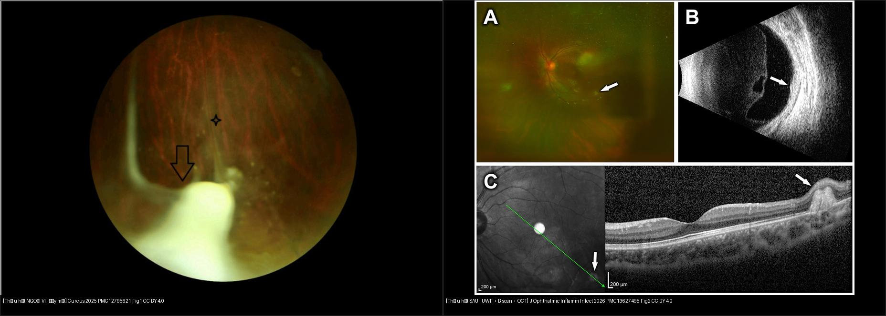
*Trái: **thể u hạt ngoại vi** — u hạt vàng–trắng vùng thái dương-dưới (mũi tên) + dây xơ và bao mạch (ngôi sao), hướng tới đĩa thị. Phải: **thể u hạt cực sau** — cùng một tổn thương nhìn bằng 3 phương thức: (A) ảnh góc siêu rộng, (B) B-scan (khối dày võng mạc tăng hồi âm, mũi tên), (C) OCT (nếp gấp/dày võng mạc, mũi tên). Nguồn: Cureus 2025 (PMC12795621) Fig. 1, CC BY 4.0 + J Ophthalmic Inflamm Infect 2026 (PMC13627495) Fig. 2, CC BY 4.0; ảnh ghép letterbox, giữ nguyên bản.*

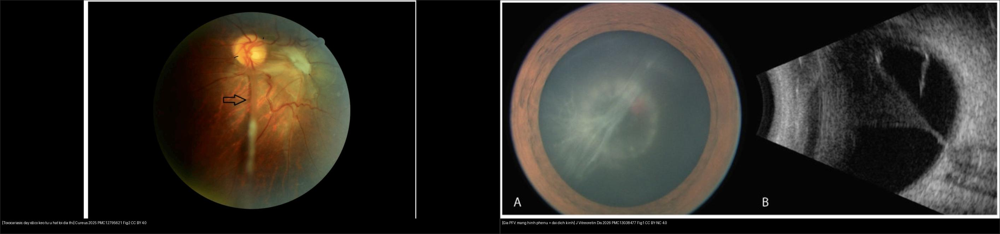
*Trái: **Toxocariasis** — dây xơ dày chạy từ u hạt ngoại vi tới đĩa thị, co kéo võng mạc (mũi tên). Phải: **màng giả PFV/PHPV** — ảnh tiền phòng (A) thấy dây màng trắng sau thuỷ tinh thể + B-scan (B) màng tăng hồi âm hình **phễu** từ đĩa thị tới bao sau thuỷ tinh thể. Khác biệt chốt: **OLM có u hạt + viêm**, PFV **không viêm**. Nguồn: Cureus 2025 (PMC12795621) Fig. 2, CC BY 4.0 + J Vitreoretin Dis 2026 (PMC13038477) Fig. 1, CC BY-NC 4.0; ảnh ghép letterbox, giữ nguyên bản.*

### Dấu hiệu chữ ký & đọc chuẩn xác
- **Dây co kéo (traction band) từ u hạt ra đĩa thị:** dấu mạnh nhất gợi OLM — gặp ở thể u hạt ngoại vi. Đừng nhầm với **màng co kéo sau bong võng mạc** (không có u hạt) hay **dây PFV** (không viêm, dính thuỷ tinh thể).
- **U hạt + viêm dịch kính:** hỗ trợ OLM; u hạt **im lặng, không viêm** vẫn có thể gặp ở thể ngoại vi.
- **FA có thể BỎ SÓT u hạt ngoại vi** khi bị màng sau thuỷ tinh thể che (ca PMC13038477: 2 u hạt hắc–võng mạc ở 5h và 6h **không thấy trên FA**, chỉ thấy khi mổ). → **không dựa FA đơn thuần để loại trừ**.

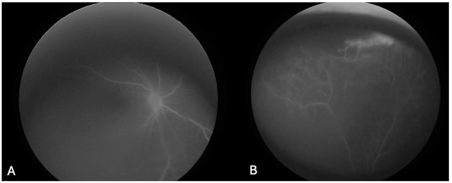
*FA thì sớm ở ca giả PFV: (A) **vô mạch dọc cuống dịch kính**; (B) **vùng vô mạch ngoại vi trên** kèm rò mao mạch. Nhắc lại: ở tổn thương **ngoại vi**, FA có thể bỏ sót nếu bị màng/đục che → cần **đè củng mạc + UBM + soi tới ora**. Nguồn: Parellada SE et al., J Vitreoretin Dis 2026 (PMC13038477), Fig. 2, CC BY-NC 4.0.*

## 4. Protocol chụp & xét nghiệm + hệ phân độ

- **Khám & chụp (giao thức):**
  - **Soi đáy mắt giãn đồng tử + đè củng mạc (scleral depression) tới ora serrata** — bắt buộc, vì u hạt ngoại vi nằm **trước xích đạo** dễ bị bỏ sót khi chỉ nhìn cực sau.
  - **Chụp ảnh đáy mắt / ảnh góc siêu rộng (UWF)** để theo dõi tổn thương & nếp gấp.
  - **Siêu âm B-scan:** u hạt tăng hồi âm dính võng mạc; **dây/băng tăng hồi âm từ đĩa thị**, di động hạn chế; phát hiện bong võng mạc co kéo. **UBM (siêu âm sinh học)** cho **pars plana** — vùng khó nhìn, đo được **kích thước u hạt**, màng cyclitic, bong thể mi.
  - **FA** đánh giá viêm mạch/tân mạch/rò; **OCT** đánh giá **CME, nếp gấp, bong thanh dịch, màng trước võng mạc**.
  - **CT/MRI hốc mắt** khi cần **loại trừ retinoblastoma** (tìm canxi hoá, lan ngoài nhãn cầu) trước mọi can thiệp.
- **Xét nghiệm (ngưỡng):**
  - **ELISA *Toxocara* IgG huyết thanh:** độ nhạy **~91%**, độ đặc hiệu **~90%**; **kết quả ÂM không loại trừ** OLM (Pivetti-Pezzi P, PMC2659485).
  - Nghi ngờ mà huyết thanh âm → **kháng thể kháng *Toxocara* dịch tiền phòng/dịch kính + hệ số Goldmann–Witmer** (chứng minh **sản xuất kháng thể nội nhãn**).
  - **Bạch cầu ái toan máu ngoại vi:** thường **nhẹ hoặc bình thường** ở thể **chỉ có mắt (OLM)**; tăng rõ hơn ở thể nội tạng (VLM) → **không dựa eosinophil để chẩn đoán/loại trừ**.
- **Điều trị (theo bậc):**
  - **Corticoid** (uống/tiêm quanh nhãn) là **nền tảng** kiểm soát viêm, giảm tạo màng co kéo — luôn cân nhắc "ô dù steroid" khi diệt ấu trùng (larvae chết làm viêm tăng).
  - **Thuốc diệt giun** (albendazole/mebendazole) — còn **tranh luận**, không dùng phổ quát; phối hợp "ô dù steroid".
  - **Laser** có vai trò hạn chế: diệt ấu trùng **di động thấy được** hoặc xử lý **màng tân mạch hắc mạc**.
  - **Anti-VEGF** khi có **tân mạch/CNV**; **phẫu thuật dịch kính (PPV)** khi **co kéo nặng/bong võng mạc/bục thuỷ tinh thể** — lưu ý **bong võng mạc tái phát sau mổ tới 24–42%** do viêm tồn dư.
  - **Phòng bệnh:** tẩy giun định kỳ cho chó mèo, hạn chế trẻ chơi đất/cát bẩn.

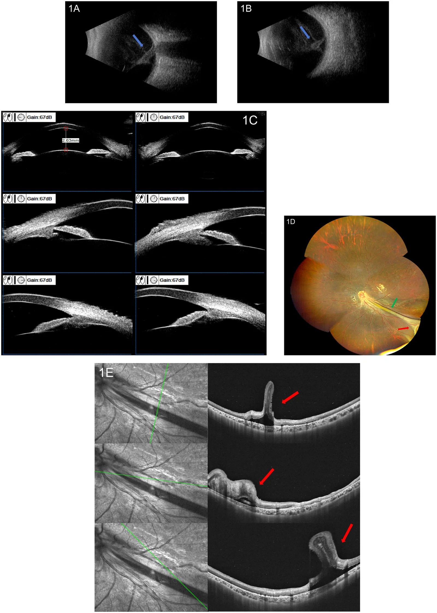
*B-scan (A,B): băng tăng hồi âm trung bình trong dịch kính, chạy từ **đĩa thị (A)** tới **thành nhãn cầu phía thái dương (B)**, di động hạn chế = co kéo dịch kính–võng mạc. UBM (C): montage theo giờ — bản đồ u hạt ngoại vi vùng pars plana. Nguồn: Chen J & Zhang L, Front Med 2026 (PMC13553358), Fig. 1, CC BY 4.0.*

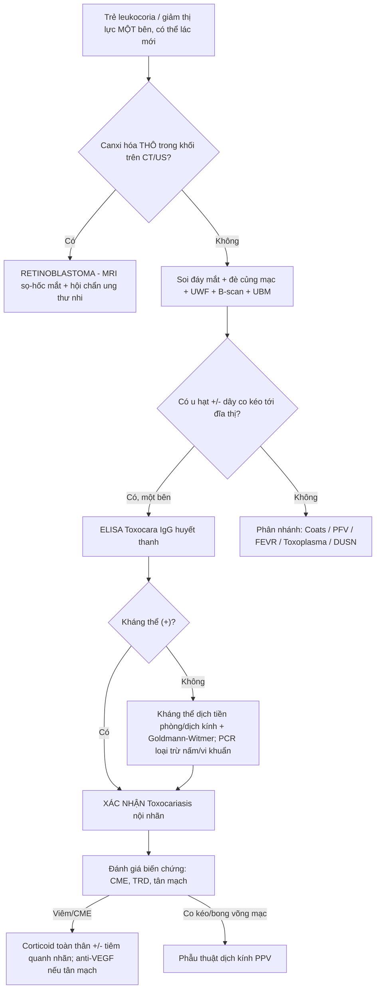

- **Phân độ:** bệnh **không có hệ phân độ RADS riêng**; mô tả theo **3 thể** (viêm nội nhãn mạn / u hạt cực sau / u hạt ngoại vi) và **mức biến chứng** (CME, nếp gấp, TRD). Tiên lượng gắn với thể: u hạt ngoại vi **có thể yên lặng** nhưng co kéo gây bong võng mạc muộn.

## 5. Biến thể bình thường và cạm bẫy

- **Cạm bẫy chết người:** **leukocoria/khối trong nhãn cầu ở trẻ = loại trừ retinoblastoma TRƯỚC TIÊN**. **Canxi hoá thô trong khối** = RB tới khi loại trừ; **OLM không canxi hoá điển hình**. **Không laser/đốt mắt khi chưa loại trừ RB** (nguy cơ gieo rắc).
- **Huyết thanh âm KHÔNG loại trừ OLM** → phải tìm kháng thể nội nhãn (dịch tiền phòng/Goldmann–Witmer). Ngược lại huyết thanh dương **không tự động** xác nhận OLM (nhiễm *Toxocara* huyết thanh khá phổ biến — **19%** dân số toàn cầu) → luôn gắn với hình thái đáy mắt.
- **Eosinophil máu thường bình thường ở thể chỉ có mắt** → đừng vì "eosinophil bình thường" mà bỏ chẩn đoán.
- **FA/soi đáy mắt cực sau có thể bỏ sót u hạt ngoại vi** (che bởi màng/đục) → **UBM + đè củng mạc tới ora** là cần thiết.
- **Toxocariasis hai bên là hiếm nhưng CÓ** — "một bên" không loại trừ tuyệt đối; khởi phát **hai mắt không đồng thì** và **bất đối xứng** là chìa khoá (PMC13627495).
- **Bong võng mạc tái phát sau mổ 24–42%** do viêm tồn dư → cần "ô dù steroid" và theo dõi lâu dài.
- **Cạm bẫy hình học:** dây co kéo từ u hạt **ra đĩa thị** (OLM) khác **màng co kéo hình phễu** của PFV (dính **thuỷ tinh thể**, không viêm) và khác **nếp gấp võng mạc bẩm sinh** (không u hạt, không tiền sử nhiễm).

## 6. Tự lượng giá — Blind Quiz

**Ca 1 — Bé trai 7 tuổi, mất thị lực trái tiến triển 3 tháng; nhà nuôi chó. Đáy mắt trái vùng thái dương-dưới:**

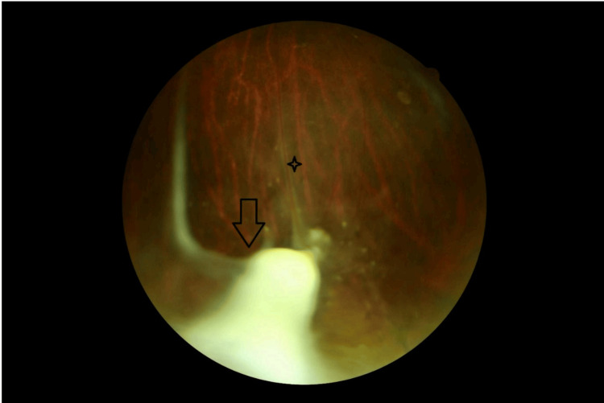

- Gợi ý lâm sàng: thị lực phải 20/20, trái "đếm ngón tay"; có RAPD; ELISA *Toxocara* dương.
- Hỏi: mô tả 2 dấu chính? Chẩn đoán & thể? DDx phải loại trừ trước?

<b>Bấm để hiện đáp án (findings + chẩn đoán)</b>

- Dấu hiệu (findings): **u hạt vàng–trắng vùng thái dương-dưới ngoại vi (mũi tên)** + **dây xơ (fibrous band)** + **bao mạch (vascular sheathing, ngôi sao)**.
- Chẩn đoán (diagnosis): **Toxocariasis nội nhãn — thể u hạt NGOẠI VI (kèm viêm mạch võng mạc ngoại vi)**. DDx phải loại trừ trước: **retinoblastoma** (tìm canxi hoá thô), Coats, PFV. Xác nhận: ELISA (+) + soi đáy mắt/UBM vùng pars plana.
- Nguồn ảnh: El Korno O et al., Cureus 2025, PMC12795621 Fig. 1, CC BY 4.0.

**Ca 2 — Cùng bệnh nhân, dây xơ co kéo rõ; FA vùng dưới:**

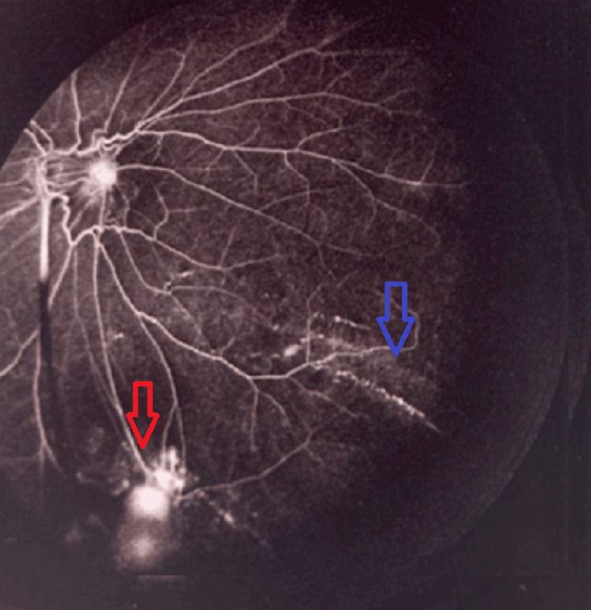

- Hỏi: trên FA thấy gì? Hệ quả lâm sàng là gì (cơ chế nào gây mất thị lực)?

<b>Bấm để hiện đáp án (findings + chẩn đoán)</b>

- Dấu hiệu (findings): **viêm mạch võng mạc ngoại vi hoạt động (mũi tên xanh)** rò + nhuộm thuốc vùng dưới, tương ứng **tân mạch võng mạc (mũi tên đỏ)**; có rò hoàng điểm lan toả.
- Ý nghĩa: đây là tổn thương **viêm mạch + tân mạch** (thể gây mất thị lực — viêm dịch kính nặng **52,6%**, CME **47,4%**, TRD **36,8%**). Xử trí: **corticoid** (nền) ± **anti-VEGF** cho tân mạch; laser cho vùng tân mạch.
- Nguồn ảnh: El Korno O et al., Cureus 2025, PMC12795621 Fig. 4, CC BY 4.0.

**Ca 3 — Bé 7 tuổi (mắt đối diện bình thường), OCT hoàng điểm mắt phải:**

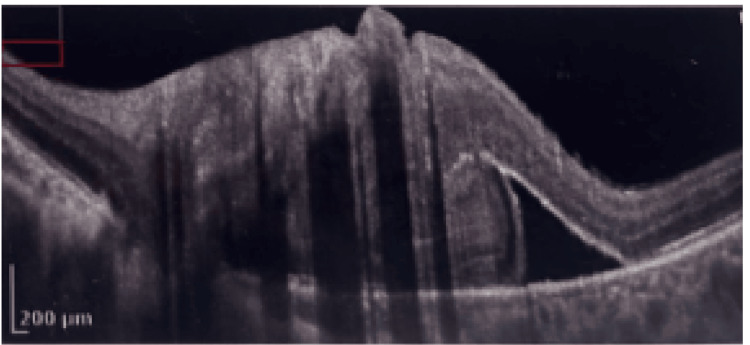

- Hỏi: OCT cho thấy biến chứng gì (thuộc nhóm nào ở mục 1)? Có phải u hạt không?

<b>Bấm để hiện đáp án (findings + chẩn đoán)</b>

- Dấu hiệu (findings): **bong thanh dịch dưới võng mạc** + **màng trước võng mạc (ERM) xơ** co kéo, gây dày hoàng điểm — tương ứng nhóm **phù hoàng điểm (47,4%) / co kéo**.
- Lưu ý: đây là **biến chứng ở cực sau**, **không phải u hạt** (u hạt nằm ngoại vi). Cho thấy OLM ngoại vi **vẫn có thể gây tổn thương hoàng điểm nặng** do viêm/co kéo.
- Nguồn ảnh: El Korno O et al., Cureus 2025, PMC12795621 Fig. 6, CC BY 4.0.

**Ca 4 — Ca-series toxocariasis HAI BÊN; u hạt thì có dấu gì trên UBM?**

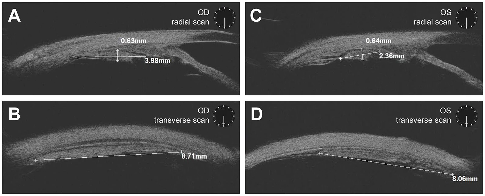

- Hỏi: UBM giúp thấy tổn thương ở vị trí nào mà soi đáy mắt thường bỏ sót? Đo được gì?

<b>Bấm để hiện đáp án (findings + chẩn đoán)</b>

- Dấu hiệu (findings): **u hạt dạng khối tăng hồi âm (hyperechoic), bờ rõ**, trục dài **xếp tiếp tuyến với thể mi** ở vùng **pars plana (vị trí 6 giờ)**, thấy **hai bên** (A,C = lát hướng tâm; B,D = lát ngang).
- Ý nghĩa: UBM cho **pars plana — trước xích đạo**, vùng soi đáy mắt khó tới; đo được kích thước (u hạt ngoại vi mắt đến trước **6,38 ± 1,69 mm** vs mắt đến sau **5,29 ± 1,77 mm**, p = 0,045).
- Nguồn ảnh: Gu J et al., J Ophthalmic Inflamm Infect 2026, PMC13627495 Fig. 1, CC BY 4.0.

**Ca 5 — U hạt cực sau: nhận diện trên 3 phương thức:**

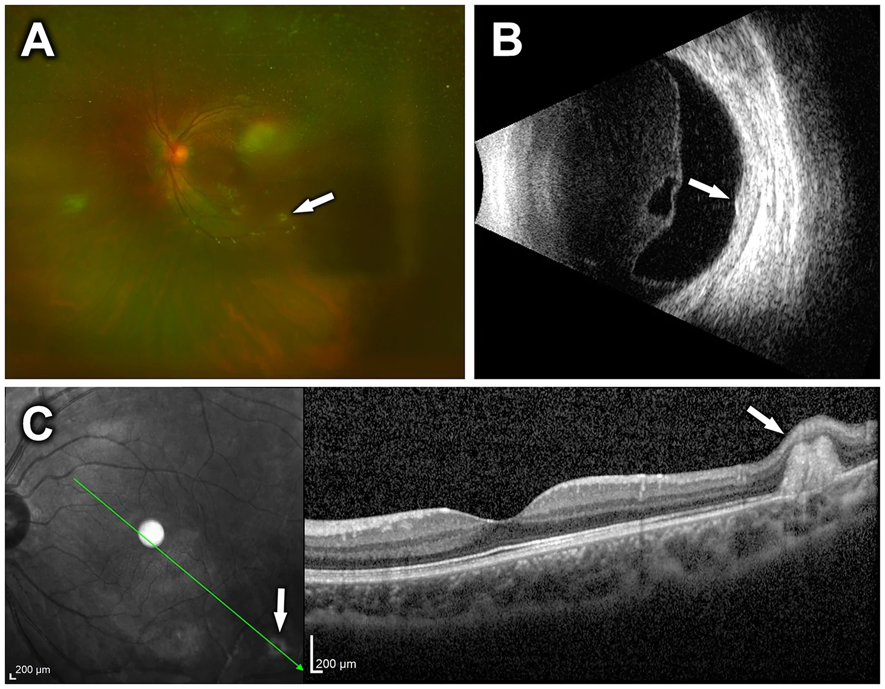

- Hỏi: trên ảnh góc siêu rộng (A) u hạt nằm ở đâu (nông/sâu)? B-scan (B) và OCT (C) bổ sung gì?

<b>Bấm để hiện đáp án (findings + chẩn đoán)</b>

- Dấu hiệu (findings): (A) khối **vàng, nằm sâu trong võng mạc** ở vùng cực sau (mũi tên); (B) B-scan: **dày võng mạc khu trú, hồi âm trung bình–cao** (mũi tên); (C) OCT: **nếp gấp/dày võng mạc** tại u hạt (mũi tên).
- Chẩn đoán (diagnosis): **u hạt cực sau (posterior pole granuloma)** — thể hay gặp 25–46%. Xác nhận: ELISA/huyết thanh nội nhãn.
- Nguồn ảnh: Gu J et al., J Ophthalmic Inflamm Infect 2026, PMC13627495 Fig. 2, CC BY 4.0.

**Ca 6 — Trẻ viêm màng bồ đào hai bên; ảnh góc siêu rộng mắt phải:**

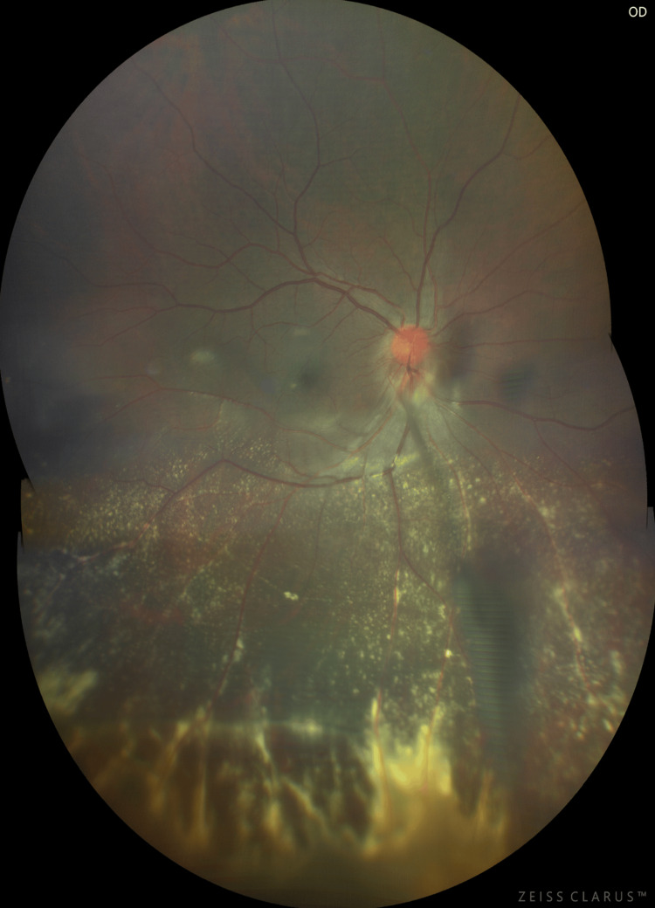

- Gợi ý lâm sàng: đau khớp, viêm màng bồ đào trước hai bên; đáy mắt phải viêm.
- Hỏi: dấu chính? Vì sao tổn thương này gợi nguyên nhân ký sinh (không phải viêm màng bồ đào tự miễn)?

<b>Bấm để hiện đáp án (findings + chẩn đoán)</b>

- Dấu hiệu (findings): đĩa thị sung huyết, **bao mạch võng mạc động–tĩnh mạch**, thâm nhiễm/xuất tiết vùng **ngoại vi dưới**, và **dây mạch xơ (fibrovascular stalk) từ đĩa thị chạy xuống vùng viêm nặng** nơi có **u hạt ngoại vi** (ấn đè củng mạc thấy u hạt bờ). FA: rò đĩa thị + nhuộm "hình cánh hoa" hoàng điểm + băng tăng huỳnh quang từ đĩa xuống dưới.
- Chẩn đoán (diagnosis): **Toxocariasis nội nhãn** (u hạt ngoại vi + dây xơ mạch) trên nền viêm màng bồ đào hai bên; nguyên nhân ký sinh **tạo u hạt + dây xơ**, khác viêm màng bồ đào tự miễn đơn thuần (không có u hạt kiểu này).
- Nguồn ảnh: Tanchuling RV et al., Cureus 2025, PMC12096418 Fig. 2, CC BY 4.0.

**Ca 7 — Hai đáy mắt: gọi tên cơ chế mỗi bên và cách phân biệt:**

- Hỏi: bên nào là **tổn thương ký sinh có u hạt + viêm**? Bên nào là **màng giả PFV không viêm**? Cái gì chốt?

<b>Bấm để hiện đáp án (findings + chẩn đoán)</b>

- **Trái = Toxocariasis (OLM):** dây xơ dày từ **u hạt ngoại vi** tới đĩa thị, co kéo võng mạc; **có u hạt + viêm**.
- **Phải = PFV/PHPV:** màng trắng sau thuỷ tinh thể (A) + màng tăng hồi âm **hình phễu** dính **đĩa thị → bao sau thuỷ tinh thể** (B); **không viêm, không u hạt**.
- **Chốt phân biệt:** **u hạt + dây co kéo tới đĩa thị + viêm = OLM**; **màng phễu dính thuỷ tinh thể, không viêm = PFV**. Luôn **loại trừ retinoblastoma** (canxi hoá thô) trước.
- Nguồn: Cureus 2025 (PMC12795621) CC BY 4.0 + J Vitreoretin Dis 2026 (PMC13038477) CC BY-NC 4.0.

## Bài liên quan chéo
- [400 – Tổng quan Mắt & thị giác](../400-tong-quan-mat-thi-giac/lesson.md) (bảng DDx mắt)
- [450 – Mắt nhi: ROP, Coats, PHPV](../450-mat-nhi/lesson.md)
- [412 – U trong nhãn cầu](../412-u-trong-nhan-cau/lesson.md) (retinoblastoma — loại trừ trước)
- [457 – Bệnh "giả ROP" ở trẻ đủ tháng (FEVR, Norrie, IP, Coats)](../457-benh-gia-rop-tre-du-thang/lesson.md)
- [448 – U hắc mạc](../448-u-hac-mac/lesson.md) (khối đặc trong nhãn cầu)
- [445 – Bong võng mạc](../445-bong-vong-mac/lesson.md) (co kéo vs rách nguyên phát)
- [446 – Phù hoàng điểm viêm vs DME](../446-phu-hoang-diem-viem/lesson.md) (CME — biến chứng của OLM)
- [411 – Siêu âm nhãn cầu](../411-sieu-am-nhan-cau/lesson.md) (B-scan/UBM)
- [463 – Viêm nội nhãn nội sinh do nấm](../463-viem-noi-nhan-noi-sinh-nam/lesson.md) (DDx thể viêm nội nhãn)

## Ảnh
- Tên file: `466_toxocariasis_<Dấu hiệu>_<Modality>_PMC*-Fig*-CCBY*.jpg`; nguồn + giấy phép từng ảnh trong `images/CREDITS.md`.
- Ảnh **CC BY-NC** (PMC13038477) dùng được **tạo tác phẩm phái sinh (ảnh ghép)**; ảnh ghép letterbox giữ nguyên bản. (Các ảnh CC BY-NC-ND như PMC12661507 nếu dùng chỉ **giữ nguyên bản**, không ghép.)
- AuntMinnie (Case of the Day): **chỉ dẫn link, không tải** (xem `sources.md`).

> Không dùng để chẩn đoán độc lập khi chưa có người hướng dẫn.
