# 467 — Norrie: tư vấn di truyền X-linked, chẩn đoán trước sinh & theo dõi điếc–phát triển / Norrie disease: X-linked genetic counselling, prenatal diagnosis & hearing–development surveillance

**Tags:** `pattern:gia-rop` `pattern:di-truyen-X` `pattern:bong-vong-mac` `vung:vong-mac` `vung:tai-trong` `protocol:tu-van-di-truyen` `protocol:chan-doan-truoc-sinh` `protocol:audiometry`
**Mức chắc chắn (certainty):** tổng hợp y văn (literature synthesis) — tổng hợp từ y văn mở 2019–2026 (Medicine CC BY; Front Aging Neurosci CC BY; Mol Genet Genomic Med CC BY; JCI Insight CC BY; Ann Neurol CC BY-NC; BMJ Paediatr Open CC BY-NC; Front Med CC BY); có gắn hình thái ca nguyên văn từ bài gốc nhưng nội dung nhóm tự biên.

## 1. Tổng quan bệnh học – cơ chế hình ảnh

- **Bệnh học (pathology):** **Norrie disease (ND)** là rối loạn di truyền **hiếm, liên kết X lặn** (X-linked recessive; **OMIM 310600**), do đột biến gen ***NDP*** ở **Xp11.3** mã hóa **norrin** (Norrin cystine knot growth factor). Norrin do **tế bào Müller võng mạc** tiết ra, **hoạt hóa đường tín hiệu Wnt chính tắc (canonical Wnt/β-catenin)** qua phức hợp thụ thể **FZD4–LRP5–TSPAN12** → điều khiển **sự hình thành mao mạch trong võng mạc**. Mất chức năng norrin → **mạch máu võng mạc KHÔNG mọc hết ra ngoại vi** → **giảm mạch máu võng mạc (retinal hypovascularization)** → **mù bẩm sinh** (do loạn sản võng mạc hai bên / bong võng mạc). Vì cùng một gen, ***NDP* còn gây FEVR liên kết X (nhẹ hơn, chỉ ở mắt)** — Norrie là **đầu nặng nhất** của cùng phổ.
- **Tại sao có ảnh hưởng ngoài mắt — cơ chế "ống mạch máu chung":** norrin/Wnt cũng điều hòa **mạch máu tai trong (stria vascularis)** và **thần kinh trung ương**. Ở ốc tai, **bệnh lý mạch máu ốc tai xuất hiện TRƯỚC khi mất thính lực** (rối loạn hàng rào máu–mê lộ → giảm điện thế nội dịch → tổn thương tế bào lông), **trong khi tế bào hạch xoắn ốc (spiral ganglion cells) còn bảo tồn** → đây là **cơ sở sinh lý cho ốc tai điện tử (cochlear implant)** hoạt động được về lý thuyết. Trên **MRI**, thấy **phù nội dịch (endolymphatic hydrops)** và **ngấm thuốc đa dây thần kinh sọ** (III, V, VIII, X).
- **TẠI SAO thấy được trên ảnh (vật lý, mô bệnh):**
  - **Chụp mạch huỳnh quang (FFA/WFFA):** vùng võng mạc **vô mạch KHÔNG ngấm thuốc** (không có mạch dẫn thuốc, hàng rào máu–võng mạc còn nguyên) → **tối**; **tân mạch rò thuốc** → **sáng muộn** (thoát thuốc).
  - **Siêu âm B-scan:** bong võng mạc dạng **phễu (funnel)** — dải **tăng echo**; **khối xơ–mạch sau thủy tinh thể** ("retrolental fibrovascular tissue").
  - **CT/US (thai–nhũ nhi):** **nhãn cầu nhỏ (microphthalmos)**, khối sau thủy tinh thể, **canxi hóa** (nếu có phải **loại trừ retinoblastoma** — bài [412](../412-u-trong-nhan-cau/lesson.md)).
  - **Audiometry:** mất thính lực **thần kinh giác quan tần số CAO trước**, kiểu **"thuyền" (boat-shaped ABR)**, có thể bất đối xứng, **tiến triển** theo tuổi.
- **Ngưỡng định lượng & dịch tễ (theo nguồn):**
  - **Tần suất ~1:100.000 trẻ sinh sống** (Cao *Front Med* 2026, PMC13070777).
  - **> 200 đột biến gây bệnh** ở *NDP* (Cao 2026); có thể **di truyền từ mẹ mang gen** hoặc **đột biến mới (de novo)** (Wang *Medicine* 2022, PMC8735801; đột biến c.22_25dupGCAT dị hợp tử thể mới).
  - **Mất thính lực thần kinh giác quan tiến triển ~30–50%** các ca (Cao 2026); **khởi phát thính lực xấu đi từ 5 tuổi, muộn tới 48 tuổi** (Bryant *JCI Insight* 2022, PMC8855802) — thường phát hiện ở **thập niên thứ hai** (Sowden *BMJ Paediatr Open* 2020, PMC7670942).
  - **Chẩm đoán muộn rất muộn:** nhiều trẻ đã **bong võng mạc toàn bộ** khi khám lần đầu (bài [457](../457-benh-gia-rop-tre-du-thang/lesson.md): **82% mắt stage 5** ở tuổi trung vị **2,5 tháng**).

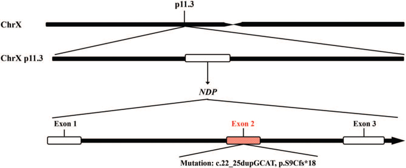
*Sơ đồ gen *NDP* (vị trí, cấu trúc exon) và protein norrin được mã hóa — norrin là **yếu tố dinh dưỡng mạch máu** cho võng mạc. Đột biến *NDP* → mạch võng mạc không mọc tới ngoại vi → mù bẩm sinh. Nguồn: Wang H et al., Medicine 2022, PMC8735801 Fig. 1, CC BY 4.0.*

## 2. Mẫu hình + chẩn đoán phân biệt theo KIỂU DI TRUYỀN (Gamut)

- **Mẫu hình cửa vào:** trẻ **TRAI, đủ tháng**, **mù/leukocoria hai bên từ lúc sinh**, có thể **chậm phát triển trí tuệ/co giật**, **gia đình có nam giới mù + điếc**; đáy mắt: khối loạn sản võng mạc dạng "pumpkin" vàng cam + bong võng mạc; siêu âm B-scan dạng phễu.
- **Phân nhóm theo cơ chế di truyền (thứ tự phải loại trừ):**
  1. **X-linked LẶN** (chỉ nam mắc; mẹ mang gen thường bình thường): **Norrie (NDP)**; **FEVR do NDP** (nhẹ hơn).
  2. **X-linked TRỘI** (gần như chỉ nữ; gây chết bào thai nam): **incontinentia pigmenti (IKBKG)** — da, răng, tóc, TKTW.
  3. **Trội/lặn NST thường:** **FEVR** (*FZD4, LRP5, TSPAN12, CTNNB1, KIF11*); **Coats plus** (*CTC1*, lặn) khi hai bên + bệnh hệ thống.
  4. **Không di truyền:** **Coats** (giãn mạch–xuất tiết, thường một bên, trai), viêm (toxocara), chấn thương.
  5. **KHỐI U — loại trừ TRƯỚC:** **retinoblastoma** (canxi hóa thô, < 5 tuổi, *RB1*).
- **Gợi nhớ khi nam mù + điếc:** **"NORRIE"** — **N**am giới · **O**cular (mù bẩm sinh hai bên) · **R**etinal detachment (dạng phễu) · **R**ecessive, X-linked · **I**nner-ear (điếc thần kinh tiến triển) · **E**xtra-neural (chậm phát triển/co giật) → **xét gen *NDP*, tầm soát cả mẹ**.

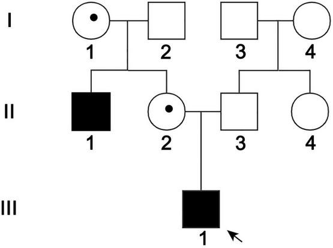
*Phả hệ Norrie: mũi tên đen = ca chỉ điểm (propositus); **II-1 và III-1 là nam bệnh**, **I-1 và II-2 là nữ MANG GEN** (heterozygous carrier), các thành viên khác bình thường. Đây là kiểu **X-linked lặn** — minh họa **50% nam mắc, 50% nữ mang gen** khi mẹ mang gen. Nguồn: Gong Y et al., Front Aging Neurosci 2022, PMC9062296 Fig. 1, CC BY 4.0.*

## 3. Bảng so sánh phân biệt (ma trận đối chiếu)

| Thực thể (entity) | Di truyền / gen | Chốt vào (rule-in) | Chốt loại (rule-out) | Gợi ý xác nhận |
|---|---|---|---|---|
| **Norrie (NDP)** | **X-linked lặn**, *NDP* Xp11.3 | **Nam, đủ tháng, mù bẩm sinh hai bên + điếc tiến triển + chậm phát triển** | Trẻ **nữ** đơn độc + da/răng (→ IP); FEVR nhẹ một mắt | **Xét gen *NDP* (NGS/exome; MLPA nếu nghi mất đoạn); audiometry; MRI não/nội tai** |
| **FEVR do NDP (thể nhẹ)** | X-linked (cùng gen) | **Vô mạch ngoại vi trên FA hai bên**, không điếc/không chậm phát triển | Điếc + chậm phát triển + bong toàn bộ → Norrie | WFFA + *NDP*; **tầm soát gia đình** |
| **Incontinentia pigmenti (IKBKG)** | **X-linked TRỘI**, *IKBKG* (NEMO) | **Bé GÁI** + tổn thương da vệt xoáy + răng/tóc dị dạng + WFFA bất thường | Nam (gần như không gặp; nếu có, nghi bất thường NST) | WFFA 1–3 tháng đầu; gen *IKBKG* |
| **Coats plus (CTC1)** | **Lặn NST thường** | **Coats-like HAI BÊN + vôi hóa/nang não + loãng xương/chảy máu tiêu hóa** | Một mắt, không bệnh hệ thống → Coats | Gen *CTC1*; MRI não; nội soi tiêu hóa (bài [465](../465-coats-plus-syndrome-ctc1/lesson.md)) |
| **Retinoblastoma (loại trừ trước)** | *RB1* (di truyền/không) | **Canxi hóa THÔ trong khối, < 5 tuổi** | Bong võng mạc + **không canxi + giãn mạch/xuất tiết** → Coats/giả ROP | **MRI sọ–hốc mắt + hội chẩn ung thư nhi** trước can thiệp |

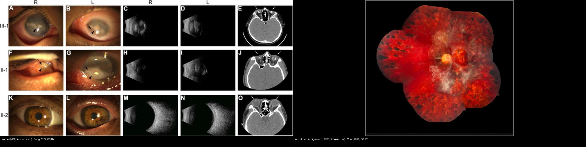
*Trái: **Norrie** — đáy mắt/tổn thương mắt của nam bệnh và dịch kính của **nữ mang gen** (một gia đình *NDP*), di truyền **X-linked lặn**. Phải: **incontinentia pigmenti** — bong võng mạc co kéo, di truyền **X-linked trội**. Cùng "con đường cuối" nhưng **khác kiểu di truyền, khác tư vấn gia đình**. Nguồn: Gong Y et al., Front Aging Neurosci 2022 (PMC9062296) Fig. 2, CC BY 4.0 + Moon JY et al., Ophthalmol Sci 2026 (PMC13425831) Fig. 2, CC BY 4.0; ảnh ghép letterbox, giữ nguyên bản.*

## 4. Protocol: tư vấn di truyền, chẩn đoán trước sinh & theo dõi

- **Xác nhận chẩn đoán & tìm đột biến:**
  - **Xét nghiệm gen *NDP*** (NGS/exome) khi có bong võng mạc hai bên ở trẻ trai đủ tháng (đặc biệt kèm điếc/chậm phát triển). **Nếu giải trình tự không phát hiện → dùng MLPA/qPCR tìm mất đoạn lớn** (đã gặp **mất đoạn lớn nhiều exon**, vd mất đoạn lớn *NDP* — Gong 2022; mất **exon 2–3** — Liu 2019).
  - **Phân độ mắt:** dùng bảng **Norrie cải tiến từ FEVR + ICROP3** (bài [457](../457-benh-gia-rop-tre-du-thang/lesson.md)) — stage 4 còn giá trị can thiệp; **stage 5 tiên lượng rất xấu**.
- **Tư vấn di truyền (genetic counselling) — các con số phải nói rõ:**
  - Nếu **mẹ là người mang gen (carrier)**: mỗi **con TRAI 50% mắc bệnh**, mỗi **con GÁI 50% mang gen**.
  - **Mẹ mang gen thường KHÔNG có biểu hiện** (kiểu hình bình thường) — nhưng đáy mắt/FA có thể có **vô mạch ngoại vi kín đáo** → **khám mẹ**.
  - **Đột biến mới (de novo)** vẫn xảy ra (Wang 2022) → có thể con đầu mắc nhưng mẹ không mang gen; nguy cơ tái phát khi đó thấp nhưng **không bằng 0** (khảm tuyến sinh dục).
- **Chẩn đoán trước sinh (prenatal) & trước làm tổ (PGD):**
  - **Lấy dịch ối/chọc gai nhau (amniocentesis/CVS)** để tìm đột biến *NDP* đã biết trong gia đình — đây là **phương pháp chốt** (Liu 2019: ca 1 thai nhi **không mang** đột biến → thai bình thường; ca 3 thai nhi **NỮ mang mất đoạn exon 2–3** → vẫn sinh bình thường vì là **người mang gen**).
  - **Siêu âm thai** có thể thấy **nhãn cầu đối xứng, thủy tinh thể trong, dịch kính sáng** (bình thường) hoặc bất thường — **nhưng siêu âm bình thường KHÔNG loại trừ** (case 3: thai mang gen, siêu âm bình thường).
  - **Chẩn đoán di truyền trước làm tổ (PGD)** để **chặn truyền gen giữa các thế hệ** (Gong 2022).
- **Theo dõi thính lực – phát triển – hỗ trợ (safety-net suốt đời):**
  - **Audiometry sớm ngay sau chẩn đoán** + **định kỳ** (đo cả mất thính lực dưới ngưỡng), vì thính lực xấu đi **âm thầm** từ **5 tuổi tới 48 tuổi**.
  - **Máy trợ thính / dụng cụ xúc giác-rung (vibro-tactile)**; **ốc tai điện tử (cochlear implant)** — nhiều bệnh nhân dùng và cho kết quả tích cực, cơ sở sinh lý vì **tế bào hạch xoắn ốc còn bảo tồn**.
  - **Theo dõi phát triển – thần kinh**: chậm phát triển, **co giật**, vấn đề tâm lý/hành vi; **phòng khám đôi giác quan (Dual Sensory clinic)** giảm số buổi hẹn và cải thiện phối hợp chăm sóc.
  - **Điều trị mắt:** không có điều trị phục hồi mù bẩm sinh; can thiệp nhằm **bảo tồn chút thị lực còn lại** (laser/mổ ở stage 4). **Gene therapy (AAV-norrin) đang tiền lâm sàng** (Dillinger *Mol Ther Adv* 2026, PMC13355717).

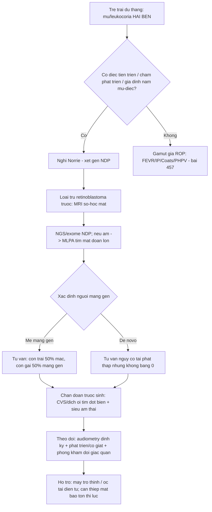

## 5. Biến thể bình thường và cạm bẫy

- **Mẹ mang gen "trông bình thường":** người nữ mang gen *NDP* **thường không có triệu chứng**, nhưng có thể có **vô mạch ngoại vi kín đáo trên FA** — **đáy mắt bình thường KHÔNG loại trừ mang gen**; phải xét gen mẹ.
- **Siêu âm thai bình thường KHÔNG loại trừ Norrie:** thai nhi có thể mang đột biến (nhất là **thai nữ mang gen**) mà siêu âm hoàn toàn bình thường → **kết luận phải dựa vào xét nghiệm gen**, không dựa vào hình ảnh thai.
- **Nhầm "ROP":** Norrie xảy ra ở trẻ **ĐỦ tháng** — gọi "ROP" ở trẻ không sinh non là **bỏ sót bệnh di truyền + bỏ sót tầm soát gia đình + bỏ sót retinoblastoma**.
- **Bỏ sót phần ngoài mắt:** khám mắt xong dừng lại → bỏ sót **điếc** (thứ bệnh nhân sợ mất nhất sau khi đã mù) và **chậm phát triển/co giật**; cần **audiometry + theo dõi phát triển** ngay.
- **Tiên lượng "muộn không cứu":** phần lớn trẻ đã **stage 5** khi chẩn đoán → **giá trị lớn nhất của chẩn đoán sớm nằm ở TƯ VẤN DI TRUYỀN & chẩn đoán trước sinh**, hơn là cứu thị lực của trẻ bệnh.
- **Đừng quên **canxi hóa**:** bất kỳ khối trong nhãn cầu ở trẻ nhỏ có **canxi hóa thô** phải **loại trừ retinoblastoma trước** mọi can thiệp (bài 412).

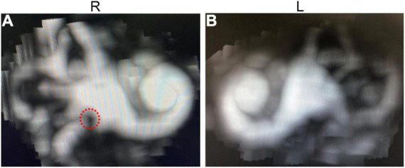
*MIP MRI sau tiêm gadolinium: vòng tròn đỏ = **túi nhỏ tiền đình (saccule) căng giãn** (phù nội dịch) ở cả hai tai — biểu hiện **bệnh lý tai trong** của Norrie. Nguồn: Gong Y et al., Front Aging Neurosci 2022, PMC9062296 Fig. 4, CC BY 4.0.*

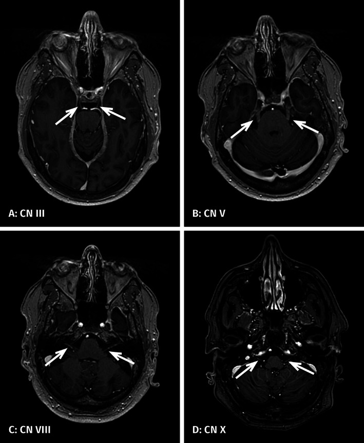
*Ngấm thuốc gadolinium các dây thần kinh sọ **III, V, VIII và X** trên T1W — biểu hiện thần kinh ngoài mắt của Norrie (nhấn mạnh: đó là **bệnh hệ thống có bệnh lý mạch máu–hàng rào**, không chỉ ở mắt). Nguồn: Jokela M et al., Ann Neurol 2022, PMC9299797 Fig. 1, CC BY-NC 4.0.*

## 6. Tự lượng giá — Blind Quiz

**Ca 1 — Trẻ trai đủ tháng, phả hệ có hai nam mù; mẹ không triệu chứng. Kết quả giải trình tự gen:**
> *NDP*: biến thể mất đoạn — gen vắng trên nhiễm sắc thể X của mẹ.

- Hỏi: kiểu di truyền? Nguy cơ cho con trai/con gái tiếp theo? Bước tiếp theo cho thai kỳ sau?

<b>Bấm để hiện đáp án (findings + chẩn đoán)</b>

- Chẩn đoán (diagnosis): **Norrie disease — mẹ là người mang gen (carrier)**.
- Tư vấn: mỗi **con trai 50% mắc**; mỗi **con gái 50% mang gen**. For next pregnancy: **chẩn đoán trước sinh bằng chọc ối/CVS** tìm đột biến *NDP*, hoặc **PGD**.
- Cơ chế: Norrin–Wnt mất chức năng → mạch võng mạc không mọc ra ngoại vi → mù bẩm sinh; tế bào hạch xoắn ốc còn bảo tồn → tiềm năng ốc tai điện tử.
- Nguồn hình: Gong Y et al., Front Aging Neurosci 2022, PMC9062296; Liu J et al., Mol Genet Genomic Med 2019, PMC6382493.

**Ca 2 — Phả hệ và đáy mắt của gia đình Norrie (nữ mang gen vs nam bệnh):**

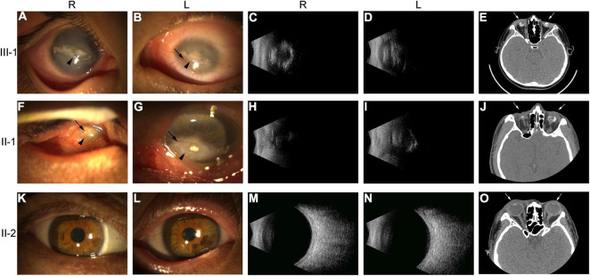

- Hỏi: mắt nào là **người bệnh**, mắt nào là **người mang gen**? Vì sao phải khám mẹ?

<b>Bấm để hiện đáp án (findings + chẩn đoán)</b>

- Dấu hiệu (findings): **người bệnh (nam)**: tân mạch, keratoleukoma, dịch kính đục nặng, CT nhãn cầu; **người mang gen (nữ)**: có thể có **bất thường nhẹ** (mũi tên = tân mạch; đầu mũi tên = keratoleukoma) nhưng **phần lớn không triệu chứng**.
- Chẩn đoán: **Norrie X-linked lặn** — mẹ mang gen vẫn cần **khám lại + xét gen** vì "bình thường lâm sàng" không loại trừ.
- Nguồn ảnh: Gong Y et al., Front Aging Neurosci 2022, PMC9062296 Fig. 2, CC BY 4.0.

**Ca 3 — Theo dõi thính lực ở nhiều bệnh nhân Norrie:**

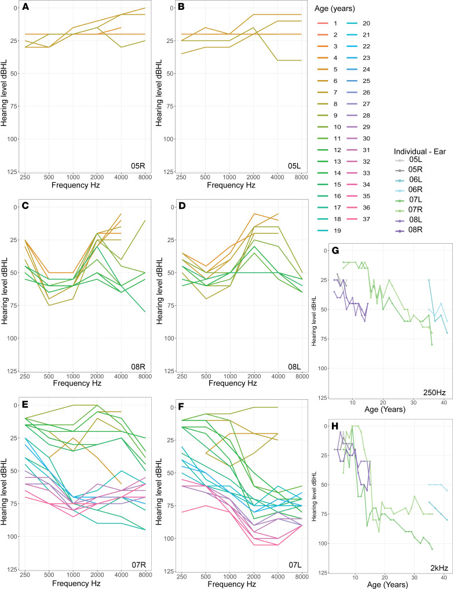

- Hỏi: mất thính lực bắt đầu ở **tần số nào**? Khi nào bắt đầu? Vì sao cần theo dõi cả đời?

<b>Bấm để hiện đáp án (findings + chẩn đoán)</b>

- Dấu hiệu (findings): mất thính lực **tần số CAO trước**, khởi phát **rất sớm và tiến triển**; mức độ có thể nhẹ–bất đối xứng; ABR thường **"boat-shaped"**.
- Chẩn đoán: **điếc thần kinh giác quan tiến triển do Norrie**, khởi phát **từ 5 tuổi, muộn tới 48 tuổi**; bệnh lý **mạch máu ốc tai xuất hiện TRƯỚC** mất thính lực → **cửa sổ can thiệp sớm**.
- Nguồn ảnh: Bryant D et al., JCI Insight 2022, PMC8855802 Fig. 1, CC BY 4.0.

**Ca 4 — Chẩn đoán trước sinh: phả hệ + mất đoạn gen ở thai nhi:**

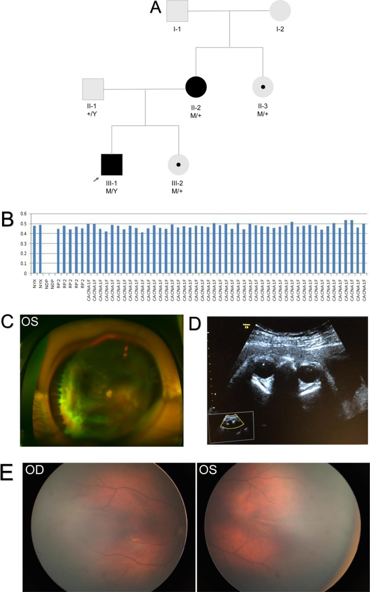

- Hỏi: làm sao khẳng định thai nhi có mắc bệnh? Siêu âm thai bình thường có loại trừ được không? Vì sao thai **nữ** mang đột biến vẫn sinh bình thường?

<b>Bấm để hiện đáp án (findings + chẩn đoán)</b>

- Dấu hiệu (findings): phả hệ gia đình 3 + **phát hiện mất đoạn hai exon** trên gen *NDP*; siêu âm thai cho thấy **nhãn cầu đối xứng, thủy tinh thể trong**.
- Chẩn đoán: **thai nhi mang mất đoạn *NDP*** — nhưng là **thai NỮ** → **người mang gen**, kiểu hình thường bình thường → sinh bình thường. **Siêu âm bình thường KHÔNG loại trừ**; phải **xác nhận bằng xét nghiệm gen**.
- Nguồn ảnh: Liu J et al., Mol Genet Genomic Med 2019, PMC6382493 Fig. 3, CC BY 4.0.

**Ca 5 — Lộ trình chẩn đoán & theo dõi Norrie (quản lý đa chuyên khoa):**

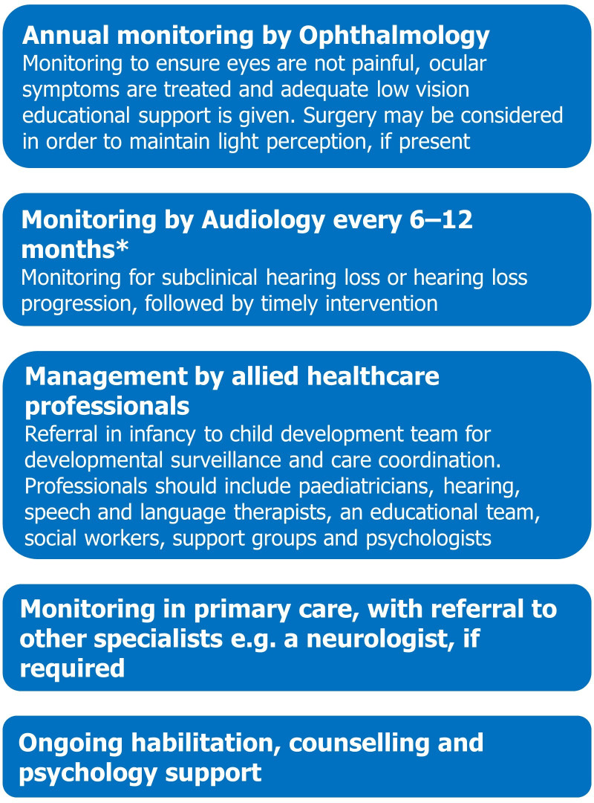

- Hỏi: liệt kê các mục theo dõi thiết yếu ngoài mắt; khi nào cần phòng khám đôi giác quan?

<b>Bấm để hiện đáp án (findings + chẩn đoán)</b>

- Dấu hiệu/nội dung: lộ trình gồm **đánh giá thính lực (kể cả mất dưới ngưỡng)**, **thần kinh/phát triển**, **co giật**, **tâm lý–hành vi**, hỗ trợ **máy trợ thính/ốc tai điện tử**.
- Ý nghĩa: cần **theo dõi suốt đời**; **phòng khám đôi giác quan (Dual Sensory clinic)** phối hợp mắt–tai–phát triển, giảm gánh nặng đi lại, cải thiện chăm sóc — nhất là khi **điếc tiến triển trên nền đã mù**.
- Nguồn ảnh: Sowden JC et al., BMJ Paediatr Open 2020, PMC7670942 Fig. 4, CC BY-NC 4.0.

Lợi ích của phòng khám đôi giác quan:

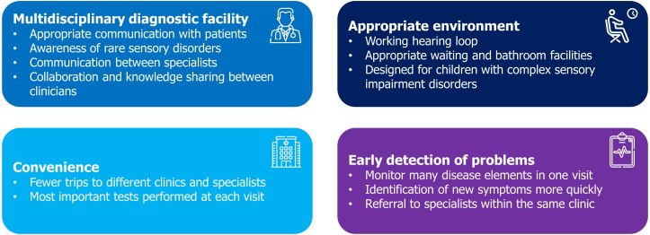
*Sơ đồ tổng hợp lợi ích của **Dual Sensory clinics** cho bệnh nhân Norrie: phối hợp đa chuyên khoa, giảm số buổi hẹn/di chuyển, hỗ trợ tâm lý xã hội. Nguồn: Sowden JC et al., BMJ Paediatr Open 2020, PMC7670942 Fig. 5, CC BY-NC 4.0.*

## Bài liên quan chéo
- [400 – Tổng quan Mắt & thị giác](../400-tong-quan-mat-thi-giac/lesson.md)
- [457 – Bệnh "giả ROP" ở trẻ đủ tháng: FEVR, Norrie, incontinentia pigmenti & Coats](../457-benh-gia-rop-tre-du-thang/lesson.md) (chẩn đoán/hình ảnh Norrie)
- [456 – Bệnh võng mạc trẻ sinh non (ROP)](../456-benh-vong-mac-tre-sinh-non/lesson.md) (phân biệt: sinh non vs đủ tháng)
- [412 – U trong nhãn cầu (retinoblastoma — loại trừ trước)](../412-u-trong-nhan-cau/lesson.md)
- [465 – Coats plus (CTC1): Coats-like hai bên + vôi hóa/nang não](../465-coats-plus-syndrome-ctc1/lesson.md)
- [439 – Teo thị di truyền: DOA/OPA1 & Wolfram](../439-teo-thi-di-truyen/lesson.md) (bệnh di truyền mắt–thần kinh khác)
- [437 – Teo thị kèm ĐIẾC: DOA+/OPA1 & WFS1 trội](../437-teo-thi-kem-diec/lesson.md) (mù + điếc không do NDP)

## Ảnh
- Tên file: `467_norrie_<nội dung>_<PMCID>-Fig<n>-<License>.jpg`; nguồn + giấy phép từng ảnh trong `images/CREDITS.md`.
- Ảnh **CC BY-NC** (PMC9299797, PMC7670942) và **CC BY** giữ **nguyên bản**; ảnh ghép chỉ dùng nguồn cho phép tạo tác phẩm phái sinh (CC BY) — letterbox, giữ nguyên bản.

> Không dùng để chẩn đoán độc lập khi chưa có người hướng dẫn.
