# 468 — Sàng lọc ROP từ xa (tele-ROP) & trí tuệ nhân tạo / Tele-ROP screening & artificial intelligence

**Tags:** `pattern:rop` `vung:vong-mac` `score:ICROP` `protocol:tele-ROP` `protocol:AI-sang-loc-ROP`
**Mức chắc chắn (certainty):** tổng hợp y văn (literature synthesis) — nhóm tự biên từ y văn mở (Saudi J Ophthalmol 2022 CC BY-NC-SA; Eye Brain 2016 CC BY-NC; Sci Rep 2019 CC BY; JAMA Netw Open 2021 CC BY; J Ophthalmol 2021 CC BY; Diagnostics 2021 CC BY; Ophthalmol Sci 2022 CC BY-NC-ND; BMC Ophthalmol 2021 CC BY), chưa gắn một ca nguyên văn đơn lẻ.

## 1. Tổng quan — vì sao ROP phải "ra khỏi" phòng khám chuyên gia

- **Bối cảnh (pathology – epidemiology):** ROP vẫn là **nguyên nhân mù có thể điều trị hàng đầu ở trẻ em**. Khi hồi sức sơ sinh lan rộng ở nước thu nhập trung bình mà hạ tầng sàng lọc không theo kịp, xuất hiện **"đại dịch ROP thứ ba"** (Tan Z et al., *Saudi J Ophthalmol* 2022, PMC9583350). Nghịch lý vận hành: **gánh nặng đọc ảnh rất lớn nhưng sản lượng điều trị rất thấp** — chỉ khoảng **1–2%** trẻ được sàng lọc cần điều trị (bài [456](../456-benh-vong-mac-tre-sinh-non/lesson.md)), nên "mỗi giờ bác sĩ chuyên gia" là tài nguyên khan hiếm nhất.
- **Ba phương thức sàng lọc** (Tan Z, PMC9583350): **soi đáy mắt gián tiếp hai mắt (binocular indirect ophthalmoscopy — BIO)**; **chụp ảnh võng mạc số góc rộng (wide-field digital retinal imaging — WFDRI)**; và **sàng lọc từ xa (teleophthalmology / tele-ROP)**. BIO là "chuẩn vàng" nhưng có **3 hạn chế cấu trúc**: (1) độ đồng thuận giữa người khám thấp (interoperator agreement), (2) khó mở rộng quy mô (scalability), (3) rào cản địa lý — đây chính là 3 khe hở mà **ảnh số hóa + tele-ROP + AI** lấp vào.
- **TẠI SAO ảnh võng mạc trẻ non lại khó (cơ chế hình ảnh):** võng mạc chưa mạch hóa hoàn toàn nằm ở **ngoại vi cực trước xích đạo** → muốn thấy ranh giới mạch/vô mạch phải có **góc rộng thật**; môi trường trong suốt thường **đục nhẹ** (mờ dịch kính, sương giác mạc do ấn đầu dò), **đồng tử nhỏ**, trẻ **cử động** → ảnh hay mờ, lệch sáng, cháy (glare). **Bản thân đậm độ/tín hiệu không phải vấn đề** (ảnh quang học màu), cái quyết định là **độ phân giải ranh giới mạch–vô mạch và mức vằn xoắn mạch cực sau** (plus disease).
- **Ngưỡng định lượng nằm lòng:**
  - **Tiêu chí sàng lọc:** mọi trẻ **tuổi thai ≤ 30 tuần VÀ/HOẶC cân nặng sinh ≤ 1500 g**; mở rộng cho **30–32 tuần hoặc 1500–2000 g có yếu tố nguy cơ** (hỗ trợ hô hấp, tim mạch…). Tiêu chí **rất khác nhau giữa các quốc gia**, dù cùng nhóm thu nhập thì thường giống nhau (Tan Z, PMC9583350).
  - **Chụp ảnh chuẩn:** bộ **5–6 ảnh** kinh điển (cực sau quanh đĩa thị + thái dương, mũi, trên, dưới + ảnh ngoài nhãn cầu) (Thanos A et al., *Eye Brain* 2016, PMC5398746).
  - **Điện thoại so với máy chuẩn:** trường nhìn của **chụp đáy mắt bằng điện thoại (smartphone-based fundus imaging — SBFI)** chỉ bằng **khoảng 1/2,5 (tỷ lệ đường kính 1:2,5)** so với máy tiếp xúc, nhưng **độ chi tiết tương đương**, thời gian khám dài hơn (**109,0 ± 57,8 giây** so với **75,9 ± 36,3 giây**, p < 0,01) (Wintergerst MWM et al., *Sci Rep* 2019, PMC6928229).
  - **Hiệu năng AI gộp (meta-analysis):** 9 nghiên cứu / 15 bộ phân loại — **độ nhạy gộp 0,953** (KTC 95% 0,946–0,959), **độ đặc hiệu gộp 0,975** (0,973–0,977), **AUC đường SROC 0,984** (0,978–0,989) (Zhang J et al., *J Ophthalmol* 2021, PMC8363465).
  - **Thang độ nặng mạch máu (vascular severity score — VSS):** do AI gán **từ 1 đến 9**, tăng dần theo mức ICROP; VSS gắn chặt với plus disease và ROP cần điều trị (Cole E et al., *Ophthalmol Sci* 2022, PMC9754980).

## 2. Mẫu hình + chẩn đoán phân biệt theo "nút thắt" (gamut theo công suất)

Mẫu hình không phải "một tổn thương" mà là **một chuỗi giá trị (workflow)**; DDx ở đây là **chọn nút thắt nào để can thiệp**.

- **Nút thắt 1 — thiếu camera:** xử lý bằng **WFDRI giá rẻ** hoặc **SBFI** (điện thoại + thấu kính Pan Retinal 2.2, không tiếp xúc). SBFI hy sinh **trường nhìn** để đổi lấy **chi phí và tính di động** (Wintergerst MWM, PMC6928229).
- **Nút thắt 2 — thiếu chuyên gia đọc:** xử lý bằng **AI triage** (lọc ảnh bình thường để chuyên gia chỉ đọc ca nghi ngờ) và **bản đồ nhiệt giải thích (explainable AI)** để tăng tin cậy (Wang J et al., *JAMA Netw Open* 2021, PMC8100867).
- **Nút thắt 3 — thiếu mạng lưới tiếp cận:** xử lý bằng **nền tảng đặt hẹn/tư vấn qua điện thoại** (ví dụ WeChat): trong đại dịch, **tỷ lệ hoàn thành lịch hẹn trực tuyến 58,1% so với 22,1% đối với hẹn trực tiếp** (p = 0,018) và số trẻ được sàng lọc **năm 2020 (54 trẻ) không giảm** so với 2019 (51 trẻ) (Guo Z et al., *BMC Ophthalmol* 2021, PMC8192130).
- **Chuỗi tele-ROP điển hình** (Tan Z, PMC9583350): xác định trẻ theo tiêu chí → chụp ảnh, **đưa lên cơ sở dữ liệu chia sẻ** → (nếu có) **CBIA/AI sàng lọc ảnh** → nghi ROP? → **chuyên gia đọc** → xác định ROP → **xuất viện hoặc theo dõi tiếp**.

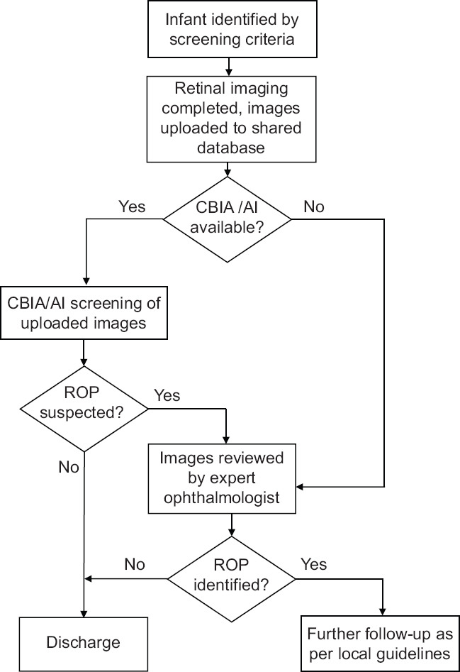
*Sơ đồ luồng: trẻ đủ tiêu chí → ảnh đưa lên cơ sở dữ liệu chia sẻ → có CBIA/AI? → AI sàng lọc → nghi ROP? → chuyên gia đọc → xác định ROP? → xuất viện / theo dõi. Nguồn: Tan Z et al., Saudi J Ophthalmol 2022, PMC9583350 Fig. 5, CC BY-NC-SA 4.0 (giữ nguyên bản).*

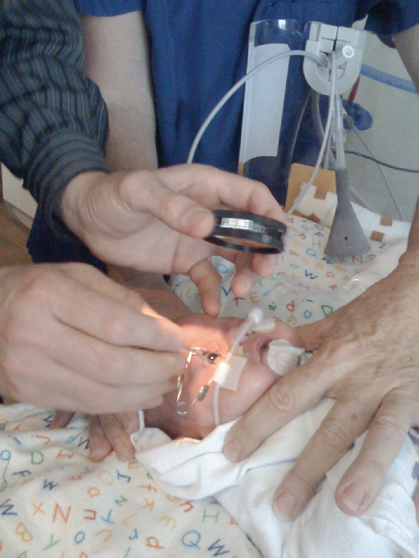
*BIO với thấu kính cầm tay trên trẻ sơ sinh: mở van banh mi, đèn soi trực tiếp. Hạn chế: khó mở rộng, tốn chuyên gia. Nguồn: Tan Z et al., PMC9583350 Fig. 2, CC BY-NC-SA 4.0 (giữ nguyên bản).*

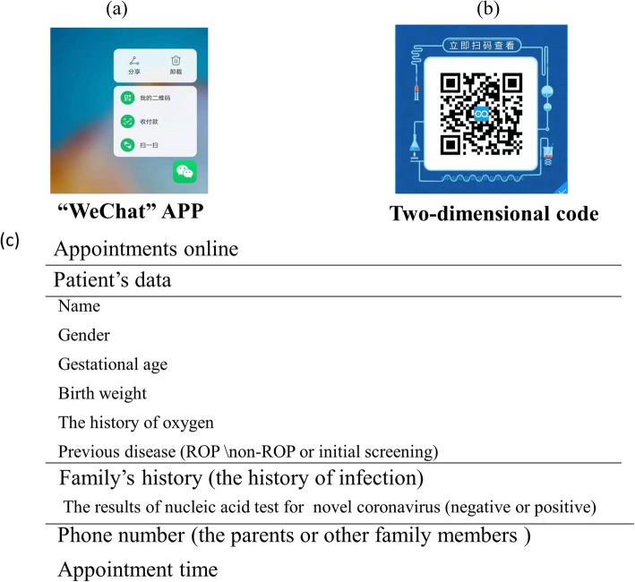
*Giao diện ứng dụng đặt hẹn khám ROP trên điện thoại/máy tính bảng. Nguồn: Guo Z et al., BMC Ophthalmol 2021, PMC8192130 Fig. 1, CC BY 4.0.*

## 3. Bảng so sánh phân biệt (ma trận đối chiếu)

| Phương thức (entity) | Hình ảnh/đầu ra điển hình | Chốt vào (rule-in) | Chốt loại (rule-out) | Gợi ý xác nhận |
|---|---|---|---|---|
| Soi đáy mắt gián tiếp (BIO) | Quan sát động, không có ảnh lưu | **Bất kỳ mức non nào + cần đánh giá động/3D tại giường** | Không thể lưu ảnh để hội chẩn từ xa → khó audit | Chuẩn vàng; nhưng đồng thuận giữa người khám thấp |
| Chụp số góc rộng (WFDRI: RetCam, 3nethra) | Ảnh màu góc rộng nhiều ô, thấy tới ngoại vi | **Ảnh góc rộng thấy ranh giới mạch/vô mạch + vằn mạch cực sau** | Trường nhìn hẹp/ảnh mờ không tới ngoại vi → không loại trừ được ROP ngoại vi | So khớp ảnh ICROP; lưu trữ + hội chẩn từ xa |
| Chụp đáy mắt bằng điện thoại (SBFI) | Ảnh tròn nhỏ, trường nhìn **~1/2,5** máy chuẩn | **Nguồn lực thấp + cần cơ động**; đồng thuận plus κ 0,88, giai đoạn κ 0,81 | **Trường nhìn nhỏ** → dễ bỏ sót tổn thương ngoại vi (zone II–III xa) | So với CFI: Se/Sp plus **90%/100%**, ROP **88%/93%** |
| AI triage (học sâu) | Điểm số/VSS 1–9 + bản đồ nhiệt | **AUC 0,98–0,999 cho plus/ROP** → lọc ca bình thường | **Dịch chuyển miền (domain shift)** khi đổi máy/chủng tộc → âm tính giả | Đọc lại bởi chuyên gia khi AI dương/không chắc |
| Tele-ROP lai (AI + chuyên gia) | Chuỗi workflow có nhánh AI | **Nghi ROP → chuyển chuyên gia → theo dõi/xuất viện** | **AI âm nhưng ảnh chất lượng kém** → không được xuất viện | Cơ sở dữ liệu chia sẻ + lịch theo dõi theo guideline địa phương |

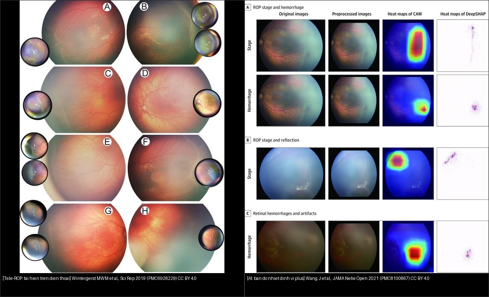
*Trái: tái hiện ROP bằng điện thoại (ảnh lớn = máy chuẩn, ảnh nhỏ = SBFI). Phải: bản đồ nhiệt AI (CAM/DeepSHAP) định vị vùng quyết định "giai đoạn" và "xuất huyết". Nguồn: Wintergerst MWM et al., Sci Rep 2019 (PMC6928229) CC BY 4.0 + Wang J et al., JAMA Netw Open 2021 (PMC8100867) CC BY 4.0. Ảnh ghép letterbox, giữ nguyên bản.*

### Bảng phụ — hiệu năng định lượng của các hệ AI (để so sánh "chốt" bằng số)

| Hệ thống | Nguồn | Đầu ra | Độ nhạy / độ đặc hiệu / AUC |
|---|---|---|---|
| i-ROP DL (VSS 1–9) | Cole E, PMC9754980 | plus disease; VSS | AUC **0,999 (Nepal)** / **0,968 (Mongolia)** |
| Nền tảng đa chiều 4 bộ phân loại | Wang J, PMC8100867 | stage, xuất huyết, pre-plus/plus, RW-ROP | AUC **0,983–0,998**; hệ chuyển tuyến AUC **0,9901–0,9956** |
| Gộp 9 nghiên cứu / 15 bộ phân loại | Zhang J, PMC8363465 | phân loại + phân độ | Se gộp **0,953**; Sp gộp **0,975**; SROC AUC **0,984** |
| DIAROP (ResNet+Inception+FWHT) | Attallah O, PMC8620568 | bệnh / không bệnh | độ chính xác **93,2%**; AUC **0,98** |

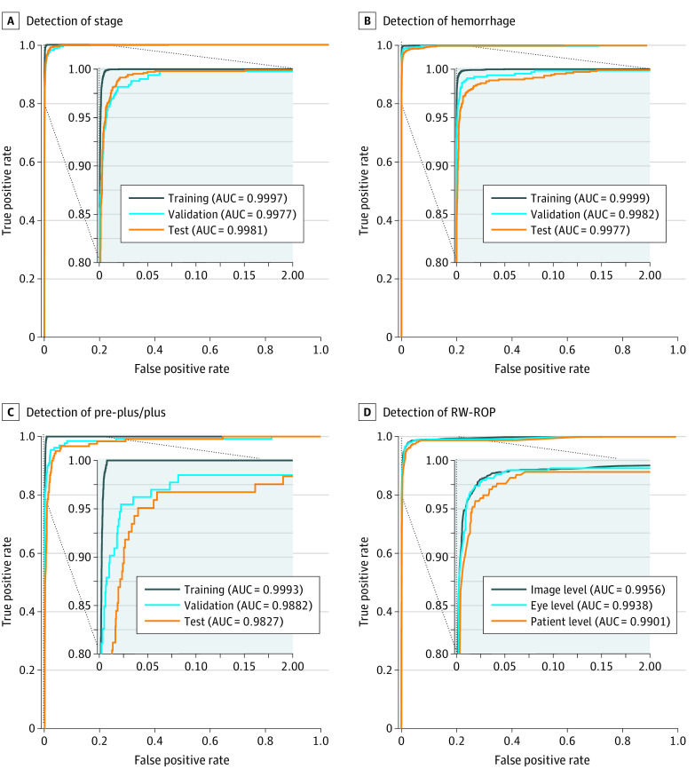
*Bốn bộ phân loại độc lập: (A) giai đoạn, (B) xuất huyết, (C) pre-plus/plus, (D) ROP cần chuyển tuyến (RW-ROP). AUC huấn luyện/kiểm định/kiểm tra đều ~0,98–0,999. Nguồn: Wang J et al., JAMA Netw Open 2021, PMC8100867 Fig. 1, CC BY 4.0.*

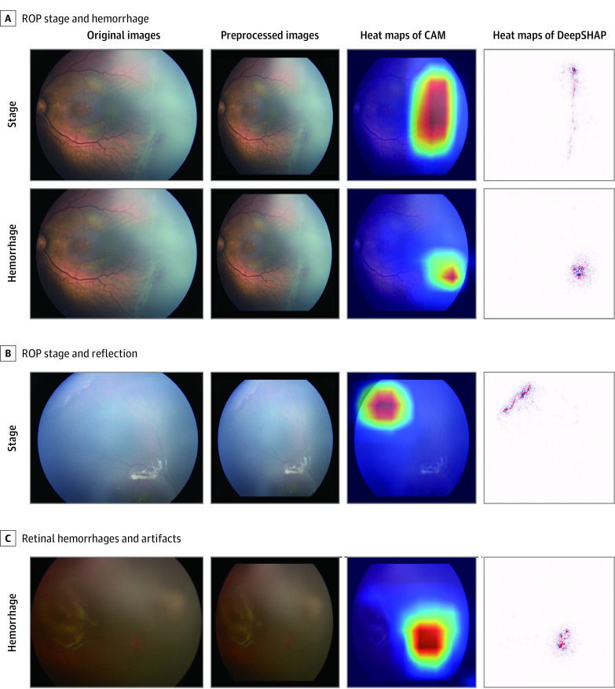
*CAM/DeepSHAP: vùng đỏ = nơi AI dựa vào để quyết định (gờ tăng sinh, xuất huyết, phản xạ giả). Nguồn: Wang J et al., PMC8100867 Fig. 2, CC BY 4.0.*

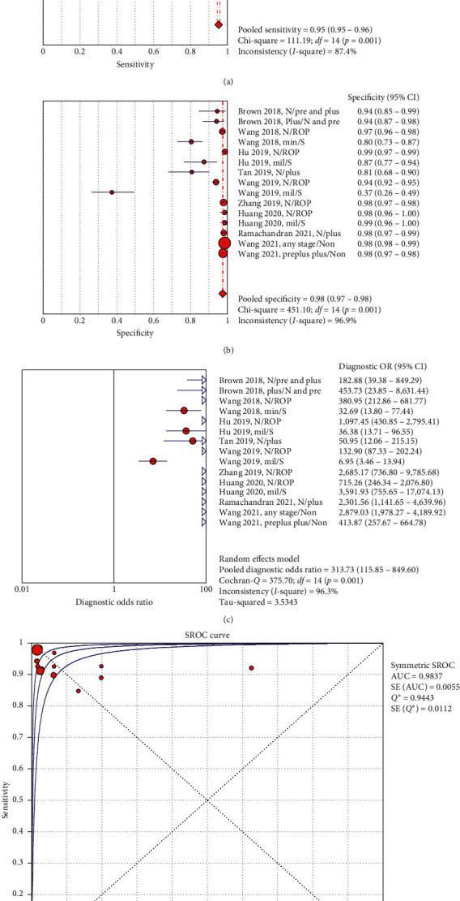
*Forest plot: độ nhạy gộp 0,95; độ đặc hiệu gộp 0,98; DOR gộp 313,73; SROC AUC 0,984. Nguồn: Zhang J et al., J Ophthalmol 2021, PMC8363465 Fig. 2, CC BY 4.0.*

## 4. Protocol chụp + hệ phân độ/điểm chuẩn hóa

- **Chuẩn bị:** giãn đồng tử (cyclopentolate 0,2% ± phenylephrine 1%), **không ấn nhãn cầu**, ghi lại **PMA tại thời điểm chụp** (vì tổn thương đổi theo tuần).
- **Chụp:** bộ **5–6 ảnh** — ngoài nhãn cầu + cực sau quanh đĩa thị + thái dương + mũi + trên + dưới (Thanos A, PMC5398746).
- **Kiểm tra chất lượng ảnh + xác định vùng (zone) tự động:** phần mềm cho phép **Zoom/Pan/Brightness/Contrast/Saturation/Text** và công cụ **"Draw Zone 1"** vẽ vòng zone I quanh đĩa thị (Thanos A, PMC5398746). Zone I lấy **2 khoảng đĩa–hoàng điểm**.
- **Đọc và mã hóa:** nhập trực tiếp **giãn đồng tử? rubeosis? tình trạng mạch (Normal/Pre-Plus/Plus); giai đoạn cao nhất (S1–S4/5); zone thấp nhất (1/2/3)**; phần mềm tự gợi ý **lịch theo dõi tiếp** (Thanos A, PMC5398746).
- **AI/PROTOCOL hiện đại:** (1) bộ phân loại **chất lượng ảnh** loại ảnh mờ trước; (2) các bộ phân loại **giai đoạn, xuất huyết, pre-plus/plus, RW-ROP**; (3) **VSS 1–9** để theo dõi tiến triển/đáp ứng điều trị; (4) **bản đồ nhiệt giải thích** để chuyên gia kiểm tra lại (Wang J, PMC8100867; Cole E, PMC9754980).
- **Ngưỡng hành động (giữ nguyên từ bài 456):** **Type 1 (ETROP)** — zone I bất kỳ giai đoạn **có plus**; zone I **stage 3**; zone II **stage 2–3 có plus** → điều trị trong **48–72 giờ**. **AP-ROP** điều trị cấp cứu, không chờ phân giai đoạn.

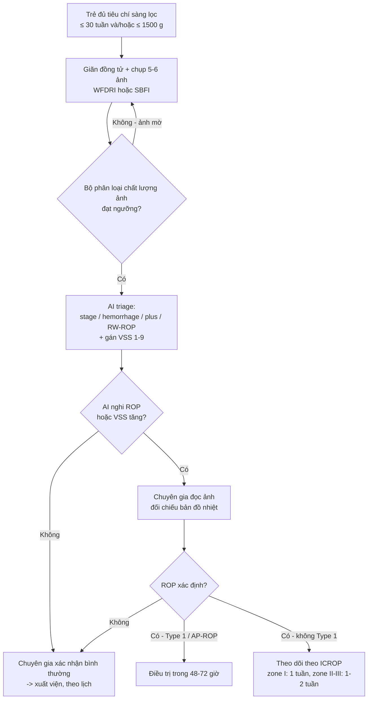

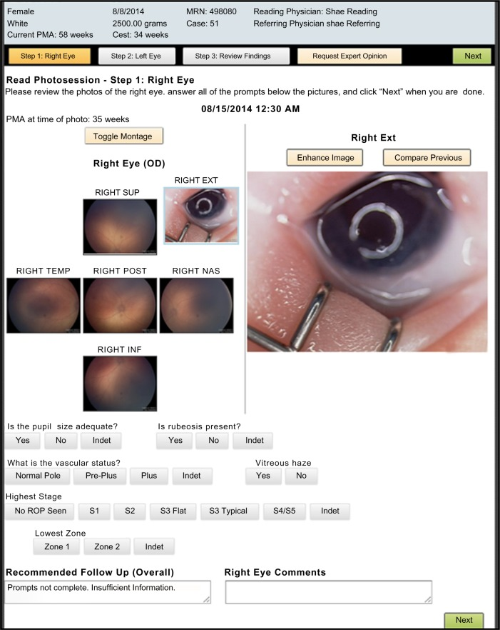
*Trường nhập liệu chuẩn hóa: montage mắt phải (SUP/TEMP/POST/NAS/INF + ảnh ngoài), trạng thái mạch Normal/Pre-Plus/Plus, giai đoạn cao nhất S1–S4/5, zone thấp nhất 1/2/3, gợi ý theo dõi. Nguồn: Thanos A et al., Eye Brain 2016, PMC5398746 Fig. 1, CC BY-NC 3.0 (giữ nguyên bản).*

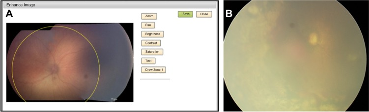
*(A) Công cụ "Draw Zone 1" vẽ vòng zone I quanh đĩa thị trên ảnh cực sau. (B) Ảnh ngoại vi mờ — minh họa vì sao cần kiểm tra chất lượng trước khi kết luận. Nguồn: Thanos A et al., PMC5398746 Fig. 2, CC BY-NC 3.0 (giữ nguyên bản).*

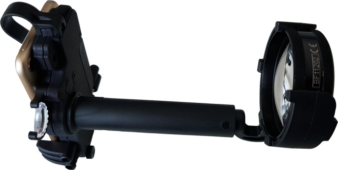
*Điện thoại + thấu kính Pan Retinal 2.2, chụp gián tiếp không tiếp xúc — phương án chi phí thấp cho nơi thiếu máy. Nguồn: Wintergerst MWM et al., Sci Rep 2019, PMC6928229 Fig. 1, CC BY 4.0.*

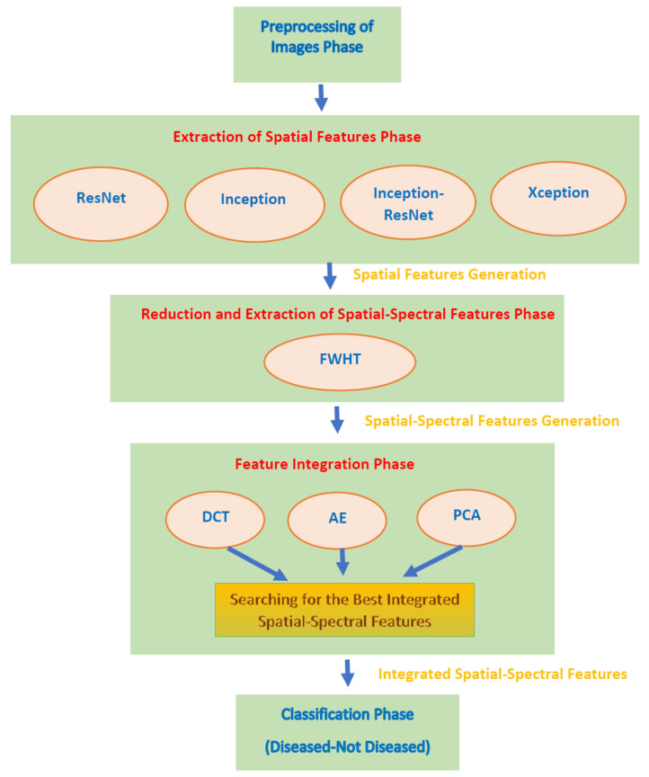
*Tiền xử lý → trích đặc trưng không gian (ResNet/Inception/Inception-ResNet/Xception) → biến đổi Walsh-Hadamard → tích hợp đặc trưng (DCT/AE/PCA) → phân loại bệnh/không bệnh. Nguồn: Attallah O, Diagnostics 2021, PMC8620568 Fig. 2, CC BY 4.0.*

## 5. Biến thể bình thường và cạm bẫy

- **Ảnh kém chất lượng "núp bóng" âm tính giả (cạm bẫy số 1):** đồng tử chưa giãn, mờ dịch kính, phản xạ giả, lệch sáng → AI có thể "bình thường hóa". **Luôn chạy bộ phân loại chất lượng ảnh trước**; ảnh không đạt thì chụp lại, **không được xuất viện**.
- **Dịch chuyển miền (domain shift):** AI huấn luyện trên máy này (RetCam) có thể giảm hiệu năng trên máy khác (3nethra) hoặc dân số khác — Cole E (PMC9754980) phải kiểm định trên **2 máy + 2 quốc gia** mới dám dùng. **Không bê nguyên ngưỡng của bài gốc sang máy của mình.**
- **Trường nhìn nhỏ của điện thoại:** SBFI chỉ bằng **~1/2,5** đường kính máy chuẩn → **dễ bỏ sót tổn thương ngoại vi (zone II–III xa)**; phải chấp nhận là công cụ bổ trợ/cơ động, không thay thế hoàn toàn WFDRI.
- **"Satisfaction of search":** thấy một tổn thương (ví dụ xuất huyết) rồi ngừng tìm plus/zone ngoại vi — đọc hệ thống theo từng ô ảnh.
- **Phụ thuộc quá mức vào AI (automation bias):** đặc biệt khi ảnh xấu; giữ nguyên tắc **AI âm nhưng ảnh kém = chưa kết luận**.
- **Phản xạ giả (artifact):** mép thấu kính, bọng khí, phản chiếu đèn → giả "gờ/tân mạch" (xem hàng "artifacts" trong bản đồ nhiệt, PMC8100867 Fig. 2).
- **Cạm bẫy trách nhiệm:** tele-ROP vẫn cần **bác sĩ chịu trách nhiệm pháp lý cuối cùng**; ảnh lưu trữ phải đủ để truy vết (audit).

## 6. Tự lượng giá — Blind Quiz

**Ca 1 — Quy trình tele-ROP trong một mạng lưới có AI: bước nào quyết định "xuất viện"?**

- Bối cảnh: nơi chưa có đủ bác sĩ chuyên khoa muốn dùng AI để lọc trước.
- Câu hỏi: AI nằm ở bước nào? Nếu AI "không nghi ROP" thì có được xuất viện ngay không? Hai nhánh "ROP nghi ngờ" và "ROP xác định" khác nhau ra sao?

<b>Bấm để hiện đáp án (findings + chẩn đoán)</b>

- **Luồng:** trẻ đủ tiêu chí → chụp ảnh, đưa lên **cơ sở dữ liệu chia sẻ** → hỏi **"CBIA/AI có sẵn?"** → nếu có, **AI sàng lọc ảnh** → **"ROP nghi ngờ?"** → nếu nghi, **chuyển chuyên gia đọc** → **"ROP xác định?"** → nếu không, **xuất viện**; nếu có, **theo dõi theo guideline địa phương**.
- **AI là bước triage, KHÔNG phải người kết luận:** nhánh "No" ở "ROP nghi ngờ?" đi thẳng xuống **Discharge** chỉ khi ảnh đạt chất lượng; trên thực tế vẫn giữ ngưỡng an toàn (ảnh kém → không xuất viện).
- **Chẩn đoán:** đây là sơ đồ **tele-ROP lai (AI + chuyên gia)** — mấu chốt là **AI giảm tải cho chuyên gia**, không thay thế.
- Nguồn: Tan Z et al., Saudi J Ophthalmol 2022, PMC9583350 Fig. 5, CC BY-NC-SA 4.0 (giữ nguyên bản).

**Ca 2 — Giao diện đọc ảnh: dấu hiệu nào bắt buộc nhập trước khi quyết định lịch theo dõi?**

- Bối cảnh: một mạng lưới mới, cần chuẩn hóa dữ liệu đọc ảnh.
- Câu hỏi: Kể tên các trường nhập liệu chính? Vì sao phải nhập cả **zone thấp nhất** lẫn **giai đoạn cao nhất**?

<b>Bấm để hiện đáp án (findings + chẩn đoán)</b>

- **Trường nhập:** đồng tử đủ giãn? **rubeosis**? tình trạng mạch (**Normal/Pre-Plus/Plus**); **giai đoạn cao nhất** (No ROP/S1/S2/S3 Flat/S3 Typical/S4–S5/Indet); **zone thấp nhất** (1/2/3); ghi chú và **lịch theo dõi gợi ý**.
- **Vì sao cả hai:** **zone quyết định tiên lượng/ngưỡng điều trị**, **giai đoạn quyết định mức tăng sinh**; một ca có thể **stage 3 ở zone II** (Type 1 nếu có plus) nhưng cũng có **stage 1 ở zone I** (nguy hiểm vì zone I). Thiếu một trong hai → quyết định sai.
- **Chẩn đoán:** montage mắt phải (SUP/TEMP/POST/NAS/INF + ảnh ngoài nhãn cầu) theo bộ 5–6 ảnh chuẩn.
- Nguồn: Thanos A et al., Eye Brain 2016, PMC5398746 Fig. 1, CC BY-NC 3.0 (giữ nguyên bản).

**Ca 3 — AI gán điểm: đọc ROC và VSS để quyết định ngưỡng**

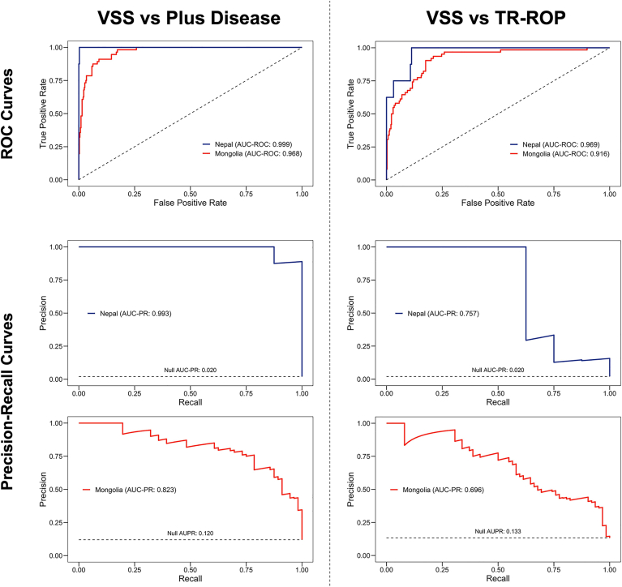

- Bối cảnh: đánh giá một hệ AI đã huấn luyện trên máy RetCam, giờ dùng ở nơi khác máy.
- Câu hỏi: VSS phân biệt plus disease tốt đến đâu? Vì sao phải xem **cả ROC lẫn đường precision-recall**?

<b>Bấm để hiện đáp án (findings + chẩn đoán)</b>

- **Kết quả:** VSS đối chiếu **plus disease** — AUC **0,999 (Nepal)** và **0,968 (Mongolia)**; đối chiếu **TR-ROP** — AUC **0,969** và **0,916**. Đường precision-recall cần thiết vì **bệnh hiếm** (type 1 ROP: Mongolia **14,0%** vs Nepal **2,2%**) khiến ROC "đẹp" dễ gây ảo giác.
- **Điểm chốt (clincher):** VSS **1–9** tăng đơn điệu theo mức ICROP → dùng để **phát hiện tiến triển/tái hoạt**, không chỉ phân loại nhị phân.
- **Chẩn đoán:** hệ i-ROP DL, kiểm định đa trung tâm/đa máy — bằng chứng cho việc dùng AI ở nơi thu nhập thấp–trung bình (Nepal dùng máy 3nethra, Mongolia dùng RetCam).
- Nguồn: Cole E et al., Ophthalmol Sci 2022, PMC9754980 Fig. 1, CC BY-NC-ND 4.0 (giữ nguyên bản, không ghép).

**Ca 4 — Nhìn vào "trí tuệ" của AI: bản đồ nhiệt có tin được không?**

- Bối cảnh: muốn biết AI ra quyết định dựa trên dấu hiệu bệnh hay trên **nhiễu/ảnh giả**.
- Câu hỏi: Ở hàng "Stage" và "Hemorrhage", vùng đỏ nằm ở đâu? Ở hàng có phản xạ giả (reflection), AI có bị "lừa" không?

<b>Bấm để hiện đáp án (findings + chẩn đoán)</b>

- **Hàng Stage:** vùng đỏ tập trung ở **gờ tăng sinh/ranh giới mạch–vô mạch**. **Hàng Hemorrhage:** vùng đỏ ở **ổ xuất huyết**. **Hàng phản xạ/artifact:** vùng đỏ dồn vào **đốm sáng giả**, cảnh báo AI **có thể bám vào nhiễu** nếu ảnh cháy sáng.
- **Ý nghĩa:** bản đồ nhiệt (CAM/DeepSHAP) giúp chuyên gia kiểm tra AI có dựa vào **dấu hiệu bệnh thật** không → đây là cơ sở của **explainable AI**.
- **Chẩn đoán:** nền tảng đa chiều 4 bộ phân loại (stage/xuất huyết/pre-plus-plus/RW-ROP), AUC 0,983–0,998.
- Nguồn: Wang J et al., JAMA Netw Open 2021, PMC8100867 Fig. 2, CC BY 4.0.

## Bài liên quan chéo
- [456 – Bệnh võng mạc trẻ sinh non (ROP): zone–stage–plus & AP-ROP](../456-benh-vong-mac-tre-sinh-non/lesson.md)
- [457 – Bệnh "giả ROP" ở trẻ đủ tháng (FEVR, Norrie, IP, Coats)](../457-benh-gia-rop-tre-du-thang/lesson.md)
- [458 – Di chứng & theo dõi dài hạn sau ROP](../458-di-chung-theo-doi-dai-han-sau-rop/lesson.md)
- [461 – Chọn thuốc & phác đồ anti-VEGF cho ROP](../461-chon-thuoc-phac-do-anti-vegf-cho-rop/lesson.md)
- [469 – Xử trí lác & nhược thị ở trẻ sinh non/ROP](../469-lac-nhuoc-thi-tre-sinh-non-rop/lesson.md)
- [401 – Phương thức chẩn đoán hình ảnh mắt](../401-phuong-thuc-mat/lesson.md)

## Ảnh
- Tên file `468_tele-rop_<nội dung>_<Tạp chí>-<Năm>-Fig<k>-<giấy phép>.jpg`; nguồn + giấy phép từng ảnh trong `images/CREDITS.md`.
- Ảnh **CC BY-NC / CC BY-NC-ND / CC BY-NC-SA** giữ **nguyên bản** (không crop, không ghép). Chỉ ảnh **CC BY** được dùng để tạo **ảnh ghép** (`composite_468_tele-rop-vs-AI.jpg`, letterbox giữ nguyên tỷ lệ).

> Không dùng để chẩn đoán độc lập khi chưa có người hướng dẫn.
