# 469 — Lác & nhược thị ở trẻ sinh non/ROP: kính chỉnh, bịt mắt vs atropine, thời điểm can thiệp / Strabismus & amblyopia in preterm/ROP children

**Tags:** `pattern:lac` `pattern:nhuoc-thi` `vung:mat` `protocol:chinh-thi-tre-non`
**Mức chắc chắn (certainty):** tổng hợp y văn (literature synthesis) — nhóm tự biên từ y văn mở (Br J Ophthalmol 2024 CC BY-NC; Eye 2023 CC BY; BMC Pediatr 2023 CC BY; Korean J Ophthalmol 2019 CC BY-NC; BMJ Open Ophthalmol 2021 CC BY-NC; Sci Rep 2022 CC BY; Biomed Res Int 2018 CC BY; Rom J Ophthalmol 2023 CC BY; Medicine 2015 CC BY-NC-ND; Br J Ophthalmol 2018 CC BY-NC), chưa gắn một ca nguyên văn đơn lẻ.

## 1. Tổng quan — vì sao trẻ sinh non "thu hoạch" cả lác lẫn nhược thị

- **Bối cảnh (pathology):** trẻ sinh non tích lũy **nhiều bất thường khúc xạ và trục nhãn cầu** cùng lúc — cận thị (nhất là sau điều trị ROP), **loạn thị**, **dị khúc xạ (anisometropia)**, **hoàng điểm lệch (macular ectopia)/võng mạc bị kéo** do sẹo xơ–mạch, **rối loạn chức năng hai mắt** và **rung giật nhãn cầu (nystagmus)**. Cộng thêm **tổn thương não (bệnh não trắng quanh não thất)** khiến một phần là **suy giảm thị giác do não (cerebral visual impairment)** — không thể sửa bằng kính. Vì vậy ở nhóm này **lác và nhược thị thường đi đôi**.
- **Cơ chế — TẠI SAO lại gây nhược thị:** võng mạc và vỏ não thị giác có **"cửa sổ nhạy cảm" (sensitive/critical period)**; khi hai mắt nhận **ảnh không tương xứng** (mờ do khúc xạ, lệch trục, hoặc mất ảnh do đục/kéo võng mạc), não **ức chế ảnh mắt yếu** → giảm thị lực vĩnh viễn nếu không chỉnh sớm. Nhược thị ở trẻ non **thường nặng hơn và kháng trị hơn** vì có nhiều yếu tố cảm giác chồng lấp.
- **Ngưỡng định lượng nằm lòng (Gutenberg Prematurity Eye Study, Fieß A et al., *Br J Ophthalmol* 2024, PMC11503079):**
  - **Tỷ lệ lác theo mức non:** **2,1%** (≥ 37 tuần) → **6,6%** (33–36 tuần) → **17,4%** (29–32 tuần) → **11,1%** (≤ 28 tuần) → **27,1%** (ROP không điều trị) → **60%** (ROP đã điều trị). **Rung giật nhãn cầu:** 0,7% → 1,5% → 4,3% → 5,6% → 10,4% → **26,7%**.
  - **Yếu tố nguy cơ lác (hồi quy đa biến):** **dị khúc xạ ≥ 1,5 D — OR 3,87** (p = 0,003); **viễn thị ≥ 2 D — OR 9,89**; tuổi thai — OR 0,90 (p = 0,046). Lác **thường xuất hiện trong 10 năm đầu đời**.
  - **Yếu tố nguy cơ nhược thị** (Fieß A et al., *Acta Ophthalmol* 2025, PMC12531598): tuổi thai **≤ 28 tuần OR 2,92**; **suy bánh nhau OR 3,84**; **ROP phải điều trị — OR 15,71** (p ≤ 0,001).
  - **Yếu tố chu sinh (Cao Y et al., *BMC Pediatr* 2023, PMC10039439, n = 128 trẻ non, 30 nhóm nguy cơ/98 đối chứng):** **loạn sản phế quản–phổi (BPD) OR 8,355**; tổn thương chất trắng não **OR 16,742**; dùng **levothyroxine OR 2,859**; **thở máy xâm lấn OR 2,983**; **glucocorticoid là yếu tố bảo vệ — OR 0,055**.
  - **Loại lác ở trẻ non:** Gadzo AP et al. (*Rom J Ophthalmol* 2023, PMC10117192) trên 126 trẻ ≤ 34 tuần/≤ 2000 g: **52,4% có lác (30,2% lác trong, 22,2% lác ngoài)**; **nhóm ROP hoạt động 100% là lác trong**; cân nặng/tuổi thai trung bình **thấp hơn** ở nhóm lác (1371,3 ± 58,0 g; 29,7 ± 0,4 tuần).

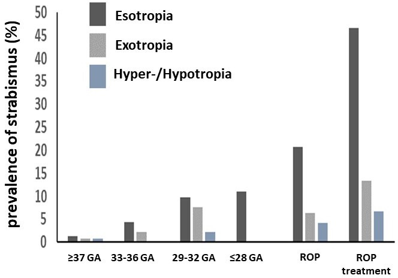
*Cột đậm = lác trong (esotropia), xám = lác ngoài (exotropia), xanh = trên/dưới (hyper-/hypotropia). Lác trong chiếm ưu thế và tăng vọt ở nhóm ROP điều trị (~46% lác trong). Nguồn: Fieß A et al., Br J Ophthalmol 2024, PMC11503079 Fig. 1, CC BY-NC 4.0 (giữ nguyên bản).*

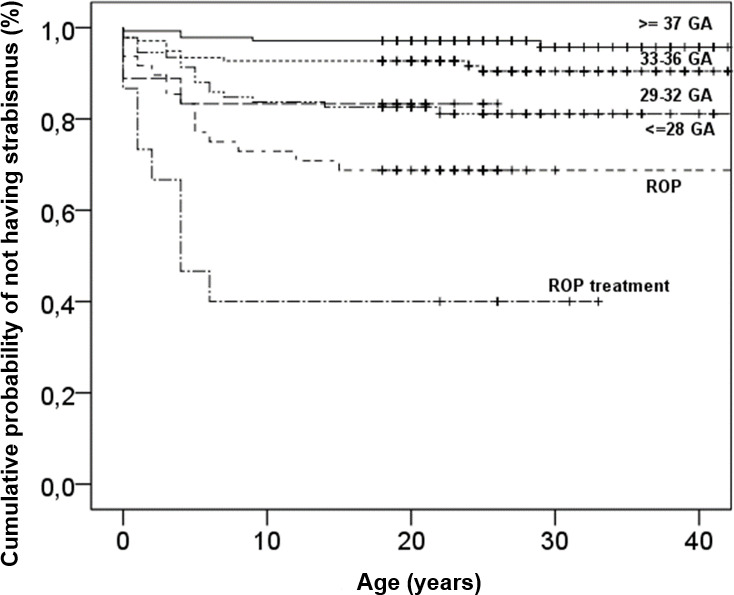
*Nhóm ≥ 37 tuần giữ tỷ lệ không lác ~0,97; nhóm ROP điều trị tụt còn ~0,4 — lác xuất hiện dồn trong thập niên đầu. Nguồn: Fieß A et al., PMC11503079 Fig. 2, CC BY-NC 4.0 (giữ nguyên bản).*

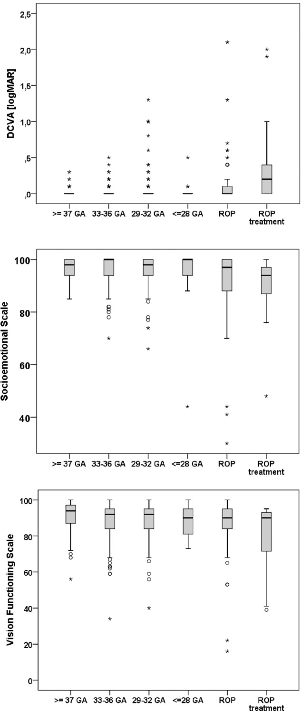
*Từ trên xuống: thị lực chỉnh kính (DCVA, logMAR) tăng (xấu hơn) ở nhóm ROP điều trị; thang cảm xúc–xã hội và thang chức năng thị giác đều thấp hơn. Nguồn: Fieß A et al., Eye 2023, PMC10275879 Fig. 1, CC BY 4.0.*

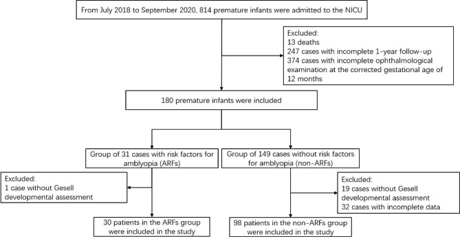
*814 trẻ non nhập NICU → 180 đủ tiêu chuẩn → 31 trẻ có yếu tố nguy cơ nhược thị (ARFs) vs 149 không có; phân tích cuối 30 vs 98. Nguồn: Cao Y et al., BMC Pediatr 2023, PMC10039439 Fig. 1, CC BY 4.0.*

## 2. Mẫu hình + chẩn đoán phân biệt theo cơ chế (gamut theo nguyên nhân)

Cùng một "lác" nhưng **cơ chế quyết định điều trị**. Phân loại theo trục cơ chế:

- **Lác trong khởi phát sớm ở trẻ non (esotropia):** thường do **viễn thị/dị khúc xạ**; điều trị chính là **kính chỉnh** — nhiều ca hết lác khi đeo kính đúng. Trẻ ROP nặng/đã điều trị → **lác trong cảm giác** (sensory) do thị lực hai mắt chênh.
- **Lác ngoài (exotropia):** xuất hiện **muộn hơn**, hay ở trẻ có **hoàng điểm lệch/cận thị** sau ROP; tiên lượng chức năng hai mắt kém hơn.
- **Lác cảm giác (sensory strabismus):** hệ quả của ROP nặng (mắt thị lực kém kéo lác) — **không thể "chữa" bằng tập luyện**, cần điều trị bệnh nền + cân nhắc phẫu thuật.
- **Lác trong cấp mắc phải đồng thời (acute acquired comitant esotropia — AACE):** khởi phát **đột ngột ở trẻ ≥ 5 tuổi**, song thị, góc tương đối ổn định. Chen J et al. (*Medicine* 2015, PMC4697976, 47 ca): **2 ca có u góc cầu–tiểu não** và **1 ca giun–tiểu não thoái hóa di truyền** → **AACE đòi hỏi chụp não–hốc mắt để loại trừ u hố sau**.
- **Nhược thị (3 thể):** **khúc xạ** (refractive — dị khúc xạ/viễn thị cao), **lệch trục** (strabismic), **do tắc/mất ảnh** (deprivation — đục môi trường, kéo võng mạc). Ở trẻ non còn thể **nhược thị hỗn hợp** kèm thành phần não.
- **Rung giật nhãn cầu (nystagmus):** dấu hiệu **tiên lượng nặng** (Fieß A, PMC11503079) — nhóm ROP điều trị tới **26,7%**, thường đi kèm nhược thị và hạn chế khả năng hồi phục thị lực hai mắt.

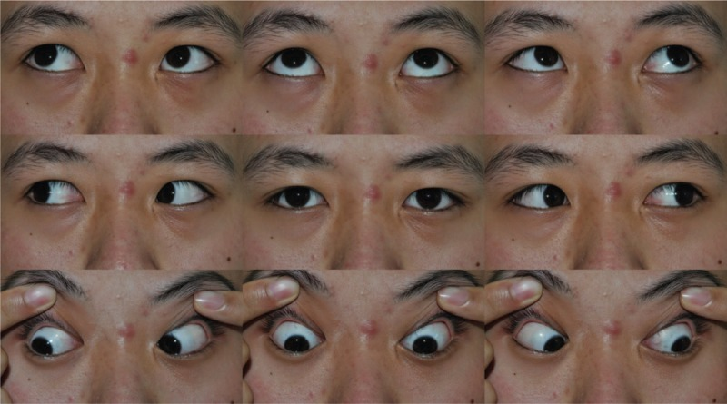
*Ảnh ghép 9 hướng nhìn một ca AACE góc nhỏ: lác trong đồng thời, vận nhãn bình thường. Hình thái này có thể do tăng nhìn gần nhưng phải loại trừ u hố sau. Nguồn: Chen J et al., Medicine 2015, PMC4697976 Fig. 1, CC BY-NC-ND 4.0 (giữ nguyên bản, không ghép).*

## 3. Bảng so sánh phân biệt (ma trận đối chiếu)

| Thực thể (entity) | Lâm sàng/hình ảnh điển hình | Chốt vào (rule-in) | Chốt loại (rule-out) | Gợi ý xác nhận/xử trí |
|---|---|---|---|---|
| Nhược thị khúc xạ | Thị lực giảm một/both mắt, **không có tổn thương thực thể** | **Chênh khúc xạ (anisometropia) ≥ 1,5 D, viễn thị ≥ 2 D** KR sau lý liệt điều tiết | Đáy mắt/tổn thương thực thể giải thích được thị lực kém | Kính chỉnh đúng + theo dõi 6–8 tuần; bịt mắt/atropine nếu không cải thiện |
| Nhược thị do lác | Lệch trục + giảm thị lực mắt lác | **Lác + thị lực chênh** (kể cả lác nhỏ/microtropia) | Không lệch trục, thị lực hai mắt bằng nhau | Chỉnh khúc xạ + điều trị nhược thị trước khi mổ |
| Lác trong do điều tiết | Lác trong **tăng khi nhìn gần**, hết khi đeo kính | **Hết/giảm rõ khi soi bóng + chỉnh viễn thị đủ** | Còn lác lớn khi đã đeo kính → thành phần không do điều tiết | Kính lõm/thêm điều tiết; đo AC/A |
| Lác cảm giác sau ROP | Lác ở mắt thị lực kém, tiền sử laser/anti-VEGF | **ROP điều trị + thị lực chênh + hoàng điểm lệch** | Hai mắt thị lực cân bằng → không phải cảm giác | Điều trị nội khoa trước; phẫu thuật khi góc ổn định |
| AACE | Khởi phát đột ngột ≥ 5 tuổi, song thị, vận nhãn bình thường | **Lác trong đồng thời mới + song thị khoảng cách** | Nếu có dấu hiệu thần kinh (phù đĩa thị, liệt vận nhãn) → phải chụp | **Chụp MRI/CT não–hốc mắt** loại trừ u hố sau (Chen J 2015: 2/47) |
| Rung giật nhãn cầu ở trẻ non | Rung giật + thị lực kém hai mắt | **ROP điều trị + rung giật** (26,7%) | Rung giật đơn độc không kèm yếu tố nguy cơ | Kính chỉnh tối đa; hỗ trợ thị giác |

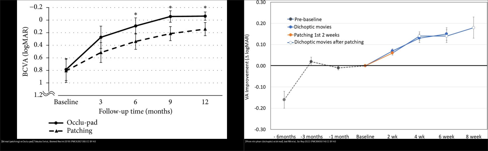
*Trái: bịt mắt kinh điển vs Occlu-pad (BCVA logMAR theo tháng). Phải: phim nhị phân (dichoptic movies) vs bịt mắt (ΔlogMAR theo tuần). Nguồn: Totsuka S et al., Biomed Res Int 2018 (PMC6282136) CC BY 4.0 + Jost RM et al., Sci Rep 2022 (PMC8905014) CC BY 4.0. Ảnh ghép letterbox, giữ nguyên bản.*

### Bảng phụ — so sánh các phương thức điều trị nhược thị (bằng số)

| Phương thức | Nguồn | Kết quả định lượng | Tuân thủ/ghi chú |
|---|---|---|---|
| Bịt mắt (patching) vs nhị phân | Brin TA et al., PMC8043000 (36 RCT) | **MD −0,03 logMAR (KTC 95% 0,01–0,04)** — khác biệt không có ý nghĩa lâm sàng | Tuân thủ dao động lớn, ảnh hưởng kết quả |
| Phim nhị phân tại nhà vs bịt mắt | Jost RM et al., PMC8905014 | 2 tuần: **0,07 ± 0,02 logMAR** (tương đương bịt mắt); tới 6 tuần **0,15–0,18 logMAR** | 3 phim/tuần vs bịt **14 giờ/tuần** |
| Occlu-pad (iPad phân cực) vs bịt mắt | Totsuka S et al., PMC6282136 | Khác biệt rõ ở **6 tháng** (nhược thị dị khúc xạ) và **9 tháng** (nhược thị do lác) | **Tuân thủ tốt hơn từ 3 tháng** |

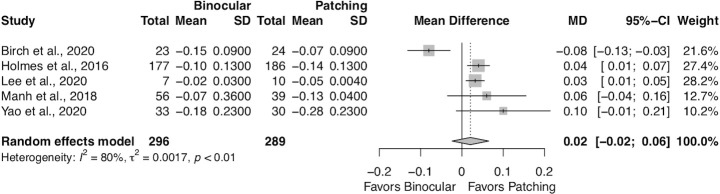
*5 nghiên cứu, MD tổng 0,02 [−0,02; 0,06] — nghiêng nhẹ về bịt mắt nhưng không đáng kể; I² = 80%. Nguồn: Brin TA et al., BMJ Open Ophthalmol 2021, PMC8043000 Fig. 4, CC BY-NC 4.0 (giữ nguyên bản).*

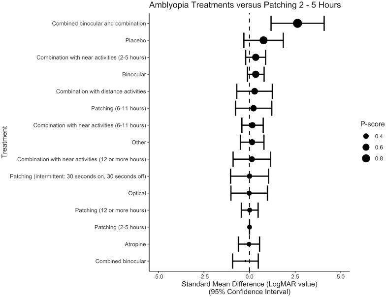
*P-score: "combined binocular + combination" và bịt mắt 2–5 giờ nằm nhóm hiệu quả; atropine và bịt mắt liều thấp thấp hơn. Nguồn: Brin TA et al., PMC8043000 Fig. 6, CC BY-NC 4.0 (giữ nguyên bản).*

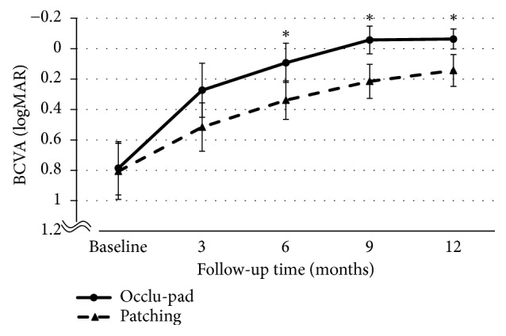
*Occlu-pad (liền) tốt hơn bịt mắt (đứt) tại 6, 9, 12 tháng (dấu *). Nguồn: Totsuka S et al., Biomed Res Int 2018, PMC6282136 Fig. 2, CC BY 4.0.*

## 4. Protocol xử trí + hệ phân độ/điểm chuẩn hóa

- **Bước 0 — khúc xạ dưới lý liệt điều tiết (cycloplegic refraction) là bắt buộc:** mọi trẻ non/ROP cần **đo khúc xạ sau giãn đồng tử**, không tin kết quả máy đo khúc xạ tự động ở trẻ nhỏ. Ngưỡng đáng chú ý: **dị khúc xạ ≥ 1,5 D**, **viễn thị ≥ 2 D**, loạn thị/cận thị cao (Fieß A, PMC11503079).
- **Bước 1 — kính chỉnh đúng** (theo khúc xạ lý liệt), đeo liên tục; **theo dõi lại sau 6–8 tuần** (Park SH, *Korean J Ophthalmol* 2019, PMC6911788).
- **Bước 2 — nếu không cải thiện thị lực:** **bịt mắt 2 giờ/ngày** hoặc **atropine cuối tuần**; nếu cải thiện → theo dõi sát, **giảm liều dần rồi ngừng**.
- **Bước 3 — nếu không tiến triển thêm:** **tăng lên 6 giờ bịt mắt/ngày** hoặc **chuyển/pha thêm phương thức** (bịt mắt ↔ atropine, thêm điều trị nhị phân). Liều bịt mắt có **quan hệ liều–đáp ứng**: bịt mắt **2–5 giờ** là mức "chuẩn so sánh" trong các thử nghiệm, liều **12 giờ hoặc hơn** không chắc tốt hơn (Brin TA, PMC8043000) — **không "bịt mắt càng nhiều càng tốt"**.
- **Điều trị kỹ thuật số (bổ trợ):** Occlu-pad (iPad lột lớp phân cực) và **phim nhị phân (dichoptic)** giúp tăng tuân thủ; hiệu quả thị lực tương đương bịt mắt ở ngắn hạn, vượt hơn về tuân thủ (Totsuka S, PMC6282136; Jost RM, PMC8905014).
- **Rung giật nhãn cầu/kết cục dài hạn:** nhóm **ROP + điều trị + lác + rung giật** có thị lực và chức năng thị giác thấp nhất (Fieß A, PMC10275879) → **tầm soát khúc xạ–lác–nhược thị định kỳ suốt tuổi học đường**, chuyển tiếp sang người lớn.
- **Thời điểm can thiệp phẫu thuật lác:** nói chung **sau khi đã chỉnh khúc xạ và điều trị nhược thị tối ưu** và khi **góc lác ổn định**; **chưa rõ ngưỡng góc "ổn định" cụ thể trong quần thể sinh non — cần tra thêm**.

```mermaid
flowchart TD
  A[Trẻ sinh non/ROP:<br/>tầm soát khúc xạ - lác - nhược thị] --> B[Đo khúc xạ<br/>dưới lý liệt điều tiết]
  B --> C[Cấp kính chỉnh đúng]
  C --> D{Theo dõi 6-8 tuần<br/>thị lực cải thiện?}
  D -->|Có| E[Tiếp tục kính<br/>+ khám định kỳ]
  D -->|Không| F[Bịt mắt 2 giờ/ngày<br/>HOẶC atropine cuối tuần]
  F --> G{Cải thiện?}
  G -->|Có| H[Theo dõi sát<br/>giảm liều dần rồi ngừng]
  G -->|Không thêm| I[Tăng 6 giờ bịt mắt/ngày<br/>HOẶC pha/chuyển phương thức]
  I --> J[Xét phẫu thuật lác khi<br/>góc ổn định + nhược thị tối ưu]
  K{Lác mới đột ngột<br/>+ song thị (AACE)?} -->|Có| L[Chụp MRI/CT não - hốc mắt<br/>loại trừ u hố sau]
```

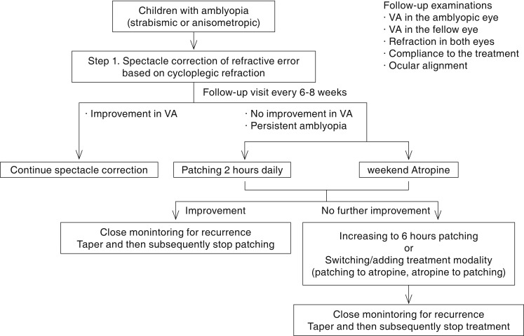
*Trẻ nhược thị → Bước 1: kính chỉnh theo khúc xạ lý liệt → theo dõi 6–8 tuần → không cải thiện: bịt mắt 2 giờ/ngày hoặc atropine cuối tuần → không tiến triển: tăng 6 giờ hoặc đổi phương thức. Nguồn: Park SH, Korean J Ophthalmol 2019, PMC6911788 Fig. 1, CC BY-NC 3.0 (giữ nguyên bản).*

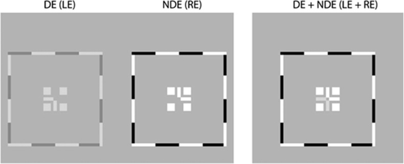
*Mắt ưu thế (DE/LE) nhận ảnh tương phản thấp, mắt nhược thị (NDE/RE) nhận ảnh tương phản cao → buộc não dùng cả hai mắt. Nguồn: Kraus CL et al., Br J Ophthalmol 2018, PMC6241622 Fig. 1, CC BY-NC 4.0 (giữ nguyên bản).*

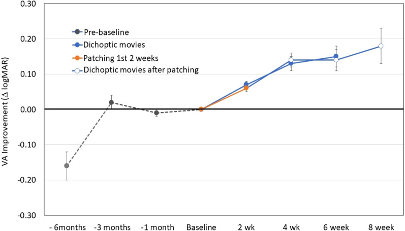
*ΔlogMAR theo thời gian: phim nhị phân (xanh) và bịt mắt 2 tuần đầu (cam) cải thiện tương đương; sau đó cả nhóm chuyển sang phim nhị phân tiếp tục cải thiện tới tuần 8. Nguồn: Jost RM et al., Sci Rep 2022, PMC8905014 Fig. 2, CC BY 4.0.*

## 5. Biến thể bình thường và cạm bẫy

- **Cân nặng sinh KHÔNG đủ để tiên đoán:** trong một loạt trẻ ≤ 34 tuần, cân nặng khác biệt giữa nhóm chính thị/lác ngoài/lác trong **không có ý nghĩa (p = 0,136)** — **tuổi thai và tình trạng ROP** quan trọng hơn cân nặng đơn thuần (Gadzo AP, PMC10117192).

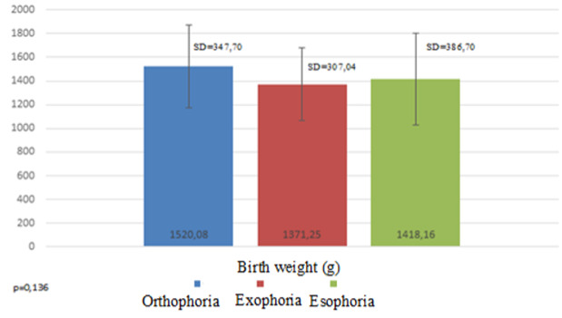
*Cân nặng sinh trung bình (g) ở nhóm chính thị (1520,08), lác ngoài (1371,25), lác trong (1418,16); p = 0,136 → cân nặng đơn thuần không phân biệt được nguy cơ. Nguồn: Gadzo AP et al., Rom J Ophthalmol 2023, PMC10117192 Fig. 1, CC BY 4.0.*
- **Lác do điều tiết "giả lác cơ năng":** nếu không **lý liệt điều tiết** sẽ bỏ sót viễn thị và cho trẻ mổ oan — luôn soi bóng/khúc xạ lý liệt đúng (atropine/cyclopentolate).
- **Đo khúc xạ tự động sai ở trẻ:** máy tự động không thay cho soi bóng trên trẻ nhỏ, đặc biệt trẻ non có kích thích.
- **Nhược thị bị "che" bởi rung giật nhãn cầu/bệnh não:** đánh giá thị lực ở trẻ non phải dùng **bảng phù hợp lứa tuổi (Teller/Lea)**; đừng quy toàn bộ giảm thị lực cho ROP.
- **AACE không được coi là "lành":** Chen J (PMC4697976) có **2/47 ca u hố sau** → **bắt buộc hình ảnh não–hốc mắt**. Bỏ qua bước này là cạm bẫy chết người.
- **Không phẫu thuật lác khi nhược thị chưa tối ưu:** mổ trước khi chỉnh khúc xạ/bịt mắt đúng → tái lác và thị lực kém.
- **Bịt mắt quá liều:** bịt mắt ≥ 12 giờ/ngày không chứng minh tốt hơn **2–5 giờ** — tăng nguy cơ nhược thị đảo mắt bịt (occlusion amblyopia). Cân nhắc atropine/kỹ thuật số để giảm liều che.
- **Cận thị tiến triển sau ROP:** sau laser/anti-VEGF, khúc xạ thay đổi nhanh → **tái khám khúc xạ định kỳ**, không "chốt" đơn kính một lần.

## 6. Tự lượng giá — Blind Quiz

**Ca 1 — Trẻ 6 tuổi, sinh 27 tuần, đã laser ROP hai mắt. Khám: mắt kém thị lực, có lác.**


- Bối cảnh: nghi lác và nhược thị sau ROP.
- Câu hỏi: Nhóm nào trên biểu đồ (theo mức non/ROP) có thị lực kém nhất? Vì sao cân nhắc cả yếu tố não, không chỉ mắt?

<details><summary><b>Bấm để hiện đáp án (findings + chẩn đoán)</b></summary>

- **Nhóm ROP điều trị** có **DCVA logMAR cao nhất (thị lực kém nhất)** và điểm thang cảm xúc–xã hội/chức năng thị giác thấp nhất. Ở trẻ này, lác thường là **lác cảm giác (sensory)** do chênh thị lực hai mắt.
- **Cạm bẫy:** giảm thị lực ở trẻ non thường **phối hợp** thành phần não (bệnh não trắng) → một phần không hồi phục bằng kính/bịt mắt; cần đặt kỳ vọng thực tế.
- **Xử trí:** chỉnh khúc xạ lý liệt đúng + điều trị nhược thị tối ưu, theo dõi 6–8 tuần; phẫu thuật lác khi góc ổn định.
- Nguồn: Fieß A et al., Eye 2023, PMC10275879 Fig. 1, CC BY 4.0.
</details>

**Ca 2 — Trẻ 5 tuổi sinh 28 tuần: khúc xạ lý liệt phát hiện dị khúc xạ, thị lực một mắt giảm. Đọc bảng tỷ lệ lác để hiểu nguy cơ.**


- Bối cảnh: trẻ non không ROP, đang theo dõi.
- Câu hỏi: Nhóm tuổi thai nào có lác trong cao nhất (ngoài nhóm ROP)? Dị khúc xạ ≥ 1,5 D làm tăng nguy cơ lác bao nhiêu?

<details><summary><b>Bấm để hiện đáp án (findings + chẩn đoán)</b></summary>

- **Lác trong** chiếm ưu thế và tăng rõ ở **29–32 tuần** (17,4%) và đặc biệt ở **ROP điều trị** (~46% lác trong). Ngoài nhóm ROP, nguy cơ tăng dần khi tuổi thai giảm.
- **Dị khúc xạ ≥ 1,5 D → OR 3,87**; **viễn thị ≥ 2 D → OR 9,89** (Fieß A, PMC11503079).
- **Chẩn đoán:** nhược thị khúc xạ/lác do khúc xạ → **ưu tiên kính chỉnh trước**, rồi mới bịt mắt/atropine; theo dõi 6–8 tuần.
- Nguồn: Fieß A et al., Br J Ophthalmol 2024, PMC11503079 Fig. 1, CC BY-NC 4.0 (giữ nguyên bản).
</details>

**Ca 3 — Chọn phương thức điều trị nhược thị: nhìn vào rừng so sánh.**


- Bối cảnh: phụ huynh hỏi "có cách nào không cần bịt mắt nhiều không?".
- Câu hỏi: Kết quả gộp nói gì về hiệu quả bịt mắt so với điều trị nhị phân? Yếu tố nào có thể làm kết quả khác biệt?

<details><summary><b>Bấm để hiện đáp án (findings + chẩn đoán)</b></summary>

- **MD tổng 0,02 logMAR [−0,02; 0,06]** — **không khác biệt có ý nghĩa lâm sàng**; nghiêng nhẹ về bịt mắt; **I² = 80%** (không đồng nhất cao).
- **Yếu tố then chốt là TUÂN THỦ**, không phải bản thân phương thức: Occlu-pad và phim nhị phân giúp **tăng tuân thủ** (Totsuka S, PMC6282136; Jost RM, PMC8905014) → có thể là lựa chọn khi trẻ khó chịu với bịt mắt.
- **Chẩn đoán:** không có "phương thức vô địch"; chọn theo tuân thủ + độ tuổi + mức nhược thị; giảm liều bịt mắt là hợp lý nếu duy trì đều.
- Nguồn: Brin TA et al., BMJ Open Ophthalmol 2021, PMC8043000 Fig. 4, CC BY-NC 4.0 (giữ nguyên bản).
</details>

## Bài liên quan chéo
- [458 – Di chứng & theo dõi dài hạn sau ROP](../458-di-chung-theo-doi-dai-han-sau-rop/lesson.md)
- [456 – Bệnh võng mạc trẻ sinh non (ROP)](../456-benh-vong-mac-tre-sinh-non/lesson.md)
- [461 – Chọn thuốc & phác đồ anti-VEGF cho ROP](../461-chon-thuoc-phac-do-anti-vegf-cho-rop/lesson.md)
- [468 – Sàng lọc ROP từ xa (tele-ROP) & AI](../468-tele-rop-sang-loc-ai-theo-doi/lesson.md)
- [450 – Mắt trẻ em (leukocoria & tiếp cận)](../450-mat-nhi/lesson.md)
- [433 – Phù đĩa thị vs drusen đĩa](../433-phu-dia-thi-drusen/lesson.md)

## Ảnh
- Tên file `469_lac-nhuoc-thi_<nội dung>_<Tạp chí>-<Năm>-Fig<k>-<giấy phép>.jpg`; nguồn + giấy phép từng ảnh trong `images/CREDITS.md`.
- Ảnh **CC BY-NC / CC BY-NC-ND** giữ **nguyên bản** (không crop, không ghép). Chỉ ảnh **CC BY** được dùng để tạo **ảnh ghép** (`composite_469_bit-mat-vs-dieu-tri-so.jpg`, letterbox giữ nguyên tỷ lệ).

> Không dùng để chẩn đoán độc lập khi chưa có người hướng dẫn.
