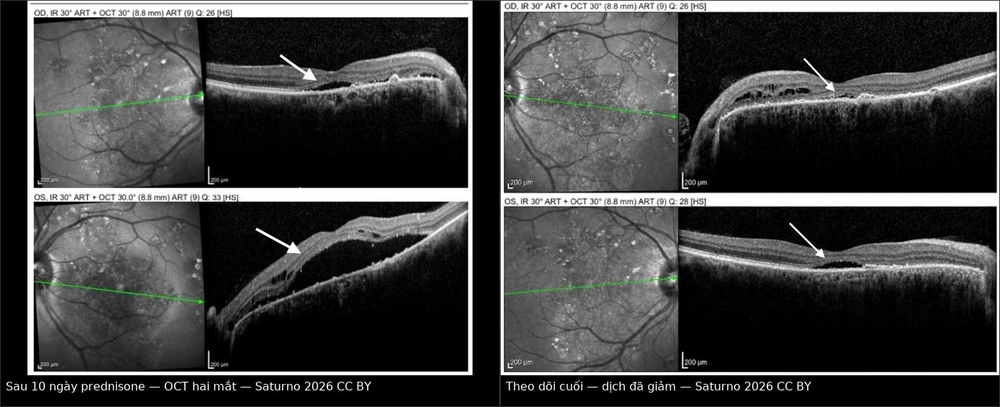
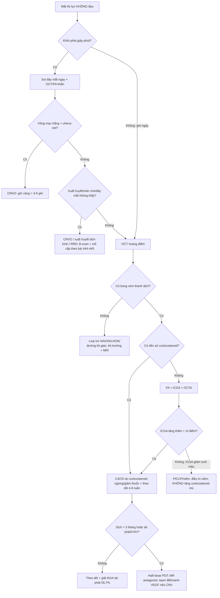
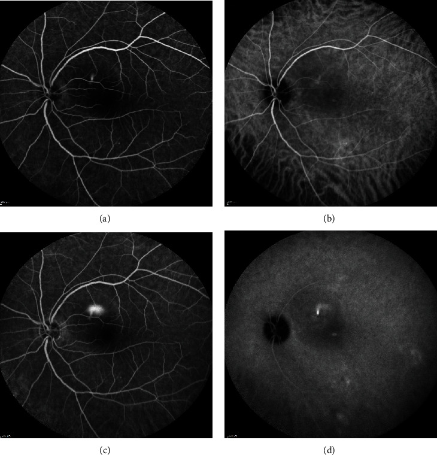
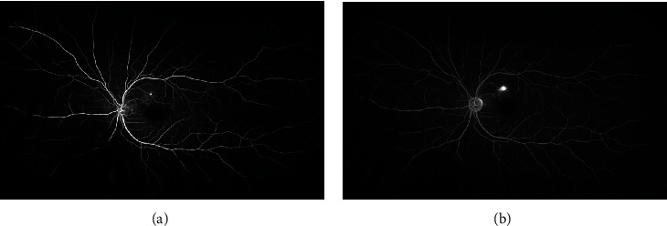
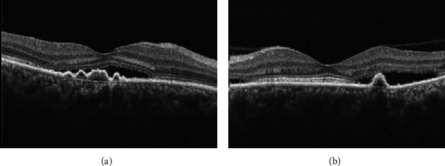
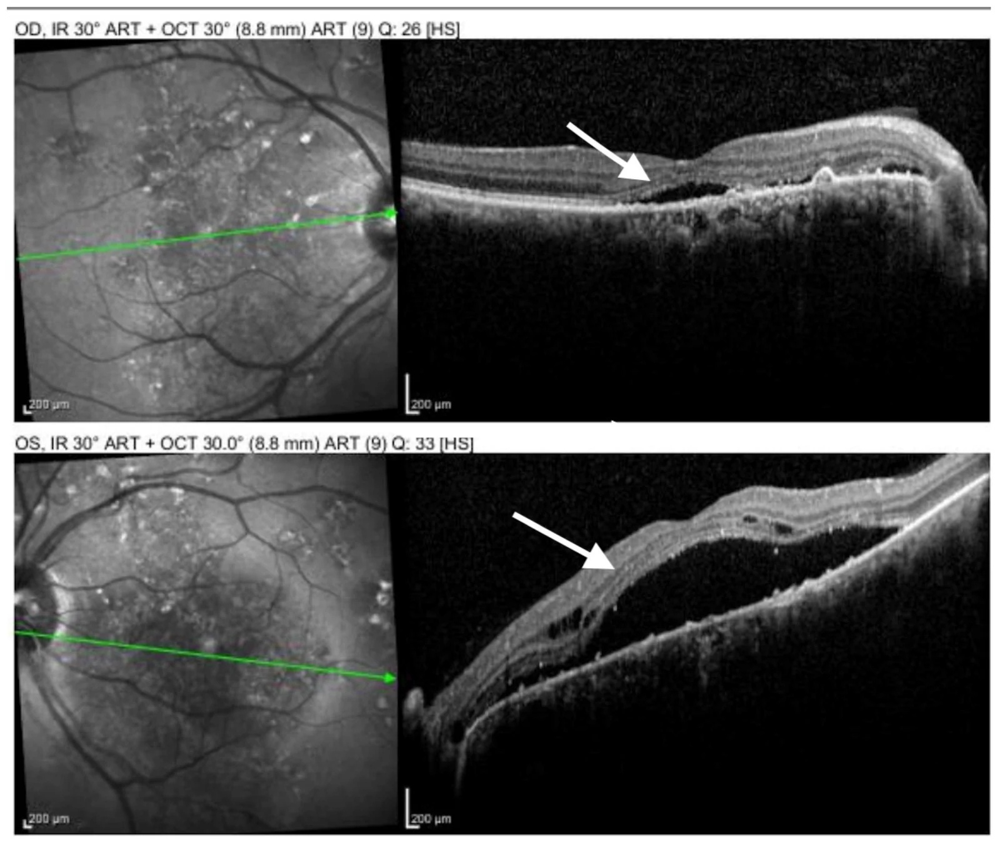
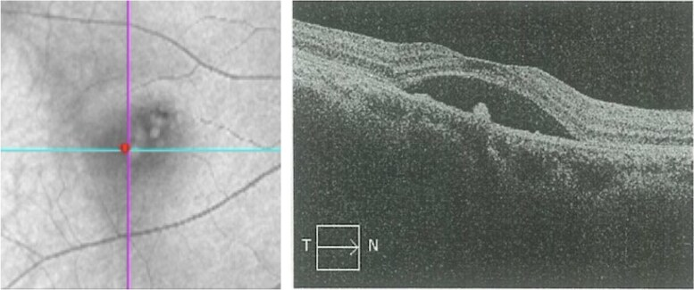
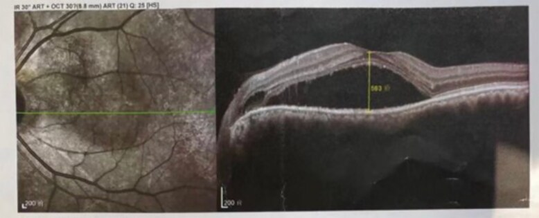
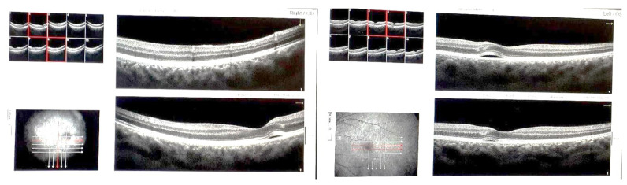

# 470 — Bệnh võng mạc trung tâm thanh dịch do corticosteroid & tiếp cận mất thị lực KHÔNG đau / Corticosteroid-induced central serous chorioretinopathy & painless vision loss

**Tags:** `pattern:bong-thanh-dich` `vung:hoang-diem` `vung:hac-mac` `score:CSCR-chronicity` `protocol:OCT-EDI` `protocol:FA-ICGA` `incidentaloma:mat-do-thuoc`
**Mức chắc chắn (certainty):** tổng hợp y văn (literature synthesis) — tổng hợp từ review + ca nguyên văn có ảnh CC BY (ghi PMCID từng ảnh), đối chiếu với các bài 444/445/435 trong repo; chưa gắn một ca nguyên văn duy nhất của nhóm.

## 1. Tổng quan — vì sao corticosteroid tạo ra một "bong võng mạc" mà không có rách

- **Bệnh học (pathology):** bệnh võng mạc trung tâm thanh dịch (central serous chorioretinopathy — CSCR) nằm trong **phổ bệnh hắc mạc dày (pachychoroid disease spectrum)**: hắc mạc dày, mạch hắc mạc giãn và tăng thấm, rồi **biểu mô sắc tố võng mạc (retinal pigment epithelium — RPE) mất chức năng bơm** → dịch tích tụ giữa võng mạc thần kinh cảm giác và RPE. Đây là **bong thanh dịch (serous detachment)**, không phải bong do rách (rhegmatogenous).
- **TẠI SAO hình ảnh như vậy (cơ chế vật lý):**
  - **OCT:** dịch dưới võng mạc là nước → **khoang giảm phản xạ (hyporeflective) hình vòm** giữa võng mạc thần kinh cảm giác và dải RPE. Võng mạc ngoài mất bám dính → các đoạn ngoài tế bào cảm thụ sáng **dựng đứng, "xù xì" (shaggy photoreceptors)**; mạn tính → teo võng mạc ngoài, mỏng điểm hoàng điểm. **EDI-OCT (enhanced depth imaging)** thấy hắc mạc dày, mạch hắc mạc lớn (pachyvessels).
  - **FA (fluorescein angiography):** thuốc huỳnh quang rò qua vùng RPE khiếm khuyết → **điểm rò tăng huỳnh quang**; lan dần trong khoang dưới võng mạc. Kiểu **"vệt mực loang" (inkblot)** là dạng thường gặp; kiểu **"đuôi khói" (smokestack)** chỉ **10–20%** ca, do dòng đối lưu của dịch giàu protein bốc lên rồi tỏa hình nấm.
  - **ICGA (indocyanine green angiography):** thấy **tăng thấm hắc mạc** (hyperpermeability) và mạch hắc mạc giãn — đối lập với **giảm tưới máu hắc mạc (hypoperfusion)** của bệnh viêm hắc mạc mao mạch nguyên phát (primary inflammatory choriocapillaropathy — PICCP).
  - **FAF (fundus autofluorescence):** cấp — giảm huỳnh quang do dịch che lấp; mạn — lốm đốm, có **"rãnh thoát dịch" (guttering/descending tracts)** do RPE tổn thương dọc đường dịch chảy.
- **Vì sao corticosteroid là nguyên nhân hàng đầu:** glucocorticoid hoạt hóa **thụ thể mineralocorticoid** ở mạch hắc mạc → giãn mạch, tăng thấm; đồng thời làm rối loạn vận chuyển ion và điện thế của RPE → giảm tái hấp thu dịch dưới võng mạc. Corticosteroid còn làm tăng nhạy cảm với catecholamine và thay đổi huyết động học. Hệ quả lâm sàng: **thể do thuốc ít nam hóa hơn thể vô căn, hay hai bên và không điển hình hơn**.
  - Đường dùng đều có thể gây: **uống, tiêm tĩnh mạch, tiêm quanh nhãn cầu, nhỏ mắt, tiêm khớp, bôi da**; cả **tăng cortisol nội sinh (hội chứng Cushing)** và **thai kỳ** — phân tích gộp 4 nghiên cứu (2.766 người) cho **OR 5,51 (KTC 95% 2,12–14,30)** cho thai kỳ như yếu tố nguy cơ CSCR.
- **Ngưỡng định lượng nằm lòng:**
  - **Tần suất:** đỉnh **~70/100.000 người–năm** ở nhóm **40–49 tuổi**; nam gặp nhiều hơn ở thể vô căn.
  - **Diễn tiến tự nhiên:** **84%** ca cấp khỏi trong **6 tháng** trong một cohort tiến cứu (31 mắt); một cohort 140 mắt theo dõi trung bình **98,9 tháng** cho thấy **62,1%** khỏi trong 6 tháng nhưng **55,7% tái phát**, trung bình **25,7 tháng** sau khi khỏi.
  - **Yếu tố kéo dài đợt cấp (độc lập):** **bề dày hắc mạc dưới hoàng điểm (SFCT) ≥ 500 μm**, **RPE nhô ≥ 50 μm tại điểm rò**, **tuổi ≥ 40**.
  - **Thể do corticosteroid trong viêm màng bồ đào:** series 14 bệnh nhân/20 mắt — **78,6% nam**, prednisone uống **5–80 mg/ngày**, **85%** có rò điểm trên FA; series 26 bệnh nhân/31 mắt — **88,4% nam**, tuổi trung bình **42,8**, hai bên **19,2%**, **88,5%** đang dùng corticosteroid toàn thân, thời gian khỏi trung bình **99 ± 61 ngày**, **29%** cần laser điểm.
- **Phản biện quan trọng (fidelity + critique):** nguy cơ CSCR rất rõ với corticosteroid **toàn thân/quanh nhãn cầu/nhỏ mắt**, nhưng **tiêm corticosteroid nội dịch kính** có dữ liệu ngược lại: cohort **2.336 bệnh nhân** trong 21 năm **không có ca CSCR nào** (KTC 95% 0–0,13%), và bề dày hắc mạc **giảm nhẹ** sau 1 tháng (dexamethasone implant **227,0 → 217,9 μm**; triamcinolone **219,8 → 218,6 μm**). Không được suy diễn nguy cơ toàn thân sang mọi đường tiêm nội nhãn — nhưng vẫn phải cảnh giác ở ca lâm sàng đơn lẻ.

## 2. Mẫu hình + chẩn đoán phân biệt theo kiểu khởi phát (gamut)

**Mất thị lực KHÔNG đau không phải một bệnh — đó là một "cửa vào".** Ba câu hỏi chia gamut:

1. **Khởi phát nhanh cỡ nào?** Giây–phút (mạch máu, bong võng mạc, xuất huyết) vs giờ–ngày (viêm, CSCR, thần kinh thị).
2. **Mất trung tâm hay mất vùng?** Trung tâm/ám điểm + biến dạng hình (metamorphopsia) → hoàng điểm; mất nửa trên/dưới → thần kinh thị hoặc nhánh mạch.
3. **Đáy mắt có tổn thương nhìn thấy không?** Có (trắng nhợt, xuất huyết, bong, phù đĩa) vs **đáy mắt bình thường** (thần kinh thị sau nhãn cầu, bệnh đường thị giác, bệnh võng mạc chưa thấy).

- **Nhóm A — đột ngột, không đau, đáy mắt BẤT THƯỜNG:**
  - **Tắc động mạch trung tâm võng mạc (CRAO):** võng mạc trắng nhợt + **chấm đỏ anh đào (cherry-red spot)**; **giờ vàng < 4–6 giờ** (bài 444).
  - **Tắc tĩnh mạch trung tâm võng mạc (CRVO):** "blood-and-thunder", tĩnh mạch giãn ngoằn ngoèo; nguy cơ **glaucoma tân mạch ~90–100 ngày** (bài 444).
  - **Bong võng mạc do rách (rhegmatogenous retinal detachment — RRD):** chớp sáng, ruồi bay, **màn che từ ngoại vi**; **macula-on → mổ trong 24 giờ**, **macula-off → trong 1 tuần** (bài 445).
  - **Xuất huyết dịch kính:** mất thị lực đột ngột, không thấy đáy mắt → **siêu âm B-scan** tìm bong/rach; ở người đái tháo đường nghĩ tân mạch.
  - **Xuất huyết dưới võng mạc do AMD tân mạch:** người > 50, **biến dạng hình** rồi mất thị lực nhanh; OCT/OCTA tìm màng tân mạch.
- **Nhóm B — bán cấp, không đau, tổn thương HOÀNG ĐIỂM:**
  - **CSCR (bài này):** 20–50 tuổi, nam nhiều hơn, **nhìn mờ nhẹ + ám điểm trung tâm + biến dạng hình + thị lực gần như bình thường** (thường 20/20–20/40), **khúc xạ dịch về phía viễn thị**; đáy mắt có vùng nhạt màu hình vòm.
  - **Thoái hóa hoàng điểm do tuổi (AMD) / tân mạch hắc mạc (CNV):** drusen, xuất huyết, dịch; OCT thấy dịch dưới RPE/dưới võng mạc, OCTA thấy mạng tân mạch.
  - **Phù hoàng điểm do đái tháo đường (DME):** phù dạng nang, dày võng mạc, xuất huyết/vi phình mạch.
  - **Lỗ hoàng điểm (macular hole):** ám điểm trung tâm + biến dạng hình; OCT thấy khuyết toàn bộ võng mạc tại hõm trung tâm.
  - **Nếp gấp hắc mạc – võng mạc, nang hắc mạc, u hắc mạc:** OCT + siêu âm B-scan.
- **Nhóm C — không đau, đáy mắt BÌNH THƯỜNG hoặc phù đĩa:**
  - **Bệnh thần kinh thị thiếu máu không do viêm mạch (NAION):** > 50 tuổi, **mất thị trường kiểu độ cao (altitudinal)**, đĩa sung huyết; mắt đối diện **15–24% trong 5 năm** (bài 435).
  - **Bệnh thần kinh thị do viêm (optic neuritis):** thường **đau khi đảo mắt**, trẻ; nếu không đau vẫn phải loại trừ.
  - **Bệnh thần kinh thị di truyền Leber (LHON):** nam trẻ, mất thị lực trung tâm hai mắt tuần tự.
  - **Bệnh đường thị giác/chẩm (occipital):** mất thị trường đối bên, MRI não.

- **Gợi nhớ CSCR do thuốc — "STEROID":** **S**teroid (mọi đường) · **T**ime (vài ngày–vài tuần sau khi bắt đầu/tăng liều) · **E**xtra (hay hai bên, không điển hình) · **R**PE leak (rò điểm trên FA) · **O**CT dome (bong hình vòm) · **I**nkblot/smokestack · **D**iscontinue (giảm/ngừng corticosteroid là điều trị chính).

## 3. Bảng so sánh phân biệt (ma trận đối chiếu)

| Thực thể (entity) | Hình ảnh điển hình (OCT/FA/ICGA) | Chốt vào (rule-in) | Chốt loại (rule-out) | Gợi ý xác nhận |
|---|---|---|---|---|
| **CSCR do corticosteroid** | OCT: **bong vòm thanh dịch**, hắc mạc dày trên EDI, có thể PED; FA: **rò điểm inkblot** (đa số) hoặc **smokestack 10–20%**; ICGA: tăng thấm hắc mạc | **Tiền sử corticosteroid (mọi đường) + bong vòm + rò điểm + hắc mạc dày**, thường cải thiện khi giảm/ngừng thuốc | **Rách võng mạc + dịch di chuyển theo tư thế → RRD**; **FA giảm huỳnh quang sớm + ICGA giảm tưới máu → PICCP**; **màng tân mạch trên OCTA → CNV** | Soi đáy mắt + SD-OCT/EDI; FA ± ICGA; rà soát toàn bộ thuốc; cortisol/ACTH nếu nghi Cushing |
| **CNV thứ phát sau CSCR mạn** | Dịch dưới RPE/võng mạc, **màng tân mạch trên OCTA**, xuất huyết; FA rò lan tỏa không khu trú | **CSCR mạn > 3 tháng + dịch tái phát + OCTA thấy mạng tân mạch** | **OCTA không thấy mạng tân mạch + FA chỉ rò điểm đơn thuần → CSCR không biến chứng** | OCTA (en face), FA/ICGA; anti-VEGF nếu xác nhận |
| **PICCP/viêm hắc mạc mao mạch (ampiginous, APMPPE, serpiginous)** | OCT: tổn thương võng mạc ngoài/RPE, có thể bong; **FA giảm huỳnh quang sớm rồi nhuộm muộn**; **ICGA giảm tưới máu kéo dài** | **Tổn thương dạng mảng (placoid) + ICGA giảm tưới máu + không liên quan corticosteroid** | **ICGA tăng thấm + rò điểm + hắc mạc dày → CSCR** | ICGA là chốt; hỏi đáp ứng corticosteroid; theo dõi tổn thương mới |
| **Bệnh Vogt–Koyanagi–Harada (VKH)** | Bong thanh dịch hai bên **lan rộng**, phù đĩa, **FA nhiều điểm rò nhỏ + pooling**, ICGA viêm mô đệm lan tỏa | **Bong hai bên + viêm màng bồ đào trước + dấu hiệu hệ thống (da/tóc/tai)** | **Rò điểm đơn độc + ICGA không viêm mô đệm + không dấu hệ thống → CSCR** | Khám mắt toàn diện, FA/ICGA, hỏi triệu chứng thần kinh–da–tai |
| **NAION** | Đĩa **sung huyết, phù một phần**, xuất huyết quanh đĩa; OCT võng mạc **không có dịch dưới võng mạc** | **> 50 tuổi + mất thị trường độ cao + đĩa phù + không đau** | **OCT có bong vòm hoàng điểm → CSCR/CNV, không phải NAION** | Soi đáy mắt, thị trường, OCT đĩa; ESR/CRP nếu nghi GCA (bài 435) |
| **Ngộ độc hydroxychloroquine (HCQ)** | Tổn thương **võng mạc ngoài quanh hoàng điểm**, OCT có "mũi tên" tổn thương RPE; **dịch dưới võng mạc thoáng qua** có thể gặp | **Dùng HCQ lâu năm + tổn thương đối xứng quanh hoàng điểm + ngừng thuốc không hết** | **Dịch dưới võng mạc thoáng qua, hết sau giảm corticosteroid → CSCR đã khỏi, không phải HCQ** | So sánh OCT cũ, FAF, thị trường 10–2; xem bài 440 |

*Trái: SD-OCT hai mắt sau **10 ngày prednisone 1 mg/kg/ngày** — bong vòm võng mạc thần kinh cảm giác (mũi tên). Phải: theo dõi cuối — dịch đã giảm rõ. Nguồn: Saturno MC et al., Diagnostics 2026 (PMC13512710), Fig. 3–4, CC BY 4.0; ảnh ghép letterbox giữ nguyên tỷ lệ.*

### Dấu hiệu chốt cần đọc đúng trên từng kỹ thuật
- **OCT là chốt chẩn đoán bong thanh dịch**, nhưng phải đo: chiều cao dịch dưới võng mạc (μm), có **PED** không, **võng mạc ngoài còn nguyên không**, **SFCT** bao nhiêu. Trong ca nguồn, chiều cao dịch **436 μm** kèm PED; ca khác **186 μm** trước và tăng rõ sau tiêm triamcinolone.
- **FA phân biệt "rò" với "thiếu máu":** CSCR rò **tăng huỳnh quang**; PICCP **giảm huỳnh quang sớm** do giảm tưới máu hắc mạc.
- **ICGA là trọng tài** khi OCT chỉ nói "có dịch": tăng thấm (CSCR) vs giảm tưới máu (viêm).
- **OCTA** để tìm **CNV** ở CSCR mạn — đây là biến chứng đổi hoàn toàn điều trị (anti-VEGF thay vì chỉ theo dõi/PDT).

## 4. Protocol chụp + thuật toán điều trị

- **Protocol hình ảnh tối thiểu:**
  1. **SD-OCT hoàng điểm hai mắt** (máy có EDI): đo chiều cao dịch, PED, độ nguyên vẹn võng mạc ngoài, SFCT.
  2. **FA** (nếu không có chống chỉ định): tìm điểm rò, kiểu inkblot/smokestack, loại trừ CNV.
  3. **ICGA** khi nghi viêm hắc mạc mao mạch hoặc cần phân biệt tăng thấm vs giảm tưới máu.
  4. **OCTA** khi CSCR mạn/tái phát để tìm CNV.
  5. **FAF** khi nghi tổn thương RPE mạn/guttering.
- **Đánh giá nguyên nhân:** rà soát **toàn bộ thuốc** (uống, nhỏ mắt, tiêm khớp, bôi da, xịt mũi), hỏi **thuốc nam hóa/testosterone**, **thai kỳ**, **cường cortisol** (béo trung tâm, tăng huyết áp, đường huyết, rậm lông). Nếu nghi Cushing nội sinh → **cortisol tự do nước tiểu 24 giờ / test ức chế dexamethasone / CT thượng thận**.
- **Nguyên tắc điều trị:**
  - **CSCR cấp do corticosteroid: giảm/ngừng thuốc là điều trị chính** — phối hợp với bác sĩ kê đơn (thấp khớp, thận, hô hấp, ghép) để không bùng phát bệnh nền. Trong ca nguồn, prednisone được giảm ngay, thêm **mycophenolate mofetil 2 g/ngày** để kiểm soát viêm nền.
  - **Theo dõi quan sát** nếu triệu chứng nhẹ, dịch ít, < 3 tháng: khám lại **4–6 tuần**; giải thích **55,7% tái phát** về lâu dài.
  - **Chỉ định can thiệp** khi dịch kéo dài **> 3 tháng**, tái phát gây suy giảm thị lực, hoặc có CNV:
    - **Quang động trị liệu bán liều/bán năng lượng (half-dose/half-fluence PDT)** là lựa chọn hàng đầu cho CSCR mạn — trong thử nghiệm SPECTRA, **90% (36/40) nhóm eplerenone phải chuyển sang PDT sau 3 tháng** vì dịch dai dẳng, so với **20% (8/40)** ở nhóm PDT; sau 24 tháng, dịch hết **80% (32/40) vs 88% (35/40)**, p = 0,609.
    - **Chất đối kháng thụ thể mineralocorticoid:** eplerenone **25 mg/ngày × 1 tuần → 50 mg/ngày × 1–3 tháng**, hoặc spironolactone **50 mg/ngày**; canrenone **100 mg/ngày** đã dùng trong ca nguồn. Theo dõi **K⁺ và chức năng thận**. Bằng chứng yếu hơn PDT — **không dùng thay PDT** ở thể mạn có chỉ định.
    - **Laser điểm (focal laser)** cho rò **ngoài hoàng điểm**; **anti-VEGF** nếu có CNV.
  - **Thai kỳ:** ưu tiên theo dõi/giảm corticosteroid; **tránh PDT và kháng thụ thể mineralocorticoid**; phối hợp sản khoa.
- **Sơ đồ tiếp cận mất thị lực không đau + CSCR:**

*Bốn thì FA/ICGA: (a, b) sớm — điểm rò; (c, d) muộn — cột huỳnh quang bốc lên và tỏa hình nấm. Kiểu này chỉ gặp **10–20%** ca CSCR cấp. Nguồn: Iyer PG et al., Case Rep Ophthalmol Med 2020 (PMC7443246), Fig. 2, CC BY 4.0.*

*FA thì sớm (a) và muộn (b): điểm rò tăng huỳnh quang lan rộng dần tại chỗ (inkblot). Đây là kiểu **thường gặp nhất**; smokestack chỉ 10–20%. Nguồn: Iyer PG et al., PMC7443246, Fig. 1, CC BY 4.0.*

## 5. Biến thể bình thường và cạm bẫy

- **Cạm bẫy số 1 — "dịch mới = bệnh viêm bùng phát":** ở bệnh nhân viêm màng bồ đào đang dùng corticosteroid, dịch dưới võng mạc mới xuất hiện có thể là **CSCR do thuốc**, không phải viêm tiến triển. **Tăng corticosteroid sẽ làm CSCR nặng thêm** — đây là lỗi iatrogenic đã được báo cáo.
- **CSCR do thuốc không điển hình:** ít nam hóa hơn, **hai bên** và **bong lan rộng** hơn thể vô căn; đừng vì "không đúng nam trẻ" mà loại trừ.
- **FA/ICG bình thường không loại trừ CSCR:** đã có ca CSCR có **dịch trong võng mạc (IRF)** với FA và ICG bình thường; chẩn đoán dựa vào OCT + bối cảnh.
- **CSCR đã khỏi giả HCQ:** tổn thương võng mạc ngoài quanh hoàng điểm sau CSCR thoáng qua có thể bị đọc nhầm là **ngộ độc hydroxychloroquine**; so OCT cũ + hỏi đợt corticosteroid + theo dõi sau ngừng thuốc.
- **Tiêm nội dịch kính không giống đường toàn thân:** cohort 2.336 bệnh nhân **không có CSCR**, hắc mạc còn **mỏng đi**; đừng quy mọi dịch sau tiêm nội nhãn cho corticosteroid mà bỏ qua nguyên nhân khác (bong dịch kính sau, CNV, phù do bệnh nền).
- **"Không đau" không có nghĩa "lành":** CRAO (< 4–6 giờ), RRD macula-on (24 giờ), GCA/AAION (mắt kia có thể mất trong 1 tuần) là các cấp cứu trong cùng gamut — **hỏi kỹ khởi phát và soi đáy mắt trước khi cho về**.
- **CSCR và thai kỳ:** có thể xuất hiện trong thai kỳ do tăng cortisol; **không dùng eplerenone/spironolactone/PDT**; theo dõi sau sinh.
- **Giảm corticosteroid quá nhanh:** nguy cơ bùng phát bệnh nền (viêm màng bồ đào, bệnh mô liên kết, ghép tạng) — cần **phối hợp bác sĩ điều trị**, giảm theo bậc, không tự ngừng.

*(a) Đoạn ngoài tế bào cảm thụ dựng đứng, xù xì khi mất bám vào RPE; (b) PED + dịch dưới võng mạc. Đây là dấu hiệu của CSCR hoạt động, không đặc hiệu nguyên nhân. Nguồn: Iyer PG et al., PMC7443246, Fig. 4, CC BY 4.0.*

## 6. Tự lượng giác — Blind Quiz

**Ca 1 — Nam 48 tuổi, viêm hắc mạc mao mạch (ampiginous) đang dùng prednisone 1 mg/kg/ngày. Sau 10 ngày, nhìn mờ hai bên và nhìn màu lệch. Đọc OCT.**

- Gợi ý lâm sàng: bệnh nền viêm hắc mạc; thị lực giảm nhanh sau khi bắt đầu corticosteroid liều cao; không có tổn thương placoid mới.
- Câu hỏi: Dịch nằm ở đâu? Đây là viêm tiến triển hay biến chứng thuốc? Bước tiếp theo là tăng hay giảm corticosteroid?

<b>Bấm để hiện đáp án (findings + chẩn đoán)</b>

- **Dấu hiệu:** SD-OCT hai mắt — **bong vòm thanh dịch võng mạc thần kinh cảm giác** (mũi tên), võng mạc ngoài còn nguyên; không có tổn thương placoid mới, không có giảm tưới máu mới trên ICGA.
- **Chẩn đoán:** **CSCR do corticosteroid (thể hai bên)** — xuất hiện sau **10 ngày prednisone 1 mg/kg/ngày**, có rò điểm kiểu inkblot trên FA, ICGA tăng thấm hắc mạc chồng trên vùng giảm tưới máu cũ.
- **Xử trí:** **giảm/ngừng prednisone** (không tăng!), thêm **mycophenolate mofetil 2 g/ngày** để kiểm soát bệnh nền; theo dõi OCT. Trong ca nguồn, dịch gần hết sau **2 tháng**, thị lực **20/25 và 20/40**, rồi **20/20 và 20/22** ở lần khám cuối.
- **Bài học:** "dịch mới" ở bệnh nhân viêm đang dùng steroid **không đồng nghĩa bùng phát viêm**.
- Nguồn ảnh: Saturno MC et al., Diagnostics 2026 (PMC13512710), Fig. 3, CC BY 4.0.

**Ca 2 — Nữ 39 tuổi, nhìn mờ + biến dạng hình hai mắt. Đọc OCT và cho biết nguyên nhân nội sinh hay ngoại sinh.**

- Gợi ý lâm sàng: không dùng corticosteroid ngoại sinh; có bằng chứng lâm sàng và sinh hóa của tăng cortisol.
- Câu hỏi: Mô tả dịch và PED? Nếu không có thuốc, còn nguyên nhân nào? Xét nghiệm nào tiếp theo?

<b>Bấm để hiện đáp án (findings + chẩn đoán)</b>

- **Dấu hiệu:** OCT mắt phải — **bong thanh dịch võng mạc thần kinh** với chiều cao dịch **436 μm**, kèm **bong RPE (PED)**; mắt trái cũng có dịch.
- **Chẩn đoán:** **CSCR do tăng cortisol nội sinh (hội chứng Cushing)** — CT bụng phát hiện **adenoma thượng thận phải 29 × 21 mm**; sau mổ, bong thanh dịch thoái triển trong **6 tuần**.
- **Xét nghiệm:** cortisol tự do nước tiểu 24 giờ/test ức chế dexamethasone, ACTH, CT/MRI thượng thận.
- **Bài học:** CSCR "vô căn" ở người có dấu hiệu Cushing phải tìm **nguồn cortisol nội sinh**; điều trị nguyên nhân (phẫu thuật) có thể khỏi bệnh.
- Nguồn ảnh: Pang B et al., JCEM Case Rep 2025 (PMC12445647), Fig. 1, CC BY 4.0.

**Ca 3 — Nam 60 tuổi, Graves orbitopathy, đã truyền methylprednisolone 4,5 g/10 tuần; sau đó tiêm triamcinolone quanh nhãn cầu, đột ngột nhìn mờ. Đọc OCT.**

- Gợi ý lâm sàng: bệnh nền tuyến giáp; nhiều đợt corticosteroid đường toàn thân và tại chỗ.
- Câu hỏi: Dịch dưới võng mạc xuất hiện sau can thiệp nào? Chẩn đoán? Hướng xử trí?

<b>Bấm để hiện đáp án (findings + chẩn đoán)</b>

- **Dấu hiệu:** OCT — **bong thanh dịch võng mạc** + **PED nhỏ**, chiều cao dịch tăng so với trước tiêm (trước **186 μm**).
- **Chẩn đoán:** **CSCR do corticosteroid** sau **tiêm triamcinolone quanh nhãn cầu** (đường tại chỗ cũng đủ gây bệnh), trên nền đã dùng methylprednisolone tĩnh mạch.
- **Xử trí:** ngừng corticosteroid ngoại sinh; theo dõi; trong ca nguồn dịch và PED cải thiện sau **4 tháng** ngừng thuốc, thị lực hồi phục.
- **Bài học:** hỏi **cả đường tiêm tại chỗ** — không chỉ thuốc uống.
- Nguồn ảnh: Pang B et al., PMC12445647, Fig. 4, CC BY 4.0.

**Ca 4 — FA của một bệnh nhân nam trẻ, nhìn mờ một bên vài ngày, đang dùng corticoid nhỏ mắt. Đọc kiểu rò và phân biệt với viêm hắc mạc.**

- Gợi ý lâm sàng: không đau, không sốt, không tiền sử viêm màng bồ đào; đang dùng corticoid nhỏ mắt. Đây là ca minh họa hình ảnh từ review, không có đầy đủ bệnh sử.
- Câu hỏi: Kiểu rò tên gì? Cơ chế? Nếu ICGA cho thấy giảm tưới máu thì chẩn đoán đổi thế nào?

<b>Bấm để hiện đáp án (findings + chẩn đoán)</b>

- **Dấu hiệu:** FA thì sớm có **điểm rò**, thì muộn huỳnh quang **bốc thành cột rồi tỏa hình nấm** = **smokestack (đuôi khói)** — gặp ở **10–20%** CSCR cấp.
- **Chẩn đoán:** **CSCR** — trong bối cảnh đang dùng corticoid nhỏ mắt, đây là nguyên nhân cần nghĩ trước. Nếu ICGA thấy **giảm tưới máu hắc mạc kéo dài** thay vì tăng thấm → nghĩ **PICCP/viêm hắc mạc mao mạch**, không phải CSCR.
- **Xử trí:** ngừng corticoid nhỏ mắt; theo dõi OCT 4–6 tuần; giải thích khả năng tái phát.
- Nguồn ảnh: Iyer PG et al., Case Rep Ophthalmol Med 2020 (PMC7443246), Fig. 2, CC BY 4.0.

**Ca 5 — Bệnh nhân LHON đang được điều trị corticosteroid; ngày thứ 3 thấy nhìn mờ thêm. Đọc OCT.**

- Gợi ý lâm sàng: bệnh thần kinh thị di truyền; corticosteroid được dùng cho đợt cấp; thị lực không cải thiện như mong đợi.
- Câu hỏi: Dịch nằm ở đâu? Có phải bệnh thần kinh thị nặng lên? Nên tăng hay giảm corticosteroid?

<b>Bấm để hiện đáp án (findings + chẩn đoán)</b>

- **Dấu hiệu:** OCT hoàng điểm — **bong thanh dịch võng mạc thần kinh**, dày và tăng phản xạ lớp nhân ngoài/ellipsoid; không có bong hắc mạc.
- **Chẩn đoán:** **CSCR do corticosteroid** xuất hiện ở **ngày thứ 3** điều trị — biến chứng iatrogenic, không phải LHON tiến triển.
- **Xử trí:** trao đổi với bác sĩ thần kinh–mắt về **giảm/ngừng corticosteroid**; theo dõi OCT. Không tăng liều vì "thấy mờ hơn".
- Nguồn ảnh: Zoric L et al., Medicina 2024 (PMC11766876), Fig. 2, CC BY 4.0.

## Bài liên quan chéo
- [400 – Tổng quan Mắt & thị giác](../400-tong-quan-mat-thi-giac/lesson.md)
- [444 – Tắc mạch võng mạc: CRVO/BRVO vs CRAO (cherry-red & giờ vàng)](../444-tac-mach-vong-mac/lesson.md)
- [445 – Bong võng mạc: rhegmatogenous vs co kéo vs tiết dịch](../445-bong-vong-mac/lesson.md)
- [435 – GCA & NAION/AION: cấp cứu mù ở người > 50 tuổi](../435-gca-va-naion-aion/lesson.md)
- [440 – Theo dõi & điều trị teo thị di truyền](../440-theo-doi-dieu-tri-teo-thi-di-truyen/lesson.md)
- [464 – Viêm thần kinh thị tái phát (CRION)](../464-viem-than-kinh-thi-tai-phat-CRION/lesson.md)
- [455 – Behçet & lupus ở mắt](../455-behcet-lupus-mat/lesson.md)
- [447 – Hội chứng đốm trắng (APMPPE, MEWDS, AZOOR, PIC)](../447-dom-trang-vong-mac/lesson.md)

## Ảnh
- Tên file `470_cscr_<modality>_PMC...`; nguồn + giấy phép từng ảnh trong `images/CREDITS.md`.
- Tất cả ảnh dùng ở đây là **CC BY 4.0**; ảnh ghép letterbox giữ nguyên tỷ lệ, không crop/kéo giãn.
- Không tải ảnh từ AuntMinnie/paywall; nguồn đóng chỉ dẫn link ở `sources.md`.

> Không dùng để chẩn đoán độc lập khi chưa có người hướng dẫn.
