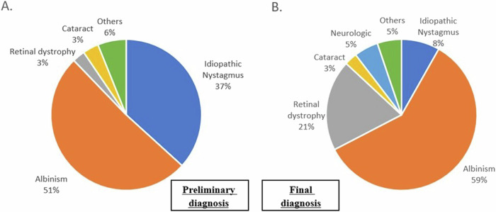
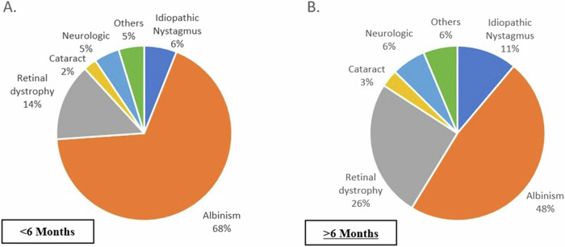
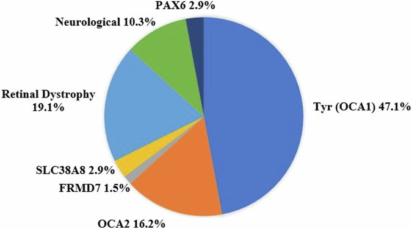
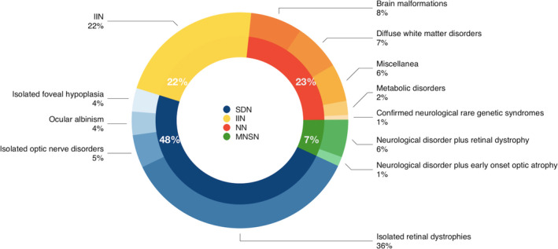
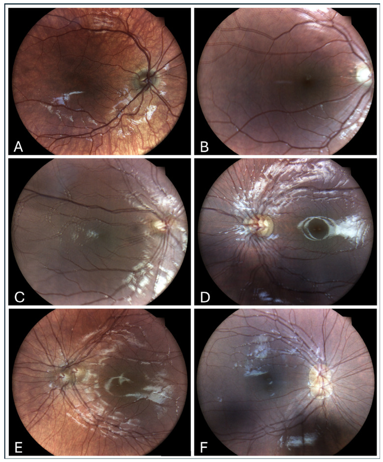
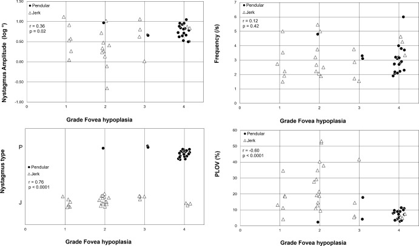
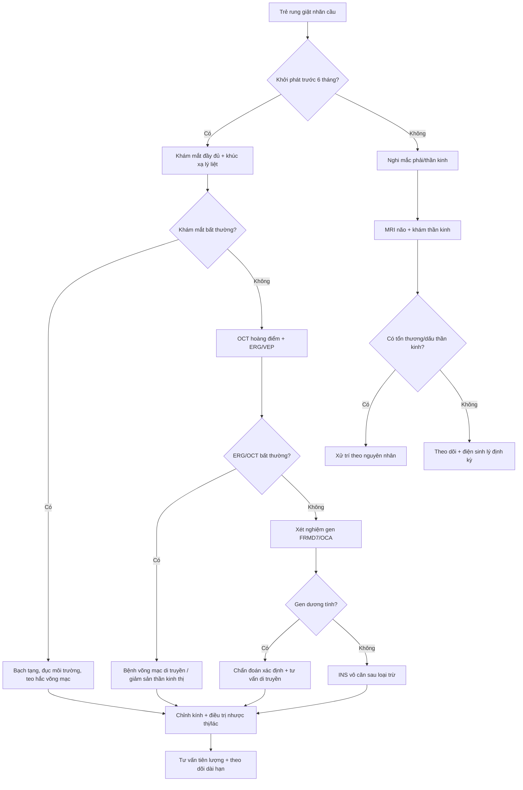

# 471 — Rung giật nhãn cầu ở trẻ nhũ nhi & trẻ sinh non: phân biệt thể cảm giác – vô căn – thần kinh / Infantile & sensory nystagmus in infants and preterm children

**Tags:** `pattern:rung-giat-nhan-cau` `pattern:giam-thi-luc` `vung:mat` `vung:nao` `protocol:ERG-VEP` `protocol:OCT-hoang-diem` `protocol:MRI-nao`
**Mức chắc chắn (certainty):** tổng hợp y văn (literature synthesis) — tự biên từ 4 nghiên cứu đoàn hệ mở (Eye 2025 CC BY; Dev Med Child Neurol 2022 CC BY; Children 2025 CC BY; IOVS 2023 CC BY-NC-ND) + 2 bài tổng quan mở (Clin Ophthalmol 2025 CC BY-NC; Front Neurosci 2025 CC BY), chưa gắn một ca nguyên văn đơn lẻ.

## 1. Tổng quan — vì sao mắt "rung" lại làm mất thị lực, và ngưỡng nào buộc phải tầm soát bệnh nền

- **Định nghĩa (definition):** rung giật nhãn cầu (nystagmus) là dao động không tự chủ, có nhịp, hai pha (pha chậm đưa mắt ra khỏi đích + pha nhanh đưa về, hoặc dao động đều kiểu lắc). **Rung giật nhãn cầu nhũ nhi (infantile nystagmus syndrome — INS)** khởi phát **trước 6 tháng tuổi**; khởi phát **sau 6 tháng** được xếp là **mắc phải (acquired)** và có trọng số bệnh lý thần kinh cao hơn.
- **Dịch tễ (epidemiology):** rung giật nhãn cầu ở trẻ **6,1 – 14/10.000 trẻ sinh sống**; **tăng rõ ở trẻ sinh non**, đặc biệt nhóm đã điều trị bệnh võng mạc sinh non (ROP) — trong đoàn hệ Gutenberg, rung giật gặp **26,7%** ở nhóm ROP phải điều trị so với **0,7%** ở trẻ ≥ 37 tuần (Fieß A, *Br J Ophthalmol* 2024, PMC11503079; bài 469).
- **TẠI SAO rung giật làm giảm thị lực — cơ chế vật lý:** ảnh của vật trượt liên tục trên võng mạc; võng mạc chỉ "nhìn rõ" khi ảnh đứng yên đủ lâu. Thước đo trực tiếp là **tỉ lệ thời gian vận tốc mắt thấp (percentage of low velocity — PLOV)**: PLOV càng thấp, ảnh càng nhoè. Trên 50 bệnh nhân bạch tạng (albinism), **kiểu rung giật và PLOV tương quan mạnh nhất với thị lực (r = 0,70 và r = −0,56)** và với mức giảm sản hố hoàng điểm (foveal hypoplasia) (r = 0,76 và r = −0,60); **mức giảm sản hố hoàng điểm tương quan với thị lực r = 0,87** (Talsma HE, *IOVS* 2023, PMC10746925). Nói cách khác: rung giật vừa là **dấu hiệu** của hệ thị giác lỗi, vừa là **nguyên nhân cộng thêm** làm thị lực kém.
- **TẠI SAO phải tìm bệnh nền chứ không được "chốt vô căn" sớm:** trong 147 trẻ ≤ 1 tuổi có rung giật, chẩn đoán **lúc khám đầu** là "vô căn" tới **36,7%**, nhưng chẩn đoán **cuối cùng** chỉ còn **8,2%** vô căn; **bạch tạng 59,2%**, **bệnh võng mạc di truyền (inherited retinal disease — IRD) 19,5%**, **thần kinh 4,7%** (Goldman E, *Eye* 2025, PMC11933425). Việc "đổi nhãn" chủ yếu nhờ **khám lâm sàng kỹ + điện sinh lý + xét nghiệm gen**.
- **Ngưỡng định lượng nằm lòng (Goldman E, PMC11933425; n = 147 trẻ ≤ 1 tuổi):**
  - **Nguyên nhân cuối cùng:** bạch tạng **87/147 (59,2%)**; IRD **28 (19,5%)**; vô căn **12 (8,2%)**; đục thể thuỷ tinh **4 (2,7%)**; khác (aniridia, coloboma…) **9 (6,1%)**; **thần kinh 7 (4,7%)** (bệnh não thị giác (CVI) 4, u chèn chỗ 1, Moebius 1, giảm myelin thoáng qua 1).
  - **Theo tuổi:** ở nhóm **< 6 tháng**, bạch tạng chiếm **57/84 (67,9%)**; ở nhóm **≥ 6 tháng**, IRD tăng lên **26%** (Hình 2).
  - **Đặc điểm kèm:** lác **51/147 (34,7%)**, trong đó **lác trong 42/51 (82,4%)**; **viễn thị ≥ +4 D 73/147 (49,6%)**; **cận thị ≤ −4 D 9/147 (6,1%)**; **loạn thị > 2 D 50/147 (34%)**.
  - **Dạng sóng:** ngang **122/147 (82,9%)**, dọc **8/147 (5,4%)**, hỗn hợp **9/147 (6,1%)**. Trong 8 ca rung giật dọc: **4 ca là IRD** (achromatopsia 3, CSNB 1), 2 aniridia, 1 đục thể thuỷ tinh, 1 vô căn — **rung giật dọc KHÔNG đồng nghĩa với u não**, nhưng buộc phải loại trừ cả bệnh võng mạc lẫn thần kinh.
  - **Hiệu suất xét nghiệm:** MRI được làm ở **29/147 (19,7%)** nhưng chỉ **6/29** ca tìm ra nguyên nhân thần kinh; **gen** là xét nghiệm "chốt" ở **66/147 (44,9%)**, **khám lâm sàng** ở **60/147 (40,8%)** (trong đó **43/60 = 72%** là chẩn đoán bạch tạng), **ERG 16/147 (10,9%)**.
- **Nhóm "mắt bình thường nhưng vẫn rung" (Suppiej A, *Dev Med Child Neurol* 2022, PMC9796881; n = 142 trẻ khởi phát < 6 tháng, khám mắt không kết luận):** **khiếm khuyết cảm giác (sensory defect) 48%**, **thần kinh 23%**, **phối hợp thần kinh + cảm giác 7%**, **INS vô căn 22%**. Tổng hợp lại, **30%** trẻ "không thấy bất thường ở mắt" có nguyên nhân thần kinh — nên **điện sinh lý (electrophysiology) phải làm sớm**, không chờ MRI.

*Trái (A): lúc khám đầu — "vô căn" 37%, bạch tạng 51%. Phải (B): sau chẩn đoán — bạch tạng 59%, bệnh võng mạc di truyền 21%, vô căn chỉ còn 8%, thần kinh 5%. Nguồn: Goldman E et al., Eye 2025, PMC11933425 Fig. 1, CC BY 4.0.*

*Nhóm < 6 tháng: bạch tạng 68%, IRD 14%, thần kinh 5%. Nhóm ≥ 6 tháng: bạch tạng 48%, IRD 26%, thần kinh 6%, vô căn 11%. Nguồn: Goldman E et al., Eye 2025, PMC11933425 Fig. 2, CC BY 4.0.*

*Tyr (OCA1) 47,1%, OCA2 16,2%, bệnh võng mạc di truyền 19,1%, nhóm thần kinh 10,3%, PAX6 2,9%, SLC38A8 2,9%, FRMD7 1,5%. Nguồn: Goldman E et al., Eye 2025, PMC11933425 Fig. 4, CC BY 4.0.*

## 2. Mẫu hình + chẩn đoán phân biệt theo cơ chế (gamut)

- **Cách phân nhóm thực dụng:** hỏi **2 câu** trước mọi xét nghiệm — **(1) khởi phát trước hay sau 6 tháng? (2) khám mắt có thấy bất thường không?** Từ đó chia 4 nhánh:
  1. **INS có bệnh nền mắt rõ (sensory nystagmus):** bạch tạng (albinism), bệnh võng mạc di truyền (achromatopsia, CSNB, LCA), **giảm sản thần kinh thị (optic nerve hypoplasia)**, đục thể thuỷ tinh/giác mạc, teo hắc võng mạc. Chiếm **48%** nhóm "không thấy bất thường" khi khám chuyên sâu (Suppiej A, PMC9796881).
  2. **INS vô căn (idiopathic infantile nystagmus):** khám mắt – OCT – ERG bình thường; nhiều ca có **đột biến FRMD7** (di truyền liên kết X) hoặc gen trội khác; chiếm **22%** (Suppiej) / **8,2%** (Goldman) tuỳ tiêu chuẩn "đã loại trừ đủ chưa".
  3. **Rung giật do thần kinh:** dị dạng não, bệnh chất trắng, bệnh chuyển hoá, u chèn chỗ, CVI. Chiếm **23%** (Suppiej) và **30%** nếu khám mắt không kết luận.
  4. **Rung giật mắc phải "kiểu thần kinh định vị":** rung giật **see-saw** (vùng giao thoa thị – hypothalamic), **downbeat/upbeat**, **convergence-retraction** (não giữa lưng), **opsoclonus-myoclonus** (u nguyên bào thần kinh ở trẻ) — **khởi phát sau 6 tháng hoặc có dấu thần kinh kèm**.
- **Gamut theo tuổi & bối cảnh:**
  - **Sơ sinh – 6 tháng:** bạch tạng, IRD bẩm sinh, giảm sản thần kinh thị, đục thể thuỷ tinh bẩm sinh, **spasmus nutans** (gật đầu + nghiêng đầu, lành tính nhưng phải loại trừ u đường thị–vùng dưới đồi), rung giật do thuốc/mẹ dùng thuốc.
  - **Trẻ sinh non/ROP:** rung giật **26,7%** ở nhóm ROP đã điều trị (Fieß A, PMC11503079); thường kèm lác, cận thị, hoàng điểm lệch, **bệnh não trắng quanh não thất** → phải tách phần "mắt" và phần "não".
  - **Sau 6 tháng:** u hố sau/dị dạng não, bệnh chuyển hoá, ngộ độc, rung giật do mất thị lực mắc phải; **luôn hỏi thuốc** (phenytoin, carbamazepine, rượu ở mẹ) và **chấn thương**.
- **Mnemonic "6 câu hỏi trước khi gọi vô căn":** **O**nset < 6 tháng? **F**amily history? **A**lbinism (da/tóc/mắt)? **R**etina (ERG/OCT)? **N**eurology (dấu thần kinh, đầu to, chậm phát triển)? **G**enetics (FRMD7/OCA)?

*Vòng trong: khiếm khuyết cảm giác (SDN) 48%, vô căn (IIN) 22%, thần kinh (NN) 23%, phối hợp (MNSN) 7%. Vòng ngoài SDN: bệnh võng mạc di truyền đơn thuần 36%, bệnh thần kinh thị 5%, bạch tạng mắt 4%, giảm sản hố hoàng điểm đơn thuần 4%. Nguồn: Suppiej A et al., Dev Med Child Neurol 2022, PMC9796881 Fig. 1, CC BY 4.0.*

## 3. Bảng so sánh phân biệt (ma trận đối chiếu)

| Thực thể (entity) | Lâm sàng/hình ảnh điển hình | Chốt vào (rule-in) | Chốt loại (rule-out) | Gợi ý xác nhận |
|---|---|---|---|---|
| Bạch tạng (albinism) | Rung giật ngang, **giảm sản hố hoàng điểm**, da/tóc nhạt, trong suốt mống mắt | **Giảm sản hố hoàng điểm + dấu da/tóc + tiền sử gia đình** | Đáy mắt có hố hoàng điểm rõ và sắc tố bình thường → không phải bạch tạng | Khám đèn khe + OCT; **gen OCA1/OCA2/GPR143**; ERG |
| Bệnh võng mạc di truyền (achromatopsia/CSNB/LCA) | Rung giật + **sợ ánh sáng**, thị lực kém, đáy mắt có thể bình thường | **ERG bất thường** (giảm/không đáp ứng) + sợ ánh sáng | ERG bình thường + OCT bình thường → ít nghĩ IRD | **ERG/VEP** + gen (CNGA3/CNGB3/TRPM1…) |
| INS vô căn (FRMD7) | Rung giật ngang, **không sợ ánh sáng**, khám mắt – OCT – ERG bình thường, hay có người trong gia đình | **Loại trừ đủ bệnh mắt + thần kinh + gen FRMD7** | Còn bất kỳ bất thường ERG/OCT/MRI → không gọi vô căn | Gen FRMD7; theo dõi thị lực |
| Rung giật thần kinh | Khởi phát **sau 6 tháng**, **dọc/hỗn hợp**, đầu to, chậm phát triển, dấu thần kinh khu trú | **Dấu thần kinh + MRI bất thường** | MRI bình thường + ERG bất thường → nghiêng cảm giác | **MRI não** (29/147 ca, 6/29 tìm ra nguyên nhân) + khám thần kinh |
| Spasmus nutans | **Gật đầu + nghiêng đầu + rung giật nhỏ**, thường 6–18 tháng, tự hết | **Bộ ba gật–nghiêng–rung, không dấu thần kinh** | Có dấu thần kinh/dậy thì sớm → **phải MRI loại trừ u đường thị** | MRI nếu không điển hình; theo dõi |
| Rung giật mắc phải kiểu định vị | **See-saw**, downbeat, convergence-retraction, opsoclonus | **Hình thái đặc hiệu + khởi phát muộn** | Rung giật ngang đơn thuần từ nhỏ → INS | MRI não–hốc mắt; tầm soát u (opsoclonus → neuroblastoma) |

*(A) không có ảnh đôi; (B) rung giật xoay độ 1; (C–F) các mức ảnh đôi ngang/dọc tăng dần. Chụp đáy mắt vẫn đọc được chi tiết võng mạc dù mắt rung, và giúp định hướng – định lượng biên độ. Nguồn: Cohen-Sinai N et al., Children 2025, PMC11854684 Fig. 2, CC BY 4.0.*

*Biên độ, tần số và PLOV đều thay đổi có ý nghĩa theo grade giảm sản hố hoàng điểm; grade 4 gần như luôn đi với rung giật kiểu lắc (pendular) 86%. Nguồn: Talsma HE et al., IOVS 2023, PMC10746925 Fig. 6, CC BY-NC-ND 4.0 (giữ nguyên bản).*

## 4. Protocol chẩn đoán + hệ phân độ/điểm chuẩn hoá

- **Bước 0 — khám mắt đầy đủ (bắt buộc, làm trước mọi hình ảnh):** thị lực theo lứa tuổi (Teller/Lea), **khúc xạ dưới lý liệt điều tiết (cycloplegic refraction)**, đèn khe, **soi đáy mắt gián tiếp**, tìm dấu bạch tạng (trong suốt mống mắt, giảm sắc tố hố hoàng điểm), đục môi trường, lác. Khám lâm sàng một mình đã "chốt" được **40,8%** ca, riêng bạch tạng **72%** (Goldman E, PMC11933425) — **đừng nhảy thẳng vào MRI**.
- **Bước 1 — đo khúc xạ dưới lý liệt + chỉnh kính:** viễn thị ≥ +4 D gặp ở **49,6%** trẻ rung giật ≤ 1 tuổi; chỉnh kính đúng là bước đầu của mọi phác đồ.
- **Bước 2 — OCT hoàng điểm (handheld nếu trẻ nhỏ):** xác định **grade giảm sản hố hoàng điểm 0–4** (Leicester grading: 0 = bình thường; 4 = mất phân biệt các lớp trong/ngoài võng mạc). Lưu ý chất lượng ảnh kém khi mắt rung — trong đoàn hệ trên chỉ **15 trẻ** làm được OCT (Goldman E, PMC11933425); **không loại trừ bệnh võng mạc chỉ vì OCT không đọc được**.
- **Bước 3 — điện sinh lý (ERG/VEP) sớm:** đây là "cửa" phân biệt bệnh võng mạc với vô căn; Suppiej A khuyến nghị **đưa điện sinh lý vào sớm**, nhất là khi khám mắt không kết luận (PMC9796881). ERG là xét nghiệm chốt ở **10,9%** ca trong đoàn hệ Goldman.
- **Bước 4 — xét nghiệm gen:** panel **FRMD7, OCA1 (TYR), OCA2, GPR143, SLC38A8, PAX6**, gen bệnh võng mạc (CNGA3, CNGB3, TRPM1, CRB1, GUCY2D, RPE65…). Gen là xét nghiệm chốt nhiều nhất — **44,9%** (Goldman E, PMC11933425). **Tư vấn di truyền** theo kiểu di truyền (FRMD7 liên kết X; OCA lặn; một số thể trội).
- **Bước 5 — MRI não:** chỉ định khi **khởi phát sau 6 tháng**, rung giật **dọc/hỗn hợp**, **bất đối xứng**, có **dấu thần kinh**, đầu to, chậm phát triển, spasmus nutans không điển hình, nghi u. MRI được làm ở **19,7%** và chỉ **6/29** ca cho nguyên nhân — **MRI không thay thế ERG/khám mắt**.
- **Hệ phân độ dùng trong bài:**
  - **Leicester OCT grading giảm sản hố hoàng điểm 0–4** (0 bình thường → 4 mất phân biệt hoàn toàn) — tương quan với thị lực **r = 0,87** (Talsma HE, PMC10746925).
  - **Phân loại sóng:** **jerk** (pha nhanh rõ) vs **pendular** (lắc đều); **PLOV** thấp = thị lực kém hơn. Grade 4 gần như luôn là **pendular (86%)**.
- **Điều trị (không có "thuốc chữa rung" đơn thuần):**
  1. **Chỉnh khúc xạ tối đa** + điều trị nhược thị/lác nếu có (bài 469) — nền tảng.
  2. **Lăng kính (prisms)** đưa mắt về **điểm trung hoà (null point)** khi có tư thế đầu bất thường; **kính râm/ám màu** cho achromatopsia (sợ ánh sáng).
  3. **Phẫu thuật:** chuyển **null point** (Anderson–Kestenbaum) hoặc làm giảm biên độ (recession/resection, tenotomy). Trong tổng quan hệ thống 52 nghiên cứu điều trị INS, **28/52** là can thiệp phẫu thuật — bằng chứng không đồng nhất, kết quả báo cáo khác nhau (Li X, *Front Neurosci* 2025, PMC12222088).
  4. **Thuốc:** gabapentin/memantine/brinzolamide được dùng cho một số thể (đặc biệt rung giật mắc phải/acquired), **hiệu quả và liều ở trẻ còn chưa được chuẩn hoá — chưa rõ, cần tra**; không dùng thay cho chỉnh kính/điều trị bệnh nền.
  5. **Huấn luyện tri giác (perceptual training)** là hướng mới, hứa hẹn cải thiện thị lực và chất lượng sống nhưng còn ít dữ liệu (Li X, PMC12222088).

## 5. Biến thể bình thường và cạm bẫy

- **"Vô căn" là chẩn đoán loại trừ, không phải chẩn đoán đầu tay:** tỉ lệ vô căn tụt từ **36,7% → 8,2%** sau khi làm đủ xét nghiệm (Goldman E, PMC11933425). Gọi vô căn khi chưa ERG/gen = bỏ sót bệnh võng mạc di truyền.
- **MRI bình thường không loại trừ bệnh mắt:** MRI chỉ được làm ở 19,7% và hiệu suất thấp (6/29); **ERG/OCT/gen** mới là trục chính.
- **Rung giật dọc không đồng nghĩa u não:** 8 ca dọc trong đoàn hệ có **4 IRD**, 1 vô căn — nhưng vẫn phải loại trừ thần kinh.
- **Rung giật che lấp nhược thị:** trẻ rung giật thường không đo được thị lực kiểu bảng thông thường; dùng **Teller/Lea + đo lập thể**, và nhớ rằng **lác 34,7%** đi kèm.
- **Spasmus nutans "lành tính" là cạm bẫy chết người:** bộ ba gật đầu–nghiêng đầu–rung giật nhỏ thường tự hết, nhưng **u đường thị/vùng dưới đồi** có thể bắt chước; **bất đối xứng, dấu thần kinh, khởi phát sớm** → MRI.
- **Trẻ sinh non: đừng quy tất cả cho ROP:** rung giật gặp **26,7%** ở nhóm ROP điều trị nhưng còn do **bệnh não trắng, khúc xạ cao, lác** — khám đa ngành (bài 469, 456).
- **Ảnh OCT/đáy mắt bị nhiễu do rung:** không đọc sai thành "bình thường"; dùng **fundus camera chụp chuỗi** (ảnh "bóng ma" giúp định hướng) hoặc máy cầm tay.
- **Bỏ sót thuốc/ngộ độc:** phenytoin, carbamazepine, lithium, rượu — hỏi kỹ trước khi quy vô căn.

## 6. Tự lượng giá — Blind Quiz

**Ca 1 — Bé 8 tháng, rung giật nhãn cầu từ 3 tháng, khám mắt "không thấy gì", ERG và OCT bình thường.**

- Bối cảnh: mắt không đục, đáy mắt khó đọc vì mắt rung.
- Câu hỏi: Hai chẩn đoán nào "biến mất" nhiều nhất sau khi làm đủ xét nghiệm? Trước khi gọi vô căn, cần làm gì?

<b>Bấm để hiện đáp án (findings + chẩn đoán)</b>

- **"Vô căn" giảm từ 37% xuống 8%**, đồng thời **bạch tạng tăng 51% → 59%**, **bệnh võng mạc di truyền 3% → 21%**. Nghĩa là phần lớn ca "không thấy gì" thực ra có bệnh nền khi khám/điện sinh lý/gen kỹ hơn.
- **Cần làm:** khúc xạ lý liệt, OCT hoàng điểm (tìm giảm sản hố hoàng điểm), **ERG/VEP**, panel gen (FRMD7/OCA/IRD), khám da–tóc–mống mắt.
- **Chẩn đoán:** INS vô căn chỉ được đặt sau khi **loại trừ bệnh võng mạc, bạch tạng, thần kinh** — không dựa vào "khám mắt thấy bình thường".
- Nguồn: Goldman E et al., Eye 2025, PMC11933425 Fig. 1, CC BY 4.0.

**Ca 2 — Bé gái 10 tháng, rung giật ngang, sợ ánh sáng, đáy mắt khó đọc; ERG giảm đáp ứng.**

- Bối cảnh: mẹ than con "không dám mở mắt ngoài nắng".
- Câu hỏi: Ảnh đáy mắt cho thấy gì? Vì sao ERG quan trọng hơn MRI ở ca này?

<b>Bấm để hiện đáp án (findings + chẩn đoán)</b>

- **Findings:** ảnh đáy mắt có **nhiều "bóng ma" (ghost images)** xếp theo hướng rung — dấu hiệu của rung giật biên độ trung bình–lớn; võng mạc vẫn đọc được chi tiết.
- **Chẩn đoán:** rung giật **thể cảm giác do bệnh võng mạc di truyền** (achromatopsia/CSNB) — sợ ánh sáng + ERG giảm là chốt. **ERG phát hiện bệnh võng mạc** trong khi MRI chỉ loại trừ nguyên nhân thần kinh; ở nhóm "mắt bình thường", 48% là khiếm khuyết cảm giác (Suppiej A, PMC9796881).
- **Xử trí:** chỉnh kính, kính râm/ám màu, tư vấn di truyền, theo dõi thị lực; không chờ MRI để bắt đầu hỗ trợ thị giác.
- Nguồn: Cohen-Sinai N et al., Children 2025, PMC11854684 Fig. 2, CC BY 4.0; Suppiej A et al., Dev Med Child Neurol 2022, PMC9796881 (CC BY 4.0).

**Ca 3 — Bé trai 2 tuổi, rung giật + gật đầu + nghiêng đầu; khám thần kinh bình thường.**

- Bối cảnh: bố mẹ thấy con "lắc đầu theo nhịp" khi nhìn đồ chơi.
- Câu hỏi: Nghĩ thể nào? Khi nào vẫn phải chụp MRI dù khám thần kinh bình thường?

<b>Bấm để hiện đáp án (findings + chẩn đoán)</b>

- **Nghĩ spasmus nutans** (gật đầu + nghiêng đầu + rung giật nhỏ, thường 6–18 tháng, tự hết) — thuộc nhóm **INS**, không phải "thần kinh" điển hình.
- **Vẫn phải MRI** nếu: rung giật **bất đối xứng**, **dọc**, kèm **dấu thần kinh**, **đầu to**, chậm phát triển, hoặc không tự hết đúng tuổi — vì **u đường thị/vùng dưới đồi** có thể bắt chước.
- **Lưu ý dịch tễ:** trong 147 trẻ, nguyên nhân thần kinh chỉ **4,7%**, nhưng khi khám mắt không kết luận thì lên tới **30%** — nên không được bỏ qua bước khám thần kinh/điện sinh lý.
- Nguồn: Suppiej A et al., Dev Med Child Neurol 2022, PMC9796881 Fig. 1, CC BY 4.0; Goldman E et al., Eye 2025, PMC11933425 (CC BY 4.0).

## Bài liên quan chéo
- [469 – Lác & nhược thị ở trẻ sinh non/ROP](../469-lac-nhuoc-thi-tre-sinh-non-rop/lesson.md)
- [456 – Bệnh võng mạc trẻ sinh non (ROP)](../456-benh-vong-mac-tre-sinh-non/lesson.md)
- [458 – Di chứng & theo dõi dài hạn sau ROP](../458-di-chung-theo-doi-dai-han-sau-rop/lesson.md)
- [450 – Mắt trẻ em (leukocoria & tiếp cận)](../450-mat-nhi/lesson.md)
- [437 – Teo thị kèm điếc (OPA1/WFS1)](../437-teo-thi-kem-diec/lesson.md)
- [433 – Phù đĩa thị vs drusen đĩa](../433-phu-dia-thi-drusen/lesson.md)

## Ảnh
- Tên file `471_rung-giat-nhan-cau_<nội dung>_<PMCID>-Fig<k>-<giấy phép>.jpg`; nguồn + giấy phép từng ảnh trong `images/CREDITS.md`.
- Ảnh **CC BY-NC-ND** giữ **nguyên bản** (không crop/ghép).

> Không dùng để chẩn đoán độc lập khi chưa có người hướng dẫn.
