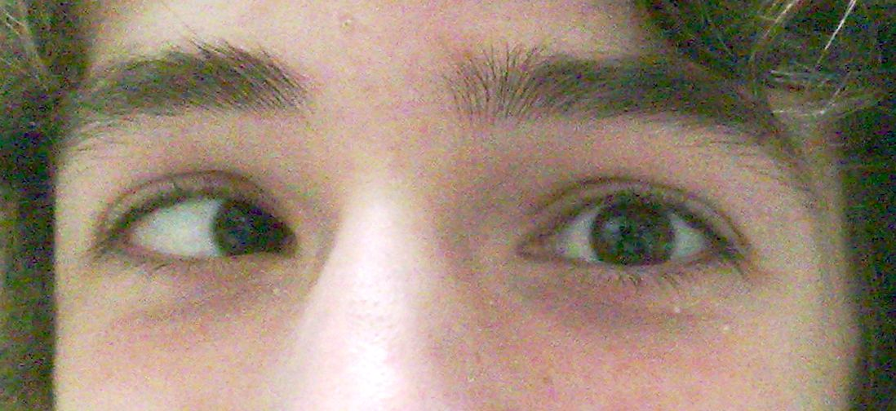
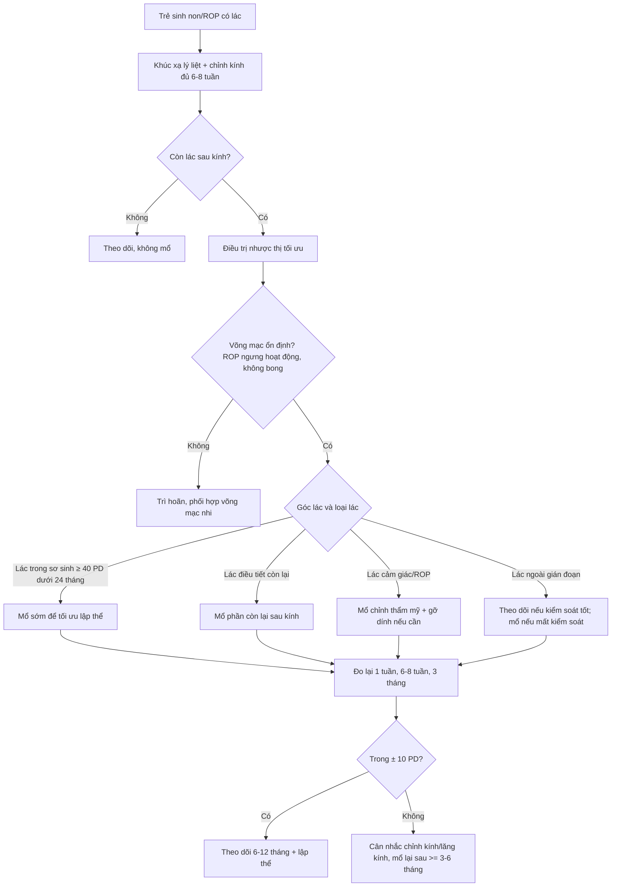
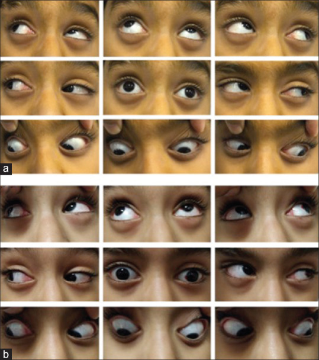
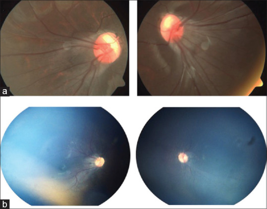

# 472 — Phẫu thuật lác ở trẻ sinh non/ROP: chỉ định, thời điểm, liều – tái phát & cạm bẫy giả lác / Strabismus surgery in preterm/ROP children: indications, timing, dosing, recurrence and pseudo-strabismus pitfalls

**Tags:** `pattern:lac` `pattern:lac-trong` `pattern:lac-ngoai` `vung:mat` `vung:co-van-nhan` `protocol:do-goc-lac` `protocol:khuc-xa-ly-liet` `incidentaloma:rop`
**Mức chắc chắn (certainty):** tổng hợp y văn (literature synthesis) — tổng hợp từ 1 ca nguyên văn có ảnh (PMC7350496), 1 thuần tập 949 trẻ (PMC13018795), 1 nghiên cứu so sánh kết cục mổ 480 mắt (PMC6286133), 1 nghiên cứu tái mổ 24.816 trẻ (PMC10394029), 1 loạt 206 bệnh nhân ROP (PMC10442749) và 1 review thời điểm mổ (PMC9023972); chưa gắn một ca nguyên văn duy nhất của nhóm.

> **Bài này nối tiếp [469 – Lác & nhược thị ở trẻ sinh non/ROP](../469-lac-nhuoc-thi-tre-sinh-non-rop/lesson.md).** 469 phủ **dịch tễ, khúc xạ, điều trị nhược thị và nguyên tắc chung**; bài 472 chỉ đi sâu **quyết định phẫu thuật**: ai mổ, mổ khi nào, mổ kiểu gì, vì sao tái phát và những cái bẫy khiến mổ sai.

## 1. Tổng quan — mổ lác để làm gì, và vì sao trẻ sinh non là "ca khó"

- **Mục tiêu của phẫu thuật (surgical goal):** đưa trục nhãn cầu về **chỉnh vị (orthotropia)** trong **± 10 PD**, tạo điều kiện cho **thị giác hai mắt (binocular single vision)** và **lập thể (stereopsis)**, cải thiện **thẩm mỹ** và **chất lượng sống**. Ở trẻ còn trong **thời kỳ nhạy cảm thị giác**, mục tiêu cảm giác quan trọng ngang mục tiêu vận động.
- **Cơ chế vật lý – giải phẫu (TẠI SAO mổ có tác dụng):** lác là **mất cân bằng lực** giữa các cơ vận nhãn. **Lùi cơ (recession)** làm **yếu** cơ (tăng khoảng cách chèn → giảm mô-men xoắn); **cắt cơ (resection)** làm **mạnh** cơ (ngắn lại → tăng lực kéo). Kết quả phụ thuộc **cung cơ – độ đàn hồi – mô sẹo dính** xung quanh, không chỉ số mm lùi/cắt. Vì vậy cùng một liều mổ cho **kết cục khác nhau** ở mắt có sẹo ROP, đã cryo, đã đặt **đai củng mạc (scleral buckle)** hoặc đã **cắt dịch kính (vitrectomy)**.
- **Vì sao trẻ sinh non/ROP khó hơn trẻ đủ tháng:**
  - **Hoàng điểm lệch (macular ectopia)/kéo hoàng điểm (macular drag):** sẹo xơ–mạch kéo hoàng điểm ra **thái dương**, làm **trục thị giác lệch khỏi trục giải phẫu** → **giả lác ngoài (pseudo-exotropia)** dù thật ra **lác trong**. Đây là cạm bẫy chết người của phẫu thuật lác trong ROP.
  - **Rối loạn phát triển thần kinh (neurodevelopmental disability — NDD):** bại não, bệnh não trắng quanh não thất, xuất huyết não thất — làm **kiểm soát vận nhãn kém**, **tái lác** và **quá chỉnh (overcorrection)** cao hơn.
  - **Khúc xạ phức tạp:** cận thị nặng sau ROP, **loạn thị**, **dị khúc xạ (anisometropia)**, **viễn thị** — vừa gây lác vừa làm mờ ảnh sau mổ.
  - **Nhược thị (amblyopia) và rung giật nhãn cầu (nystagmus)** thường đi kèm → kết quả cảm giác kém dù mắt thẳng.
  - **Mô mềm – củng mạc mỏng, dính:** nguy cơ **thủng củng mạc** khi móc/kéo cơ, đặc biệt mắt đã **cryo điều trị ROP** (đã có báo cáo thủng củng mạc trong mổ lác ở nhóm này — *J Pediatr Ophthalmol Strabismus* 2007; chưa rõ số ca trong bài gốc).
- **Ngưỡng định lượng nằm lòng:**
  - **Tỷ lệ lác ở trẻ sinh non (Gutenberg Prematurity Study Young, 949 trẻ 4–17 tuổi, Fieß A et al., *Br J Ophthalmol* 2026, PMC13018795):** **6%** ở trẻ đủ tháng → **10%** (33–36 tuần) → **12%** (29–32 tuần) → **23%** (≤ 28 tuần) → **20%** (ROP ≤ 32 tuần không điều trị) → **68%** (ROP ≤ 32 tuần **đã điều trị**). Rung giật nhãn cầu: **0,8% → 0,4% → 1,8% → 2,6% → 5,0% → 47%**.
  - **Yếu tố nguy cơ lác trong (esotropia):** **viễn thị OR 4,17**; **dị khúc xạ OR 3,09**; mỗi tuần non thêm **OR 1,11**. Lác nói chung: tuổi thai sớm **OR 1,08/tuần**, **loạn thị OR 2,48**, **viễn thị OR 2,09**.
  - **Kết cục mổ lác ngoài ở trẻ sinh non (Jung EH et al., *PLoS One* 2018, PMC6286133; 48 trẻ sinh non so với 432 đủ tháng, theo dõi trung bình 34,6 ± 13,9 tháng):** **thành công 60,4% vs 61,8% ở 1 năm** (p = 0,691); **43,8% vs 44,2% ở lần khám cuối** (p = 0,977); **tái phát 33,3% → 54,2%** (sinh non) so với **34,5% → 53,2%** (đủ tháng). **Sinh non tự nó KHÔNG phải yếu tố nguy cơ tái phát** (HR 1,139; KTC 95% 0,757–1,714), nhưng **NDD làm tăng quá chỉnh** (p = 0,004).
  - **Tái mổ (Lee JY et al., *Sci Rep* 2023, PMC10394029; 24.816 trẻ ≤ 9 tuổi, Hàn Quốc):** **tỷ lệ tích lũy tái mổ 843/10.000 (8,4%) với lác ngoài** và **1.559/10.000 (15,6%) với lác trong**. Yếu tố nguy cơ: **tuổi mổ < 3 — OR 4,26 (lác ngoài), 6,57 (lác trong)**; **mổ một mắt — OR 6,49 (lác ngoài), 7,20 (lác trong)**.
  - **Thời điểm – bằng chứng:** lác trong sơ sinh **≥ 40 PD** ở 2–4 tháng **hiếm khi tự hết** (0/45 và 0/21 trong 2 thuần tập — PEDIG, dẫn trong PMC9023972). **ELISS** (231 trẻ mổ sớm, tuổi mổ trung bình **20 tháng**, so với 301 trẻ mổ muộn **49,1 tháng**): lập thể ở 6 tuổi **13,5% vs 3,9%**; số mổ/trẻ **1,18 vs 0,99**. **Mổ sớm (< 24 tháng)** có lợi cho **lập thể**, không khác biệt lớn về **góc lác sau mổ**.
  - **Phản biện quan trọng (fidelity + critique):** quan niệm "phải chờ góc lác ổn định mới mổ" **không được chứng minh** trong lác trong sơ sinh: Leuder et al. (n = 30) thấy **11/15 thành công ở cả nhóm góc ổn định (< 5 PD dao động) và nhóm dao động > 10 PD** — **không cần trì hoãn chờ ổn định**. Ngược lại, **trì hoãn kéo dài làm mất cơ hội lập thể**. Với trẻ **sinh non/ROP**, lý do trì hoãn đúng là **chờ võng mạc ổn định (ROP ngưng hoạt động, không có bong võng mạc tiến triển)**, không phải "chờ góc ổn định".

## 2. Mẫu hình + chẩn đoán phân biệt theo cơ chế (gamut)

**Cùng một "mắt lác" nhưng cơ chế quyết định có mổ hay không, mổ cơ nào và tiên lượng.** Gợi nhớ **RIMS**:

- **R — Refractive (khúc xạ):** **lác trong điều tiết (accommodative esotropia)** do **viễn thị chưa chỉnh**; tăng điều tiết → tăng quy tụ → lác trong. **Chỉnh kính lý liệt đủ** có thể làm **thẳng mắt hoàn toàn** → **không mổ**. Thể **một phần (partial accommodative)** còn lác khi nhìn gần dù đeo kính → có thể cần mổ phần còn lại.
- **I — Innervational/neurologic (thần kinh):** bại não, **bệnh não trắng quanh não thất**, xuất huyết não thất, não úng thủy, **liệt dây III/IV/VI**, **hội chứng chặn rung giật (nystagmus blockage syndrome)** — trẻ quy tụ để "khóa" rung giật, giả lác trong. Mổ khi chưa xử lý nguyên nhân thần kinh dễ thất bại.
- **M — Mechanical/restrictive (cơ học/hạn chế):** **ROP có sẹo (cicatricial ROP)**, **đai củng mạc**, **dính cơ sau cryo/cắt dịch kính**, chấn thương hốc mắt, bệnh tuyến giáp. Nghiệm pháp **kéo cưỡng bức (forced duction test)** dương tính = có thành phần hạn chế → cần **gỡ dính** chứ không chỉ lùi/cắt cơ.
- **S — Sensory (cảm giác):** mắt thị lực kém do **ROP nặng, teo thị, đục thể thủy tinh, nhược thị nặng** — mắt yếu "trôi" vào trong hoặc ra ngoài. Mổ **chỉnh thẩm mỹ** là chính; cần nói rõ **không hứa hẹn thị giác hai mắt**.

**Các thể hay gặp ở trẻ sinh non/ROP:**

- **Lác trong sơ sinh (infantile esotropia):** xuất hiện **trước 6 tháng**, góc **lớn (≥ 40 PD)**, thường **hằng định**, kèm **quá hoạt cơ chéo dưới (inferior oblique overaction — IOOA)**, **lệch dọc không tương xứng (dissociated vertical deviation — DVD)**, **rung giật tiềm ẩn (latent nystagmus)**.
- **Lác trong do điều tiết:** thường **2–7 tuổi**, góc **thay đổi theo khoảng cách**, **giảm khi đeo kính viễn**, có **tỷ lệ AC/A cao**.
- **Lác ngoài (exotropia):** hay gặp ở trẻ sinh non lớn hơn, **lác ngoài gián đoạn (intermittent exotropia)**, có thể **quá chỉnh sau mổ lác trong (consecutive exotropia)**.
- **Lác cảm giác sau ROP:** mắt **thị lực kém**, **hoàng điểm lệch**, có thể kèm **lác dọc** và **xoắn (torsion)**; góc đo bằng **prism cover test** khó vì thị lực kém — dùng **Krimsky/Hirschberg** và **đo ở cả nhìn xa – gần**.
- **Giả lác (pseudo-strabismus):** **nếp da góc mắt (epicanthus)**, **góc kappa dương**, **hoàng điểm lệch do ROP** → **trục thị giác lệch**, mắt nhìn như lác ngoài dù **cover test cho thấy lác trong**. **Không được mổ dựa trên Hirschberg đơn thuần.**

## 3. Bảng so sánh phân biệt (ma trận đối chiếu)

| Thực thể (entity) | Hình ảnh/lâm sàng điển hình | Chốt vào (rule-in) | Chốt loại (rule-out) | Gợi ý xác nhận |
|---|---|---|---|---|
| **Lác trong điều tiết (accommodative esotropia)** | Trẻ 2–7 tuổi, lác trong tăng khi nhìn gần, giảm khi đeo kính; viễn thị +2,00 đến +8,00 D | **Khúc xạ lý liệt có viễn thị + góc lác giảm/thẳng khi đeo kính đủ** | **Góc lác không đổi dù chỉnh kính đủ** → không phải thể điều tiết thuần | Khúc xạ lý liệt (cyclopentolate 1% hoặc atropine 1%), đo góc trước/sau kính, AC/A |
| **Lác trong sơ sinh (infantile esotropia)** | Trước 6 tháng, góc ≥ 40 PD, hằng định, IOOA/DVD, rung giật tiềm ẩn | **Xuất hiện < 6 tháng + góc lớn hằng định + không có viễn thị đáng kể** | **Góc nhỏ, gián đoạn, có viễn thị + giảm khi đeo kính** → nghĩ điều tiết | Đo góc xa/gần, đánh giá IOOA/DVD, khúc xạ lý liệt, theo dõi 2–4 tháng |
| **Lác cảm giác sau ROP (sensory/cicatricial)** | Tiền sử laser/cryo/vitrectomy; thị lực chênh; **hoàng điểm lệch thái dương**; có thể lác dọc/xoắn | **ROP đã điều trị + thị lực chênh + hoàng điểm lệch + góc đo được bằng Krimsky** | **Hai mắt thị lực cân bằng, hoàng điểm đúng vị trí** → không phải cảm giác | Soi đáy mắt giãn đồng tử, chụp đáy mắt/OCT, siêu âm B-scan nếu media đục, đo góc nhiều lần |
| **Giả lác ngoài do hoàng điểm lệch (macular drag pseudo-exotropia)** | Nhìn như lác ngoài hai mắt; Hirschberg lệch mũi; **cover test lại là lác trong** | **Hirschberg "ngoài" + cover test "trong" + tiền sử ROP + hoàng điểm kéo thái dương** | **Cover test xác nhận lác ngoài thật + không có kéo hoàng điểm** | **Cover test là chốt**; chụp đáy mắt; không mổ theo Hirschberg |
| **Lác ngoài gián đoạn (intermittent exotropia)** | Lác ngoài khi mệt/nhìn xa, có lúc thẳng; kiểm soát tốt khi nhìn gần | **Góc ngoài chỉ xuất hiện khi phá dung hợp, còn lúc khác thẳng** | **Lác ngoài hằng định + không bao giờ thẳng** → lác ngoài thường trực | Đo góc xa/gần, test che mắt 30–60 phút, kiểm soát (control) |
| **Hội chứng chặn rung giật (nystagmus blockage)** | Lác trong "chủ động" để giảm rung giật; đầu quay; thị lực tốt hơn khi lác | **Lác trong + rung giật giảm khi quy tụ + đầu quay** | **Không có rung giật, lác trong hằng định** → lác trong thông thường | Quan sát rung giật khi che mắt, đo thị lực ở các tư thế, ghi video |

*Ảnh lâm sàng lác trong mắt phải (esotropia of the right eye) — minh họa hướng lệch trục nhãn cầu, không phải ca ROP. Ảnh: Kakawere, Wikimedia Commons, CC BY 4.0 (giữ nguyên bản).*

### Ba dấu hiệu phải đo trước khi quyết định mổ
- **Góc lác (angle of deviation) tính bằng PD (prism diopter), đo ở cả nhìn xa 5–6 m và nhìn gần 33–40 cm**, có/không kính, có/không che mắt. Ghi **góc nguyên phát và góc ở các hướng nhìn** (9 hướng) để phát hiện **không đồng nhất (incomitance)**.
- **Kiểm soát (control) và tần suất lác** ở lác gián đoạn: dùng thang **NCS (Newcastle Control Score) 0–7** hoặc **LACTOSE 0–6** — điểm cao = lác nhiều = cân nhắc mổ sớm hơn.
- **Lập thể (stereoacuity)**: Titmus/Randot/TNO; **mất lập thể** là lý do mổ sớm, còn **lập thể tốt** cho phép theo dõi ở lác gián đoạn nhẹ.

## 4. Protocol chụp/đo + thuật toán phẫu thuật

### 4.1. Đánh giá trước mổ (bắt buộc đủ bộ)

- **Khúc xạ lý liệt (cycloplegic refraction):** **cyclopentolate 1%** (nhỏ 2–3 lần, cách 5 phút) hoặc **atropine 1%** (3 ngày) ở trẻ nhỏ/trẻ có rung giật; **phải chỉnh kính đủ và cho đeo 6–8 tuần** trước khi kết luận không đáp ứng. Ở trẻ sinh non, **cận thị cao sau ROP** phải chỉnh đủ — không cắt bớt độ.
- **Thị lực:** tuổi phù hợp (Teller/Snellen/Lea/ETDRS); **thị lực từng mắt** (che mắt) để phát hiện **nhược thị** — mổ lác khi nhược thị chưa điều trị thường **tái lác và kết quả cảm giác kém**.
- **Đo vận nhãn:** 9 hướng nhìn, **ductions/versions**, tìm **IOOA** (quá hoạt cơ chéo dưới), **DVD**, **hạn chế vận nhãn**.
- **Forced duction test** (dưới gây mê) khi nghi **hạn chế cơ học**: ROP sẹo, đai củng mạc, dính sau cryo. Dương tính → cần **gỡ dính/tenolysis** hoặc **cắt dải xơ**, không chỉ lùi cơ.
- **Đáy mắt giãn đồng tử:** loại trừ **bong võng mạc**, **ROP hoạt động**, **kéo hoàng điểm**, **teo thị**; **OCT** nếu trẻ hợp tác; **siêu âm B-scan** nếu đục media.
- **Đánh giá toàn thân:** tiền sử **sinh non, cân nặng lúc sinh, ROP, bại não, động kinh, bệnh phổi mạn (BPD)**; **nguy cơ ngưng thở sau mê** ở trẻ sinh non — phối hợp gây mê nhi, theo dõi **SpO₂/apnea** sau mổ theo phác đồ địa phương.
- **Chụp hình ảnh:** không có chỉ định chẩn đoán lác bằng CT/MRI thường quy; **MRI/CT sọ** chỉ khi nghi **bệnh thần kinh – hốc mắt** (liệt dây, proptosis, chấn thương). Với ROP, **ảnh đáy mắt/OCT** quan trọng hơn CT.

### 4.2. Chọn kiểu mổ (nguyên tắc, không có công thức chung)

| Tình huống | Lựa chọn thường dùng | Điều cần lưu ý |
|---|---|---|
| Lác trong 15–40 PD, không hạn chế | **Lùi hai cơ trực trong (bilateral medial rectus recession)** hoặc **lùi–cắt một mắt (recess–resect)** | Ưu tiên **hai mắt** ở trẻ nhỏ để tránh **tái mổ** (mổ một mắt OR 6,49–7,20) |
| Lác trong > 40 PD | **Lùi hai trực trong + lùi/cắt trực ngoài** hoặc **mổ 3–4 cơ** | Nguy cơ **quá chỉnh** và **hạn chế vận nhãn**; cân nhắc **mổ hai thì** |
| Lác ngoài 15–40 PD | **Lùi hai trực ngoài** hoặc **lùi–cắt một mắt** | Ở trẻ **NDD**, quá chỉnh hay gặp — **giảm liều** so với trẻ thường |
| Có **IOOA/DVD** | **Làm yếu cơ chéo dưới (IO myectomy/recession)** cùng thì hoặc thì sau | Không bỏ sót **lệch dọc** — sẽ lộ ra sau khi chỉnh ngang |
| **Hạn chế cơ học** (ROP sẹo, đai) | **Gỡ dính + lùi cơ**; đôi khi **cắt dải xơ** | **Forced duction** quyết định; nguy cơ **thủng củng mạc** ở mắt mỏng |
| Lác nhỏ < 10 PD, thẩm mỹ chấp nhận | **Theo dõi/kính lăng** hoặc **botulinum toxin A** (chọn lọc) | Không mổ chỉ vì "thấy lệch" nếu không ảnh hưởng chức năng/thẩm mỹ |

- **Liều cụ thể (mm) theo bảng của từng phẫu thuật viên** dựa trên **góc lác, chiều dài nhãn cầu, độ đàn hồi cơ**; **chưa có công thức được kiểm chứng riêng cho trẻ sinh non** — không suy diễn liều người lớn sang trẻ nhỏ.
- **Botulinum toxin A** vào cơ trực trong/ngoài là lựa chọn ở **lác nhỏ, lác sau liệt dây VI, hoặc trẻ quá nhỏ**; hiệu quả **tạm thời**, có thể lặp; **không thay thế** mổ khi góc lớn/hạn chế cơ học.

### 4.3. Thời điểm mổ — thuật toán

- **Ngưỡng thực hành:** mổ khi **góc lác hằng định ≥ 10–15 PD** gây **mất lập thể/rối loạn chức năng** hoặc **ảnh hưởng thẩm mỹ rõ**; với **lác trong sơ sinh ≥ 40 PD**, không chờ tự hết.
- **Mốc vàng cho lập thể:** chỉnh vị **trước 12–24 tháng** cho kết quả lập thể tốt nhất; **mổ sau 39 tháng** hầu như **không đạt lập thể** trong loạt của Çerman (dẫn trong PMC9023972) — nhưng vẫn **cải thiện thẩm mỹ/chất lượng sống** ở mọi tuổi.
- **Theo dõi sau mổ:** **1 tuần** (nhiễm trùng, hạn chế vận nhãn), **6–8 tuần** (góc lác, quá chỉnh), **3 tháng**, sau đó **6–12 tháng**; đo lại **khúc xạ** vì cận thị ROP có thể tiến triển.

### 4.4. Hệ phân độ/điểm dùng trong thực hành (không có RADS cho lác)

| Thang | Thành phần | Ngưỡng/ý nghĩa |
|---|---|---|
| **Góc lác (PD)** | Prism alternate cover test xa/gần | **< 10 PD**: nhỏ; **10–20 PD**: vừa; **20–40 PD**: lớn; **> 40 PD**: rất lớn |
| **Kiểm soát lác gián đoạn** | NCS 0–7 hoặc LACTOSE 0–6 | Điểm cao = lác thường xuyên; **NCS ≥ 3** thường là ngưỡng cân nhắc can thiệp |
| **Lập thể** | Titmus/Randot/TNO (arcsec) | Mất lập thể = ưu tiên mổ sớm; lập thể tốt = theo dõi |

## 5. Biến thể bình thường và cạm bẫy

- **Cạm bẫy số 1 — giả lác ngoài do hoàng điểm lệch:** trẻ ROP có **Hirschberg lệch mũi** (trông như lác ngoài) nhưng **cover test cho thấy lác trong**. Nếu mổ theo "lác ngoài" sẽ **làm lác trong nặng thêm**. Ca nguyên văn: bé trai 8 tuổi, **35 PD lác trong**, **−7,50 D**, Hirschberg "ngoài", cover test "trong"; xử trí **làm yếu hai cơ chéo dưới** vì V-pattern, **cố ý không chỉnh lác trong** để tránh làm giả lác ngoài rõ hơn (Sethi A et al., *Indian J Ophthalmol* 2020, PMC7350496). Ca 2: bé 6 tuổi, **15° giả lác ngoài**, **−6,50 D**, **điều trị bảo tồn**.
- **Cạm bẫy số 2 — mổ lác trong điều tiết khi chưa chỉnh kính đủ:** nếu chưa **khúc xạ lý liệt**, bỏ sót **viễn thị +2,00 đến +8,00 D** → mổ oan, rồi vẫn lác. **Luôn cho đeo kính đủ 6–8 tuần** trước khi kết luận.
- **Cạm bẫy số 3 — "chờ góc ổn định" quá lâu:** bằng chứng **không chứng minh** phải chờ (Leuder n = 30); chờ lâu **mất lập thể**. Trì hoãn chỉ hợp lý khi **võng mạc chưa ổn định** hoặc **nhược thị chưa điều trị**.
- **Cạm bẫy số 4 — bỏ sót lệch dọc/DVD/IOOA:** chỉnh ngang xong mới lộ **lệch dọc**; cần **đo 9 hướng** và xử lý **cơ chéo** cùng lúc nếu có chỉ định.
- **Cạm bẫy số 5 — mổ một mắt ở trẻ nhỏ:** **OR tái mổ 6,49–7,20** so với mổ hai mắt; nếu góc phù hợp, **ưu tiên hai mắt**.
- **Cạm bẫy số 6 — quá chỉnh ở trẻ NDD:** **NDD là yếu tố nguy cơ quá chỉnh** (p = 0,004); cân nhắc **giảm liều** và **theo dõi sát**.
- **Cạm bẫy số 7 — thủng củng mạc:** mắt ROP đã **cryo** có củng mạc mỏng/dính; **móc cơ nhẹ tay**, dùng **móc không sắc**, kiểm tra **đáy mắt** nếu nghi.
- **Cạm bẫy số 8 — coi lác cảm giác là "thất bại kỹ thuật":** ở mắt thị lực kém, **tái lác là quy luật**, cần **tư vấn trước mổ** rằng mục tiêu là **thẩm mỹ**, không phải thị giác hai mắt.
- **Cạm bẫy số 9 — bỏ qua nguy cơ gây mê:** trẻ sinh non/BPD có **nguy cơ ngưng thở sau mê**; **không mổ ngoại trú** ở trẻ nguy cơ cao.

*(a) Trước mổ: giả lác ngoài hai mắt, quá hoạt cơ chéo dưới, V-pattern. (b) Sau mổ: V-pattern và động tác nâng khi nhìn vào giảm; **lác trong không chỉnh** để tránh làm giả lác ngoài nặng thêm. Nguồn: Sethi A et al., Indian J Ophthalmol 2020 (PMC7350496), Fig. 1, CC BY-NC-SA 4.0 (giữ nguyên bản).*

*(a) Ca 1 và (b) Ca 2: **kéo hoàng điểm thái dương (temporal macular drag)**, ROP đã thoái triển. Đĩa thị–hoàng điểm lệch làm trục thị giác lệch khỏi trục giải phẫu → Hirschberg "ngoài" dù cover test "trong". Nguồn: Sethi A et al., PMC7350496, Fig. 2, CC BY-NC-SA 4.0 (giữ nguyên bản).*

## 6. Tự lượng giá — Blind Quiz

**Ca 1 — Bé trai 8 tuổi, sinh non, đã laser ROP. Nhìn như lác ngoài hai mắt 3 năm. Thị lực 20/40 mỗi mắt với −7,50 D. Hirschberg lệch mũi, nhưng cover test cho thấy mắt đi từ ngoài vào trong.**

- Gợi ý lâm sàng: ROP đã điều trị, cận thị cao, không đau, không song thị (trẻ nhỏ thường không kêu).
- Câu hỏi: Đây là lác ngoài hay lác trong? Vì sao Hirschberg và cover test "nói khác nhau"? Nên mổ cơ nào?

<b>Bấm để hiện đáp án (findings + chẩn đoán)</b>

- **Dấu hiệu:** Hirschberg **lệch mũi** (giả lác ngoài), nhưng **cover test** cho **chuyển động vào–ra** → **lác trong thật 35 PD**, kèm **quá hoạt cơ chéo dưới hai bên** và **V-pattern**. Đáy mắt: **kéo hoàng điểm thái dương** hai mắt.
- **Chẩn đoán:** **giả lác ngoài (pseudo-exotropia) do hoàng điểm lệch + lác trong thật** ở trẻ ROP — không phải lác ngoài.
- **Xử trí trong ca nguồn:** **làm yếu hai cơ chéo dưới** để chỉnh V-pattern; **cố ý không chỉnh lác trong** để tránh làm giả lác ngoài rõ hơn. Sau mổ V-pattern và động tác nâng giảm.
- **Bài học:** **cover test là chốt**, không mổ theo Hirschberg/ảnh.
- Nguồn ảnh: Sethi A et al., Indian J Ophthalmol 2020 (PMC7350496), Fig. 1, CC BY-NC-SA 4.0.

**Ca 2 — Bé gái 5 tuổi, sinh 27 tuần, ROP đã laser, lác ngoài 30 PD. Mổ lùi hai trực ngoài. Ba tháng sau còn lác ngoài 12 PD, mẹ hỏi "có phải mổ lại không".**

- Gợi ý lâm sàng: không có hạn chế vận nhãn, không có NDD, đang đeo kính đúng.
- Câu hỏi: Tỷ lệ thành công và tái phát sau mổ lác ngoài ở trẻ sinh non là bao nhiêu? Có nên mổ lại ngay không?

<b>Bấm để hiện đáp án (findings + chẩn đoán)</b>

- **Số liệu:** ở 48 trẻ sinh non mổ lác ngoài, **thành công 60,4% ở 1 năm** và **43,8% ở lần khám cuối**; **tái phát 33,3% → 54,2%** — **tương đương trẻ đủ tháng** (61,8%/44,2%; 34,5%→53,2%). **Sinh non không phải yếu tố nguy cơ tái phát** (HR 1,139; KTC 95% 0,757–1,714).
- **Chẩn đoán:** **tái lác ngoài sau mổ** — diễn tiến thường gặp, không phải biến chứng bất thường.
- **Xử trí:** **theo dõi thêm 3–6 tháng**, đo góc xa/gần, kiểm soát, lập thể; **chỉ mổ lại khi góc ổn định ≥ 15 PD** hoặc ảnh hưởng thẩm mỹ/chức năng. Nếu **NDD**, cảnh báo **nguy cơ quá chỉnh**.
- **Bài học:** tư vấn trước mổ rằng **tái phát ~1/2 ở 3–4 năm** là kịch bản có thể xảy ra, không phải "mổ hỏng".
- Nguồn số: Jung EH et al., PLoS One 2018 (PMC6286133), CC BY 4.0.

**Ca 3 — Bé gái 4 tuổi, nhìn gần hay lác trong, nhìn xa thẳng. Chưa đo khúc xạ lý liệt. Mẹ xin mổ vì "cô giáo nói mắt lác".**

- Gợi ý lâm sàng: lác thay đổi theo khoảng cách; không có tiền sử ROP; chưa đeo kính.
- Câu hỏi: Bước đầu tiên là gì? Khi nào mới cân nhắc mổ?

<b>Bấm để hiện đáp án (findings + chẩn đoán)</b>

- **Dấu hiệu:** lác trong **tăng khi nhìn gần**, giảm/straight khi nhìn xa — gợi ý **thành phần điều tiết**.
- **Chẩn đoán:** nghi **lác trong điều tiết (accommodative esotropia)** do **viễn thị chưa chỉnh**; cần **khúc xạ lý liệt** (cyclopentolate 1% hoặc atropine 1%).
- **Xử trí:** **chỉnh kính viễn đủ** và cho đeo **6–8 tuần**; nếu thẳng hoàn toàn → **không mổ**. Nếu còn lác khi nhìn gần/gần với kính → **lác điều tiết một phần**, có thể mổ **phần còn lại** sau khi đã chỉnh kính và điều trị nhược thị.
- **Bài học:** **không mổ lác trước khi đo khúc xạ lý liệt** — đây là lỗi hay gặp nhất ở trẻ mầm non.
- Nguồn ảnh: Kakawere, Wikimedia Commons, CC BY 4.0 (ảnh minh họa, không phải ca cụ thể).

## Bài liên quan chéo
- [400 – Tổng quan Mắt & thị giác](../400-tong-quan-mat-thi-giac/lesson.md)
- [469 – Lác & nhược thị ở trẻ sinh non/ROP](../469-lac-nhuoc-thi-tre-sinh-non-rop/lesson.md)
- [456 – Bệnh võng mạc trẻ sinh non (ROP): phân vùng – giai đoạn – sàng lọc](../456-benh-vong-mac-tre-sinh-non/lesson.md)
- [458 – Di chứng & theo dõi dài hạn sau ROP](../458-di-chung-theo-doi-dai-han-sau-rop/lesson.md)
- [471 – Rung giật nhãn cầu ở trẻ nhũ nhi & trẻ sinh non](../471-rung-giat-nhan-cau-tre-nhu-nhi/lesson.md)
- [483 – Sàng lọc thị lực trẻ mầm non](../483-sang-loc-thi-luc-tre-mam-non/lesson.md)

## Ảnh
- Tên file `472_<mô tả>_<modality>_<nguồn>-<Fig>-<license>.jpg`; nguồn + giấy phép từng ảnh trong `images/CREDITS.md`.
- Ảnh PMC7350496 là **CC BY-NC-SA 4.0** — dùng nguyên bản, **không crop/kéo giãn**, ghi công và chia sẻ lại theo cùng giấy phép.
- Ảnh Wikimedia Commons là **CC BY 4.0**, ghi công tác giả.
- Không tải ảnh từ AuntMinnie/paywall; nguồn đóng chỉ dẫn link ở `sources.md`.

> Không dùng để chẩn đoán độc lập khi chưa có người hướng dẫn.
