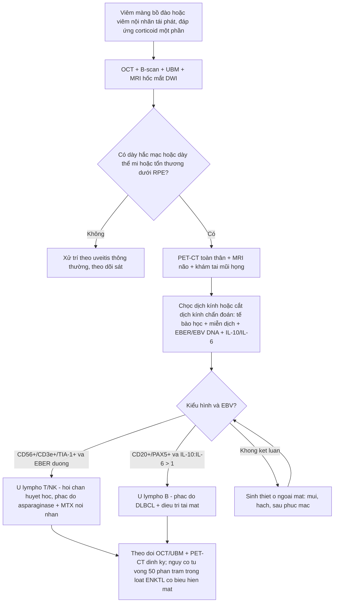
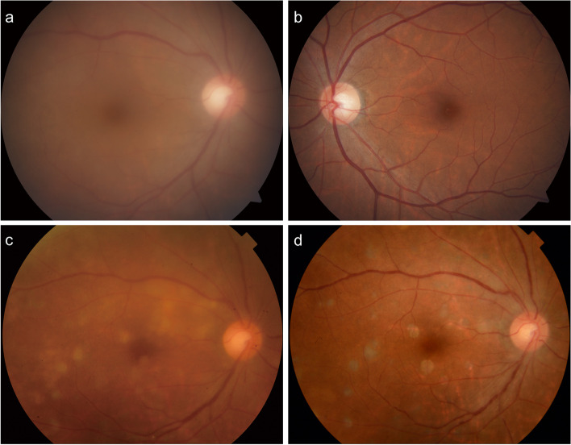
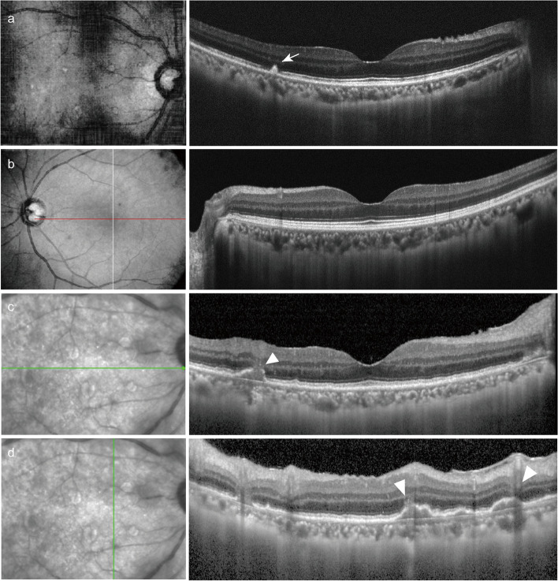
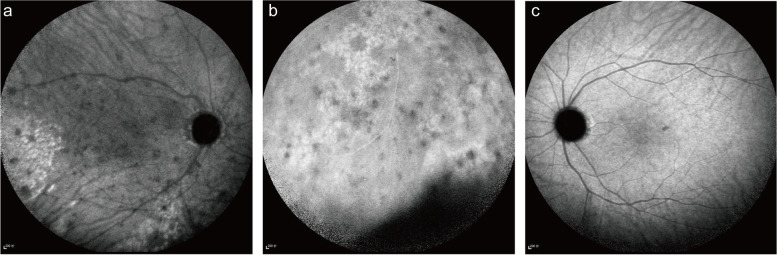
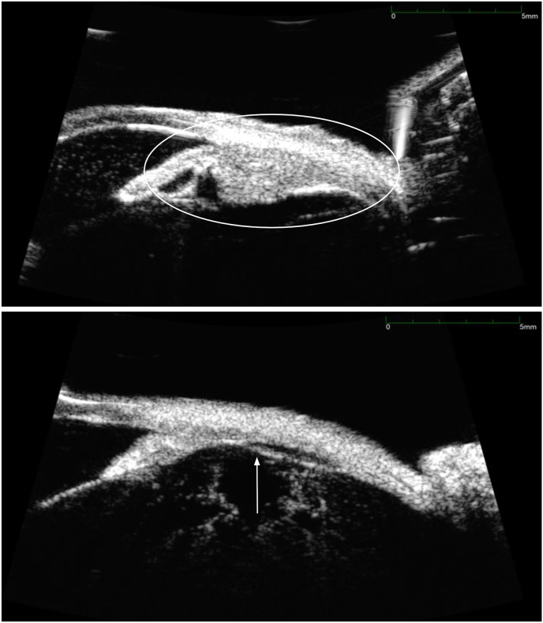
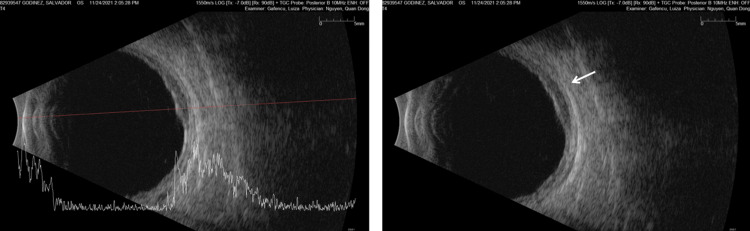
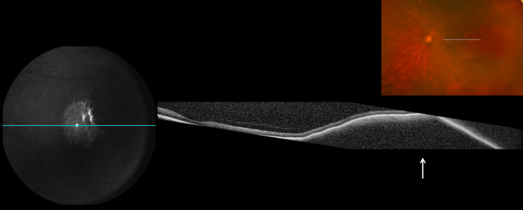

# 473 — U lympho T/NK nội nhãn & u lympho THỨ PHÁT ở mắt: khi IL-10 không cứu được bạn / Intraocular T/NK-cell lymphoma and secondary intraocular lymphoma

**Tags:** `pattern:u-lympho-T-NK` `pattern:u-lympho-thu-phat` `pattern:viet-dich-kinh` `pattern:day-hac-mac` `vung:vong-mac` `vung:hac-mac` `vung:the-mi` `anatomy:the-mi` `score:IL-10-IL-6` `score:EBER` `protocol:OCT` `protocol:UBM` `protocol:sinh-thiet-dich-kinh` `protocol:PET-CT`
**Mức chắc chắn (certainty):** tổng hợp y văn (literature synthesis) — nhóm tự biên từ các bài mở: loạt 107 bệnh nhân ENKTL có biểu hiện mắt (Eye 2025, CC BY 4.0, PMC12669774), ca thể mi kèm tổng quan IL-10/IL-6 (Am J Ophthalmol Case Rep 2025, CC BY-NC-ND 4.0, PMC12686643), ca u lympho T/NK thứ phát từ ổ bụng kèm bảng so sánh T/NK vs B (BMC Ophthalmol 2022, CC BY 4.0, PMC8962092), và ca u lympho hắc mạc thứ phát sau DLBCL tinh hoàn (Cureus 2026, CC BY 4.0, PMC13054440).

> **Vì sao bài này quan trọng:** bài **462** đã dạy "u lympho nội nhãn = DLBCL tế bào B, chốt bằng **IL-10:IL-6 > 1**". Nhưng **u lympho nội nhãn không chỉ có tế bào B**: thể **T/NK** (thường là ENKTL týp mũi — *extranodal NK/T-cell lymphoma, nasal type*) và **u lympho thứ phát** từ một ổ hệ thống (DLBCL tinh hoàn, u lympho sau phúc mạc…) có **sinh học, dấu ấn và điều trị khác hẳn**. Dùng IL-10 làm "chốt loại" sẽ **bỏ sót đúng nhóm bệnh nặng nhất**: trong tổng quan y văn của bài thể mi, **71% ca u lympho T nội nhãn đã công bố có tỉ lệ IL-10/IL-6 < 1** — tức là **âm tính giả theo tiêu chuẩn của PVRL tế bào B**. Hệ quả: bệnh nhân bị điều trị như "viêm màng bồ đào", u lympho T/NK **tiến triển nhanh, hoại tử, thủng củng mạc**, và **50% tử vong** trong loạt ENKTL có biểu hiện mắt. Bài này bổ sung **cửa thứ hai**: *EBV + miễn dịch tế bào + hình ảnh hắc mạc/thể mi*, không chỉ cytokine.

## 1. Tổng quan bệnh học – cơ chế hình ảnh

- **Ba nhóm cần phân biệt trong cùng một mắt "giả uveitis":**
  1. **U lympho nội nhãn tiên phát tế bào B (PVRL)** — ~đa số, DLBCL, thường hai mắt, người > 60 tuổi, tổn thương **dưới biểu mô sắc tố (sub-RPE)** (bài 462).
  2. **U lympho T/NK nội nhãn** — **thường là biểu hiện thứ phát của ENKTL týp mũi** hoặc u lympho T ngoại vi (PTCL-NOS); thể **tiên phát trong mắt cực hiếm**. Trong loạt 107 ENKTL, **12 ca (11,2%) có triệu chứng mắt**, trong đó **4 ca chỉ có tổn thương trong nhãn** (PMC12669774).
  3. **U lympho THỨ PHÁT ở mắt (secondary intraocular lymphoma)** — u lympho hệ thống **tái phát vào mắt** như một **ổ miễn dịch đặc quyền (immune-privileged site)**, có thể **nhiều năm sau khi lui bệnh** (ca DLBCL tinh hoàn: **5 năm**; PMC13054440).
- **Cơ chế hình ảnh (TẠI SAO — 4 cửa Argon):**
  - **Tế bào lympho ác xâm nhập mô đệm hắc mạc/thể mi** → **dày hắc mạc lan tỏa** (B-scan **2,8–3,2 mm** trong ca thứ phát; bình thường ~< 2 mm tùy vị trí) và **dày thể mi** trên **UBM**. Vì u **thấm (infiltrative)** chứ không tạo khối rắn, siêu âm thấy **dày đều, bờ không rõ**, khác melanoma/nang.
  - **Tế bào u bám khoang dưới RPE** → **nốt tăng phản hồi (hyperreflective) dưới RPE** trên OCT, đáy mắt thấy **ổ vàng–kem sâu**; đây là dấu **dùng chung với PVRL**, nên **không phân biệt được T/NK vs B bằng OCT**.
  - **Vì sao T/NK khác B về hình ảnh:** ENKTL **xâm lấn thành mạch (angioinvasive)** và gây **hoại tử**, nên hay có **hypopyon, nốt trên mống mắt, thủng củng mạc, viêm màng bồ đào trước dữ dội** — bệnh cảnh **"viêm tiền phòng"** chứ không "lặng lẽ dưới RPE". Trong ca thể mi, biểu hiện đầu là **giả hạt keratic (pseudo-keratic precipitates)** + **dày thể mi**.
  - **Vì sao MRI hốc mắt giúp:** u lympho **giàu tế bào, tỉ lệ nhân/bào tương cao** → **hạn chế khuếch tán (restricted diffusion, ADC thấp)**, **T1W đồng–giảm tín hiệu, T2W đồng–giảm tín hiệu**, ngấm thuốc **đồng nhất, vừa**. Melanoma có **T1W tăng tín hiệu** (melanin) — đây là chốt loại trên MRI.
  - **Vì sao EBV quan trọng:** ENKTL **liên quan EBV gần như bắt buộc**; dịch kính **EBV DNA dương 9,90 × 10³ copy/mL** và mô **EBER 100% dương** trong ca thứ phát (PMC8962092). EBV **không** đặc hiệu cho ung thư (còn gặp trong viêm nhiễm), nhưng **EBER + kiểu hình CD56+/CD3ε+/TIA-1+/GrB+** là **chốt mô bệnh**.
- **Ngưỡng định lượng phải nhớ:**
  - **IL-10/IL-6:** **> 1** gợi ý u lympho tế bào B (PVRL); **< 1 ở 71% u lympho T nội nhãn** → **KHÔNG dùng để loại trừ u lympho T/NK**. Ca BMC có **IL-10 39,4 pg/mL, IL-6 37,5 pg/mL, tỉ lệ 1,05** — vẫn là ENKTL.
  - **Loạt ENKTL có biểu hiện mắt (n = 12):** tuổi trung vị **47 (25–74)**, **nam:nữ = 5:1**, **8 ca một mắt / 4 ca hai mắt**, **8 ca chỉ tổn thương phần phụ / 4 ca chỉ trong nhãn**, khoảng cách từ chẩn đoán ENKTL tới triệu chứng mắt **18,1 ± 20,8 tháng**; theo dõi **23,5 (2–45) tháng**: **9 tái phát, 6 tử vong (50%)**, sống trung bình **17 (2–45) tháng**; trong 7 mắt của 6 ca sống, **chỉ 2 mắt đạt 20/25, 4 mắt < đếm ngón tay (HM)**.
  - **Điều trị tại mắt:** **methotrexate (MTX) nội nhãn 400 µg/0,1 mL** khi xác định di căn trong nhãn; **cắt dịch kính chẩn đoán (diagnostic PPV)** khi đục dịch kính/xuất huyết/bong võng mạc (PMC12669774).
  - **U lympho hắc mạc thứ phát:** B-scan **dày hắc mạc 2,8–3,2 mm**, **phản hồi trong trung bình–cao**, **không đục dịch kính lúc đầu** — dễ bị đọc là "dày hắc mạc vô căn" (PMC13054440).

## 2. Mẫu hình + chẩn đoán phân biệt theo vị trí (gamut)

**Câu hỏi lọc:** *"Viêm màng bồ đào/viêm nội nhãn ở người có u lympho hệ thống (hoặc tiền sử u lympho tinh hoàn, mũi, họng), điều trị corticoid chỉ đỡ tạm, kèm **dày hắc mạc/thể mi** hoặc **hypopyon tái phát** — có phải u lympho thứ phát/T/NK không?"*

**Gamut theo vị trí:**
- **Dịch kính (vitreous):** **u lympho T/NK** (đục dịch kính nhanh, tế bào ít atypia trên H&E — dễ âm tính giả) vs **PVRL tế bào B** (462) vs **viêm màng bồ đào trung gian** vs **nấm nội nhãn** (463) vs **CMV/ARN** (452) vs **viêm nội nhãn do vi khuẩn** (mủ, đau, giờ–ngày).
- **Hắc mạc (choroid):** **u lympho thứ phát** (dày lan tỏa, không đục dịch kính) vs **u lympho hắc mạc tiên phát** vs **melanoma** (khối, T1W tăng) vs **di căn hắc mạc** (nhiều ổ, bệnh nguyên phát) vs **hemangioma hắc mạc** (tăng huỳnh quang sớm, T2 sáng).
- **Thể mi (ciliary body):** **u lympho thể mi** (dày trên UBM, giả hạt keratic, hạ nhãn áp) vs **melanoma thể mi** vs **di căn** vs **viêm thể mi (cyclitis)**.
- **Tiền phòng/mống mắt (anterior segment):** **ENKTL** (hypopyon, nốt mống mắt, pseudohypopyon) vs **viêm màng bồ đào trước** vs **u hắc mạc mống mắt** vs **di căn**.
- **Hốc mắt/phần phụ (orbit–adnexa):** **ENKTL mũi–hốc mắt** (giả viêm mô tế bào, giả viêm xoang) vs **viêm mô tế bào hốc mắt** vs **GPA/IgG4** (451).

## 3. Bảng so sánh phân biệt (ma trận đối chiếu)

| Thực thể (entity) | Hình ảnh điển hình | Chốt vào (rule-in) | Chốt loại (rule-out) | Gợi ý xác nhận |
|---|---|---|---|---|
| **U lympho T/NK nội nhãn (ENKTL)** | Đục dịch kính **nhanh**, **hypopyon/nốt mống mắt**, **dày thể mi trên UBM**, có thể thủng củng mạc | **Tiền sử ENKTL mũi + EBV DNA dịch kính dương + EBER+ + CD56/CD3ε/TIA-1/GrB+** | **IL-10/IL-6 > 1** không loại trừ; **EBER âm + kiểu hình B (CD20+)** → nghĩ B | PCR EBV dịch kính, tế bào học/miễn dịch, UBM thể mi, sinh thiết mũi nếu có ổ |
| **PVRL tế bào B (462)** | Ổ vàng–kem **dưới RPE**, đục dịch kính **ít viêm**, hai mắt, > 60 tuổi | **IL-10 dịch kính > 400 pg/mL**, **IL-10:IL-6 > 1**, **MYD88 L265P** | **IL-10 thấp + EBV+ + CD56+** → chuyển hướng T/NK | Cytokine + MYD88 + CD20/PAX5 |
| **U lympho thứ phát (B hoặc T)** | **Dày hắc mạc lan tỏa 2,8–3,2 mm**, thâm nhiễm dưới võng mạc, **có thể không đục dịch kính**; ICGA **đốm giảm huỳnh quang** | **Tiền sử u lympho hệ thống + dày hắc mạc + PET-CT có ổ ngoài mắt** | **Khối đơn độc T1W tăng + melanin** → melanoma; **hắc mạc bình thường** → loại | B-scan 10–20 MHz, OCT, ICGA, **PET-CT toàn thân**, sinh thiết hắc mạc/dịch kính |
| **Melanoma hắc mạc** | Khối **vòm**, bờ rõ, **T1W tăng – T2W giảm**, siêu âm **phản hồi trung bình–thấp + khoét âm (acoustic hollowing)** | **T1W tăng tín hiệu**, vôi hóa/không, khối đơn độc | **Dày lan tỏa hai bên + T1W không tăng** → không phải melanoma | MRI hốc mắt + siêu âm A/B |
| **Di căn hắc mạc** | **Nhiều ổ kem–trắng dẹt**, hai mắt, bệnh nguyên phát rõ | **U nguyên phát (vú/phổi) + nhiều ổ + FAF tăng** | **Một ổ dày lan tỏa đơn độc** → ít nghĩ di căn | PET-CT, sinh thiết nếu cần |
| **Viêm màng bồ đào trung gian** | Đục dịch kính **dày**, "snowbank", **không dày hắc mạc** | **Đáp ứng corticoid rõ, IL-10 thấp, không tế bào ác** | **Dày hắc mạc/thể mi + EBV+** → không phải vô căn | Theo dõi + cytokine + tế bào học |
| **Nấm nội nhãn (463)** | **"Fluff ball"/"chuỗi ngọc trai"**, bối cảnh candidemia/ICU | **Cấy/PCR nấm dương, bạch cầu trung tính trong dịch kính** | **EBER+ / tế bào lympho ác** → u lympho | Cấy + PCR + soi đáy mắt |

*(A, C, E) Đáy mắt góc rộng mắt trái: **đục dịch kính** và các **ổ thâm nhiễm vàng–trắng dọc mạch máu** lan tỏa, mờ dần sau điều trị; (B) tiền phòng: **giả hạt keratic mịn rải rác**; (D) tế bào học dịch kính: **tế bào lympho rải rác, không atypia rõ** — đây là lý do **tế bào học đơn thuần dễ âm tính**; (F) sau cắt dịch kính: dịch kính trong, võng mạc áp. Nguồn: Luo J et al., Eye (Lond) 2025 (PMC12669774) Fig. 2, CC BY 4.0.*

## 4. Protocol chẩn đoán + theo dõi + sơ đồ quyết định

**Bước 1 — Hình ảnh (không xâm lấn):**
- **OCT hoàng điểm:** nốt tăng phản hồi **dưới RPE**, bất thường RPE dạng "gò", dịch dưới võng mạc; đo chiều dày hắc mạc nếu OCT EDI.
- **B-scan 10–20 MHz:** **đo chiều dày hắc mạc** (ca thứ phát **2,8–3,2 mm**), phát hiện đục dịch kính, bong võng mạc, loại khối đặc.
- **UBM:** **bắt buộc khi nghi thể mi** — đo độ dày thể mi, tìm dịch dưới võng mạc ngoại vi (ca PMC12686643).
- **MRI hốc mắt:** T1W, T2W, **DWI/ADC**, T1W **fat-sat sau tiêm** — u lympho **hạn chế khuếch tán**, T1W không tăng (loại melanoma).
- **PET-CT toàn thân + MRI não:** tìm **ổ ngoài mắt** (mũi, sau phúc mạc, tinh hoàn, CNS) — quyết định đây là **thứ phát** hay tiên phát.

**Bước 2 — Lấy mẫu (chẩn đoán xác định):**
- **Chọc hút dịch kính/dịch tiền phòng** hoặc **cắt dịch kính chẩn đoán**; gửi **đồng thời**: tế bào học, **dòng chảy tế bào/miễn dịch tế bào (CD3, CD56, TIA-1, GrB, CD20, PAX5, Ki-67)**, **EBER/EBV DNA**, **TCR/IgH PCR**, **IL-10/IL-6**, NGS.
- **Sinh thiết ổ ngoài mắt** (mũi, hạch, sau phúc mạc) khi có — **chốt chẩn đoán thường đến từ ổ ngoài mắt**, không phải từ dịch kính (ca PMC12686643: sinh thiết mũi xác nhận tái phát ENKL **sau 5 chu kỳ MTX nội nhãn**).
- **Nguyên tắc:** **không dùng corticoid trước khi lấy mẫu** nếu nghi u lympho (làm ly giải tế bào → âm tính giả).

**Bước 3 — Điều trị & theo dõi (khung):**
- **ENKTL:** hóa trị **chứa asparaginase** (SMILE, DDGP, P-GemOx) ± **xạ trị** vùng mũi; thể trong nhãn: **MTX nội nhãn 400 µg/0,1 mL** ± cắt dịch kính; **không dùng corticoid đơn thuần**.
- **U lympho B thứ phát:** điều trị theo **phác đồ của u lympho hệ thống** (R-CHOP/R-MPV, ASCT nếu đủ điều kiện) + **điều trị tại mắt** (MTX/rituximab nội nhãn, xạ trị mắt) khi tổn thương đe dọa thị lực.
- **Theo dõi:** khám mắt + OCT/UBM mỗi **1–3 tháng** trong năm đầu; **MRI não/PET-CT định kỳ** vì nguy cơ CNS và tái phát hệ thống; ở người sống sót sau **DLBCL tinh hoàn**, duy trì **tầm soát mắt dài hạn** (ca tái phát sau **5 năm**).

## 5. Biến thể bình thường và cạm bẫy

- **Bẫy chết người #1 — "IL-10 thấp = không phải u lympho":** **71% u lympho T nội nhãn có IL-10/IL-6 < 1**. Ca thể mi có tỉ lệ **< 1** mà vẫn là ENKTL. → **IL-10 chỉ dùng để nghiêng về B, không dùng để loại trừ**.
- **Bẫy #2 — "hypopyon = nhiễm trùng":** ENKTL thể tiền phòng có **giả hypopyon (pseudohypopyon)** do tế bào u; cấy âm tính + **EBER+** mới là chốt. Điều trị kháng sinh/kháng nấm kéo dài làm mất thời gian.
- **Bẫy #3 — tế bào học "không atypia":** trong ca Eye 2025, mô học dịch kính chỉ thấy **tế bào lympho rải rác không atypia rõ** — **không loại trừ**; phải có **miễn dịch tế bào/EBER** và **sinh thiết ổ ngoài mắt**.
- **Bẫy #4 — dày hắc mạc đơn độc:** ca DLBCL tinh hoàn có **B-scan dày 2,8–3,2 mm, không đục dịch kính** — nếu chỉ soi đáy mắt sẽ bỏ sót; **hỏi tiền sử u lympho** và **chụp B-scan ở mọi ca dày hắc mạc không rõ nguyên nhân**.
- **Bẫy #5 — melanoma vs lymphoma trên MRI:** melanoma **T1W tăng tín hiệu** do melanin; lymphoma **T1W đồng/giảm + hạn chế khuếch tán**. Đừng sinh thiết mù một khối T1W tăng.
- **Bẫy #6 — "chỉ có một mắt":** ENKTL hay **một mắt** (8/12), khác PVRL tế bào B (hai mắt 50–80%). Một mắt **không** loại trừ u lympho.
- **Bẫy #7 — bỏ sót ổ nguyên phát:** ENKTL luôn có **liên quan mũi** (12/12 trong loạt); phải **nội soi mũi + sinh thiết** kể cả khi triệu chứng mắt đến trước.

## 6. Tự lượng giá — Blind Quiz

**Ca 1 — Nam 47 tuổi, tiền sử ENKTL týp mũi, nhìn mờ mắt trái 2 tuần; soi đáy mắt góc rộng:**

- Hỏi: mô tả 2 thành phần bất thường? Vì sao **không** chốt là "viêm màng bồ đào"? Xét nghiệm nào ít xâm lấn nhất giúp nghiêng chẩn đoán?

<b>Bấm để hiện đáp án (findings + chẩn đoán)</b>

- Dấu hiệu: **đục dịch kính** + **các ổ thâm nhiễm vàng–trắng dọc mạch máu** lan tỏa; tiền phòng có **giả hạt keratic mịn**; tế bào học dịch kính **lympho rải rác không atypia**.
- Chẩn đoán: **u lympho T/NK nội nhãn (ENKTL) tái phát/thứ phát** — xác nhận bằng **EBER+**, kiểu hình **CD56+/CD3ε+/TIA-1+/GrB+**; trong loạt này **12/107 ENKTL có biểu hiện mắt**, **50% tử vong**, sống trung bình **17 tháng**.
- Vì sao không chốt uveitis: **tiền sử ENKTL + một mắt + đục dịch kính nhanh + đáp ứng corticoid một phần**; cần **EBV DNA dịch kính** và **sinh thiết mũi**.
- Nguồn ảnh: Luo J et al., Eye (Lond) 2025 (PMC12669774) Fig. 2, CC BY 4.0.

**Ca 2 — Nữ 55 tuổi, nhìn mờ mắt phải 10 tháng, không đau; đáy mắt phải (a) và trái (b) lúc đầu:**

- Hỏi: bất thường chính? Nếu chỉ có ảnh này, 3 chẩn đoán phân biệt hàng đầu? Cần thêm gì để phân biệt T/NK vs B?

<b>Bấm để hiện đáp án (findings + chẩn đoán)</b>

- Dấu hiệu: **(a) mắt phải đục dịch kính nặng** che hoàn toàn hậu cực; **(b) mắt trái bình thường**; các panel (c, d) theo dõi: **nhiều đốm vàng nhỏ ("leopard spots")** ở hậu cực.
- Chẩn đoán: **u lympho dịch kính–võng mạc thứ phát từ ENKTL sau phúc mạc**; dịch kính **IL-10 39,4 pg/mL, IL-6 37,5, tỉ lệ 1,05**, **EBV DNA 9,90 × 10³ copy/mL**; khối sau phúc mạc **EBER 100%**, **CD2+/CD3ε+/CD56+/TIA-1+/GrB+**.
- Phân biệt T/NK vs B: **EBER/EBV DNA**, **CD56/TIA-1/GrB** (T/NK) vs **CD20/PAX5/MYD88** (B); **IL-10/IL-6 không phân biệt được** (ca này 1,05).
- Nguồn ảnh: Chen et al., BMC Ophthalmol 2022 (PMC8962092) Fig. 1, CC BY 4.0.

**Ca 3 — Cùng bệnh nhân Ca 2: OCT hoàng điểm lúc đầu (a, b) và khi theo dõi (c, d):**

- Hỏi: tổn thương nằm ở lớp nào? Vì sao OCT **không phân biệt** được T/NK với u lympho B?

<b>Bấm để hiện đáp án (findings + chẩn đoán)</b>

- Dấu hiệu: **(a)** nốt **tăng phản hồi dưới RPE** (mũi tên trắng) + RPE không đều; **(c)** nhiều nốt tăng phản hồi; **(d)** các **"gò" RPE** (mũi tên) — tương ứng đốm vàng trên đáy mắt.
- Chẩn đoán: **thâm nhiễm lympho dưới RPE** — cùng cơ chế với PVRL tế bào B; **OCT dương tính không cho biết dòng tế bào**.
- Chốt dòng tế bào: **EBER + miễn dịch tế bào**; hình ảnh chỉ định hướng **vị trí sinh thiết** (dưới RPE/hắc mạc).
- Nguồn ảnh: Chen et al. (PMC8962092) Fig. 2, CC BY 4.0.

**Ca 4 — Cùng bệnh nhân Ca 2: ICGA (a, b) và mắt trái (c):**

- Hỏi: ICGA thấy gì? Dấu này có đặc hiệu cho u lympho không?

<b>Bấm để hiện đáp án (findings + chẩn đoán)</b>

- Dấu hiệu: **(a, b)** nhiều **đốm giảm huỳnh quang (hypofluorescent spots)** + **chấm tăng huỳnh quang thành cụm** ở hậu cực; **(c)** mắt trái bình thường.
- Ý nghĩa: ICGA phát hiện **tổn thương hắc mạc kín đáo**; đốm giảm huỳnh quang gặp ở **u lympho, bệnh hắc võng mạc đa ổ, sarcoid, lao** → **không đặc hiệu**, nhưng **định vị ổ để sinh thiết**.
- Nguồn ảnh: Chen et al. (PMC8962092) Fig. 3, CC BY 4.0.

**Ca 5 — Nam 47 tuổi, tiền sử ENKTL mũi, nhìn mờ mắt trái; UBM thể mi trước (trên) và sau 7 tháng điều trị (dưới):**

- Hỏi: tổn thương ở đâu? Vì sao **siêu âm B thường bỏ sót**? Điều gì giải thích đáp ứng với MTX nội nhãn?

<b>Bấm để hiện đáp án (findings + chẩn đoán)</b>

- Dấu hiệu: **dày thể mi (vòng trắng)** kèm **dịch dưới võng mạc ngoại vi**; sau **5 chu kỳ MTX nội nhãn** thể mi **mỏng lại** (mũi tên).
- Vì sao B-scan bỏ sót: **thể mi nằm sát chu biên (peripheral)**, khó đưa đầu dò; **UBM tần số cao (35–50 MHz)** mới đo được.
- Chẩn đoán: **u lympho thể mi do ENKTL tái phát**; IL-10/IL-6 **< 1** (không điển hình B); **sinh thiết mũi** xác nhận sau 5 chu kỳ MTX.
- Nguồn ảnh: Louie et al., Am J Ophthalmol Case Rep 2025 (PMC12686643) Fig. 3, **CC BY-NC-ND 4.0** — giữ nguyên bản, không crop/ghép.

**Ca 6 — Nam 67 tuổi, tiền sử DLBCL tinh hoàn 5 năm, nhìn mờ mắt trái; B-scan và OCT:**

- Hỏi: vì sao đây là "u lympho thứ phát" chứ không phải viêm hắc mạc? Ngưỡng độ dày hắc mạc trong ca này?

<b>Bấm để hiện đáp án (findings + chẩn đoán)</b>

- Dấu hiệu: **dày hắc mạc lan tỏa ~2,8–3,2 mm**, phản hồi **trung bình–cao**, **không đục dịch kính**; OCT: **vật liệu tăng phản hồi dưới võng mạc**, **dịch dưới võng mạc**, RPE gồ ghề, dày hắc mạc.
- Chẩn đoán: **u lympho hắc mạc thứ phát sau DLBCL tinh hoàn** — mắt là **ổ miễn dịch đặc quyền**, tái phát sau **5 năm**; xác nhận bằng **cắt dịch kính chẩn đoán** trong lúc mổ bong võng mạc.
- Vì sao không phải viêm: **không đau, không đục dịch kính, tiền sử DLBCL, dày hắc mạc đơn độc**; viêm hắc mạc thường có **dấu viêm tiền phòng và đáp ứng corticoid**.
- Nguồn ảnh: Ganbold B et al., Cureus 2026 (PMC13054440) Fig. 5 và Fig. 3, CC BY 4.0.

## Bài liên quan chéo
- [400 – Tổng quan Mắt & thị giác](../400-tong-quan-mat-thi-giac/lesson.md)
- [462 – U lympho nội nhãn (PVRL) vs viêm màng bồ đào giả danh](../462-u-lympho-noi-nhan-PVRL/lesson.md)
- [463 – Viêm nội nhãn nội sinh do nấm](../463-viem-noi-nhan-noi-sinh-nam/lesson.md) (masquerade nhiễm trùng)
- [451 – Biểu hiện mắt của bệnh hệ thống](../451-he-thong-mat/lesson.md)
- [452 – Hoại tử võng mạc cấp (ARN) & CMV retinitis](../452-hoai-tu-vong-mac-ARN-CMV/lesson.md)
- [411 – Siêu âm nhãn cầu](../411-sieu-am-nhan-cau/lesson.md) (B-scan/UBM khi không thấy đáy mắt)

## Ảnh
- `473_lympho-T-NK-mat_Fig2_PMC12669774-CCBY.jpg` — Luo J et al., Eye (Lond) 2025 (PMCID: PMC12669774) Fig. 2, CC BY 4.0.
- `473_lympho-T-NK-thu-phat_fundus_PMC8962092-CCBY.jpg` — Chen et al., BMC Ophthalmol 2022 (PMCID: PMC8962092) Fig. 1, CC BY 4.0.
- `473_lympho-T-NK-thu-phat_OCT_PMC8962092-CCBY.jpg` — Chen et al. (PMC8962092) Fig. 2, CC BY 4.0.
- `473_lympho-T-NK-thu-phat_ICGA_PMC8962092-CCBY.jpg` — Chen et al. (PMC8962092) Fig. 3, CC BY 4.0.
- `473_lympho-T-NK-the-hang_UBM_PMC12686643-CCBYNCND.jpg` — Louie et al., Am J Ophthalmol Case Rep 2025 (PMCID: PMC12686643) Fig. 3, **CC BY-NC-ND 4.0** (giữ nguyên bản, không crop/ghép).
- `473_u-lympho-thu-phat-hac-mac_Bscan_PMC13054440-CCBY.jpg` — Ganbold B et al., Cureus 2026 (PMCID: PMC13054440) Fig. 5, CC BY 4.0.
- `473_u-lympho-thu-phat-hac-mac_OCT_PMC13054440-CCBY.jpg` — Ganbold B et al. (PMC13054440) Fig. 3, CC BY 4.0.
- `473_u-lympho-thu-phat-hac-mac_fundus_PMC13054440-CCBY.jpg` — Ganbold B et al. (PMC13054440) Fig. 2, CC BY 4.0.
- Chi tiết giấy phép từng ảnh trong `images/CREDITS.md`. AuntMinnie / Retina Image Bank: **chỉ dẫn link, không tải**.

> Không dùng để chẩn đoán độc lập khi chưa có người hướng dẫn.
