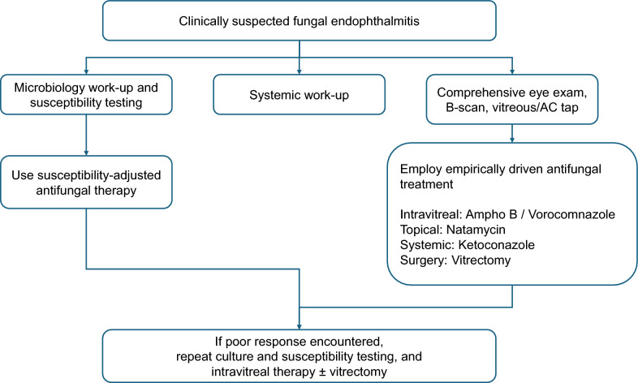
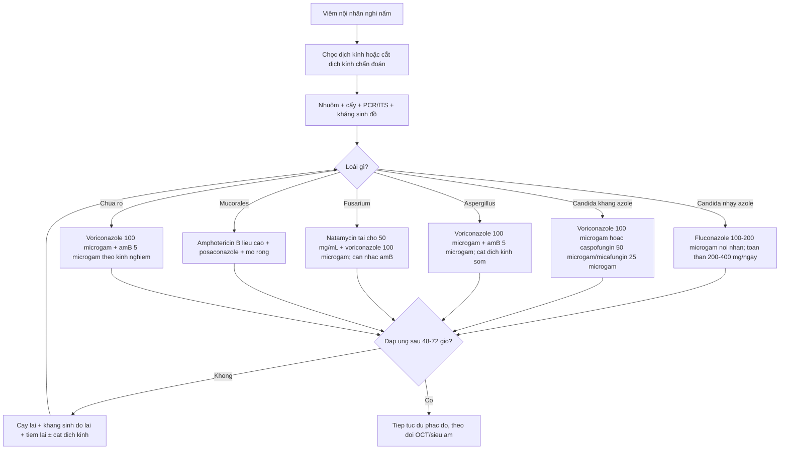
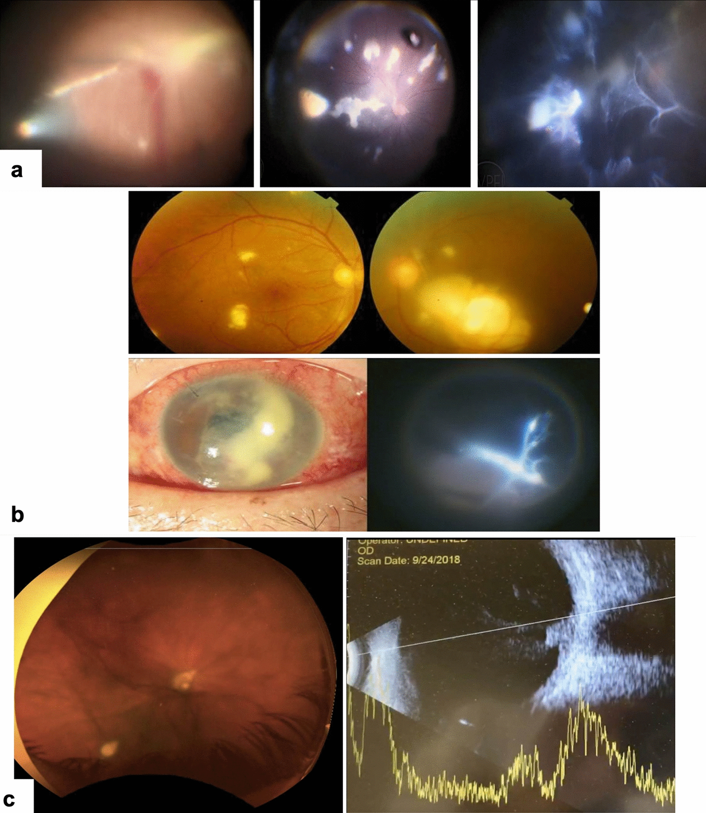
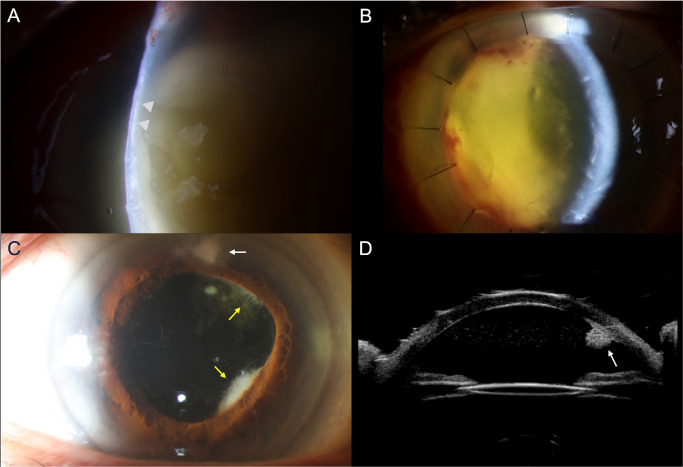
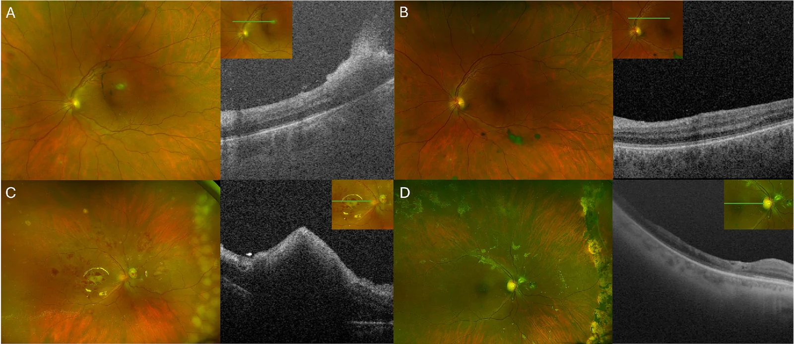
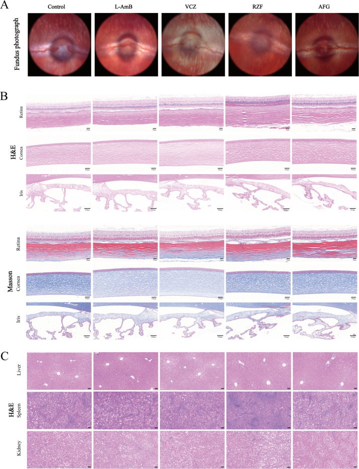
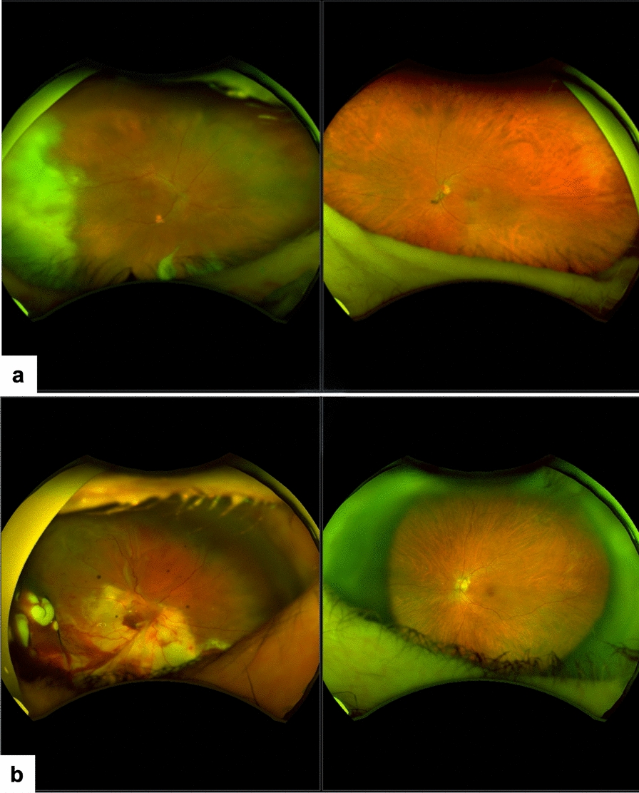
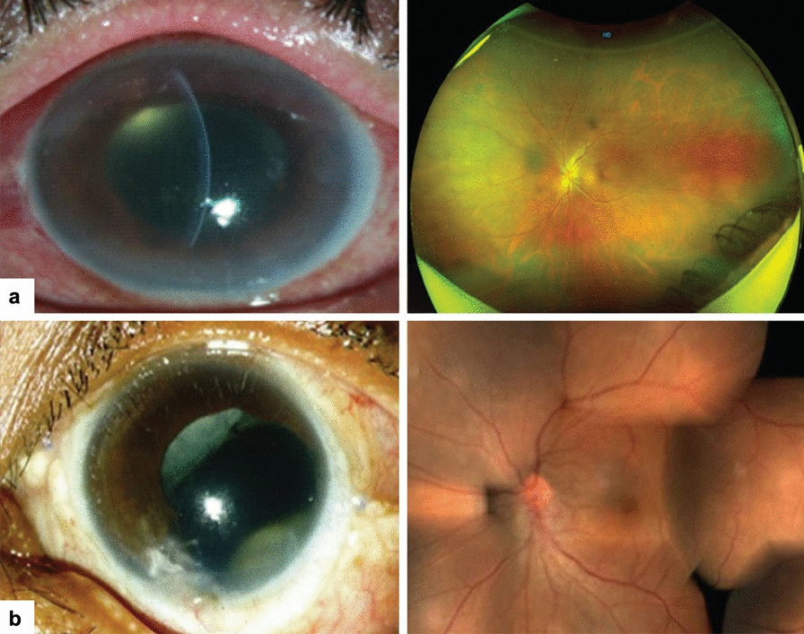

# 474 — Kháng nấm nội nhãn: chọn thuốc theo loài & kháng sinh đồ / Intravitreal antifungal selection by species and susceptibility

**Tags:** `pattern:viem-noi-nhan` `pattern:chon-thuoc-theo-loai` `pattern:fluff-ball` `vung:dich-kinh` `vung:vong-mac` `score:MIC` `score:khang-sinh-do` `protocol:tiem-noi-nhan` `protocol:cat-dich-kinh` `protocol:PCR-dich-kinh` `incidentaloma:khang-nam`
**Mức chắc chắn (certainty):** tổng hợp y văn (literature synthesis) — nhóm tự biên từ: đồng thuận APVRS/AAPPO/APSOII 2025 (CC BY 4.0, PMC12516872), nghiên cứu echinocandin trên *C. albicans* (Antimicrob Agents Chemother 2026, CC BY 4.0, PMC13148047), loạt *Aspergillus* (IOVS 2026, CC BY-NC-ND 4.0, PMC13676249), loạt *Fusarium* (IOVS 2026, CC BY-NC-ND 4.0, PMC13284917), kháng sinh đồ *Fusarium* theo loài (Antimicrob Agents Chemother 2025, CC BY 4.0, PMC12135539) và độc tính võng mạc thực nghiệm (J Fungi 2025, CC BY 4.0, PMC12387355).

> **Vì sao bài này quan trọng:** bài **463** đã dạy **nhận diện** viêm nội nhãn nội sinh do nấm. Nhưng khi đã nhận diện, câu hỏi tiếp theo quyết định giữ hay mất mắt là: **chọn thuốc nào, cho loài nào, liều bao nhiêu, khi nào tiêm lại, khi nào mổ**. Câu trả lời **không** nằm trong một phác đồ chung: **Candida** nhạy cả ba nhóm chính; **Aspergillus** cần azole/polyene và **cắt dịch kính sớm**; **Fusarium** **kháng nội tại (intrinsic resistance)** với nhiều thuốc và **phức hợp *F. solani* có MIC cao nhất** — nơi **rezafungin và ibrexafungerp hoàn toàn không có tác dụng**. Trong loạt *Aspergillus* mới nhất, dù **100% mắt được tiêm kháng nấm, 86% được cắt dịch kính, 79% dùng kháng nấm toàn thân**, **chỉ 7% đạt ≥ 20/200** và **50% còn LP/NLP**. Chọn đúng thuốc **từ đầu** là biến số duy nhất còn can thiệp được.

## 1. Tổng quan bệnh học – cơ chế hình ảnh – cơ chế chọn thuốc

- **Bốn nhóm thuốc, bốn đích — quyết định phổ:**
  - **Polyene (amphotericin B, amphotericin B dạng lipid):** gắn **ergosterol** → tạo lỗ màng tế bào nấm. Phổ **rộng nhất**, **diệt nấm (fungicidal)** theo nồng độ, nhưng **độc thận** khi toàn thân và **độc võng mạc** khi tiêm nội nhãn liều cao.
  - **Azole (fluconazole, voriconazole, posaconazole):** ức chế **CYP51/14α-demethylase** → chặn tổng hợp ergosterol. **Fluconazole** phổ hẹp (chủ yếu *Candida*); **voriconazole** phổ rộng hơn (gồm *C. glabrata/krusei* và **nấm mốc**); **posaconazole** bao phủ **Mucorales**.
  - **Echinocandin (caspofungin, micafungin, anidulafungin, rezafungin):** ức chế **β-1,3-D-glucan synthase** → **chỉ hiệu quả với *Candida*** (và *Aspergillus* ở mức **kìm nấm**), **KHÔNG có vai trò với *Fusarium*/Mucorales**.
  - **Pyrimidine analogue (flucytosine) và allylamine (terbinafine):** dùng bổ trợ/kinh nghiệm hạn chế; **terbinafine có phổ theo loài** (xem mục 3).
- **Vì sao "cùng một loài" vẫn phải có kháng sinh đồ:** MIC là **nồng độ ức chế tối thiểu**; nhưng hiệu quả tại mắt phụ thuộc thêm **nồng độ đạt được trong dịch kính**, **thời gian bán thải**, **gắn protein**, **biofilm** và **ổ hoại tử không tưới máu**. Đây là lý do **MIC thấp chưa chắc đã khỏi** — và ngược lại **MIC cao có thể vẫn kiểm soát được nếu nồng độ nội nhãn cao gấp nhiều lần**.
- **Cơ chế hình ảnh (TẠI SAO — nối tiếp bài 463):**
  - Nấm từ máu **bám hắc mạc → phá hàng rào máu–võng mạc ngoài** → **viêm hắc mạc dẹt (flat choroiditis)** (chưa cần tiêm nội nhãn).
  - Khi tổn thương **nhô lên (chorioretinitis)** hoặc **vào dịch kính**, khối nấm + bạch cầu trung tính tạo **"fluff ball"/"chuỗi ngọc trai"** — lúc này **tiêm nội nhãn + cắt dịch kính** mới có ý nghĩa.
  - **Nấm mốc xâm lấn mạch** → **hoại tử, hypopyon, thủng giác mạc/củng mạc**; hình ảnh **nặng hơn, tiến triển giờ–ngày**, và **ổ hoại tử không có mạch** chính là nơi thuốc không tới → **phải mổ lấy tổ chức hoại tử**, không chỉ tiêm.
- **Ngưỡng định lượng phải nhớ:**
  - **Liều nội nhãn (đồng thuận APVRS 2025, 0,1 mL):** amphotericin B **5 µg**; caspofungin **50 µg**; fluconazole **100–200 µg**; micafungin **25 µg**; posaconazole **100 µg**; **voriconazole 100 µg**. **Natamycin** chỉ dùng **tại chỗ 50 mg/mL** (không tiêm nội nhãn).
  - **Liều toàn thân (người lớn):** amphotericin B **0,5–1,0 mg/kg**; caspofungin **70 mg (nạp) → 50 mg/24h**; fluconazole **200–400 mg/ngày**; posaconazole **300 mg q12h (nạp) → 300 mg/24h**; voriconazole **6 mg/kg q12h (nạp) → 4 mg/kg q12h**.
  - **MIC *C. albicans* ATCC 10231:** amphotericin B (dạng lipid) **4 µg/mL**; voriconazole **0,125–0,25**; **rezafungin 0,016–0,03125**; **anidulafungin 0,016–0,03125** (PMC13148047).
  - **Độc tính tế bào võng mạc (IC50, ARPE-19):** amphotericin B lipid và voriconazole **> 1.000 µg/mL**; **rezafungin 40–50 µg/mL**; **anidulafungin 30–40 µg/mL** → chỉ số chọn lọc **IC50/MIC ≈ 10³**.
  - **Hiệu quả trên mô hình thỏ (35 µg/0,1 mL rezafungin hoặc anidulafungin):** điểm lâm sàng ngày 7: chứng **9,67**; amphotericin B **3,00**; voriconazole **2,67**; rezafungin **2,67**; anidulafungin **3,00**; **amphotericin B có CFU thấp nhất** (log10 **3,93** so với **4,69–4,70** của ba thuốc còn lại), tất cả đạt **diệt > 99,3%**.
  - **Loạt *Aspergillus* (14 mắt):** cắt dịch kính **86%** (lặp **29%**), tiêm nội nhãn **100%** (voriconazole **71%**), toàn thân **79%**; **≥ 20/200 chỉ 7%**, **LP/NLP 50%**, **phthisis 21%**, không bỏ mắt; theo dõi **554 ngày**.
  - **Loạt *Fusarium* (14 mắt):** ghép giác mạc điều trị **100%**, cắt dịch kính **57%**; **≥ 20/400 chỉ 29%**, **LP/NLP 21%**; biến chứng **71%** (tăng nhãn áp/glaucoma **80%** trong số có biến chứng, bong võng mạc **30%**); **khởi trị kháng nấm trung vị 5 ngày**, **natamycin trung vị 8 ngày** sau khi đến; **3/14 (21%) được thử corticoid trước natamycin** — đều là chậm trễ.
  - **Kháng sinh đồ *Fusarium* (EUCAST):** **natamycin MIC 2–8 mg/L** cho mọi phức hợp; **manogepix ≤ 0,016–0,06 mg/L** (nhạy chung); **olorofim** rất nhạy với **FFSC (MIC90 0,25)** nhưng **kháng với FSSC/FDSC/FIESC (MIC > 8)**; **terbinafine** nhạy với FDSC/FFSC/FOSC nhưng **MIC > 32** với FIESC; **rezafungin và ibrexafungerp không có tác dụng**.

## 2. Mẫu hình + chẩn đoán phân biệt theo loài (gamut)

**Câu hỏi lọc:** *"Đã xác định viêm nội nhãn do nấm — **loài nào**, **nhạy thuốc gì**, và **có ổ hoại tử/biofilm cần mổ không**?"* → câu trả lời chia theo **loài**, không theo "nấm nói chung".

**Gamut theo loài (thay cho gamut theo vị trí ở bài 463):**
- **Nấm men — *Candida*:** *C. albicans* (nhạy cả ba nhóm), *C. tropicalis*, *C. parapsilosis*, **các loài kháng azole: *C. glabrata*, *C. krusei*** (voriconazole/echinocandin thay fluconazole). Hình ảnh: **chorioretinitis nhỏ + "fluff ball"**, hai mắt, bối cảnh candidemia/ICU.
- **Nấm mốc — *Aspergillus*:** *A. fumigatus*, *A. flavus*, *A. niger*; **xâm lấn mạch, hoại tử nhanh**, hypopyon, thủng giác mạc; **voriconazole nội nhãn là trụ cột**, amphotericin B là lựa chọn thay thế.
- **Nấm mốc — *Fusarium*:** **phức hợp *F. solani* (FSSC) MIC cao nhất**, *F. oxysporum*, *F. fujikuroi*; thường **sau chấn thương thực vật/dùng kính tiếp xúc**; **kháng nội tại nhiều azole**, cần **natamycin tại chỗ + voriconazole nội nhãn**, cân nhắc amphotericin B.
- **Nấm mốc sẫm màu (dematiaceous):** *Curvularia*, *Lasiodiplodia*, *Alternaria* — **azole (voriconazole/posaconazole)** + mổ.
- **Mucorales (Mucor/Rhizopus/Lichtheimia):** **KHÔNG dùng echinocandin**, **amphotericin B + posaconazole + mổ rộng** là bắt buộc; hình ảnh **hoại tử lan nhanh, đau nhiều, mù nhanh**.
- **Loài hiếm/khó điều trị:** *Purpureocillium lilacinum*, *Scopulariopsis*, *Trichosporon*, *Arthrographis* — **kháng sinh đồ là bắt buộc**, thường **phải bỏ mắt** (PMC13187959).

## 3. Bảng so sánh phân biệt (ma trận đối chiếu)

| Thực thể (theo loài) | Hình ảnh / bối cảnh điển hình | Chốt vào (rule-in) | Chốt loại (rule-out) | Thuốc & xác nhận |
|---|---|---|---|---|
| ***Candida* nhạy azole** | Chorioretinitis nhỏ, "fluff ball", candidemia, catheter/TPN | **Cấy/PCR *Candida* + MIC fluconazole thấp** | **MIC fluconazole cao** → không dùng fluconazole | **Fluconazole 100–200 µg nội nhãn** ± toàn thân 200–400 mg/ngày; xác nhận bằng cấy + MIC |
| ***Candida* kháng azole (*C. glabrata/krusei*)** | Như trên nhưng **đáp ứng kém fluconazole** | **MIC fluconazole/voriconazole cao**, **MIC echinocandin thấp** | **Cấy âm + tổn thương không điển hình** → sinh thiết lại | **Voriconazole 100 µg** hoặc **caspofungin 50 µg/micafungin 25 µg**; cân nhắc rezafungin/anidulafungin (dữ liệu còn thực nghiệm) |
| ***Aspergillus*** | **Hypopyon, hoại tử, thủng giác mạc**, nội sinh ở ĐTĐ/giảm miễn dịch | **Nhuộm/cấy thấy sợi nấm có vách phân nhánh 45°** + **voriconazole nội nhãn** | **Không có sợi nấm + diễn tiến cấp giờ** → nghĩ vi khuẩn | **Voriconazole 100 µg nội nhãn** ± amphotericin B 5 µg; **cắt dịch kính 86%** trong loạt; xác nhận cấy + MIC |
| ***Fusarium*** | Sau **chấn thương thực vật/kính tiếp xúc**, loét giác mạc lan, **vòng thâm nhiễm**, hypopyon | **Cấy *Fusarium* + FSSC (MIC cao)** | **MIC thấp + đáp ứng natamycin** → thể nhẹ hơn | **Natamycin 50 mg/mL tại chỗ** + **voriconazole 100 µg nội nhãn**; **KHÔNG dựa vào echinocandin**; xác nhận loài/phức hợp |
| **Dematiaceous** | Loét chậm, sắc tố nâu–đen, sau chấn thương gỗ | **Cấy nấm sẫm màu + MIC azole thấp** | **Không mọc trong 4 tuần** → cấy lại/nuôi cấy mô | **Voriconazole/posaconazole** ± amphotericin B; cắt dịch kính |
| **Mucorales** | **Hoại tử lan nhanh, đau nhiều, mù nhanh**, hốc mắt | **Sợi nấm không vách/rộng + sinh thiết mô** | **Echinocandin đơn thuần** → không đủ | **Amphotericin B liều cao + posaconazole + mổ rộng** |
| **Biofilm / ổ hoại tử** | Tái phát sau tiêm, màng trước võng mạc, **tổn thương không nhỏ đi** | **Cấy lại dương + tổn thương đặc** | **Đục dịch kính nhẹ, không màng** → chưa cần mổ | **Cắt dịch kính + làm sạch ổ + tiêm lại**; xác nhận bằng cấy lại |

*Sơ đồ đồng thuận APVRS/AAPPO/APSOII 2025: **(1)** làm **xét nghiệm vi sinh + kháng sinh đồ** song song với khám mắt/B-scan/chọc dịch kính; **(2)** khởi trị **theo kinh nghiệm** (nội nhãn amphotericin B/voriconazole, tại chỗ natamycin, toàn thân theo loài, mổ khi cần); **(3)** khi **đáp ứng kém → cấy lại + kháng sinh đồ lại + tiêm lại ± cắt dịch kính**. Điểm cốt tử: **"kháng sinh đồ điều chỉnh thuốc"** là một nhánh chính thức của phác đồ, không phải tùy chọn. Nguồn: Das T et al., Eye Vis (Lond) 2025 (PMC12516872) Fig. 6, CC BY 4.0.*

## 4. Protocol chụp/xét nghiệm + chọn thuốc + sơ đồ quyết định

**Bước 1 — Xác định "có nấm" và "nấm ở đâu":**
- **Soi đáy mắt giãn đồng tử** ± **siêu âm B-scan** (khi đục dịch kính); **OCT** khi thấy đáy mắt; **UBM** nếu tổn thương thể mi/tiền phòng.
- **Chọc hút dịch tiền phòng/dịch kính** (hoặc **cắt dịch kính chẩn đoán**): **nhuộm Gram/Giemsa/Calcofluor**, **cấy trên Sabouraud + thạch máu**, **PCR/ITS sequencing**, **kháng sinh đồ (EUCAST/CLSI)**.
- **Xét nghiệm hệ thống:** cấy máu, β-D-glucan, galactomannan (Aspergillus), HIV, HbA1c, miễn dịch; **PET-CT/CT ngực–bụng** nếu nghi nội sinh.

**Bước 2 — Chọn thuốc theo loài (bảng liều mục 1):**
- **Chưa biết loài (kinh nghiệm):** **voriconazole 100 µg nội nhãn** ± **amphotericin B 5 µg**; **natamycin tại chỗ** nếu có loét giác mạc; **kháng nấm toàn thân** theo bối cảnh (fluconazole nếu nghi *Candida*; voriconazole nếu nghi nấm mốc).
- **Đã biết loài:** **điều chỉnh theo MIC** — không giữ "phác đồ mặc định" khi kháng sinh đồ nói khác.
- **Echinocandin:** chỉ dùng khi ***Candida* kháng azole/không dung nạp amphotericin B**; **không dùng cho nấm mốc**; liều nội nhãn **caspofungin 50 µg**, **micafungin 25 µg**; **rezafungin/anidulafungin 35 µg** còn **thực nghiệm**.

**Bước 3 — Khi nào tiêm lại, khi nào mổ:**
- **Tiêm lại 48–72 giờ** nếu **không cải thiện** hoặc **tổn thương còn hoạt động**; trung bình **> 1 mũi** (loạt Ấn Độ 730 ca: **tất cả cần cắt dịch kính + trung bình 2 kháng nấm nội nhãn**).
- **Cắt dịch kính (PPV):** **viêm dịch kính trung bình–nặng**, **màng trước võng mạc**, **ổ hoại tử đặc**, **đục dịch kính cản trở theo dõi**, hoặc **không đáp ứng sau 1–2 mũi**; ở *Aspergillus* **86%** và *Fusarium* **57%** trong các loạt gần đây phải mổ.
- **Lấy dịch kính trong mổ để cấy lại** — đây là bước **điều chỉnh thuốc** quan trọng nhất khi thất bại.
- **Corticoid:** **không khuyến cáo** trong viêm nội nhãn do nấm (đồng thuận 2025); **thử corticoid trước khi nghĩ đến nấm là bẫy** (21% ca *Fusarium* đã bị thử corticoid trước natamycin).

## 5. Biến thể bình thường và cạm bẫy

- **"MIC thấp = sẽ khỏi" — sai:** *F. solani* có thể **MIC natamycin 4–8 mg/L** nhưng vẫn **thất bại** vì **ổ hoại tử không tưới máu** và **biofilm**; ngược lại rezafungin **MIC 0,016** nhưng **chưa có dữ liệu người**.
- **"Echinocandin phổ rộng" — sai:** echinocandin **không có tác dụng với *Fusarium*/Mucorales**, và với *Aspergillus* chỉ **kìm nấm**. Dùng đơn thuần cho nấm mốc = **bỏ mặc ổ hoại tử**.
- **"Đã tiêm voriconazole là đủ" — sai:** loạt *Fusarium* có **100% được điều trị đa mô thức** (tại chỗ + nội nhãn + mổ) mà **chỉ 29% đạt ≥ 20/400**; loạt *Aspergillus* **100% tiêm nội nhãn, 86% cắt dịch kính** mà **50% còn LP/NLP**.
- **Chậm trễ là biến số chính:** *Fusarium* **khởi trị kháng nấm trung vị 5 ngày**, **natamycin 8 ngày** sau khi đến; **21% bị thử corticoid trước** — mỗi ngày chậm làm tăng nguy cơ mất mắt.
- **"Cấy âm = không phải nấm":** độ nhạy cấy dịch kính **không cao**; nếu hình ảnh điển hình + bối cảnh nguy cơ, **vẫn điều trị** và **cấy lại trong mổ**.
- **"Đục dịch kính nhẹ thì không cần mổ":** với *Candida*, **viêm dịch kính nhẹ** có thể chỉ cần tiêm; nhưng **màng/ổ đặc** là chỉ định mổ **dù thị lực còn tốt**.
- **Độc tính:** amphotericin B nội nhãn liều cao gây **hoại tử võng mạc**; voriconazole **nhiều lần** có độc tính tích lũy trên thực nghiệm; micafungin **tổn thương mô học nhiều hơn voriconazole** trong nghiên cứu thỏ — **không dùng liều "cao hơn cho chắc"**.
- **Corticoid:** **không** dùng trong giai đoạn hoạt động; nếu bệnh nhân đã dùng corticoid toàn thân vì lý do khác, **giảm liều nhanh** và theo dõi sát.

## 6. Tự lượng giá — Blind Quiz

**Ca 1 — Bệnh nhân nội sinh, đáy mắt cho thấy các dấu hiệu sau (a) và tổn thương hai mắt (b):**

- Hỏi: gọi tên 3 dấu hiệu ở hàng (a)? Hàng (b) gợi ý nội sinh hay ngoại sinh? Bước tiếp theo ngay sau khi thấy?

<b>Bấm để hiện đáp án (findings + chẩn đoán)</b>

- Dấu hiệu: **(a) "chuỗi ngọc trai" (string of pearls)** — đám nấm/tế bào viêm xếp chuỗi trong dịch kính; **đọng trước võng mạc (pre-retinal deposits)**; **màng dịch kính (vitreous membranes)**. **(b)** nhiều **ổ dưới võng mạc/hắc võng mạc hai mắt** + hypopyon → **viêm nội nhãn nội sinh hai mắt**.
- Chẩn đoán: **viêm nội nhãn do nấm** — cần **chọc dịch kính/cắt dịch kính chẩn đoán** ngay, **cấy + PCR + kháng sinh đồ**, khám toàn thân tìm ổ nội sinh (candidemia, catheter, TPN).
- Nguồn ảnh: Das T et al., Eye Vis (Lond) 2025 (PMC12516872) Fig. 1, CC BY 4.0.

**Ca 2 — Bệnh nhân *Fusarium* sau chấn thương thực vật: 4 ô lâm sàng (A–D):**

- Hỏi: dấu hiệu nào cho thấy nấm đã **vào nội nhãn**? Vì sao **không** chờ kết quả cấy mới điều trị? Thuốc nào **không** dùng đơn thuần?

<b>Bấm để hiện đáp án (findings + chẩn đoán)</b>

- Dấu hiệu: **(A)** loét giác mạc lan + **mảng nội mô (endothelial plaque)** + **hypopyon toàn bộ**; **(B)** phù ghép, **mủ tiền phòng**; **(C)** **mủ/fibrin trong tiền phòng**, tổn thương mống mắt; **(D)** UBM: **tổ chức đặc trong tiền phòng** dính mống mắt.
- Chẩn đoán: **viêm nội nhãn do *Fusarium*** — trong loạt 14 mắt: **ghép giác mạc điều trị 100%**, **cắt dịch kính 57%**, **≥ 20/400 chỉ 29%**, **LP/NLP 21%**.
- Vì sao không chờ cấy: **khởi trị trung vị 5 ngày, natamycin 8 ngày** đã là chậm; **không chờ** khi có loét + hypopyon.
- Thuốc không dùng đơn thuần: **echinocandin** (không có tác dụng với *Fusarium*); **rezafungin/ibrexafungerp không tác dụng** trên mọi phức hợp.
- Nguồn ảnh: Kang S et al., Invest Ophthalmol Vis Sci 2026 (PMC13284917) Fig. 1, **CC BY-NC-ND 4.0** — giữ nguyên bản, không crop/ghép.

**Ca 3 — *Aspergillus* nội sinh ở bệnh nhân đái tháo đường type 1: đáy mắt + OCT theo thời gian (A–D):**

- Hỏi: tổn thương nằm ở khoang nào? Vì sao *Aspergillus* **khó điều trị hơn *Candida***? Trong loạt này, tỷ lệ đạt ≥ 20/200 là bao nhiêu?

<b>Bấm để hiện đáp án (findings + chẩn đoán)</b>

- Dấu hiệu: các **ổ hắc võng mạc vàng–trắng** + **đục dịch kính**, OCT cho thấy **tổn thương dưới võng mạc/hắc mạc**, dịch dưới võng mạc và **phá vỡ lớp ngoài võng mạc**; các panel sau cho thấy **thu nhỏ tổn thương nhưng để lại sẹo/teo**.
- Vì sao khó hơn *Candida*: *Aspergillus* **xâm lấn mạch → nhồi máu/hoại tử**, **tiến triển giờ–ngày**, ít đáp ứng với thuốc đơn thuần; cần **voriconazole nội nhãn + cắt dịch kính sớm**.
- Số liệu: **14 mắt**, cắt dịch kính **86%**, tiêm nội nhãn **100%**, toàn thân **79%**; **≥ 20/200 chỉ 1/14 (7%)**; **LP/NLP 7/14 (50%)**; **phthisis 21%**.
- Nguồn ảnh: Kang S et al., Invest Ophthalmol Vis Sci 2026 (PMC13676249) Fig. 3, **CC BY-NC-ND 4.0** — giữ nguyên bản, không crop/ghép.

**Ca 4 — Mô hình thỏ *C. albicans*: ảnh đáy mắt và mô học các nhóm (đối chứng, L-AmB, VCZ, RZF, AFG):**

- Hỏi: mục đích của ảnh mô học **gan–lách–thận**? Vì sao kết quả này **không** chứng minh hiệu quả trên người? Liều rezafungin/anidulafungin dùng là bao nhiêu?

<b>Bấm để hiện đáp án (findings + chẩn đoán)</b>

- Mục đích: chứng minh **an toàn hệ thống** khi thuốc thoát ra khỏi mắt — không có tổn thương gan/lách/thận rõ; đồng thời so **mô học võng mạc/giác mạc/mống mắt** giữa các nhóm.
- Vì sao không chứng minh trên người: **mô hình thỏ**, liều **35 µg/0,1 mL** cho rezafungin/anidulafungin, **thể tích dịch kính thỏ ~1,6 mL** → nồng độ **~25 µg/mL**, khác dược động học người; chưa có thử nghiệm ngẫu nhiên.
- Số liệu liên quan: **CFU thấp nhất ở amphotericin B** (log10 3,93), ba thuốc còn lại **4,69–4,70**; **IC50 ARPE-19: RZF 40–50, AFG 30–40 µg/mL** (chỉ số chọn lọc ~10³).
- Nguồn ảnh: Zhang Y et al., Antimicrob Agents Chemother 2026 (PMC13148047) Fig. 2, CC BY 4.0.

**Ca 5 — Kết quả điều trị nội sinh (ảnh 1) và ngoại sinh (ảnh 2) trong đồng thuận:**

- Hỏi: điều gì quyết định **giữ được mắt** ở bệnh cảnh **nội sinh**? Vì sao bệnh cảnh **ngoại sinh** lại **mất chức năng** dù đã điều trị?

<b>Bấm để hiện đáp án (findings + chẩn đoán)</b>

- **Ảnh 1 — viêm nội nhãn nội sinh hai mắt**: tổn thương **dưới võng mạc/hắc mạc lan rộng** trước điều trị; sau **kháng nấm toàn thân + nội nhãn + cắt dịch kính** → **tổn thương thoái triển, võng mạc áp, thị lực hồi phục một phần**. Yếu tố quyết định: **chẩn đoán sớm + điều trị đa đường + kiểm soát ổ nội sinh**.
- **Ảnh 2 — ngoại sinh sau đục thủy tinh thể/chấn thương**: **hoại tử lan, màng trước võng mạc, bong võng mạc co kéo** → **mất chức năng vĩnh viễn** dù đã mổ; yếu tố quyết định: **độ trễ** và **mức xâm lấn của nấm mốc**.
- Nguồn ảnh: Das T et al. (PMC12516872) Fig. 5 (nội sinh) và Fig. 4 (ngoại sinh), CC BY 4.0.

## Bài liên quan chéo
- [400 – Tổng quan Mắt & thị giác](../400-tong-quan-mat-thi-giac/lesson.md)
- [463 – Viêm nội nhãn nội sinh do nấm (Candida/Aspergillus)](../463-viem-noi-nhan-noi-sinh-nam/lesson.md) (nhận diện & sàng lọc)
- [462 – U lympho nội nhãn (PVRL)](../462-u-lympho-noi-nhan-PVRL/lesson.md) (masquerade)
- [473 – U lympho T/NK & u lympho thứ phát ở mắt](../473-u-lympho-T-NK-va-u-lympho-thu-phat-o-mat/lesson.md) (masquerade)
- [460 – Can thiệp mắt](../460-can-thiep-mat/lesson.md) (kỹ thuật tiêm nội nhãn, cắt dịch kính)
- [449 – Chấn thương mắt & dị vật nội nhãn](../449-chan-thuong-mat-dich-vat/lesson.md) (đường vào nấm sau chấn thương)

## Ảnh
- `474_khang-nam_phac-do_PMC12516872-CCBY.jpg` — Das T et al., Eye Vis (Lond) 2025 (PMCID: PMC12516872) Fig. 6, CC BY 4.0.
- `474_khang-nam_dau-hieu_PMC12516872-CCBY.jpg` — Das T et al. (PMC12516872) Fig. 1, CC BY 4.0.
- `474_khang-nam_ket-qua-noi-sinh_PMC12516872-CCBY.jpg` — Das T et al. (PMC12516872) Fig. 5, CC BY 4.0.
- `474_khang-nam_ket-qua-ngoai-sinh_PMC12516872-CCBY.jpg` — Das T et al. (PMC12516872) Fig. 4, CC BY 4.0.
- `474_Aspergillus_slitlamp_PMC13676249-CCBYNCND.webp` — Kang S et al., Invest Ophthalmol Vis Sci 2026 (PMCID: PMC13676249) Fig. 2, **CC BY-NC-ND 4.0** (giữ nguyên bản, không crop/ghép).
- `474_Aspergillus_fundus-OCT_PMC13676249-CCBYNCND.webp` — Kang S et al. (PMC13676249) Fig. 3, **CC BY-NC-ND 4.0** (giữ nguyên bản).
- `474_Fusarium_dien-tien_PMC13284917-CCBYNCND.jpg` — Kang S et al., Invest Ophthalmol Vis Sci 2026 (PMCID: PMC13284917) Fig. 1, **CC BY-NC-ND 4.0** (giữ nguyên bản).
- `474_Candida_fundus-thu-nghiem_PMC13148047-CCBY.jpg` — Zhang Y et al., Antimicrob Agents Chemother 2026 (PMCID: PMC13148047) Fig. 2, CC BY 4.0.
- `474_Candida_dieu-tri-thu-nghiem_PMC13148047-CCBY.jpg` — Zhang Y et al. (PMC13148047) Fig. 5, CC BY 4.0.
- Chi tiết giấy phép từng ảnh trong `images/CREDITS.md`. AuntMinnie / Retina Image Bank: **chỉ dẫn link, không tải**.

> Không dùng để chẩn đoán độc lập khi chưa có người hướng dẫn.
