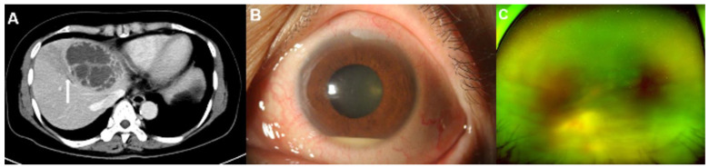
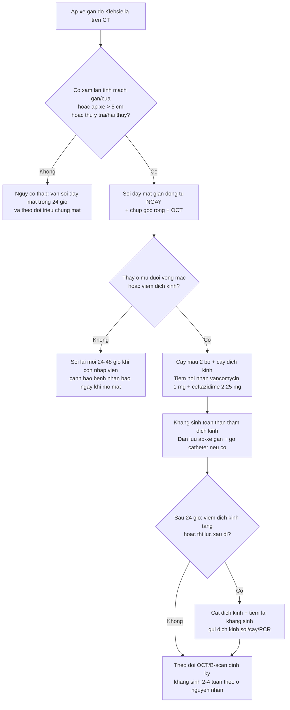
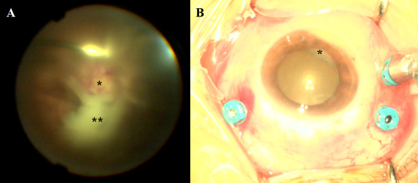
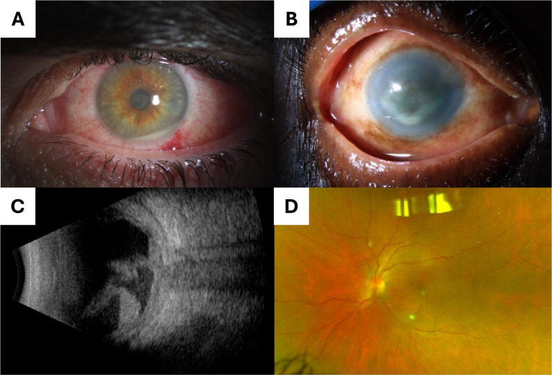
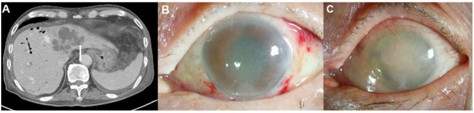

# 475 — Viêm nội nhãn nội sinh do vi khuẩn: ổ mủ dưới võng mạc & "tiền phòng im lặng" / Endogenous bacterial endophthalmitis

**Tags:** `pattern:viem-noi-nhan` `pattern:ap-xe-duoi-vong-mac` `pattern:viet-dich-kinh` `vung:vong-mac` `vung:hac-mac` `vung:gan` `vung:tim` `score:OR-CT` `protocol:soi-day-mat` `protocol:tiem-noi-nhan` `protocol:cat-dich-kinh` `protocol:CT-bung` `incidentaloma:ap-xe-gan`
**Mức chắc chắn (certainty):** tổng hợp y văn (literature synthesis) — nhóm tự biên từ: đồng thuận Đài Loan 2024 về viêm nội nhãn nội sinh (CC BY-NC 4.0, PMC10776529), nghiên cứu CT dự báo viêm nội nhãn ở áp-xe gan do *Klebsiella* (CC BY 4.0, PMC9369040), đoàn hệ nội nhãn 14 năm tại Bắc Kinh — 103 ca (CC BY 4.0, PMC13581886), đoàn hệ Đài Bắc 2025 — 91 ca (CC BY-NC-SA 4.0, PMC12204661), đoàn hệ Bascom Palmer 2026 — 41 ca (CC BY 4.0, PMC13447657), phân tích cơ sở dữ liệu viêm nội tâm mạc — 769.472 ca nhập viện (PMC11733160), tổng quan chẩn đoán–điều trị Sadiq 2015 (CC BY 4.0, PMC4630262).

> **Vì sao bài này quan trọng:** bài **463** đã dạy **nấm** nội sinh, và trong bảng giả danh của 463, vi khuẩn nội sinh chỉ là **một hàng**. Nhưng đây là bệnh cảnh **ngược hoàn toàn về nhịp độ**: nấm tiến triển **nhiều ngày–tuần, phần lớn không triệu chứng**; vi khuẩn (nhất là *Klebsiella*) phá hủy tế bào cảm thụ ánh sáng **trong 48 giờ** (mô hình thỏ) và có thể dẫn tới **evisceration/enucleation 41%**, thị lực **≤ đếm ngón tay/LP ở 89%** (tổng hợp của Yang, dẫn qua Lee JJ 2022). Với bác sĩ CĐHA, điểm vào lại **không nằm ở mắt**: một **áp-xe gan "trông bình thường"** trên CT là nơi **dự báo được** ai sẽ mất mắt — **can thiệp mạch máu lân cận của ổ áp-xe làm tăng nguy cơ viêm nội nhãn OR 148** (Lee JJ 2022). Đọc đúng dấu hiệu CT đó = gọi mắt khám trước khi bệnh nhân kịp kêu mờ mắt.

## 1. Tổng quan bệnh học – cơ chế hình ảnh – vì sao CT bụng lại quyết định

- **Đường đi (pathway) của vi khuẩn tới mắt:** hắc mạc có **lưu lượng máu rất cao** và **mao mạch hắc mạc có lỗ cửa sổ (fenestrated choriocapillaris)** → vi khuẩn trong máu **dễ lắng tại hắc mạc**. Ban đầu **biểu mô sắc tố võng mạc (RPE) + màng Bruch** còn hàng rào, tổn thương là **viêm hắc mạc dẹt (flat choroiditis)**; khi hàng rào vỡ → **ổ mủ dưới võng mạc (subretinal abscess)** → **viêm dịch kính (vitritis)** → **mủ tiền phòng (hypopyon)**. Đây là lý do **tổn thương sớm nhất luôn nằm SÂU (hắc mạc/dưới võng mạc)** và **tiền phòng có thể còn trong** khi hậu cực đã mủ đặc.
- **Vì sao dịch kính là "buồng nuôi cấy":** dịch kính là **gel vô mạch, không có hệ miễn dịch tại chỗ**, thể tích ~4 mL người lớn; vi khuẩn vào đây **nhân lên không bị cản** và **kháng sinh toàn thân khó thấm** (hàng rào máu–dịch kính) → giải thích **tại sao phải tiêm nội nhãn**, không thể chỉ truyền tĩnh mạch.
- **Vì sao *Klebsiella* dữ dội hơn:** *K. pneumoniae* tạo **màng sinh học (biofilm) giàu polysaccharide** chống thực bào của đại thực bào/bạch cầu trung tính, **xuyên qua hàng rào máu–mắt**; thể **tăng độc lực (hypervirulent, hvKP)** mang kiểu hình **niêm dịch quánh (hypermucoviscous)**. Trong đoàn hệ phía Đông Bắc Trung Quốc 2026, **81,8% ca cấy dương là *K. pneumoniae***, trong đó **82,5% là hvKP**, ưu thế dòng **ST23-K1** (PMC13581886). Thực nghiệm trên thỏ: tổn thương **tế bào cảm thụ ánh sáng không hồi phục trong 48 giờ** (dẫn qua Lee JJ 2022).
- **Ngưỡng định lượng nằm lòng (dùng để phân tầng nguy cơ):**
  - **Áp-xe gan do *K. pneumoniae* → viêm nội nhãn:** **0,005%–1,92%** tùy loạt; tại Đài Loan, cơ sở dữ liệu toàn quốc ghi **0,9–1,36%** (Lee CY 2024; Lee JJ 2022).
  - **Viêm nội tâm mạc nhiễm khuẩn (infective endocarditis) → viêm nội nhãn:** **2.248/769.472 ca nhập viện = 0,29%**; **đái tháo đường OR 2,04**, **rối loạn do rượu OR 1,80**, **xơ gan OR 1,45**, nhóm **21–64 tuổi OR 3,66** so với ≤ 20 tuổi; **có dụng cụ tim (cardiac device) lại GIẢM nguy cơ OR 0,34** (Shah MK 2025).
  - **Cơ cấu tác nhân (châu Á):** tại Đài Loan **78–91% viêm nội nhãn nội sinh cấy dương là vi khuẩn**, ***K. pneumoniae* 34–53%** — cao hơn hẳn các loạt phương Tây (Lee CY 2024). Đài Bắc 2025 (91 bệnh nhân): **vi khuẩn 61,5%, nấm 27,5%** (Chuang YH 2025).
  - **Ổ nhiễm ngoài mắt:** áp-xe gan là ổ thường nhất (Đài Loan); **63,1%** ca Trung Quốc có ổ ngoài mắt, **áp-xe gan 45,0%** (PMC13581886).
  - **Biểu hiện lúc vào viện (Bascom Palmer 2026, 41 bệnh nhân/50 mắt):** **73% đến từ phòng khám** (không phải đang nằm điều trị nhiễm trùng), **88% mờ mắt**, **chỉ 39% có triệu chứng toàn thân**, **trung vị 11 ngày** từ lúc có triệu chứng mắt tới lúc điều trị, **cấy máu dương 56%**, **tử vong do nhiễm trùng 7%** (so với **29–50%** ở các loạt cũ), **evisceration 4%**, **52% đạt ≥ 20/400** (Zhang C 2026).
- **TẠI SAO "tiền phòng im lặng" lại là dấu hiệu hình ảnh quan trọng:** vì phản ứng tiền phòng **không tỉ lệ với mức phá hủy hậu cực**. Đồng thuận Đài Loan minh họa đúng ca áp-xe gan do *Klebsiella*: hậu cực **viêm dịch kính đặc + ổ mủ dưới hoàng điểm lan rộng + bao mạch võng mạc**, trong khi tiền phòng **chỉ hypopyon nhẹ** (PMC10776529, Fig. 1). Hệ quả thực hành: **không được dùng "tiền phòng sạch" để loại trừ**, và **phải soi đáy mắt giãn đồng tử** — một việc mà ảnh CT không làm thay được.

## 2. Mẫu hình + chẩn đoán phân biệt theo vị trí (gamut)

**Câu hỏi lọc:** *"Bệnh nhân đái tháo đường, đang/đã có áp-xe gan hoặc nhiễm khuẩn huyết, **mờ mắt một bên tiến triển trong 1–3 ngày** — có phải viêm nội nhãn nội sinh do vi khuẩn không?"* → **soi đáy mắt giãn đồng tử ngay**, không chờ cấy.

**Gamut theo ổ nhiễm ngoài mắt (nguồn lây) — gợi nhớ LUCID** *(nhóm biên soạn tự đặt)*:
- **L — Liver (gan/đường mật):** áp-xe gan do *K. pneumoniae* (châu Á, hvKP), đường mật, sau thủ thuật gan. Tần suất cao nhất.
- **U — Urinary (đường niệu):** *E. coli*, *K. pneumoniae*; đồng thuận Đài Loan ghi nhận **xu hướng tăng ở nữ cao tuổi không đái tháo đường** với ổ nguyên nhân đường niệu (PMC10776529).
- **C — Cardiac (tim):** viêm nội tâm mạc — *S. aureus*, *Streptococcus*; nguy cơ 0,29%, đái tháo đường/rượu/xơ gan làm tăng (Shah MK 2025).
- **I — IV line / IVDU (đường truyền, tiêm chích):** *S. aureus* (kể cả MRSA), tụ cầu coagulase âm; **catheter là nguồn thường nhất ở loạt Mỹ (30% các ca tìm được ổ)**; **17% ca có tiêm chích ma túy** (Zhang C 2026).
- **D — Dental / Device (răng, dụng cụ cấy):** ổ răng hàm mặt, shunt, van tim nhân tạo, máy tạo nhịp.

**Gamut theo vị trí tổn thương trong mắt:**
- **Hắc mạc/dưới võng mạc:** **ổ mủ dưới võng mạc (subretinal abscess)** — dấu hiệu đặc trưng nhất của vi khuẩn nội sinh, hay gặp *Klebsiella*; phân biệt với ổ chorioretinitis **nhỏ, vàng–kem, đơn độc** của *Candida* (bài 463).
- **Dịch kính:** viêm dịch kính mủ đặc, màng/fibrin; phân biệt với **xuất huyết dịch kính** (không sốt, không mủ tiền phòng) và **viêm dịch kính do nấm** (chậm hơn, "fluff ball").
- **Tiền phòng:** hypopyon, fibrin, dính mống mắt — **hypopyon nhiều gợi ý vi khuẩn/nấm mốc** hơn nấm men.
- **Toàn nhãn (panophthalmitis) / hốc mắt:** phù mi, lồi mắt, hạn chế vận nhãn → **nguy cơ mất nhãn cầu**, cần cắt dịch kính ± evisceration.
- **Mắt đối diện:** gặp ở một tỉ lệ đáng kể; **hai mắt nhiều hơn ở thể nấm** (Chuang YH 2025) → **luôn soi cả hai mắt**.

## 3. Bảng so sánh phân biệt (ma trận đối chiếu)

| Thực thể (entity) | Hình ảnh điển hình (đáy mắt / OCT / B-scan / CT) | Chốt vào (rule-in) | Chốt loại (rule-out) | Gợi ý xác nhận |
|---|---|---|---|---|
| **Viêm nội nhãn nội sinh do *Klebsiella* (áp-xe gan)** | **Ổ mủ dưới võng mạc lớn, vàng–trắng, bờ mờ**, viêm dịch kính nhanh, **tiền phòng có thể chỉ hypopyon nhẹ**; CT: áp-xe gan **thùy trái/hai thùy, xâm lấn tĩnh mạch gan/cửa** | **Đái tháo đường + áp-xe gan + mờ mắt giờ–ngày**; **CT có xâm lấn mạch lân cận (OR 148)** | **Không sốt, không ổ ngoài mắt, tiến triển tuần** → nghĩ nấm (463) hoặc masquerade | Cấy máu (2 bộ) + cấy dịch kính; **tiêm nội nhãn ngay, không chờ** |
| **Viêm nội nhãn nội sinh do Gram dương (S. aureus / Streptococcus)** | Tổn thương hậu cực + **mủ tiền phòng sớm**, có thể **mảng trắng võng mạc**; bối cảnh **catheter/van tim/tiêm chích** | **Van tim nhân tạo/máy tạo nhịp/catheter + sốt + mờ mắt**; **cấy máu dương** | **Không có ổ nhiễm, hai mắt, chậm** → nghĩ nấm/viêm | Siêu âm tim (TTE/TEE), cấy máu, cấy dịch kính |
| **Viêm nội nhãn nội sinh do nấm (Candida/Aspergillus — bài 463)** | **"Fluff ball"/"chuỗi ngọc trai"/"quả cầu tuyết"**, ổ **vàng–kem nhỏ**, viêm dịch kính **nhẹ–trung bình**; **phần lớn KHÔNG triệu chứng** | **Candidemia/catheter/TPN/ICU/giảm bạch cầu hạt + tổn thương ở người không kêu mắt** | **Tiến triển giờ–ngày + ổ mủ dưới võng mạc lớn + áp-xe gan** → nghĩ vi khuẩn | Cấy/PCR dịch kính, β-D-glucan, galactomannan |
| **Viêm nội nhãn NGOẠI SINH (sau mổ đục thủy tinh thể/tiêm nội nhãn)** | Viêm **tiền phòng nổi bật**, mủ quanh IOL, **đau nhiều**; khởi phát **3–7 ngày** sau thủ thuật | **Tiền sử mổ/tiêm trong 6 tháng + đau + mủ tiền phòng** | **Không tiền sử thủ thuật; có ổ nhiễm toàn thân** → nghĩ nội sinh | Cấy dịch tiền phòng/dịch kính; so sánh bài 463 (nội sinh) |
| **U lympho nội nhãn (PVRL — bài 462)** | **Ổ vàng–kem dưới biểu mô sắc tố (sub-RPE)**, viêm dịch kính **nghèo**, người **> 60 tuổi** | **Tái phát sau corticoid + tổn thương dưới RPE + IL-10/IL-6 > 1** | **Sốt + ổ nhiễm ngoài mắt + tiến triển giờ–ngày** → không phải u lympho | IL-10/IL-6 dịch kính, MYD88 L265P |
| **Hoại tử võng mạc cấp (ARN) / CMV retinitis (bài 452)** | **Hoại tử dọc mạch + xuất huyết** ("bánh pizza"), viêm dịch kính ít; **HIV CD4 < 50** | **HIV + tổn thương dọc mạch, đau nhẹ** | **Ổ mủ dưới võng mạc + hypopyon + nhiễm khuẩn huyết** → nghĩ vi khuẩn | PCR dịch tiền phòng/dịch kính |

*(A) CT bụng có cản quang: **nang dạng vách 7,5 cm ở phân thùy IV** — áp-xe gan do *Klebsiella* — kèm **viêm tắc tĩnh mạch gan lân cận do xâm lấn trực tiếp** (mũi tên). (B) Sinh hiển vi đèn khe: **hypopyon chỉ 2 mm** — phản ứng tiền phòng "nhẹ" không tương xứng với hậu cực. (C) Đáy mắt góc rộng: **khối trắng nghi ổ mủ dưới võng mạc**. Ba ảnh của cùng một bệnh nhân nữ 59 tuổi đái tháo đường. Nguồn: Lee JJ et al., J Clin Med 2022 (PMC9369040) Fig. 2, CC BY 4.0.*

### Dấu hiệu phải đọc đúng tên
- **Ổ mủ dưới võng mạc (subretinal abscess):** khối vàng–trắng **nằm dưới võng mạc, trên hắc mạc**, che mạch máu võng mạc — khác **ổ chorioretinitis nông** của nấm và khác **bong võng mạc tiết dịch** (không có khối đặc).
- **Viêm tắc tĩnh mạch gan lân cận (adjacent hepatic/portal vein thrombophlebitis):** trên CT là **khuyết thuốc trong lòng tĩnh mạch gan/cửa sát ổ áp-xe** — đây **không phải chi tiết phụ**: chính nó là **dấu hiệu dự báo di căn nhiễm trùng**, với **OR 148,1** trong phân tích đa biến (Lee JJ 2022).
- **"Tiền phòng im lặng" (quiet anterior segment):** hypopyon **ít/không có** dù hậu cực mủ đặc — dấu hiệu **bẫy**, đã được đồng thuận Đài Loan nêu riêng (PMC10776529).

## 4. Protocol chụp/xét nghiệm + sơ đồ quyết định + phác đồ

**Bước 1 — Mắt (không xâm lấn, làm trong 24 giờ):**
- **Soi đáy mắt giãn đồng tử: khuyến cáo cho MỌI bệnh nhân áp-xe gan do vi khuẩn** (khuyến cáo của đồng thuận Đài Loan; lý do: **0,9–1,36%** sẽ viêm nội nhãn và **diễn tiến tối cấp**).
- **Chụp đáy mắt góc rộng (ultra-widefield)** + **OCT** (đo chiều cao ổ mủ, xác định tổn thương **dưới võng mạc** hay **trong võng mạc**, theo dõi đáp ứng).
- **Siêu âm B-scan 10–20 MHz** khi **không thấy đáy mắt** (mủ dịch kính, phù giác mạc): đánh giá **độ đặc dịch kính, màng, bong võng mạc, dày hắc mạc** — nhưng **B-scan KHÔNG phân biệt được mủ với máu**, nên **không dùng một mình để chốt**.

**Bước 2 — CT bụng (nơi bác sĩ CĐHA tạo ra giá trị):**
- **CT bụng có cản quang thì tĩnh mạch cửa** (lát ≤ 5 mm) khi nghi áp-xe gan; **đọc và ghi rõ 3 biến số dự báo**:

| Biến số trên CT (áp-xe gan do *K. pneumoniae*) | Tần suất ở nhóm có viêm nội nhãn | OR đa biến | Ý nghĩa thực hành |
|---|---|---|---|
| **Áp-xe thùy TRÁI** | **53,3%** (nhóm không viêm nội nhãn: thùy phải 68,7%) | **19,6** | Ghi vị trí theo phân thùy, không chỉ "áp-xe gan" |
| **Áp-xe HAI thùy** | — | **45,1** | Càng nhiều thùy càng nguy cơ |
| **Xâm lấn mạch lân cận (tĩnh mạch gan/cửa)** | phổ biến hơn rõ rệt (p < 0,001) | **148,1** | **Dấu hiệu mạnh nhất** — phải chủ động tìm |
| **Đái tháo đường (lâm sàng)** | 66,7% nhóm có viêm nội nhãn | **11,6** | Đưa vào phần kết luận của báo cáo |
| Kích thước > 5 cm / nhiều ổ | Không khác biệt có ý nghĩa | — | **Không dùng để phân tầng** |

- **Toàn bộ 15/15 ca viêm nội nhãn** trong loạt này thỏa **ít nhất một** trong hai điều kiện: **áp-xe > 5 cm** hoặc **có xâm lấn mạch lân cận** — nên đây là **bộ lọc âm tính hữu ích**: áp-xe nhỏ, không xâm lấn mạch, thùy phải → nguy cơ thấp (nhưng **không thay thế** việc soi đáy mắt). Độ đồng thuận giữa hai bác sĩ CĐHA cho dấu hiệu xâm lấn mạch **kappa 0,872** — nghĩa là **hễ chủ động tìm thì tìm được** (Lee JJ 2022).

**Bước 3 — Toàn thân & vi sinh:**
- **2 bộ cấy máu TRƯỚC kháng sinh** (chỉ 56% dương trong loạt Bascom — âm tính **không loại trừ**), cấy nước tiểu, cấy dịch kính/dịch tiền phòng.
- **Siêu âm tim (TTE, chuyển TEE nếu nghi)** khi có bệnh cảnh nhiễm khuẩn huyết không rõ ổ; **khám răng hàm mặt**, **gỡ/đổi catheter** nếu nghi nguồn đường truyền.
- **Dẫn lưu ổ nguyên nhân** (áp-xe gan) là một phần của điều trị, không chỉ là chẩn đoán.

**Bước 4 — Điều trị (chốt định lượng):**
- **Tiêm nội nhãn ngay khi nghi (không chờ cấy):** **vancomycin 1 mg/0,1 mL** + **ceftazidime 2,25 mg/0,1 mL** (hoặc **amikacin 0,4 mg/0,1 mL**) — phổ Gram dương + Gram âm (Sadiq MA 2015, PMC4630262).
- **Cắt dịch kính (pars plana vitrectomy) khi:** (1) **viêm dịch kính tiến triển hoặc thị lực xấu đi sau 24 giờ** dù đã kháng sinh toàn thân ± tiêm nội nhãn; (2) **viêm dịch kính đặc che đĩa thị và cung mạch** ngay lần khám đầu (khuyến cáo của đồng thuận Đài Loan, PMC10776529).
- **Kháng sinh toàn thân có thấm tốt dịch kính** (ceftriaxone, moxifloxacin) — **luôn phối hợp** vì ổ ngoài mắt là nguồn liên tục; thời gian **2–4 tuần tĩnh mạch** tùy ổ nguyên nhân, sau đó uống.
- **Corticoid nội nhãn: không dùng thường quy** khi chưa loại trừ nấm (nguy cơ bùng phát — xem bài 463).
- **Tiêm nội nhãn là yếu tố bảo vệ độc lập:** trong đoàn hệ Trung Quốc 103 ca, tiêm nội nhãn giảm nguy cơ kết cục thị lực xấu với **RR 0,061 (95% CI 0,005–0,442)** (PMC13581886). **Chậm tiêm = mất mắt.**

## 5. Biến thể bình thường và cạm bẫy

- **Bẫy số 1 — "tiền phòng sạch":** hypopyon **nhẹ hoặc không có** trong khi hậu cực đã mủ đặc (đồng thuận Đài Loan nêu riêng). **Không bao giờ** dùng tình trạng tiền phòng để quyết định không soi đáy mắt.
- **Bẫy số 2 — "bệnh nhân không kêu mắt":** **73%** ca Bascom đến từ **phòng khám** vì triệu chứng mắt, nhưng **chỉ 39%** có triệu chứng toàn thân; ở chiều ngược lại, bệnh nhân đang nằm ICU vì áp-xe gan **có thể không phản ánh được**. Với người bệnh **không giao tiếp được (an thần, sa sút trí tuệ)**, **soi đáy mắt theo chỉ định CT** là cách duy nhất.
- **Bẫy số 3 — đọc B-scan quá tự tin:** **mủ dịch kính và xuất huyết dịch kính đều là "echo dày"**; B-scan **không phân biệt** được. Chỉ dùng B-scan để **đếm/loại bong võng mạc và màng**; chẩn đoán mủ dựa vào **bối cảnh + đáy mắt/CT**.
- **Bẫy số 4 — chờ cấy:** **cấy máu chỉ dương 56%**, cấy dịch kính cũng có thể âm → **âm tính không loại trừ**; đồng thuận Đài Loan: **tiêm nội nhãn ngay, không chờ**.
- **Bẫy số 5 — *Klebsiella* "string test" âm:** xét nghiệm **kéo sợi (string test)** âm **không loại trừ hvKP** (PMC13581886) — đừng vì thế mà hạ mức cảnh giác.
- **Bẫy số 6 — nhầm ổ áp-xe gan với u hoại tử:** khối **dạng vách, có khí trong, viêm tắc tĩnh mạch lân cận**, bối cảnh **sốt + đái tháo đường** → áp-xe; **u hoại tử** thường có thành dày không đều, không khí trong, có thì động mạch đặc trưng. Đọc **thì tĩnh mạch cửa** để thấy rõ vách và tĩnh mạch.
- **Bẫy số 7 — gộp vi khuẩn vào nấm:** bệnh nhân đái tháo đường có áp-xe gan **không** đồng nghĩa nấm; và bệnh nhân có candidemia **vẫn có thể** đồng nhiễm vi khuẩn. **Điều trị theo cấy + bối cảnh**, không theo "trường phái".
- **Bẫy số 8 — bỏ sót mắt thứ hai:** hai mắt gặp ở một tỉ lệ đáng kể (nhiều hơn ở thể nấm); **luôn soi cả hai mắt**, kể cả khi bệnh nhân chỉ kêu một bên.

## 6. Tự lượng giá — Blind Quiz

**Ca 1 — Nữ 59 tuổi, đái tháo đường, sốt 5 ngày, đau hạ sườn trái; CT bụng có cản quang (A). Mắt phải: mờ nhẹ, tiền phòng chỉ "hơi đục" (B), đáy mắt (C):**

- Hỏi: (1) mô tả ổ áp-xe và dấu hiệu mũi tên trên CT; (2) vì sao tiền phòng "nhẹ" mà vẫn phải coi là cấp cứu; (3) dấu hiệu CT nào dự báo nguy cơ viêm nội nhãn mạnh nhất?

<b>Bấm để hiện đáp án (findings + chẩn đoán)</b>

- **Findings:** (A) **nang dạng vách 7,5 cm ở phân thùy IV**, kèm **khuyết thuốc trong tĩnh mạch gan lân cận** (mũi tên) = **viêm tắc tĩnh mạch do xâm lấn trực tiếp**; (B) **hypopyon 2 mm** + sung huyết; (C) **khối trắng nghi ổ mủ dưới võng mạc**, đáy mắt mờ.
- **Chẩn đoán:** **viêm nội nhãn nội sinh do *K. pneumoniae*** từ **áp-xe gan**.
- **Vì sao "nhẹ" vẫn cấp cứu:** phản ứng tiền phòng **không tỉ lệ** với tổn thương hậu cực; mô hình thỏ cho thấy **tế bào cảm thụ ánh sáng bị phá hủy không hồi phục trong 48 giờ**.
- **Dấu hiệu mạnh nhất:** **xâm lấn mạch lân cận** — **OR 148,1** (đa biến); sau đó **hai thùy OR 45,1**, **thùy trái OR 19,6**, **đái tháo đường OR 11,6**.
- Nguồn ảnh: Lee JJ et al., J Clin Med 2022 (PMC9369040) Fig. 2, CC BY 4.0.

**Ca 2 — Cùng bối cảnh áp-xe gan do *Klebsiella*: so sánh TIỀN PHÒNG (B) và HẬU CỰC (A):**

- Hỏi: mô tả (A) và (B). Sự "lệch pha" này dạy điều gì về thứ tự thăm khám?

<b>Bấm để hiện đáp án (findings + chẩn đoán)</b>

- **(A) Hậu cực:** **viêm dịch kính đặc** (\*\*), **ổ mủ dưới hoàng điểm lớn** (\*), **bao mạch võng mạc lan tỏa**.
- **(B) Tiền phòng:** **chỉ hypopyon nhẹ** (\*) — hoàn toàn không tương xứng.
- **Bài học:** thứ tự đúng là **soi đáy mắt TRƯỚC khi kết luận**; một "tiền phòng nhẹ" không hạ thấp mức độ cấp cứu, và **OCT/B-scan** giúp định lượng tổn thương sau.
- Nguồn ảnh: Lee CY et al., Ophthalmol Ther 2024 (PMC10776529) Fig. 1, **CC BY-NC 4.0** — giữ nguyên bản.

**Ca 3 — Bốn bệnh cảnh viêm nội nhãn nội sinh: (A) hypopyon, (B) thâm nhiễm giác mạc + fibrin tiền phòng, (C) siêu âm B-scan, (D) đáy mắt góc rộng:**

- Hỏi: (1) B-scan (C) cho thấy gì và **không** cho thấy gì? (2) Ảnh nào gợi ý tác nhân **nấm** hơn vi khuẩn? (3) Nếu chỉ có B-scan, có chốt được "mủ" không?

<b>Bấm để hiện đáp án (findings + chẩn đoán)</b>

- **(A)** nam 40 tuổi, **hypopyon + sung huyết kết mạc**, viêm nội nhãn nội sinh do **tụ cầu vàng (*S. aureus*)** từ **nhiễm khuẩn đường niệu có catheter**.
- **(B)** nữ 79 tuổi, **thâm nhiễm giác mạc + fibrin tiền phòng**, viêm nội nhãn nội sinh do ***K. pneumoniae*** từ **áp-xe mô mềm**.
- **(C)** B-scan: **viêm dịch kính đặc, màng dày, dày hắc mạc–võng mạc, bong hắc mạc nông** — nhưng **không phân biệt được mủ với máu**.
- **(D)** nữ 31 tuổi, **tiêm chích ma túy**, ảnh giả màu góc rộng: **thâm nhiễm võng mạc hai mắt (trái > phải)** — cấy ra ***Candida albicans***; đây là bệnh cảnh **nấm**, tiến triển chậm hơn.
- Nguồn ảnh: Zhang C et al., J Ophthalmic Inflamm Infect 2026 (PMC13447657) Fig. 1, CC BY 4.0.

**Ca 4 — Nam 87 tuổi, đái tháo đường, xơ gan mật do viêm đường mật tái diễn; CT (A) và mắt sau điều trị (B, C):**

- Hỏi: vì sao ca này nguy cơ cao hơn ca 1? Kết cục (C) nói lên điều gì về giá trị của chẩn đoán sớm?

<b>Bấm để hiện đáp án (findings + chẩn đoán)</b>

- **(A)** **nang dạng vách 6,8 cm ở phân thùy II và IV** (hai thùy) + **xâm lấn tĩnh mạch gan lân cận** (mũi tên) → hội đủ **hai** yếu tố dự báo mạnh nhất (**hai thùy OR 45,1**; **xâm lấn mạch OR 148,1**), cộng **đái tháo đường OR 11,6**.
- **(B)** phù giác mạc nặng + tiền phòng đục; **(C)** **phthisis bulbi** — mắt teo, mất chức năng, dù đã điều trị tích cực.
- **Bài học:** *Klebsiella* nội sinh có thể **mất mắt trong vài ngày**; **không có "thời gian chờ đợi hợp lý"**. Với bác sĩ CĐHA: **nhìn thấy áp-xe hai thùy/xâm lấn mạch = đề nghị soi đáy mắt ngay hôm nay**.
- Nguồn ảnh: Lee JJ et al., J Clin Med 2022 (PMC9369040) Fig. 3, CC BY 4.0.

## Bài liên quan chéo
- [400 – Tổng quan Mắt & thị giác](../400-tong-quan-mat-thi-giac/lesson.md)
- [463 – Viêm nội nhãn nội sinh do nấm (Candida/Aspergillus)](../463-viem-noi-nhan-noi-sinh-nam/lesson.md) (đối chiếu nhịp độ: tuần vs giờ)
- [474 – Kháng nấm nội nhãn: chọn thuốc theo loài](../474-khang-nam-noi-nhan-chon-thuoc-theo-loai/lesson.md) (khi tác nhân là nấm)
- [462 – U lympho nội nhãn (PVRL) vs viêm màng bồ đào giả danh](../462-u-lympho-noi-nhan-PVRL/lesson.md) (masquerade)
- [452 – Hoại tử võng mạc cấp (ARN) & CMV retinitis](../452-hoai-tu-vong-mac-ARN-CMV/lesson.md)
- [449 – Chấn thương mắt & dị vật nội nhãn](../449-chan-thuong-mat-dich-vat/lesson.md) (phân biệt nội sinh vs ngoại sinh)
- [459 – Theo dõi dài hạn CMV retinitis](../459-theo-doi-dai-han-cmv-retinitis/lesson.md)
- [161 – Viêm ruột thừa cấp: ổ nhiễm trong bụng & phân tầng điều trị](../161-viem-ruot-thua-cap/lesson.md) (bối cảnh ổ nhiễm ngoài mắt)

## Ảnh
- `475_ap-xe-gan-hypopyon-day-mat_Fundus-CT_PMC9369040-Fig2-CCBY.jpg` — Lee JJ et al., J Clin Med 2022 (PMC9369040) Fig. 2, CC BY 4.0.
- `475_ap-xe-hai-thuy-va-phthisis_Fundus-CT_PMC9369040-Fig3-CCBY.jpg` — Lee JJ et al. (PMC9369040) Fig. 3, CC BY 4.0.
- `475_tien-phong-im-lang_Fundus_PMC10776529-Fig1-CCBYNC.jpg` — Lee CY et al., Ophthalmol Ther 2024 (PMC10776529) Fig. 1, **CC BY-NC 4.0** (giữ nguyên bản).
- `475_bon-benh-canh_Fundus_PMC13447657-Fig1-CCBY.jpg` — Zhang C et al., J Ophthalmic Inflamm Infect 2026 (PMC13447657) Fig. 1, CC BY 4.0.
- Chi tiết giấy phép từng ảnh trong `images/CREDITS.md`. AuntMinnie/Retina Image Bank: **chỉ dẫn link, không tải**.

> Không dùng để chẩn đoán độc lập khi chưa có người hướng dẫn.
