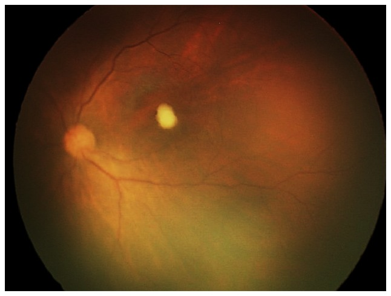
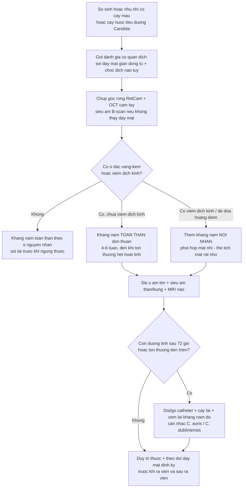
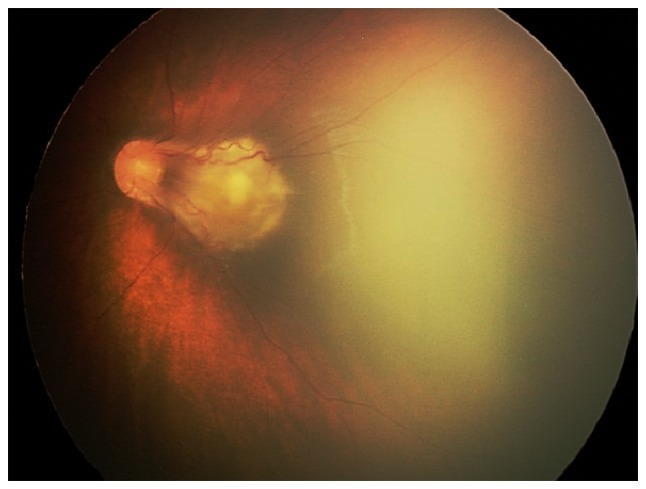
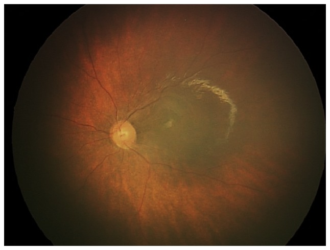
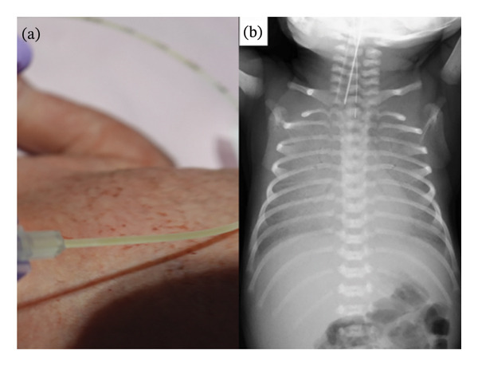

# 476 — Tầm soát mắt ở trẻ candidemia (NICU): soi đáy mắt cho ai, khi nào & đọc gì / Ocular screening in neonatal candidemia

**Tags:** `pattern:sang-loc-day-mat` `pattern:chorioretinitis` `pattern:viet-dich-kinh` `vung:vong-mac` `vung:dich-kinh` `vung:so-sinh` `score:sang-loc` `protocol:soi-day-mat` `protocol:RetCam` `protocol:choc-dich-nao-tuy` `incidentaloma:candidemia`
**Mức chắc chắn (certainty):** tổng hợp y văn (literature synthesis) — nhóm tự biên từ: đoàn hệ 223 sơ sinh nhiễm nấm xâm lấn 14 năm (CC BY 4.0, PMC11119303), thư phản biện 2026 về việc "áp" khuyến cáo người lớn cho sơ sinh (CC BY 4.0, PMC13601054), phân tích gộp 13 nghiên cứu/250.513 sơ sinh về khám võng mạc (PMC13449564), ca bệnh sơ sinh đủ tháng viêm võng mạc do *Candida* (CC BY-NC-ND 4.0, PMC5488640), ca sinh non 30 tuần ngực–da–mắt do *C. dubliniensis* (CC BY 4.0, PMC13112072).

> **Vì sao bài này quan trọng:** bài **463** đã dạy người lớn: candidemia → **soi đáy mắt dù không triệu chứng**, vì **~60–89% ca tổn thương hoàn toàn không than phiền**. Nhưng ở **trẻ sơ sinh**, lập luận "không triệu chứng thì không cần khám" bị **đảo ngược hoàn toàn**: trẻ **không thể kể** mờ mắt, dấu hiệu toàn thân **mơ hồ**, và **lan tới cơ quan đích lại nhiều hơn người lớn** (hàng rào máu–não non yếu). Đây là **điểm đang tranh luận nóng năm 2026**: hướng dẫn Brazil 2026 chuyển sang **khám chọn lọc theo triệu chứng/yếu tố nguy cơ** (theo mô hình người lớn) và **bị phản biện công khai** rằng làm vậy sẽ **bỏ sót chorioretinitis ở đúng nhóm không thể khai bệnh** (PMC13601054). Với bác sĩ CĐHA/NICU, câu hỏi thực hành là: **ai phải soi, soi bằng gì, đọc thấy gì thì đổi phác đồ** — bài này trả lời bằng số.

## 1. Tổng quan bệnh học – cơ chế hình ảnh – vì sao trẻ sơ sinh KHÁC người lớn

- **Đường vào và điểm lắng:** giống người lớn — *Candida* trong máu **bám hắc mạc**, phá **hàng rào máu–võng mạc ngoài (RPE/Bruch)** → **viêm hắc mạc dẹt** → **chorioretinitis nhô lên** → **viêm dịch kính**. Ở sơ sinh, **hắc mạc còn mỏng, mao mạch hắc mạc dày đặc**, và **hàng rào máu–não/hàng rào máu–mắt chưa trưởng thành** → **cùng một mức nhiễm nấm huyết cho tỉ lệ lan tới mắt và màng não cao hơn**.
- **Vì sao tổn thương sơ sinh hay "nghèo" trên ảnh:** giai đoạn sớm chỉ là **một ổ vàng–kem nhỏ ở hậu cực, KHÔNG có viêm dịch kính** — đúng như ca sơ sinh đủ tháng 39 tuần: **một ổ cạnh hoàng điểm, không haze dịch kính** (Lu CW 2017, PMC5488640). Nếu chỉ tìm "đục dịch kính" như ở người lớn, **sẽ bỏ sót giai đoạn còn điều trị được bằng kháng nấm toàn thân**.
- **Vì sao mắt và màng não đi cùng nhau:** cả hai là **"khoang kín" miễn dịch** mà kháng nấm khó thấm; trong **223 sơ sinh nhiễm nấm xâm lấn** (2009–2022, Trung Quốc): **tổn thương cơ quan đích (end-organ damage) 17,9%**; **viêm màng não do nấm 13,5%** ca; **viêm màng não + viêm nội nhãn 1,8%**; **viêm nội nhãn đơn thuần 0,9%**; **viêm tủy xương do nấm 0,4%** (Han T 2024). Nghĩa là **tổn thương mắt ~2,7% tổng số sơ sinh nhiễm nấm xâm lấn**, và **gần 2/3 ca có tổn thương mắt đi kèm viêm màng não** — **chọc dịch não tủy và soi đáy mắt là một cặp, không phải hai quyết định rời**.
- **Tác nhân & điểm khác người lớn:** sơ sinh **không có "ổ răng", "áp-xe gan do *Klebsiella*"**; nguồn là **catheter tĩnh mạch trung tâm, nuôi ăn tĩnh mạch, kháng sinh phổ rộng, đường ruột non** — tác nhân **C. albicans** rồi ***C. parapsilosis*** (30,5% trong loạt trên), ***C. glabrata* 7,2%** (Han T 2024). Thể **bẩm sinh (congenital)** lây **ngược chiều trong tử cung** (màng ối rách sớm, mẹ có *Candida* âm đạo): biểu hiện **ban đỏ–sẩn trên thân + viêm phổi nặng ngay sau sinh**, đúng ca **30 tuần/1349 g** với **phổi mờ lan tỏa sau surfactant** và *C. dubliniensis* (Higashiyama H 2026, PMC13112072).
- **Ngưỡng định lượng nằm lòng:**
  - **Sơ sinh nhiễm nấm xâm lấn:** tổn thương cơ quan đích **17,9%**; **viêm nội nhãn 0,9%**, **kèm viêm màng não 1,8%** (Han T 2024).
  - **Khám võng mạc sơ sinh (mọi nguyên nhân, chủ yếu ROP):** phân tích gộp **13 nghiên cứu, 250.513 sơ sinh** → **bất thường đe dọa thị lực có thể điều trị 6,1/10.000** (95% CI 1–14,1); **bất thường có khả năng đe dọa 42,2/10.000** (95% CI 19,8–71,9); **11/13 nghiên cứu dùng chụp võng mạc góc rộng (RetCam)**, **không ghi nhận biến chứng** (Anne RP 2026, PMC13449564). → **Khám hàng loạt là an toàn và khả thi**, nhưng **hiệu suất thấp nếu không chọn đúng nhóm**.
  - **Điều trị:** chorioretinitis **chưa có viêm dịch kính** có thể **khỏi bằng kháng nấm toàn thân đơn thuần**; thời gian **4–6 tuần và kéo dài tới khi tổn thương hết hoạt tính** (IDSA, dẫn trong Lu CW 2017). Ca *C. dubliniensis*: **fosfluconazole thất bại (tái phát ngày 8)** → **micafungin 10 mg/kg/ngày × 14 ngày** → sạch, ra viện ngày 59 (Higashiyama H 2026).
- **TẠI SAO "không có triệu chứng" là lý do ĐỂ soi, không phải để bỏ:** ở người lớn, **~89%** ca tổn thương mắt do *Candida* **không than phiền** (bài 463); ở trẻ, khả năng than phiền **bằng 0**. Vì vậy **triệu chứng không thể là cửa vào của thuật toán**.

## 2. Mẫu hình + chẩn đoán phân biệt theo vị trí (gamut)

**Câu hỏi lọc:** *"Sơ sinh/nhũ nhi cấy máu hoặc nước tiểu dương tính với Candida — có cần soi đáy mắt không, và tìm gì?"*

**Gamut theo vị trí tổn thương trên đáy mắt sơ sinh:**
- **Hậu cực (macular/juxtafoveal):** **ổ chorioretinitis vàng–kem đơn độc, bờ tương đối rõ, không viêm dịch kính** = *Candida* giai đoạn sớm (ca 39 tuần). Phân biệt với **drusen/loạn dưỡng** (hai bên, không bối cảnh nhiễm) và **xuất huyết do sinh** (mờ dần trong 2–4 tuần).
- **Ngoại vi dọc mạch:** **hoại tử + xuất huyết** = ARN/CMV (bài 452) — ở sơ sinh **rất hiếm**, cần bằng chứng virus.
- **Dịch kính:** **viêm dịch kính mủ** → *Candida* muộn, hoặc **vi khuẩn nội sinh** (bài 475) — vi khuẩn **nhanh hơn nhiều (giờ–ngày)**.
- **Vùng ROP (ridge, ngoại vi thái dương):** **ROP** — bệnh cảnh **phổ biến nhất** khi soi đáy mắt sơ sinh; **đừng để ROP "che" ổ nấm ở hậu cực** (bẫy thỏa mãn tìm kiếm).
- **Toàn nhãn/hốc mắt:** panophthalmitis, viêm mô tế bào hốc mắt — **cấp cứu**, dọa mất mắt.

**Gamut theo bối cảnh (quyết định có khám hay không):**

| Bối cảnh | Nguy cơ tổn thương mắt | Hành động |
|---|---|---|
| **Cấy máu dương *Candida*** (sơ sinh/nhũ nhi) | Cao — đây là chỉ định **mạnh** của IDSA | **Soi đáy mắt giãn đồng tử + chọc dịch não tủy** cho **mọi** trẻ |
| **Cấy nước tiểu dương *Candida*** ở sơ sinh | Trung bình–cao (IDSA xếp cùng nhóm cấy máu) | **Soi đáy mắt** (kèm siêu âm thận/bụng) |
| **Candida bẩm sinh (ban da + viêm phổi ngay sau sinh)** | Cao | **Soi đáy mắt trước khi ra viện**, không chờ triệu chứng mắt |
| **Candidemia đã cấy âm sau điều trị** | Còn nguy cơ (tổn thương tiến triển chậm) | **Soi lại** nếu lần đầu chưa soi được hoặc tổn thương chưa lành |
| **Chỉ có yếu tố nguy cơ, cấy âm** | Thấp | Không soi thường quy; theo dõi lâm sàng |

## 3. Bảng so sánh phân biệt (ma trận đối chiếu)

| Thực thể (entity) | Hình ảnh điển hình (đáy mắt / OCT / siêu âm / X-quang) | Chốt vào (rule-in) | Chốt loại (rule-out) | Gợi ý xác nhận |
|---|---|---|---|---|
| **Chorioretinitis do *Candida* (sơ sinh)** | **Ổ vàng–kem đơn độc/ít ổ ở hậu cực, KHÔNG viêm dịch kính** ở giai đoạn sớm; muộn: viêm dịch kính, "fluff ball" | **Cấy máu/nước tiểu dương *Candida* + ổ vàng–kem ở trẻ không thể khai bệnh** | **Tổn thương hai bên đối xứng, không bối cảnh nhiễm** → nghĩ loạn dưỡng/bẩm sinh khác | Soi đáy mắt giãn đồng tử + **OCT cầm tay** (tổn thương lớp ngoài võng mạc) |
| **ROP (bệnh võng mạc trẻ sinh non — bài 456)** | **Đường ranh giới (ridge) + mô xơ tăng sinh ở ngoại vi thái dương**, phân vùng I–III | **Sinh non/nhẹ cân + ridge đúng vùng** | **Ổ vàng–kem ở hậu cực giữa võng mạc bình thường** → không phải ROP | Soi đáy mắt/RetCam theo lịch ROP; **phân vùng–giai đoạn** |
| **Viêm nội nhãn nội sinh do VI KHUẨN (bài 475)** | **Ổ mủ dưới võng mạc lớn**, viêm dịch kính **giờ–ngày**, hypopyon | **Nhiễm khuẩn huyết + tiến triển < 72 giờ + ổ mủ** | **Tiến triển nhiều ngày–tuần, ổ nhỏ, không mủ tiền phòng** → nghĩ nấm | Cấy máu/dịch kính; **tiêm nội nhãn ngay** |
| **Nhiễm trùng bẩm sinh khác (CMV, toxoplasmosis, giang mai)** | CMV: hoại tử dọc mạch/xuất huyết; toxo: **ổ hoại tử + sẹo tăng sắc tố**; kèm **canxi hóa não, đầu nhỏ** | **Huyết thanh/PCR mẹ–con + tổn thương não trên siêu âm/MRI** | **Cấy *Candida* dương + tổn thương đúng ổ** | PCR CMV, huyết thanh toxo/giang mai, siêu âm thóp |
| **Xuất huyết võng mạc do sinh** | Xuất huyết **dạng vệt/đốm, tự mờ trong 2–4 tuần**, không có ổ đặc | **Bối cảnh sinh khó + hình dạng xuất huyết** | **Ổ đặc vàng–trắng, không mờ theo thời gian** → nghĩ nhiễm | Soi lại sau 2–4 tuần |
| **Viêm phổi sơ sinh do *Candida* bẩm sinh (X-quang)** | **Mờ lan tỏa hai phổi, thể tích phổi thấp, không đáp ứng đủ với surfactant** | **Ban da + cấy *Candida* (dạ dày/da/dịch khí quản) + X-quang mờ lan tỏa** | **Mờ một bên, có ổ đặc khu trú** → nghĩ vi khuẩn/hít sặc | Cấy máu + nhuộm soi dịch khí quản; **soi đáy mắt cùng lúc** |

*Sơ sinh nữ **39 tuần**, ngày 6 sau sinh sốt 39 °C, nôn; chẩn đoán nhiễm khuẩn huyết + viêm màng não sơ sinh, điều trị **cefepime 11 ngày** → xuất hiện **một ổ vàng–kem cạnh hoàng điểm mắt trái, KHÔNG haze dịch kính, không tế bào**. Cấy máu và dịch não tủy ra ***Candida albicans***. Nguồn: Lu CW et al., Exp Ther Med 2017 (PMC5488640) Fig. 1, **CC BY-NC-ND 4.0 — giữ nguyên bản, không crop/ghép**.*

### Dấu hiệu phải đọc đúng tên
- **Chorioretinitis không viêm dịch kính (chorioretinitis without vitritis):** **giai đoạn sớm nhất còn điều trị được** — kháng nấm **toàn thân đơn thuần** có thể đủ; đây là lý do **soi sớm có giá trị hơn soi "đẹp"**.
- **"Firework display" (chùm pháo hoa) trên OCT cầm tay:** tổn thương **tăng phản hồi ở lớp ngoài võng mạc bắn lên dịch kính** — dấu hiệu đã được báo cáo giúp chẩn đoán ở sơ sinh khi **đáy mắt còn nghèo** (ca báo 2018; **không dùng ảnh do không xác minh được giấy phép** — xem `sources.md`).
- **Chụp võng mạc góc rộng (wide-field digital imaging, RetCam):** phương tiện của **11/13 nghiên cứu** trong phân tích gộp 250.513 sơ sinh — **thay thế hợp lý** khi thiếu bác sĩ mắt tại chỗ, và **lưu ảnh để so sánh tiến triển**.

## 4. Protocol chụp/xét nghiệm + sơ đồ quyết định + phác đồ

**Bước 1 — Ai soi (chỉ định):**
- **MỌI sơ sinh/nhũ nhi có cấy MÁU hoặc cấy NƯỚC TIỂU dương tính với *Candida*** — khuyến cáo **mức mạnh** của IDSA 2016, **cùng lúc với chọc dịch não tủy** (dẫn trong PMC13601054).
- **Trẻ có Candida bẩm sinh (ban da + viêm phổi)** — soi **trước khi ra viện**.
- **Trẻ candidemia tái phát/không cấy âm được** — soi lại trước khi ngừng kháng nấm.

**Bước 2 — Soi bằng gì, đọc gì:**
- **Soi đáy mắt giãn đồng tử** (đồng tử sơ sinh dễ giãn; dùng thuốc giãn ngắn, theo phác đồ sơ sinh của đơn vị) **± ấn củng mạc nhẹ** để thấy ngoại vi.
- **Chụp ảnh góc rộng (RetCam/thiết bị tương đương)** — lưu ảnh **làm mốc so sánh**; đây là cách chuẩn hóa tốt nhất cho NICU.
- **OCT cầm tay (handheld SD-OCT)** khi **ổ nghèo trên ảnh màu** — phát hiện tổn thương **lớp ngoài võng mạc/dưới võng mạc** và **dịch kính mức vi thể**.
- **Siêu âm B-scan** khi **không thấy đáy mắt** (hẹp đồng tử dính, mủ dịch kính) — tìm **bong võng mạc, màng, dày hắc mạc**.
- **Đọc theo 4 câu hỏi:** (1) có **ổ đặc vàng–kem** không? (2) có **viêm dịch kính** không (tiên lượng và quyết định tiêm nội nhãn)? (3) tổn thương **ở hậu cực hay ngoại vi**? (4) có **bong võng mạc/hắc mạc** không?

**Bước 3 — Đánh giá cơ quan đích song song (bắt buộc, "gói sơ sinh"):**
- **Chọc dịch não tủy** (tế bào, protein, glucose, cấy, PCR).
- **Siêu âm thóp/MRI não** (ổ áp-xe, ventriculitis).
- **Siêu âm tim** (viêm nội tâm mạc do *Candida* — ở sơ sinh có thể **không có tiếng thổi**, tim cấu trúc bình thường).
- **Siêu âm thận/bụng** (áp-xe thận, nấm bào tử).
- **Cấy máu lặp lại tới khi âm** + **gỡ/đổi catheter** nếu còn.

**Bước 4 — Phác đồ (chốt định lượng):**
- **Chorioretinitis CHƯA có viêm dịch kính:** **kháng nấm toàn thân đơn thuần** là đủ (IDSA); **thời gian 4–6 tuần, kéo dài tới khi tổn thương hết hoạt tính** (Lu CW 2017).
- **Đã có viêm dịch kính / đe dọa hoàng điểm:** thêm **kháng nấm nội nhãn** (liều theo bài 474: amphotericin B **5 µg/0,1 mL**, voriconazole **100 µg/0,1 mL**) — **quyết định phối hợp bác sĩ mắt nhi**, vì **thể tích mắt sơ sinh rất nhỏ**.
- **Thuốc toàn thân thường dùng:** **amphotericin B deoxycholate 1 mg/kg/ngày**; **fluconazole** (kinh nghiệm nhiều nhất ở sơ sinh); **micafungin 10 mg/kg/ngày** (ca *C. dubliniensis* tái phát với fluconazole đã đáp ứng) — **liều cụ thể theo phác đồ NICU và cân nặng**.
- **Không dùng corticoid nội nhãn** khi chưa loại trừ nấm (bài 463).

## 5. Biến thể bình thường và cạm bẫy

- **Bẫy số 1 — "không có viêm dịch kính nên không phải nấm":** giai đoạn sớm **chỉ có ổ vàng–kem**, đúng ca 39 tuần (PMC5488640). **Không có viêm dịch kính là dấu hiệu ĐIỀU TRỊ ĐƯỢC**, không phải dấu hiệu loại trừ.
- **Bẫy số 2 — chờ trẻ "có triệu chứng mắt":** trẻ **không thể khai**; đây chính là lý do **IDSA khuyến cáo hệ thống** và là điểm phản biện hướng dẫn Brazil 2026 (**áp mô hình chọn lọc của người lớn cho sơ sinh sẽ bỏ sót đúng nhóm không thể khai bệnh** — PMC13601054).
- **Bẫy số 3 — soi đáy mắt "nhân tiện" lúc khám ROP nhưng chỉ tìm ROP:** **thỏa mãn tìm kiếm (satisfaction of search)** — đã thấy ridge ROP là dừng. Phải **quét toàn bộ 360°, đặc biệt hậu cực**, và ghi rõ "đã kiểm tra hậu cực".
- **Bẫy số 4 — coi ban da bẩm sinh là "viêm da lành":** ban đỏ–sẩn ở thân + **viêm phổi mờ lan tỏa không đáp ứng đủ surfactant** ở trẻ non tháng = **candida bẩm sinh**, phải **cấy + soi đáy mắt** (ca 30 tuần/1349 g, PMC13112072).
- **Bẫy số 5 — tin vào "đã âm hóa cấy máu":** tổn thương mắt **tiến triển chậm hơn** đáp ứng cấy máu; ca 39 tuần **vẫn lan rộng tổn thương sau khi ra viện** dù cấy đã âm (PMC5488640, Fig. 2) → **soi lại sau ra viện**.
- **Bẫy số 6 — fluconazole cho mọi loài:** ***C. dubliniensis*** có thể **kháng fluconazole mức thấp** và **tái phát sau 8 ngày fosfluconazole**; ***C. auris*** đa kháng (đã có **ca sơ sinh Brazil**, Anvisa 2023 — dẫn trong PMC13601054). **Định danh loài + MIC**, không đoán.
- **Bẫy số 7 — bỏ sót tim và não vì mắt "chỉ nhẹ":** **1,8%** sơ sinh nhiễm nấm có **viêm màng não + viêm nội nhãn cùng lúc** (Han T 2024) → **nhìn thấy ổ ở mắt = phải chọc dịch não tủy và siêu âm tim**, không dừng ở mắt.
- **Bẫy số 8 — dùng B-scan để "chốt" viêm dịch kính:** mủ và máu đều là echo dày — B-scan chỉ giúp **loại bong võng mạc/màng**, không định tính dịch.

## 6. Tự lượng giá — Blind Quiz

**Ca 1 — Sơ sinh nữ 39 tuần, ngày 6 sốt 39 °C, nôn; đã dùng cefepime 11 ngày. Mắt trái:**

- Hỏi: (1) mô tả tổn thương; (2) vì sao "không viêm dịch kính" lại quan trọng cho quyết định điều trị? (3) cần xét nghiệm gì ngay?

<b>Bấm để hiện đáp án (findings + chẩn đoán)</b>

- **Findings:** **một ổ vàng–kem, bờ tương đối rõ, cạnh hoàng điểm**; **không haze dịch kính, không tế bào**.
- **Chẩn đoán:** **chorioretinitis do *Candida albicans*** (cấy máu + dịch não tủy dương) ở sơ sinh đủ tháng sau **11 ngày kháng sinh phổ rộng**.
- **Vì sao quan trọng:** **chorioretinitis chưa có viêm dịch kính** điều trị được bằng **kháng nấm toàn thân đơn thuần**; nếu chờ tới khi có viêm dịch kính mới điều trị thì đã mất giai đoạn dễ nhất (và có thể phải tiêm nội nhãn/cắt dịch kính ở mắt sơ sinh).
- **Xét nghiệm ngay:** cấy máu + **chọc dịch não tủy** (đã dương *C. albicans* trong ca này), siêu âm tim/thận, **soi đáy mắt hai bên**.
- Nguồn ảnh: Lu CW et al., Exp Ther Med 2017 (PMC5488640) Fig. 1, **CC BY-NC-ND 4.0** (giữ nguyên bản).

**Ca 2 — Cùng trẻ, 6 ngày sau khi ra viện (đã âm hóa cấy máu, đã ngừng fluconazole):**

- Hỏi: (1) tổn thương thay đổi thế nào? (2) "cấy máu âm" có cho phép ngừng theo dõi mắt không? (3) điều trị nên kéo dài bao lâu?

<b>Bấm để hiện đáp án (findings + chẩn đoán)</b>

- **Findings:** ổ chorioretinitis **đã lan rộng ra cung mạch trên và dưới–thái dương**, bờ mờ hơn, **vẫn chưa có viêm dịch kính rõ**.
- **Ý nghĩa:** **cấy máu âm không đồng nghĩa tổn thương mắt lành** — tổn thương mắt tiến triển chậm hơn và cần **theo dõi bằng ảnh**.
- **Thời gian điều trị:** **4–6 tuần** và **kéo dài tới khi hết hoạt tính trên đáy mắt** (IDSA, dẫn trong Lu CW 2017); ca này được điều trị tiếp **4 tuần** và tổn thương **hết hoạt tính**.
- Nguồn ảnh: Lu CW et al. (PMC5488640) Fig. 3, **CC BY-NC-ND 4.0** (giữ nguyên bản).

**Ca 3 — Cùng trẻ sau đợt điều trị thứ hai:**

- Hỏi: đủ tiêu chuẩn ngừng kháng nấm chưa? Cần làm gì trước khi kết thúc theo dõi?

<b>Bấm để hiện đáp án (findings + chẩn đoán)</b>

- **Findings:** **không còn tổn thương hoạt tính** — sẹo nhỏ tại nơi nhiễm, không dịch, không viêm dịch kính.
- **Tiêu chuẩn ngừng:** hết hoạt tính trên đáy mắt **+** đủ **4–6 tuần** kháng nấm **+** cấy âm, ổ ngoài mắt (khớp háng trong ca này) ổn định.
- **Trước khi kết thúc:** **soi đáy mắt hai bên lần cuối**, hẹn **theo dõi thị lực/phát triển thị giác** (trẻ sơ sinh chưa hợp tác đo thị lực — theo dõi **nhìn theo vật, phản xạ đồng tử, lác**).
- Nguồn ảnh: Lu CW et al. (PMC5488640) Fig. 4, **CC BY-NC-ND 4.0** (giữ nguyên bản).

**Ca 4 — Sinh non 30 tuần, 1349 g, màng ối rách sớm, mẹ có *C. albicans* âm đạo. Ngay sau sinh: ban đỏ–sẩn thân + suy hô hấp; X-quang sau surfactant:**

- Hỏi: (1) mô tả X-quang và chẩn đoán phân biệt; (2) vì sao phải soi đáy mắt ở trẻ này dù chưa có dấu hiệu mắt? (3) nếu cấy ra *C. dubliniensis* thì lưu ý gì về thuốc?

<b>Bấm để hiện đáp án (findings + chẩn đoán)</b>

- **Findings X-quang (b):** **mờ đục lan tỏa cả hai phổi**, thể tích phổi **thấp**, ống nội khí quản tại chỗ, **không cải thiện hoàn toàn sau surfactant**; (a) **ban đỏ dạng sẩn rải rác trên thân**.
- **Chẩn đoán:** **candida bẩm sinh (congenital candidiasis) do *C. dubliniensis*** — xác định bằng **MALDI-TOF** từ dịch dạ dày, da, dịch phế quản, chất gây.
- **Vì sao soi mắt:** candida bẩm sinh **lan máu → mắt và màng não**; trẻ **không thể khai bệnh**; trong 223 sơ sinh nhiễm nấm xâm lấn, **2,7% có tổn thương mắt** và **1,8% kèm viêm màng não**.
- **Lưu ý thuốc:** *C. dubliniensis* **rất giống *C. albicans* trên soi/cấy thường**, dễ **kháng fluconazole mức thấp**; ca này **tái phát ngày 8 với fosfluconazole** → chuyển **micafungin 10 mg/kg/ngày × 14 ngày**, ra viện ngày 59 không di chứng.
- Nguồn ảnh: Higashiyama H, Futatani T. Case Rep Pediatr 2026 (PMC13112072) Fig. 1, CC BY 4.0.

## Bài liên quan chéo
- [400 – Tổng quan Mắt & thị giác](../400-tong-quan-mat-thi-giac/lesson.md)
- [463 – Viêm nội nhãn nội sinh do nấm (Candida/Aspergillus)](../463-viem-noi-nhan-noi-sinh-nam/lesson.md) (người lớn — nền tảng so sánh)
- [474 – Kháng nấm nội nhãn: chọn thuốc theo loài & MIC](../474-khang-nam-noi-nhan-chon-thuoc-theo-loai/lesson.md) (liều nội nhãn)
- [475 – Viêm nội nhãn nội sinh do vi khuẩn](../475-viem-noi-nhan-noi-sinh-vi-khuan/lesson.md) (nhịp độ giờ–ngày, ổ mủ dưới võng mạc)
- [456 – Bệnh võng mạc trẻ sinh non (ROP): sàng lọc & phân giai đoạn](../456-benh-vong-mac-tre-sinh-non/lesson.md) (cùng buổi soi, khác bệnh)
- [458 – Di chứng & theo dõi dài hạn sau ROP](../458-di-chung-theo-doi-dai-han-sau-rop/lesson.md)
- [452 – Hoại tử võng mạc cấp (ARN) & CMV retinitis](../452-hoai-tu-vong-mac-ARN-CMV/lesson.md)
- [615 – Viêm phổi nhi: round pneumonia, virus vs vi khuẩn, hít sặc](../615-viem-phoi-nhi-round-pneumonia/lesson.md) (X-quang mờ lan tỏa sơ sinh)

## Ảnh
- `476_viem-vong-mac-Candida_Fundus_PMC5488640-Fig1-CCBYNCND.jpg` — Lu CW et al., Exp Ther Med 2017 (PMC5488640) Fig. 1, **CC BY-NC-ND 4.0** (giữ nguyên bản).
- `476_viem-vong-mac-tien-trien_Fundus_PMC5488640-Fig2-CCBYNCND.jpg` — Lu CW et al. (PMC5488640) Fig. 3, **CC BY-NC-ND 4.0** (giữ nguyên bản).
- `476_viem-vong-mac-sau-dieu-tri_Fundus_PMC5488640-Fig4-CCBYNCND.jpg` — Lu CW et al. (PMC5488640) Fig. 4, **CC BY-NC-ND 4.0** (giữ nguyên bản).
- `476_candida-bam-sinh_XR_PMC13112072-Fig1-CCBY.jpg` — Higashiyama H, Futatani T. Case Rep Pediatr 2026 (PMC13112072) Fig. 1, CC BY 4.0.
- Chi tiết giấy phép từng ảnh trong `images/CREDITS.md`. AuntMinnie/Retina Image Bank: **chỉ dẫn link, không tải**.

> Không dùng để chẩn đoán độc lập khi chưa có người hướng dẫn.
