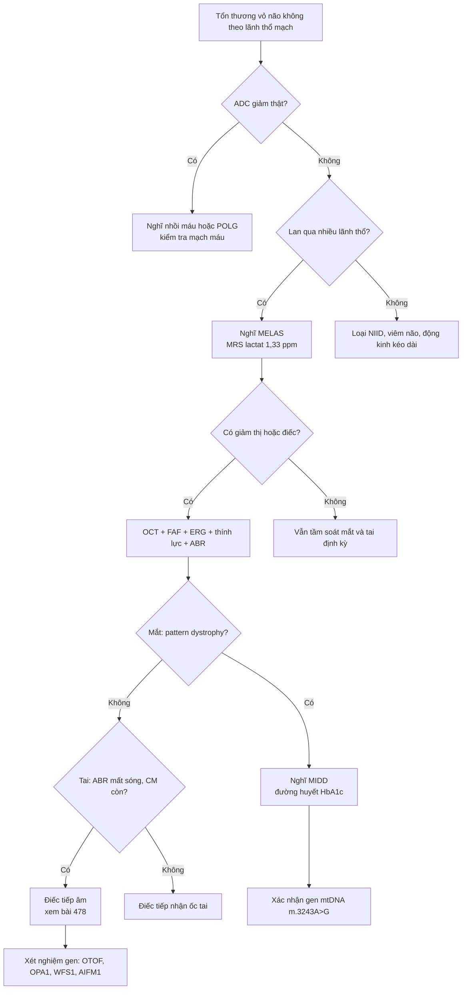
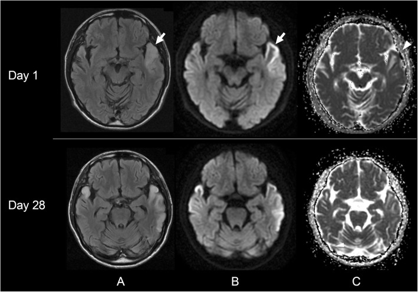
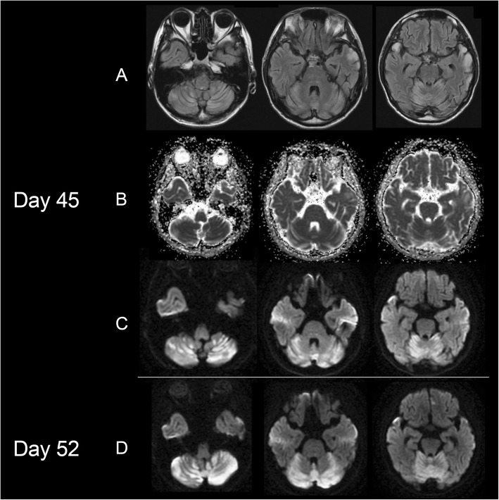
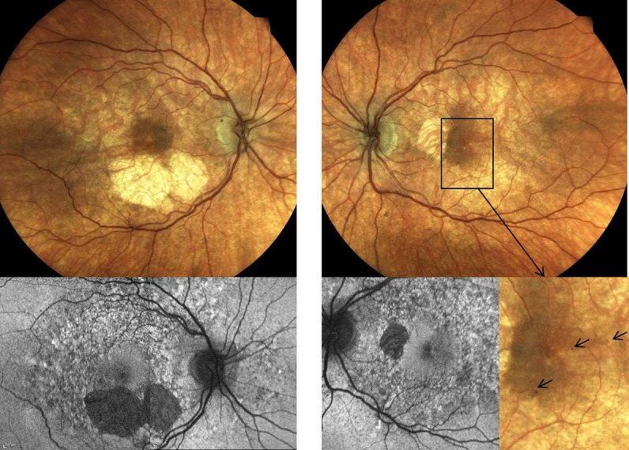
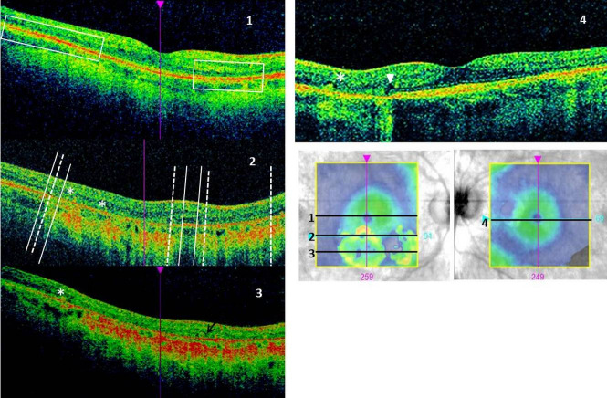
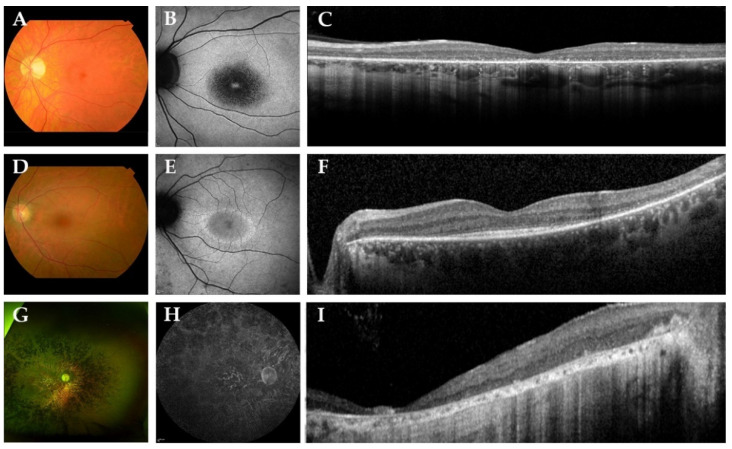
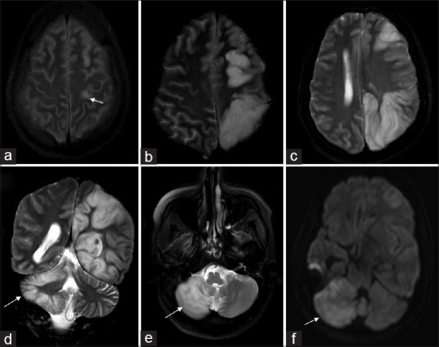
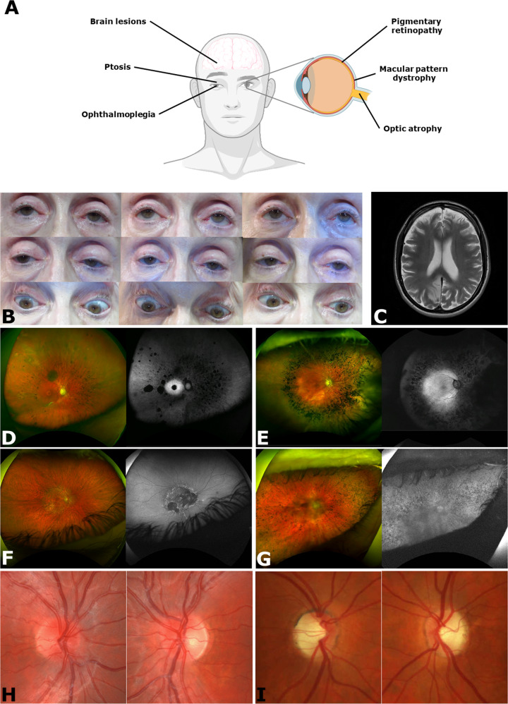

# 477 — Bệnh ty thể có biểu hiện THỊ GIÁC & TAI: MELAS, MIDD, POLG, PHARC / Mitochondrial disease with visual and auditory involvement

**Tags:** `pattern:benh-ty-the` `pattern:khong-theo-lanh-tho` `vung:vo-nao` `vung:tieu-nao` `vung:vong-mac` `vung:than-kinh-thi` `protocol:MRI-DWI-ADC-MRS` `protocol:OCT-FAF-ERG` `protocol:audiometry-ABR`

**Mức chắc chắn (certainty):** tổng hợp y văn (literature synthesis) — mỗi dòng số liệu đều lấy từ bài gốc có PMCID; ca hình ảnh là ca nguyên văn (đọc trực tiếp mô tả trong bài nguồn), không suy diễn thêm.

> **Vì sao một bài CĐHA lại gộp não + mắt + tai?** Ty thể là "nhà máy ATP" của mọi tế bào, nhưng tổn thương biểu hiện rõ nhất ở **mô tiêu thụ oxy cao nhất**: vỏ não, võng mạc (RPE/ngoài võng mạc), dây VIII và cơ tim. Vì vậy cùng một biến thể gen (điển hình **m.3243A>G** của MT-TL1) có thể cho **cơn đột quỵ giả (stroke-like episode — SLE)** trên MRI, **loạn dưỡng hoàng điểm dạng pattern** trên đáy mắt/FAF/OCT, và **điếc tiếp nhận hai bên** trên thính lực đồ. Bỏ một trong ba hệ = chuỗi chẩn đoán đứt.

## 1. Tổng quan bệnh học – cơ chế hình ảnh

**Di truyền và ngưỡng biểu hiện (threshold effect).** mtDNA đột biến tồn tại lẫn với mtDNA lành trong cùng tế bào (**heteroplasmy**). Triệu chứng xuất hiện khi tỷ lệ đột biến trong mô vượt ngưỡng — với MELAS, bài tổng quan mắt ghi **heteroplasmy 50–90%** cho kiểu hình MELAS điển hình (Chen BS et al. 2023, PMC10397317). Ca MELAS có biểu hiện tiểu não dưới đây chỉ **17% heteroplasmy trong bạch cầu** mà vẫn có tổn thương não — vì mô đích (não) có thể có heteroplasmy cao hơn hẳn máu; **đừng dùng heteroplasmy máu để loại trừ bệnh**.

**TẠI SAO hình ảnh MELAS trông như vậy — cơ chế 4 bước:**
1. Chuỗi hô hấp tổng hợp ATP kém → **thiếu năng lượng cục bộ**;
2. Bơm **Na⁺/K⁺-ATPase** thất bại → mất phân cực màng → **tăng hưng phấn thần kinh** (co giật, lan dọc vỏ não theo kiểu "spreading" chứ không theo động mạch);
3. Hàng rào máu–não mở + phù **do thấm (vasogenic)** → **DWI sáng nhưng ADC KHÔNG giảm** (đây là điểm chốt phân biệt với nhồi máu thiếu máu);
4. Chuyển hóa yếm khí → **lactat tăng**: đỉnh lactat **1,33 ppm** trên MRS (doublet, **đảo pha ở TE 135–144 ms**, cùng pha ở TE 30 ms); lactat dịch não tủy ca nguyên văn **10,2 mmol/L**, **tỷ lệ lactat/pyruvat 30,9** (Oyama M et al. 2020, PMC7195751).

**Vì sao võng mạc bị trước.** RPE và lớp ngoài võng mạc là mô có mật độ ty thể cao nhất cơ thể; thiếu ATP → **mất chức năng bơm của RPE** → ứ sắc tố, teo lớp ngoài, sau đó mỏng lớp tế bào hạch. Trên FAF, hiện tượng đặc trưng là **nhiễu hạt lan rộng (diffuse speckled pattern) vượt ra ngoài vùng bất thường thấy trên soi đáy mắt** — dấu "occult" này giúp phân biệt với các bệnh hoàng điểm khác (Chen BS et al. 2023, PMC10397317).

**Vì sao tai bị.** Stria vascularis và tế bào lông ngoài phụ thuộc ATP; tổn thương **ốc tai (thanh âm) ± dây VIII** → điếc tiếp nhận, thường **hai bên, đối xứng, tiến triển**, khởi phát có thể trước cả tiểu đường trong MIDD.

**Ngưỡng định lượng nền (dùng trong bài):**

| Thông số | Con số | Nguồn |
|---|---|---|
| m.3243A>G trong MELAS (gộp) | **78%** (KTC 95%: 68–86) | Li Y et al. 2026, PMC13487938 (13 nghiên cứu, 988 người) |
| Vùng não hay tổn thương nhất | **thùy thích (temporal) 87%** | Li Y et al. 2026, PMC13487938 |
| Co giật / tăng lactat | **89% / 81%** | Li Y et al. 2026, PMC13487938 |
| Heteroplasmy kiểu MELAS | **50–90%** | Chen BS et al. 2023, PMC10397317 |
| Hoàng điểm dạng pattern của MIDD — tuổi phát hiện | trung bình **46,5 tuổi** (27–71) | Chen BS et al. 2023, PMC10397317 |
| PHARC — tần suất từng dấu hiệu | đa dây thần kinh **91%**, điếc **86%**, thất điều **74%**, viêm võng mạc sắc tố **82%**, đục thủy tinh thể **86%** | Harutyunyan L et al. 2024, PMC11539745 (58 bệnh nhân/37 gia đình) |

## 2. Mẫu hình + chẩn đoán phân biệt theo vị trí (gamut)

**A. Vỏ não — tổn thương "không theo lãnh thổ mạch" (non-territorial):**
- **MELAS** (m.3243A>G, cũng gặp m.13513G>A, m.3271T>C…): vỏ **thùy thích/thùy đỉnh–chẩm**, lan dọc vỏ qua nhiều lãnh thổ, tổn thương **"di cư" (migratory)** giữa các đợt; tiểu não: **dọc các lá tiểu não (folia)**, không vào nhân sâu/cuống tiểu não (Oyama M et al. 2020, PMC7195751).
- **POLG-related** (nDNA): tổn thương vỏ **quanh hồi trước trung tâm (perirolandic)**, có thể kèm **hiện tượng chéo lấn (crossed cerebellar diaschisis)** — bán cầu tiểu não đối bên giảm tưới máu/hạn chế khuếch tán (Muthusamy K et al. 2022, PMC9764922).
- **Bệnh thể vùi nội nhân tế bào thần kinh (NIID)** — **cạm bẫy số 1**: DWI sáng dải vỏ não/bán cấp, hình ảnh gần như trùng MELAS; bài so sánh trực tiếp cho thấy hai bệnh khác nhau về phân bố và cách lan (Shi Y et al. 2024, PMC11651200 — CC BY-NC-ND, chỉ dẫn link); bài "pitfall" cũng nhấn mạnh NIID bị chẩn đoán nhầm thành MELAS (Liu X et al. 2026, PMC13005549).
- **Viêm não do virus (HSV)**: thùy thích nhưng **hai bên, không đối xứng, có xuất huyết và bắt thuốc cản quang**, ADC giảm; ca MELAS dưới đây từng **điều trị acyclovir + ức chế miễn dịch 45 ngày trước khi đúng chẩn đoán** — bài học lâm sàng: đáp ứng kém với acyclovir + lactat cao → nghĩ ty thể.

**B. Chất xám sâu / thân não (mẫu hình "chuyển hóa"):**
- **POLG** (thể ataxia–neuropathy): **tăng tín hiệu đối xứng hai bên ở đồi thị lưng–giữa (dorsomedial thalami) và nhân răng/nhân tiểu não sâu** (Alhatou A et al. 2026, PMC13681239; chỉ dẫn link ảnh webp).
- **Leigh**, **KSS/LS**, **bệnh ty thể do POLG khởi phát muộn**: đồi thị, thân não, nhân nền — đối xứng là chìa khóa.

**C. Hoàng điểm/võng mạc — gamut "loạn dưỡng hoàng điểm dạng pattern":**
- **MIDD**: hoàng điểm dạng pattern + đái tháo đường + điếc; FAF **nhiễu hạt lan rộng**, **hoàng điểm trung tâm còn được bảo tồn tới giai đoạn muộn** (Chen BS et al. 2023, PMC10397317).
- **PHARC** (ABHD12, lặn): viêm võng mạc sắc tố + đục thủy tinh thể + đa dây thần kinh + thất điều + điếc (mã **ORPHA171848**).
- **Bệnh võng mạc đái tháo đường**: có **vi phình mạch, xuất tiết cứng, xuất huyết** — MIDD thì **KHÔNG có** (tần suất bệnh võng mạc ĐTĐ ở MIDD thấp hơn ĐTĐ typ 2 cùng thời gian bệnh).
- **Teo hắc mạc (choroideremia), dystrophia retinae pigmentosa**, **bệnh Stargardt**, **độc tính thuốc (HCQ, deferoxamine)** — xem bài 484/487/489.

**D. Thần kinh thị (optic nerve):** **DOA/OPA1** (teo thị hai bên, không đau, giảm thị lực từ từ), **LHON** (nam trẻ, mất thị lực trung tâm cấp–bán cấp tuần tự hai mắt), **teo thị trong MELAS/MIDD** — bắt buộc đo **RNFL/GCL bằng OCT** để định lượng (bài 434/439).

## 3. Bảng so sánh phân biệt (ma trận đối chiếu)

### 3.1. Tổn thương vỏ não "không theo lãnh thổ mạch"

| Thực thể (entity) | Hình ảnh điển hình (DWI/FLAIR/ADC) | Chốt vào (rule-in) | Chốt loại (rule-out) | Gợi ý xác nhận |
|---|---|---|---|---|
| **MELAS** | Vỏ thùy thích/đỉnh–chẩm, **lan dọc vỏ qua nhiều lãnh thổ**, DWI sáng + **ADC không giảm**, teo não tiến triển | **Lan qua đường phân thùy mạch + ADC không giảm + lactat dịch não tủy cao** | ADC giảm rõ + tổn thương khu trú đúng một lãnh thổ → nhồi máu | MRS đỉnh 1,33 ppm, lactat máu/dịch não tủy, gen mtDNA (m.3243A>G) |
| **Nhồi máu thiếu máu não** | Khu trú **một lãnh thổ động mạch**, DWI sáng + **ADC giảm** | **ADC giảm rõ so với vỏ não đối bên trong cửa sổ 0–72 giờ** + mạch máu tương ứng tắc/hẹp | Tổn thương bắc cầu qua nhiều lãnh thổ → nghĩ ty thể | CTA/MRA, tưới máu (MELAS thường **tăng** tưới máu, nhồi máu **giảm**); cut-off ADC tuyệt đối phụ thuộc máy — **chưa rõ, cần tra** |
| **NIID** | DWI sáng **dải vỏ não/bán cấp hai bên**, đối xứng, không theo lãnh thổ | **Tổn thương dải vỏ–bán cấp đối xứng + không tăng lactat** | Có lactat cao + lan "di cư" từng đợt → MELAS | Gen NOTCH2NLC, sinh thiết da |
| **POLG** | Vỏ **quanh hồi trước trung tâm**, có thể **hạn chế khuếch tán thật**, kèm **diaschisis tiểu não chéo** | **Tổn thương perirolandic + bán cầu tiểu não đối bên bất thường** | Không có bất thường đối bên + tổn thương nhiều thùy rời rạc → MELAS | Gen POLG, **tránh valproat**, men gan |
| **Viêm não HSV** | Thùy thích ± trán dưới, **hai bên không đối xứng**, xuất huyết, bắt thuốc | **Xuất huyết + bắt thuốc cản quang + sốt cấp** | Không bắt thuốc, không xuất huyết, lactat cao → ty thể | PCR HSV dịch não tủy |

### 3.2. Loạn dưỡng hoàng điểm/võng mạc trong bệnh ty thể

| Thực thể (entity) | Đáy mắt + FAF + OCT | Chốt vào (rule-in) | Chốt loại (rule-out) | Gợi ý xác nhận |
|---|---|---|---|---|
| **MIDD** | **Pattern dystrophy**: sắc tố quanh hoàng điểm, FAF **nhiễu hạt lan rộng vượt vùng tổn thương**, OCT **mỏng lớp ngoài + RPE**, OCT-A giảm mật độ mao mạch sâu | **Đái tháo đường + điếc hai bên + FAF nhiễu hạt** | Có vi phình mạch/xuất tiết cứng → bệnh võng mạc ĐTĐ | m.3243A>G; ERG 30 Hz flicker chậm |
| **PHARC** | **Viêm võng mạc sắc tố** (đốm xương, teo RPE), đục thủy tinh thể sớm | **RP + đa dây thần kinh + thất điều + điếc** (đủ bộ) | Chỉ RP đơn thuần, không thần kinh → RP cô lập/Usher | ABHD12 (lặn), ERG, EMG |
| **Usher** | RP + điếc tiếp nhận **bẩm sinh/sớm** | **Điếc bẩm sinh + RP, không đa dây thần kinh** | Có thất điều tiến triển + đa dây thần kinh → PHARC | Gen Usher (MYO7A…), tiền đình |
| **Bệnh võng mạc ĐTĐ** | Vi phình mạch, xuất huyết/xuất tiết, phù hoàng điểm | **Dấu hiệu vi mạch rõ** | Không vi phình mạch + FAF nhiễu hạt → MIDD | Soi đáy mắt giãn đồng tử, OCT |
| **Độc tính HCQ** | **Vòng sáng quanh hoàng điểm (pericentral ring)** trên FAF, mất đoạn parafoveal trên OCT | **Tiền sử HCQ ≥ 5 năm + liều > 5 mg/kg/ngày** | Không dùng thuốc → loại | Bài 484/487 |

## 4. Protocol chụp + hệ phân độ/điểm chuẩn hóa

**4.1. MRI sọ khi nghi SLE (bắt buộc đủ bộ):**
- **DWI (b = 1000) + ADC map** — không được chỉ đọc DWI; **ADC là câu trả lời cho "nhồi máu hay phù do ty thể"**.
- **FLAIR** trục + coronal (đánh giá lan dọc vỏ), **T2**, **SWI** (loại xuất huyết — hay gặp ở MELAS cấp).
- **MRS đa voxel** đặt vào vùng tổn thương **và** vùng vỏ "bình thường" đối bên; đọc **lactat 1,33 ppm** ở **TE 135–144 ms** (đảo pha) — TE 30 ms để xác nhận cùng pha.
- **ASL/DSC tưới máu**: SLE thường **tăng tưới máu** (vi mạch giãn), khác nhồi máu (giảm) — hỗ trợ mạnh khi lâm sàng mơ hồ.
- **MRA/CTA** loại tắc mạch lớn; **không** cần tiêm cản quang thường quy cho SLE (tổn thương không bắt thuốc đặc hiệu).

**4.2. Mắt (multimodal — "không thấy trên soi đáy mắt không có nghĩa là không có"):**
- **OCT macula (SD-OCT)** + **FAF rộng góc** + **OCT-A**;
- **ERG toàn trường** (đáp ứng 30 Hz flicker chậm/giảm biên độ), **mfERG**, **VEP** khi thị lực không tương xứng tổn thương;
- **OCT RNFL/GCL** để theo dõi teo thị (định lượng µm/năm).

**4.3. Tai:** đo thính lực lưỡi tần, **ABR** (click + tone burst), **OAE/CM**, **phản xạ cơ bậu (stapedial reflex)**, **ASSR**; **MRI 3D chuỗi nặng T2 (CISS/FIESTA/DRIVE)** khảo sát dây VIII và ốc tai (chi tiết ở bài 478).

**4.4. Sơ đồ xử trí "tổn thương vỏ não không theo lãnh thổ mạch + điếc/giảm thị"**

**4.5. Điểm chuẩn/ngưỡng xử trí (không có "RADS" cho bệnh ty thể — dùng 3 thang sau):**
- **Heteroplasmy**: báo % theo mô (máu/niệu/nước bọt/cơ) — **máu thấp không loại trừ**; nên xét **niệu sediment** hoặc mô đích khi nghi cao.
- **Tiêu chuẩn MELAS (đồng thuận 2026, Mancuso M et al. 2026, PMC13090769):** ≥ 1 cơn SLE + bằng chứng rối loạn chức năng ty thể do biến thể mtDNA gây bệnh; **không dùng thuật ngữ "MELAS-like"/"MELAS spectrum"**; các chất bổ trợ (L-arginine, L-citrulline, taurine, CoQ10) **chưa có bằng chứng** — không hứa hẹn với gia đình; **khởi động thuốc chống co giật ngay** khi nghi co giật trong cơn; **corticoid tĩnh mạch có thể có lợi cấp**.
- **Theo dõi mắt**: OCT/FAF mỗi **6–12 tháng**; **thính lực đồ mỗi năm** (MIDD: điếc có thể là dấu hiệu đầu tiên trước đái tháo đường nhiều năm).

## 5. Biến thể bình thường và cạm bẫy

- **Cạm bẫy 1 — đọc DWI mà bỏ ADC:** SLE là **phù thấm**, ADC **không giảm** (thậm chí tăng) trong giai đoạn cấp. Đọc "DWI sáng = nhồi máu" là nguyên nhân chính của việc bỏ sót MELAS (và của việc điều trị sai hướng).
- **Cạm bẫy 2 — "hết tổn thương là hết bệnh":** SLE có thể **di cư** sang vùng khác trong vài tuần; chụp lại là bắt buộc để thấy kiểu lan (Oyama: thùy thích trái → thùy thích phải → tiểu não vào ngày 45).
- **Cạm bẫy 3 — NIID:** tổn thương dải vỏ–bán cấp đối xứng, **không tăng lactat**, tiến triển chậm ở người lớn tuổi; đừng gán MELAS chỉ vì DWI sáng vỏ não (Liu X et al. 2026, PMC13005549).
- **Cạm bẫy 4 — tiểu não:** SLE tiểu não đi **dọc các lá (folia)** và **không vào nhân sâu/cuống** — khác nhồi máu vùng PICA/AICA (có địa hướng mạch rõ); ADC tiểu não cũng **không giảm** (Oyama M et al. 2020).
- **Cạm bẫy 5 — mắt:** "đáy mắt bình thường" không loại trừ MIDD — tổn thương **occult** chỉ hiện trên FAF/OCT/ERG. Ngược lại, **FAF nhiễu hạt** dễ bị đọc thành "nhiễu ảnh" ở mắt khô/đục thủy tinh thể → luôn đối chiếu OCT.
- **Cạm bẫy 6 — thuật ngữ:** không dùng "MELAS-like"; đồng thuận 2026 yêu cầu bằng chứng **biến thể mtDNA gây bệnh** mới gọi MELAS (Mancuso M et al. 2026).
- **Biến thể bình thường:** giãn nhẹ khoang dịch não tủy quanh dây VIII và **dây VIII nhỏ hơn dây VII** ở một số người không có triệu chứng — khi đo dây VIII phải dùng **lát cắt vuông góc ống tai trong** và so với bên đối diện; đừng chẩn đoán "thiểu sản dây thần kinh ốc tai" chỉ vì một lát cắt chéo.

## 6. Tự lượng giá — Blind Quiz

**Ca 1 — Nam 47 tuổi, đái tháo đường typ 2, đột ngột mất ngôn ngữ. Nhìn 3 chuỗi ở ngày 1 và ngày 28.**

- Gợi ý: bệnh nhân được điều trị acyclovir rồi ức chế miễn dịch nhưng không đỡ.
- Câu hỏi: (1) Tổn thương ở đâu, có theo một lãnh thổ động mạch không? (2) Cột ADC (C) nói gì — có hạn chế khuếch tán thật? (3) Ba chẩn đoán phân biệt và xét nghiệm chốt?

<b>Bấm để hiện đáp án (findings + chẩn đoán)</b>

- **Dấu hiệu:** FLAIR (A) và DWI (B) tăng tín hiệu **vỏ thùy thích trước–bên trái**, lan dọc vỏ; trên **ADC (C) vùng tổn thương KHÔNG tối** (không giảm ADC) → **phù thấm (vasogenic)**, không phải hạn chế khuếch tán. Ngày 28 tổn thương vẫn còn nhưng đã có xu hướng teo vỏ.
- **Chẩn đoán:** **cơn đột quỵ giả do MELAS (stroke-like episode)** — m.3243A>G, heteroplasmy bạch cầu **17%**.
- **Vì sao:** mất năng lượng → bơm Na⁺/K⁺-ATPase thất bại → phù thấm, không phải tắc mạch. Xét nghiệm chốt: **MRS lactat 1,33 ppm**, lactat máu/dịch não tủy, gen mtDNA.
- **Phản biện (trung thành nguồn):** ca này **heteroplasmy máu chỉ 17%** — thấp hơn con số "50–90%" của thể điển hình; đừng dùng ngưỡng heteroplasmy máu để loại trừ.
- **Nguồn ảnh:** Oyama M et al., *BMC Neurol* 2020, Fig. 1 (PMC7195751), **CC BY 4.0**.

**Ca 2 — Cùng bệnh nhân, ngày 45: thất điều, nói khó. Nhìn hàng FLAIR/DWI/ADC của tiểu não.**

- Câu hỏi: Tổn thương tiểu não nằm ở đâu (lá tiểu não hay nhân sâu)? Có hạn chế khuếch tán không? Vì sao điều này quan trọng cho chẩn đoán?

<b>Bấm để hiện đáp án</b>

- **Dấu hiệu:** tăng tín hiệu **dọc các lá tiểu não (folia)** hai bên trên FLAIR/DWI; **không** vào nhân tiểu não sâu hay cuống tiểu não; **ADC không giảm**.
- **Chẩn đoán:** SLE tiểu não trong MELAS — cùng cơ chế với tổn thương vỏ đại não.
- **Vì sao quan trọng:** phân bố **theo lá, không theo địa hướng mạch** + ADC không giảm giúp loại nhồi máu PICA/AICA; tổn thương tiểu não xuất hiện **muộn** (ngày 45) chứng minh bệnh **di cư theo thời gian**.
- **Nguồn ảnh:** Oyama M et al., *BMC Neurol* 2020, Fig. 2 (PMC7195751), **CC BY 4.0**.

**Ca 3 — Nữ 47 tuổi, đái tháo đường, điếc, nhìn mờ tăng dần. Không có vi phình mạch trên đáy mắt.**

- Câu hỏi: (1) Mô tả tổn thương đáy mắt/FAF. (2) Vì sao không phải bệnh võng mạc đái tháo đường? (3) Xét nghiệm nào chốt chẩn đoán?

<b>Bấm để hiện đáp án</b>

- **Dấu hiệu:** teo RPE + thay đổi sắc tố vùng hoàng điểm; **FAF giảm huỳnh quang ở vùng teo + dạng nhiễu hạt (mottled) vùng hoàng điểm và quanh gai**, lan rộng hơn vùng bất thường trên ảnh màu.
- **Chẩn đoán:** **bệnh võng mạc do MIDD** (m.3243A>G): BCVA 0,06 logMAR mắt phải / 0,1 logMAR mắt trái; OCT mỏng lớp ngoài + RPE; OCT-A giảm mật độ đám rối mao mạch sâu và choriocapillaris; ERG 30 Hz flicker chậm; sau 1 năm **mỏng thêm lớp tế bào hạch**.
- **Vì sao không phải bệnh võng mạc ĐTĐ:** **không có vi phình mạch/xuất huyết/xuất tiết cứng**, tổn thương là **loạn dưỡng hoàng điểm dạng pattern**; tần suất bệnh võng mạc ĐTĐ ở MIDD thấp hơn ĐTĐ typ 2 cùng thời gian bệnh.
- **Nguồn ảnh:** Chwiejczak K et al., *GMS Ophthalmol Cases* 2023, Fig. 1 (PMC10726563), **CC BY 4.0**.

Hình OCT của cùng ca (bắt buộc xem cùng FAF — FAF một mình dễ đọc sai):

- Trên SD-OCT: **mất/giảm tín hiệu lớp ellipsoid (EZ) và RPE** ở vùng teo, còn **điểm vàng trung tâm còn tương đối nguyên** giai đoạn sớm; các **điểm tăng phản xạ trong võng mạc (hyperreflective foci)** ở một số lát cắt. Đây là lý do phải chụp OCT chứ không chỉ soi đáy mắt.
- Nguồn ảnh: Chwiejczak K et al., *GMS Ophthalmol Cases* 2023, Fig. 3 (PMC10726563), **CC BY 4.0**.

**Ca 4 — Bệnh nhân trẻ, đa dây thần kinh + điếc + thất điều + nhìn kém. Nhìn 3 hàng ảnh (3 bệnh nhân).**

- Câu hỏi: Bộ ba/tứ chứng nào cần tìm? Gen nào? Phân biệt với bệnh nào hay nhầm nhất?

<b>Bấm để hiện đáp án</b>

- **Dấu hiệu:** teo RPE/viêm võng mạc sắc tố vùng hoàng điểm (ảnh màu), FAF giảm huỳnh quang dạng đốm/vòng, SD-OCT mất lớp ngoài võng mạc và RPE từng vùng.
- **Chẩn đoán:** **PHARC** (Polyneuropathy, Hearing loss, Ataxia, Retinitis pigmentosa, Cataract) — ABHD12 thể lặn, **ORPHA171848**; 58 bệnh nhân đã báo cáo: đa dây thần kinh **91%**, điếc **86%**, thất điều **74%**, RP **82%**, đục thủy tinh thể **86%**.
- **Phân biệt hay nhầm:** **Usher** (điếc bẩm sinh + RP, không đa dây thần kinh), **Refsum** (thất điều + RP + điếc nhưng có acid phytanic cao), **CMT** (đa dây thần kinh nhưng hiếm RP).
- **Nguồn ảnh:** Nguyen XT et al., *Genes (Basel)* 2021, Fig. 2 (PMC8467809), **CC BY 4.0**.

**Ca 5 — Bệnh nhân động kinh liên tục, co giật nửa người; MRI cho thấy tổn thương vỏ và bất thường tiểu não ĐỐI BÊN.**

- Câu hỏi: Dấu hiệu "perirolandic" là gì? Vì sao tiểu não đối bên lại bất thường? Gen nào cần nghĩ tới và thuốc nào phải tránh?

<b>Bấm để hiện đáp án</b>

- **Dấu hiệu:** tăng tín hiệu khu trú **hồi trước trung tâm trái (a)**, lan rộng ra vỏ trán–đỉnh–chẩm sau 1 tuần (b–d) kèm **hạn chế khuếch tán thật**; bán cầu tiểu não **phải** tăng tín hiệu (d, e) và hạn chế khuếch tán (f).
- **Cơ chế:** **diaschisis tiểu não chéo** — mất kết nối vỏ–cầu–tiểu não do tổn thương vỏ/động kinh, không phải di căn hay nhồi máu tiểu não.
- **Chẩn đoán/gen:** bệnh cảnh **POLG** (phổ ataxia–neuropathy/Epilepsy): cần xét nghiệm POLG; **tránh valproat** ở mọi bệnh nhân nghi bệnh ty thể (nguy cơ suy gan), kiểm tra men gan và lactat.
- **Nguồn ảnh:** Muthusamy K et al., *Ann Indian Acad Neurol* 2022, Fig. 1 (PMC9764922), **CC BY-NC-SA 4.0** (giữ nguyên bản, không cắt/ghép).

**Ca 6 — Toàn cảnh: mắt trong bệnh ty thể gồm những gì?**

<b>Bấm để hiện đáp án</b>

- Hình tổng quan: sụp mi (CPEO), liệt nhãn cầu, **viêm võng mạc sắc tố/loạn dưỡng hoàng điểm**, **teo thị**, đục thủy tinh thể, bất thường đồng tử — mỗi biểu hiện ứng với một nhóm hội chứng (KSS, MELAS, MIDD, LHON, DOA, PHARC).
- **Điểm thực hành:** bệnh ty thể là **chẩn đoán đa hệ** — một bệnh nhân "đái tháo đường + điếc" hoặc "động kinh + nhìn mờ" phải được hỏi cả ba hệ và chụp/chẩn đoán song song.
- **Nguồn ảnh:** Chen BS et al., *Eye (Lond)* 2023, Fig. 2 (PMC10397317), **CC BY 4.0**.

## Bài liên quan chéo
- [434 – Teo thị do độc–chuyển hóa & LHON](../434-teo-thi-than-kinh-thi-doc-va-LHON/lesson.md)
- [437 – Teo thị kèm điếc: OPA1 & WFS1](../437-teo-thi-kem-diec/lesson.md)
- [439 – Teo thị di truyền DOA/OPA1 & Wolfram](../439-teo-thi-di-truyen/lesson.md)
- [478 – Điếc tiếp âm (ANSD) ở trẻ: ABR/CM/OAE, cấy ốc tai](../478-diec-tiep-am-ansd-tre/lesson.md)
- [484 – Nhiễm độc võng mạc do hydroxychloroquine](../484-nhiem-doc-vong-mac-hydroxychloroquine/lesson.md)
- [487 – Nhiễm độc võng mạc do thuốc khác ngoài HCQ](../487-nhiem-doc-vong-mac-thuoc-khac-ngoai-hcq/lesson.md)
- [215 – Bệnh chất trắng/mất myelin (gamut tổn thương não đối xứng)](../215-mat-myelin/lesson.md)

## Ảnh
- Toàn bộ ảnh tải từ bài **open access** trên PMC, ghi nguồn + giấy phép từng file trong [`images/CREDITS.md`](images/CREDITS.md).
- Ảnh **CC BY-NC-ND** (nếu có) giữ nguyên bản, **không crop/ghép**; ảnh **CC BY-NC-SA** giữ nguyên bản.

> Không dùng để chẩn đoán độc lập khi chưa có người hướng dẫn.
