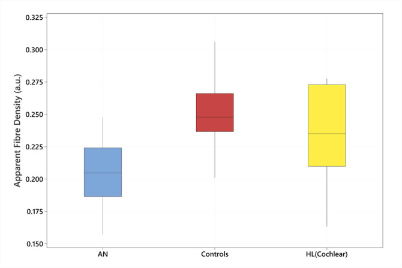
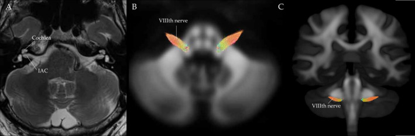
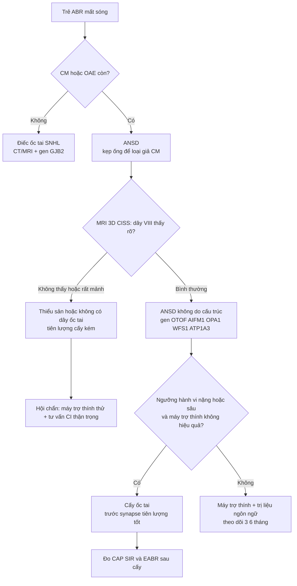
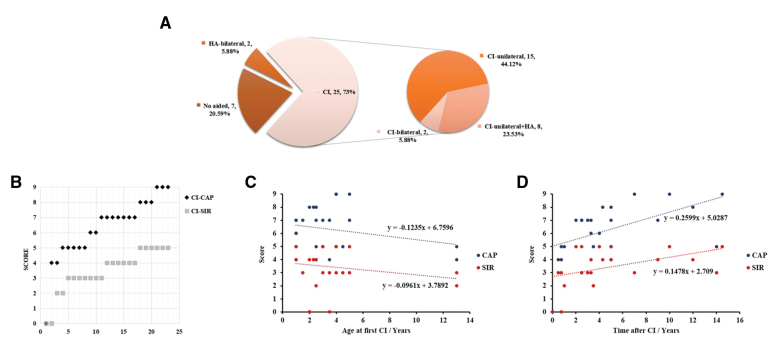
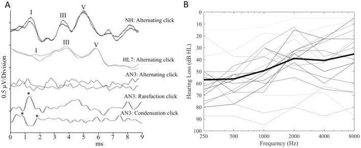

# 478 — Điếc tiếp âm (auditory neuropathy spectrum disorder, ANSD) ở trẻ: ABR/CM/OAE → MRI dây VIII → chọn cấy ốc tai / Auditory neuropathy spectrum disorder in children

**Tags:** `pattern:diec-tiep-am` `vung:oc-tai` `vung:ong-tai-trong` `anatomy:day-VIII` `protocol:MRI-3D-CISS-FIESTA` `protocol:ABR-CM-OAE` `score:CAP-SIR`

**Mức chắc chắn (certainty):** tổng hợp y văn (literature synthesis) — số liệu lấy từ bài gốc có PMCID; ảnh là hình minh họa phương pháp/ca trong bài nguồn, mô tả đúng nguyên văn.

> **Câu chốt của ANSD:** *"Tai vẫn khuếch đại âm thanh, nhưng tín hiệu không được truyền đồng bộ lên não."* Vì vậy **ốc tai (OAE/CM) "còn" nhưng ABR "mất"** — nghịch lý này là toàn bộ chẩn đoán, và cũng là lý do máy trợ thính thường kém hiệu quả hơn mong đợi.

## 1. Tổng quan bệnh học – cơ chế hình ảnh

**Định nghĩa (đang dùng trong thực hành):** ANSD = **ABR mất hoặc bất thường** *kèm* **OAE và/hoặc CM bình thường hoặc chỉ thay đổi nhẹ**, khởi phát hai bên (Zhou X et al. 2026, PMC12904244 — 645 bệnh nhân, 27 năm). Tổn thương nằm ở **tế bào lông trong, synapse dải băng (ribbon synapse) hoặc dây thần kinh VIII** — không nằm ở tế bào lông ngoài (vẫn "kêu" ra OAE/CM).

**Dịch tễ (định lượng):**
- ANSD chiếm khoảng **7–10%** tổng số ca giảm thính lực ở trẻ; tần suất chung dao động **1–40%** tùy quần thể sàng lọc (Mathew S et al. 2024, PMC11681793).
- ANSD **một bên** hiếm: **1,31–7,31%** (Zhang 2012) và **2,4–4,7%** (Usami 2017) theo tổng quan trên — và **một bên gần như luôn gợi ý thiểu sản dây thần kinh ốc tai**.
- **CM xuất hiện 96,36–100%** ở mọi lứa tuổi từ sơ sinh đến người lớn (Zhou X et al. 2026) → **CM là dấu hiệu bền vững nhất**, trong khi DPOAE **mất dần theo thời gian**.

**TẠI SAO hình ảnh và thính học lại "lệch pha":**
1. **Tế bào lông ngoài (OHC)** tạo **OAE** và **CM** — đây là hiện tượng **điện–cơ, trước synapse**. OHC còn → vẫn có tín hiệu "ồn ào" trong ống tai.
2. **ABR** đo **đồng bộ hóa** của dây VIII và thân não. Khi sợi trục mất myelin/giảm số sợi/khớp thần kinh hỏng → **mất đồng bộ** dù tín hiệu vẫn tới → **sóng ABR mất hoặc biến dạng**, dù ngưỡng nghe hành vi có thể chỉ **trung bình**.
3. Trên MRI, **dây thần kinh ốc tai mảnh/không thấy** là nguyên nhân **cấu trúc** hay gặp nhất; nhưng đa số ANSD **có MRI bình thường** → **MRI bình thường KHÔNG loại trừ ANSD** (khác với thiểu sản dây thần kinh, nơi MRI là chốt).
4. **Định lượng vi cấu trúc:** dMRI đo **mật độ sợi biểu kiến (apparent fibre density — AFD)** của dây VIII: 52 người (27 nghe bình thường, 7 điếc ốc tai, 18 ANSD) cho thấy **AFD giảm có ý nghĩa ở nhóm ANSD** so với cả hai nhóm còn lại — bằng chứng in vivo đầu tiên gắn vi cấu trúc dây VIII với ngưỡng nghe (Zanin J et al. 2025, PMC11811761).

*Hộp (boxplot) AFD dây VIII: nhóm ANSD thấp hơn nhóm nghe bình thường và nhóm điếc ốc tai. Nguồn: Zanin J et al., Eur J Neurol 2025, Fig. 3 (PMC11811761), CC BY 4.0.*

**Nguyên nhân theo vị trí tổn thương (khung "site of lesion"):**

- **Trước synapse (OHC/IHC):** đột biến *OTOF* (giải phóng neurotransmitter), vàng da nhân, thiếu oxy → OAE/CM còn, ABR mất; MRI thường **bình thường**.
- **Synapse dải băng (ribbon synapse):** *OTOF* thể nặng, nhiễm trùng bào thai → mất đồng bộ nặng; MRI bình thường.
- **Sau synapse (dây VIII/sợi trục):** **thiểu sản/không có dây thần kinh ốc tai (CND)**, *AIFM1*, *OPA1*, *WFS1*, *ATP1A3* → ABR mất, phân biệt lời rất kém; **MRI 3D chuỗi nặng T2 là chốt**.
- **Thân não/trung ương:** bệnh chất trắng, u thân não → ABR bất thường kiểu "ngoài ốc tai"; cần MRI sọ có cản quang.

## 2. Mẫu hình + chẩn đoán phân biệt theo vị trí (gamut)

**A. Trẻ có ABR mất sóng — gamut theo "OAE/CM còn hay mất":**
- **CM/OAE CÒN + ABR mất** → **ANSD** (OTOF, CND, AIFM1, OPA1/WFS1, ATP1A3, vàng da nhân, non tháng).
- **CM/OAE MẤT + ABR mất** → **điếc ốc tai (sensorineural hearing loss — SNHL)** thông thường; nếu một bên + ống tai trong hẹp → nghĩ **CND**.
- **ABR có nhưng sóng V giãn/lệch** → tổn thương **thân não/ngoài ốc tai** (u, bệnh chất trắng, NF2 với schwannoma hai bên).

**B. Trên MRI — gamut "dây thần kinh ốc tai bất thường":**
- **Thiểu sản dây thần kinh ốc tai (cochlear nerve hypoplasia)** — dây mảnh, thường kèm ống tai trong hẹp.
- **Không có dây thần kinh ốc tai (aplasia)** — không thấy dây ở mọi bình diện; tiên lượng cấy ốc tai **kém**.
- **Hẹp ống tai trong (IAC stenosis)** — trên CT; liên quan ANSD một bên (Mathew S et al. 2024).
- **Dị dạng ốc tai (cochlear dysplasia)**, hẹp ống tai thần kinh ốc tai (cochlear nerve canal).
- **U/ schwannoma VIII hai bên (NF2)** — bắt thuốc, giãn ống tai trong; ABR bất thường kiểu sau ốc tai.

**C. Chẩn đoán phân biệt lâm sàng hay nhầm:**
- **"Điếc ốc tai nặng có máy trợ thính kém hiệu quả"** → thực ra là ANSD (ngưỡng hành vi tốt hơn ABR gợi ý).
- **Rối loạn phổ tự kỷ/chậm phát triển ngôn ngữ** — thính lực bình thường, ABR bình thường.
- **Điếc do di truyền không hội chứng (GJB2)** — OAE mất, ABR mất; **không** phải ANSD.
- **Bệnh ty thể (OPA1/WFS1)** — ANSD + teo thị (xem bài 437/477).

## 3. Bảng so sánh phân biệt (ma trận đối chiếu)

| Thực thể (entity) | Hình ảnh / thính học điển hình | Chốt vào (rule-in) | Chốt loại (rule-out) | Gợi ý xác nhận |
|---|---|---|---|---|
| **ANSD do OTOF** | ABR mất, **DPOAE còn rồi mất dần**, CM còn; MRI thường bình thường | **CM còn + ABR mất + PTA nặng–sâu** (PTA 89,20 ± 17,81 dB HL; **91,11%** nặng trở lên) | OAE mất hoàn toàn ngay lần đầu + không có CM → nghĩ SNHL ốc tai | Gen OTOF (**41,2%** AN khởi phát nhũ nhi), ASSR, theo dõi DPOAE |
| **Thiểu sản/không có dây thần kinh ốc tai (CND)** | **MRI 3D CISS/FIESTA: dây ốc tai mảnh hoặc không thấy**; CT: ống tai trong/ống tai thần kinh ốc tai hẹp | **Không thấy dây ốc tai ở mọi bình diện** hoặc đường kính ống tai thần kinh ốc tai **≤ 1,3 mm** trên CT | Dây ốc tai thấy rõ, đường kính bằng bên đối diện → loại CND | MRI lát mỏng vuông góc ống tai trong, đo 3 chiều |
| **ANSD do AIFM1** | Khởi phát **muộn**, ngưỡng nghe **tốt hơn** OTOF; có thể kèm bệnh lý thần kinh–cơ | **AIFM1 = 18,6% AN khởi phát muộn** | Khởi phát sớm + điếc nặng–sâu → nghĩ OTOF | NGS panel AN, EMG |
| **ANSD + teo thị (OPA1/WFS1)** | ANSD + teo thị hai bên, OCT RNFL mỏng | **Điếc tiếp âm + teo thị** | Chỉ điếc, đáy mắt bình thường → loại | Gen OPA1/WFS1, OCT, ERG |
| **Điếc ốc tai (SNHL) thông thường** | OAE **mất**, ABR mất, CM không rõ | **OAE mất hai bên + không có CM** | CM rõ + OAE còn → ANSD | Audiometry, CT/MRI, GJB2 |
| **Schwannoma VIII/NF2** | Khối bắt thuốc ống tai trong, giãn ống tai trong | **Khối bắt thuốc + giãn ống tai trong** | Ống tai trong bình thường, không khối → loại | MRI sọ có cản quang, gen NF2 |

## 4. Protocol chụp + hệ phân độ/điểm chuẩn hóa

**4.1. Thính học (làm trước, định nghĩa bệnh):**
- **ABR** (click + tone burst) + **CM**: ghi ở cường độ cao, **kẹp/khóa ống dẫn âm (tube-clamp)** để loại **hiện tượng giả CM do nhiễu điện từ** — đây là bước hay bị bỏ qua nhất.
- **OAE (DPOAE/TEOAE)**: tiêu chuẩn "có đáp ứng" thường dùng **SNR ≥ 6 dB** (hướng dẫn gCAN 2026, PMC12875854).
- **Mốc thời gian (hướng dẫn gCAN 2026):** ABR + CM lần đầu ở **tuổi hiệu chỉnh 6 tuần (42 ngày)**; **làm lại 8–12 tuần**; cân nhắc làm lại **12–18 tháng** — vì trẻ non tháng/chậm phát triển có thể "giả ANSD" thoáng qua.
- **ASSR, phản xạ cơ bậu, audiometry hành vi** khi trẻ đủ lớn; **đo phân biệt lời (SDS)** — đặc trưng ANSD: **SDS kém không tương xứng với PTA**.

**4.2. Hình ảnh (MRI là phương thức được khuyến cáo, CT bổ sung cho phần xương):**
- **MRI 1,5–3 T**: chuỗi **3D nặng T2 (CISS/FIESTA/DRIVE/RESTORE)** lát **0,5–0,8 mm** qua ống tai trong; **tái tạo lát vuông góc (oblique sagittal)** với ống tai trong để **đo đường kính dây VII, VIII (trước/ sau)** và so hai bên.
- **MRI sọ** T2/FLAIR + T1 sau tiêm: loại u thân não, schwannoma, bệnh chất trắng.
- **CT xương thái dương** (lát ≤ 0,6 mm): đo **ống tai trong** và **ống tai thần kinh ốc tai**; ngưỡng đã báo cáo: **≤ 1,3 mm = ống tai thần kinh ốc tai nhỏ** (Roche 2010, dẫn qua Mathew S et al. 2024).
- **dMRI fixel-based (AFD)** — hiện là công cụ nghiên cứu, **chưa phải chuẩn lâm sàng**: AFD giảm ở ANSD và **tương quan với ngưỡng nghe 4 tần số**.

*Hình phương pháp: (A) T2 trục — xác định ốc tai và ống tai trong; (B) chồng mô hình hướng sợi (fibre orientation distribution) lên vùng dây VIII. Nguồn: Zanin J et al., Eur J Neurol 2025, Fig. 2 (PMC11811761), CC BY 4.0.*

**4.3. Phân loại & thang điểm dùng trong theo dõi:**
- **Phân loại theo vị trí tổn thương** (trước synapse / synapse / sau synapse) và **theo tuổi khởi phát** (nhũ nhi / thiếu niên / người lớn) — quyết định tiên lượng cấy ốc tai: **trước và tại synapse kết quả tốt**, **sau synapse kém hơn**, **không có dây thần kinh ốc tai kết quả rất kém** (gCAN 2026).
- **CAP (Categories of Auditory Performance)** và **SIR (Speech Intelligibility Rating)** để đo kết quả sau cấy: ca OTOF 25 trẻ cấy ốc tai đạt **CAP 7,00 (5,00–7,50)** (Wang H et al. 2026, PMC13252965).

**4.4. Sơ đồ: trẻ ABR mất sóng — làm gì tiếp**

**4.5. Ngưỡng xử trí theo tuổi (gCAN 2026) — dùng để trả lời gia đình:**
- **0–6 tháng:** chưa có ngưỡng hành vi tin cậy → **giáo dục phụ huynh + theo dõi**, chưa vội kết luận.
- **6–9 tháng:** có ngưỡng hành vi tin cậy + thấy lợi ích rõ → **đeo máy trợ thính** và đánh giá lại.
- **9–12 tháng:** ngưỡng ổn định + ngôn ngữ tiến triển → **tiếp tục máy trợ thính**; nếu **nặng/sâu hoặc không lợi** → **chỉ định cấy ốc tai**.
- Nguyên tắc: đánh giá lợi ích của máy trợ thính bằng **phát triển nhận thức lời nói**, **không** chỉ bằng việc "ngưỡng nghe đẹp hơn".

## 5. Biến thể bình thường và cạm bẫy

- **Cạm bẫy 1 — "giả CM" (CM giả):** nhiễu điện từ của máy kích thích có thể tạo sóng giống CM. Bắt buộc **kẹp ống dẫn âm** hoặc chạy lại với ống bịt: CM thật **biến mất/đảo**, nhiễu thì không. Đây là lỗi hay gặp nhất khiến trẻ bị dán nhãn ANSD oan.
- **Cạm bẫy 2 — kết luận sớm ở trẻ non tháng:** ABR có thể "chín" muộn; hướng dẫn khuyến cáo **làm lại ở 8–12 tuần và 12–18 tháng** trước khi chốt.
- **Cạm bẫy 3 — MRI bình thường ≠ không có ANSD:** đa số ANSD không có bất thường cấu trúc; ngược lại **thiểu sản dây thần kinh ốc tai** là bất thường hay gặp nhất trong ANSD (Mathew S et al. 2024).
- **Cạm bẫy 4 — đo dây VIII trên lát cắt chéo:** dây VIII **nhỏ hơn dây VII** là bình thường; phải **tái tạo vuông góc ống tai trong** và so bên đối diện. Đo trên lát axial nghiêng 20–30° có thể "tạo ra" thiểu sản giả.
- **Cạm bẫy 5 — hội chứng "một bên":** ANSD **một bên** chỉ chiếm **1,31–7,31%** → nếu gặp, **phải đi tìm thiểu sản dây thần kinh ốc tai** và bệnh lý ống tai trong.
- **Cạm bẫy 6 — hứa hẹn với gia đình:** kết quả cấy ốc tai trong ANSD **không đồng nhất**; nói rõ **trước synapse tốt, sau synapse/không có dây thần kinh kém** (gCAN 2026). Trẻ có bệnh thần kinh ngoại biên/teo thị kèm theo cần đánh giá **mắt + thần kinh** song song.

## 6. Tự lượng giá — Blind Quiz

**Ca 1 — Bé 14 tháng, chậm nói, ABR mất sóng hai bên nhưng OAE còn. Cha mẹ hỏi "có cấy ốc tai được không?".**

- Câu hỏi: (1) Chẩn đoán thính học là gì? (2) MRI cần trả lời câu hỏi nào trước khi quyết định cấy? (3) Nếu dây thần kinh ốc tai không thấy thì tiên lượng ra sao?

<b>Bấm để hiện đáp án (findings + chẩn đoán)</b>

- **Chẩn đoán:** **ANSD** — ABR mất sóng + OAE/CM còn (CM xuất hiện **96,36–100%** ở mọi lứa tuổi trong loạt 645 bệnh nhân).
- **MRI phải trả lời:** có **dây thần kinh ốc tai** không, đường kính bao nhiêu so với bên đối diện, ống tai trong/ống tai thần kinh ốc tai có hẹp (**≤ 1,3 mm** = nhỏ), có dị dạng ốc tai hay u ống tai trong.
- **Tiên lượng:** **không thấy dây thần kinh ốc tai ở mọi bình diện → kết quả cấy ốc tai kém**, phải hội chẩn và tư vấn rất thận trọng; **trước/tại synapse → tiên lượng tốt**.
- **Nguồn ảnh:** Zanin J et al., *Eur J Neurol* 2025, Fig. 2 (PMC11811761), **CC BY 4.0**.

**Ca 2 — Bé 2 tuổi, ANSD, được cấy ốc tai. Nhìn biểu đồ kết quả theo tuổi cấy.**

- Câu hỏi: Yếu tố nào quyết định kết quả? Điểm CAP trung bình của nhóm OTOF được cấy là bao nhiêu?

<b>Bấm để hiện đáp án</b>

- **Dữ liệu:** 43 bệnh nhân ANSD do OTOF; **25 trẻ được cấy ốc tai**; **CAP 7,00 (5,00–7,50)**; PTA trước can thiệp **89,20 ± 17,81 dB HL**, **91,11%** nặng–sâu; kết quả gắn với **tuổi can thiệp và thời gian mắc bệnh** (cấy sớm tốt hơn).
- **Ý nghĩa thực hành:** ở ANSD do OTOF, cấy ốc tai **hiệu quả** dù ABR mất — vì CI kích thích trực tiếp sợi trục, **bỏ qua synapse hỏng**.
- **Nguồn ảnh:** Wang H et al., *Ear Hear* 2026, Fig. 4 (PMC13252965), **CC BY-NC-ND 4.0** (giữ nguyên bản, không cắt/ghép).

**Ca 3 — Nhìn biểu đồ AFD: nhóm nào có mật độ sợi dây VIII thấp nhất, và điều đó nói gì về bản chất ANSD?**

- Câu hỏi: Vì sao "điếc ốc tai" lại có AFD **không** giảm? AFD dùng được trong lâm sàng chưa?

<b>Bấm để hiện đáp án</b>

- **Findings:** AFD thấp nhất ở **ANSD**; nhóm **điếc ốc tai** có AFD tương đương người nghe bình thường → tổn thương của họ ở **ốc tai/tế bào lông**, không ở sợi trục dây VIII.
- **Ý nghĩa:** ANSD có thành phần **mất sợi trục/bất thường vi cấu trúc dây VIII** thật, không chỉ là "lệch đồng bộ chức năng".
- **Chưa dùng lâm sàng thường quy:** đây là nghiên cứu 52 người, cần chuẩn hóa trước khi thành chỉ định — hiện **MRI thường quy vẫn là đánh giá cấu trúc (CISS/FIESTA)**, không phải fixel-based dMRI.
- **Nguồn ảnh:** Zanin J et al., *Eur J Neurol* 2025, Fig. 3 (PMC11811761), **CC BY 4.0**.

**Ca 4 — Mối liên hệ giữa AFD và ngưỡng nghe: đọc biểu đồ tán xạ.**

<b>Bấm để hiện đáp án</b>

- **Findings:** AFD **tương quan với ngưỡng nghe trung bình 4 tần số** ở nhóm có chức năng ốc tai "bình thường" (nhóm ANSD): mật độ sợi càng thấp → ngưỡng nghe càng kém.
- **Bài học:** "dây thần kinh mảnh" không chỉ là bất thường giải phẫu — nó **dự báo chức năng**; nhưng đừng ngoại suy sang từng cá nhân (dữ liệu nhóm, n nhỏ).
- **Nguồn ảnh:** Zanin J et al., *Eur J Neurol* 2025, Fig. 4 (PMC11811761), **CC BY 4.0**.

## Bài liên quan chéo
- [437 – Teo thị kèm điếc: OPA1 & WFS1](../437-teo-thi-kem-diec/lesson.md)
- [477 – Bệnh ty thể có biểu hiện thị giác & tai](../477-benh-ty-the-thi-giac-tai/lesson.md)
- [236 – Viêm tai xương chũm & biến chứng nội sọ](../236-viem-tai-xuong-chum-bien-chung-noi-so/lesson.md)
- [217 – Khối góc cầu tiểu não (CPA)](../217-ngoai-truc-CPA/lesson.md)
- [603 – Pierre Robin: tắc nghẽn đường thở ở trẻ](../603-pierre-robin-tac-nghen-duong-tho/lesson.md)
- [605 – Siêu âm phổi điểm ở sơ sinh](../605-sieu-am-phoi-diem-so-sinh/lesson.md)

## Ảnh
- Ảnh tải từ bài **open access** trên PMC; nguồn + giấy phép từng file ở [`images/CREDITS.md`](images/CREDITS.md).
- Ảnh **CC BY-NC-ND** giữ nguyên bản, không crop/ghép.

> Không dùng để chẩn đoán độc lập khi chưa có người hướng dẫn.
