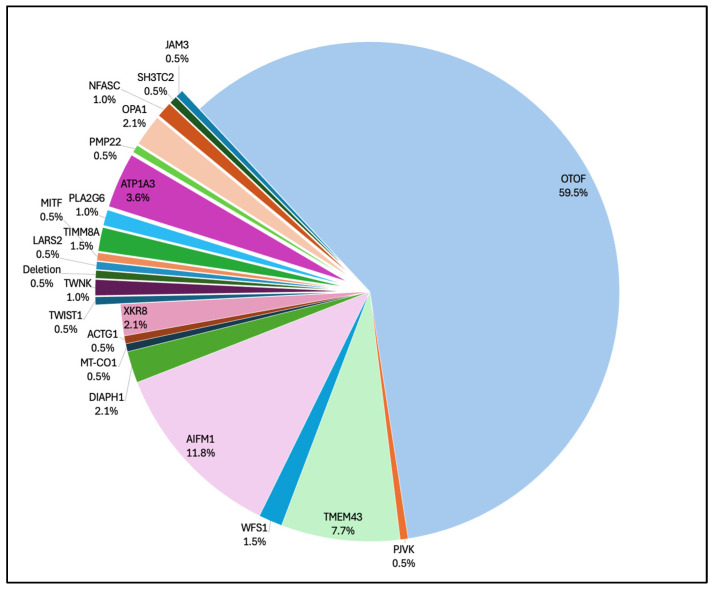
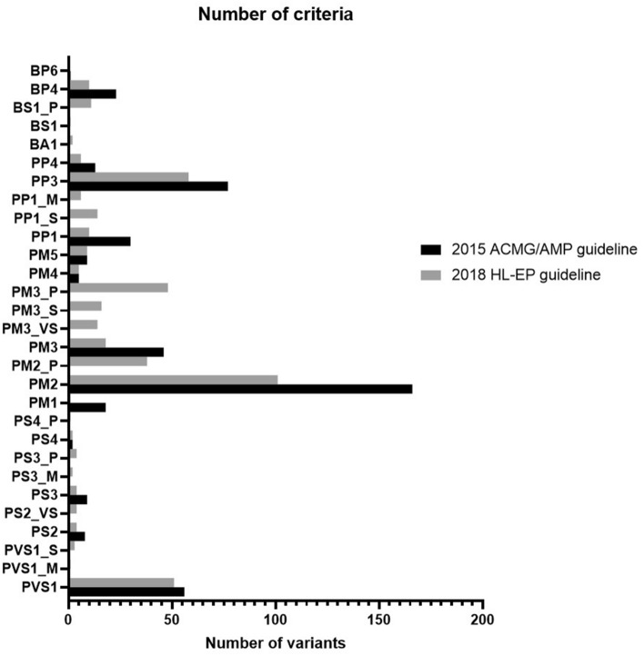
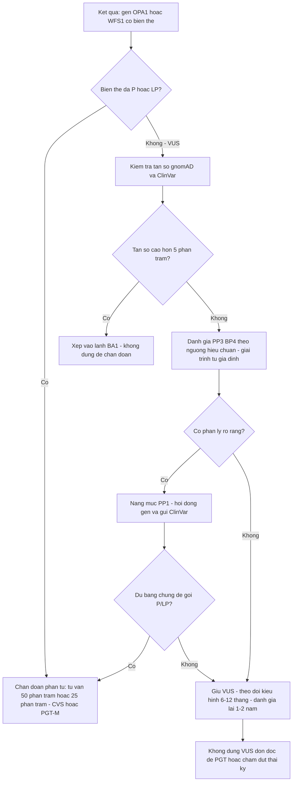
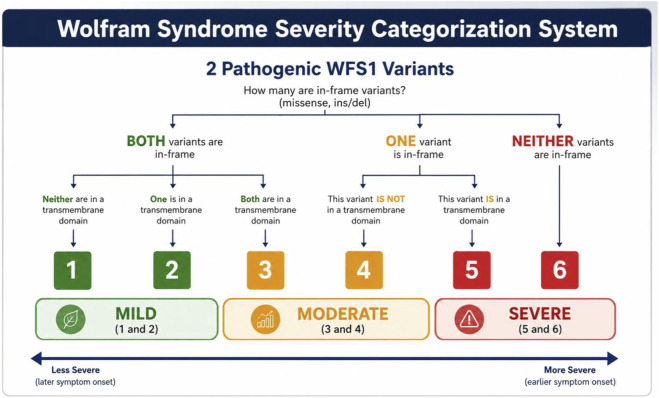

# 479 — Tư vấn di truyền & xử lý biến thể VUS trong teo thị/điếc di truyền (OPA1/WFS1) / Genetic counselling and variant-of-uncertain-significance workup in hereditary optic atrophy with deafness

**Tags:** `pattern:teo-thi` `pattern:diec-thi-giac` `vung:than-kinh-thi` `anatomy:co-dinh-thinh` `protocol:NGS-panel` `protocol:OCT-RNFL-GCL` `protocol:audiometry-ABR` `score:ACMG-AMP-2015`
**Mức chắc chắn (certainty):** tổng hợp y văn (literature synthesis) — nhóm tự biên từ y văn mở 2022–2026: nghiên cứu 169 biến thể/135 bệnh nhân điếc (Sci Rep 2022, CC BY 4.0, PMC9304357), hệ thống phân độ nặng theo kiểu gen Wolfram (Front Genet 2026, CC BY 4.0, PMC13412279), tổng quan bệnh ty thể–mắt (Int J Mol Sci 2026, CC BY 4.0, PMC13410010), tổng quan gen gây điếc tiếp âm (J Clin Med 2026, CC BY 4.0, PMC13258488) và cohort 18.475 người điếc (Genes 2026, CC BY 4.0, PMC13025685).

> **Vì sao bài này quan trọng:** bài **437** đã dạy nhận diện "teo thị + điếc" và ghi rõ **5/8 biến thể OPA1 trong cohort điếc là VUS**. Nhưng trên thực tế, bác sĩ nhận về một tờ kết quả ghi *"OPA1 c.XXXX G>A — Variant of Uncertain Significance"* và phải trả lời 4 câu: **có bệnh không, con cái bao nhiêu phần trăm, có làm xét nghiệm trước sinh được không, bao giờ xét nghiệm lại**. Trả lời sai theo hướng nào cũng nguy hiểm: gán bệnh → lo lắng/thủ thuật oan; gán lành → **bỏ sót đái tháo đường của Wolfram** hoặc bỏ theo dõi mắt kia.

## 1. Tổng quan — vì sao một biến thể "không rõ ý nghĩa" lại sinh ra, và ngưỡng nào biến nó thành bệnh

- **VUS không phải một chẩn đoán, mà là một trạng thái bằng chứng.** Khung **ACMG/AMP 2015** xếp biến thể thành 5 mức: bệnh (P), có khả năng bệnh (LP), **chưa rõ ý nghĩa (VUS)**, có khả năng lành (LB), lành (B). Mỗi bằng chứng có **điểm**: rất mạnh **8**, mạnh **4**, trung bình **2**, hỗ trợ **1**; tổng điểm **≥ 10 = P**, **6–9 = LP**, **0–5 = VUS**, **−1 đến −6 = LB**, **≤ −7 = B** (khung điểm ClinGen).
- **TẠI SAO VUS tồn tại (không phải vì lab kém):**
  1. **Bệnh hiếm → ít quan sát.** OPA1 chỉ chiếm **8/18.475 (0,043%)** proband trong một cohort điếc lớn; gặp lại cùng biến thể ở người thứ hai là chuyện may mắn.
  2. **Gen hiếm, đa dạng biến thể.** OPA1 có hiệu ứng **phụ thuộc domain**: biến thể **missense vùng GTPase** gắn với **DOA-plus/điếc tiếp âm** (6/7 ca trong cohort AN), còn **truncating** thường chỉ teo thị — nên cùng "missense" không cùng nghĩa.
  3. **Dữ liệu tần số không đại diện.** Một biến thể "không có trong gnomAD" ở người Việt có thể là **đa hình phổ biến của quần thể** chưa được đưa vào cơ sở dữ liệu → **PM2 (vắng mặt ở quần thể chứng) là tiêu chí bị lạm dụng nhất**.
  4. **Kiểu hình chồng lấp.** "Teo thị + điếc" gặp ở OPA1, WFS1, OTOF, AIFM1… nên tiêu chí **PP4 (kiểu hình đặc hiệu)** yếu, không đủ một mình.
- **Bằng chứng định lượng về VUS trong thực hành (169 biến thể/51 gen điếc):**
  - Theo **ACMG/AMP 2015**: **83/169 = 49,11% là VUS**; theo hướng dẫn chuyên khoa **HL-EP 2018**: **77/169 = 45,56%** — **hướng dẫn chuyên khoa không làm giảm VUS**, chỉ **phân tầng lại**.
  - **28,40% (48/169)** biến thể **đổi mức** khi áp hướng dẫn chuyên khoa; **22,49% (38/169) được nâng mức**.
  - Sau khi hội đồng chuyên gia xem lại: **12/83 (14,45%) VUS chuyển thành P/LP** — tức **cứ ~7 VUS có 1 cái thành bệnh**; không được "đóng hồ sơ" với VUS.
  - **PM2** là tiêu chí được áp nhiều nhất; **PP3** mất hiệu lực ở **24,68% (19/77)** biến thể khi siết tiêu chí tin học.
- **Ngưỡng định lượng phải nhớ (dùng khi đọc báo cáo gen):**
  - **BA1 (lành, độc lập):** tần số alen **> 5%** ở quần thể.
  - **BS1:** tần số **cao hơn tần số bệnh kỳ vọng**; **PM2:** **vắng mặt** ở quần thể chứng (nay dùng mức **hỗ trợ**, không phải trung bình).
  - **PP3/BP4 tin học:** dùng **ngưỡng đã hiệu chuẩn** (ví dụ **REVEL ≥ 0,773** cho PP3; **≤ 0,290** cho BP4); công cụ splice như **SpliceAI** chỉ là **bằng chứng hỗ trợ**, ngưỡng thực hành thường dùng **≥ 0,2** nhưng **chưa có cutoff thống nhất — cần tra bản gốc ClinGen SVI**.
  - **Di truyền:** OPA1 và WFS1 trội = **50%** cho mỗi con; WFS1 lặn (Wolfram) = **25%**; **anh/chị em cùng bố mẹ khỏe mạnh giúp loại trừ/ủng hộ** (mỗi người khỏe mạnh có kiểu gen nghi vấn làm tăng bằng chứng **BS4**).

## 2. Mẫu hình + gamut theo gen và kiểu di truyền

- **Câu hỏi lọc 1 — gen nào và di truyền nào?** *Teo thị đơn độc/trội trong gia đình* → **OPA1 (AD)**; *điếc tần số thấp sớm + teo thị muộn* → **WFS1 trội**; *ĐTĐ + đái tháo nhạt + teo thị + điếc* → **WFS1 lặn (Wolfram)**; *trẻ điếc tiếp âm đơn độc* → **OTOF (AR, 59,5%)**, **AIFM1 (X-linked, 11,8%)**.
- **Câu hỏi lọc 2 — biến thể có "đúng chỗ" không?** Với OPA1: **missense vùng GTPase** nguy cơ **DOA-plus** cao hơn; với WFS1: **vị trí trong domain xuyên màng** quyết định phân độ nặng (Hình 1 mục 3).
- **Gamut "teo thị/điếc di truyền" theo gen (tần suất trong điếc tiếp âm):**

| Gen | Di truyền | Kiểu hình lõi | Tỷ lệ trong AN | Hệ quả tư vấn |
|---|---|---|---|---|
| **OTOF** | Lặn (AR) | Điếc tiếp âm nặng, khởi phát sớm; cấy ốc tai kết quả tốt | **59,5%** | 25% cho con; tiên lượng cấy tốt |
| **AIFM1** | **X-linked** | ANSD khởi phát muộn, có thể kèm thần kinh | **11,8%** | Nam 50% nếu mẹ mang; nữ mang |
| **TMEM43** | AD/AR tùy biến thể | ANSD ± bệnh cơ tim | **7,7%** | Cần tầm soát tim nếu AD |
| **ATP1A3** | AD | CAPOS (ataxia, teo thị, điếc) | **3,6%** | 50%; kiểu hình đặc hiệu |
| **OPA1** | **AD** | ADOA/DOA+ (teo thị + ANSD, myopathy, ataxia) | **2,1%** | 50%; **5/8 biến thể trong cohort điếc là VUS** |
| **WFS1** | **AR (Wolfram) / AD (Wolfram-like)** | ĐTĐ, đái tháo nhạt, teo thị, điếc | **1,5%** | 25% hoặc 50%; **phân độ nặng theo kiểu gen** |

*Tỷ lệ các gen gây **điếc tiếp âm (ANSD)** trong tổng quan hệ thống: OTOF 59,5%, AIFM1 11,8%, TMEM43 7,7%, ATP1A3 3,6%, **OPA1 2,1%**, **WFS1 1,5%** — "teo thị + điếc" là **một phần nhỏ** của gamut, nên VUS ở OPA1/WFS1 phải đọc trong bối cảnh kiểu hình.*

## 3. Bảng so sánh phân biệt (ma trận đối chiếu)

| Thực thể | Dữ liệu điển hình | Chốt vào (rule-in) | Chốt loại (rule-out) | Gợi ý xác nhận |
|---|---|---|---|---|
| **OPA1 — P/LP (AD)** | Teo thị hai bên nhợt thái dương, RNFL/GCL mỏng; điếc ANSD; tiền sử gia đình AD | **Biến thể LOF/missense GTPase đã phân loại P/LP + kiểu hình khớp + phân ly trong gia đình** | **Chỉ có VUS + không ai khác trong nhà bị** → chưa kết luận | NGS panel; CNV/MLPA OPA1; OCT RNFL/GCL; ERG |
| **OPA1 — VUS** | Cùng kiểu hình nhưng bằng chứng chưa đủ | **Phân ly rõ (PP1) + de novo đã xác nhận (PS2) + chức năng bất thường (PS3)** | **Tần số quần thể cao (BA1/BS1) + người khỏe mang cùng biến thể** | Giải trình tự gia đình; RNA/minigene nếu splice; thử nghiệm chức năng |
| **WFS1 — hai biến thể P/LP (AR, Wolfram)** | ĐTĐ không tự miễn + đái tháo nhạt + teo thị + điếc | **2 biến thể P/LP ở hai alen (in trans) + ≥ 2 triệu chứng lõi** | **Chỉ 1 biến thể P/LP + 1 VUS** → chưa đủ chẩn đoán phân tử | NGS WFS1; giải trình tự bố mẹ để xác định pha; glucose/osmolality |
| **WFS1 — một biến thể P/LP (AD, Wolfram-like)** | Điếc tần số thấp sớm, teo thị muộn, thị lực **ổn định** | **Biến thể AD đã biết + điếc sớm + tiền sử gia đình** | **ĐTĐ + đái tháo nhạt nặng** → nghĩ thể lặn | NGS WFS1; audiometry; OCT |
| **WFS1 — VUS** | Như trên nhưng chưa đủ bằng chứng | **Phân ly + tần số cực thấp + kiểu hình đặc hiệu (điếc tần số thấp)** | **Không phân ly + gặp ở người khỏe** | Giải trình tự gia đình; **không dùng để phân độ nặng** |
| **Đa hình lành (benign polymorphism)** | Biến thể missense cùng gen, người mang khỏe mạnh | **BA1 (> 5%) hoặc BS1/BS2 + không phân ly** | **Phân ly hoàn hảo + chức năng bất thường** | Tra gnomAD/ClinVar; giải trình tự người nhà |
| **LHON (mtDNA)** | Mất thị lực cấp tuần tự, nam trẻ, đĩa phù nhẹ rồi teo | **3 đột biến 11778/14484/3460 + tiền sử bên mẹ** | **Điếc + tiến triển nhiều năm** → OPA1/WFS1 | mtDNA; **không áp ACMG như gen nhân** (heteroplasmy) |
| **Teo thị do độc chất** | Teo thị hai bên, tiền sử ethambutol/rượu–thuốc lá/thiếu B12 | **Ngừng thuốc → cải thiện; B12 thấp** | **Điếc ANSD + gia đình AD** → di truyền | Hỏi thuốc, B12, homocysteine |

## 4. Protocol xét nghiệm — từ VUS đến quyết định, và xét nghiệm trước sinh

**Bước 1 — chọn xét nghiệm theo kiểu hình (không làm ngược):**
- **Panel gen mục tiêu** (OPA1, WFS1, OTOF, AIFM1, mtDNA, các gen AN) là **bước đầu**; **WES/WGS** khi panel âm mà kiểu hình mạnh.
- **Bắt buộc tìm CNV/deletion** ở OPA1 (deletion toàn gen/exon không bắt được bằng giải trình tự thông thường).
- **mtDNA** riêng khi nghi LHON; **không** gộp vào panel gen nhân.
- Ghi rõ **kiểu hình gửi xét nghiệm** (teo thị? ANSD? ĐTĐ?) — lab dùng **PP4** và chọn gen.

**Bước 2 — xử lý một VUS (thứ tự bằng chứng):**
1. **Tần số:** gnomAD/ClinVar — **BA1 > 5%**, **BS1** nếu cao hơn tần số bệnh, **PM2** chỉ mức **hỗ trợ**.
2. **Tin học:** **REVEL/SpliceAI** theo ngưỡng hiệu chuẩn (**PP3/BP4**) — không dùng một công cụ để kết luận.
3. **Phân ly:** giải trình tự **bố mẹ/anh chị em** — **PP1** (mỗi gia đình phân ly tăng mức) hoặc **BS4** (không phân ly).
4. **De novo:** xác nhận **quan hệ cha–mẹ** trước khi dùng **PS2**.
5. **Chức năng:** RNA/minigene cho **splice**, nguyên bào sợi cho OPA1 (dung hợp ty thể), tế bào cho WFS1 — **PS3/BS3**.
6. **Kiểu hình:** **PP4** chỉ khi kiểu hình **đặc hiệu** (điếc tần số thấp của WFS1 trội; ANSD + teo thị của OPA1).
- **Gửi lại ClinVar + hội đồng gen (variant curation)**; **đánh giá lại sau 1–2 năm** vì **14,45% VUS đổi mức** sau khi có thêm dữ liệu.

*PM2 (vắng mặt ở quần thể chứng) là tiêu chí **áp nhiều nhất** (gần 170/169 biến thể ở 2015) và **giảm mạnh** khi siết; **PP3** lại tăng. Bài học: VUS thường được "đỡ" bằng **PM2 + PP3** — hai loại bằng chứng **yếu nhất**, không đủ để gọi bệnh.*

**Bước 3 — tư vấn sinh sản và xét nghiệm trước sinh:**
- **Nguy cơ tái phát:** OPA1/WFS1 trội = **50%**; Wolfram lặn = **25%**; **de novo** vẫn có nguy cơ **germline mosaicism** (thấp, nhưng phải nói).
- **Khi biến thể đã P/LP:** **CVS 11–13 tuần 6 ngày** hoặc **chọc ối ≥ 15 tuần**; **PGT-M** (chẩn đoán di truyền trước làm tổ) là lựa chọn; **NIPT không dùng cho bệnh đơn gen**.
- **Khi biến thể là VUS:** **không** dùng VUS đơn độc để quyết định chấm dứt thai kỳ/PGT — cần **hội đồng + bằng chứng bổ sung**; nếu thai kỳ gấp, tư vấn theo **nguy cơ kiểu hình** và theo dõi sau sinh (OCT/audiometry).
- **Sau sinh:** OCT RNFL/GCL + audiometry/ABR (phát hiện ANSD); với WFS1: **glucose/HbA1c, osmolality niệu, siêu âm thận** (bài 437).

## 5. Biến thể bình thường và cạm bẫy

- **Cạm bẫy 1 — "VUS = có bệnh".** Gán nhãn sai gây lo lắng, mổ/cấy ốc tai không cần, và **loại trừ oan** các nguyên nhân khác (ethambutol, B12, glaucoma). VUS **không phải** chẩn đoán.
- **Cạm bẫy 2 — "VUS = lành".** Với WFS1, bỏ theo dõi nghĩa là **bỏ sót đái tháo đường/đái tháo nhạt**; với OPA1, bỏ theo dõi **mắt còn lại/điếc tiến triển**. **14,45% VUS sẽ thành P/LP** → phải hẹn **đánh giá lại**.
- **Cạm bẫy 3 — PM2 + PP3 = "đủ bệnh".** Đây là **hai bằng chứng yếu** (1 + 1 = 4 điểm theo khung điểm, vẫn **< 6** ngưỡng LP). Đừng để báo cáo lab "gợi ý bệnh" thay thế hội đồng.
- **Cạm bẫy 4 — 1 P + 1 VUS ở gen lặn.** Với WFS1, cần **hai alen bệnh**; **pha (in trans)** phải chứng minh bằng giải trình tự bố mẹ — nếu cùng một alen thì **không giải thích được bệnh**.
- **Cạm bẫy 5 — phân độ nặng Wolfram trên VUS.** Hệ thống phân độ (Hình dưới) **chỉ áp dụng khi có 2 biến thể P/LP**; dùng nó để tiên lượng khi một alen còn VUS là **suy diễn quá mức**.
- **Cạm bẫy 6 — bỏ qua CNV.** Giải trình tự âm không loại trừ **deletion OPA1**; phải có **MLPA/CNV calling**.
- **Cạm bẫy 7 — dùng NIPT cho bệnh đơn gen.** NIPT sàng lọc **lệch bội/thai nhi**, không thay thế CVS/chọc ối cho OPA1/WFS1.
- **Cạm bẫy 8 — tần số quần thể Việt Nam chưa có.** Một biến thể "lạ" có thể là **đa hình dân tộc**; thiếu dữ liệu **không** đồng nghĩa với **gây bệnh** — ghi rõ "chưa rõ, cần tra" thay vì suy đoán.

*Phân độ **chỉ dùng khi có 2 biến thể WFS1 P/LP**: in-frame/không, vị trí trong domain xuyên màng → 6 mức, gộp 3 tầng **nhẹ/trung bình/nặng**. Tuổi khởi phát ĐTĐ trung vị **9,0 / 6,5 / 4,6 tuổi**; teo thị **14,0 / 11,0 / 9,0 tuổi**; **không** dự báo được điếc và đái tháo nhạt.*

## 6. Tự lượng giá — Blind Quiz

**Ca 1 — Trẻ 4 tuổi điếc tiếp âm, không có teo thị rõ. Panel gen trả về một biến thể OPA1 dạng missense "VUS". Gia đình hỏi: "Có phải bệnh di truyền của cháu không?"**

- Hỏi: 3 thông tin nào phải thu thập trước khi trả lời? Khi nào được phép dùng VUS để tư vấn sinh sản?

<b>Bấm để hiện đáp án (findings + chẩn đoán)</b>

- Phải thu thập: **(1) tần số biến thể** trên gnomAD/ClinVar theo quần thể; **(2) giải trình tự bố mẹ + anh chị em** để xem **phân ly/de novo**; **(3) kiểu hình định lượng** — OCT RNFL/GCL, audiometry/ABR, ERG (tìm DOA-plus), khám thần kinh–cơ.
- Vì sao OPA1 khó: biến thể **missense vùng GTPase** mới gắn với **ANSD/DOA-plus**; missense ngoài vùng này có thể lành. **5/8 biến thể OPA1 trong cohort điếc là VUS** → khả năng gặp VUS rất cao.
- Trả lời gia đình: **"Chưa kết luận được"**, tiếp tục theo dõi mắt–tai **6–12 tháng/lần**, hẹn **đánh giá lại sau 1–2 năm**, gửi ClinVar. **Không dùng VUS đơn độc** để PGT/chấm dứt thai kỳ.

**Ca 2 — Hai biến thể WFS1: một đã P/LP, một là VUS. Bố mẹ muốn biết con sẽ bị ĐTĐ năm mấy tuổi.**

- Hỏi: có phân độ được không? Cần làm gì để phân độ? Điều gì **không** dự báo được kể cả khi phân độ xong?

<b>Bấm để hiện đáp án (findings + chẩn đoán)</b>

- **Không phân độ được** vì hệ thống yêu cầu **2 biến thể P/LP**; một VUS chưa xác định → chưa biết alen thứ hai có bệnh hay không.
- Cần: **giải trình tự bố mẹ** xác định **pha in trans**, bằng chứng phân ly, và **hội đồng gen** nâng mức VUS nếu đủ.
- Khi đã đủ 2 P/LP: tầng **nhẹ/trung bình/nặng** cho tuổi khởi phát ĐTĐ trung vị **9,0 / 6,5 / 4,6 tuổi**; teo thị **14,0 / 11,0 / 9,0 tuổi**.
- **Không dự báo được** điếc và đái tháo nhạt (không có khác biệt có ý nghĩa giữa các tầng) — đừng hứa với gia đình.

**Ca 3 — Báo cáo lab: "OPA1 c.2873G>A, PM2, PP3 → VUS". Bác sĩ muốn kết luận "bệnh ty thể" để giải thích mọi triệu chứng.**

- Hỏi: PM2 + PP3 được bao nhiêu điểm? Còn thiếu bằng chứng gì? Vì sao không được quy mọi triệu chứng cho gen?

<b>Bấm để hiện đáp án (findings + chẩn đoán)</b>

- **PM2 (hỗ trợ) = 1 điểm + PP3 (hỗ trợ) = 1 điểm → 2 điểm**, vẫn nằm trong **VUS (0–5)**, chưa đạt **LP (6–9)**.
- Thiếu: **phân ly trong gia đình (PP1)**, **de novo đã xác nhận (PS2)**, **bằng chứng chức năng (PS3)**, hoặc **tần số cực thấp có ý nghĩa** — và phải loại trừ **đa hình quần thể**.
- Vì sao không quy mọi triệu chứng: bệnh ty thể có **nhiều nguyên nhân** (mtDNA, gen nhân khác, bệnh mắc phải); một VUS **không giải thích được** các triệu chứng ngoài kiểu hình lõi, và gán sai sẽ **bỏ sót nguyên nhân điều trị được** (B12, thuốc, bệnh hệ thống).

## Bài liên quan chéo
- [437 – Teo thị kèm điếc: DOA+/OPA1 & WFS1 trội](../437-teo-thi-kem-diec/lesson.md) (nhận diện, OCT, audiometry)
- [478 – Điếc tiếp âm (ANSD) ở trẻ](../478-diec-tiep-am-ansd-tre/lesson.md) (ABR/CM/OAE, cấy ốc tai)
- [477 – Bệnh ty thể có biểu hiện thị giác & tai](../477-benh-ty-the-thi-giac-tai/lesson.md)
- [434 – Teo thị do độc–chuyển hóa & LHON](../434-teo-thi-than-kinh-thi-doc-va-LHON/lesson.md)
- [499 – Hattersley–Urano & phổ WFS1 trội](../499-hattersley-urano-wfs1-troi/lesson.md) (thể trội nặng: ĐTĐ sơ sinh + điếc + đục TTT)
- [1627 – Người mang OPA1 không triệu chứng](../1627-nguoi-mang-opa1-khong-trieu-chung/lesson.md) (độ thấm không hoàn toàn, theo dõi OCT)
- [199 – Quy trình xét nghiệm gen & tầm soát người thân trong hội chứng ung thư di truyền](../199-quy-trinh-xet-nghiem-gen-tam-soat-gia-dinh/lesson.md) (mô hình tư vấn gia đình, cascade screening)
- [400 – Tổng quan Mắt & thị giác](../400-tong-quan-mat-thi-giac/lesson.md)

## Ảnh
- `479_gen-gay-AN-ty-le_PMC13258488-Fig2-CCBY.jpg` — J Clin Med 2026 (PMCID: PMC13258488), CC BY 4.0.
- `479_vus-criteria-tan-suat_PMC9304357-Fig3-CCBY.jpg` — Kim SY et al., Sci Rep 2022 (PMCID: PMC9304357), CC BY 4.0.
- `479_wfs1-phan-do-kieu-gen_PMC13412279-Fig1-CCBY.jpg` — Oiknine L et al., Front Genet 2026 (PMCID: PMC13412279), CC BY 4.0.
- Chi tiết giấy phép từng ảnh trong `images/CREDITS.md`. Không tải ảnh từ AuntMinnie/EyeWiki; chỉ dẫn link.

> Không dùng để chẩn đoán độc lập khi chưa có người hướng dẫn.
