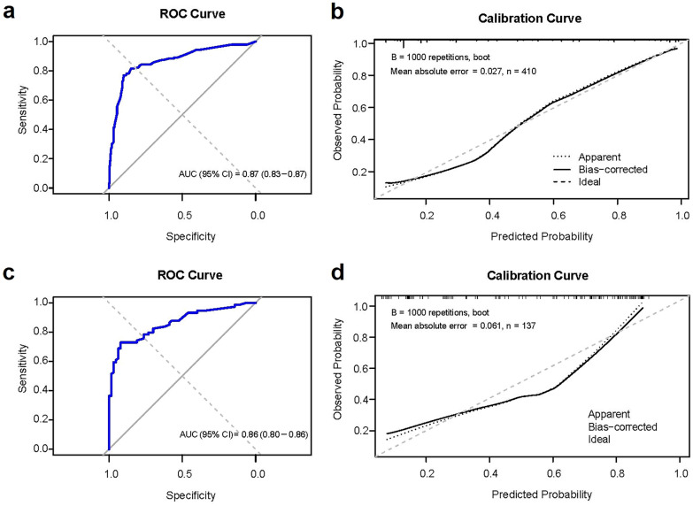
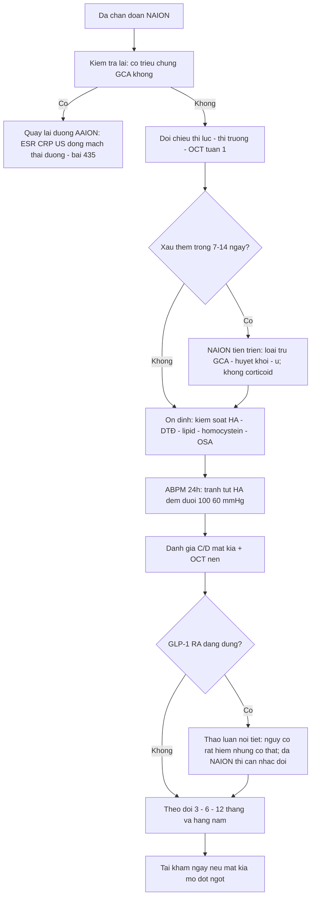
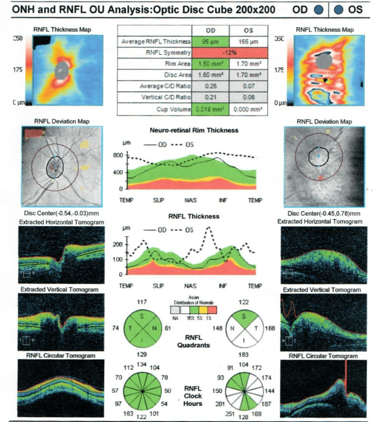
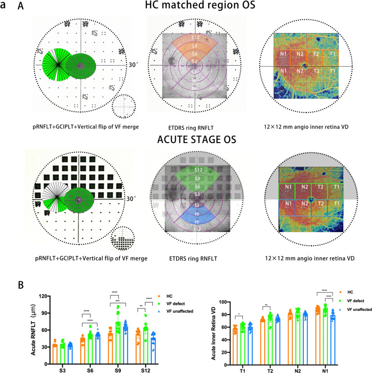
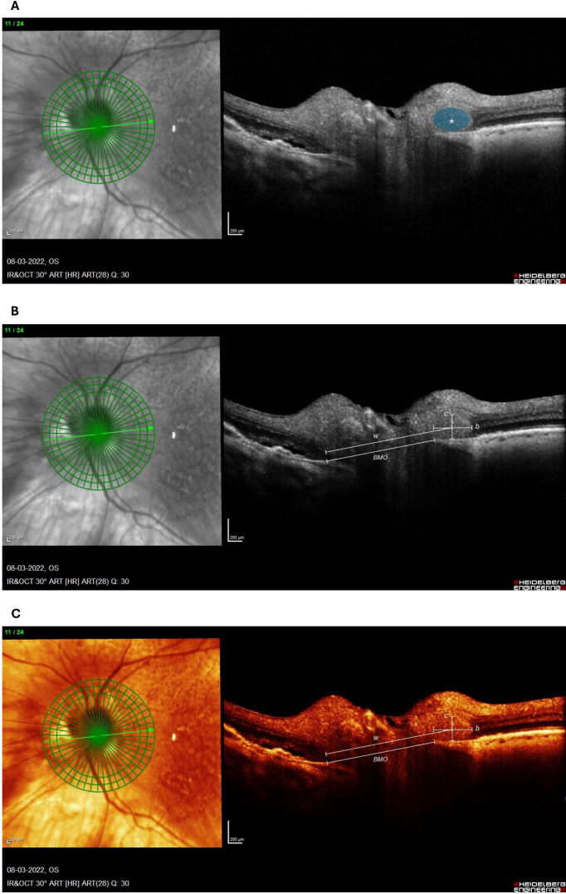

# 480 — NAION sau chẩn đoán: điều trị, dự phòng mắt đối diện & theo dõi dài hạn / Management and follow-up of non-arteritic anterior ischemic optic neuropathy

**Tags:** `pattern:thieu-mau-dia-thi` `vung:than-kinh-thi` `protocol:OCT-RNFL-GCL` `protocol:thi-truong-Humphrey` `protocol:ABPM-24h` `protocol:OCT-ONH` `score:logMAR`
**Mức chắc chắn (certainty):** tổng hợp y văn (literature synthesis) — nhóm tự biên từ y văn mở 2022–2026: cohort 895 bệnh nhân Trung Quốc (Eye Vis 2026, CC BY 4.0, PMC13474980), ca lâm sàng 3 năm theo dõi (Life 2026, CC BY 4.0, PMC13608588), nghiên cứu yếu tố tiên lượng hồi phục thị trường (PLoS One 2026, CC BY 4.0, PMC13262848), tổng quan nguy cơ GLP-1 RA (J Endocr Soc 2026, CC BY, PMC13650476), phân tích gộp semaglutide (PLoS Med 2026, CC BY 4.0, PMC13221145) và cohort cựu chiến binh Mỹ (JAMA Ophthalmol 2026, CC BY, PMC12902922).

> **Vì sao bài này quan trọng:** bài **435** trả lời "có phải NAION không, có phải GCA không" và chốt **không dùng corticoid**. Nhưng câu hỏi thật của bệnh nhân sau khi ra viện là: *"Mắt kia có bị không? Có thuốc nào hồi phục không? Bao lâu khám lại? Tôi đang tiêm semaglutide thì sao?"* — ba câu này quyết định **mất thêm mắt thứ hai**, **tai biến tim mạch**, và **tuân thủ điều trị đái tháo đường**. Bài này là bài "chuyện sau NAION".

## 1. Tổng quan — vì sao không có thuốc "cứu", và cái gì thực sự còn kiểm soát được

- **Bản chất tổn thương đã xong trước khi bệnh nhân đến:** NAION là **nhồi máu đầu thị (optic nerve head)** trên nền **đĩa thị "chật" (disc-at-risk: lõm C/D nhỏ, ~0,1–0,2)** + **giảm tưới máu**. Sợi trục trong nhãn cầu **không có myelin** và sống nhờ ty thể → khi thiếu máu, chết theo kiểu **"chết ngược" (dying-back)**; phù đĩa chỉ là **hậu quả**, không phải nguyên nhân. Vì vậy không có "vùng tranh tối–tranh sáng" để tái tưới máu, và **không có thuốc nào được chứng minh phục hồi thị lực**.
- **TẠI SAO corticoid không giúp:** phù đĩa trong NAION **không do viêm**; giảm phù không làm sợi trục đã nhồi máu sống lại, trong khi corticoid liều cao gây **tăng đường huyết, loãng xương, nhiễm trùng** — đúng nhóm bệnh nhân đã có đái tháo đường/tăng huyết áp. **Phẫu thuật giải ép thần kinh thị (IONDT)** đã thất bại và có xu hướng **hại** → không còn chỉ định.
- **Cái còn kiểm soát được = yếu tố hệ thống + mắt đối diện.** Nguy cơ **mắt thứ hai 15–24% trong 5 năm** (bài 435); **tái phát cùng mắt 3–8%**. Đây là lý do phải điều trị **bệnh nền** chứ không phải "điều trị NAION".
- **Số liệu nằm lòng (cohort 895 bệnh nhân, 1.128 mắt, Trung Quốc):**
  - **25,3% (226/895)** có NAION **hai bên**; yếu tố gắn với hai bên: **rối loạn lipid máu, bệnh huyết học, hút thuốc**.
  - Tại lần khám cuối, **50,6% (369/730 mắt)** có **BCVA ≤ 0,3** — tức một nửa mắt **không hồi phục chức năng đọc**.
  - Yếu tố tiên lượng **kết cục thị lực xấu**: **BCVA khởi phát thấp** (OR 0,72 mỗi bậc), **đái tháo đường** (OR 2,97; 95% CI 1,10–8,03), **tăng homocystein máu** (OR 11,59; 95% CI 1,87–71,97), **bong thanh dịch hoàng điểm** (OR 6,70; 95% CI 1,34–33,40); **xuất huyết quanh đĩa là yếu tố bảo vệ** (OR 0,19; 95% CI 0,06–0,66).
  - Mô hình dự báo **BCVA ≤ 0,3**: **AUC 0,87** (training) và **0,86** (validation) — dùng để **tư vấn**, chưa phải công cụ lâm sàng đóng gói.
- **Hồi phục thị trường (38 bệnh nhân/41 mắt, Hàn Quốc):** định nghĩa hồi phục = **MD cải thiện ≥ 3 dB lúc 3 tháng**; **MD và VFI nền tốt hơn** là yếu tố tiên lượng độc lập; **độ dày RNFL lúc khởi phát KHÔNG dự báo hồi phục**; **thuốc nhỏ mắt brimonidine/netarsudil không liên quan** (p = 0,723).
- **Nguy cơ do thuốc (2024–2026) — semaglutide/GLP-1 RA:** cohort cựu chiến binh Mỹ (nền đái tháo đường typ 2) cho **HR 2,33** (95% CI 1,54–3,54) so với SGLT2i; **tỷ suất 123 vs 67/100.000 người–năm**; phân tích gộp cho **HR 1,96–2,17**, tương ứng **thêm ~1 ca/7.000 người điều trị 1 năm** (nguy cơ tuyệt đối 0,014%). EMA/WHO xếp NAION là **phản ứng "rất hiếm" (≤ 1/10.000 người dùng/năm)**.
- **Ngưỡng huyết áp đêm:** **hạ huyết áp đêm** được định nghĩa trong cohort trên là **SBP trung bình đêm < 100 mmHg hoặc DBP < 60 mmHg** trên **ABPM 24 giờ** — đây là yếu tố **sửa được** (thuốc hạ áp buổi tối, thuốc ức chế alpha).

## 2. Mẫu hình sau chẩn đoán — 5 bệnh cảnh phải phân biệt (gamut)

- **Câu hỏi lọc 1 — thời điểm:** *xấu đi trong 1–2 tuần đầu* = **NAION tiến triển (progressive)**; *ổn định rồi mờ đột ngột sau nhiều tháng* = **mắt đối diện** hoặc **tái phát**; *mờ từ từ nhiều năm* = **teo thị tiến triển sau NAION** (RNFL mỏng dần).
- **Câu hỏi lọc 2 — triệu chứng hệ thống mới:** đau hàm, đau đầu mới, đau cơ vai cổ, sụt cân, sốt nhẹ → **phải loại trừ GCA/AAION** dù trước đó đã gọi NAION (bài 435).
- **Câu hỏi lọc 3 — thuốc và phẫu thuật:** **GLP-1 RA khởi đầu trong 12 tháng**, phẫu thuật lớn, mất máu, hạ huyết áp khi gây mê → **NAION "thứ phát"**.
- **Gamut 5 bệnh cảnh:**
  1. **NAION đơn thuần, ổn định** — đa số; việc cần làm là **kiểm soát yếu tố nguy cơ**.
  2. **NAION tiến triển** — thị lực/thị trường xấu thêm sau vài ngày–2 tuần; **không có điều trị đặc hiệu**, nhưng phải **loại trừ GCA và bệnh ác tính/huyết khối** trước khi chấp nhận.
  3. **NAION mắt đối diện (tuần tự)** — 15–24%/5 năm; **hai bên đồng thời** gợi ý bệnh hệ thống nặng hoặc **AION do GCA**.
  4. **NAION tái phát cùng mắt** — 3–8%; chẩn đoán chỉ đặt khi **có đợt phù đĩa mới** trên nền đĩa đã teo, không phải "thị lực dao động".
  5. **NAION do thuốc/thủ thuật** — semaglutide (HR ~2), sau phẫu thuật, sau mất máu, hạ huyết áp đêm.
- **Nhóm "giả NAION" phải loại trừ:** **AION do GCA** · **phù đĩa do drusen (pseudopapilledema)** · **tắc tĩnh mạch trung tâm võng mạc (CRVO) kèm phù đĩa** · **viêm đĩa thị (papillitis)** · **tăng áp lực nội sọ (IIH)** · **chèn ép/u thần kinh thị**.

## 3. Bảng so sánh phân biệt (ma trận đối chiếu)

| Thực thể | Hình ảnh / dữ liệu điển hình | Chốt vào (rule-in) | Chốt loại (rule-out) | Gợi ý xác nhận |
|---|---|---|---|---|
| **NAION ổn định** | Phù đĩa **phân đoạn**, xuất huyết quanh đĩa, **khiếm khuyết thị trường kiểu độ cao**; mắt kia **C/D nhỏ** | **> 50 tuổi + mờ đột ngột không đau + đĩa chật + không triệu chứng hệ thống** | **Đau hàm/đau đầu mới + ESR/CRP cao** → không phải NAION đơn thuần | OCT ONH, thị trường 24-2, ESR/CRP |
| **NAION tiến triển** | Thị lực/thị trường **xấu thêm trong 7–14 ngày**, phù đĩa tăng | **So sánh 2 lần đo cách ≥ 1 tuần có mất thêm ≥ 2 dòng Snellen hoặc MD xấu ≥ 3 dB** | **Đau + phù đĩa lan tỏa + tăng cân/đau đầu** → nghĩ IIH/u | Đo lại thị lực + thị trường có định lượng |
| **NAION mắt đối diện** | Đĩa **chật đối xứng** hai bên; đợt mới **phù + khiếm khuyết thị trường** | **Tiền sử NAION mắt kia + đợt mờ mới không đau** | **Bệnh cảnh 2 bên trong vài ngày + đau** → GCA | So sánh OCT/ảnh đĩa cũ; ESR/CRP |
| **AION do GCA (AAION)** | Đĩa **nhợt trắng phấn**, đốm bông, thiếu máu hắc mạc trên FA | **> 50 + đau hàm/đầu + ESR > 50 mm/h hoặc CRP cao + 2 bên** | **Đĩa sung huyết đơn thuần, không triệu chứng hệ thống** → NAION | US động mạch thái dương, sinh thiết |
| **NAION do semaglutide** | Như NAION thường; **thuốc khởi đầu < 12 tháng** | **Khởi đầu GLP-1 RA gần đây + đĩa chật** | **Không phải nguyên nhân duy nhất** — vẫn phải loại trừ GCA/khác | Ngừng/đổi thuốc có cân nhắc; theo dõi mắt kia |
| **Giả phù do drusen** | Drusen **tự phát huỳnh quang**, **OCT thấy cấu trúc tròn dưới võng mạc**, không phù quanh đĩa | **Bờ đĩa rõ + mạch máu không bị che + không khiếm khuyết thị trường mới** | **Phù thật + khiếm khuyết thị trường** → NAION/viêm | OCT ONH + FAF + siêu âm B |
| **CRVO kèm phù đĩa** | **Xuất huyết 4 góc**, giãn tĩnh mạch, phù hoàng điểm | **Xuất huyết lan tỏa + tĩnh mạch giãn** | **Xuất huyết chỉ quanh đĩa (dạng tia) + thị trường kiểu độ cao** → NAION | Soi đáy mắt giãn đồng tử, OCT hoàng điểm |

## 4. Protocol theo dõi + kiểm soát yếu tố nguy cơ

**Lịch theo dõi (đề xuất thực hành, không phải guideline có bằng chứng cấp cao):**

| Mốc | Việc làm | Mục đích |
|---|---|---|
| **1 tuần** | Thị lực + thị trường (nếu hợp tác) + soi đáy mắt | Bắt **NAION tiến triển** và **mắt đối diện** |
| **1 tháng** | OCT ONH/RNFL + thị trường Humphrey 24-2 | Đo **RNFL đỉnh phù** làm mốc |
| **3 tháng** | OCT RNFL + GCL, thị trường | Mốc **teo thị** (RNFL bắt đầu mỏng); đánh giá hồi phục MD ≥ 3 dB |
| **6–12 tháng** | OCT RNFL/GCL, thị trường, đáy mắt | Theo dõi **teo tiến triển**; phát hiện đợt mới |
| **Hằng năm** | Như trên + đánh giá **C/D mắt kia**, kiểm soát HA/ĐTĐ/lipid | Dự phòng **mắt thứ hai** |

**Kiểm soát yếu tố nguy cơ (phần "điều trị" thật sự):**
- **Huyết áp:** mục tiêu chung **< 140/90 mmHg**, nhưng **tránh tụt ban đêm**; làm **ABPM 24 giờ** khi nghi hạ huyết áp đêm (**SBP đêm < 100 mmHg hoặc DBP < 60 mmHg** = ngưỡng trong cohort 895 bệnh nhân) → **dời/giảm thuốc hạ áp buổi tối**, tránh lợi tiểu ban đêm.
- **Đái tháo đường:** HbA1c theo mục tiêu cá nhân; **đái tháo đường là yếu tố tiên lượng kết cục xấu (OR 2,97)** — không phải chỉ là yếu tố nguy cơ.
- **Lipid:** điều trị theo nguy cơ tim mạch; **rối loạn lipid gắn với NAION hai bên**.
- **Homocystein:** đo ở người trẻ/không giải thích được; **tăng homocystein OR 11,59** → bổ sung B12/folate nếu thiếu.
- **Ngưng thở khi ngủ do tắc nghẽn (OSA):** tầm soát bằng bảng hỏi (Berlin/STOP-BANG) + **đa ký giấc ngủ** khi dương tính; OSA là yếu tố nguy cơ được thừa nhận và **gắn với dao động huyết áp đêm**.
- **Hút thuốc:** tư vấn cai tuyệt đối (gắn với NAION hai bên).
- **GLP-1 RA:** **không ngừng thuốc mù quáng** vì lợi ích tim–thận; nhưng theo **đồng thuận AAO/NANOS 2026**: bệnh nhân **> 50 tuổi có nhiều yếu tố nguy cơ chuyển hóa** nên được **soi đáy mắt đánh giá C/D** trước/trong khi dùng; **người đã từng NAION không phải ứng viên lý tưởng** cho GLP-1 RA (nguy cơ mắt đối diện) → thảo luận với bác sĩ nội tiết.
- **Phục hồi chức năng:** dụng cụ phóng đại, kính lăng trụ cho song thị, **tư vấn lái xe** (khiếm khuyết thị trường nửa dưới), đánh giá **nguy cơ té ngã**, hỗ trợ tâm lý; **không có thuốc/thực phẩm chức năng nào có bằng chứng**.

**Công cụ tư vấn tiên lượng (chưa đóng gói thành app):** mô hình trên 895 bệnh nhân đạt **AUC 0,87 (training) / 0,86 (validation)**, hiệu chuẩn tốt — dùng để giải thích **xác suất BCVA ≤ 0,3** dựa trên **BCVA khởi phát thấp, đái tháo đường, tăng homocystein, bong thanh dịch hoàng điểm**.

*ROC (a, b) và hiệu chuẩn (c, d) của mô hình dự báo **BCVA ≤ 0,3** — AUC 0,87/0,86. Dùng cho **tư vấn**, không thay thế đánh giá lâm sàng.*

## 5. Biến thể bình thường và cạm bẫy

- **"Đo RNFL tuần đầu để tiên lượng" là bẫy:** lúc phù, RNFL **dày**, không phản ánh mức tổn thương; nghiên cứu 41 mắt cho thấy **RNFL khởi phát không dự báo hồi phục**. Tiên lượng dựa vào **MD/VFI nền** và **BCVA khởi phát**.
- **Nhầm mắt đối diện với "tái phát":** luôn **đo cả hai mắt**, so ảnh đĩa cũ; "tái phát cùng mắt 3–8%" chỉ đặt khi có **đợt phù mới**.
- **Cho corticoid "cho chắc":** không có bằng chứng, có hại; đặc biệt nguy hiểm nếu bệnh nhân **đái tháo đường** (yếu tố tiên lượng xấu).
- **Bỏ sót GCA ở người > 50 tuổi:** NAION là chẩn đoán **loại trừ**; hỏi **đau hàm, đau đầu mới, đau cơ vai cổ, sụt cân** ở **mọi** lần tái khám đầu.
- **Hạ huyết áp quá tay:** tăng thuốc để "phòng đột quỵ" có thể gây **nhồi máu đầu thị mắt kia** — cần **ABPM**, ưu tiên thuốc phù hợp, tránh tụt đêm.
- **Semaglutide: hai thái cực đều sai.** Nguy cơ tuyệt đối rất thấp (**~1/7.000 người–năm**) nhưng **không bằng 0**; bệnh nhân **đã NAION** cần cân nhắc đổi thuốc, người chưa NAION **không cần ngừng** chỉ vì lo lắng.
- **PHOMS (peripapillary hyperreflective ovoid mass-like structure)** gặp ở **cả AION do GCA và NAION** — **không dùng để phân biệt nguyên nhân**, chỉ là dấu phù quanh đĩa.
- **Satisfaction of search:** đã thấy phù đĩa một bên vẫn phải soi **mắt kia + đáy mắt ngoại vi** (CRVO, drusen, u).

## 6. Tự lượng giá — Blind Quiz

**Ca 1 — Nam 61 tuổi, đái tháo đường typ 2, mờ mắt trái 2 ngày không đau. OCT đầu thị hai mắt:**

- Hỏi: mắt nào đang phù? Chỉ số nào nói **đĩa chật**? Vì sao **không** dùng corticoid?

<b>Bấm để hiện đáp án (findings + chẩn đoán)</b>

- Dấu hiệu: **OS (trái) RNFL trung bình 155 µm** (phù đĩa) so với **OD 95 µm**; **OD có C/D 0,25 và đĩa đệm 0,018 mm³** — cấu trúc **"đĩa chật" (disc-at-risk)** ở mắt chưa bị.
- Chẩn đoán: **NAION mắt trái** trên nền **đĩa chật hai bên**.
- Vì sao không corticoid: tổn thương sợi trục **đã xảy ra**; corticoid không phục hồi, lại **tăng đường huyết** ở bệnh nhân đái tháo đường. Việc cần làm: kiểm soát HA/ĐTĐ/lipid, **ABPM ban đêm**, tầm soát OSA, dặn **báo ngay nếu mắt phải mờ**.
- Nguồn ảnh: Yagudaeva E et al., Cureus 2026 (PMC13340861) Fig. 1, CC BY 4.0.

**Ca 2 — Cùng bệnh nhân, 3 tháng sau: bản đồ RNFL – thị trường – mạch máu:**

- Hỏi: vì sao phải **ghép** bản đồ RNFL với thị trường? Hai chỉ số nào đổi **ngược chiều** ở giai đoạn cấp và mạn?

<b>Bấm để hiện đáp án (findings + chẩn đoán)</b>

- Dấu hiệu: thị trường **lật dọc** rồi **chồng lên bản đồ RNFL** cho thấy **vùng khiếm khuyết khớp với vùng sợi trục tổn thương**; các cột đồ thị cho thấy ở **giai đoạn cấp** RNFL **dày lên** ở vùng tổn thương trong khi **mật độ mạch máu (VD) giảm**.
- Ý nghĩa: **RNFL dày ≠ lành** — phù che mất mất sợi trục; phải đợi **teo (3–6 tháng)** mới đọc được mức mất thật. Vì vậy theo dõi cần **cả cấu trúc (OCT) và chức năng (thị trường)**.
- Nguồn ảnh: Yang S et al., Ophthalmol Ther 2026 (PMC12901807) Fig. 2a, **CC BY-NC 4.0** (giữ nguyên bản, không cắt/ghép).

**Ca 3 — Bệnh nhân 86 tuổi, phù đĩa, OCT có cấu trúc dạng "trứng" quanh đĩa:**

- Hỏi: cấu trúc được đánh dấu là gì? Nó giúp phân biệt **AION do GCA** với **NAION** không? Vậy phải dựa vào đâu?

<b>Bấm để hiện đáp án (findings + chẩn đoán)</b>

- Dấu hiệu: **PHOMS** — cấu trúc **dạng bầu dục tăng hồi âm quanh đĩa**, thể tích tính theo **2π²abc**; đây là **phù quanh đĩa**, gặp ở **cả A-AION và NAION**.
- Kết luận: **PHOMS không phân biệt nguyên nhân**; phân biệt GCA dựa vào **triệu chứng hệ thống + ESR/CRP + siêu âm động mạch thái dương ± sinh thiết**.
- Nguồn ảnh: Maartensson MB et al., Front Ophthalmol 2026 (PMC13021419) Fig. 1, CC BY 4.0 — ca **A-AION** (không phải NAION), dùng làm **đối chứng**.

## Bài liên quan chéo
- [435 – GCA & AAION vs NAION: cấp cứu mù ở người > 50 tuổi](../435-gca-va-naion-aion/lesson.md) (chẩn đoán, ESR/CRP, sinh thiết)
- [430 – Đường thị giác: viêm vs thiếu máu](../430-duong-thi-giac/lesson.md)
- [433 – Phù đĩa thị vs drusen](../433-phu-dia-thi-drusen/lesson.md)
- [444 – Tắc mạch võng mạc](../444-tac-mach-vong-mac/lesson.md) (CRVO/CRAO)
- [451 – Biểu hiện mắt của bệnh hệ thống](../451-he-thong-mat/lesson.md) (đái tháo đường, tăng huyết áp)
- [400 – Tổng quan Mắt & thị giác](../400-tong-quan-mat-thi-giac/lesson.md)

## Ảnh
- `480_naion-oct-dia-thi_PMC13340861-Fig1-CCBY.jpg` — Yagudaeva E et al., Cureus 2026 (PMCID: PMC13340861), CC BY 4.0.
- `480_naion-octa-thi-truong_PMC12901807-Fig2-CCBYNC.jpg` — Yang S et al., Ophthalmol Ther 2026 (PMCID: PMC12901807), CC BY-NC 4.0 (giữ nguyên bản).
- `480_naion-mo-hinh-du-doan_PMC13474980-Fig2-CCBY.jpg` — Xu X et al., Eye Vis 2026 (PMCID: PMC13474980), CC BY 4.0.
- `480_phoms-aion_PMC13021419-Fig1-CCBY.jpg` — Maartensson MB et al., Front Ophthalmol 2026 (PMCID: PMC13021419), CC BY 4.0 (ca A-AION, dùng đối chứng).
- Chi tiết giấy phép từng ảnh trong `images/CREDITS.md`. AuntMinnie: chỉ dẫn link, không tải.

> Không dùng để chẩn đoán độc lập khi chưa có người hướng dẫn.
