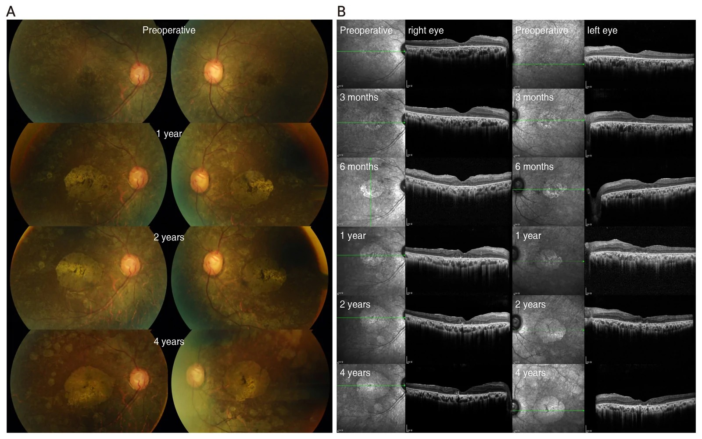
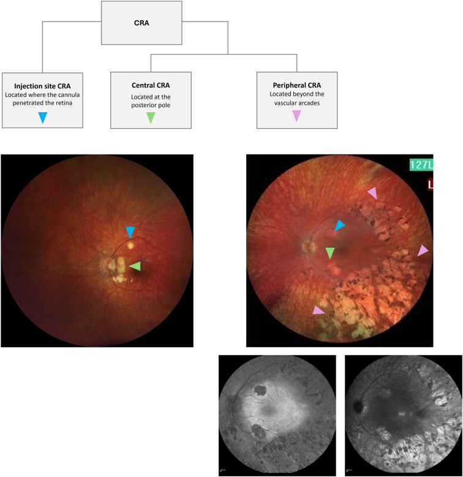
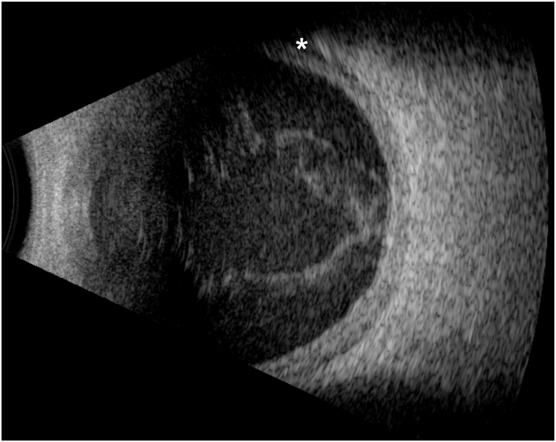
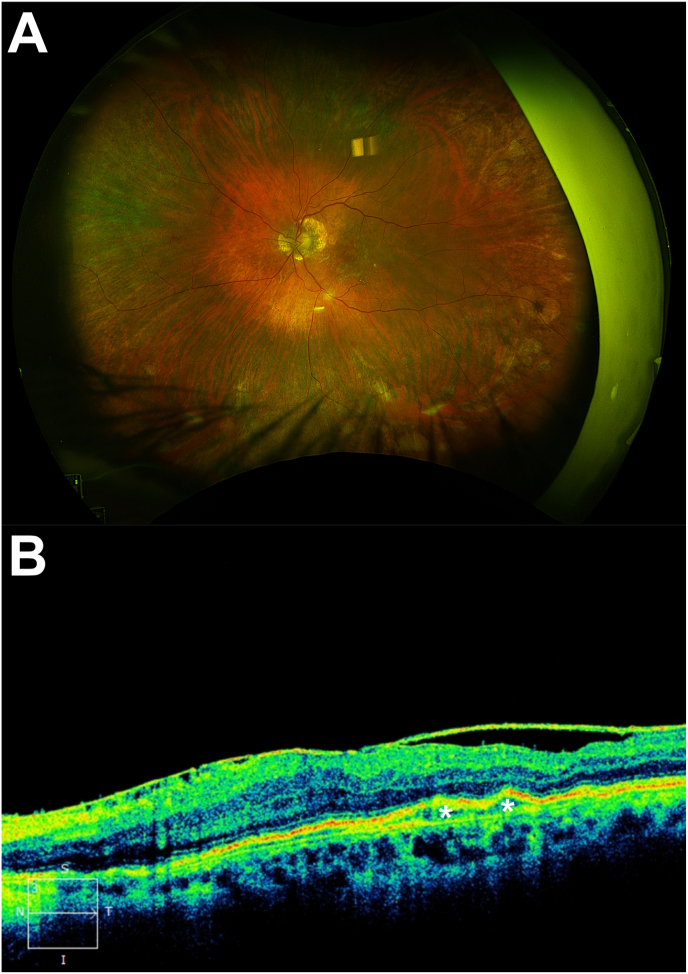
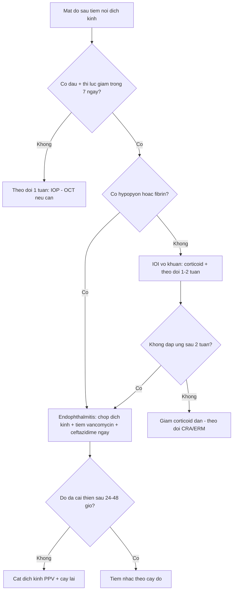
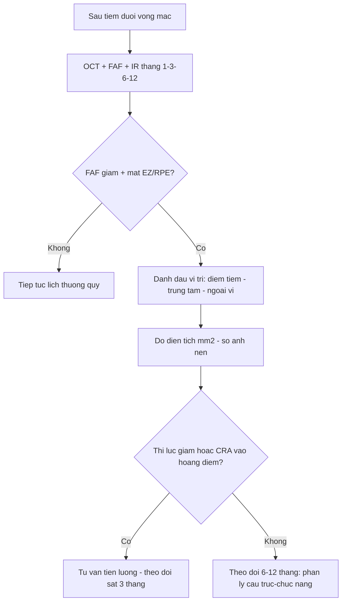
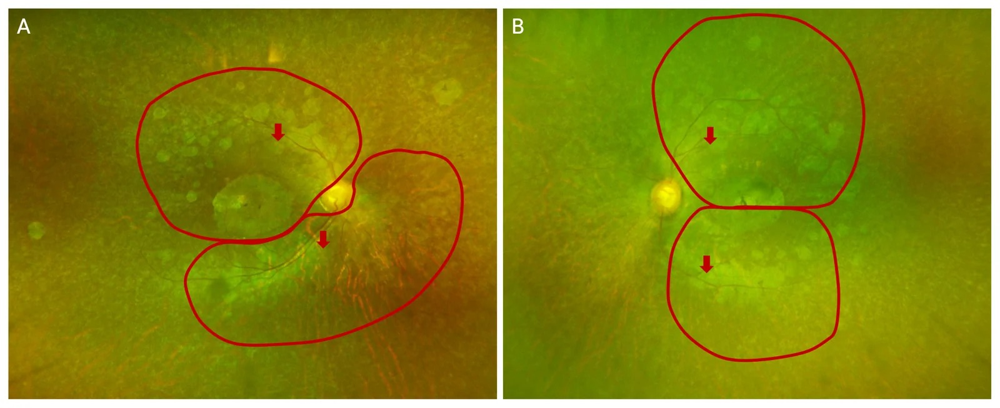

# 481 — Biến chứng nội nhãn sau liệu pháp gene & tiêm nội dịch kính / Intraocular complications of retinal gene therapy and intravitreal injection

**Tags:** `pattern:bien-chung-sau-tiem` `vung:vong-mac` `vung:dich-kinh` `protocol:gene-therapy` `protocol:SD-OCT-FAF` `score:SUN`
**Mức chắc chắn (certainty):** tổng hợp y văn (literature synthesis) — gộp 5 nghiên cứu mở (PMC13677208, PMC12993124, PMC12914102, PMC11843360) + 1 ca lâm sàng; chưa có ca nguyên văn của nhóm.

## 1. Tổng quan — vì sao mắt phản ứng sau tiêm gene & sau mũi tiêm nội dịch kính

- **Hai đường đưa thuốc khác nhau, hai nhóm biến chứng khác nhau:**
  - **Dưới võng mạc (subretinal)** — voretigene neparvovec-rzyl (RPE65): phải **cắt dịch kính 25G + bơm dịch tạo bong bóng (bleb)** rồi tiêm vector AAV vào khoang dưới võng mạc. Biến chứng đặc trưng: **teo hắc–võng mạc (chorioretinal atrophy, CRA)** tại chỗ cannula chạm (touchdown) và quanh hoàng điểm, có thể **tiến triển nhanh trong 3–6 tháng đầu**.
  - **Nội dịch kính (intravitreal)** — lenadogene nolparvovec (LHON) và anti-VEGF: kim qua pars plana, không cắt dịch kính. Biến chứng đặc trưng: **viêm nội nhãn (endophthalmitis) nhiễm khuẩn**, **viêm nội nhãn vô khuẩn do vector (intraocular inflammation, IOI)**, **tăng nhãn áp thoáng qua**, đục thủy tinh thể, màng trước võng mạc (ERM).
- **TẠI SAO CRA xuất hiện:** bong bóng dưới võng mạc tách lớp cảm thụ ánh sáng khỏi RPE trong vài giờ → thiếu tiếp xúc, stress cơ học tại điểm tiêm, tiếp xúc nồng độ vector cao cục bộ, và có thể cả đáp ứng miễn dịch. Bằng chứng cơ chế: **bóc màng giới hạn trong (ILM peeling) bảo vệ khỏi CRA tại điểm tiêm: 0/4 mắt bóc ILM so với 2/2 mắt không bóc**. Một số ca CRA liên quan **bơm khí dưới võng mạc** (subretinal air) → gợi ý thiếu máu/tiếp xúc khí là yếu tố phụ.
- **TẠI SAO CRA thấy rõ trên FAF trước khi thấy trên lâm sàng:** vùng RPE mất → không còn lipofuscin phát huỳnh quang → **ổ giảm huỳnh quang (hypo-autofluorescence)** xuất hiện **2 tuần sau mổ**, trước khi ảnh màu thấy rõ; trên **OCT** tương ứng mất dải ellipsoid zone (EZ) + mỏng RPE + lộ mạch hắc mạc. Đây là lý do phải chụp **FAF + OCT + hồng ngoại (IR)** theo lịch, không chỉ đo thị lực.
- **TẠI SAO IOI do vector:** capsid AAV và transgene bị nhận diện bởi miễn dịch bẩm sinh (TLR9) và miễn dịch thích ứng → viêm tiền phòng/trung gian, thường **nhẹ, đáp ứng corticoid**, nhưng tỷ lệ rất cao: **79,0% mắt (49/62) có ít nhất 1 biến cố IOI trong 2 năm đầu** so với **10,9% (5/62) mắt giả dược**; từ năm 2–5 giảm còn **16,7%** (4/62). Đục thủy tinh thể gặp ở **6 người**, tăng nhãn áp **3 biến cố** trong 5 năm.
- **TẠI SAO endophthalmitis sau tiêm:** vi khuẩn từ kết mạc/mi mắt theo kim vào dịch kính; **tỷ lệ 0,013–0,061% mỗi mũi tiêm**, tác nhân hay gặp **Staphylococcus coagulase âm** và **Streptococcus**; biểu hiện **1–7 ngày** sau tiêm (ca điển hình: **1 ngày** và **4 ngày**), đau + nhìn mờ + **hypopyon/fibrin**.
- **Ngưỡng định lượng cần nhớ:**
  - CRA: tỷ lệ dao động **9% (7/77) → 100% (13/13)** tùy loạt; đăng ký PERCEIVE **14% (27/187 mắt)**; khởi phát trung bình **4,7 tháng** (Gange), sớm nhất **3 tháng** trên OCT/IR.
  - Diện tích CRA một ca 4 năm: **5,74 → 12,74 mm²** (mắt phải), **4,67 → 11,52 mm²** (mắt trái) — lớn nhanh nhất trong năm đầu.
  - Thị lực cùng ca: **9 chữ ETDRS → 34 chữ** lúc 6 tháng, vẫn cao hơn nền ở 4 năm dù CRA lan vào hoàng điểm → **phân ly cấu trúc–chức năng**.
  - Endophthalmitis: **0,013–0,061%/mũi**; **1–7 ngày**; cấy âm 20–40% tùy loạt.
  - IOI sau gene: **79,0%** (≤ 2 năm) và **16,7%** (2–5 năm); tăng nhãn áp **3 biến cố/62 mắt**.

## 2. Mẫu hình + chẩn đoán phân biệt theo thời điểm (gamut theo trục thời gian)

- **Ngày 0–7 (cấp):** endophthalmitis nhiễm khuẩn; tăng nhãn áp thoáng qua do thể tích tiêm (**0,05–0,1 mL**); bong võng mạc/ rách võng mạc do kim; xuất huyết dịch kính; bong hắc mạc (ca B-scan dưới đây có bong hắc mạc nông).
- **Tuần 1–8 (bán cấp):** IOI vô khuẩn do vector (tiền phòng/trung gian), thường **1–4 tuần** sau tiêm gene; viêm màng bồ đào do thuốc; đục thủy tinh thể tiến triển nhanh ở mắt đã cắt dịch kính.
- **Tháng 1–12 (muộn sớm):** **CRA** (điểm tiêm, trung tâm, ngoại vi) — đỉnh tiến triển năm đầu; **ERM**; tăng nhãn áp do corticoid.
- **> 12 tháng (muộn):** CRA tiếp tục lan chậm; đục thủy tinh thể; glôcôm; tái phát IOI muộn (hiếm); teo hắc mạc lan rộng ảnh hưởng thị trường.
- **Theo đường tiêm:** dưới võng mạc → CRA + bong võng mạc + bong hắc mạc; nội dịch kính → endophthalmitis + IOI + tăng nhãn áp.

## 3. Bảng so sánh phân biệt (ma trận đối chiếu)

| Thực thể (entity) | Hình ảnh điển hình | Chốt vào (rule-in) | Chốt loại (rule-out) | Gợi ý xác nhận |
|---|---|---|---|---|
| Endophthalmitis nhiễm khuẩn sau tiêm | B-scan: **đục dịch kính + màng**; ảnh màu: **hypopyon, fibrin**; OCT không đọc được vì môi trường đục | **Đau + thị lực giảm trong 1–7 ngày + hypopyon/fibrin + vitritis** | Không đau, thị lực ổn, chỉ tăng nhãn áp thoáng qua → không phải endophthalmitis | Chọc dịch kính + cấy + tiêm vancomycin 1 mg/0,1 mL + ceftazidime 2,25 mg/0,1 mL |
| IOI vô khuẩn do vector | Tế bào tiền phòng, **vitritis nhẹ–trung bình**, có thể phù hoàng điểm; **không hypopyon** | **Khởi phát 1–4 tuần sau tiêm gene + đáp ứng corticoid trong 1–2 tuần + cấy âm** | Cấy dương/mủ đặc/hypopyon lớn → endophthalmitis | SUN grading tế bào tiền phòng; corticoid tại chỗ/toàn thân |
| CRA tại điểm tiêm (injection-site CRA) | **Ổ teo tròn, bờ rõ, đúng nơi cannula chạm**, FAF giảm, OCT mất EZ/RPE | **Vị trí trùng điểm tiêm (touchdown) + bờ tròn + không lan theo mạch** | Tổn thương lan dọc arcade, không liên quan điểm tiêm → CRA trung tâm/ngoại vi | Chồng ảnh FAF + ảnh mổ/ video ghi điểm tiêm |
| CRA trung tâm (central/perifoveal) | Ổ teo **quanh hoàng điểm**, có thể vào trung tâm; IR giảm tín hiệu; OCT mỏng hắc mạc | **Nằm ở cực sau, tiến triển nhanh nhất**, có thể gây ám điểm cạnh trung tâm | Ổ nhỏ đúng điểm tiêm, không tiến triển → CRA tại điểm tiêm | Đo diện tích mm² trên FAF/IR mỗi 3–6 tháng |
| CRA ngoại vi (peripheral/nummular) | Ổ teo **ngoài arcade mạch**, dạng đồng tiền (nummular) | **Ngoài arcade + nhiều ổ + bờ rõ** | Teo do bệnh lý võng mạc nền (RP) → đối chiếu ảnh trước mổ | FAF + OCT ngoại vi, so ảnh nền |
| Tăng nhãn áp sau tiêm | Đo IOP; **giác mạc phù** nếu rất cao | **IOP > 25–30 mmHg trong 30 phút đầu** hoặc tăng kéo dài > 5 mmHg so nền | IOP bình thường, không phù giác mạc → loại | Đo lại 30 phút; nhỏ thuốc hạ nhãn áp; theo dõi 1 tuần |
| ERM/đục thủy tinh thể sau tiêm | OCT: **màng tăng phản âm trên võng mạc**; đục TTT trên đèn khe | **ERM trên OCT + co kéo nhẹ**; đục TTT tiến triển | Không thấy màng, không đục → loại | OCT macula; sinh hiển vi |
| Bong võng mạc/bong hắc mạc | B-scan: **màng tăng âm di động**, dịch dưới võng mạc; bong hắc mạc hình vòm | **Màng di động + nếp gấp + vùng dịch** | Màng cố định, không dịch → màng xơ | B-scan + khám đáy mắt; OCT nếu thấy được |

*CRA sau tiêm dưới võng mạc: (A) ảnh màu nền – 1 năm – 2 năm – 4 năm cho thấy **mảng teo hắc–võng mạc quanh hoàng điểm** xuất hiện từ năm 1 và lan chậm về sau; (B) chuỗi hồng ngoại + OCT: mất EZ/RPE, mỏng hắc mạc, hình thành từ **3–6 tháng**. Nguồn: Hwang S et al., Korean J Ophthalmol 2026, PMC13677208 Fig. 2, CC BY-NC 4.0.*

*Đồng thuận chuyên gia 2026: CRA được chia **tại điểm tiêm (injection site)**, **trung tâm (central)**, **ngoại vi (peripheral)** — màu mũi tên tương ứng trên ảnh màu và FAF. Cách gọi thống nhất quyết định việc quy kết biến chứng và theo dõi. Nguồn: Fischer MD et al., Ophthalmol Sci 2026, PMC12993124 Fig. 1, CC BY 4.0.*

*B-scan 1 ngày sau tiêm aflibercept: **đục dịch kính + màng** (mũi tên) và **bong hắc mạc nông** (dấu hoa thị) — môi trường đục nên OCT không dùng được, B-scan là chốt hình ảnh. Nguồn: Rohowetz LJ et al., Am J Ophthalmol Case Rep 2026, PMC12914102 Fig. 1, CC BY 4.0.*

## 4. Protocol chụp – theo dõi + phân độ

- **Trước can thiệp (baseline):** BCVA ETDRS, IOP, sinh hiển vi, **OCT macula (cube 512×128)**, **FAF 55°**, **IR**, chụp màu widefield; với gene therapy thêm **ERG/FST/MLMT** để có mốc chức năng.
- **Lịch sau tiêm dưới võng mạc:** **1 tuần, 1 tháng, 3 tháng, 6 tháng, 12 tháng**, sau đó **hằng năm**; mỗi lần: BCVA + IOP + OCT + FAF + IR; đo **diện tích CRA (mm²)** trên FAF/IR, ghi vị trí theo 3 nhóm (điểm tiêm/trung tâm/ngoại vi).
- **Lịch sau tiêm nội dịch kính:** khám **ngày 1–7** nếu đau/nhìn mờ (red flags); IOP **30 phút** sau tiêm và **1 tuần**; OCT/FAF theo bệnh nền (3–6 tháng).
- **Phân độ viêm tiền phòng theo SUN (Standardization of Uveitis Nomenclature):** tế bào **0,5+ = 1–5 tế bào/field**, **1+ = 6–15**, **2+ = 16–25**, **3+ = 26–50**, **4+ = > 50**; đây là ngôn ngữ để quyết định tăng/giảm corticoid, không chỉ "có viêm".
- **Ngưỡng xử trí endophthalmitis:** nghi ngờ = **chọc dịch kính + tiêm kháng sinh nội nhãn ngay**, không chờ cấy; **cắt dịch kính (PPV) nếu không cải thiện sau 24–48 giờ** hoặc thị lực còn rất kém (ca dưới đây PPV ngay ngày hôm sau).

*Hai tuần sau chọc dịch kính + kháng sinh nội nhãn: (A) đáy mắt trong, không còn viêm; (B) OCT còn **màng trước võng mạc (ERM, mũi tên)** và bong biểu mô sắc tố (dấu hoa thị) — di chứng cần theo dõi dù nhiễm trùng đã lui. Nguồn: Rohowetz LJ et al., Am J Ophthalmol Case Rep 2026, PMC12914102 Fig. 2, CC BY 4.0.*

## 5. Biến thể bình thường và cạm bẫy

- **Phân ly cấu trúc–chức năng:** CRA lan rộng trên OCT nhưng BCVA/MLMT vẫn cải thiện so với nền (ca 4 năm: 9 → 34 chữ) → **không được kết luận "thất bại điều trị" chỉ vì ảnh xấu**; phải so với chính bệnh nhân trước điều trị.
- **CRA do bệnh nền vs do can thiệp:** RP/RPE65 đã có teo ngoại vi từ trước; chỉ gọi CRA khi **vượt quá vùng retinotomy/bleb** hoặc **mới xuất hiện sau mổ** — luôn chồng ảnh nền.
- **FAF giảm do môi trường đục (đục TTT, dịch kính) không phải teo:** đối chiếu OCT + IR trước khi kết luận.
- **IOI vô khuẩn bị điều trị như endophthalmitis:** tiêm kháng sinh nội nhãn lặp lại ở IOI nhẹ làm tăng độc tính võng mạc; ngược lại, **chờ cấy ở endophthalmitis thật = mất mắt** — chốt là **đau + hypopyon + thời điểm 1–7 ngày**.
- **Tăng nhãn áp thoáng qua bị bỏ qua:** đo **30 phút** sau tiêm; nếu không đo, bỏ sót IOP > 30 mmHg ở mắt có thị trường hẹp.
- **B-scan bình thường không loại trừ endophthalmitis sớm:** hình ảnh có thể bình thường trong 24 giờ đầu; quyết định dựa vào lâm sàng.
- **Sót biến chứng thứ hai (satisfaction of search):** thấy CRA rồi bỏ qua ERM/đục TTT/tăng nhãn áp — đọc đủ 3 lớp (giác mạc–dịch kính–võng mạc) mỗi lần.

## 6. Tự lượng giá — Blind Quiz

**Ca 1 — Nam 83 tuổi, đau và nhìn mờ mắt trái 1 ngày sau tiêm aflibercept 2 mg. Thị lực sáng tối (light perception).**

- Gợi ý: mắt giả thủy tinh thể, đái tháo đường; tiêm qua pars plana.
- Câu hỏi: Dấu hiệu trên B-scan? Vì sao không dùng OCT? Ba chẩn đoán phân biệt và dấu hiệu nào chốt?

<b>Bấm để hiện đáp án (findings + chẩn đoán)</b>

- Dấu hiệu: **đục dịch kính + màng** (mũi tên) và **bong hắc mạc nông** (dấu hoa thị); không thấy được đáy mắt vì môi trường đục → OCT không đọc được, **B-scan là chốt**.
- Chẩn đoán: **viêm nội nhãn sau tiêm nội dịch kính (post-injection endophthalmitis)**, cấy âm ở lần này. Xử trí: chọc dịch kính + **vancomycin 1 mg/0,1 mL + ceftazidime 2,25 mg/0,1 mL + dexamethasone**, **PPV ngày hôm sau** vì không cải thiện.
- Vì sao: vi khuẩn kết mạc theo kim vào dịch kính; khởi phát **1–7 ngày**, đau + thị lực giảm mạnh là chốt lâm sàng.
- Nguồn ảnh: Rohowetz LJ et al., Am J Ophthalmol Case Rep 2026, PMC12914102 Fig. 1, CC BY 4.0.

**Ca 2 — Nữ 29 tuổi, RPE65 biallelic, tiêm dưới võng mạc voretigene hai mắt cách nhau 7 ngày. Ảnh dưới là mắt phải tại 1–4 năm.**

- Gợi ý: trước mổ thị lực 9 chữ ETDRS, ERG tắt; sau 6 tháng 34 chữ.
- Câu hỏi: Tổn thương mới xuất hiện từ lúc nào? Nằm ở đâu so với hoàng điểm? Vì sao thị lực vẫn tốt hơn nền?

<b>Bấm để hiện đáp án (findings + chẩn đoán)</b>

- Dấu hiệu: **mảng teo hắc–võng mạc (CRA)** quanh hoàng điểm, thấy rõ từ **1 năm**, trên OCT/IR hình thành từ **3–6 tháng** (mất EZ, mỏng RPE, lộ mạch hắc mạc); diện tích **5,74 → 12,74 mm²** ở mắt phải.
- Chẩn đoán: **CRA trung tâm/perifoveal sau tiêm dưới võng mạc** (phân loại Bommakanti: hỗn hợp perifoveal + nummular).
- Vì sao thị lực vẫn tốt: **phân ly cấu trúc–chức năng** — vector phục hồi phototransduction ở tế bào còn sống, nên BCVA/MLMT vẫn hơn nền dù teo tiến triển; không được kết luận thất bại điều trị chỉ dựa vào ảnh.
- Nguồn ảnh: Hwang S et al., Korean J Ophthalmol 2026, PMC13677208 Fig. 2, CC BY-NC 4.0.

**Ca 3 — Cùng bệnh nhân, 4 năm sau tiêm: ảnh widefield chồng ranh giới bong bóng lúc mổ.**

- Câu hỏi: CRA nằm trong hay ngoài vùng bleb? Điều đó nói gì về cơ chế?

<b>Bấm để hiện đáp án (findings + chẩn đoán)</b>

- Dấu hiệu: teo có **cả trong và ngoài** ranh giới bleb (đỏ); điểm tiêm đánh dấu bằng mũi tên.
- Ý nghĩa: CRA **không chỉ do bóc tách cơ học** tại bleb — còn yếu tố vector/nồng độ, viêm, và đặc điểm võng mạc nền; vì vậy theo dõi phải **toàn bộ cực sau + ngoại vi**, không chỉ vùng tiêm.
- Nguồn ảnh: Hwang S et al., Korean J Ophthalmol 2026, PMC13677208 Fig. 4, CC BY-NC 4.0.

**Ca 4 — Bệnh nhân sau tiêm gene, 3 tuần sau thấy mờ nhẹ, không đau, tiền phòng có tế bào 1+.**

<b>Bấm để hiện đáp án (findings + chẩn đoán)</b>

- Chẩn đoán: **IOI vô khuẩn do vector** (viêm tiền phòng/trung gian), tỷ lệ tới **79% trong 2 năm đầu** ở lenadogene; **không hypopyon**, không đau.
- Xử trí: corticoid tại chỗ (và toàn thân nếu nặng), theo dõi **1–2 tuần**; chỉ chọc dịch kính nếu hypopyon/mủ/không đáp ứng.
- Vì sao: phân biệt với endophthalmitis bằng **thời điểm (1–4 tuần vs 1–7 ngày)**, **đau**, **hypopyon**, và **đáp ứng corticoid**.

## Bài liên quan chéo
- [440 – Theo dõi & điều trị teo thị di truyền](../440-theo-doi-dieu-tri-teo-thi-di-truyen/lesson.md) (bối cảnh liệu pháp gene LHON)
- [460 – Can thiệp mạch mắt + xạ trị](../460-can-thiep-mat/lesson.md)
- [474 – Kháng nấm nội nhãn: chọn thuốc theo loài](../474-khang-nam-noi-nhan-chon-thuoc-theo-loai/lesson.md)
- [475 – Viêm nội nhãn nội sinh do vi khuẩn](../475-viem-noi-nhan-noi-sinh-vi-khuan/lesson.md)
- [476 – Tầm soát mắt ở candidemia nhi & sơ sinh](../476-tam-soat-mat-candidemia-nhi/lesson.md)
- [492 – Sinh thiết hắc–võng mạc & lấy mẫu dịch kính](../492-sinh-thiet-hac-vong-mac-dich-kinh/lesson.md)
- [400 – Tổng quan hệ Mắt & thị giác](../400-tong-quan-mat-thi-giac/lesson.md)

## Ảnh
- 5 ảnh trong `images/`, nguồn + giấy phép từng ảnh ở `images/CREDITS.md`.
- Không dùng ảnh từ AuntMinnie (chỉ dẫn link).

> Không dùng để chẩn đoán độc lập khi chưa có người hướng dẫn.
