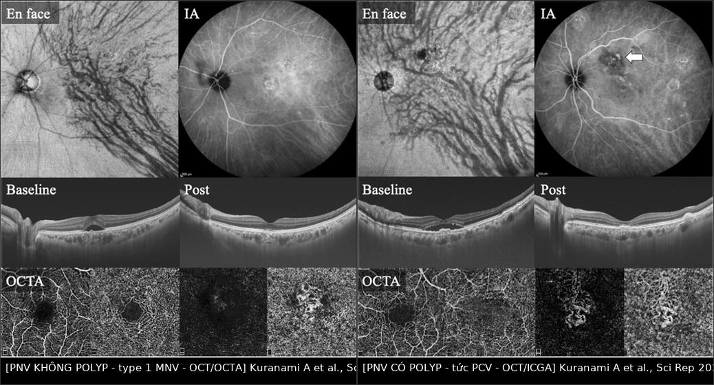
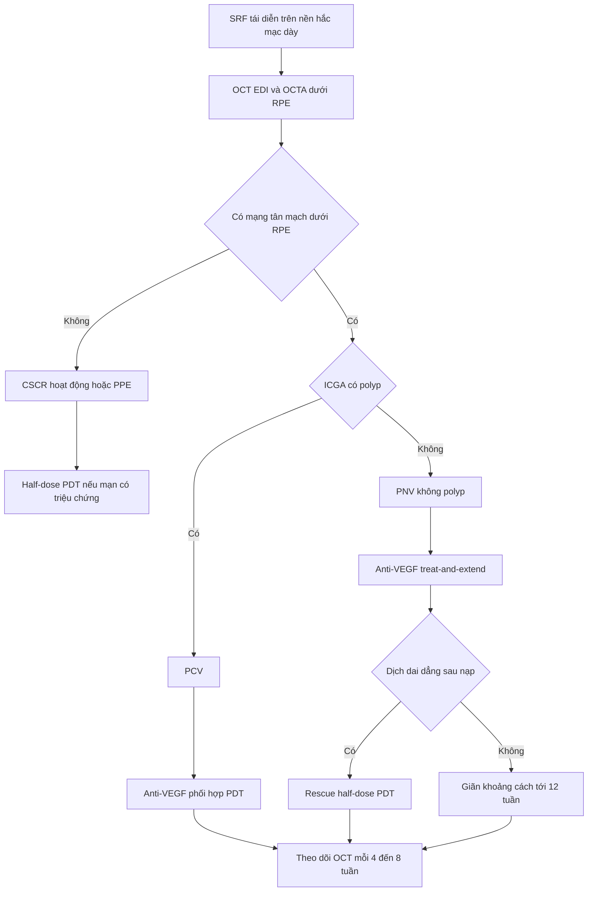
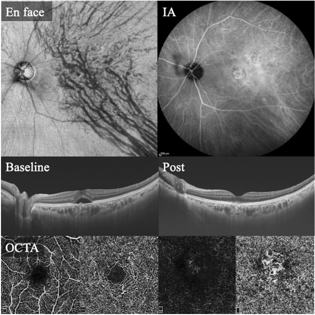
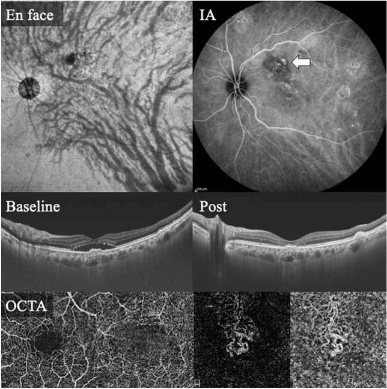
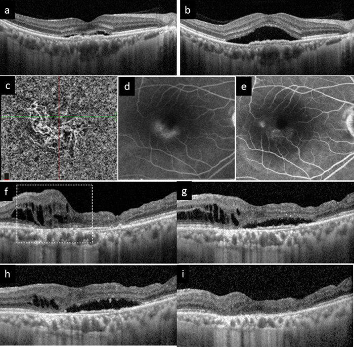

# 482 — Tân mạch hắc mạc sau CSCR mạn (pachychoroid neovasculopathy): OCTA, phân biệt CSCR hoạt động & chọn anti-VEGF/PDT / Pachychoroid neovasculopathy (PNV)

**Tags:** `pattern:tan-mach-hac-mac` `pattern:bong-thanh-dich` `pattern:hac-mac-day` `vung:hoang-diem` `protocol:OCT-EDI` `protocol:OCTA` `protocol:FA-ICGA`
**Mức chắc chắn (certainty):** tổng hợp y văn (literature synthesis) — số liệu từ toàn văn các bài mở (PMC10164122, PMC11933466); **các ca trong quiz là ca nguyên văn**, giữ đúng tuổi – mô tả OCT/ICGA/OCTA gốc.

> **Câu chốt:** bệnh nhân **lớn tuổi, hắc mạc dày, không có drusen**, có **dịch dưới võng mạc (subretinal fluid — SRF)** tái diễn trên nền **CSCR mạn** → đừng chỉ nghĩ "CSCR đang hoạt động". Phải tìm **tân mạch type 1 dưới biểu mô sắc tố (type 1 MNV)** trên **OCTA**, vì **PNV cần anti-VEGF**, còn **CSCR cần half-dose PDT** — **điều trị sai hướng = tiêm lặp vô ích hoặc bỏ mất cửa sổ PDT**. Dấu chốt trên OCT: **nâng RPE nông, không đều (shallow irregular RPE elevation — SIRE) = "dấu hai lớp" (double-layer sign)**, và **dòng chảy giữa RPE và màng Bruch trên OCTA**.

## 1. Tổng quan bệnh học – cơ chế hình ảnh

- **Bệnh học (pathology).** Phổ bệnh hắc mạc dày (**pachychoroid disease spectrum**) gồm **bệnh hắc mạc dày không triệu chứng (PPE) → CSCR → PNV → bệnh mạch polyp (PCV)**. Nền tảng: **ứ trệ dòng ra tĩnh mạch hắc mạc** (củng mạc dày, tĩnh mạch xoáy thoát kém) → **mạch Haller giãn (pachyvessels)**, **choriocapillaris mỏng/giảm tưới máu** phía trên → thiếu oxy → **VEGF** → mọc **tân mạch type 1** trong khoang dưới RPE.
- **TẠI SAO hình ảnh như vậy (vật lý):**
  - **OCT:** tổ chức tân mạch là **mô phản xạ trung bình–cao**, nằm **giữa RPE và màng Bruch**, đẩy RPE lên **nông và gồ ghề** → **SIRE / dấu hai lớp**. Khác **drusen**: drusen là vật liệu **dưới RPE, bờ nhẵn, đối xứng**, thường nhiều ổ hai mắt.
  - **OCTA (chụp mạch cắt lớp quang học):** dùng **tương phản chuyển động** của hồng cầu giữa các lần quét → **mạng mạch tăng tín hiệu** trong khoang dưới RPE, không cần thuốc cản quang.
  - **FA (fluorescein angiography):** tân mạch rò huyết tương → **tăng huỳnh quang, lan tỏa thì muộn**; **ICGA (indocyanine green angiography)** phát hiện **tăng thấm mạch hắc mạc (choroidal vascular hyperpermeability — CVH)** và **polyp**.
  - **Hắc mạc dày đo bằng EDI-OCT** tại **dưới hoàng điểm (subfoveal choroidal thickness — SCT)**: PNV **298 ± 96 µm** so với nAMD không pachychoroid **228 ± 82 µm** (P < 0,01) (PMC10164122).
- **Vì sao khó chẩn đoán:** **PNV bị xếp nhầm thành "nAMD"** rất nhiều — khi phân loại lại 100 bệnh nhân, **43%** ca "nAMD" thực chất là **PNV**; **47,3%** ca type 1/type 2 MNV và **44,7%** ca PCV được xếp lại thành PNV (PMC10164122). Điều này **đổi tiên lượng và cách điều trị**.
- **Ngưỡng định lượng cần nhớ:**
  - **SCT tham chiếu "hắc mạc dày" ~270 µm** (nghiên cứu Hàn Quốc > 300 mắt, SCT trung bình ~270 µm) — nhưng **KHÔNG có ngưỡng tuyệt đối**: **7/43 mắt PNV (16%) có SCT < 200 µm** (PMC10164122) → **hắc mạc mỏng không loại trừ PNV**.
  - **Bất đối xứng dọc của mạch hắc mạc trung bình/lớn (vertical asymmetry):** **81,4%** ở PNV so với **31,6%** ở nhóm không PNV (PMC10164122).
  - **Drusen:** **0%** ở PNV so với **19,3%** ở nhóm không PNV (PMC10164122) — không có drusen là **gợi ý**, không phải tiêu chuẩn bắt buộc.
  - **39,5%** mắt PNV có **polyp** (tức đã ở dải PCV) (PMC10164122); **13,5%** mắt PNV chuyển thành **PCV/AT1** sau trung bình **3,4 năm** (PMC11933466).

## 2. Mẫu hình + chẩn đoán phân biệt theo bối cảnh (Gamut)

- **Mẫu hình "SRF + hắc mạc dày + không drusen":** CSCR cấp → CSCR mạn → **PNV** → **PCV**; ngoài ra **PPE (không có dịch)**, **hội chứng pachychoroid quanh đĩa thị (PPS)**.
- **Mẫu hình "SRF + drusen + tuổi cao":** **nAMD type 1 (drusen-driven)** — tân mạch giống PNV nhưng nền bệnh khác, đáp ứng anti-VEGF kém hơn, cần phân biệt để tiên lượng.
- **Mẫu hình "hắc mạc dày + SRF hai mắt + viêm":** **Vogt–Koyanagi–Harada (VKH)**, **bệnh hắc mạc dày do thuốc** (corticosteroid — bài 470), **hội chứng Cushing**, **thai kỳ**.
- **Mẫu hình "khối hắc mạc đỏ cam":** **u máu hắc mạc (choroidal hemangioma)** — dày hắc mạc khu trú, ICGA "washout", không có mạng tân mạch.
- **Mnemonic "THICK":** **T**hiếu drusen · **H**aller giãn (pachyvessels) · **I**rregular RPE elevation (SIRE) · **C**horoid dày > 270 µm · **K**hông đáp ứng kéo dài với anti-VEGF đơn thuần.

## 3. Bảng so sánh phân biệt (ma trận đối chiếu)

| Thực thể (entity) | Hình ảnh điển hình (OCT/OCTA/FA-ICGA) | Chốt vào (rule-in) | Chốt loại (rule-out) | Gợi ý xác nhận |
|---|---|---|---|---|
| **CSCR hoạt động** | SRF vòm, **RPE phẳng hoặc điểm rò nhỏ**, hắc mạc dày, **không có mạng mạch dưới RPE** | **FA: điểm rò + lan tỏa; OCTA KHÔNG có mạng tân mạch** | **Mạng mạch rõ trên OCTA** → PNV | FA/ICGA; theo dõi 4–8 tuần |
| **PNV (type 1 MNV)** | **SIRE/dấu hai lớp**, hắc mạc dày, **OCTA có mạng mạch dưới RPE**, **không drusen** | **SIRE + dòng chảy dưới RPE trên OCTA + không drusen** | Drusen nhiều + hắc mạc mỏng → nAMD | OCTA 3×3/6×6 + ICGA |
| **PCV (PNV có polyp)** | **PED dạng vòm nhọn (sharp-peaked)**, polyp trên ICGA, **xuất huyết/tơ huyết dưới võng mạc** | **Polyp trên ICGA + PED vòm nhọn** | Không polyp, mạng mạch phẳng → PNV | ICGA (chuẩn vàng cho polyp) |
| **nAMD type 1 (drusen-driven)** | Drusen, hắc mạc **không dày**, MNV dưới RPE | **Drusen hai mắt + tuổi > 70 + SCT bình thường/mỏng** | SCT > 270 µm + SIRE + không drusen → PNV | OCTA + ICGA; tiền sử |
| **PPE (pachychoroid pigment epitheliopathy)** | **RPE biến đổi không có SRF**, hắc mạc dày, pachyvessels | **Không dịch, không mạng mạch** | Có SRF/MNV → CSCR/PNV | OCT EDI; theo dõi |
| **U máu hắc mạc** | Dày hắc mạc **khu trú**, **tăng huỳnh quang sớm + washout** trên ICGA, không MNV | **Khối đỏ cam + ICGA washout** | Có mạng tân mạch → PNV | ICGA, siêu âm B |
| **VKH** | **SRF hai mắt + hắc mạc dày lan tỏa + viêm dịch kính**, disc hyperemia | **Song phương + viêm + tiền sử da/tóc** | Một mắt, không viêm → CSCR/PNV | FA/ICGA, lâm sàng toàn thân |

*Trái: **PNV không polyp** — en face OCT thấy bất đối xứng mạch hắc mạc; ICGA không polyp; OCT có SRF trên SIRE; OCTA có mạng tân mạch. Phải: **PNV có polyp (PCV)** — polyp ở đỉnh mạng mạch trên ICGA (mũi tên), OCTA vẫn thấy MNV. Cùng một bộ máy, cùng cách đọc → khác nhau ở **polyp**. Nguồn: Kuranami A et al., Sci Rep 2023 (PMC10164122), Fig. 2–3, CC BY 4.0. Ảnh ghép letterbox, giữ nguyên tỷ lệ.*

### Ba dấu hiệu chốt cần đọc đúng
- **SIRE/dấu hai lớp:** dải phản xạ thứ hai **dưới RPE**, **nâng RPE nông và không đều** (không tạo vòm căng như PED); nếu bờ nhẵn, đối xứng, hai mắt → nghĩ drusen.
- **OCTA dương tính:** mạng mạch **nằm giữa RPE và Bruch** (segmentation "sub-RPE"), có **dòng chảy rõ**, không phải chấm nhiễu.
- **ICGA:** CVH lan tỏa + **polyp** (nếu có) — quyết định **thêm PDT**.

## 4. Protocol chụp + thuật toán điều trị

### 4.1. Bộ ảnh tối thiểu (mỗi lần khám)
- **OCT hoàng điểm EDI, raster 6 × 6 mm** (hoặc 30°): đo **SCT**, tìm **SIRE**, định lượng **SRF** (µm), **dịch trong võng mạc (IRF)**, **PED**, **màng trước võng mạc**.
- **OCTA 3 × 3 mm (và 6 × 6 mm)** với **segmentation dưới RPE**: xác nhận **MNV**, đo **diện tích mạng mạch**, phát hiện **polyp nghi ngờ**.
- **FA + ICGA** ở lần đầu (và khi nghi polyp/tái phát): **FA** cho rò rỉ, **ICGA** cho CVH và polyp — ICGA là **chuẩn vàng cho polyp**, không thay bằng OCTA.
- **AF (autofluorescence)** đánh giá tổn thương RPE mạn; **siêu âm B** nếu nghi u máu hắc mạc.
- **Trước điều trị:** huyết áp, tiền sử **corticosteroid** (bài 470), thai kỳ, chống chỉ định verteporfin (porphyria, suy gan nặng), chức năng gan/thận.

### 4.2. Điều trị
- **PNV không polyp → anti-VEGF là trục:** chọn **aflibercept** khi cần giảm dịch mạnh (giảm **CVH** và **bề dày hắc mạc** tốt hơn ranibizumab trong dữ liệu review) (PMC11933466); phác đồ **treat-and-extend**.
  - Dữ liệu 2 năm (22 mắt PNV so với 22 mắt không PNV): **khô hoàng điểm sau nạp 90,9% vs 59,1%**; **11,0 ± 2,9 vs 13,4 ± 3,2 mũi tiêm**; **khoảng cách 12,1 ± 2,9 vs 8,4 ± 3,1 tuần** (PMC10164122) → PNV **cần ít mũi hơn** nhưng **vẫn cần theo dõi dài**.
  - **SCT giảm sau điều trị:** 296 ± 89 µm → **230 ± 74 µm (1 năm)** → **216 ± 71 µm (2 năm)** (PMC10164122) — giảm hắc mạc là dấu hiệu đáp ứng, **không phải mục tiêu điều trị**.
- **PNV có polyp (PCV) → anti-VEGF + PDT phối hợp:** PDT nhắm **polyp/CVH**, anti-VEGF nhắm **dịch**; phối hợp ban đầu giúp **giảm số mũi duy trì** (PMC11933466).
- **PNV kháng trị (dịch dai dẳng dù anti-VEGF) → "rescue PDT":** half-dose hoặc half-fluence PDT; đây là lựa chọn được khuyến nghị trong review khi đơn trị anti-VEGF thất bại (PMC11933466).
- **CSCR thuần (không MNV) → half-dose/half-fluence PDT** là điều trị chuẩn cho thể mạn có triệu chứng (PLACE, SPECTRA); **eplerenone KHÔNG có hiệu quả** trong RCT (VICI, SPECTRA) (PMC11933466).
- **Theo dõi:** OCT mỗi **4 tuần** trong giai đoạn nạp, sau đó theo **treat-and-extend** (4 → 8 → 12 tuần); **OCTA lặp khi nghi tái phát** hoặc khi dịch không giải thích được; **ICGA lặp** nếu xuất huyết mới (nghi polyp).
- **Ngừng/giảm liều:** chỉ khi **khô hoàng điểm ≥ 3 lần khám liên tiếp** và không có hoạt tính trên OCTA — **không ngừng theo cảm nhận "bệnh nhân thấy tốt hơn"**.

## 5. Biến thể bình thường và cạm bẫy

- **Hắc mạc dày không bệnh lý:** nhiều mắt SCT > 300 µm hoàn toàn bình thường — **chỉ chẩn đoán PNV khi có MNV**, không điều trị "hắc mạc dày" đơn thuần.
- **Hắc mạc mỏng không loại trừ PNV:** **16%** mắt PNV có SCT < 200 µm (PMC10164122); đừng vì SCT 180 µm mà kết luận nAMD.
- **OCTA giả "tân mạch":** artifact do **projection** từ mạch hắc mạc lớn hoặc do segmentation sai → luôn đối chiếu **B-scan** và **hai lần chụp**; nếu không chắc, dùng **ICGA**.
- **Dấu hai lớp có thể không hoạt động (non-exudative MNV):** thấy mạng mạch nhưng **không dịch** → theo dõi, **không tiêm**.
- **CSCR mạn có SRF dai dẳng ≠ PNV:** điều trị anti-VEGF khi không có MNV **không giúp** và làm mất thời gian; ngược lại, coi PNV là "CSCR tái phát" và chỉ theo dõi → **mất thị lực do thoái hóa võng mạc ngoài**.
- **Corticosteroid là yếu tố khởi phát mạnh:** bệnh nhân dùng steroid uống/tiêm ngoài nhãn cầu/hít liều cao — hỏi kỹ và **ngừng nếu có thể** (bài 470).
- **Thai kỳ:** CSCR thường nặng lên; hạn chế thuốc, ưu tiên theo dõi; **PDT và anti-VEGF cần hội chẩn sản – mắt**.
- **Xuất huyết dưới võng mạc ồ ạt sau tiêm** ở PCV (biến chứng hiếm nhưng nặng) — cần nhận biết và xử trí cấp (bài 445).
- **Đừng bỏ sót nguyên nhân khác của SRF:** viêm màng bồ đào, u hắc mạch, bong võng mạc thần kinh cảm giác do tăng huyết áp — OCTA âm tính không đồng nghĩa "chỉ là CSCR".

## 6. Tự lượng giác — Blind Quiz

**Ca 1 — Nữ 70 tuổi, nhìn mờ mắt phải vài tuần, không đau, không tiền sử bệnh mắt.**

- Gợi ý: hắc mạc dày; không thấy drusen; bờ RPE gồ lên không đều; mắt còn lại bình thường.
- Câu hỏi: (1) Mô tả tổn thương trên OCT và OCTA? (2) CSCR hay PNV? (3) Vì sao câu trả lời đổi cách điều trị?

<b>Bấm để hiện đáp án (findings + chẩn đoán)</b>

- **Findings:** **en face OCT**: **bất đối xứng dọc của mạch hắc mạc**, mạch Haller giãn quanh hoàng điểm (pachyvessels). **ICGA**: không có polyp, có tăng thấm. **OCT baseline**: **SRF trên một vùng RPE nâng nông, không đều = SIRE**, **SCT 317 µm**; **OCT post**: dịch giảm, RPE còn gồ. **OCTA**: **mạng mạch tăng tín hiệu dưới RPE tại hoàng điểm** = type 1 MNV.
- **Chẩn đoán:** **pachychoroid neovasculopathy (PNV)** — tân mạch type 1 trên nền hắc mạc dày, **không drusen**.
- **CSCR hay PNV:** CSCR hoạt động **không có mạng tân mạch**; ở đây OCTA thấy MNV → **PNV**. Đây là ca được xếp lại từ "type 1 MNV/nAMD" sang PNV.
- **Vì sao đổi điều trị:** PNV đáp ứng anti-VEGF tốt hơn, **ít mũi hơn** và giãn được khoảng cách; nếu coi là CSCR mạn thì sẽ chọn **half-dose PDT**, còn nếu coi là nAMD thì tiên lượng sai và có thể tiêm quá nhiều.
- **Nguồn ảnh:** Kuranami A et al., Sci Rep 2023 (PMC10164122), Fig. 3, CC BY 4.0. Ca nguyên văn: nữ 70 tuổi, SCT 317 µm.

**Ca 2 — Cùng bộ ảnh ở bệnh nhân nam 81 tuổi, thị lực giảm, có polyp trên ICGA.**

- Gợi ý: SCT 385 µm; OCT có **PED**; cần ICGA để tìm **polyp**.
- Câu hỏi: (1) Dấu hiệu phân biệt với ca 1? (2) Chẩn đoán và điều trị khác ca 1 thế nào? (3) Nguy cơ cần cảnh báo?

<b>Bấm để hiện đáp án (findings + chẩn đoán)</b>

- **Findings:** **en face OCT**: mạch hắc mạc giãn, bất đối xứng dọc; **ICGA**: **mạng mạch + polyp ở đỉnh** (mũi tên); **OCT**: **SRF + RPE nâng**, **SCT 385 µm**; **OCTA**: mạng MNV (polyp có thể không thấy rõ dòng chảy).
- **Chẩn đoán:** **PNV có polyp = PCV** trên nền pachychoroid.
- **Khác ca 1:** có **polyp** → cần **phối hợp anti-VEGF + PDT** (PDT nhắm polyp/CVH), không chỉ anti-VEGF.
- **Nguy cơ:** polyp dễ gây **xuất huyết dưới võng mạc/tơ huyết** và **PED vòm nhọn**; cần theo dõi sát và cảnh báo bệnh nhân dấu hiệu bùng phát.
- **Nguồn ảnh:** Kuranami A et al., Sci Rep 2023 (PMC10164122), Fig. 2, CC BY 4.0. Ca nguyên văn: nam 81 tuổi, SCT 385 µm.

**Ca 3 — Bệnh nhân CSCR mạn, dịch tăng dần sau 1 năm; OCT thấy SIRE, OCTA có mạng mạch, FA rò rỉ tăng.**

- Gợi ý: trước đó được chẩn đoán CSCR; dịch dưới võng mạc **tăng lên** dù đã theo dõi; xuất hiện **cyst trong võng mạc** ở giai đoạn sau.
- Câu hỏi: (1) Vì sao nghĩ đã "chuyển" sang PNV? (2) Vai trò của OCTA và FA? (3) Kế hoạch điều trị và theo dõi?

<b>Bấm để hiện đáp án (findings + chẩn đoán)</b>

- **Findings:** **(a)** OCT ban đầu: SRF trên **SIRE**, hắc mạc dày, pachyvessels. **(b)** OCT sau: **SRF nặng hơn**, có **nang trong võng mạc**. **(c)** OCTA: **dòng chảy tân mạch**. **(d–e)** FA lúc đầu và **sau 1 năm**: **rò rỉ tăng**, lan rộng.
- **Chẩn đoán:** **PNV hình thành trên nền CSCR mạn** (CSCR → PNV là một **continuum**, không phải hai bệnh tách rời).
- **Vai trò từng kỹ thuật:** OCT phát hiện SIRE/dịch; **OCTA xác nhận MNV**; **FA** cho thấy mức rò rỉ và theo dõi đáp ứng; **ICGA** cần khi nghi polyp/CVH.
- **Điều trị:** **anti-VEGF** (aflibercept) theo treat-and-extend; nếu **dịch dai dẳng** → **rescue half-dose PDT**; nếu có polyp → phối hợp PDT ngay.
- **Theo dõi:** OCT mỗi 4 tuần trong giai đoạn nạp, sau đó giãn cách; **đo lại SCT** (giảm là dấu hiệu đáp ứng), kiểm tra **nhãn áp** và **thị lực** mỗi lần.
- **Nguồn ảnh:** Cheung CMG et al., Eye 2025 (PMC11933466), Fig. 3a–e, CC BY 4.0.

## Bài liên quan chéo

- [470 – CSCR do corticosteroid & tiếp cận mất thị lực không đau](../470-cscr-do-corticosteroid-mat-thi-luc-khong-dau/lesson.md) (khởi phát do thuốc, OCT/FA)
- [441 – OCT hoàng điểm: đọc lớp & dấu hiệu](../441-OCT-hoang-diem/lesson.md) (SIRE, PED, SRF)
- [445 – Bong võng mạc](../445-bong-vong-mac/lesson.md) (phân biệt bong thanh dịch và bong do rách)
- [444 – Tắc mạch võng mạc](../444-tac-mach-vong-mac/lesson.md) (mờ mắt đột ngột không đau)
- [484 – Nhiễm độc võng mạc do hydroxychloroquine](../484-nhiem-doc-vong-mac-hydroxychloroquine/lesson.md) (bệnh hắc mạc–võng mạc do thuốc)
- [400 – Tổng quan Mắt & thị giác](../400-tong-quan-mat-thi-giac/lesson.md)

> Không dùng để chẩn đoán độc lập khi chưa có người hướng dẫn.
