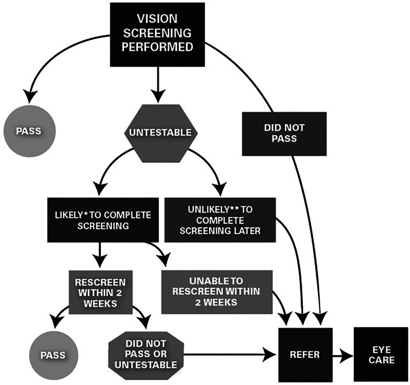
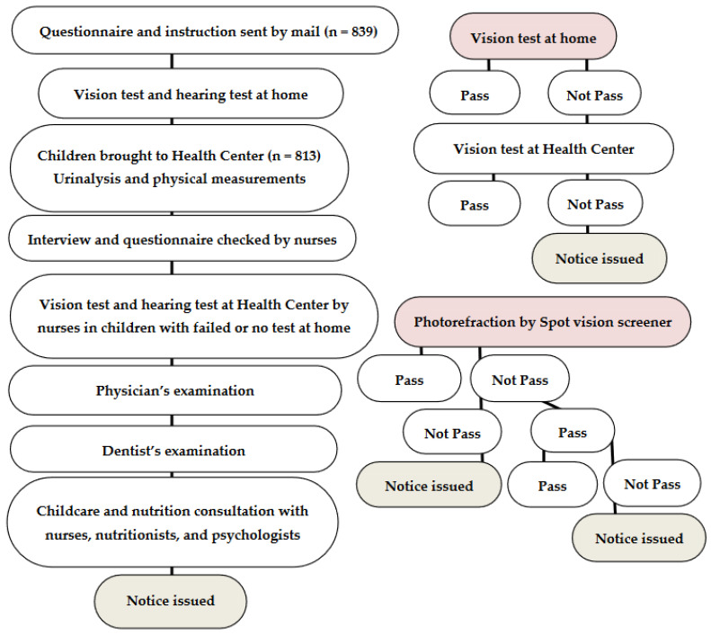
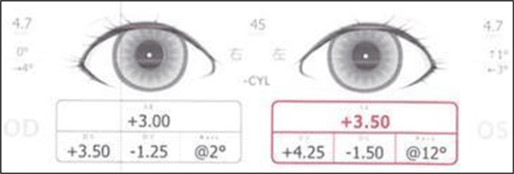
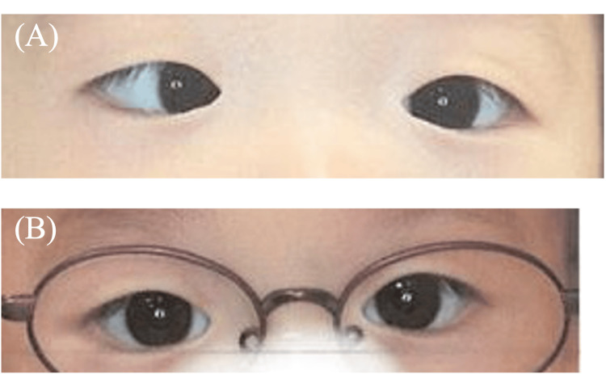
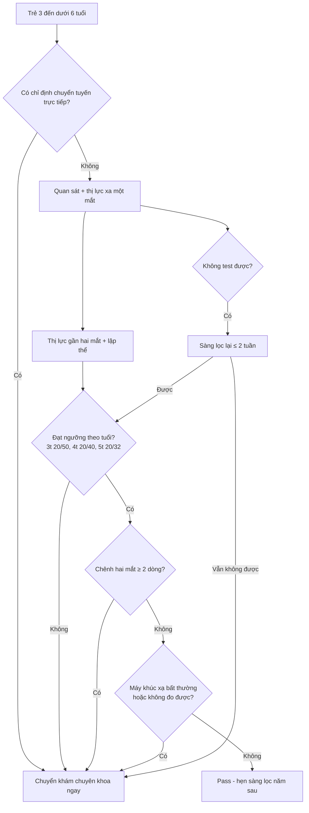
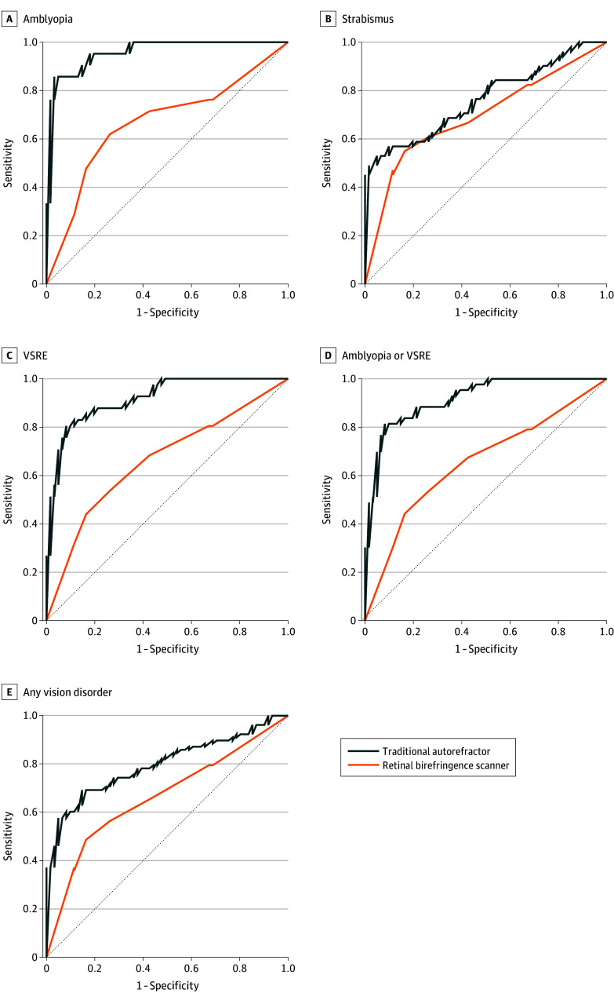

# 483 — Sàng lọc thị lực trẻ mầm non: photoscreener/autorefractor, ngưỡng chuyển tuyến & vì sao bỏ sót lác nhỏ / Preschool vision screening: photoscreeners, referral thresholds and why small-angle strabismus is missed

**Tags:** `pattern:sang-loc` `pattern:khuc-xa` `pattern:lac` `vung:mat` `protocol:chinh-thi-tre-mam-non` `score:NCCVEH-2025` `incidentaloma:khuc-xa-tre`
**Mức chắc chắn (certainty):** tổng hợp y văn (literature synthesis) — tự biên từ khuyến cáo NCCVEH 2025 (CC BY-NC-ND), 1 thử nghiệm độ chính xác chẩn đoán JAMA Ophthalmol 2026 (CC BY-NC-ND), 1 loạt ca Cureus 2026 (CC BY) và 1 chương trình cộng đồng 813 trẻ (CC BY), chưa gắn một ca nguyên văn đơn lẻ.

## 1. Tổng quan — sàng lọc để làm gì, và giới hạn vật lý của máy

- **Mục tiêu (goal):** tìm trẻ **3 – dưới 6 tuổi** có **tật khúc xạ đáng kể chưa chỉnh, nhược thị (amblyopia), lác (strabismus), giảm thị lực** hoặc bệnh mắt khác, rồi **chuyển tuyến** khám chuyên khoa — không phải để chẩn đoán tại chỗ. Khuyến cáo NCCVEH 2025: **sàng lọc HẰNG NĂM** cho mọi trẻ **3 đến < 6 tuổi** (Pang Y, *Optom Vis Sci* 2025, PMC12520030).
- **Vì sao phải sớm — sinh lý "cửa sổ":** vỏ não thị giác có **thời kỳ nhạy cảm**; nhược thị điều trị càng sớm càng tốt, và đây là nguyên nhân **giảm thị lực một mắt** hàng đầu ở trẻ. **Nhược thị 0,8 – 3,0%**; **lác 0,08 – 4,6%** ở trẻ 3 – < 6 tuổi (Pang Y, PMC12520030).
- **Tần suất các bất thường khúc xạ (MEPEDS/BPEDS, dẫn trong PMC12520030):**
  - **Cận thị:** 1,9 – 4,9% tuỳ sắc tộc.
  - **Loạn thị > 1,50 DC:** **5,2 – 13,2%**.
  - **Dị khúc xạ (anisometropia):** **1,0 – 1,5%** khi chênh **≥ 2,00 DS**; **3,4 – 4,0%** khi chênh **≥ 1,00 DS**.
  - **Viễn thị là tật khúc xạ phổ biến nhất**; **viễn thị ≥ +4,00 D** liên quan điểm đọc viết sớm kém hơn, còn **+3,00 đến +4,00 D** đã có thể giảm thị lực gần/lập thể (VIP-HIP).
- **TẠI SAO máy ảnh khúc xạ (photoscreener) bỏ sót lác nhỏ — giải thích vật lý:**
  - Máy đo **khúc xạ qua ảnh hồng ngoại (infrared photorefraction)** ở khoảng cách **~1 m**, không tạo đủ **kích thích điều tiết (accommodative demand)** để "lộ" lác trong điều tiết; lác chỉ hiện khi nhìn gần hoặc lúc mệt sẽ nằm ngoài cửa sổ đo.
  - Thuật toán máy ước lượng **vị trí/độ lệch ánh phản xạ**, không đo **góc lác** như nghiệm pháp cover test; **lác góc nhỏ (< 10 Δ)**, lác **gián đoạn**, lác **chỉ khi nhìn gần** dễ rơi khỏi ngưỡng phát hiện.
  - Hệ quả thực hành: 3 ca **lác trong điều tiết** dưới 3 tuổi có **viễn thị +2,50 đến +5,50 D** nhưng **Spot Vision Screener (SVS) báo "vị trí mắt bình thường"**; khi đo lại lúc 3 tuổi máy mới phát hiện (Fuseya K, *Cureus* 2026, PMC13045761).
- **Hiệu năng định lượng của máy (numbers):**
  - SVS: **độ nhạy 85 – 89%**, **độ đặc hiệu 71 – 88%** tuỳ tiêu chuẩn chuyển tuyến (Garry & Donahue, dẫn trong PMC13045761); một nghiên cứu khác **87,7% / 75,9%** (Peterseim, dẫn trong cùng bài).
  - So sánh trực tiếp **autorefractor truyền thống (Spot) vs máy quét lưỡng chiết võng mạc (retinal birefringence scanner — Blinq)**: 195 trẻ, **139 hoàn thành**; **nhược thị 15,1%**, **lác 32,4%**, **tật khúc xạ đáng kể (VSRE) 30,1%**. Autorefractor **nhạy hơn** cho nhược thị (**+29 điểm %**) và VSRE (**+41 điểm %**), **không khác** cho lác (**−6 điểm %, p = 0,69**); **AUROC của máy lưỡng chiết thấp hơn**, rõ nhất ở nhược thị (**−0,13**) (Oatts JT, *JAMA Ophthalmol* 2026, PMC13195499).
  - Chiến lược "sàng lọc **yếu tố nguy cơ** nhược thị" có thể gây **chuyển tuyến dương tính giả tới 34%** (Oatts JT, PMC13195499).
- **Chương trình cộng đồng tại Nhật (3,5 tuổi, n = 813):** thêm **photorefraction** vào khám thị lực – điều tra giúp tăng phát hiện: **95 trẻ (11%)** được chuyển tuyến; **76 (80%)** gửi lại chẩn đoán; tỉ lệ bệnh **cần điều trị** cao nhất khi **trượt cả hai tiêu chuẩn 10/15 (66%)**, rồi **trượt riêng Spot 13/45 (28%)**, so với **trượt riêng thị lực 6/33 (18%)**, **p = 0,0031** (Matsuo T, *IJERPH* 2022, PMC9321534).

*Trẻ "không test được" được sàng lọc lại **trong cùng ngày hoặc muộn nhất 2 tuần**; nếu không thể sàng lọc lại ≤ 2 tuần thì **chuyển tuyến** như trẻ trượt. Nguồn: Pang Y et al., Optom Vis Sci 2025, PMC12520030 Fig. 1, CC BY-NC-ND 4.0 (giữ nguyên bản).*

*Bên trái: 839 trẻ được gửi bảng hỏi, 813 đến trung tâm. Bên phải: thị lực tại nhà → thị lực tại trung tâm → **photorefraction bằng Spot**; mỗi bước "không đạt" đều phát thông báo chuyển tuyến. Nguồn: Matsuo T et al., Int J Environ Res Public Health 2022, PMC9321534 Fig. 1, CC BY 4.0.*

## 2. Mẫu hình + chẩn đoán phân biệt theo "cái gì bị bỏ sót" (gamut)

- **Sàng lọc chuẩn gồm 4 thành phần (NCCVEH 2025):** **quan sát (observation)** → **thị lực xa một mắt** theo ngưỡng tuổi → **thị lực gần hai mắt** → **lập thể (stereopsis)**. **Máy** được phép thay **thị lực xa + lập thể**, nhưng **vẫn phải đo thị lực gần** vì máy có thể bỏ sót **viễn thị chưa chỉnh**.
- **Gamut "bị bỏ sót" — 6 nhóm hay gặp:**
  1. **Lác trong điều tiết góc nhỏ/gián đoạn (small-angle accommodative esotropia):** máy báo bình thường; chỉ hiện khi nhìn gần; viễn thị +2,50 đến +5,50 D. Đây là **nhóm bỏ sót kinh điển** (Fuseya K, PMC13045761).
  2. **Viễn thị trung bình – cao hai bên:** thị lực xa có thể vẫn "qua"; **thị lực gần/lập thể giảm**; máy khúc xạ có thể đo thiếu.
  3. **Dị khúc xạ nhỏ dưới ngưỡng máy:** chênh **1,00 – 1,50 D** vẫn có thể gây nhược thị, trong khi nhiều tiêu chuẩn chuyển tuyến lấy ngưỡng **1,50 D**.
  4. **Đục môi trường (cataract bẩm sinh/đục giác mạc):** máy có thể "không đo được" hoặc báo khúc xạ lệch — **quan sát + đèn pin/red reflex** mới phát hiện.
  5. **Sụp mi (ptosis)/bất thường hình thái:** **chuyển tuyến trực tiếp**, không qua sàng lọc.
  6. **Rung giật nhãn cầu (nystagmus):** là **dấu hiệu quan sát** — trẻ rung giật phải khám chuyên khoa ngay (bài 471), không chờ kết quả máy.
- **Nhóm "chuyển tuyến trực tiếp, bỏ qua sàng lọc" (NCCVEH 2025):** lác/sụp mi nhìn thấy rõ; rối loạn phát triển thần kinh (bại não, Down, chậm phát triển, tự kỷ); bệnh hệ thống/di truyền có biểu hiện mắt (đái tháo đường, JIA, hồng cầu hình liềm); thuốc có tác dụng phụ mắt; **tiền sử gia đình bậc 1** lác/nhược thị/khúc xạ cao; **sinh non < 32 tuần và/hoặc < 1500 g**; chậm mốc phát triển; phơi nhiễm rượu/ma tuý trong tử cung; nhiễm trùng bẩm sinh (Zika, CMV, rubella, giang mai, toxoplasma); lo ngại thần kinh (sau chấn thương đầu).

## 3. Bảng so sánh phân biệt (ma trận đối chiếu)

| Thực thể (entity) | Dấu hiệu trên sàng lọc | Chốt vào (rule-in) | Chốt loại (rule-out) | Gợi ý xác nhận |
|---|---|---|---|---|
| Nhược thị do dị khúc xạ | Thị lực một mắt dưới ngưỡng tuổi; **chênh ≥ 2 dòng** giữa hai mắt dù mỗi mắt "qua" | **Chênh khúc xạ ≥ 1,50 D** (hoặc chênh thị lực ≥ 2 dòng) | Hai mắt thị lực bằng nhau, khúc xạ cân → ít nghĩ | Khúc xạ **lý liệt điều tiết** + khám đáy mắt |
| Lác trong điều tiết góc nhỏ | Máy báo **vị trí mắt bình thường**; trẻ có thể "qua" thị lực xa | **Lác hiện khi nhìn gần + viễn thị ≥ +2,50 D + cover test dương** | Máy báo lệch trục rõ → không còn là "bỏ sót" | **Cover test gần/xa** + khúc xạ lý liệt; thử kính viễn thị đủ |
| Viễn thị hai bên mức trung bình–cao | Thị lực xa có thể qua; **thị lực gần/lập thể giảm** | **Viễn thị ≥ +3,00 D** (đặc biệt ≥ +4,00 D) + giảm thị lực gần | Khúc xạ lý liệt ≤ +1,50 D và lập thể bình thường | Soi bóng/autorefractor **sau lý liệt**; đo thị lực gần |
| Đục môi trường (cataract/giác mạc) | Máy **không đo được** hoặc phản xạ đỏ bất thường | **Mất phản xạ đỏ (red reflex) + leukocoria** | Phản xạ đỏ đều hai bên, máy đo được | Đèn khe/đồng tử, siêu âm, khám mê nếu cần (bài 450) |
| Sụp mi/ bất thường hình thái | Quan sát thấy mi che trục thị giác | **Mi che đồng tử hoặc lệch trục** | Mi không che trục, đối xứng | Chuyển tuyến trực tiếp, không chờ sàng lọc |
| Rung giật nhãn cầu | Quan sát thấy dao động mắt | **Rung giật + giảm thị lực/không giữ được fixation** | Không rung giật | Khám chuyên khoa + ERG/OCT/gen (bài 471) |

*Máy ghi "vị trí mắt trong giới hạn bình thường", chỉ báo viễn thị loạn nhẹ (OD +3,00/−1,25 × 2°; OS +3,50/−1,50 × 12°) — trong khi khám lâm sàng có lác trong cả nhìn gần và xa, khúc xạ lý liệt **+4,50 D hai mắt**. Nguồn: Fuseya K et al., Cureus 2026, PMC13045761 Fig. 1, CC BY 4.0.*

*(A) Trước: lác trong mắt phải. (B) Sau 3 tháng đeo kính chỉnh đủ: vị trí mắt trở về bình thường. Đây là lý do **không được bỏ qua lác nhỏ** — điều trị bằng kính rất hiệu quả. Nguồn: Fuseya K et al., Cureus 2026, PMC13045761 Fig. 3, CC BY 4.0.*

## 4. Protocol sàng lọc + ngưỡng/điểm chuẩn hoá

- **Đối tượng & tần suất:** trẻ **3 đến < 6 tuổi**, **sàng lọc hằng năm** (NCCVEH 2025).
- **Trình tự 4 bước:** **quan sát** → **thị lực xa một mắt** → **thị lực gần hai mắt** → **lập thể**. Nếu dùng máy: máy thay **thị lực xa + lập thể**, nhưng **vẫn đo thị lực gần**.
- **Ngưỡng "đạt" thị lực theo tuổi (pass criteria):**
  - **3 tuổi: 20/50 hoặc tốt hơn.**
  - **4 tuổi: 20/40 hoặc tốt hơn.**
  - **5 tuổi trở lên: 20/32 hoặc tốt hơn.**
  - Đúng **≥ 3/4 hoặc 3/5 optotype** mỗi dòng.
  - **Chênh thị lực hai mắt ≥ 2 dòng → chuyển tuyến**, kể cả khi mỗi mắt đều "đạt".
- **Kỹ thuật đo:** khoảng cách **5 ft (1,5 m) hoặc 10 ft (3 m)**; dùng **LEA SYMBOLS hoặc HOTV**; có **crowding bar**; **không dùng optotype đơn lẻ không có crowding** (ước lượng thị lực cao hơn thực tế, đặc biệt ở nhược thị); che mắt bằng **miếng dán dùng một lần hoặc kính che**, không dùng tay/giấy.
- **Lập thể:** ưu tiên **PASS Test 2** (random dot); độ khả thi **> 99%** ở 3–5 tuổi; trẻ **không làm được PASS Test 2 có nguy cơ rối loạn thị giác cao gấp 5,75 lần**.
- **Máy ảnh khúc xạ:** được AAP/NCCVEH chấp nhận; **không quy đổi** kết quả khúc xạ của máy thành "thị lực"; máy có thể **bỏ sót viễn thị chưa chỉnh** và **lác góc nhỏ**.
- **Xử lý kết quả:** "không test được" → **sàng lọc lại trong cùng ngày, muộn nhất 2 tuần**; nếu không thể → **chuyển tuyến**. Trẻ trượt → chuyển khám toàn diện, có **hệ thống theo dõi đến khi khám xong** (không chỉ phát giấy hẹn).
- **Chương trình cộng đồng tham chiếu:** mô hình Nhật 3,5 tuổi (thị lực tại nhà → trung tâm → photorefraction) cho thấy **thêm máy làm tăng phát hiện bệnh cần điều trị** (28% ở nhóm chỉ trượt máy) nhưng **không thay thế** thị lực (Matsuo T, PMC9321534).

*Đường đen = autorefractor truyền thống (Spot); đường cam = máy quét lưỡng chiết võng mạc (Blinq). Autorefractor tốt hơn rõ ở **nhược thị (A)** và **tật khúc xạ đáng kể (C, D)**; hai đường gần như trùng nhau ở **lác (B)** — xác nhận rằng **không máy nào giải quyết tốt lác**, đặc biệt lác góc nhỏ. Nguồn: Oatts JT et al., JAMA Ophthalmol 2026, PMC13195499 Fig. 2, CC BY-NC-ND 4.0 (giữ nguyên bản).*

## 5. Biến thể bình thường và cạm bẫy

- **"Qua sàng lọc" không đồng nghĩa "mắt bình thường":** máy có thể bỏ sót lác góc nhỏ/gián đoạn và viễn thị; **quan sát + khám lâm sàng** vẫn bắt buộc.
- **Không quy đổi khúc xạ của máy thành thị lực:** NCCVEH nêu rõ **không thể chuyển điểm "pass/refer" của máy thành điểm thị lực**; dùng sai dẫn tới bỏ qua trẻ có thị lực kém thật.
- **Đo khúc xạ không lý liệt ở trẻ:** trẻ điều tiết mạnh → **đo thiếu viễn thị**; mọi ngưỡng chẩn đoán phải dựa trên **khúc xạ lý liệt**.
- **Chỉ dùng một test:** thị lực xa đơn thuần bỏ sót viễn thị/lác; máy đơn thuần bỏ sót thị lực gần — **phải phối hợp** (mô hình Nhật: 28% bệnh cần điều trị chỉ phát hiện nhờ máy, nhưng 18% chỉ nhờ thị lực).
- **Trẻ "không test được" bị bỏ qua:** nhóm này có nguy cơ rối loạn thị giác **cao gấp ≥ 2 lần**; phải **sàng lọc lại ≤ 2 tuần** hoặc chuyển tuyến.
- **Máy đo trong phòng sáng/tối không đúng:** ánh sáng môi trường và khoảng cách ~1 m ảnh hưởng kết quả; trẻ không hợp tác → kết quả "bình thường giả".
- **Bỏ sót lác vì "máy báo bình thường":** đây là **lỗi hệ thống**, không phải lỗi cá nhân — Fuseya K mô tả 3 ca dưới 3 tuổi; **khám lại khi trẻ 3 tuổi** vẫn cần thiết dù trước đó "qua".
- **Mất dấu sau chuyển tuyến:** sàng lọc chỉ có giá trị nếu trẻ **thực sự được khám**; chương trình cần **vòng phản hồi kết quả** (NCCVEH 2025).
- **Sụp mi/rung giật không phải "chuyện của máy":** đây là **dấu hiệu quan sát**, chuyển tuyến trực tiếp.

## 6. Tự lượng giá — Blind Quiz

**Ca 1 — Bé trai 1 tuổi 8 tháng, khám sức khoẻ 18 tháng: máy báo "vị trí mắt bình thường", chỉ có viễn thị nhẹ. Mẹ thấy mắt hơi lệch khi nhìn gần.**

- Bối cảnh: trẻ chưa biết đọc, hợp tác kém; máy đo cách ~1 m.
- Câu hỏi: Vì sao máy có thể bỏ sót? Bước nào trong khám lâm sàng sẽ "lật" chẩn đoán?

<b>Bấm để hiện đáp án (findings + chẩn đoán)</b>

- **Findings:** máy ghi vị trí mắt bình thường, chỉ viễn thị loạn nhẹ; nhưng **cover test** phát hiện **lác trong khi nhìn gần**, và **khúc xạ lý liệt +4,50 D hai mắt**.
- **Vì sao bỏ sót:** máy đo ở ~1 m, **không đủ kích thích điều tiết**, lác chỉ hiện khi nhìn gần; thuật toán không đo góc lác như cover test. Viễn thị bị **đo thiếu** nếu không lý liệt.
- **Chẩn đoán:** **lác trong điều tiết (accommodative esotropia)** — điều trị **kính viễn thị chỉnh đủ**, không cần mổ.
- Nguồn: Fuseya K et al., Cureus 2026, PMC13045761 Fig. 1, CC BY 4.0.

**Ca 2 — Cùng bệnh nhi sau 3 tháng đeo kính: mẹ hỏi "mắt con đã thẳng chưa?".**

- Bối cảnh: trẻ đeo kính liên tục, tái khám đúng hẹn.
- Câu hỏi: Mô tả (A) và (B). Kết quả này nói gì về giá trị của việc phát hiện sớm?

<b>Bấm để hiện đáp án (findings + chẩn đoán)</b>

- **(A)** lác trong mắt phải trước điều trị; **(B)** sau 3 tháng kính chỉnh đủ, **vị trí mắt trở về bình thường**.
- **Ý nghĩa:** lác trong điều tiết đáp ứng tốt với **kính viễn thị đủ** — phát hiện sớm tránh nhược thị và tránh mổ không cần thiết. Đây là lý do **không được "tin" kết quả máy bình thường** khi lâm sàng có dấu hiệu.
- **Theo dõi:** tiếp tục kính, đo lại khúc xạ lý liệt định kỳ; một số ca còn lác phần còn lại (partial accommodative) cần đánh giá thêm.
- Nguồn: Fuseya K et al., Cureus 2026, PMC13045761 Fig. 3, CC BY 4.0.

**Ca 3 — Chọn máy cho chương trình sàng lọc: autorefractor hay máy quét lưỡng chiết võng mạc?**

- Bối cảnh: quản lý chương trình muốn "máy mới phát hiện nhược thị trực tiếp".
- Câu hỏi: Nhìn ROC, máy nào tốt hơn cho nhược thị và cho lác? Có nên bỏ thị lực/lập thể không?

<b>Bấm để hiện đáp án (findings + chẩn đoán)</b>

- **Nhược thị (A):** đường **autorefractor (đen)** nằm trên rõ rệt — AUROC cao hơn **0,13** so với máy lưỡng chiết; độ nhạy cao hơn **29 điểm %**.
- **Lác (B):** hai đường gần như trùng nhau (**−6 điểm %, p = 0,69**) — **không máy nào vượt trội**, và cả hai đều kém ở lác góc nhỏ.
- **Kết luận:** không có "máy vạn năng"; **không bỏ** thị lực gần/lập thể/quan sát. Chọn máy theo mục tiêu chương trình, huấn luyện người sàng lọc và **bảo đảm chuyển tuyến – khám – phản hồi**.
- Nguồn: Oatts JT et al., JAMA Ophthalmol 2026, PMC13195499 Fig. 2, CC BY-NC-ND 4.0 (giữ nguyên bản).

## Bài liên quan chéo
- [469 – Lác & nhược thị ở trẻ sinh non/ROP](../469-lac-nhuoc-thi-tre-sinh-non-rop/lesson.md)
- [471 – Rung giật nhãn cầu ở trẻ nhũ nhi & trẻ sinh non](../471-rung-giat-nhan-cau-tre-nhu-nhi/lesson.md)
- [450 – Mắt trẻ em (leukocoria & tiếp cận)](../450-mat-nhi/lesson.md)
- [468 – Sàng lọc ROP từ xa (tele-ROP) & AI](../468-tele-rop-sang-loc-ai-theo-doi/lesson.md)
- [456 – Bệnh võng mạc trẻ sinh non (ROP)](../456-benh-vong-mac-tre-sinh-non/lesson.md)
- [433 – Phù đĩa thị vs drusen đĩa](../433-phu-dia-thi-drusen/lesson.md)

## Ảnh
- Tên file `483_sang-loc-thi-luc_<nội dung>_<PMCID>-Fig<k>-<giấy phép>.jpg`; nguồn + giấy phép từng ảnh trong `images/CREDITS.md`.
- Ảnh **CC BY-NC-ND** giữ **nguyên bản** (không crop/ghép).

> Không dùng để chẩn đoán độc lập khi chưa có người hướng dẫn.
