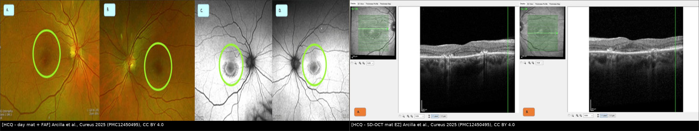
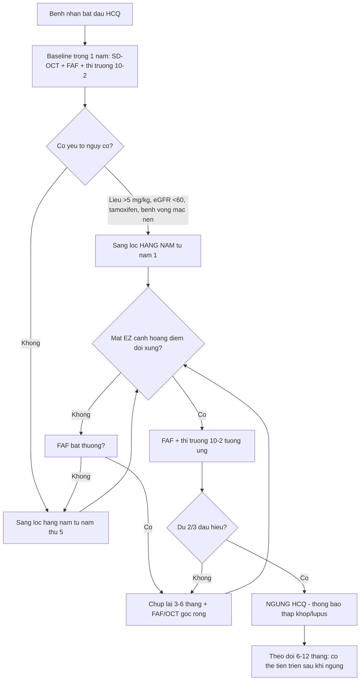
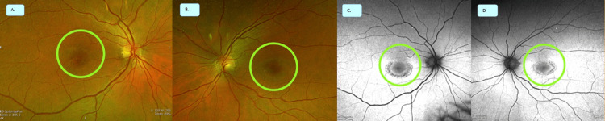
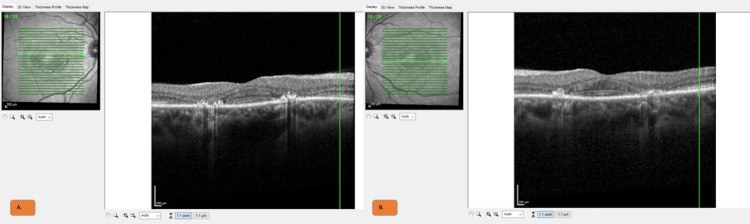
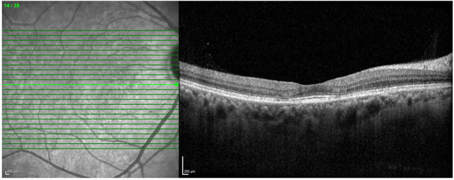

# 484 — Nhiễm độc võng mạc do hydroxychloroquine: sàng lọc, ngưỡng liều & phân biệt với bệnh võng mạc lupus / Hydroxychloroquine retinopathy

**Tags:** `pattern:mat-EZ-canh-hoang-diem` `vung:hoang-diem` `score:AAO-nguy-co` `protocol:SD-OCT-FAF-thi-truong-10-2`
**Mức chắc chắn (certainty):** tổng hợp y văn (literature synthesis) — tự biên từ 2 bài mở CC BY 4.0 (review hình ảnh *Diagnostics* 2023 + loạt ca *Cureus* 2025), số liệu lấy nguyên từ bài gốc, tên tác giả đối chiếu PMCID.

> **Bài này trả lời "ai cần tầm soát, chụp gì, đọc gì, khi nào ngừng thuốc" — không phải bài chẩn đoán bệnh võng mạc lupus.**
> [455 – Behçet & lupus tại mắt](../455-behcet-lupus-mat/lesson.md) phủ **tổn thương võng mạc do chính bệnh lupus** (vi mạch, xuất tiết, thiếu máu võng mạc); [453 – Bệnh võng mạc tăng huyết áp & thiếu máu](../453-benh-vong-mac-tang-huyet-ap-va-thieu-mau/lesson.md) phủ **tổn thương mạch máu toàn thân tại võng mạc**; [441 – OCT hoàng điểm](../441-OCT-hoang-diem/lesson.md) phủ **kỹ thuật đọc OCT**. Bài này dành cho **bệnh nhân đang dùng hydroxychloroquine (HCQ)**, cho bác sĩ CĐHA/mắt phải **đọc ảnh sàng lọc ở người không triệu chứng** và quyết định **ngừng thuốc** — nơi mà "thị lực 20/20" không loại trừ được gì.

## 1. Tổng quan bệnh học – cơ chế hình ảnh

### 1.1 Vì sao HCQ ăn vào võng mạc, và vì sao tổn thương nằm *cạnh* hố trung tâm

- **HCQ là thuốc ưa mỡ, tích điện kiềm yếu (lysosomotropic):** dạng base tự do qua được màng tế bào, **tích tụ trong lysosome**, làm tăng pH trong lysosome → mất ổn định lysosome, ức chế phân giải protein và **ức chế thực bào đoạn ngoài tế bào cảm quang ở tế bào biểu mô sắc tố (RPE)**. Đây là cơ chế vừa **ức chế miễn dịch** (tác dụng điều trị) vừa **gây độc võng mạc**.
- **HCQ gắn melanin và tồn tại lâu trong RPE** → tổn thương có thể **tiếp tục tiến triển sau khi ngừng thuốc**, nên "ngừng là xong" chỉ đúng khi phát hiện **rất sớm**. Bài gốc ghi rõ nguy cơ này và đó là lý do chính phải sàng lọc định kỳ.
- **Vì sao tổn thương cạnh hoàng điểm chứ không phải đúng hố trung tâm:** vùng **cạnh hoàng điểm (2–6°)** và **quanh trung tâm (≥ 8°)** có **mật độ tế bào cảm quang và nhu cầu chuyển hóa cao nhất**, trong khi **hố trung tâm chỉ có tế bào nón, không có mạch máu, được nuôi từ màng mạch (choriocapillaris)** — nên **hố trung tâm được bảo tồn lâu**, tạo hình ảnh **"đĩa bay" (flying saucer) / "mũ sombrero"**: vùng mỏng đi nằm **quanh** một hố trung tâm còn dày.
- **Hệ quả về mặt đọc ảnh:** tổn thương **bắt đầu ở lớp ngoài** (ellipsoid zone — EZ, tức dải sáng của đoạn trong tế bào nón; interdigitation zone; nhân ngoài — ONL) rồi mới tới RPE. Vì vậy **đọc OCT từ lớp ngoài lên**, không chỉ nhìn "độ dày võng mạc" — bản đồ dày võng mạc có thể **bình thường** khi EZ đã mất từng đoạn.
- **Tại sao FAF bắt được tổn thương:** FAF đo **lipofuscin** trong RPE (kích thích ~488 nm, thu ~500–750 nm). RPE **còn sống nhưng quá tải** → **tăng tự huỳnh quang (hyperautofluorescence)**; RPE **đã chết/mất** → **giảm tự huỳnh quang (hypoautofluorescence)**. Vì vậy FAF sớm = **vòng tăng huỳnh quang cạnh hoàng điểm**, muộn = **vòng giảm huỳnh quang** tạo hình **"mắt bò" (bull's eye)**.
- **Vì sao HCQ gây "mắt bò" muộn mà thị lực vẫn tốt:** tổn thương **né hố trung tâm** nên thị lực trung tâm còn nguyên; bệnh nhân chỉ mất **thị trường vòng quanh trung tâm (ring scotoma)** — thứ **không thể phát hiện nếu không làm thị trường 10-2**. Đây là điểm chết người về mặt lâm sàng: **thị lực 20/20 + đáy mắt "bình thường" ≠ không có độc tính**.

### 1.2 Ngưỡng định lượng nằm lòng (bắt buộc nhớ)

- **Tỷ lệ mắc:** khoảng **7,5%** chung, nhưng **tăng tới 20–50% sau 2 thập kỷ** dùng thuốc; con số thay đổi theo **liều, thời gian và phương thức hình ảnh** dùng để phát hiện.
- **Yếu tố nguy cơ (đủ để đổi lịch sàng lọc):** **liều > 5 mg/kg/ngày** (cân nặng thực tế), **dùng đồng thời tamoxifen**, **suy thận với eGFR < 60 mL/phút/1,73 m²**, **bệnh võng mạc nền**, **thời gian dùng > 5 năm**.
- **Liều:** chuẩn hiện hành là **≤ 5 mg/kg cân nặng thực tế/ngày**; trước 2016 từng dùng **6,5 mg/kg cân nặng lý tưởng**. Ở người béo, hai cách tính cho kết quả rất khác — và đã có ca **nồng độ HCQ trong máu cao bất thường dù "đúng liều theo cân nặng"**, gợi ý cần **theo dõi nồng độ thuốc ở ca chọn lọc**.
- **Hai kiểu phân bố tổn thương (quan trọng cho người châu Á):**
  - **Cạnh hoàng điểm (parafoveal, 2–6°):** kiểu "kinh điển" ở người da trắng.
  - **Quanh trung tâm (pericentral, ≥ 8°):** trong loạt **201 bệnh nhân (18% châu Á)**, kiểu **đơn thuần quanh trung tâm gặp 50% ở người châu Á vs 2% ở người da trắng**; nhóm này dùng thuốc **lâu hơn (19,5 vs 15,0 năm)** và **tổng liều tích lũy cao hơn (2.186 g vs 1.813 g)** → **được chẩn đoán muộn hơn**. Vì vậy ở bệnh nhân châu Á **phải chụp rộng ra ngoài hoàng điểm** (FAF góc rộng/widefield), không chỉ macula 30°.

## 2. Mẫu hình + chẩn đoán phân biệt theo vị trí (gamut)

**Câu hỏi lọc:** *"Mất lớp ngoài võng mạc nằm ở đâu so với hố trung tâm, và hố trung tâm có được bảo tồn không?"* — vị trí + kiểu bảo tồn hố trung tâm quyết định chẩn đoán, không phải mức giảm thị lực.

- **Mất EZ dạng vòng cạnh hoàng điểm (2–6°), hố trung tâm còn nguyên:** **nhiễm độc HCQ/chloroquine** (kiểu parafoveal) — điển hình nhất.
- **Mất EZ vùng quanh trung tâm (≥ 8°), có thể lan ra ngoài hậu cực:** **nhiễm độc HCQ kiểu pericentral** — hay gặp ở **người châu Á**, dễ bỏ sót nếu chỉ chụp macula hẹp.
- **Mất EZ + nang nhỏ trong võng mạc ngoài ("pseudocystic spaces") ở hoàng điểm:** **bệnh võng mạc do tamoxifen** — khác HCQ, và **tamoxifen dùng đồng thời làm tăng nguy cơ HCQ**.
- **Tổn thương mạch máu: xuất tiết bông, xuất huyết trong võng mạc, giãn mao mạch, thiếu tưới máu trên FFA:** **bệnh võng mạc lupus** đang hoạt động — tổn thương **theo mạch**, không phải mất lớp ngoài đối xứng hai bên.
- **Mất EZ + tăng huỳnh quang, nhưng có **tân mạch hắc mạc (CNV)** hoặc **dịch dưới võng mạc**:** nghĩ **thoái hóa điểm vàng liên quan tuổi / cận huyết (pachychoroid)** hơn là độc tính thuốc.
- **Bất thường EZ đối xứng + tiền sử dùng thuốc khác (clofazimine, deferoxamine, MEK inhibitor, fludarabine):** **nhiễm độc thuốc khác** — hình ảnh có thể giống, phải hỏi **toàn bộ đơn thuốc**, không chỉ HCQ.

**Gamut theo cơ chế:** tổn thương lysosome/RPE (HCQ, chloroquine) → mất tế bào cảm quang lớp ngoài (EZ) → mất RPE (hypoAF, "mắt bò") → mất thị trường vòng và cuối cùng mất thị lực trung tâm khi tổn thương lan vào hố trung tâm.

## 3. Bảng so sánh phân biệt (ma trận đối chiếu)

### 3.1 HCQ retinopathy vs các bệnh cảnh "mất lớp ngoài võng mạc"

| Bệnh cảnh | Dấu hiệu chốt trên OCT/FAF | Chốt vào (rule-in) | Chốt loại (rule-out) | Theo dõi / xử trí |
|---|---|---|---|---|
| **Nhiễm độc HCQ — kiểu cạnh hoàng điểm** | **Mất/giảm EZ 2–6° quanh hố trung tâm**, ONL mỏng, **hố trung tâm còn nguyên** ("flying saucer"); FAF **vòng tăng rồi giảm huỳnh quang** cạnh hoàng điểm | **Đối xứng hai bên + đúng vùng cạnh hoàng điểm + đang dùng HCQ > 5 năm hoặc liều > 5 mg/kg** | **Tổn thương một bên, có dịch/CNV, có xuất huyết** → không phải độc tính thuốc | **Ngừng HCQ** khi có tổn thương chắc chắn; chụp lại 6–12 tháng vì có thể **tiến triển sau khi ngừng** |
| **Nhiễm độc HCQ — kiểu quanh trung tâm** | **Mất EZ ≥ 8°**, có thể **ngoài phạm vi macula 30°**; FAF góc rộng thấy vòng huỳnh quang lệch tâm | **Bệnh nhân châu Á + dùng lâu năm + FAF góc rộng bất thường** | **Macula 30° bình thường không loại trừ** — đây là cạm bẫy chính | Chụp **widefield FAF/OCT** khi nghi ngờ; ngừng thuốc |
| **Bệnh võng mạc lupus** | **Xuất tiết bông, xuất huyết, giãn mao mạch, thiếu tưới máu trên FFA**, phù hoàng điểm | **Bệnh lupus đang hoạt động + tổn thương mạch máu** | **Mất lớp ngoài đối xứng, không xuất huyết, không rò mạch** → không phải lupus | Điều trị lupus; **không ngừng HCQ** vì lý do này |
| **Bệnh võng mạc do tamoxifen** | **Nang nhỏ/tổn thương dạng nang trong võng mạc ngoài**, chấm tinh thể, mất EZ; có thể **giảm thị lực sớm** | **Tiền sử tamoxifen, tổn thương dạng nang/tinh thể** | **Chỉ mất EZ dạng vòng điển hình, không nang** → nghĩ HCQ hơn | Ngừng tamoxifen theo ung thư; phối hợp theo dõi |
| **Thoái hóa điểm vàng / bệnh mạch hắc mạc** | **Drusen, dịch dưới võng mạc, CNV, thay đổi RPE không đối xứng** | **CNV/dịch/drusen** | **Đối xứng hai bên, không drusen, không dịch** → không phải thoái hóa | Điều trị theo phác đồ (anti-VEGF/PDT) |

### 3.2 Bảng "đọc nhanh" theo phương thức (lấy từ review 2023)

| Phương thức | Dấu hiệu của HCQ | Giá trị thực hành |
|---|---|---|
| **SD-OCT** | Mất/giảm **EZ**, mất **IZ**, **ONL mỏng**, "flying saucer"/"sombrero", mỏng phức hợp RPE–Bruch | **Nhạy và đặc hiệu hơn FAF**; thay đổi sớm có thể **chủ quan/khó thấy** |
| **FAF** | **Tăng và/hoặc giảm huỳnh quang cạnh hoàng điểm hoặc quanh trung tâm**, né hố trung tâm; muộn = **"mắt bò"** | Xem nhanh toàn hậu cực trong **một ảnh**, đối chiếu với OCT; **phát hiện sớm kém hơn SD-OCT** |
| **Thị trường 10-2** | **Cung scotoma quanh trung tâm**, có khi **trước** thay đổi thấy được | **Bắt buộc** trong bộ sàng lọc; giải thích vì sao bệnh nhân "20/20 mà vẫn độc" |
| **OCTA** | Giảm mật độ mạch **đám rối nông và sâu**, **signal void ở choriocapillaris**, **FAZ lớn hơn** | Hứa hẹn phát hiện sớm, **chưa đủ bằng chứng để thay bộ sàng lọc chuẩn** |
| **FAF góc rộng / OCT góc rộng** | Vòng huỳnh quang **lệch tâm**, mất EZ **ngoài macula** | Cần cho **bệnh nhân châu Á** (kiểu pericentral) |

*Trái: **đáy mắt màu (A,B) và FAF (C,D)** — vòng teo/giảm sắc tố đồng tâm quanh hố trung tâm hai bên, điển hình **"mắt bò"**; phải: **SD-OCT** hai mắt — **mất ellipsoid zone cạnh hoàng điểm**, hố trung tâm còn nguyên (Arcilla CK et al., *Cureus* 2025, PMC12450495, CC BY 4.0, Fig. 1–2). Ảnh ghép letterbox, giữ nguyên tỷ lệ.*

## 4. Protocol sàng lọc + phân tầng nguy cơ

### 4.1 Ai, khi nào, chụp gì

- **Đường cơ sở (baseline):** trong **vòng 1 năm** từ khi bắt đầu HCQ — để có ảnh so sánh về sau, **không phải để "tầm soát"** (chưa thể có độc tính).
- **Sàng lọc định kỳ:** **hằng năm bắt đầu từ năm thứ 5** ở người **không có yếu tố nguy cơ**.
- **Sàng lọc sớm hơn/đều hơn (hằng năm ngay từ đầu)** khi có **≥ 1 yếu tố nguy cơ**: liều **> 5 mg/kg/ngày**, **eGFR < 60**, **tamoxifen đồng thời**, **bệnh võng mạc nền**, hoặc **thời gian dùng đã > 5 năm**.
- **Bộ ba bắt buộc mỗi lần sàng lọc:** **SD-OCT macula** + **FAF** + **thị trường tự động 10-2** (trắng/đỏ). Thêm **FAF/OCT góc rộng** ở **bệnh nhân châu Á** hoặc khi OCT macula 30° không giải thích được triệu chứng.
- **Không dùng đáy mắt soi đèn khe đơn thuần để "loại trừ":** hình "mắt bò" là dấu hiệu **muộn**; giai đoạn sớm **chỉ có trên OCT/FAF/thị trường**.

### 4.2 Đọc kết quả theo bậc (và ngưỡng hành động)

1. **Nghi ngờ (suspect):** bất thường **một dấu hiệu**, chưa chắc chắn, có thể do chất lượng ảnh/tilt cận thị → **chụp lại 3–6 tháng**, kiểm tra kỹ thuật, so ảnh cũ.
2. **Chắc chắn (definite):** **mất EZ cạnh hoàng điểm đối xứng hai bên** + **bất thường FAF tương ứng** ± **scotoma 10-2** → **ngừng HCQ** (phối hợp thấp khớp/lupus để thay thuốc).
3. **Muộn/nặng:** **"mắt bò" trên FAF**, mất EZ lan rộng, **scotoma vòng rõ** → **ngừng ngay**; giải thích **nguy cơ tiếp tục tiến triển dù đã ngừng** và **lịch theo dõi dài hạn**.
4. **Sau khi ngừng:** chụp lại **6–12 tháng/lần** trong vài năm đầu; nếu ổn định → thưa dần. **Không hứa "sẽ hồi phục"**.

### 4.3 Sơ đồ quyết định

## 5. Biến thể bình thường và cạm bẫy

- **Lắng đọng giác mạc (corneal verticillata):** HCQ có thể **kết tinh trong biểu mô giác mạc** thành **hình xoáy** — **lành tính, hồi phục**, **không phải dấu hiệu độc võng mạc**; đừng vì thấy nó mà kết luận "đã nhiễm độc" hoặc ngược lại bỏ qua OCT.
- **"Thị lực 20/20" không loại trừ:** ca điển hình trong bài gốc có **thị lực 20/20 hai mắt**, sắc giác **6/8**, nhưng **FAF "mắt bò"**, **OCT mất EZ cạnh hoàng điểm**, **thị trường vòng** và **mfERG giảm biên độ**. Nếu chỉ đo thị lực, ca này bị bỏ qua.
- **Chụp macula 30° bình thường ở người châu Á:** kiểu **quanh trung tâm ≥ 8°** có thể **nằm ngoài khung 30°** → **"bình thường" giả**. Phải chụp rộng khi có nghi ngờ.
- **Ảnh OCT chất lượng kém/tilt:** mất EZ **giả** do cắt lớp xiên hoặc đường quét không vuông góc; **luôn kiểm tra đường quét (B-scan qua hố trung tâm)** và đối chiếu **hai mắt**.
- **Tamoxifen dùng chung:** có thể gây **nang võng mạc ngoài** và **làm tăng nguy cơ HCQ**; thấy nang → nghĩ tamoxifen, nhưng **đừng bỏ qua HCQ**.
- **Bệnh võng mạc lupus đang hoạt động:** có **xuất tiết bông/xuất huyết/thiếu tưới máu** → **không phải** độc tính thuốc, **không ngừng HCQ** (ngừng có thể làm lupus bùng phát).
- **Độc tính ngoài mắt:** HCQ còn gây **độc tim (QTc kéo dài, bệnh cơ tim)** — ca trong bài gốc có **QTc 618 ms** sau 10 năm với liều **3,6 mg/kg**; bệnh nhân ngất/kéo dài QTc khi dùng HCQ cần **đánh giá tim mạch**, không chỉ mắt.
- **Nồng độ thuốc trong máu:** đã ghi nhận **nồng độ cao bất thường dù liều "đúng" theo cân nặng** → với ca có độc tính **không tương xứng với liều**, xem xét **theo dõi nồng độ** thay vì chỉ giảm liều theo cân nặng.

## 6. Tự lượng giá — Blind Quiz

**Ca 1 — Nữ 50 tuổi, lupus dạng đĩa, HCQ 200 mg × 2/ngày hơn 20 năm (4,6 mg/kg). Nhìn "vòng tròn có ánh sáng", rèm cửa bị "lượn sóng" 6 tháng. Thị lực 20/20 hai mắt. Đáy mắt + FAF dưới đây.**

- Hỏi: (1) Vòng tròn trên ảnh màu và trên FAF là gì? (2) Vì sao thị lực vẫn 20/20? (3) Bước tiếp theo bắt buộc?

<b>Bấm để hiện đáp án (findings + chẩn đoán)</b>

- **Findings:** (A,B) **vòng teo/giảm sắc tố đồng tâm quanh hố trung tâm** hai bên = **"mắt bò" (bull's eye)**; (C,D) FAF **giảm huỳnh quang trung tâm mạnh** với vòng bất thường quanh hố trung tâm, **né hố trung tâm**.
- **Chẩn đoán:** **nhiễm độc võng mạc HCQ giai đoạn muộn** (dùng > 20 năm, **4,6 mg/kg** — liều "đúng" nhưng **thời gian quá dài**).
- **Vì sao 20/20:** tổn thương **né hố trung tâm** → còn thị lực trung tâm; mất **thị trường vòng quanh trung tâm** (bài gốc: **scotoma vòng hai bên**, mfERG giảm).
- **Bước tiếp theo:** **ngừng HCQ ngay** + phối hợp thấp khớp/lupus; **thị trường 10-2 + OCT** để đánh giá mức; **theo dõi dài hạn** (có thể tiến triển sau ngừng).
- **Nguồn ảnh:** Arcilla CK et al., *Cureus* 2025 (PMC12450495), CC BY 4.0 — Fig. 1 (A–D).

**Ca 2 — Cùng bệnh nhân, SD-OCT hai mắt.**

- Hỏi: (1) Lớp nào mất, lớp nào còn? (2) Vì sao gọi là "flying saucer"? (3) Nếu chỉ nhìn bản đồ độ dày võng mạc thì có thể kết luận gì sai?

<b>Bấm để hiện đáp án</b>

- **Findings:** (A,B) **mất/gián đoạn ellipsoid zone (EZ)** ở vùng **cạnh hoàng điểm** hai bên; **hố trung tâm còn EZ**; các lớp trong còn tương đối.
- **"Flying saucer":** vùng mỏng đi **quanh** một hố trung tâm **còn dày** → mặt cắt giống **đĩa bay/mũ sombrero**; đây là dấu hiệu **trung bình–nặng**, không phải sớm.
- **Sai lầm nếu chỉ nhìn bản đồ dày:** độ dày trung bình có thể **bình thường** vì tổn thương **khu trú vòng cạnh hoàng điểm** và **bù trừ**; phải đọc **từng B-scan qua hố trung tâm** và so **hai mắt**.
- **Nguồn ảnh:** Arcilla CK et al., *Cureus* 2025 (PMC12450495), CC BY 4.0 — Fig. 2 (A,B).

**Ca 3 — Bệnh nhân khác, OCT macula: mất EZ cạnh hoàng điểm nhưng **chưa** có "mắt bò" trên đáy mắt.**

- Hỏi: (1) Đây là giai đoạn nào? (2) Vì sao FAF có thể **chưa** thấy bất thường? (3) Có nên chờ "mắt bò" rồi mới ngừng thuốc?

<b>Bấm để hiện đáp án</b>

- **Findings:** **mất EZ cạnh hoàng điểm**, **ONL mỏng**, **hố trung tâm còn nguyên**; đáy mắt **chưa** có vòng "mắt bò" rõ.
- **Giai đoạn:** **sớm–trung gian** — tổn thương **lớp ngoài** đã có, **RPE chưa mất** nên **FAF còn bình thường/không rõ** (review ghi FAF **phát hiện sớm kém hơn SD-OCT**).
- **Không chờ "mắt bò":** "mắt bò" là dấu hiệu **muộn**; ngưỡng ngừng thuốc là **mất EZ cạnh hoàng điểm đối xứng + bất thường FAF/thị trường tương ứng** — chờ hình "mắt bò" = mất thêm tế bào cảm quang **không hồi phục**.
- **Nguồn ảnh:** Cheong KX et al., *Diagnostics* 2023 (PMC10217485), CC BY 4.0 — Fig. 1.

## Bài liên quan chéo
- [455 – Behçet & lupus tại mắt](../455-behcet-lupus-mat/lesson.md)
- [453 – Bệnh võng mạc tăng huyết áp & thiếu máu](../453-benh-vong-mac-tang-huyet-ap-va-thieu-mau/lesson.md)
- [441 – OCT hoàng điểm](../441-OCT-hoang-diem/lesson.md)
- [443 – Bệnh võng mạc đái tháo đường](../443-vong-mac-dai-thao-duong/lesson.md)
- [470 – CSCR do corticosteroid: mất thị lực không đau](../470-cscr-do-corticosteroid-mat-thi-luc-khong-dau/lesson.md)
- [434 – Teo thị thần kinh thị do độc & LHON](../434-teo-thi-than-kinh-thi-doc-va-LHON/lesson.md)
- [460 – Can thiệp mắt: tiêm nội dịch kính & anti-VEGF](../460-can-thiep-mat/lesson.md)

## Ảnh
- `images/484_hcq-bulls-eye_Fundus_PMC12450495.jpg`, `images/484_hcq-EZ-loss_OCT_PMC12450495.jpg` — Arcilla CK et al., *Cureus* 2025 (PMC12450495), **CC BY 4.0**.
- `images/484_hcq-parafoveal_OCT_PMC10217485.jpg` — Cheong KX et al., *Diagnostics* 2023 (PMC10217485), **CC BY 4.0**.
- `images/composite_484_bulls-eye-va-OCT.jpg` — ảnh ghép từ hai bài CC BY 4.0 trên (letterbox, không crop/kéo giãn).
- Nguồn + giấy phép từng ảnh: [`images/CREDITS.md`](images/CREDITS.md).

> Không dùng để chẩn đoán độc lập khi chưa có người hướng dẫn.
