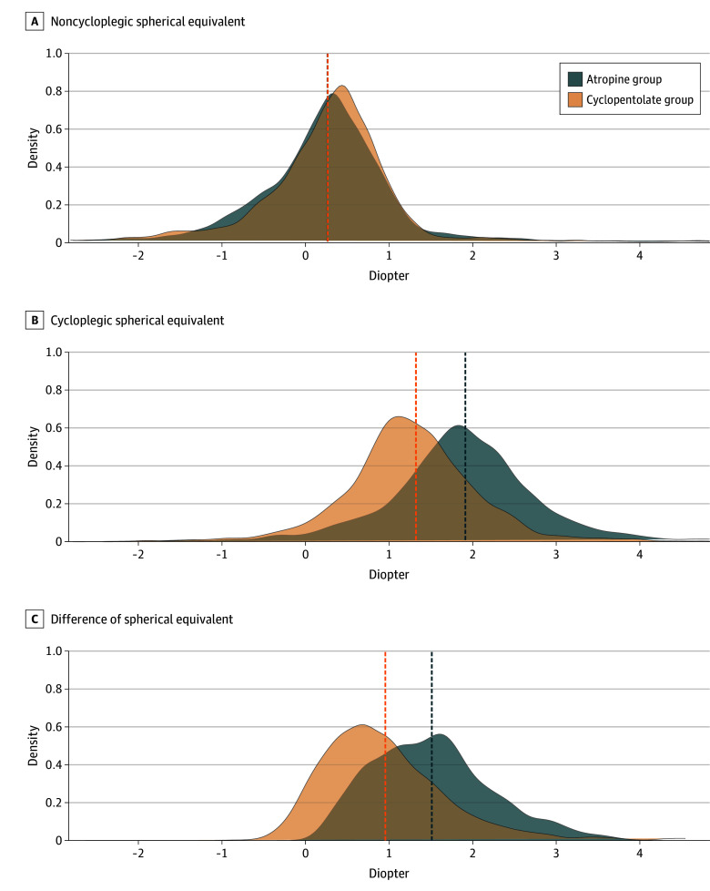
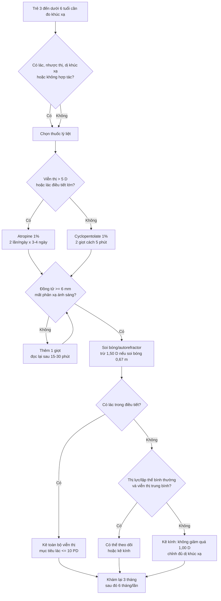
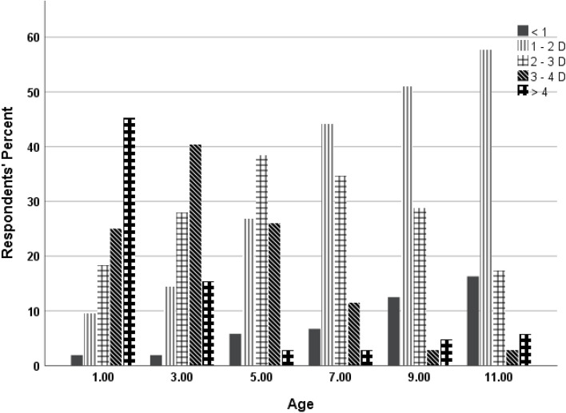
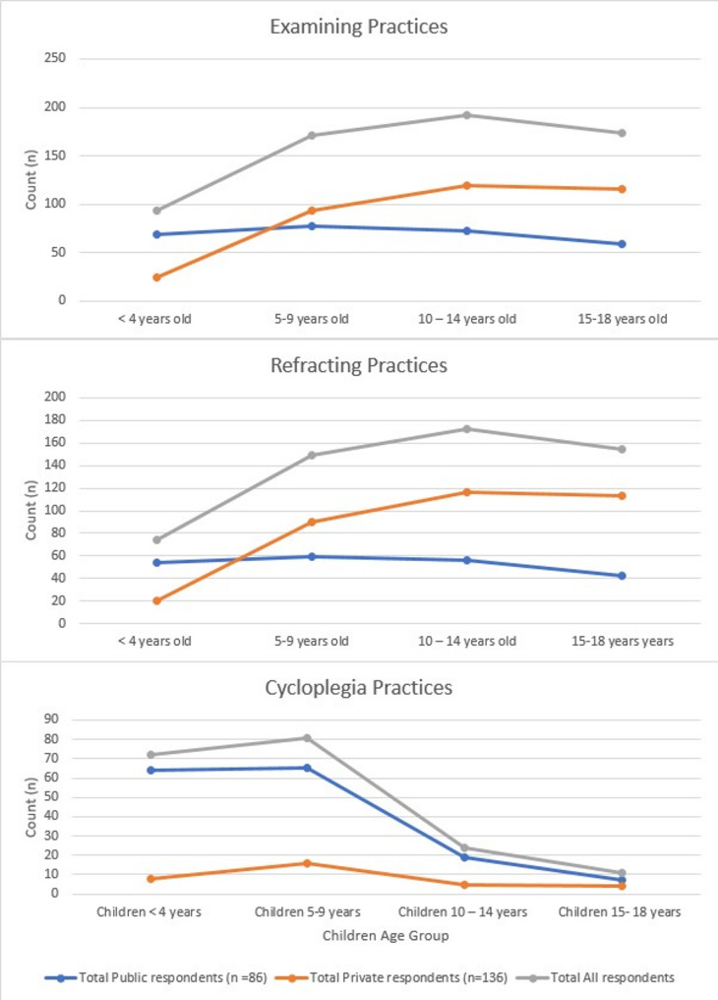
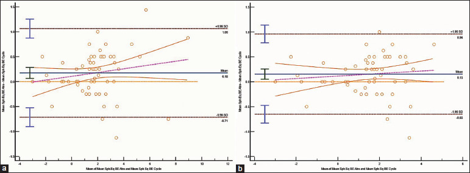

# 485 — Đo khúc xạ dưới lý liệt điều tiết ở trẻ mầm non: atropine vs cyclopentolate, kỹ thuật & quy tắc kê kính viễn thị / Cycloplegic refraction in preschoolers: agent choice, technique and hyperopia prescribing

**Tags:** `pattern:khuc-xa` `pattern:lac` `pattern:nhuoc-thi` `vung:mat` `protocol:khuc-xa-ly-liet` `protocol:atropine` `score:SE` `incidentaloma:khuc-xa-tre`

**Mức chắc chắn (certainty):** tổng hợp y văn (literature synthesis) — phân tích hậu kiểm JAMA Ophthalmology 2025 (1.761 trẻ, 3.048 mắt), RCT đối đầu atropine–cyclopentolate 2023, RCT kê kính viễn thị 2019, nghiên cứu sắc tố mống mắt 2021 và khuyến cáo thực hành; số liệu lấy trực tiếp từ bài gốc.

> **Câu chốt:** Ở trẻ mầm non, **khúc xạ không lý liệt là khúc xạ sai** — trẻ điều tiết 10–15 D, nên viễn thị bị **đo thiếu**, cận thị bị **đo thừa**. Cyclopentolate 1% (2 giọt cách 5 phút, đọc sau 30 phút) là lựa chọn đầu tay cho phần lớn trẻ; **atropine 1%** dành cho **viễn thị > 5 D, lác trong điều tiết lớn, mống mắt sẫm mà lý liệt chưa đủ**. Nhưng atropine lý liệt **mạnh hơn trung bình 0,59 D** so với cyclopentolate — đây chính là nguồn "quá chỉnh" nếu không hiểu.

## 1. Tổng quan — vì sao phải lý liệt, và vì sao hai thuốc cho hai con số khác nhau

- **Sinh lý:** trẻ 3–6 tuổi có **biên độ điều tiết 10–15 D**. Khi đo không lý liệt, trẻ tự động điều tiết để nhìn mục tiêu → **thủy tinh thể dày lên**, công suất khúc xạ tăng theo hướng cận thị. Hệ quả: **viễn thị thật bị che lấp**, còn trẻ cận thị nhẹ có thể thành "cận thị giả" (pseudomyopia).
- **Cơ chế thuốc:** lý liệt điều tiết là **đối kháng muscarinic M3** ở cơ thể mi → cơ giãn → dây zinn căng → thủy tinh thể dẹt lại; đồng thời liệt cơ vòng mống mắt → giãn đồng tử. **Atropine** là amine bậc ba, thấm qua hàng rào máu–não và thấm mô tốt hơn → lý liệt **mạnh nhất** nhưng **kéo dài tới 14 ngày**; **cyclopentolate** khởi phát **~30 phút**, tác dụng **tới 24 giờ**; **tropicamide** chủ yếu giãn đồng tử, lý liệt yếu và ngắn (**1–2 giờ**).
- **Vì sao hai thuốc khác nhau có ý nghĩa lâm sàng:** trong phân tích 1.524 mắt/nhóm (trẻ 3–7 tuổi), **mức tăng cận thị do lý liệt (DSE)** là **1,56 ± 0,72 D với atropine** và **0,97 ± 0,70 D với cyclopentolate** — chênh **0,59 D (95% CI 0,54–0,64)**. Hệ quả phân loại: **viễn thị trung bình–cao 7,2% vs 2,7%**, **tiền cận thị 8,7% vs 21,6%**. Nói cách khác, cyclopentolate **bỏ sót gần 2/3 số trẻ viễn thị trung bình–cao** so với atropine.
- **Nhưng đừng biến chênh lệch nhóm thành chênh lệch cá nhân:** khi đo **cùng một trẻ** bằng cả hai thuốc (n = 67), chênh trung bình chỉ **0,18 D (95% CI 0,07–0,29)**, tương quan r = 0,975, giới hạn đồng thuận **−0,71 đến +1,06 D**. Nghĩa là **trung bình gần nhau, nhưng từng trẻ có thể lệch tới ~1 D** — đủ để đổi quyết định kê kính.
- **Mống mắt sẫm làm lý liệt yếu hơn:** trẻ mống mắt sẫm + da sẫm có **viễn thị đo được thấp hơn 1,02–1,84 D** và **điều tiết tồn dư cao hơn** so với mống mắt sáng/da sáng khi dùng cùng phác đồ cyclopentolate; đây là lý do **một giọt cyclopentolate là không đủ** ở nhóm này.

## 2. Mẫu hình lâm sàng — cùng một trẻ, bốn cách "sai" thường gặp

- **Viễn thị bị đo thiếu (under-plus):** trẻ nhìn xa "vẫn 20/30", nhưng thị lực gần/lập thể kém; đo không lý liệt chỉ +1,50 D, lý liệt +4,00 D. Bỏ sót → **nhược thị do viễn thị** và **lác trong điều tiết**.
- **Cận thị giả (pseudomyopia):** trẻ cận thị nhẹ −1,00 D khi không lý liệt, thành **+0,50 D** sau lý liệt; nếu kê kính cận sẽ **làm nặng thêm**.
- **Lác trong điều tiết (accommodative esotropia):** viễn thị +2,50 đến +5,00 D; mắt lác khi nhìn gần, thẳng khi đeo kính đủ. **Chỉnh đủ viễn thị theo khúc xạ lý liệt** là điều trị bước đầu; lác còn > 10 PD sau kính = **thể bán điều tiết**.
- **Dị khúc xạ (anisometropia):** chênh ≥ 1,00–1,50 D giữa hai mắt; mắt viễn thị nhiều hơn dễ nhược thị. Phải đo **cả hai mắt sau lý liệt**, không suy từ một mắt.
- **Tiền cận thị (premyopia) bị "thổi phồng":** dùng cyclopentolate, tỷ lệ tiền cận thị **21,6%**; dùng atropine còn **8,7%** — cùng một quần thể, khác thuốc. Đừng gắn nhãn "nguy cơ cận thị" chỉ vì một lần đo bằng cyclopentolate.

## 3. Bảng so sánh phân biệt — chọn thuốc theo mục tiêu, không theo thói quen

| Thuốc | Liều / cách dùng | Khởi phát – kéo dài | Độ lý liệt | Chỉ định | Tác dụng phụ | Chống chỉ định / lưu ý |
|---|---|---|---|---|---|---|
| **Atropine 1%** | 2 lần/ngày × 3–4 ngày trước khám, thêm 1 giọt ngày khám (JAMA: 2 lần/ngày × 4 ngày + ngày 5) | Đủ sau **3 ngày**; kéo dài **tới 14 ngày** | **Mạnh nhất**; DSE **1,56 D** | **Viễn thị > 5 D**, lác trong điều tiết lớn, mống mắt sẫm + cyclopentolate thất bại | Đỏ bừng **40,8%**, sốt **30%**, sốt + đỏ bừng **15,5%**, phát ban; nhịp nhanh, sảng, co giật (hiếm) | **Down syndrome** (nhạy cảm tác dụng tim); trẻ nhỏ/nguy cơ độc toàn thân; nhỏ thuốc đúng liều, lau góc mắt |
| **Cyclopentolate 1%** | 2 giọt cách **5 phút**; đọc sau **30 phút**; nếu đồng tử chưa giãn/lý liệt chưa đủ → thêm 1 giọt | **~30 phút**; kéo dài **tới 24 giờ** | Mạnh vừa; DSE **0,97 D** | **Lựa chọn đầu tay** cho phần lớn trẻ mầm non, kể cả viễn thị trung bình | Buồn ngủ **37%**, đỏ mắt **14,8%**, sốt **11,1%**, đỏ bừng **11,1%**; ảo giác/loạng choạng (hiếm) | **1 giọt là không đủ** ở mống mắt sẫm; tránh quá liều ở trẻ < 1 tuổi (dùng 0,5%) |
| **Tropicamide 1%** | 1–2 giọt, đọc sau 30–45 phút | **15–30 phút**; **1–2 giờ** | Yếu, thiên về giãn đồng tử | Khám đáy mắt/đồng tử, không dùng đơn độc để đo khúc xạ viễn thị | Kích ứng, nhìn mờ ngắn | **Không đủ lý liệt** cho viễn thị/lác điều tiết |
| **Cyclopentolate + phenylephrine (Tropherine)** | Thêm sau cyclopentolate | Như cyclopentolate | **Không mạnh hơn** cyclopentolate đơn thuần; có thể **yếu hơn** ở trẻ viễn thị | Giãn đồng tử thêm khi cần | Như cyclopentolate + tác dụng alpha | Không dùng thay atropine khi cần lý liệt tối đa |

*Panel A: khúc xạ không lý liệt gần như trùng nhau giữa hai nhóm. Panel B: sau lý liệt, atropine (xanh) lệch về phía viễn thị hơn cyclopentolate (cam). Panel C: mức chênh DSE — atropine **1,56 D** vs cyclopentolate **0,97 D**, chênh **0,59 D**. Nguồn: Wu H et al., JAMA Ophthalmol 2025, PMC12464850 Fig. 1, CC BY 4.0.*

## 4. Protocol — chọn thuốc, xác nhận đủ lý liệt, đo và kê kính

- **Chỉ định lý liệt:** mọi trẻ **3 – dưới 6 tuổi** nghi ngờ tật khúc xạ; trẻ **lác**, **nhược thị**, **dị khúc xạ**, **không hợp tác đo thị lực**, hoặc kết quả không lý liệt **không khớp** với lâm sàng.
- **Chọn thuốc:**
  - **Cyclopentolate 1%** là đầu tay: 2 giọt cách 5 phút, đọc sau 30 phút; thêm 1 giọt nếu đồng tử < 6 mm hoặc còn phản xạ ánh sáng rõ.
  - **Atropine 1%** khi: **viễn thị > 5 D**, **lác trong điều tiết lớn**, **mống mắt sẫm** mà cyclopentolate không đủ, hoặc cần **lý liệt tối đa** để quyết định mổ/không mổ.
  - **Trẻ < 1 tuổi:** cyclopentolate **0,5%** (hoặc Cyclomydril) theo khuyến cáo AOA/AAO; atropine chỉ khi thật cần và có theo dõi.
- **Xác nhận đủ lý liệt:** đồng tử giãn **≥ 6 mm**, **mất phản xạ ánh sáng trực tiếp**, không còn điều tiết khi cho trẻ nhìn gần; nếu chưa đạt → **thêm giọt** và đọc lại sau 15–30 phút.
- **Đo:** soi bóng/autorefractor **sau lý liệt**; soi bóng ở khoảng cách **2/3 m (0,67 m)** thì **trừ 1,50 D** (công thức 1/khoảng cách mét); đo **cả hai mắt**; ghi **cầu, trụ, trục** và **SE = cầu + ½ trụ**.
- **Quy tắc kê kính viễn thị:**
  - **Lác trong điều tiết:** kê **toàn bộ viễn thị theo khúc xạ lý liệt** (kèm loạn thị); mục tiêu **lác còn ≤ 10 PD** ở gần và xa. Chỉnh đủ sớm giúp **thị giác hai mắt**; nếu lác kéo dài **> 4 tháng** ở trẻ khởi phát ≤ 2 tuổi, tiên lượng lập thể kém hơn (**67% vs 42%**).
  - **Viễn thị trung bình không lác, thị lực và lập thể bình thường:** **có thể theo dõi** — RCT ở trẻ 3–5 tuổi với **+3,00 đến +6,00 D** cho thấy tỷ lệ thất bại **12% (đeo kính ngay) vs 9% (theo dõi)** sau 3 năm, khác biệt không có ý nghĩa (P = 0,72). Nếu kê: **không giảm quá +1,00 D SE**, chỉnh **đủ dị khúc xạ**, loạn thị **trong 0,50 D** của toàn bộ.
  - **Viễn thị > 5 D** hoặc **lý liệt không đủ bằng cyclopentolate**: chuyển **atropine** để tránh kê thiếu.
- **Theo dõi:** đeo kính → khám lại **3 tháng** (kiểm tra độ chịu kính, lác, thị lực), sau đó **6 tháng/lần**; theo dõi không kính → **6–12 tháng/lần**; đo lại khúc xạ lý liệt khi có thay đổi thị lực/lác.
- **Tư vấn phụ huynh:** nhìn mờ **vài giờ (cyclopentolate) đến 1–2 tuần (atropine)**, đeo kính râm, tránh nắng; sốt/đỏ bừng sau atropine là tác dụng kháng muscarinic — **không phải dị ứng**, nhưng cần gọi nếu **sốt cao, lơ mơ, co giật**.

*Thực hành kê kính viễn thị rất khác nhau: ở 1 tuổi, phần lớn kê khi **3–4 D**; từ 5–11 tuổi, nhiều người kê sớm ở **2–3 D**. Đây là lý do cần một quy tắc thống nhất theo **tuổi + lác + thị lực/lập thể**, không chỉ theo con số. Nguồn: Alsaqr A et al., BMC Ophthalmol 2024, PMC11134738 Fig. 2, CC BY 4.0.*

## 5. Biến thể bình thường và cạm bẫy

- **Một giọt cyclopentolate không đủ ở mống mắt sẫm:** nghiên cứu ở trẻ viễn thị mống mắt nâu cho thấy **1 giọt kém hơn 2 giọt** có ý nghĩa; **2 giọt cách 10 phút** tương đương **3 giọt**. Ở trẻ da/mắt sẫm, có thể cần **thêm 1 giọt** hoặc chuyển atropine.
- **Atropine "thấy thêm độ" không có nghĩa "kê thêm độ":** atropine lý liệt mạnh hơn, có thể lộ viễn thị nhiều hơn **0,5–1 D** so với cyclopentolate. Kê **toàn bộ** ở lác điều tiết, nhưng ở trẻ không lác, **giảm tối đa 1,00 D** và theo dõi — giảm quá tay gây **nhược thị do thiếu chỉnh**.
- **Nhìn mờ kéo dài do atropine** có thể **gây nhược thị** nếu trẻ không đeo kính đúng; cảnh báo phụ huynh và hẹn lại sớm.
- **Không dùng kết quả không lý liệt để kê kính**, kể cả khi máy autorefractor "ổn định"; trẻ điều tiết mạnh, sai số lớn nhất ở viễn thị.
- **Không bỏ qua mắt thứ hai:** dị khúc xạ **1,00–1,50 D** có thể gây nhược thị dù mỗi mắt "đạt" thị lực; đo cả hai mắt sau lý liệt.
- **Down syndrome:** tránh atropine do **nhạy cảm tác dụng tim**; dùng cyclopentolate/cyclopentolate–phenylephrine với theo dõi.
- **Sốt/đỏ bừng sau atropine** là tác dụng kháng muscarinic, không phải dị ứng; nhưng **sốt cao, lơ mơ, co giật** = độc toàn thân, cần xử trí cấp.
- **Không "bỏ lý liệt" khi trẻ lớn hơn:** thực hành cho thấy tỷ lệ dùng lý liệt **giảm mạnh sau 5–9 tuổi**, dù viễn thị/lác điều tiết vẫn cần đo chính xác ở tuổi đi học.

*Số người trả lời dùng lý liệt giảm rõ sau nhóm 5–9 tuổi, trong khi nhu cầu đo khúc xạ chính xác không giảm tương ứng. Nguồn: Bin Hashim et al., BMC Pediatr 2026, PMC13471644 Fig. 1, CC BY 4.0.*

## 6. Tự lượng giá — Blind Quiz

**Ca 1 — Trẻ 4 tuổi, nghi viễn thị. Hai nhóm được đo bằng atropine và cyclopentolate. Nhìn hình, nhóm nào lộ viễn thị nhiều hơn, và vì sao?**

- Gợi ý: panel B là khúc xạ **sau lý liệt**; đường đứt là trung bình nhóm.
- Câu hỏi: chênh lệch trung bình bao nhiêu D? Điều này ảnh hưởng gì đến nhãn "tiền cận thị"?

<b>Bấm để hiện đáp án</b>

- **Atropine** lệch về phía viễn thị hơn; **DSE 1,56 D vs 0,97 D**, chênh **0,59 D (95% CI 0,54–0,64)**.
- Vì vậy cyclopentolate **thổi phồng tiền cận thị** (21,6% vs 8,7%) và **bỏ sót viễn thị trung bình–cao** (2,7% vs 7,2%).
- Nguồn ảnh: Wu H et al., JAMA Ophthalmol 2025, PMC12464850 Fig. 1, CC BY 4.0.

**Ca 2 — Cùng một trẻ được đo bằng atropine và cyclopentolate. Hai thuốc có thay nhau được không?**

- Gợi ý: đường giữa là chênh trung bình; hai đường đứt là giới hạn đồng thuận 95%.
- Câu hỏi: chênh trung bình bao nhiêu? Giới hạn đồng thuận rộng bao nhiêu? Khi nào vẫn phải dùng atropine?

<b>Bấm để hiện đáp án</b>

- Chênh trung bình **0,18 D (95% CI 0,07–0,29)**, tương quan r = 0,975; giới hạn đồng thuận **−0,71 đến +1,06 D**.
- Trung bình gần nhau nhưng **từng trẻ có thể lệch ~1 D** → không thay thế mù quáng. Dùng **atropine** khi **viễn thị > 5 D**, lác điều tiết lớn, hoặc nghi ngờ cyclopentolate lý liệt chưa đủ.
- Nguồn ảnh: Singh RP et al., Indian J Ophthalmol 2023, PMC10788739 Fig. 3, CC BY-NC-SA 4.0 (giữ nguyên bản).

**Ca 3 — Bé 5 tuổi, viễn thị +4,00 D hai mắt, thị lực và lập thể bình thường, không lác. Có cần đeo kính ngay?**

- Gợi ý: nhìn cột tuổi 5 và các ngưỡng 2–3 D / 3–4 D.
- Câu hỏi: dữ liệu RCT nói gì về "đeo kính ngay vs theo dõi"? Nếu kê, được giảm tối đa bao nhiêu D?

<b>Bấm để hiện đáp án</b>

- RCT ở trẻ 3–5 tuổi với **+3,00 đến +6,00 D**, thị lực/lập thể bình thường: thất bại **12% (kính ngay) vs 9% (theo dõi)**, P = 0,72 — **có thể theo dõi** nếu gia đình tuân thủ tái khám.
- Nếu kê: **không giảm quá +1,00 D SE**, chỉnh **đủ dị khúc xạ**, loạn thị trong **0,50 D**; nếu có lác điều tiết → **kê toàn bộ**.
- Nguồn ảnh: Alsaqr A et al., BMC Ophthalmol 2024, PMC11134738 Fig. 2, CC BY 4.0.

## Bài liên quan chéo
- [483 – Sàng lọc thị lực trẻ mầm non](../483-sang-loc-thi-luc-tre-mam-non/lesson.md)
- [469 – Lác & nhược thị ở trẻ sinh non/ROP](../469-lac-nhuoc-thi-tre-sinh-non-rop/lesson.md)
- [450 – Mắt nhi](../450-mat-nhi/lesson.md)
- [400 – Tổng quan Mắt & thị giác](../400-tong-quan-mat-thi-giac/lesson.md)

> Không dùng để chẩn đoán độc lập khi chưa có người hướng dẫn.
