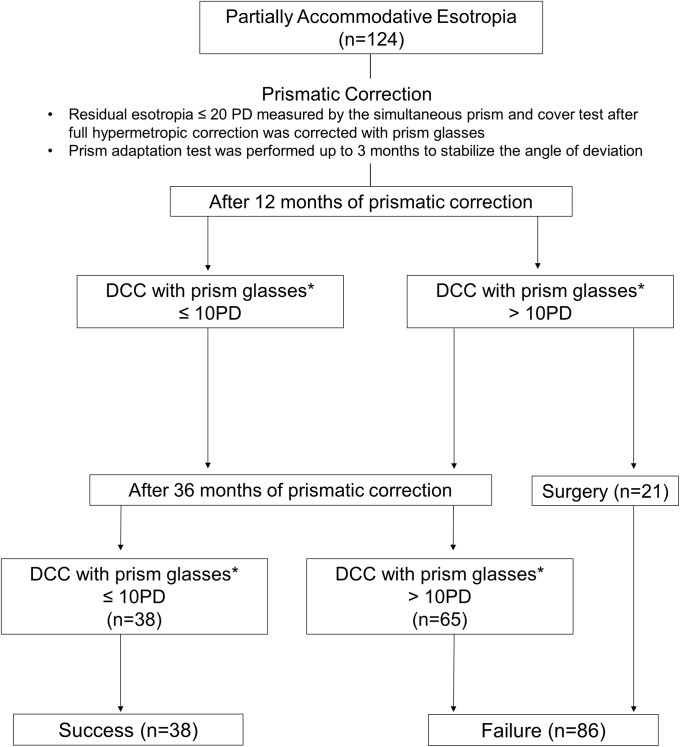
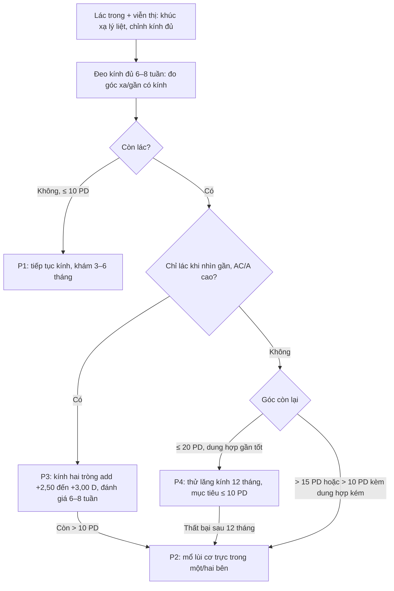
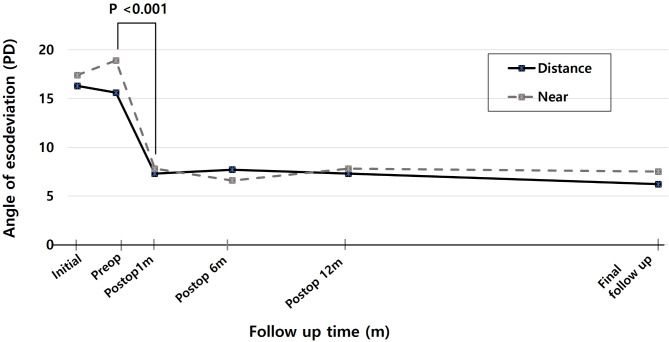
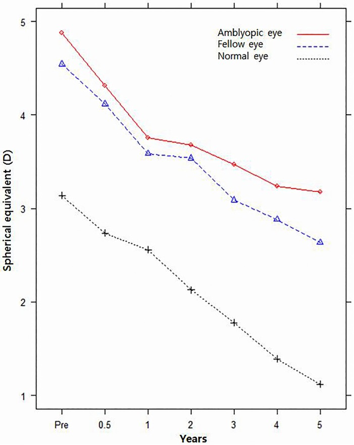

# 486 — Lác trong điều tiết sau khi đeo kính: theo dõi, lác phần còn lại, lăng kính & ngưỡng mổ / Follow-up of accommodative esotropia after glasses: residual deviation, prisms and surgical thresholds

**Tags:** `pattern:lac` `pattern:lac-trong` `pattern:lac-dieu-tiet` `pattern:khuc-xa` `vung:mat` `protocol:do-goc-lac` `protocol:khuc-xa-ly-liet` `score:goc-lac-PD` `incidentaloma:khuc-xa-tre`
**Mức chắc chắn (certainty):** tổng hợp y văn (literature synthesis) — tự biên từ 1 tổng quan hệ thống 34 nghiên cứu/3.877 trẻ (PMC12178246), 1 thuần tập 124 trẻ đeo lăng kính (PMC6886759), 2 nghiên cứu phẫu thuật 28 và 68 trẻ (PMC11833039, PMC5147847), 2 nghiên cứu kính hai tròng/Botox (PMC3268167, PMC7048305), 1 nghiên cứu thích nghi lăng kính trước mổ (PMC11129379), 1 nghiên cứu tái phát nhược thị (PMC3959076) và các nghiên cứu khúc xạ dài hạn (PMC4849857, PMC4179119); chưa gắn một ca nguyên văn đơn lẻ của nhóm.

> **Bài này nối tiếp [483 – Sàng lọc thị lực trẻ mầm non](../483-sang-loc-thi-luc-tre-mam-non/lesson.md), [485 – Khúc xạ lý liệt](../485-khuc-xa-ly-liet-dieu-tiet-tre-mam-non/lesson.md) và [472 – Phẫu thuật lác ở trẻ sinh non/ROP](../472-phau-thuat-lac-tre-sinh-non-rop/lesson.md).** 483 phủ **phát hiện** lác/khúc xạ; 485 phủ **đo** khúc xạ lý liệt và nguyên tắc kê kính; 472 phủ **kỹ thuật mổ lác** ở trẻ sinh non. Bài 486 trả lời câu hỏi còn trống: **sau khi đã đeo kính đủ, theo dõi thế nào, khi nào coi là thất bại, khi nào thêm lăng kính/kính hai tròng và khi nào mổ phần lác còn lại.**

## 1. Tổng quan bệnh học – cơ chế hình ảnh

- **Cơ chế (pathophysiology):** viễn thị chưa chỉnh → ảnh mờ trên võng mạc → **điều tiết (accommodation)** → theo **tỷ lệ AC/A (accommodative convergence/accommodation)**, quy tụ tăng → **lác trong**. Chỉnh đủ viễn thị bằng kính lý liệt **cắt vòng lặp điều tiết–quy tụ**, nên phần lớn trẻ thẳng mắt mà không cần mổ. Khi còn một **thành phần không do điều tiết** (cơ học, cảm giác, thần kinh), chỉnh kính không đủ → gọi là **lác trong điều tiết một phần (partially accommodative esotropia — PAET)**.
- **Vì sao phải theo dõi sau kính, không chỉ "kê kính rồi hẹn 1 năm":** ba biến số thay đổi độc lập theo thời gian.
  1. **Khúc xạ:** viễn thị **tăng đến khoảng 7–8 tuổi rồi giảm dần đến người lớn**; ở thể khởi phát sơ sinh, sau 7 tuổi có **dịch chuyển cận thị −0,43 D/năm**, còn thể khởi phát muộn (18–48 tháng) **không dịch chuyển** trong 7–12 tuổi (Wang et al., *IOVS* 2016, PMC4849857). Kính cũ có thể **thiếu độ** đúng lúc trẻ cần nhất.
  2. **AC/A:** giảm dần theo tuổi nhưng **vẫn cao hơn** ở nhóm phải tiếp tục kính hai tròng (từ **5,9 → 4,5** so với **4,4 → 2,7** ở nhóm bỏ được; Kim et al., *Korean J Ophthalmol* 2012, PMC3268167).
  3. **Dung hợp – nhược thị:** thẳng mắt không bảo đảm có **lập thể**; nhược thị có thể **tái phát sau khi ngừng điều trị**.
- **Ngưỡng định lượng nằm lòng (theo thứ tự quyết định):**
  - **Chỉnh kính đủ là điều trị bậc 1 hiệu quả nhất:** tổng quan hệ thống 34 nghiên cứu, **3.877 trẻ** (tuổi trung bình 4,72 ± 2,08), thành công định nghĩa **lệch < 10 PD**: **chỉnh kính quang học 79,31%** (theo dõi trung bình 5,57 năm), **phẫu thuật cơ 71,4%** (2,89 năm), **Botox 61,24%** (3,15 năm) (Alrasheed et al., *PeerJ* 2025, PMC12178246).
  - **Ngưỡng mổ sau chỉnh kính đủ:** tổng quan trên kết luận **còn lệch > 15 PD sau chỉnh viễn thị lý liệt đủ** là nhóm cần mổ (PMC12178246). Thực hành thường dùng **> 10 PD kèm dung hợp kém**, hoặc **> 15 PD** bất kể dung hợp.
  - **Lăng kính cho lác còn lại ≤ 20 PD:** 124 trẻ, theo dõi ≥ 3 năm: **30,6% thành công** (góc còn lại ≤ 10 PD), chỉ **7,3% bỏ được lăng kính**; yếu tố dự báo thành công là **ít lệch ẩn (latent deviation) khi thích nghi lăng kính** (P = 0,001) và **dung hợp gần tốt trên Worth 4-dot** (P = 0,033); lập thể cải thiện **60,5% vs 27,9%** (P = 0,001) (Choe HR et al., *PLoS One* 2019, PMC6886759).
  - **Mổ một cơ trực trong cho PAET ≤ 25 PD:** 28 trẻ, góc trước mổ **15,5 ± 3,7 PD**, liều lùi **5,6 ± 0,7 mm**, theo dõi **4,4 ± 3,1 năm**: **thành công 53,6%** (định nghĩa **≤ 5 PD**); thành công gắn với **tuổi mổ lớn hơn** (P = 0,005), **đeo lăng kính lâu hơn trước mổ** (P = 0,030) và **liều lùi lớn hơn** (P < 0,001) (Lee D et al., *Sci Rep* 2025, PMC11833039).
  - **Sau mổ, khúc xạ vẫn tiếp tục đổi:** 68 trẻ PAET, theo dõi **4,89 ± 1,74 năm**, **−0,284 ± 0,411 D/năm**; trẻ **bỏ được kính viễn thị ở tuổi 9,41 ± 2,74**; **mắt nhược thị giảm độ ít hơn** mắt còn lại (P = 0,0002) (Oh SY et al., *PLoS One* 2016, PMC5147847).
  - **Viễn thị giảm không có nghĩa hết cần kính:** 92 trẻ lác điều tiết có khúc xạ giảm **< +2,00 D**; **26 trẻ (28%) vẫn lác ≥ 10 PD khi bỏ kính**, và nhóm này có **lập thể kém hơn rõ** (Lang I dương **3,8% vs 33,3%**, P = 0,003) (Kim et al., *Korean J Ophthalmol* 2014, PMC4179119).
  - **Kính hai tròng cho AC/A cao:** 16 trẻ, **38% bỏ được kính hai tròng** ở tuổi trung bình **10,8** (6,5–15,4), **62% phải tiếp tục** đến **13,8 tuổi** (PMC3268167).
  - **Botox so với mổ ở PAET + AC/A cao:** 84 trẻ (48 Botox, 36 mổ lùi + cố định sau), thành công **93% vs 72%** ở 1 năm (P = 0,01), nhưng khác biệt góc lệch chỉ **0 vs 5 PD** — **không khác biệt có ý nghĩa lâm sàng lớn** (Tejedor et al., *PLoS One* 2020, PMC7048305).
  - **Thích nghi lăng kính trước mổ 4 tuần:** 75 trẻ lác (gồm 10 PAET), **58,7% tăng góc ≥ 5 PD**, trung bình **+9,4 PD**; thành công sau mổ **90,9% (nhóm tăng) vs 96,8% (nhóm không tăng)**, P = 0,316 — giúp **lộ góc ẩn để chọn liều**, không làm tăng thành công (Han et al., *BMC Ophthalmol* 2024, PMC11129379).
  - **Nhược thị tái phát:** sau khi ngừng điều trị thành công, **12,74%** tái phát trong 1 năm; tuổi bắt đầu điều trị muộn hơn làm tăng nguy cơ (Saxena et al., *Indian J Ophthalmol* 2013, PMC3959076).
- **Vai trò của hình ảnh học (imaging) — không phải để đo lác:** chẩn đoán lác điều tiết là **lâm sàng + đo khúc xạ + đo góc**. Hình ảnh chỉ vào cuộc khi lác **không điển hình**: lác **không đồng nhất (incomitant)**, lác **dọc/xoắn**, **đau – sa mi – ảo thị**, **đề kháng với kính**, hoặc **nhìn đôi đột ngột** — lúc đó cần **MRI hốc mắt T1 fat-sat sau tiêm + T2 fat-sat, lát ≤ 1 mm** để loại trừ **bệnh cơ hốc mắt (myositis, Graves), u hốc mắt, tổn thương thần kinh sọ**. Trong lác điều tiết đơn thuần, **CT/MRI không có chỉ định** — chụp thừa không làm thay đổi quyết định.

## 2. Mẫu hình + chẩn đoán phân biệt theo "kiểu còn lác sau kính" (gamut)

Sau **6–8 tuần đeo kính đúng độ**, trẻ rơi vào một trong **5 kiểu** — mỗi kiểu có quyết định khác nhau. Gợi nhớ **5P**:

- **P1 — Perfect (thẳng hoàn toàn, lác điều tiết thuần):** góc **≤ 10 PD** ở cả xa và gần khi đeo kính. **Tiếp tục kính + theo dõi**; không mổ. Đây là nhóm chiếm đa số trong **79,31%** thành công của chỉnh kính (PMC12178246).
- **P2 — Partial (lác một phần, còn lác cả xa và gần):** góc còn lại **hằng định**, không giảm thêm sau 6 tháng chỉnh đủ → **thành phần không do điều tiết**. Mổ khi **> 15 PD**, hoặc **> 10 PD + dung hợp kém/lập thể kém** (PMC12178246, PMC11833039).
- **P3 — Plus (AC/A cao, chỉ lác khi nhìn gần):** xa thẳng, **gần > 10 PD**, AC/A cao (thường **> 6 PD/D**) → **kính hai tròng** (add **+2,50 đến +3,00 D** — cần kiểm chứng theo phác đồ địa phương). **38% bỏ được** sau tuổi 10,8; số còn lại tiếp tục đến 13,8 tuổi (PMC3268167).
- **P4 — Prism (lác còn lại nhỏ, dung hợp còn tốt):** **≤ 20 PD**, đặc biệt **≤ 10 PD**, thích nghi lăng kính cho thấy **ít góc ẩn**, Worth 4-dot gần tốt → **thử lăng kính 12 tháng**. Thất bại nếu góc **> 10 PD** sau 12 tháng hoặc dung hợp xấu đi (PMC6886759).
- **P5 — Post-op/Progressive (quá chỉnh hoặc tái phát):** sau mổ **lác ngoài thứ phát (consecutive exotropia)** do giảm độ viễn thị theo tuổi hoặc lùi cơ quá tay; hoặc **tái lác trong** khi bỏ kính/giảm độ. Xử trí: **khúc xạ lại**, chỉnh đủ viễn thị (có thể **over-minus nhẹ** trong lác ngoài thứ phát có bằng chứng), theo dõi 3–6 tháng trước khi can thiệp lại.

**Các "hàng giả" phải loại trước khi gọi là thất bại chỉnh kính:**

- **Kính thiếu độ/đặt sai tâm:** trẻ không nhìn qua quang tâm → **lăng kính ngoài ý** gây lác/khó chịu. Kiểm tra **độ – tâm – khung** trước mọi kết luận.
- **Dị khúc xạ (anisometropia) chưa chỉnh đủ:** một mắt vẫn mờ → nhược thị + lác. Cần chỉnh **đủ hai mắt**.
- **Lác trong do liệt dây VI (CN VI palsy):** khởi phát **đột ngột**, **không đồng nhất**, hạn chế **dạng (abduction)**; khác hoàn toàn lác điều tiết.
- **Bệnh cơ hốc mắt (myositis/Graves)/u hốc mắt:** đau, sa mi, lồi mắt, hạn chế vận nhãn; **MRI hốc mắt** là bắt buộc.
- **Hội chứng chặn rung giật (nystagmus blockage):** lác trong "chủ động"; thị lực **tốt hơn khi lác**; không mổ khi chưa đánh giá rung giật.
- **Giả lác (pseudo-strabismus):** **nếp da góc mắt**, **góc kappa** dương; **cover test âm** — không mổ.

## 3. Bảng so sánh phân biệt (ma trận đối chiếu)

| Thực thể (entity) | Hình ảnh/lâm sàng điển hình | Chốt vào (rule-in) | Chốt loại (rule-out) | Gợi ý xác nhận |
|---|---|---|---|---|
| **Lác điều tiết thuần (refractive AE)** | 2–7 tuổi, viễn thị **+2,00 đến +8,00 D**, lác trong tăng khi nhìn gần, giảm/thẳng khi đeo kính đủ | **Thẳng ≤ 10 PD ở cả xa và gần khi đeo kính lý liệt đủ** | Còn **> 10 PD** sau 6 tháng chỉnh đủ → không còn thuần điều tiết | Khúc xạ lý liệt, đo góc có/không kính, cover test xa–gần |
| **Lác điều tiết một phần (PAET)** | Còn lác **hằng định cả xa và gần** dù kính đủ; thường viễn thị trung bình–cao | **Góc không đổi sau 6 tháng chỉnh đủ + không có hạn chế cơ học** | Góc **chỉ khi nhìn gần** → thể AC/A cao (P3), không phải PAET điển hình | Đo góc xa/gần, AC/A, thử kính hai tròng |
| **AC/A cao (non-refractive AE)** | Xa thẳng, **gần lác > 10 PD**; AC/A thường **> 6 PD/D** | **Lệch gần–xa > 10 PD + đáp ứng với add +2,50 đến +3,00 D** | Đáp ứng kém với add → cân nhắc mổ/Botox | Đo góc gần, AC/A gradient, thử add tại chỗ |
| **Lác còn lại nhỏ có dung hợp tốt (prism candidate)** | **≤ 20 PD**, Worth 4-dot gần tốt, ít góc ẩn khi thích nghi lăng kính | **Thích nghi lăng kính: góc ẩn nhỏ + dung hợp gần tốt** | Góc **> 20 PD**, dung hợp kém, hoặc góc tăng dần → mổ sớm | Thích nghi lăng kính 2–4 tuần, Worth 4-dot, lập thể |
| **Quá chỉnh sau mổ (consecutive exotropia)** | Lác ngoài sau lùi cơ trực trong; thường lộ rõ khi giảm độ viễn thị | **Lác ngoài ≥ 10 PD sau mổ + tiền sử lùi cơ** | Lác ngoài **trước** mổ → lác ngoài nguyên phát | Đo góc xa/gần, khúc xạ lại, cover test |
| **Lác do liệt dây VI/bệnh hốc mắt** | **Đột ngột**, không đồng nhất, hạn chế dạng, đau/lồi mắt/sa mi | **Hạn chế dạng + không đồng nhất + dấu hiệu hốc mắt** | Đồng nhất, không hạn chế vận nhãn, thẳng khi đeo kính | MRI hốc mắt T1 fat-sat + T2 fat-sat, ≤ 1 mm; khám thần kinh |

*Lưu đồ của Choe HR et al., PLoS One 2019 (PMC6886759 Fig. 3), CC BY 4.0. Sau 12 tháng, nhóm **> 10 PD** được chuyển mổ (n = 21); sau 36 tháng, **38 trẻ thành công** và **86 thất bại** — tỷ lệ thành công **30,6%**, chỉ **7,3% bỏ được lăng kính**. Ảnh giữ nguyên bản.*

## 4. Protocol theo dõi + ngưỡng can thiệp

### 4.1. Lịch khám sau khi kê kính

- **6–8 tuần sau khi đổi kính:** kiểm tra **tuân thủ đeo**, **độ – tâm – khung**, đo **thị lực từng mắt**, **góc lác xa/gần có kính**, **Worth 4-dot gần**, **lập thể**. Đây là mốc tối thiểu để kết luận kính có hiệu quả — đánh giá sớm hơn dễ **thất bại giả**.
- **Năm đầu:** khám **3 tháng/lần** (theo [485](../485-khuc-xa-ly-liet-dieu-tiet-tre-mam-non/lesson.md)).
- **Sau ổn định:** **6 tháng/lần**; **khúc xạ lý liệt lại mỗi 6–12 tháng** ở trẻ **< 7 tuổi**, **12 tháng/lần** sau 7 tuổi — vì viễn thị còn tăng đến 7–8 tuổi rồi giảm (PMC4849857).
- **Sau mổ:** ngày 1, 1 tuần, 1 tháng, 3 tháng, 6 tháng, sau đó **hằng năm**; mỗi lần đo **cả xa và gần** để phát hiện **quá chỉnh/tái lác**.

### 4.2. Đo gì ở mỗi lần khám (bộ tối thiểu)

- **Thị lực từng mắt** (tuổi phù hợp: Lea/Snellen/Teller) — phát hiện **nhược thị mới/tái phát**.
- **Cover test + alternate prism cover test** ở **xa 5–6 m** và **gần 33–40 cm**, **có kính** và **không kính**; ghi **PD**.
- **Worth 4-dot gần** (dung hợp) và **lập thể** (Titmus/TNO/Randot).
- **AC/A gradient** khi nghi thể AC/A cao (đo góc trước/sau add **+2,00 D**).
- **Khúc xạ lý liệt** theo lịch; so **độ kính đang đeo** với độ mới.
- **Đáy mắt** và **vận nhãn 9 hướng** mỗi năm; **MRI hốc mắt** chỉ khi có **cờ đỏ** (không đồng nhất, đau, lồi mắt, sa mi, liệt dây).

### 4.3. Quyết định theo kiểu còn lác

### 4.4. Ngưỡng và kỹ thuật can thiệp

- **Trước khi kết luận thất bại chỉnh kính:** đã đeo **đủ độ, đúng tâm, liên tục ≥ 6 tháng**; đã loại **dị khúc xạ, kính sai, bệnh hốc mắt**; đã điều trị **nhược thị** (nếu có). Nghiên cứu cho thấy mổ sau **6 tháng** đeo kính đủ cho kết cục **không khác** mổ sau 1 năm — không cần chờ lâu hơn nếu góc đã ổn định (Jiang et al., *Medicine* 2018, PMC5959412).
- **Mổ khi:** góc còn **> 15 PD** sau chỉnh đủ (PMC12178246), hoặc **> 10 PD** kèm **dung hợp/lập thể kém**, hoặc **thất bại lăng kính/kính hai tròng** sau 12 tháng.
- **Chọn liều:** với PAET **≤ 25 PD**, **lùi một cơ trực trong** là lựa chọn hợp lý nhưng **thành công dài hạn chỉ 53,6%** — cần tư vấn trước mổ; **thời gian đeo lăng kính trước mổ lâu hơn** và **liều lùi đủ** gắn với thành công (PMC11833039).
- **Thích nghi lăng kính 4 tuần trước mổ:** hữu ích để **lộ góc ẩn** (58,7% tăng ≥ 5 PD, trung bình +9,4 PD) và **đặt mục tiêu góc mổ**, nhưng **không chứng minh làm tăng tỷ lệ thành công** (90,9% vs 96,8%, P = 0,316) (PMC11129379).
- **Botox** là lựa chọn thay thế ở **PAET + AC/A cao** (thành công 93% vs 72% ở 1 năm) nhưng **khác biệt góc lệch nhỏ**; không thay thế mổ khi góc lớn (PMC7048305).
- **Sau mổ:** tiếp tục **khúc xạ lý liệt hằng năm**, vì **−0,284 D/năm** và **28% trẻ vẫn cần kính** dù viễn thị giảm < +2,00 D (PMC5147847, PMC4179119).

*Đường liền: nhìn xa; đường đứt: nhìn gần. Góc giảm mạnh sau mổ (P < 0,001) rồi **tái lác nhẹ dần** đến lần khám cuối (trung bình 4,4 năm) — lý do phải theo dõi dài hạn. Nguồn: Lee D et al., Sci Rep 2025 (PMC11833039 Fig. 1), CC BY-NC-ND 4.0, giữ nguyên bản.*

## 5. Biến thể bình thường và cạm bẫy

- **"Viễn thị giảm thì không cần kính" — sai:** **28%** trẻ có khúc xạ **< +2,00 D** vẫn lác **≥ 10 PD** khi bỏ kính và có **lập thể kém hơn** (PMC4179119). Luôn **thử bỏ kính có đo góc**, không bỏ theo số độ.
- **Đánh giá quá sớm:** 2 tuần sau kê kính chưa đủ để kết luận; cần **6–8 tuần** và với PAET cần **6 tháng** chỉnh đủ trước khi mổ (PMC5959412).
- **Bỏ qua góc nhìn gần:** thể **AC/A cao** sẽ bị xếp nhầm vào "thất bại" và bị mổ oan; **luôn đo gần** và thử **add**.
- **Lăng kính "che" thất bại:** lăng kính chỉ thành công **30,6%** sau 3 năm và **chỉ 7,3% bỏ được**; đặt **mốc tái đánh giá 12 tháng**, không kéo dài vô hạn (PMC6886759).
- **Quên nhược thị:** nhược thị **tái phát 12,74%** trong năm đầu sau ngừng điều trị; trẻ **lớn tuổi khi bắt đầu điều trị** có nguy cơ cao hơn — hẹn lại **3–6 tháng** sau khi ngừng (PMC3959076).
- **Nhầm quá chỉnh với tái phát:** sau mổ, **giảm độ viễn thị theo tuổi** có thể làm lộ **lác ngoài thứ phát**; khúc xạ lại trước khi mổ lần hai.
- **Chụp CT/MRI không có chỉ định:** lác điều tiết điển hình **không cần hình ảnh**; chỉ chụp khi có **cờ đỏ** (không đồng nhất, đau, lồi mắt, sa mi, liệt dây) — tránh xạ cho trẻ.
- **Giả lác/góc kappa:** đo **cover test** trước khi tin vào Hirschberg; nếp da góc mắt ở trẻ châu Á rất dễ gây **giả lác ngoài**.

## 6. Tự lượng giá — Blind Quiz

**Ca 1 — Trẻ 5 tuổi, viễn thị +4,50 D hai mắt, đeo kính đủ 6 tháng vẫn lác trong 18 PD cả xa và gần.**

- Hỏi: đây là kiểu nào trong 5P? Vì sao không thể tiếp tục "chờ kính"? Ngưỡng nào khiến em chỉ định mổ?

<b>Bấm để hiện đáp án (findings + chẩn đoán)</b>

- **P2 — lác điều tiết một phần (PAET):** góc **18 PD** còn lại **cả xa và gần** sau **6 tháng** chỉnh đủ → có **thành phần không do điều tiết**.
- **Chỉ định mổ:** **> 15 PD** sau chỉnh đủ (PMC12178246) — ca này vượt ngưỡng; nếu chọn lùi một cơ trực trong, tư vấn **thành công dài hạn chỉ 53,6%** (PMC11833039).
- Đường cong trong ảnh cho thấy góc **giảm ngay sau mổ** rồi **tái lác nhẹ** đến 4,4 năm → phải theo dõi dài hạn, không "mổ xong là xong".
- Nguồn ảnh: Lee D et al., Sci Rep 2025, PMC11833039 Fig. 1, CC BY-NC-ND 4.0.

**Ca 2 — Trẻ 8 tuổi, lác điều tiết đã mổ, mắt nhược thị. Bố mẹ hỏi "sao mắt yếu vẫn tăng độ cận chậm hơn mắt tốt?".**

- Hỏi: đọc 3 đường trên đồ thị. Vì sao mắt nhược thị **giảm độ viễn thị ít hơn**? Điều này ảnh hưởng gì đến kê kính?

<b>Bấm để hiện đáp án (findings + chẩn đoán)</b>

- Ba đường: **mắt nhược thị**, **mắt còn lại**, **mắt bình thường**. Mắt nhược thị có **dịch chuyển cận thị chậm hơn** → vẫn **viễn thị cao hơn** theo thời gian.
- Cơ chế: mắt nhược thị thường **kém phát triển cận thị sinh lý/giãn trục** hơn; đồng thời **đeo kính đủ** và **nhược thị** làm **tín hiệu điều tiết – phát triển khúc xạ** khác mắt tốt (Oh SY et al., PMC5147847).
- Hệ quả: **không giảm độ kính theo mắt tốt**; chỉnh **đủ từng mắt**, tránh **nhược thị do thiếu chỉnh**.
- Nguồn ảnh: Oh SY et al., PLoS One 2016, PMC5147847 Fig. 2, CC BY 4.0.

**Ca 3 — Trẻ 6 tuổi, PAET còn 14 PD sau chỉnh kính, dung hợp gần tốt, ít góc ẩn khi thích nghi lăng kính.**

- Hỏi: chọn lăng kính hay mổ? Nếu chọn lăng kính, **mốc nào** để tuyên bố thất bại? Tỷ lệ thành công và tỷ lệ bỏ được lăng kính là bao nhiêu?

<b>Bấm để hiện đáp án (findings + chẩn đoán)</b>

- **P4 — ứng viên lăng kính:** góc **≤ 20 PD**, **dung hợp gần tốt**, **ít góc ẩn** — đúng tiêu chí thành công trong nghiên cứu (PMC6886759).
- **Mốc thất bại: sau 12 tháng** còn **> 10 PD**; trong lưu đồ, nhóm này được chuyển mổ (n = 21).
- **Thành công 30,6%**, **bỏ được lăng kính 7,3%** sau 3 năm — phải tư vấn rõ và **không kéo dài quá 12 tháng** nếu không cải thiện.
- Nguồn ảnh: Choe HR et al., PLoS One 2019, PMC6886759 Fig. 3, CC BY 4.0.

## Bài liên quan chéo
- [483 – Sàng lọc thị lực trẻ mầm non](../483-sang-loc-thi-luc-tre-mam-non/lesson.md) (phát hiện lác/khúc xạ)
- [485 – Khúc xạ lý liệt điều tiết ở trẻ mầm non](../485-khuc-xa-ly-liet-dieu-tiet-tre-mam-non/lesson.md) (đo và kê kính)
- [472 – Phẫu thuật lác ở trẻ sinh non/ROP](../472-phau-thuat-lac-tre-sinh-non-rop/lesson.md) (kỹ thuật mổ, tái phát)
- [469 – Lác & nhược thị ở trẻ sinh non/ROP](../469-lac-nhuoc-thi-tre-sinh-non-rop/lesson.md) (bịt mắt/atropine)
- [477 – Bệnh thị giác hai mắt](../477-benh-ty-the-thi-giac-tai/lesson.md) (lập thể và dung hợp)

## Ảnh
- Ảnh lấy từ **Europe PMC/PMC** (bản open access), giữ **nguyên bản**, không crop/ghép; nguồn – giấy phép từng file trong `images/CREDITS.md`.
- Tên file: `486_lac-dieu-tiet_<nội dung>_PMC<ID>-Fig<k>.jpg`.

> Không dùng để chẩn đoán độc lập khi chưa có người hướng dẫn.
