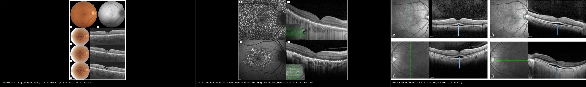
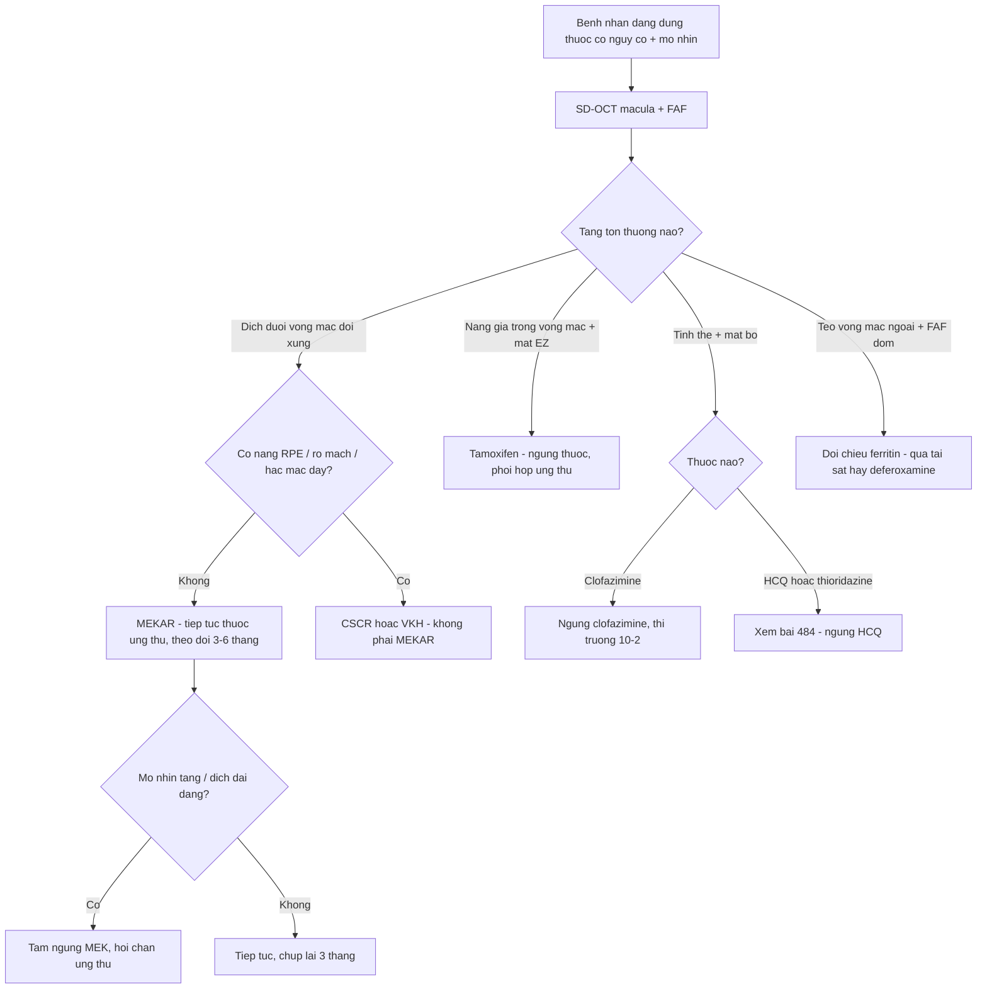
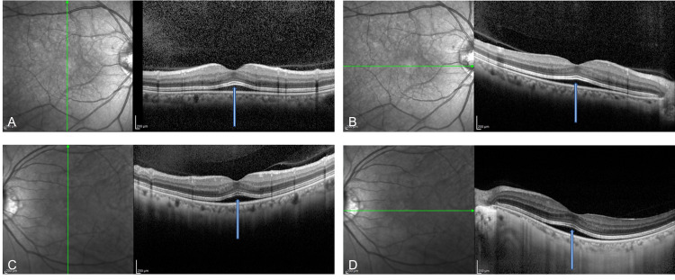
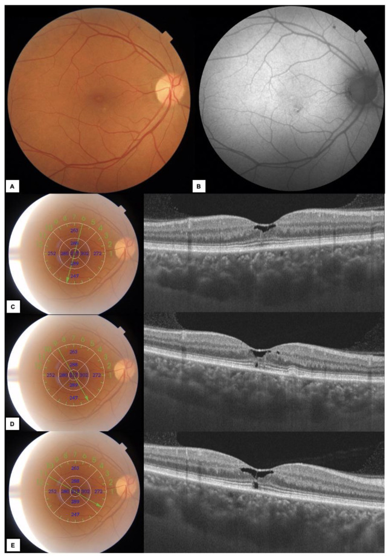
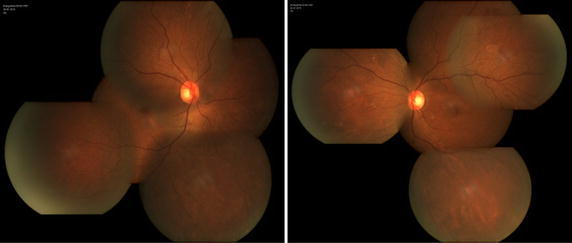
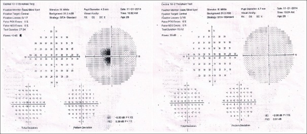

# 487 — Nhiễm độc võng mạc do thuốc KHÁC ngoài HCQ: tamoxifen, clofazimine, deferoxamine, ức chế MEK / Non-HCQ drug retinopathy

**Tags:** `pattern:ton-thuong-vong-mac-ngoai-do-thuoc` `vung:hoang-diem` `score:AAO-nguy-co` `protocol:SD-OCT-FAF`
**Mức chắc chắn (certainty):** tổng hợp y văn (literature synthesis) — tự biên từ các bài mở CC BY 4.0/CC BY-NC-SA (loạt ca + review *Diagnostics*, *SpringerPlus*, *BMC Ophthalmology*, *Cureus*, *J Pharmacol Pharmacother*, *Int J Mol Sci*); số liệu lấy nguyên từ bài gốc, tên tác giả đối chiếu PMCID.

> **Bài này trả lời "khi nào độc tính võng mạc KHÔNG do hydroxychloroquine"** — bốn nhóm thuốc hay bị gộp nhầm vào HCQ nhưng có **dấu hiệu OCT riêng và xử trí khác hẳn**.
> [484 – Nhiễm độc võng mạc do hydroxychloroquine](../484-nhiem-doc-vong-mac-hydroxychloroquine/lesson.md) là **bài nền** (mất EZ cạnh hoàng điểm, FAF "mắt bò", thị trường 10-2, ngưỡng liều 5 mg/kg). Bài này **không lặp lại** HCQ mà tập trung vào **4 gamut còn thiếu**: **tamoxifen** (nang giả + mất EZ), **clofazimine** (tinh thể + mắt bò), **deferoxamine/quá tải sắt** (teo võng mạc ngoài + FAF đốm), **ức chế MEK** (bong thanh dịch hai bên). Điểm chết người: **ngừng nhầm thuốc ung thư** khi độc tính thực sự **lành tính, tự khỏi** (MEKAR), hoặc **bỏ sót thuốc thứ hai** (tamoxifen dùng chung với HCQ).

## 1. Tổng quan bệnh học – cơ chế hình ảnh

### 1.1 Vì sao bốn nhóm thuốc này "ăn" vào võng mạc theo bốn kiểu khác nhau

- **Tamoxifen — thuốc ưa mỡ, tích điện dương, tích tụ lysosome:** giống HCQ, tamoxifen bị "giam" trong **lysosome của tế bào biểu mô sắc tố (RPE) và tế bào Müller**, làm rối loạn chức năng lysosome và **phá vỡ hàng rào máu–võng mạc ngoài**. Hệ quả hình ảnh có hai tầng:
  - **Tầng "tinh thể" (crystal retinopathy):** phức hợp tamoxifen–melanin lắng thành **tinh thể trắng phản chiếu (refractile/white deposits)** ở **lớp sợi thần kinh và lớp tế bào hạch ngoại vi** — điển hình ở **liều cao**.
  - **Tầng "nang giả" (pseudocystic cavitation):** rối loạn tế bào Müller → **khoang giảm hồi âm nhỏ trong lớp võng mạc trong** ở hố trung tâm, kèm **mất/gián đoạn ellipsoid zone (EZ)** — điển hình ở **liều chuẩn 20 mg/ngày** nhưng dùng lâu. Vì sao gọi "nang giả": **không có rò mạch/không phải phù nề dịch thật** như trong phù hoàng điểm, mà là **thoái hóa – tách lớp nội bào**.
- **Clofazimine — thuốc nhuộm phenazine ưa mỡ:** kết tinh trong mọi mô giàu lipid (giác mạc, kết mạc, mống mắt, củng mạc, **RPE**). Cơ chế: lắng tinh thể trong RPE + **độc tính quang (phototoxic)** làm **giảm tế bào cảm quang** → hình "**mắt bò**" (bull's-eye) muộn, nhưng **ám điểm trung tâm có thể xuất hiện TRƯỚC khi đáy mắt đổi màu** (tổn thương khởi đầu ở **đoạn ngoài tế bào cảm quang**).
- **Deferoxamine (và quá tải sắt) — hai cơ chế tranh luận:** quan điểm kinh điển: deferoxamine **liều cao, ferritin thấp** gây **suy bơm RPE** → phù hoàng điểm, lắng dạng **lưới/vitelliform**, thoái hóa võng mạc ngoài dạng **loạn dưỡng hoa văn (pattern dystrophy-like)**. Quan điểm mới (có bằng chứng tốt hơn): chính **quá tải sắt** (ferritin cao kéo dài) gây **siderosis võng mạc** qua stress oxy hóa/ferroptosis — deferoxamine chỉ **kéo dài sống để sắt kịp gây hại**; vì vậy tên "deferoxamine retinopathy" có thể **đặt sai** (xem phản biện ở mục 5).
- **Ức chế MEK (trametinib, cobimetinib, binimetinib, selumetinib) — độc tính "rò dịch" (MEKAR):** ức chế **MEK → ERK** ở RPE làm **mất chức năng bơm dịch** → **bong thanh dịch dưới võng mạc (subretinal fluid)**. Không phải viêm, không phải tân mạch: **hồi phục khi tái hoạt ERK**, nên **tự khỏi dù tiếp tục thuốc**.

### 1.2 Ngưỡng định lượng nằm lòng (bắt buộc nhớ)

- **Tamoxifen:** liều chuẩn **20 mg/ngày × 3–5 năm**; liều cao **30–40 mg**, và **200 mg/ngày** (u thần kinh đệm ác tính). Tỷ lệ độc tính mắt **0,9–12,0%** và **tăng theo liều**. Ca gốc: **20 mg/ngày trong 5 năm, tổng liều tích lũy 36,5 g** → mất EZ/IZ hai bên, **độ dày hoàng điểm 119 µm (mắt phải) và 156 µm (mắt trái)** (bình thường ~250–300 µm), **Arden ratio 1,658 và 1,638** (bình thường > 1,8), và **vẫn tiến triển 8 năm SAU khi ngừng thuốc** → **không hồi phục**.
- **Clofazimine:** **an toàn khi ≤ 100 mg/ngày**; **độc võng mạc đã báo cáo ở 200 mg/ngày** (bệnh nhân AIDS). Có ca **liều thấp 100 mg/tuần** vẫn có **ám điểm trung tâm một bên** (Naranjo 3 = "có thể", xem phản biện). **Ngừng thuốc sớm → cải thiện trong 3 tháng**; hình "mắt bò" đã hình thành **không thoái triển**.
- **Deferoxamine/quá tải sắt:** ngưỡng an toàn kinh điển cho tim là **ferritin < 1.000 ng/mL**; **chưa có ngưỡng an toàn cho võng mạc**. Ca gốc: ferritin dao động **2.000–7.230 ng/mL** (một ca đỉnh **10.030 ng/mL**) trước khi mất thị lực; **mật độ tế bào nón ~50% bình thường** ở vùng tổn thương.
- **Ức chế MEK:** **MEKAR gặp ở > 90%** người dùng ức chế MEK, đặc biệt **liệu pháp phối hợp BRAF + MEK** (nghiên cứu pha III: **40,6%** bệnh nhân có bong thanh dịch); **khởi phát trung vị ngày 38**; **tự cải thiện sau 3–6 tháng dù tiếp tục thuốc**; ca gốc: **bong thanh dịch tự tan trong 1–2 giờ**, **độ dày hắc mạc bình thường (152/129 µm)**, **không có điểm rò trên FA**.

## 2. Mẫu hình + chẩn đoán phân biệt theo vị trí (gamut)

**Câu hỏi lọc:** *"Bất thường nằm ở TẦNG NÀO của võng mạc (trong / ngoài / dưới võng mạc), có ĐỐI XỨNG hai bên không, và đang dùng những thuốc gì?"* — tầng tổn thương + tính đối xứng + **toàn bộ đơn thuốc** quyết định chẩn đoán.

- **Dịch dưới võng mạc hai bên, đối xứng, dạng "lều/caterpillar", không rò mạch:** **MEKAR** (ức chế MEK, ± ức chế FGFR như erdafitinib). **Cạm bẫy:** gần giống **CSCR**, nhưng MEKAR **không có nâng RPE, hắc mạc không dày, FA không rò** và **thay đổi trong vài giờ**.
- **Khoang giảm hồi âm nhỏ trong võng mạc trong ở hố trung tâm + mất EZ:** **tamoxifen** (liều chuẩn, dùng lâu) — phân biệt **MacTel type 2** (OCTA bất thường: giãn mao mạch, mất mạch) và **phù hoàng điểm** (có rò mạch).
- **Tinh thể trắng phản chiếu ở võng mạc ngoại vi (± nang hoàng điểm):** **tamoxifen liều cao**; cũng gặp **canthaxanthin, methoxyflurane** — hỏi kỹ tiền sử.
- **Hình "mắt bò" (vòng teo quanh hố trung tâm):** **HCQ/chloroquine** (bài 484), **clofazimine**, **thioridazine** (liều > 800 mg/ngày) — **phân biệt bằng bối cảnh thuốc**, không bằng hình dạng.
- **Teo võng mạc ngoài + FAF "đốm rải rác" (dotted) hai bên:** **deferoxamine/quá tải sắt** (dạng loạn dưỡng hoa văn); phân biệt **loạn dưỡng hoa văn di truyền** (không có bối cảnh truyền máu/sắt).
- **Xuất tiết bông + xuất huyết + thiếu tưới máu:** **bệnh võng mạc nền** (lupus/ĐTĐ/tăng huyết áp) — **không phải độc tính thuốc**, không ngừng thuốc.

**Mnemonic theo hình ảnh:** **MEK làm DỊCH · tamoxifen làm NANG GIẢ · clofazimine làm TINH THỂ + mắt bò · sắt/deferoxamine làm TEO + FAF đốm.**

## 3. Bảng so sánh phân biệt (ma trận đối chiếu)

| Thực thể (entity) | Hình ảnh điển hình (OCT/FAF/FA) | Chốt vào (rule-in) | Chốt loại (rule-out) | Xử trí / theo dõi |
|---|---|---|---|---|
| **Tamoxifen — nang giả + mất EZ** | **Khoang giảm hồi âm nhỏ trong võng mạc trong ở hố trung tâm**, mất/gián đoạn **EZ–IZ**, hoàng điểm mỏng (119–156 µm); FAF lốm đốm | **Đang/đã dùng tamoxifen + nang giả hoàng điểm đối xứng + OCTA bình thường** | **OCTA có giãn mao mạch/mất mạch = MacTel type 2**; **có rò mạch = phù hoàng điểm** | **Ngừng tamoxifen** (phối hợp ung thư, chuyển sang ức chế aromatase); theo dõi vì **có thể tiến triển sau ngừng** |
| **Clofazimine — mắt bò / tiền hoàng điểm** | **Ám điểm trung tâm trước**, đáy mắt **còn bình thường**; muộn → **mắt bò**, tinh thể giác mạc/kết mạc, **nước mắt–kết mạc nâu** | **Tiền sử clofazimine (lepra/Mycobacterium) + ám điểm trung tâm một–hai bên** | **Đáy mắt bình thường KHÔNG loại trừ** — phải làm **thị trường 10-2 + OCT** | **Ngừng thuốc sớm** (cải thiện ~3 tháng); mắt bò đã hình thành **không hồi phục**; giữ **≤ 100 mg/ngày** |
| **Deferoxamine / quá tải sắt** | **Teo võng mạc ngoài** + **FAF đốm (dotted)**, dạng **loạn dưỡng hoa văn**, phù hoàng điểm do suy bơm RPE; **ERG giảm** | **Truyền máu nhiều lần + ferritin > 1.000 ng/mL kéo dài**, ± deferoxamine liều cao | **Ferritin bình thường và không truyền máu → nghĩ loạn dưỡng hoa văn di truyền** | **Đối chiếu ferritin trước–trong–sau mất thị lực** (không mặc định do thuốc); tối ưu hóa chelat sắt; ngừng deferoxamine nếu nghi ngờ |
| **Ức chế MEK (MEKAR)** | **Bong thanh dịch hai bên đối xứng, dạng lều**, **IZ dày lên**, **không nâng RPE**, **hắc mạc bình thường**, **FA không rò**; biến đổi **trong vài giờ** | **Đang dùng ức chế MEK ± BRAF + bong thanh dịch đối xứng** | **Nâng RPE/rò điểm trên FA/hắc mạc dày = CSCR**; **một bên + viêm = VKH/khác** | **KHÔNG ngừng thuốc ung thư**: theo dõi, tự khỏi **3–6 tháng**; chỉ tạm ngừng khi **dịch dai dẳng gây triệu chứng** |
| **HCQ/chloroquine (đối chiếu, bài 484)** | **Mất EZ cạnh hoàng điểm đối xứng**, hố trung tâm bảo tồn ("flying saucer"), FAF "mắt bò", thị trường 10-2 có cung ám điểm | **Dùng HCQ > 5 năm hoặc liều > 5 mg/kg** | **Có xuất huyết/rò mạch/dịch → nghĩ bệnh khác** | **Ngừng HCQ** khi chắc chắn; chụp lại 6–12 tháng |

*Trái: **tamoxifen** — khoang giảm hồi âm nhỏ ở hố trung tâm + mất ellipsoid zone, kèm ảnh đáy mắt/FAF (Szabelska P et al., *Diagnostics* 2023, PMC10093114, CC BY 4.0). Giữa: **deferoxamine/quá tải sắt** — FAF đốm rải rác + thoái hóa võng mạc ngoài trên OCT (Belmouhand M et al., *BMC Ophthalmol* 2021, PMC8278719, CC BY 4.0). Phải: **MEKAR** — bong thanh dịch hình lều hai bên, IZ dày lên, không nâng RPE (Agata C et al., *Cureus* 2021, PMC8761530, CC BY 4.0). Ảnh ghép letterbox, giữ nguyên tỷ lệ, không crop/kéo giãn.*

## 4. Protocol chụp + hệ phân độ / ngưỡng hành động

### 4.1 Bộ ảnh tối thiểu theo từng thuốc

- **Tamoxifen:** **SD-OCT macula** (đọc **từng B-scan qua hố trung tâm**, không chỉ bản đồ dày) + **OCTA** (chốt phân biệt với MacTel type 2) + **EOG/ERG** khi nghi ngờ; **khám mắt nền tảng trước điều trị** vì retinopathy **không hồi phục**.
- **Clofazimine:** **soi đèn khe** tìm tinh thể giác mạc/kết mạc (dấu hiệu tích lũy) + **thị trường 10-2** + **SD-OCT** khi có triệu chứng; giữ **liều ≤ 100 mg/ngày**.
- **Deferoxamine:** **đối chiếu ferritin** (mốc **< 1.000 ng/mL**) + **OCT + FAF** + **ERG**; khám mắt **trước và định kỳ trong khi truyền máu**.
- **Ức chế MEK:** **OCT macula nền tảng**, rồi **1 tháng** sau khi bắt đầu và **mỗi 3 tháng**; **chụp lại ngay khi có mờ nhìn** (vì dịch thay đổi trong vài giờ).

### 4.2 Sơ đồ quyết định

### 4.3 Nguyên tắc "ngừng hay không ngừng thuốc"

- **MEKAR:** **không ngừng** thuốc ung thư vì lợi ích sống còn; chỉ **tạm ngừng/giảm liều** khi dịch dai dẳng, gây triệu chứng hoặc giảm thị lực.
- **Tamoxifen, clofazimine:** **ngừng** (phối hợp bác sĩ điều trị) — vì tổn thương **có thể không hồi phục**.
- **Deferoxamine:** quyết định **sau khi đối chiếu ferritin**; nếu quá tải sắt chưa kiểm soát, **không chỉ đổi thuốc** mà phải tối ưu chelat.

## 5. Biến thể bình thường và cạm bẫy

- **Bỏ sót thuốc thứ hai:** bệnh nhân ung thư vú có thể **dùng đồng thời tamoxifen và HCQ** (bệnh tự miễn) — độc tính **cộng gộp**; luôn **rà toàn bộ đơn thuốc**, không chỉ thuốc "đang nghi".
- **MEKAR bị ngừng thuốc oan:** bong thanh dịch **hai bên, đối xứng, tự khỏi** là **biểu hiện dược lý**, không phải tiến triển u — ngừng thuốc ung thư vì MEKAR là **sai lầm điều trị nghiêm trọng**.
- **Nhầm MEKAR với CSCR:** CSCR có **nâng RPE, hắc mạc dày, điểm rò trên FA**; MEKAR **không có** các dấu hiệu này và **dao động trong vài giờ**.
- **Phản biện (fidelity + critique) — "deferoxamine retinopathy" có thể là tên sai:** bài gốc chỉ ra mất thị lực xuất hiện **trên nền ferritin tăng dần vượt 1.000 ng/mL nhiều năm**, **không tương quan thời điểm với thuốc chelat**, và **thử nghiệm động vật cho thấy chính sắt gây thoái hóa võng mạc** → **quá tải sắt** có thể mới là nguyên nhân thật. Vì vậy **không được quy kết vội cho thuốc** khi chưa đọc diễn biến ferritin.
- **Phản biện — ca clofazimine không điển hình:** ca gốc là **liều thấp (100 mg/tuần), một bên, bệnh nhân không suy giảm miễn dịch**, kèm **methoxsalen (thuốc cảm quang)** — Naranjo chỉ 3 ("có thể"), tức **không chắc clofazimine một mình gây bệnh**; bài gốc nêu giả thuyết **tương tác cảm quang**. Đây là ví dụ **không được biến một ca "có thể" thành quy luật**.
- **Đáy mắt bình thường không loại trừ:** clofazimine gây **ám điểm trước khi đáy mắt đổi màu**; tamoxifen giai đoạn sớm **chỉ thấy trên OCT**.
- **Thị lực bình thường không loại trừ:** ca MEKAR có **thị lực 20/16 hai mắt** mà vẫn có bong thanh dịch hai bên.

## 6. Tự lượng giá — Blind Quiz

**Ca 1 — Nữ 50 tuổi, melanoma di căn, đang dùng encorafenib + binimetinib 4 tháng, đột ngột mờ nhìn hai mắt. Thị lực 20/16 hai mắt. OCT dưới đây.**

- Hỏi: (1) Dịch nằm ở tầng nào? (2) Ba dấu hiệu nào loại trừ CSCR? (3) Có nên ngừng thuốc ung thư?

<b>Bấm để hiện đáp án (findings + chẩn đoán)</b>

- **Findings:** (A–D) **bong thanh dịch nông hình lều, đối xứng hai mắt, ở hố trung tâm** trên cả mặt cắt đứng và ngang; **interdigitation zone (IZ) phía trên dày lên**; **không nâng RPE**.
- **Chẩn đoán:** **MEKAR (bong võng mạc thanh dịch do ức chế MEK)** — cơ chế **RPE mất bơm dịch do ức chế MEK→ERK**, không phải viêm/tân mạch.
- **Loại trừ CSCR:** **không nâng RPE · hắc mạc không dày (152/129 µm) · FA không có điểm rò**; thêm nữa dịch **tự tan trong 1–2 giờ** — dao động nhanh là đặc trưng MEKAR.
- **Xử trí:** **tiếp tục encorafenib + binimetinib**, theo dõi OCT; MEKAR thường **tự cải thiện sau 3–6 tháng dù tiếp tục thuốc**. Chỉ tạm ngừng khi dịch dai dẳng/giảm thị lực.
- **Nguồn ảnh:** Agata C et al., *Cureus* 2021 (PMC8761530), CC BY 4.0 — Fig. 1.

**Ca 2 — Nữ 57 tuổi, ung thư vú, tamoxifen 20 mg/ngày đã 7 năm, mờ nhìn mắt phải 2 tháng. OCT đa phương thức + đáy mắt dưới đây.**

- Hỏi: (1) Khoang trong võng mạc là nang thật hay giả? (2) Chẩn đoán phân biệt chính trên OCTA là gì? (3) Ngừng thuốc có hồi phục hoàn toàn?

<b>Bấm để hiện đáp án</b>

- **Findings:** (A) đáy mắt có thay đổi RPE kín đáo; (B) FAF lốm đốm giảm/tăng huỳnh quang; (C–E) **các khoang giảm hồi âm không đều ở hố trung tâm + gián đoạn lớp tế bào cảm quang**, **độ dày hoàng điểm trung tâm bình thường**; bờ RPE gồ nhẹ.
- **"Nang giả":** khoang do **rối loạn tế bào Müller/tách lớp nội bào**, **không phải dịch do rò mạch** — nên **không gọi là phù hoàng điểm** và **không điều trị bằng anti-VEGF**.
- **DDx chính:** **MacTel type 2** — phân biệt bằng **OCTA** (MacTel: giãn mao mạch, mất mạch, "right-angle venule"; tamoxifen: **OCTA bình thường**, như ca gốc).
- **Tiên lượng:** **không hồi phục hoàn toàn** — retinopathy tamoxifen **có thể tiến triển tiếp sau khi ngừng**; ca gốc khác (20 mg × 5 năm, tổng liều 36,5 g) còn **tiến triển 8 năm sau khi ngừng**. Xử trí: **ngừng tamoxifen**, phối hợp ung thư (chuyển letrozole), theo dõi định kỳ.
- **Nguồn ảnh:** Szabelska P et al., *Diagnostics* 2023 (PMC10093114), CC BY 4.0 — Fig. 1. Đáy mắt tinh thể ngoại vi: Wang L et al., *SpringerPlus* 2015 (PMC4573752), CC BY 4.0 — Fig. 1.

**Ca 3 — Nam 26 tuổi, bạch biến, dùng clofazimine 100 mg/tuần + methoxsalen 10 mg/ngày 1 năm, mờ nhìn + ám điểm trung tâm mắt trái 8 tháng. Đáy mắt và FA bình thường. Thị trường dưới đây.**

- Hỏi: (1) Vì sao đáy mắt bình thường mà bệnh nhân vẫn mất thị lực? (2) Nghĩ đến cơ chế nào? (3) Cần bao nhiêu bằng chứng để kết luận "do clofazimine"?

<b>Bấm để hiện đáp án</b>

- **Findings:** thị trường 10-2 **ám điểm trung tâm mắt trái** (MD −6,80 dB) trong khi **đáy mắt và FFA bình thường**; sau ngừng thuốc 3 tháng, **ám điểm thu nhỏ – nhẹ đi** (MD −2,05 dB) và **thị lực cải thiện 5 dòng**.
- **Cơ chế:** tổn thương khởi đầu ở **đoạn ngoài tế bào cảm quang** (trước khi RPE mất) → **triệu chứng đi trước hình ảnh**; clofazimine lắng tinh thể trong RPE + **độc tính quang** (methoxsalen làm tăng nhạy cảm ánh sáng).
- **Mức bằng chứng:** Naranjo **3 = "có thể"** — **không đủ để khẳng định clofazimine đơn thuần gây bệnh**; bài gốc nêu **tương tác cảm quang** và ca này **không điển hình** (liều thấp, một bên, miễn dịch bình thường). Kết luận an toàn: **"tiền hoàng điểm do thuốc, nghi ngờ"** + **ngừng các thuốc nghi ngờ** và theo dõi.
- **Bài học:** với độc tính mắt do thuốc, **thị trường 10-2 + OCT** phát hiện trước đáy mắt; **không chờ đáy mắt đổi màu**.
- **Nguồn ảnh:** Kasturi N, Srinivasan R, *J Pharmacol Pharmacother* 2016 (PMC5020777), CC BY-NC-SA 4.0 — Fig. 2–3.

## Bài liên quan chéo
- [484 – Nhiễm độc võng mạc do hydroxychloroquine](../484-nhiem-doc-vong-mac-hydroxychloroquine/lesson.md)
- [441 – OCT hoàng điểm](../441-OCT-hoang-diem/lesson.md)
- [470 – CSCR do corticosteroid: mất thị lực không đau](../470-cscr-do-corticosteroid-mat-thi-luc-khong-dau/lesson.md)
- [455 – Behçet & lupus tại mắt](../455-behcet-lupus-mat/lesson.md)
- [453 – Bệnh võng mạc tăng huyết áp & thiếu máu](../453-benh-vong-mac-tang-huyet-ap-va-thieu-mau/lesson.md)
- [434 – Teo thị thần kinh thị do độc & LHON](../434-teo-thi-than-kinh-thi-doc-va-LHON/lesson.md)
- [448 – U hắc mạc (melanoma) vs nevus vs di căn](../448-u-hac-mac/lesson.md)
- [400 – Tổng quan Mắt & thị giác](../400-tong-quan-mat-thi-giac/lesson.md)

## Ảnh
- `images/487_tamoxifen-nang-gia_OCT_PMC10093114.jpg` — Szabelska P et al., *Diagnostics* 2023 (PMC10093114), **CC BY 4.0**.
- `images/487_tamoxifen-tinh-the_Fundus_PMC4573752.jpg` — Wang L et al., *SpringerPlus* 2015 (PMC4573752), **CC BY 4.0**.
- `images/487_deferoxamine-ngoai-vong-mac_OCT-FAF_PMC8278719.jpg` — Belmouhand M et al., *BMC Ophthalmol* 2021 (PMC8278719), **CC BY 4.0**.
- `images/487_MEKAR-bong-thanh-dich_OCT_PMC8761530.jpg` — Agata C et al., *Cureus* 2021 (PMC8761530), **CC BY 4.0**.
- `images/487_clofazimine-scotoma_VF_PMC5020777.jpg` — Kasturi N, Srinivasan R, *J Pharmacol Pharmacother* 2016 (PMC5020777), **CC BY-NC-SA 4.0**.
- `images/composite_487_ba-kieu-ton-thuong-OCT.jpg` — ảnh ghép từ ba bài CC BY 4.0 trên (letterbox, không crop/kéo giãn).
- Nguồn + giấy phép từng ảnh: [`images/CREDITS.md`](images/CREDITS.md).

> Không dùng để chẩn đoán độc lập khi chưa có người hướng dẫn.
