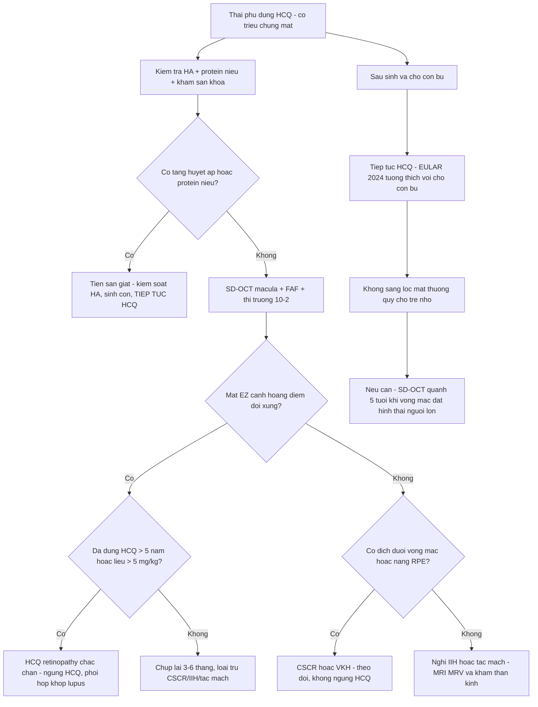
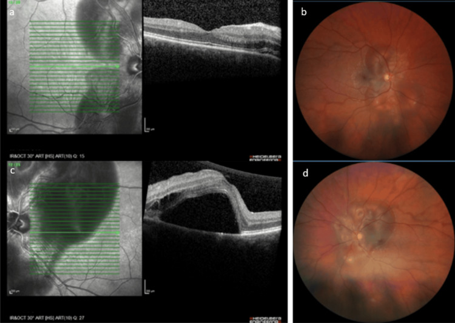
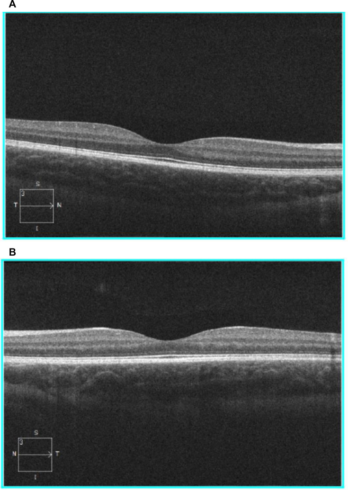

# 488 — Hydroxychloroquine trong THAI KỲ & cho con bú: an toàn mẹ–thai, lịch sàng lọc mắt và theo dõi thị giác trẻ phơi nhiễm / Hydroxychloroquine in pregnancy and lactation

**Tags:** `pattern:ton-thuong-vong-mac-ngoai-do-thuoc` `vung:hoang-diem` `score:AAO-nguy-co` `protocol:SD-OCT-FAF-thi-truong-10-2`
**Mức chắc chắn (certainty):** tổng hợp y văn (literature synthesis) — tự biên từ các bài mở CC BY 4.0/CC BY-NC (nghiên cứu PATCH, đoàn hệ GR2, phân tích gộp APS, ca PAH sau ngừng HCQ, review thay đổi mắt trong thai kỳ) + khuyến cáo EULAR/ACR (dẫn link); số liệu lấy nguyên từ bài gốc, tên tác giả đối chiếu PMCID.

> **Bài này trả lời 4 câu hỏi của bác sĩ CĐHA/mắt khi gặp thai phụ dùng HCQ:** (1) **có ngừng HCQ không?** (2) **sàng lọc võng mạc có đổi lịch không?** (3) **mờ mắt khi mang thai là do HCQ hay do thai kỳ?** (4) **theo dõi mắt cho con như thế nào?**
> Đây là bài **nối tiếp** [484 – Nhiễm độc võng mạc do hydroxychloroquine](../484-nhiem-doc-vong-mac-hydroxychloroquine/lesson.md) (cơ chế, OCT/FAF/thị trường 10-2, ngưỡng liều) và [455 – Behçet & lupus tại mắt](../455-behcet-lupus-mat/lesson.md) (tổn thương võng mạc do chính lupus). **Không lặp lại** kỹ thuật đọc ảnh của 484.

## 1. Tổng quan bệnh học – cơ chế hình ảnh

### 1.1 Vì sao phơi nhiễm thai ≤ 9 tháng gần như không gây độc võng mạc — dù HCQ rất độc với võng mạc người lớn

- **HCQ gây độc võng mạc theo TÍCH LŨY nhiều năm, không theo liều cấp:** tổn thương cần **nhiều năm** phơi nhiễm liên tục (nguy cơ **< 1% trong 5 năm đầu**, **< 2% tới 10 năm**, tăng tới **~20% sau 20 năm**). Phơi nhiễm thai nhi tối đa **~9 tháng**, tức **ngắn hơn ngưỡng tích lũy hàng chục lần** → xác suất độc võng mạc cho trẻ là **rất thấp về mặt sinh học**.
- **Nhưng không thể "soi mắt trẻ sơ sinh để loại trừ":** võng mạc trẻ **chưa có hình thái người lớn** ở giai đoạn sớm, và **điện sinh lý (ERG) ở nhũ nhi không đáng tin** (chỉ phát hiện tổn thương rất nặng). Muốn đánh giá đúng phải đợi **khoảng 5 tuổi — lúc võng mạc đã đạt hình thái người lớn** — rồi chụp **SD-OCT** tìm các dấu hiệu sớm (mất EZ cạnh hoàng điểm).
- **Bằng chứng trực tiếp (nghiên cứu PATCH):** **10 trẻ** phơi nhiễm HCQ **400 mg/ngày** trong tử cung được chụp **OCT lúc 5 tuổi**: **không có mỏng lớp hạch, lớp tế bào cảm quang, ellipsoid zone hay RPE** (kể cả vùng cạnh hoàng điểm và vùng quanh trung tâm — nơi người lớn châu Á hay bị). **Độ dày võng mạc toàn bộ 288,92 ± 13,77 µm** ở nhóm phơi nhiễm so với **297,70 ± 10,53 µm** ở nhóm chứng (**p = 0,18**); cả hai đều nằm trong dữ liệu chuẩn **279 µm (95% CI 260–298)**. **Nồng độ trong máu cuống rốn** xác nhận trẻ thực sự đã phơi nhiễm.
- **Tại sao lợi ích lại lớn hơn nguy cơ:** HCQ **giảm bùng phát lupus**, giảm tổn thương cơ quan, **giảm tái phát lupus sơ sinh (neonatal lupus)**. **Ngừng HCQ không phải "an toàn cho con" mà là đánh đổi bằng bùng phát của mẹ** — ca gốc: thai phụ **tự ngừng HCQ ở tuần 8**, đến **tuần 27+4** nhập viện với **tăng áp lực động mạch phổi (PAH)** do bùng phát lupus; **dùng lại HCQ 200 mg × 2/ngày** + corticoid → hồi phục, **áp lực động mạch phổi tâm thu ước tính còn 40 mmHg** và **hết triệu chứng ở 3 tháng sau sinh**.

### 1.2 Ngưỡng định lượng nằm lòng (bắt buộc nhớ)

- **Duy trì HCQ suốt thai kỳ và khi cho con bú:** **EULAR 2024** xếp **thuốc chống sốt rét (antimalarials) vào nhóm "tương thích với thai kỳ" và "tương thích với cho con bú"**; **ACR 2020** và **EULAR 2016** cũng khuyến cáo **tiếp tục HCQ** ở bệnh lupus. Liều đích **≤ 5 mg/kg cân nặng thực/ngày**.
- **Nồng độ HCQ toàn phần trong máu GIẢM trong thai kỳ (đoàn hệ GR2, 174 thai phụ SLE):** **17,2% bùng phát** (2,3% nặng), **biến cố thai bất lợi 16,1%**. Nồng độ **3 tháng đầu ≤ 500 ng/mL** → **bùng phát NẶNG 8,8% vs 0,7%** (p = 0,02); **≤ 200 ng/mL** → **13,3% vs 1,3%** (p = 0,04). Nồng độ **không** liên quan biến cố thai bất lợi. Ngưỡng đích đã công bố: **1.000 / 750 / 500 ng/mL**; **≤ 200 ng/mL = không tuân thủ nghiêm trọng**. Lưu ý: **máu toàn phần ≈ 2× huyết thanh** — đừng so sai loại mẫu.
- **An toàn dị tật bẩm sinh:** đoàn hệ Mỹ nêu **35,3/1.000** (không dùng HCQ) so với **44,1/1.000** (dùng HCQ 3 tháng đầu), **chỉ tăng có ý nghĩa khi liều > 400 mg/ngày** — nhưng khuyến cáo EMA này **bị phản biện toàn cầu**, và **đa số bằng chứng (300–1.000 thai kỳ + phân tích gộp) không cho thấy tăng dị tật**.
- **Phân tích gộp ở hội chứng kháng phospholipid (APS, 7 nghiên cứu, 750 bệnh nhân):** HCQ **tăng tỷ lệ sinh sống** (**OR 2,66; 95% CI 1,44–4,91**) và **giảm biến cố sản khoa** (**OR 0,19; CI in trong bài 0,19–0,39** — khoảng tin cậy này **bất thường**, cần đọc bản gốc); tỷ lệ sinh sống gộp **89,9% vs 73,9%**, biến cố sản khoa gộp **19,3% vs 55,0%**.

## 2. Mẫu hình + chẩn đoán phân biệt theo bối cảnh (gamut)

**Câu hỏi lọc:** *"Triệu chứng mắt xuất hiện ở giai đoạn nào của thai kỳ, kèm huyết áp–protein niệu–đau đầu gì, và tổn thương đối xứng hai bên theo tầng nào?"* — **bối cảnh sản khoa quyết định chẩn đoán trước cả bối cảnh thuốc**.

- **Mờ nhìn + tăng huyết áp ± protein niệu ở tam cá nguyệt 2–3 → tiền sản giật:** **bong thanh dịch hai bên** (thường quanh đĩa thị/hố trung tâm), **đốm Elschnig** (tổn thương hắc mạc do thiếu tưới máu), hẹp tiểu động mạch võng mạc, xuất tiết bông; nặng hơn → **PRES** (mù vỏ não), phù đĩa thị. **Xử trí = kiểm soát huyết áp + sinh con**, không phải ngừng HCQ.
- **Mờ nhìn từng đợt, bong vòm hoàng điểm, không tăng huyết áp → CSCR:** thai kỳ là **trạng thái stress/nội tiết** thuận lợi cho CSCR; khác HCQ (HCQ **không gây dịch dưới võng mạc**).
- **Mất thị trường vòng cung quanh trung tâm, thị lực còn tốt, đã dùng HCQ > 5 năm → HCQ retinopathy** (bài 484): **mất EZ cạnh hoàng điểm đối xứng**, FAF "mắt bò", thị trường 10-2. **Thai kỳ không làm nhanh hơn** — nhưng **không miễn trừ** cho người đã dùng nhiều năm.
- **Đau đầu + ù tai + phù đĩa thị hai bên → tăng áp lực nội sọ vô căn (IIH):** thai kỳ tăng cân làm nặng IIH; **không phải HCQ**.
- **Mất thị lực một bên, đột ngột, có/không đau → tắc mạch võng mạc hoặc huyết khối xoang tĩnh mạch não:** thai kỳ **tăng đông** (yếu tố I, V, VII, IX, X tăng; protein S/C và antithrombin III giảm) — **cấp cứu**, không chờ sàng lọc HCQ.
- **Đường huyết kiểm soát kém + xuất huyết/vi mạch → bệnh võng mạc đái tháo đường tiến triển do thai:** thai kỳ **làm nặng ĐTĐ võng mạc**, thường thoái lui sau sinh.

**Mnemonic:** **"Thai kỳ + mờ mắt = nghĩ SẢN KHOA trước, nghĩ THUỐC sau"** — **P**reeclampsia/**PRES**, **C**SCR, **I**IH, **T**hrombosis, **D**iabetes, rồi mới **H**CQ.

## 3. Bảng so sánh phân biệt (ma trận đối chiếu)

### 3.1 Mờ mắt ở thai phụ đang dùng HCQ — 5 bệnh cảnh phải tách

| Bệnh cảnh | Hình ảnh điển hình (OCT/FAF/đáy mắt) | Chốt vào (rule-in) | Chốt loại (rule-out) | Xử trí |
|---|---|---|---|---|
| **Tiền sản giật / sản giật** | **Bong thanh dịch hai bên**, đốm Elschnig, hẹp tiểu động mạch, xuất tiết bông; **PRES** nếu mù vỏ não | **HA cao ± protein niệu ở tam cá nguyệt 2–3 + tổn thương hắc mạc–võng mạc hai bên** | **HA bình thường, tổn thương chỉ ở lớp võng mạc ngoài cạnh hoàng điểm → không phải tiền sản giật** | **Kiểm soát HA + sinh con**; **tiếp tục HCQ**; theo dõi hậu sản (thường thoái lui) |
| **CSCR (thai kỳ/stress/corticoid)** | **Bong vòm hoàng điểm một–hai bên**, **nâng RPE**, FA có **điểm rò**, hắc mạc dày | **Không tăng huyết áp + bong vòm + điểm rò trên FA/ICGA** | **Mất EZ cạnh hoàng điểm không dịch → không phải CSCR** | Theo dõi; giảm stress/corticoid nếu được; **không ngừng HCQ** |
| **HCQ retinopathy (thật)** | **Mất EZ cạnh hoàng điểm đối xứng**, hố trung tâm bảo tồn ("flying saucer"), FAF "mắt bò", cung ám điểm 10-2 | **Đã dùng HCQ > 5 năm hoặc liều > 5 mg/kg + đủ 2/3 dấu hiệu** | **Không mất EZ, có dịch/xuất huyết → nghĩ bệnh khác** | **Ngừng HCQ** khi chắc chắn (phối hợp khớp/lupus); chụp lại **6–12 tháng** |
| **IIH** | **Phù đĩa thị hai bên**, mất thị trường vành, **MRI/MRV bình thường (không huyết khối)** | **Đau đầu + ù tai + phù đĩa thị hai bên + áp lực mở cao** | **Đĩa thị bình thường, mất thị trường cạnh trung tâm → nghĩ HCQ** | Điều trị IIH (giảm cân, acetazolamide — thận trọng thai kỳ) |
| **Tắc mạch võng mạc / huyết khối xoang** | **Phù võng mạc, xuất huyết tán mạch, cherry-red spot**; **phù đĩa thị + huyết khối trên MRV** | **Mất thị lực một bên đột ngột + bối cảnh tăng đông** | **Song phương, từ từ, không xuất huyết → không phải tắc mạch** | **Cấp cứu** (chống đông theo phác đồ sản khoa) |

### 3.2 Lịch sàng lọc mắt quanh thai kỳ (giữ nguyên ngưỡng của AAO 2016 — bài 484)

| Thời điểm | Việc làm | Vì sao |
|---|---|---|
| **Trước mang thai / khi bắt đầu HCQ** | Khám nền tảng trong **1 năm đầu**, gồm **SD-OCT macula + FAF + thị trường 10-2** | Có ảnh so sánh; phát hiện bệnh võng mạc **có sẵn** (không phải độc tính) |
| **Trong thai kỳ** | **Không rút ngắn lịch** nếu không triệu chứng (vẫn **hằng năm từ năm thứ 5**, sớm hơn nếu có yếu tố nguy cơ); **khám ngay khi có triệu chứng mắt** | Thai kỳ **không tăng tốc** độc tính; ưu tiên loại trừ **tiền sản giật** |
| **Nghi ngờ trên ảnh** | Lặp **SD-OCT + FAF + 10-2** sau **3–6 tháng**; **FAF/OCT góc rộng** nếu bệnh nhân châu Á | Tránh ngừng thuốc oan vì dương tính giả/tilt |
| **Cho con bú** | **Tiếp tục HCQ** (EULAR 2024: tương thích) | Không cần "vắt bỏ sữa"; ngừng thuốc làm mẹ bùng phát |
| **Trẻ phơi nhiễm trong tử cung** | **Không sàng lọc mắt thường quy ở nhũ nhi**; nếu cần đánh giá, chụp **SD-OCT quanh 5 tuổi** | Võng mạc đạt hình thái người lớn ~5 tuổi; ERG nhũ nhi không đáng tin |

## 4. Protocol + sơ đồ quyết định

### 4.1 Bộ ba bắt buộc mỗi lần sàng lọc (không đổi so với bài 484)

- **SD-OCT macula** (đọc **từng B-scan qua hố trung tâm**, không chỉ bản đồ dày) + **FAF** + **thị trường tự động 10-2**.
- Thêm **FAF/OCT góc rộng** khi bệnh nhân **châu Á** hoặc OCT 30° không giải thích được triệu chứng (kiểu **quanh trung tâm ≥ 8°** có thể nằm ngoài khung).

### 4.2 Quản lý thuốc quanh thai (điểm khác biệt của bài này)

- **Duy trì HCQ** ở bệnh lupus/APS xuyên thai kỳ và cho con bú; **liều ≤ 5 mg/kg/ngày**.
- **Cân nhắc đo nồng độ HCQ toàn phần trong máu** khi bùng phát/không đáp ứng: ngưỡng **≤ 500 ng/mL** gắn với **bùng phát nặng**; **≤ 200 ng/mL** = không tuân thủ. Đây là công cụ **phân biệt "bệnh nặng" với "không uống thuốc"** — và là **điểm kiểm soát tuân thủ** (không phải ngưỡng độc tính).
- **Ngừng HCQ** chỉ khi có **HCQ retinopathy chắc chắn** theo 484 — và **không vì lý do "đang mang thai"**.

### 4.3 Sơ đồ quyết định

## 5. Biến thể bình thường và cạm bẫy

- **"Mang thai thì ngừng HCQ cho an toàn" — sai và nguy hiểm:** ngừng HCQ làm **bùng phát lupus**, tăng **lupus sơ sinh**, và đã có ca **PAH nặng ở tuần 27** sau khi tự ngừng ở tuần 8 (hồi phục khi dùng lại). **EULAR 2024/ACR 2020: tiếp tục HCQ.**
- **Quy kết mọi mờ mắt thai kỳ cho HCQ:** nguyên nhân hay gặp và **cấp cứu** là **tiền sản giật/PRES** — bỏ sót vì "đã có HCQ giải thích rồi" là lỗi chết người.
- **Nhầm sinh lý thai kỳ với bệnh lý:** thay đổi khúc xạ/giác mạc và khô mắt trong thai kỳ thường **thoáng qua, hồi phục sau sinh** — không phải độc võng mạc và **không cần ngừng thuốc**.
- **Nồng độ HCQ thấp ≠ độc tính:** ngược lại, nồng độ thấp nghĩa là **thiếu thuốc/nguy cơ bùng phát** — đọc đúng chiều.
- **So sai loại mẫu:** **máu toàn phần ≈ 2× huyết thanh**; ngưỡng 500 ng/mL là cho **máu toàn phần**.
- **Không chờ "mắt bò" mới ngừng thuốc:** "mắt bò" là dấu hiệu **muộn**; ngưỡng ngừng là **mất EZ cạnh hoàng điểm đối xứng + FAF/thị trường tương ứng** (bài 484).
- **Dữ liệu dị tật bẩm sinh phải đọc đúng:** con số **44,1/1.000** của đoàn hệ Mỹ chỉ tăng có ý nghĩa khi **liều > 400 mg/ngày**, và **đã bị phản biện**; đa số bằng chứng **không tăng dị tật**. Đừng dùng một dòng để khuyên ngừng thuốc.
- **Cho con bú:** HCQ **tương thích** (EULAR 2024) — không khuyên "vắt bỏ sữa" hay ngừng thuốc.
- **Trẻ phơi nhiễm:** **không sàng lọc mắt thường quy ở nhũ nhi** (không đánh giá được, dễ dương tính/âm tính giả); nếu cần, **OCT quanh 5 tuổi**.

## 6. Tự lượng giá — Blind Quiz

**Ca 1 — Thai phụ 27 tuổi, con so, 32 tuần, nhập viện vì protein niệu 3+ và phù; huyết áp cao nhất 138/94 mmHg. Đang nằm viện thì giảm thị lực mắt trái (BCVA 20/20 mắt phải, 20/32 mắt trái). OCT hai mắt dưới đây.**

- Hỏi: (1) Dịch nằm ở đâu và có đối xứng không? (2) Chẩn đoán ưu tiên là gì? (3) Nếu bệnh nhân này **đang dùng HCQ**, có nên ngừng không?

<b>Bấm để hiện đáp án (findings + chẩn đoán)</b>

- **Findings:** (1a) OCT mắt phải — **lớp dịch mỏng vùng liên gai thị–hoàng điểm, CHƯA vào hố trung tâm**; (1b) ảnh đáy mắt — **bong thanh dịch quanh đĩa thị (peripapillary SRD)**; (1c,1d) mắt trái — **bong thanh dịch quanh đĩa thị LAN VÀO hố trung tâm**, giải thích thị lực giảm.
- **Chẩn đoán:** **bong thanh dịch võng mạc (SRD) do TIỀN SẢN GIẬT** — thể **không tăng huyết áp rõ** (ca gốc: protein niệu 3+, HA chỉ **138/94 mmHg**, creatinin **1,3 mg/dL**, có IUGR); SRD là biến chứng **hiếm (~0,1–2%)** của tiền sản giật, cơ chế **thiếu tưới máu hắc mạc → suy bơm RPE**, **không phải độc tính HCQ** (HCQ không gây dịch dưới võng mạc).
- **Xử trí:** coi là **tiền sản giật có đặc điểm nặng** (suy thận tiến triển + SRD hai bên) → **mổ lấy thai ở 32+3 tuần**; không điều trị mắt đặc hiệu vì SRD **thường tự hết** — ca gốc **hồi phục hoàn toàn thị lực (20/20 hai mắt) sau 1 tháng**, ổn định lúc 3 tháng, tối đa **12 tuần**. **Nếu đang dùng HCQ: TIẾP TỤC** — ngừng sẽ làm lupus bùng phát mà không cải thiện gì cho mắt.
- **Nguồn ảnh:** Oztürk Ö, Hakami S, *Cureus* 2026 (PMC13032843), CC BY 4.0 — Fig. 1.

**Ca 2 — Mẹ dùng HCQ 400 mg/ngày suốt thai kỳ (nghiên cứu PATCH). Con được chụp OCT lúc 5 tuổi. Kết quả dưới đây.**

- Hỏi: (1) Có dấu hiệu độc tính võng mạc không? (2) Vì sao phải đợi đến 5 tuổi mới đánh giá? (3) Có cần sàng lọc mắt thường quy cho trẻ này không?

<b>Bấm để hiện đáp án</b>

- **Findings:** (A) mắt phải, (B) mắt trái — **các lớp võng mạc phân tách rõ, ellipsoid zone liên tục**, **không mỏng lớp hạch/lớp tế bào cảm quang/RPE**, kể cả vùng cạnh hoàng điểm; **không có hình thái quanh trung tâm**.
- **Không có độc tính:** nhóm PATCH **288,92 ± 13,77 µm** so với chứng **297,70 ± 10,53 µm** (**p = 0,18**), cả hai trong chuẩn **279 µm (95% CI 260–298)**; chênh lệch **không có ý nghĩa sau hiệu chỉnh đa so sánh**.
- **Vì sao 5 tuổi:** võng mạc trẻ **đạt hình thái người lớn** vào khoảng **5 tuổi**, khi đó mới áp được **tiêu chuẩn độc tính của người lớn** (mất EZ cạnh hoàng điểm); đánh giá sớm hơn **không đáng tin**.
- **Không cần sàng lọc thường quy:** dữ liệu này **củng cố an toàn** — không đặt lịch OCT định kỳ cho trẻ chỉ vì mẹ dùng HCQ khi mang thai.
- **Nguồn ảnh:** Izmirly PM et al., *Lupus Sci Med* 2026 (PMC13218190), CC BY 4.0 — Fig. 1.

## Bài liên quan chéo
- [484 – Nhiễm độc võng mạc do hydroxychloroquine: sàng lọc, ngưỡng liều, phân biệt lupus retinopathy](../484-nhiem-doc-vong-mac-hydroxychloroquine/lesson.md)
- [455 – Behçet & lupus tại mắt](../455-behcet-lupus-mat/lesson.md)
- [453 – Bệnh võng mạc tăng huyết áp & thiếu máu](../453-benh-vong-mac-tang-huyet-ap-va-thieu-mau/lesson.md)
- [470 – CSCR do corticosteroid: mất thị lực không đau](../470-cscr-do-corticosteroid-mat-thi-luc-khong-dau/lesson.md)
- [433 – Phù đĩa thị vs drusen đĩa (IIH)](../433-phu-dia-thi-drusen/lesson.md)
- [444 – Tắc mạch võng mạc](../444-tac-mach-vong-mac/lesson.md)
- [443 – Bệnh võng mạc đái tháo đường](../443-vong-mac-dai-thao-duong/lesson.md)
- [487 – Nhiễm độc võng mạc do thuốc KHÁC ngoài HCQ](../487-nhiem-doc-vong-mac-thuoc-khac-ngoai-hcq/lesson.md)
- [400 – Tổng quan Mắt & thị giác](../400-tong-quan-mat-thi-giac/lesson.md)

## Ảnh
- `images/488_tre-phoi-nhiem-HCQ_OCT_PMC13218190.jpg` — Izmirly PM et al., *Lupus Sci Med* 2026 (PMC13218190), **CC BY 4.0**.
- `images/488_tien-san-giat-SRD_OCT_PMC13032843.jpg` — Oztürk Ö, Hakami S, *Cureus* 2026 (PMC13032843), **CC BY 4.0**.
- Nguồn + giấy phép từng ảnh: [`images/CREDITS.md`](images/CREDITS.md).

> Không dùng để chẩn đoán độc lập khi chưa có người hướng dẫn.
