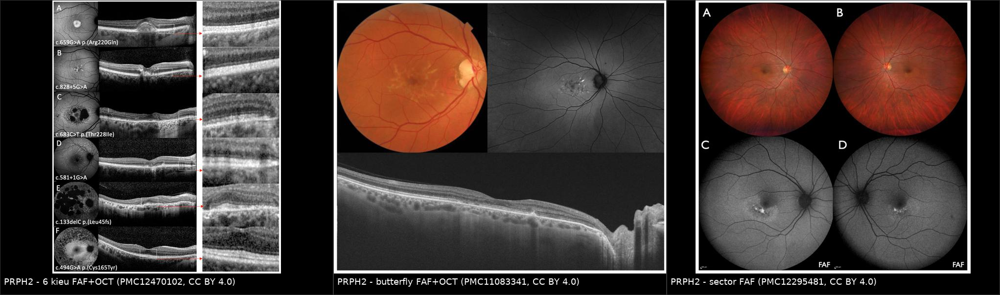
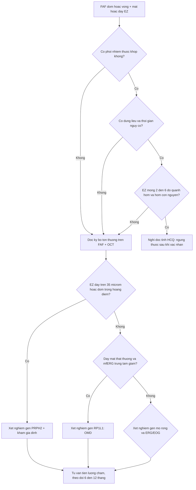
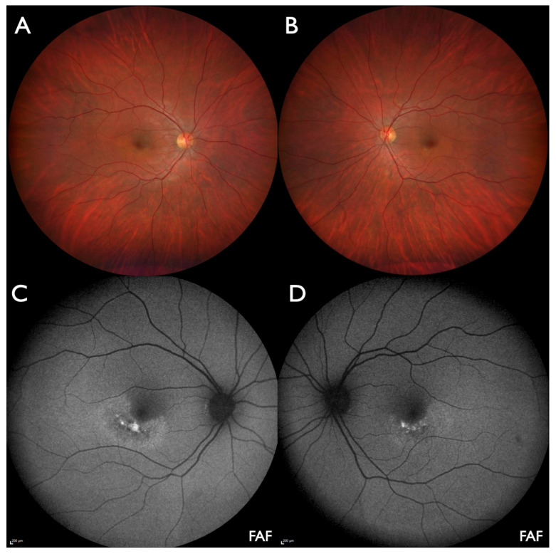
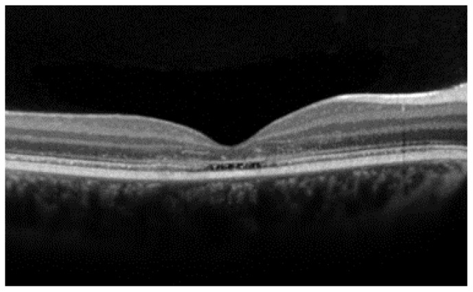

# 489 — Loạn dưỡng hoa văn & teo võng mạc ngoài DI TRUYỀN: phân biệt với độc tính thuốc (HCQ, deferoxamine/sắt, ức chế MEK)

**Tags:** `pattern:loan-duong-vong-mac-ngoai` `pattern:faf-dom` `pattern:ez-day` `vung:hoang-diem` `score:OMD-stage` `score:HCQ-risk` `protocol:SD-OCT-FAF` `protocol:mfERG`
**Mức chắc chắn (certainty):** tổng hợp y văn (literature synthesis) — ghép các nguồn mở: loạt 36 bệnh nhân PRPH2 của Oxford, *Genes* 2025 (PMC12470102, CC BY 4.0); loạt 20 bệnh nhân RP1L1 đa sắc tộc, *IOVS* 2025 (PMC11967996, CC BY-NC-ND 4.0 — **chỉ dùng số liệu, không dùng ảnh**); ca sector macular dystrophy PRPH2, *J Clin Med* 2025 (PMC12295481, CC BY 4.0); tổng quan OCT loạn dưỡng hoàng điểm di truyền, *Diagnostics* 2024 (PMC11083341, CC BY 4.0). Tên tác giả đối chiếu PMCID; số liệu giữ nguyên bài gốc.

> **Bài này trả lời câu hỏi hay bị trả lời sai nhất ở phòng khám:** *"FAF có đốm + OCT mất ellipsoid zone — do thuốc hay do gen?"*
> Ba bài nền: [484 – Nhiễm độc hydroxychloroquine](../484-nhiem-doc-vong-mac-hydroxychloroquine/lesson.md), [487 – Độc tính võng mạc do thuốc khác HCQ](../487-nhiem-doc-vong-mac-thuoc-khac-ngoai-hcq/lesson.md), [439 – Teo thị di truyền](../439-teo-thi-di-truyen/lesson.md). Bài này **không lặp lại liều/ngưỡng thuốc**, chỉ tập trung vào **phía di truyền** và **cách phân định**.

## 1. Tổng quan — vì sao ba bệnh "giống hệt nhau" trên FAF lại khác nhau về bản chất

### 1.1 Cơ chế: tổn thương ở đâu thì hình ảnh ra sao

- **PRPH2 (peripherin-2/RDS) — loạn dưỡng hoa văn (pattern dystrophy), di truyền TRỘI:** peripherin-2 là protein **viền đĩa (disc rim) của đoạn ngoài tế bào cảm quang**, quyết định hình dạng và sự xếp lớp của đĩa. Đột biến → **đĩa dị dạng, vật liệu tế bào cảm quang ứ lại ở mặt RPE** → lipofuscin tăng → **FAF tăng huỳnh quang dạng đốm/vòng**, đồng thời các lớp đoạn ngoài **dài ra và xếp rối trước khi teo** → **ellipsoid zone (EZ) DÀY lên** trên OCT. Đây là lý do *nghịch lý*: giai đoạn sớm **EZ dày chứ không mỏng**.
- **Số đo cụ thể (36 bệnh nhân PRPH2):** EZ dày ở **34/36 bệnh nhân**, trung bình **44,3 ± 11,3 µm (mắt phải)** và **42,7 ± 11,6 µm (mắt trái)**, so với **~17,0 µm ở nhóm chứng** (dẫn trong bài gốc) — tức **gấp ~2,5 lần**. **55,6%** có ổ tăng phản hồi (hyperreflective foci) tương ứng đốm tăng huỳnh quang trên FAF (PMC12470102).
- **RP1L1 — loạn dưỡng hoàng điểm ẩn (occult macular dystrophy, OMD), di truyền TRỘI:** RP1L1 nằm ở **đoạn trong tế bào cảm quang/connecting cilium**. Đột biến gây **suy chức năng tế bào nón vùng hõm** nhưng **không phá cấu trúc đủ để thấy trên đáy mắt** → "ẩn": đáy mắt, FAF (đa số) và **full-field ERG bình thường**, trong khi **mfERG/focal ERG giảm ở trung tâm** và OCT chỉ **mờ EZ + mất interdigitation zone (IZ)** tại hõm. Phân loại: **OMD cổ điển = EZ mờ + mất IZ**; **OMD thể nhẹ = chỉ mất một trong hai**; chia **3 giai đoạn** theo mức tổn thương IZ/EZ (PMC11967996, PMC11302074).
- **Teo hắc mạc vùng (regional chorioretinal atrophy):** cùng họ PRPH2 nhưng đột biến/biểu hiện khác → **mảng teo rõ bờ**, có thể **một bên hoặc đối xứng vùng**. Ca mới: **nữ 30 tuổi, PRPH2 c.623G>A p.(Gly208Asp)**, hai mảng **đối xứng cạnh hoàng điểm phía thái dương–dưới**, khởi phát triệu chứng **4,5 tháng** trước khám, **không dùng thuốc nào** (PMC12295481).
- **TẠI SAO dễ nhầm với thuốc:** cả ba đều tổn thương **cùng một tầng (RPE – võng mạc ngoài)**, nên cùng cho **FAF đốm/vòng + mất EZ**. Thứ phân biệt **không phải hình dạng**, mà là **đối xứng – bờ tổn thương – bối cảnh phơi nhiễm – tốc độ tiến triển – phả hệ**.

### 1.2 Ngưỡng định lượng nằm lòng

- **PRPH2:** khởi phát triệu chứng trung bình **44,0 ± 14,4 tuổi**; thị lực **0,20 logMAR (P) / 0,14 (T)** lúc đầu → **0,33 / 0,32 logMAR** sau **6,0 ± 3,2 năm** (chậm, ~0,02–0,03 logMAR/năm); phân bố kiểu hình: **pseudo-Stargardt 47,2%**, **AVMD 22,2%**, **pattern dystrophy 25,0%**, không điển hình 2,8%, RP 2,8% (PMC12470102).
- **RP1L1/OMD:** khởi phát trung bình **30,8 ± 17,2 tuổi** (có ca **9 tuổi**, có ca **57 tuổi**); thị lực trung vị **0,6 logMAR**; mất **~1 dòng ETDRS mỗi 2 năm** ở OMD và thể không điển hình, trong khi nhóm RP1L1-RP **ổn định > 20 năm**; **50%** có tăng huỳnh quang nhẹ đối xứng trên SW-AF (PMC11967996).
- **Độc tính thuốc (đối chiếu):** HCQ **> 5 mg/kg/ngày** hoặc **> 5 năm** → sàng lọc hằng năm từ năm thứ 5; tổn thương **mất EZ 2–6° quanh hõm, hõm còn nguyên** ("flying saucer") (bài 484). Deferoxamine/quá tải sắt: **ferritin > 1.000 ng/mL kéo dài** + **FAF đốm** + teo võng mạc ngoài (bài 487). Ức chế MEK: bong thanh dịch **> 90%**, khởi phát trung vị **ngày 38**, tự khỏi (bài 487).
- **Ngưỡng "không được ngừng thuốc vội":** chỉ ngừng HCQ khi có **mất EZ cạnh hoàng điểm đối xứng + bất thường FAF/thị trường tương ứng**; **đốm FAF đơn thuần không đủ** (bài 484) — vì đúng bức tranh đó cũng là PRPH2.

## 2. Mẫu hình + chẩn đoán phân biệt theo tầng tổn thương (Gamut)

**Câu hỏi lọc 3 bước:** *(1) Tổn thương ở tầng nào? (2) Có phơi nhiễm thuốc/bệnh nền tương ứng không? (3) Bờ tổn thương và tính đối xứng nói gì về thời điểm khởi phát?*

- **Võng mạc ngoài – hoàng điểm, KHÔNG phơi nhiễm thuốc:**
  - **PRPH2 pattern dystrophy** — nhiều ổ đốm/vòng, thường **đối xứng nhưng không đối xứng hoàn toàn**, thị lực còn tốt lâu; thể **butterfly** ở người **50 tuổi, thị lực 20/25** (PMC11083341).
  - **PRPH2 sector/CACD** — mảng teo **bờ rõ, ranh giới sắc nét, không theo lãnh thổ mạch**, một hoặc hai bên.
  - **RP1L1 OMD** — **đáy mắt bình thường**, FAF gần bình thường, **mfERG trung tâm giảm**, OCT có "**optical gap**" (mất EZ dưới hõm, độ dày võng mạc còn tốt) — ca **25 tuổi, 20/80** (PMC11083341).
  - **ABCA4 (STGD1)** — flecks lan ra ngoài hoàng điểm, **dark choroid** trên FA, ERG bất thường.
  - **BEST1** — vitelliform, **EOG Arden < 1,5**; **TIMP3 (Sorsby)** — drusen + CNV sớm.
- **Võng mạc ngoài – hoàng điểm, CÓ phơi nhiễm:**
  - **HCQ/chloroquine** — vòng quanh trung tâm, **mất EZ 2–6°**, hõm bảo tồn; nguy cơ theo liều/thời gian.
  - **Deferoxamine/quá tải sắt** — FAF **đốm rải rác** + teo ngoài, bối cảnh truyền máu/ferritin cao.
  - **Ức chế MEK (MEKAR)** — **dịch dưới võng mạc** đối xứng, **không rò mạch**, tự khỏi.
  - **Tamoxifen** — nang giả trong võng mạc + mất EZ; **clofazimine** — tinh thể + mắt bò.
- **Mnemonic 4 chữ:** **V**ị trí (hõm / cạnh hõm / ngoài hoàng điểm) · **Đ**ối xứng · **B**ờ (mờ lan tỏa vs sắc nét) · **B**ối cảnh (thuốc, truyền máu, phả hệ).

## 3. Bảng so sánh phân biệt (ma trận đối chiếu)

| Thực thể (entity) | Hình ảnh điển hình (OCT/FAF) | Chốt vào (rule-in) | Chốt loại (rule-out) | Gợi ý xác nhận |
|---|---|---|---|---|
| **PRPH2 pattern dystrophy / PSPD** | Đốm FAF tăng–giảm xen kẽ quanh hõm, **EZ DÀY 42–44 µm** (chứng ~17 µm), hyperreflective foci 55,6% | **EZ dày + đốm FAF + không phơi nhiễm thuốc + khởi phát ~40–45 tuổi** | **EZ MỎNG 2–6° quanh hõm có hõm nguyên vẹn + đang dùng HCQ > 5 năm** → độc tính | Gen **PRPH2**; khám anh chị em (cùng gen, kiểu hình khác) |
| **PRPH2 sector / CACD** | Mảng teo **bờ sắc nét**, đối xứng cạnh hoàng điểm, **không theo lãnh thổ động mạch** | **Bờ rõ + không phơi nhiễm + tiến triển chậm nhiều năm** | **Tổn thương theo lãnh thổ mạch, một bên, khởi phát đột ngột** → tắc mạch/nhồi máu | Gen PRPH2 (c.623G>A p.Gly208Asp đã báo cáo); OCT-A loại trừ thiếu tưới máu |
| **RP1L1 — OMD** | **Đáy mắt + FAF gần bình thường**; OCT: **EZ mờ + mất IZ tại hõm**, "optical gap"; **mfERG trung tâm giảm** | **Thị lực giảm + đáy mắt bình thường + ffERG bình thường + mfERG trung tâm giảm** | **FAF bất thường lan rộng hoặc có dịch/xuất huyết** → không phải OMD | Gen **RP1L1** (p.Arg45Trp hay gặp nhất); mfERG + vi chuẩn đồng tử |
| **ABCA4 (STGD1)** | Flecks lan, teo trung tâm; **dark choroid** trên FA | **Khởi phát trẻ (< 20 tuổi) + flecks + dark choroid** | **EZ dày + không có dark choroid + ERG toàn bộ bình thường** → nghĩ PRPH2 | Gen ABCA4; ERG; FA |
| **Nhiễm độc HCQ** | **Mất EZ 2–6° quanh hõm, hõm còn** ("flying saucer"); FAF vòng tăng rồi giảm | **Đang dùng HCQ > 5 năm hoặc > 5 mg/kg + tổn thương cạnh hõm đối xứng** | **EZ dày; tổn thương ngoài vùng cạnh hõm; không có phơi nhiễm** | Ngừng thuốc khi chắc chắn; chụp lại 6–12 tháng |
| **Deferoxamine / quá tải sắt** | **FAF đốm rải rác** + teo võng mạc ngoài; ERG giảm | **Truyền máu nhiều lần + ferritin > 1.000 ng/mL kéo dài** | **Ferritin bình thường, không truyền máu** → nghĩ loạn dưỡng di truyền | Đối chiếu ferritin theo thời gian; gen nếu không rõ |
| **MEKAR (ức chế MEK)** | **Bong thanh dịch hai bên dạng lều**, IZ dày, **không nâng RPE** | **Đang dùng ức chế MEK ± BRAF + dịch đối xứng** | **Nâng RPE/rò điểm trên FA/hắc mạc dày** → CSCR | Theo dõi 3–6 tháng, **không ngừng thuốc ung thư** |

*Trái: **6 kiểu hình PRPH2** — FAF + OCT + phóng đại EZ (dày, xếp rối) (PMC12470102, CC BY 4.0). Giữa: **butterfly pattern dystrophy** ở nam 50 tuổi, thị lực 20/25 — ảnh màu, FAF và OCT (PMC11083341, CC BY 4.0). Phải: **sector macular dystrophy** hai bên ở nữ 30 tuổi — ảnh màu góc rộng + FAF, mảng tổn thương cạnh hoàng điểm phía thái dương–dưới (PMC12295481, CC BY 4.0). Ảnh ghép letterbox, giữ nguyên tỷ lệ, không crop.*

## 4. Protocol chụp + bậc thang xử trí

### 4.1 Bộ hình ảnh tối thiểu khi nghi loạn dưỡng võng mạc ngoài

| Bước | Kỹ thuật | Ngưỡng / mục đích |
|---|---|---|
| 1 | **SD-OCT thể tích hoàng điểm** (mặt cắt mảnh qua hõm + bản đồ) | Đo **EZ** tại hõm và cạnh hõm; ghi **µm**. EZ **> 35 µm** gợi ý PRPH2; **< 20 µm** hoặc mất EZ cạnh hõm gợi ý độc tính/teo |
| 2 | **SW-FAF + NIR-FAF**, ảnh **góc rộng** nếu nghi HCQ (thể quanh trung tâm) | Mô tả **bờ** tổn thương: đốm rải rác (thuốc/sắt) vs vòng quanh hõm (HCQ) vs đốm trong hõm (PRPH2) |
| 3 | **mfERG (hoặc focal ERG)** | OMD: giảm **chỉ vùng trung tâm** (ring 1–2), ngoại vi bình thường |
| 4 | **Full-field ERG** | Phân biệt loạn dưỡng nón–que (bất thường) với PRPH2/OMD đơn thuần (thường bình thường) |
| 5 | **EOG (Arden)** nếu nghi BEST1; **FA** nếu nghi STGD1 (dark choroid) | Arden **< 1,5**; dark choroid |
| 6 | **Xét nghiệm gen** (panel PRPH2, RP1L1, ABCA4, BEST1, TIMP3) + **khám thân nhân** | Chốt chẩn đoán; phát hiện người mang gen chưa bệnh |

### 4.2 Cây quyết định "do thuốc hay do gen" (Mermaid)

### 4.3 Phân giai đoạn & ngưỡng theo dõi

- **OMD 3 giai đoạn** (theo mức IZ/EZ): I — IZ mờ; II — mất IZ; III — **EZ mờ/gián đoạn** kèm mất IZ; giai đoạn càng cao, thị lực càng kém (PMC11967996).
- **PRPH2:** theo dõi **6–12 tháng/lần**; thị lực giảm chậm (~**0,02–0,03 logMAR/năm** trong 6 năm) — dùng làm mốc tư vấn, tránh hứa "ổn định mãi".
- **Ngưỡng can thiệp:** hiện **chưa có điều trị đặc hiệu** cho PRPH2/OMD; việc cần làm là **đúng chẩn đoán + tư vấn di truyền + theo dõi biến chứng (CNV)** — CNV xuất hiện thì anti-VEGF.

## 5. Biến thể bình thường và cạm bẫy

- **Cạm bẫy 1 — "EZ dày là dấu hiệu sớm của PRPH2, không phải độc tính":** đo **42–44 µm** so với **~17 µm** ở chứng; nếu chỉ nhìn "bất thường EZ" rồi ngừng thuốc, bệnh nhân mất thuốc mà không ai giải thích được vì sao mắt vẫn xấu dần (bệnh di truyền tiến triển tự nhiên).
- **Cạm bẫy 2 — đốm FAF đơn thuần không đủ để ngừng HCQ:** ngưỡng ngừng thuốc là **mất EZ cạnh hõm đối xứng + FAF/thị trường tương ứng** (bài 484). Đốm FAF có thể do **PRPH2 PSPD** (47,2% kiểu hình PRPH2).
- **Cạm bẫy 3 — "đáy mắt bình thường + ERG toàn bộ bình thường" KHÔNG loại trừ bệnh:** đó chính là định nghĩa của **OMD**; bắt buộc **mfERG + OCT mặt cắt mảnh qua hõm**.
- **Cạm bẫy 4 — bất đối xứng không loại trừ:** OMD thường đối xứng nhưng **có ca một bên/biểu hiện lệch**; PRPH2 cùng một đột biến có thể ra **pattern dystrophy ở tuổi 30** và **teo hắc mạc trung tâm ở tuổi 68** (PMC12295481) → **phải khám thân nhân**, đừng kết luận theo một thành viên.
- **Cạm bẫy 5 — tổn thương "bờ sắc nét" không mặc định là do thuốc/thiếu máu:** sector dystrophy PRPH2 có bờ rất rõ nhưng **không theo lãnh thổ động mạch** và không có phơi nhiễm (PMC12295481). Luôn hỏi **toàn bộ đơn thuốc 10 năm** (HCQ, deferoxamine, tamoxifen, clofazimine) và **tiền sử truyền máu**.
- **Cạm bẫy 6 — gán sai "deferoxamine retinopathy":** FAF đốm + teo ngoài ở người thalassemia phần lớn do **quá tải sắt/ferritin rất cao**, không chắc do thuốc (bài 487) — nếu ferritin bình thường và không truyền máu, nghĩ **loạn dưỡng di truyền** và xét gen.

## 6. Tự lượng giá — Blind Quiz

**Ca 1 — Nam 50 tuổi, thị lực 20/25 hai mắt, không dùng thuốc nào. Nhìn FAF trước, mô tả bờ và vị trí tổn thương:**

- Câu hỏi: Tổn thương ở tầng nào? Hình dạng gợi ý gì? Hai chẩn đoán phân biệt và một xét nghiệm chốt?

<b>Bấm để hiện đáp án (findings + chẩn đoán)</b>

- **Findings:** đốm tăng huỳnh quang hình **cánh bướm** quanh hõm, đối xứng; OCT cho **vật liệu tăng phản hồi ở RPE/võng mạc ngoài** với EZ còn liên tục (chưa teo).
- **Chẩn đoán:** **butterfly-shaped pattern dystrophy (PRPH2)** — thị lực còn tốt dù tổn thương nhìn rất "nặng" trên FAF.
- **DDx:** (1) **nhiễm độc HCQ** — loại vì không dùng thuốc và tổn thương ở hõm chứ không phải vòng cạnh hõm; (2) **ABCA4/STGD1** — loại vì không có flecks lan và dark choroid; xét nghiệm chốt: **gen PRPH2** (kèm khám thân nhân).
- Nguồn ảnh: *Diagnostics* 2024 (PMC11083341), CC BY 4.0.

**Ca 2 — Nữ 30 tuổi, 4,5 tháng nay nhìn mờ nhẹ, không dùng thuốc, không bệnh nền. Hai mảng tổn thương đối xứng cạnh hoàng điểm:**

- Câu hỏi: Bờ tổn thương nói gì về thời điểm khởi phát? Vì sao "bờ sắc nét" không đồng nghĩa với tổn thương do thiếu máu?

<b>Bấm để hiện đáp án (findings + chẩn đoán)</b>

- **Findings:** hai mảng **bờ sắc nét**, đối xứng, cạnh hoàng điểm phía **thái dương–dưới**; FAF cho **đốm tăng và giảm huỳnh quang lẫn lộn** trong mảng.
- **Chẩn đoán:** **sector macular dystrophy do PRPH2 c.623G>A p.(Gly208Asp)** — kiểu hình mới của loạn dưỡng di truyền.
- **Vì sao không phải thiếu máu:** không theo lãnh thổ động mạch, **đối xứng hai bên**, không phơi nhiễm, và **cùng kiểu gen** đã được báo cáo gây **teo hắc mạc trung tâm** ở tuổi 68 → bản chất là **loạn dưỡng**, không phải mạch.
- **Việc phải làm:** xét gen + **khám thân nhân** (cùng đột biến, kiểu hình có thể nặng hơn).
- Nguồn ảnh: *J Clin Med* 2025 (PMC12295481), CC BY 4.0.

**Ca 3 — Nữ 25 tuổi, thị lực 20/80, đáy mắt bình thường, FAF gần bình thường, ERG toàn bộ bình thường. OCT mặt cắt qua hõm:**

- Câu hỏi: Mô tả chỗ mất lớp. Vì sao gọi là "occult"? Xét nghiệm nào bắt buộc để chứng minh?

<b>Bấm để hiện đáp án (findings + chẩn đoán)</b>

- **Findings:** **mất EZ dưới hõm** thành một "**optical gap**", độ dày võng mạc và các lớp trong **còn tương đối tốt**; không có dịch, không có drusen.
- **Chẩn đoán:** **occult macular dystrophy (RP1L1)** — "ẩn" vì đáy mắt/FAF/ffERG bình thường; tổn thương chỉ ở **tế bào nón trung tâm**.
- **Xét nghiệm chốt:** **mfERG (hoặc focal ERG) giảm ở vùng trung tâm** + **gen RP1L1** (p.Arg45Trp là đột biến hay gặp nhất).
- **Tiên lượng để tư vấn:** mất **~1 dòng ETDRS mỗi 2 năm**, không có điều trị đặc hiệu.
- Nguồn ảnh: *Diagnostics* 2024 (PMC11083341), CC BY 4.0.

## Bài liên quan chéo
- [484 – Nhiễm độc võng mạc do hydroxychloroquine](../484-nhiem-doc-vong-mac-hydroxychloroquine/lesson.md) — ngưỡng liều, lịch sàng lọc, "flying saucer"
- [487 – Nhiễm độc võng mạc do thuốc khác ngoài HCQ](../487-nhiem-doc-vong-mac-thuoc-khac-ngoai-hcq/lesson.md) — tamoxifen, clofazimine, deferoxamine/sắt, MEKAR
- [439 – Teo thị di truyền](../439-teo-thi-di-truyen/lesson.md) — tiếp cận chung bệnh di truyền thị thần kinh
- [440 – Theo dõi & điều trị teo thị di truyền](../440-theo-doi-dieu-tri-teo-thi-di-truyen/lesson.md)
- [441 – OCT hoàng điểm](../441-OCT-hoang-diem/lesson.md) — cách đọc EZ/IZ và đo độ dày
- [447 – Đốm trắng võng mạc](../447-dom-trang-vong-mac/lesson.md) — DDx flecks/đốm trắng
- [400 – Tổng quan Mắt & thị giác](../400-tong-quan-mat-thi-giac/lesson.md)

> Không dùng để chẩn đoán độc lập khi chưa có người hướng dẫn. Chẩn đoán di truyền và tư vấn gia đình cần bác sĩ chuyên khoa võng mạc/di truyền.
