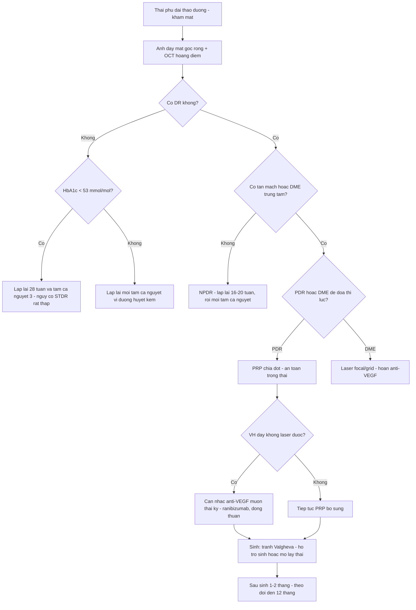
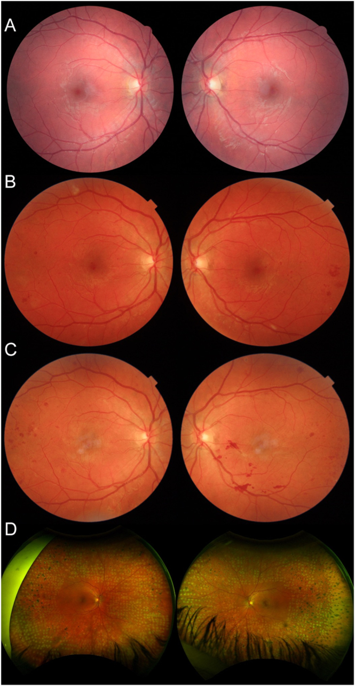
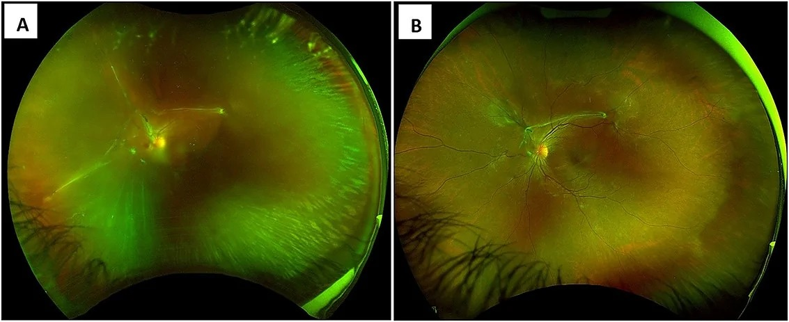
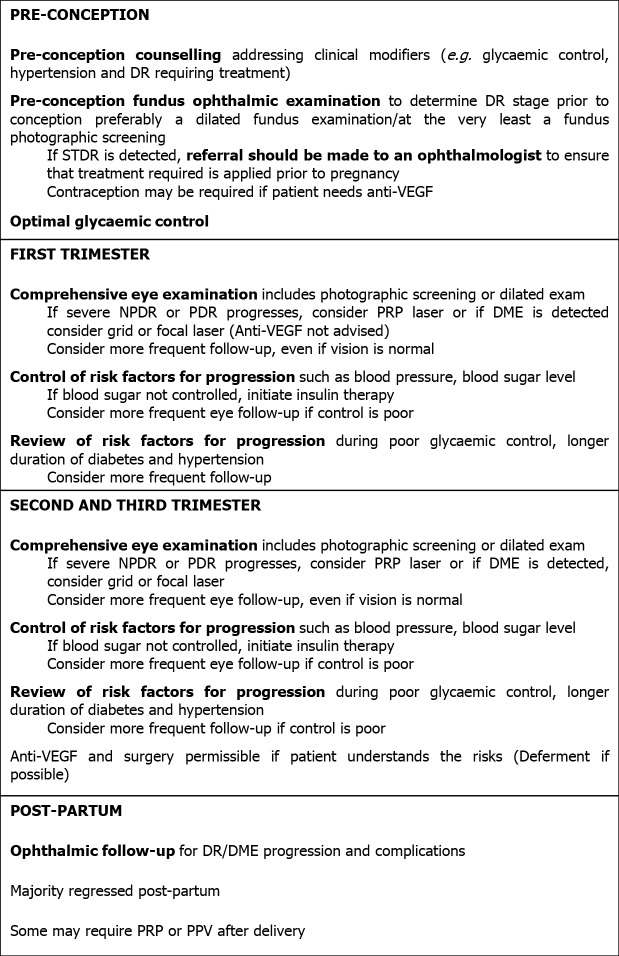

# 490 — Bệnh võng mạc đái tháo đường trong THAI KỲ: lịch soi đáy mắt theo tam cá nguyệt, tiến triển rồi thoái lui sau sinh, ngưỡng laser/anti-VEGF trước sinh / Diabetic retinopathy in pregnancy

**Tags:** `pattern:tien-trien-dr` `pattern:phu-hoang-diem` `pattern:tan-mach-vong-mac` `vung:vong-mac` `vung:hoang-diem` `score:ETDRS` `protocol:soi-day-mat-gian-tiep` `protocol:OCT-hoang-diem`
**Mức chắc chắn (certainty):** tổng hợp y văn (literature synthesis) — tự biên từ review mở CC BY/CC BY-NC (Diagnostics 2024, Indian J Ophthalmol 2021, World J Diabetes 2021), đoàn hệ lớn (Diabet Med 2022, n = 348; Diabetes Care 2025, đoàn hệ ghép cặp toàn quốc n = 2.082) và 2 ca nguyên văn CC BY 4.0/CC BY-NC 4.0; số liệu lấy nguyên từ bài gốc, tên tác giả đối chiếu PMCID.

> **Bài này trả lời 4 câu hỏi của bác sĩ CĐHA/mắt khi thai phụ đái tháo đường đến khám:** (1) **Chụp đáy mắt lúc nào, bao nhiêu lần?** (2) **Tiến triển thật hay chỉ là thay đổi sinh lý của thai?** (3) **Khi nào laser, khi nào anti-VEGF, có phải mổ lấy thai vì mắt không?** (4) **Sau sinh còn theo dõi bao lâu?**
> Đây là bài **nối tiếp** [443 – Bệnh võng mạc đái tháo đường](../443-vong-mac-dai-thao-duong/lesson.md) (phân độ, OCT, laser) và [488 – HCQ trong thai kỳ](../488-hcq-trong-thai-ky-va-cho-con-bu/lesson.md) (khung "mờ mắt ở thai phụ nghĩ sản khoa trước"). **Không lặp lại** kỹ thuật đọc OCT/laser của 443.

## 1. Tổng quan bệnh học – cơ chế hình ảnh

### 1.1 TẠI SAO thai kỳ làm võng mạc đái tháo đường "động" hơn — 4 cơ chế chồng lên nhau

- **Huyết động:** thể tích huyết tương tăng **40–50%** → pha loãng máu, giảm độ nhớt; lưu lượng máu võng mạc đo bằng Doppler **tăng ngay từ tam cá nguyệt 1**. Mao mạch võng mạc đái tháo đường đã **mất tự điều hòa (loss of autoregulation)** → tăng áp lực thủy tĩnh lên thành mao mạch vốn đã giòn → **vi phình mạch mới, phù, xuất huyết**.
- **Nội tiết – nhau thai:** hPL (human placental lactogen), progesterone, estrogen, cortisol và **IGF-1** tăng; nhau thai tiết **VEGF hòa tan (sFlt-1/PIGF mất cân bằng)** → tăng tính thấm mao mạch. Đây là lý do **phù hoàng điểm (DME) nặng lên** dù đường huyết không xấu đi.
- **Hệ renin–angiotensin tại mắt:** thai kỳ hoạt hóa RAAS nội nhãn → co mạch và tăng sinh mạch.
- **"Xấu đi sớm" (early worsening) khi siết đường huyết quá nhanh:** khi HbA1c giảm nhanh, **lưu lượng máu võng mạc giảm đột ngột → thiếu oxy tương đối → VEGF tăng** → DR nặng lên trong **6–12 tháng đầu**. DCCT: **13%** ở nhóm siết chặt so với **7,6%** ở nhóm điều trị thường quy; nguy cơ **tăng gấp đôi (OR 2,7)** khi HbA1c nền **> 6 SD** trên trung bình nhóm chứng. Nghĩa là **không chỉ đường huyết xấu mới làm nặng** — siết quá nhanh cũng vậy.

### 1.2 Vì sao đọc ảnh bằng OCT/FA/ảnh góc rộng chứ không chỉ soi đáy mắt

- **OCT hoàng điểm (SD-OCT):** giao thoa ánh sáng hồng ngoại gần (bước sóng ngắn, độ tương phản cao) đo **độ dày võng mạc theo µm** và phát hiện **nang nội bào, dịch dưới võng mạc, màng ngăn (epiretinal membrane), co kéo** — những thứ **không thấy rõ khi soi đáy mắt** và là thứ quyết định có phù hoàng điểm trung tâm (DME) hay không.
- **FA (fluorescein angiography):** thấy **rò (leakage)** từ vi mạch/Tân mạch; vùng **không tưới máu (capillary non-perfusion)** — nhưng **không dùng thường quy khi mang thai** nếu không cần thiết (thuốc nhuộm qua nhau thai, dữ liệu an toàn hạn chế).
- **Ảnh đáy mắt góc rộng (wide-field 200°) hoặc 7 trường ETDRS:** tân mạch **ngoại vi** (NVE) nằm ngoài khung 45° là lý do hay bị bỏ sót "PDR nhẹ" trên ảnh chụp thường quy.
- **Siêu âm B-scan:** bắt buộc khi **xuất huyết dịch kính (VH)** che đáy mắt — để loại **bong võng mạc co kéo (TRD)** trước khi quyết định mổ.

### 1.3 Ngưỡng định lượng nằm lòng (bắt buộc nhớ)

| Chỉ số | Con số | Nguồn |
|---|---|---|
| DR lúc khám thai đầu | **52%** (116/223) ĐTĐ type 1; **14%** (17/125) type 2 | Diabet Med 2022, n = 348 (PMC9303564) |
| DR đe dọa thị lực (STDR) lúc đầu thai | **16%** type 1; **6%** type 2 | *cùng nguồn* |
| Cần điều trị trong thai | **2,7%** (type 1) và **2,4%** (type 2) | *cùng nguồn* |
| **Không DR + HbA1c < 53 mmol/mol (7,0%)** đầu thai | **0/175** tiến triển STDR; **94%** vẫn không có DR | *cùng nguồn* |
| NPDR mức trung bình lúc đầu → tân sinh trong thai | **29%** | DIEP study, dẫn qua Diagnostics 2024 (PMC10887682) |
| Không DR lúc đầu → dấu hiệu nhẹ | **~12%** | *cùng nguồn* |
| Nguy cơ tiến triển so với không mang thai (cũ) | **1,6–2,5 lần** | 2 nghiên cứu nhỏ thập niên 1990 |
| Nguy cơ tiến triển PDR (đoàn hệ ghép cặp 2025) | **aHR 0,64 (95% CI 0,32–1,31)** — **không tăng** | Diabetes Care 2025 (PMC12451835) |
| PRP trong thai (ghép cặp) | **1,2% vs 1,1%**; OR 1,18 (0,53–2,66) | *cùng nguồn* |
| Thời gian nguy cơ còn cao sau sinh | **đến 12 tháng** | DCCT, dẫn qua 2 review |
| HbA1c đích trước sinh / trong thai | **< 6,5% (48 mmol/mol)** / **6,0–6,5%** nếu không hạ đường huyết | ADA Standards of Care |

## 2. Mẫu hình + chẩn đoán phân biệt theo vị trí (gamut)

**Câu hỏi lọc:** *"Thai phụ đái tháo đường giảm thị lực — tổn thương ở **hoàng điểm (DME)**, ở **võng mạc ngoại vi (PDR/VH)** hay **không do đái tháo đường**?"*

- **Hoàng điểm (macular):**
  - **DME trung tâm (center-involving):** dày võng mạc **≥ 250–300 µm** hoặc nang nội bào trên OCT, xuất tiết cứng hình vòng; thị lực giảm từ từ.
  - **Bong thanh dịch do tiền sản giật (SRD):** dịch **dưới võng mạc**, hai bên, kèm **hẹp tiểu động mạch, đốm Elschnig**, HA cao ± protein niệu — **không có xuất huyết/tân mạch**.
  - **CSCR:** bong vòm hoàng điểm, **không xuất huyết**, thường một bên; thai kỳ là yếu tố thuận lợi.
  - **Tắc nhánh/trung tâm tĩnh mạch võng mạc:** thai kỳ tăng đông — xuất huyết **theo vùng**, phù lan.
- **Ngoại vi (peripheral):**
  - **PDR:** NVD/NVE, **xuất huyết trước võng mạc hình "thuyền"**, có thể kèm VH.
  - **VH:** mất đỏ phản quang, không thấy đáy mắt → **siêu âm B-scan** loại TRD.
  - **TRD:** dải co kéo cố định, võng mạc căng — **mổ**, không chờ.
- **Ngoài võng mạc (mimic):**
  - **Thay đổi khúc xạ/giác mạc thai kỳ:** mờ nhẹ hai bên, **đáy mắt bình thường**, hồi phục sau sinh.
  - **IIH / u tuyến yên (lymphocytic hypophysitis):** đau đầu, **mất thị trường hai thái dương**, phù đĩa thị.
  - **Thiếu máu thiếu sắt nặng:** xuất huyết võng mạc hai bên, thiếu máu trung tâm (bài 453).

## 3. Bảng so sánh phân biệt (ma trận đối chiếu)

| Thực thể | Hình ảnh điển hình | Chốt vào (rule-in) | Chốt loại (rule-out) | Gợi ý xác nhận |
|---|---|---|---|---|
| **DME (phù hoàng điểm ĐTĐ)** | Dày võng mạc trung tâm, nang nội bào, xuất tiết cứng | **Dày ≥ 250 µm ở trung tâm hoặc nang nội bào trên OCT** + tiền sử ĐTĐ | **OCT hoàng điểm bình thường (< 250 µm, không nang) → không phải DME trung tâm** | OCT mỗi lần khám nếu nghi; **laser focal/grid** trong thai; **hoãn anti-VEGF** |
| **PDR** | NVD/NVE, xuất huyết trước VM, VH | **Tân mạch trên đĩa/thân võng mạc** ở bất kỳ vị trí | **Chỉ vi phình mạch/xuất huyết nhỏ, không tân mạch → NPDR** | Ảnh góc rộng 200° hoặc 7 trường; PRP ngay khi đủ điều kiện |
| **TRD** | Dải xơ co kéo, VM căng, VH tái phát | **Dải co kéo cố định trên OCT/US + VH không tan** | **Siêu âm không thấy dải co kéo → chưa mổ** | **Phẫu thuật cắt dịch kính** (không phụ thuộc thai) |
| **Bong thanh dịch do tiền sản giật** | SRD hai bên quanh đĩa thị/hố trung tâm, đốm Elschnig | **HA cao ± protein niệu + SRD hai bên + hẹp tiểu động mạch** | **Có tân mạch/xuất huyết dày → nghĩ ĐTĐ chứ không phải tiền sản giật** | Theo dõi sản khoa; **thường tự hết sau sinh** (bài 488) |
| **CSCR** | Bong vòm hoàng điểm, nâng RPE, không xuất huyết | **Không tăng HA + bong vòm + điểm rò trên FA** | **Có xuất huyết/nang dày → không phải CSCR** | Theo dõi; tránh corticoid |
| **Thay đổi sinh lý thai kỳ** | Đáy mắt bình thường, có thể dày hắc mạc | **Mờ nhẹ, hai bên, không tổn thương võng mạc** | **Có bất kỳ tổn thương võng mạc → không quy cho sinh lý** | Hồi phục sau sinh; không điều trị |

## 4. Protocol chụp + lịch theo dõi (chuẩn hóa)

### 4.1 Trước khi mang thai (quan trọng nhất)

- **Khám đáy mắt giãn đồng tử + ảnh 7 trường/góc rộng + OCT hoàng điểm** trước khi thụ thai.
- Nếu có **STDR (PDR hoặc DME có ý nghĩa lâm sàng)**: **điều trị trước khi mang thai** (PRP/laser), vì thai kỳ làm việc điều trị khó hơn.
- **Tư vấn:** PDR lúc bắt đầu thai là **yếu tố nguy cơ mạnh nhất** cho tiến triển; cân nhắc **trì hoãn có kế hoạch** nếu cần anti-VEGF (thuốc cần thời gian thải).
- **HbA1c đích < 6,5% (48 mmol/mol)** trước thụ thai — nhưng **giảm từ từ** để tránh early worsening.

### 4.2 Trong thai — hai hệ khuyến cáo chồng lấn

| Thời điểm | NICE / RCO / ICO | ADA / AAO PPP |
|---|---|---|
| Khám thai đầu | **Soi đáy mắt giãn đồng tử** (hoặc ảnh) | **Sớm sau thụ thai, tam cá nguyệt 1** |
| Nếu khám đầu **bình thường** | Lặp **28 tuần** | Không DR/tối thiểu: **tam cá nguyệt 1 và 3** |
| Nếu **có bất kỳ DR** | Lặp **16–20 tuần** | NPDR nhẹ: **mỗi tam cá nguyệt** |
| **NPDR trung bình–nặng / PDR** | Theo dõi sát | **Mỗi 1 tháng** (ADA) / **1–3 tháng** (AAO PPP) |
| Sau sinh | **Tiền tân sinh (pre-proliferative): theo dõi ≥ 6 tháng** | **1–2 tháng sau sinh** nếu có DME/NPDR; **đến 12 tháng** |

- **Hình ảnh mỗi lần khám:** ảnh màu **góc rộng/7 trường** + **OCT hoàng điểm** nếu nghi DME; **B-scan** nếu VH.
- **Bổ sung thai kỳ:** khám **huyết áp, protein niệu, HbA1c, cân nặng** mỗi lần — vì **tăng HA/tiền sản giật** là yếu tố làm nặng DR độc lập.

### 4.3 Điều trị trong thai — thứ tự ưu tiên

1. **PRP (panretinal photocoagulation):** **an toàn và là lựa chọn ưu tiên** cho PDR trong thai; có thể làm **từng phần (PRP chia đợt)** để dung nạp; theo dõi sát vì **có thể cần bổ sung sau sinh**.
2. **Laser focal/grid cho DME:** an toàn; là lựa chọn khi DME trung tâm **không đe dọa tức thì**.
3. **Anti-VEGF:** **tránh trong tam cá nguyệt 1** (báo cáo sảy thai sau tiêm bevacizumab tuần 5–12); nếu **bắt buộc** (VH dày không laser được, DME tiến triển nhanh): **làm muộn thai kỳ**, **ưu tiên ranibizumab** (thời gian bán thải ngắn, thanh thải nhanh), **tư vấn đa chuyên khoa + đồng thuận**.
   - **Ca faricimab 2026:** thai 29 tuần 6 ngày, PDR nguy cơ cao + VH dày, **1 mũi faricimab** → thị lực **CF → 20/25** sau 1 tháng; mổ lấy thai 36 tuần 1 ngày vì tim thai; **không biến cố** nào quy cho thuốc (PMC13676271, CC BY-NC 4.0).
   - **Có thể hoãn anti-VEGF 6–9 tháng:** RESTORE extension cho thấy **thị lực 3 năm** ở nhóm hoãn 12 tháng **tương đương** nhóm điều trị ngay.
4. **Cắt dịch kính (PPV):** chỉ khi **VH không tan hoặc TRD** — không trì hoãn vì thai.

### 4.4 Sinh và hậu sản

- **DR không phải chống chỉ định sinh thường.** Với **PDR không kiểm soát**: **gây tê ngoài màng cứng + rặn có hỗ trợ (forceps/vacuum)** hoặc **mổ lấy thai** để tránh **nghiệm pháp Valsalva** gây xuất huyết dịch kính/võng mạc (ADA).
- **Sau sinh:** **thoái lui một phần** nhưng **không hoàn toàn** — số vi phình mạch **không trở về mức trước thai**; nguy cơ tiến triển **kéo dài đến 12 tháng** → **khám 1–2 tháng sau sinh**, rồi **6 và 12 tháng** (hoặc theo mức độ).

### 4.5 Sơ đồ quyết định

## 5. Biến thể bình thường và cạm bẫy

- **"Thai kỳ luôn làm DR nặng lên" — nửa đúng:** đoàn hệ ghép cặp toàn quốc 2025 (1.041 thai phụ + 1.041 chứng, cùng mức DR nền) cho **aHR 0,64 (0,32–1,31)** cho tiến triển PDR và **PRP 1,2% vs 1,1%** — **không tăng nguy cơ điều trị** khi chăm sóc hiện đại. Ngược lại, **các yếu tố nền** (DR nặng lúc đầu, ĐTĐ type 1 lâu năm, HbA1c cao, tăng HA) mới là thứ dự báo tiến triển → **đừng hù bệnh nhân, nhưng đừng bỏ sàng lọc nhóm nguy cơ cao**.
- **Early worsening bị quy oan cho "ăn uống kém":** siết đường huyết **nhanh** cũng gây nặng lên trong 6–12 tháng (DCCT 13% vs 7,6%) — cần **giải thích trước** để bệnh nhân không bỏ điều trị.
- **HbA1c đẹp không loại trừ tiến triển:** ca ABCC8-MODY tiến triển **PDR hai bên ở 22 tuần** dù **HbA1c 39 mmol/mol** và **TIR 68%**; cần **4 đợt PRP** và còn hoạt động **đến 61 tuần sau sinh** → **thể ĐTĐ hiếm/di truyền** có thể tiến triển nhanh.
- **"Sau sinh là hết chuyện":** 57–62% (type 1) và 17–28% (type 2) có DR lúc khám đầu; một số **cần PRP/cắt dịch kính sau sinh**; nguy cơ **đến 12 tháng**. **Không được đóng hồ sơ ngay sau sinh.**
- **Bỏ sót tân mạch ngoại vi:** ảnh 45° chỉ thấy hậu cực — **luôn dùng ảnh góc rộng/7 trường** khi sàng lọc PDR.
- **Nhầm SRD do tiền sản giật với DME:** SRD **không có xuất huyết/tân mạch**, HA cao, **tự hết sau sinh**; điều trị sai hướng (laser) là vô ích, bỏ sót tiền sản giật là nguy hiểm.
- **Đo độ dày hắc mạc trong thai:** hắc mạc **dày sinh lý** khi mang thai (đặc biệt có tiền sản giật) — đừng đọc thành bệnh hắc mạc.
- **Anti-VEGF "cho nhanh":** bevacizumab có **thời gian bán thải dài, giảm VEGF huyết tương ≥ 1 tháng** → phơi nhiễm thai nhi lâu hơn ranibizumab; **không dùng thay PRP** khi PRP làm được.
- **Quên khám thai đầu:** khám **muộn** (tam cá nguyệt 2–3) làm mất cơ hội điều trị PDR trước khi có VH.

## 6. Tự lượng giá — Blind Quiz

**Ca 1 — Thai phụ 31 tuổi, ĐTĐ khởi phát lúc 11 tuổi (đột biến ABCC8), HbA1c 68 mmol/mol trước thai; chuyển từ thuốc uống sang insulin. Ảnh đáy mắt dưới đây: (A) 8 năm trước khi mang thai, (B) 22 tuần, (C, D) các mốc sau đó.**

- Hỏi: (1) Mô tả thay đổi từ A sang B. (2) Vì sao HbA1c **tốt hơn** mà võng mạc lại nặng hơn? (3) Xử trí tiếp theo và theo dõi sau sinh đến khi nào?

<b>Bấm để hiện đáp án (findings + chẩn đoán)</b>

- **Findings:** (A) hai mắt chỉ có **vi phình mạch rải rác, NPDR nhẹ**; (B) **22 tuần**: xuất huyết/tân mạch hai bên, **PDR hoạt động** (tăng sinh rõ ở mắt trái); (C) sau PRP còn xuất huyết; (D) ảnh **góc rộng** cho thấy **đốm laser PRP toàn chu vi**.
- **Chẩn đoán:** **PDR tiến triển nhanh trong thai kỳ** trên nền **ABCC8-MODY** — thể ĐTĐ hiếm, **tiến triển nhanh dù HbA1c 39 mmol/mol và TIR 68%**; đã **PRP 4 đợt hai bên từ 22 đến 33 tuần**, không mất thị lực, không bệnh thận; **PDR còn hoạt động đến 61 tuần sau sinh** và cần **PRP bổ sung**.
- **Vì sao HbA1c tốt mà vẫn nặng:** (a) **early worsening** khi HbA1c giảm nhanh (68 → 39 mmol/mol) — giảm tưới máu → thiếu oxy; (b) yếu tố **thai kỳ** (VEGF, huyết động); (c) **kiểu gen ABCC8** có thể có bệnh vi mạch tiến triển.
- **Theo dõi:** khám **mỗi 1–3 tháng** trong thai, **1–2 tháng sau sinh** và **đến ≥ 12 tháng** (ca này vượt 12 tháng) — không ngừng vì "đã sinh".
- **Nguồn ảnh:** McCluskey P et al., *Endocrinol Diabetes Metab Case Rep* 2026 (PMC12899314), CC BY 4.0 — Fig. 2.

**Ca 2 — Thai phụ 27 tuổi, ĐTĐ type 1, 28 tuần 1 ngày, **PDR nguy cơ cao + xuất huyết dịch kính dày mắt trái** không thể PRP. Sau hội chẩn đa chuyên khoa, tiêm nội dịch kính **1 mũi faricimab** lúc 29 tuần 6 ngày. Ảnh dưới đây chụp sau tiêm.**

- Hỏi: (1) Vì sao PRP không làm được? (2) Vì sao chọn anti-VEGF **muộn** thay vì sớm? (3) Có phải mổ lấy thai ngay vì mắt không?

<b>Bấm để hiện đáp án</b>

- **Findings:** (A) 1 tuần sau tiêm: **xuất huyết dịch kính tan nhiều**, thấy **màng xơ + tân mạch đĩa thị**; (B) sau đó: đáy mắt rõ hơn, **không còn VH dày**, tân mạch thoái triển một phần.
- **Vì sao PRP không làm được:** **VH dày che đáy mắt** → không nhìn thấy võng mạc ngoại vi để đặt laser; PRP mù gây biến chứng.
- **Vì sao muộn:** nguy cơ **sảy thai** khi anti-VEGF **tam cá nguyệt 1** (báo cáo bevacizumab 5–12 tuần); **ranibizumab** được ưu tiên vì bán thải ngắn — ca này dùng **faricimab** (kháng VEGF-A **và** Ang-2) lần đầu báo cáo trong thai, sau **tư vấn đa chuyên khoa + đồng thuận**.
- **Kết cục:** thị lực **CF → 20/25 sau 1 tháng**; mổ lấy thai **36 tuần 1 ngày** vì **tim thai không đảm bảo**, cách mũi tiêm **37 ngày**; **không biến cố** nào quy cho thuốc.
- **Có phải mổ ngay vì mắt?** **Không** — DR **không phải chỉ định mổ lấy thai**; chỉ **tránh Valsalva** ở PDR không kiểm soát (gây tê ngoài màng cứng + sinh hỗ trợ).
- **Nguồn ảnh:** *Oxf Med Case Reports* 2026 (PMC13676271), CC BY-NC 4.0 — Fig. 1.

**Ca 3 — Thai phụ ĐTĐ type 1 đến khám lần đầu ở 9 tuần, **không có DR** trên ảnh, HbA1c 50 mmol/mol. Bạn dùng lưu đồ nào để quyết định lịch khám tiếp?**

- Hỏi: (1) Lịch khám tiếp theo? (2) Yếu tố nào sẽ khiến bạn rút ngắn lịch? (3) Câu nào trong lưu đồ cần phản biện?

<b>Bấm để hiện đáp án</b>

- **Lịch:** theo **NICE/RCO/ICO**: khám đầu bình thường → **lặp 28 tuần**; nếu có bất kỳ DR → **16–20 tuần**. Theo **ADA**: không DR → **tam cá nguyệt 1 và 3**; NPDR nhẹ → **mỗi tam cá nguyệt**. Với **HbA1c < 53 mmol/mol và không DR**, dữ liệu đoàn hệ cho **0/175 tiến triển STDR** → có thể **giảm tần suất** một cách an toàn (Diabet Med 2022).
- **Rút ngắn lịch khi:** DR nền **trung bình–nặng/PDR**, **ĐTĐ type 1 lâu năm**, **HbA1c cao/không đạt mục tiêu**, **tăng huyết áp/tiền sản giật**, **bệnh thận**, hoặc **giảm thị lực mới**.
- **Phản biện lưu đồ:** lưu đồ ghi **"Anti-VEGF và phẫu thuật được phép nếu bệnh nhân hiểu rõ nguy cơ (defer nếu có thể)"** — đúng về nguyên tắc, nhưng cần nhấn: **PRP là ưu tiên**, anti-VEGF **tránh tam cá nguyệt 1**, và **không có dữ liệu an toàn dài hạn** cho thai nhi. Ngoài ra lưu đồ **không nêu ngưỡng HbA1c** — thiếu điểm này dễ bỏ nhóm nguy cơ cao.
- **Nguồn ảnh:** Choo PP et al., *World J Diabetes* 2021 (PMC8472492), CC BY-NC 4.0 — Fig. 1.

## Bài liên quan chéo
- [443 – Bệnh võng mạc đái tháo đường: phân độ, OCT, laser](../443-vong-mac-dai-thao-duong/lesson.md)
- [488 – Hydroxychloroquine trong THAI KỲ & cho con bú](../488-hcq-trong-thai-ky-va-cho-con-bu/lesson.md)
- [453 – Bệnh võng mạc tăng huyết áp & thiếu máu](../453-benh-vong-mac-tang-huyet-ap-va-thieu-mau/lesson.md)
- [470 – CSCR do corticosteroid](../470-cscr-do-corticosteroid-mat-thi-luc-khong-dau/lesson.md)
- [444 – Tắc mạch võng mạc](../444-tac-mach-vong-mac/lesson.md)
- [433 – Phù đĩa thị vs drusen đĩa (IIH)](../433-phu-dia-thi-drusen/lesson.md)
- [481 – Biến chứng nội nhãn liệu pháp gene/tiêm nội dịch kính](../481-bien-chung-noi-nhan-lieu-phap-gene-tiem-noi-dich-kinh/lesson.md)
- [400 – Tổng quan Mắt & thị giác](../400-tong-quan-mat-thi-giac/lesson.md)

## Ảnh
- `images/490_dr-thai-ky_Retina-serial_PMC12899314.jpg` — McCluskey P et al., *Endocrinol Diabetes Metab Case Rep* 2026 (PMC12899314), **CC BY 4.0**.
- `images/490_dr-thai-ky_Fundus_PMC13676271.jpg` — *Oxf Med Case Reports* 2026 (PMC13676271), **CC BY-NC 4.0**.
- `images/490_dr-thai-ky_Flowchart_PMC8472492.jpg` — Choo PP et al., *World J Diabetes* 2021 (PMC8472492), **CC BY-NC 4.0**.
- Nguồn + giấy phép từng ảnh: [`images/CREDITS.md`](images/CREDITS.md).

> Không dùng để chẩn đoán độc lập khi chưa có người hướng dẫn.
