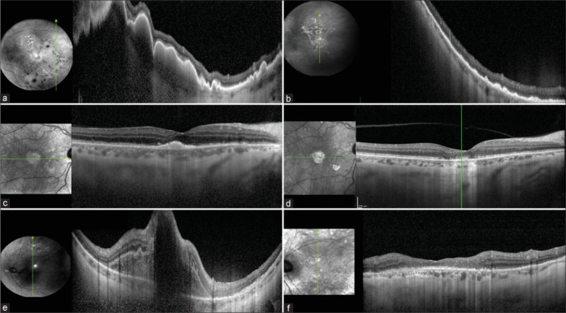
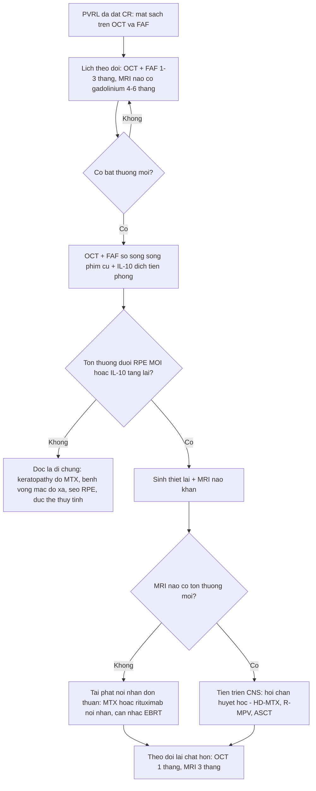
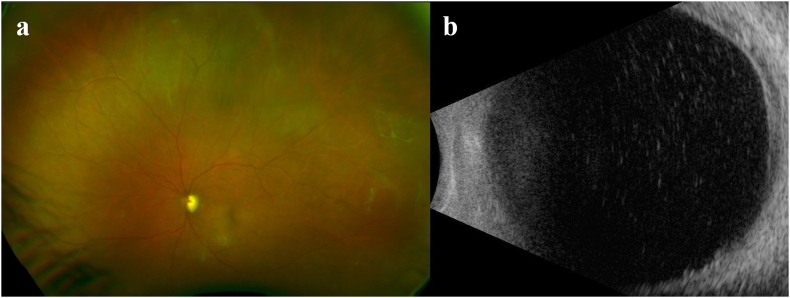
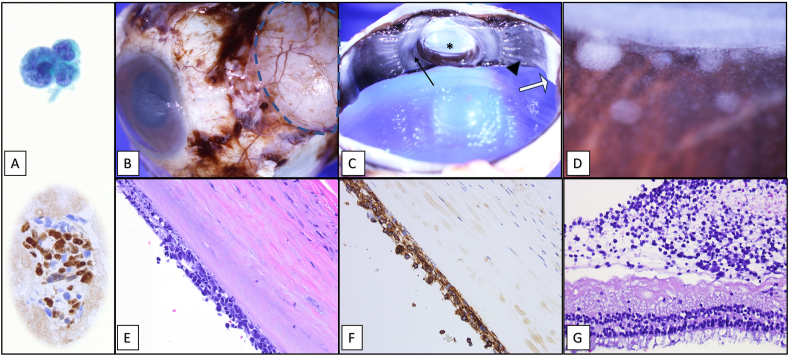
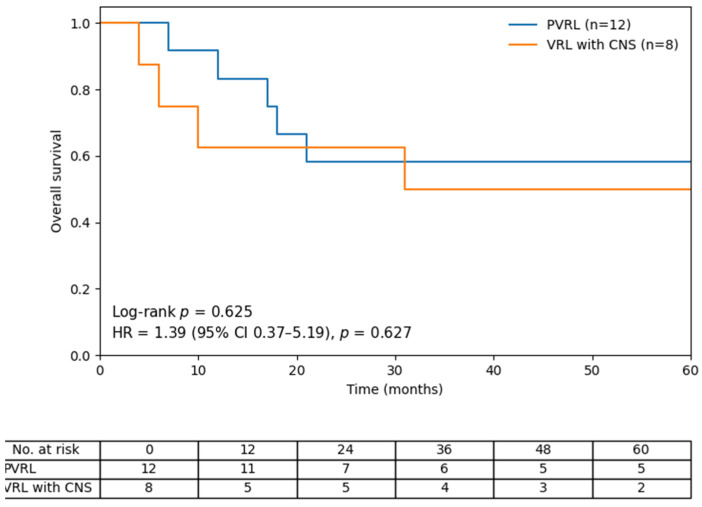

# 491 — Theo dõi & tái phát u lympho nội nhãn tiên phát (PVRL): tái phát nội nhãn, tiến triển CNS và lịch MRI / Surveillance and relapse of primary vitreoretinal lymphoma

**Tags:** `pattern:tai-phat-pvrl` `pattern:viet-dich-kinh` `vung:vong-mac` `vung:than-kinh-trung-uong` `score:IPCG-response` `score:IL-10` `protocol:MRI-nao-4-6-thang` `protocol:OCT-FAF-theo-doi`
**Mức chắc chắn (certainty):** tổng hợp y văn (literature synthesis) — nhóm tự biên từ y văn mở (Ann Hematol 2025 CC BY 4.0; J Clin Med 2026 CC BY 4.0; Indian J Ophthalmol 2026 CC BY-NC-ND 4.0; Cancers 2026 CC BY 4.0; Am J Ophthalmol Case Rep 2025 CC BY-NC-ND 4.0; Sci Rep 2026 CC BY 4.0), chưa gắn một ca nguyên văn xuyên suốt.

> **Vì sao bài này quan trọng:** bài [462](../462-u-lympho-noi-nhan-PVRL/lesson.md) đã chốt **chẩn đoán** và khung điều trị PVRL. Nhưng câu hỏi làm bác sĩ hình ảnh mất ngủ là câu hỏi **sau khi mắt đã sạch**: *bệnh nhân này đã khỏi chưa, tái phát ở đâu, và khi nào?* Ba con số định hình toàn bộ bài: **CR nội nhãn đạt 80–100%** nhưng **60–90% bệnh nhân rồi vẫn tiến triển thần kinh trung ương (CNS)** trong vài năm, và **tối đa 90%** trong các loạt dài — nghĩa là **"mắt sạch" là dấu hiệu tốt của mắt, không phải của bệnh**. Tái phát **gần như luôn ở não, không ở mắt**: trong một loạt 44 bệnh nhân có **17 người tái phát (18 biến cố)** — **17 biến cố ở não, chỉ 1 biến cố tại mắt**, và ca tại mắt đó rồi cũng tiến triển lên CNS.

## 1. Tổng quan — vì sao mắt sạch mà não vẫn tái phát, và ngưỡng nào phải nhớ

- **Bệnh học (pathology):** PVRL là **u lympho tế bào B lớn lan tỏa (DLBCL)** của mô **đặc quyền miễn dịch (immune privilege)** — cùng phổ sinh học với **u lympho hệ thần kinh trung ương tiên phát (primary CNS lymphoma, PCNSL)**, chung **đột biến MYD88 L265P**. Vì mắt và não **cách ly khỏi tuần hoàn hệ thống bằng hàng rào tương đương** (hàng rào máu–võng mạc ≈ hàng rào máu–não), thuốc toàn thân vào mắt kém và thuốc tại mắt **không với tới nhu mô não**.
- **TẠI SAO tái phát chủ yếu ở não (cơ chế, không phải thống kê suông):**
  1. **Ổ vi mô ngoài mắt có từ trước** — khoảng **1/3** bệnh nhân đã có tổn thương CNS lúc chẩn đoán; **IL-10 trong dịch não tủy (CSF) tăng** ở một số ca dù tế bào học và MRI âm — dấu hiệu của **bệnh dưới lâm sàng**.
  2. **Điều trị tại mắt quá tốt** — MTX/rituximab nội nhãn và xạ trị mắt đạt CR **> 80–90%** nên mắt sạch nhanh, trong khi ổ ngoài mắt không được chạm tới.
  3. **Mắt là "nơi trú ẩn" (sanctuary site)** — hàng rào máu–võng mạc đẩy thuốc ra ngoài; và bất kỳ **vật liệu nhân tạo** trong mắt (thể thủy tinh nhân tạo, ống dẫn lưu glaucoma) có thể thành **nơi trú ẩn thật sự** cho tế bào u (xem mục 5).
- **Ngưỡng định lượng phải nhớ (4 cửa Argon):**

| Chỉ số | Con số | Nguồn |
|---|---|---|
| Tiến triển CNS sau PVRL | **60–90%** trong vài năm; tới **90%** ở loạt dài | J Clin Med 2026 (PMC13027321); Cancers 2026 (PMC13565040) |
| Thời gian tới tiến triển CNS (có MRI định kỳ 4–6 tháng) | trung bình **11,8 tháng** (khoảng 1–45) | J Clin Med 2026 (PMC13027321) |
| Thời gian tới tiến triển CNS (theo dõi thụ động) | **16,2–30 tháng** — dài hơn *vì phát hiện muộn*, không vì bệnh nhẹ hơn | J Clin Med 2026 (PMC13027321) |
| Tái phát sau phác đồ không hóa chất + MTX nội nhãn | **17/44 = 38,6%** (bài bàn luận ghi 42,9%); **toàn bộ đều có thành phần CNS**, 1 ca tái phát nội nhãn trước | Ann Hematol 2025 (PMC12283856) |
| PFS / OS trung vị (loạt 44 BN) | **22,1 tháng** / **71,5 tháng**; tử vong do tiến triển CNS **11,4%** | Ann Hematol 2025 (PMC12283856) |
| Sống toàn bộ 5 năm (PVRL chưa có CNS) | **58%** | J Clin Med 2026 (PMC13027321) |
| Tái phát sau MTX nội nhãn giảm cường độ | **17,6%** (3/17); CR **82,4%**, trung vị **6 tháng** | J Clin Med 2026 (PMC13607433) |
| Tái phát trong loạt thực hành 65 BN | **35 BN** tái phát trong trung vị **23,2 tháng** theo dõi | Sci Rep 2026 (PMC12910012) |
| Rituximab nội nhãn cứu vãn (đã xạ trị mắt + toàn não) | **10/10 mắt CR** sau trung bình **4 mũi 1 mg/0,1 mL**, 1 mắt tái phát sau **14 tháng** | Indian J Ophthalmol 2026 (PMC13271570) |
| Ngưỡng IL-10 dịch tiền phòng | **< 10 pg/mL** = âm tính hóa; **< 50% so với ban đầu** → tiếp tục hàng tháng tới khi âm tính hóa | Cancers 2026 (PMC13565040) |
| Thời gian âm tính hóa IL-10 dưới MTX nội nhãn | trung bình **1,17 tháng**, khoảng **8,5 mũi** | Cancers 2026 (PMC13565040) |

- **Cơ chế hình ảnh (TẠI SAO OCT/FAF phát hiện tái phát sớm hơn soi đáy mắt):** tế bào u **hồi lưu về khoang dưới biểu mô sắc tố (sub-RPE)** — nơi có mật độ mao mạch hắc mạc và ligand homing. Trên OCT, chúng là **khối tăng phản hồi (hyperreflective) dưới RPE** làm dày/bong RPE **trước khi** đáy mắt thấy ổ vàng; trên FAF là **ổ tăng tự huỳnh quang**. Vì tổn thương **dưới RPE không nhìn thấy bằng đèn khe**, **OCT là "kính hiển vi" của theo dõi**, không phải ảnh màu.

## 2. Mẫu hình + chẩn đoán phân biệt theo vị trí (gamut)

**Câu hỏi lọc:** *"Bệnh nhân PVRL đã đạt CR, nay có bất thường mới — đó là tái phát, di chứng điều trị, hay nhiễm trùng?"* Trả lời theo **3 tầng**: mắt → não → toàn thân.

**Gamut theo vị trí tái phát:**
- **Nội nhãn đơn thuần (intraocular):** tái phát PVRL thật (dịch kính + ổ dưới RPE mới) — **hiếm**, thường đi kèm hoặc đi trước CNS.
- **CNS ± mắt (phổ biến nhất):** u lympho não mới (quanh não thất, thể chai, thùy trán) ± thâm nhiễm dịch kính/thần kinh thị.
- **Ngoài CNS, ngoài mắt (hiếm):** màng phổi, tinh hoàn, hạch, tủy xương — trong loạt 12 BN có **1 ca tràn dịch màng phổi ác tính**.
- **"Nơi trú ẩn" (sanctuary):** tái phát lặp lại **cùng một mắt** dù CR toàn thân — nghĩ **vật liệu nhân tạo** (IOL, ống dẫn lưu glaucoma) hoặc **vỏ bao sau** làm ổ chứa.

**Gamut của "tổn thương mới trong mắt sau điều trị" (phân biệt theo bản chất):**
- **Tái phát u:** tế bào dịch kính **mới** + **ổ dưới RPE mới** + IL-10 tăng lại.
- **Độc tính MTX nội nhãn:** **bệnh giác mạc (keratopathy) 41,2%**, viêm tiền phòng nhẹ, chấm trên giác mạc — **không có tổn thương dưới RPE**.
- **Bệnh võng mạc do xạ (radiation retinopathy):** giãn mao mạch, xuất tiết cứng, phù hoàng điểm, thiếu tưới máu — xuất hiện **6–24 tháng** sau xạ, **không có tế bào u**.
- **Đục thể thủy tinh / dính sau mổ:** giảm thị lực tiến triển, **không viêm**.
- **Nhiễm trùng (CMV, ARN, nấm):** viêm rõ, hoại tử võng mạc, đau — ở người **sau hóa trị/suy giảm miễn dịch** (bài [452](../452-hoai-tu-vong-mac-ARN-CMV/lesson.md), [454](../454-viem-vong-mac-suy-giam-mien-dich/lesson.md)).
- **Di chứng xơ – sẹo RPE (inactive):** dày RPE **không đổi** qua nhiều lần chụp, **không tế bào dịch kính**, IL-10 âm.

## 3. Bảng so sánh phân biệt (ma trận đối chiếu)

| Thực thể (entity) | Hình ảnh điển hình | Chốt vào (rule-in) | Chốt loại (rule-out) | Gợi ý xác nhận |
|---|---|---|---|---|
| **Tái phát PVRL nội nhãn** | **Tế bào dịch kính mới** + **ổ tăng phản hồi dưới RPE mới** + FAF tăng tự huỳnh quang | **Tổn thương dưới RPE MỚI so với phim cũ + IL-10 dịch tiền phòng tăng lại (> 50 pg/mL hoặc > 50% so với đáy)** | Chỉ dày RPE **không đổi** nhiều tháng, không tế bào → sẹo | OCT/FAF so **song song phim cũ**; sinh thiết lại nếu còn nghi |
| **Tiến triển CNS (mắt có thể sạch)** | MRI não: khối **quanh não thất/thể chai**, ngấm thuốc đồng nhất, **ít phù quanh u** ở người > 60 tuổi | **Khối ngấm thuốc mới trên MRI có cản quang** ± **IL-10 CSF tăng** | Mắt sạch **không loại trừ** CNS; MRI không cản quang **không đủ** | MRI não + gadolinium **mỗi 4–6 tháng**; chọc dòng CSF khi nghi |
| **Bệnh giác mạc do MTX (keratopathy)** | Chấm/đục **biểu mô giác mạc**, đau, chói; **41,2%** số mắt trong loạt 17 BN | **Tiền sử nhiều mũi MTX + tổn thương chỉ ở giác mạc** | Tổn thương **dưới RPE/võng mạc** → không phải keratopathy | Đèn khe + OCT; giảm tần suất tiêm |
| **Bệnh võng mạc do xạ** | **Giãn mao mạch, xuất tiết cứng, phù hoàng điểm, vùng thiếu tưới máu**; xuất hiện **6–24 tháng** sau xạ | **Tiền sử EBRT + tổn thương mạch máu kiểu xạ, không tế bào u** | **Ổ dưới RPE mới + tế bào dịch kính** → nghĩ tái phát | FFA/OCTA: thiếu tưới máu; OCT: phù, không có khối u |
| **Nhiễm trùng nội nhãn** | Viêm rõ, hoại tử võng mạc, mủ dịch kính, đau | **Sốt/giảm bạch cầu + tổn thương hoại tử + PCR dương** | Đáp ứng corticoid đơn thuần → không loại trừ u | PCR dịch kính/tiền phòng, cấy (bài 452/454) |
| **Tổn thương RPE không hoạt động (sẹo)** | Dày RPE/bong RPE **cũ, ổn định**; **không tế bào dịch kính**; IL-10 thấp | **Bất biến trên ≥ 2 lần chụp cách 3 tháng** | **Dày lên/thêm ổ mới** → không phải sẹo | So sánh định lượng chiều dày/chiều rộng (µm) |
| **"Nơi trú ẩn" quanh vật liệu nhân tạo** | Tái phát **lặp lại cùng mắt** dù CR toàn thân; ống dẫn lưu/IOL có thể bình thường trên lâm sàng | **≥ 2 lần tái phát cùng mắt + có implant** | Tái phát ở mắt **khác** → không phải sanctuary của implant | Giải phẫu bệnh sau cắt nhãn (nếu buộc); cân nhắc tháo implant |

*Ba bệnh nhân tái phát sau xạ trị mắt và xạ toàn não: **trước** (a, c, e) có **khối tăng phản hồi dưới võng mạc/dưới RPE** (dịch dưới võng mạc, bong RPE) làm mất cấu trúc võng mạc ngoài; **sau** một đợt rituximab nội nhãn (b, d, f) các khối này **biến mất, võng mạc ngoài tái cấu trúc**. Đây là cách đọc **"trước–sau"** chứ không đọc một ảnh đơn. Nguồn: Cristescu IE et al., Indian J Ophthalmol 2026 (PMC13271570) Fig. 4, **CC BY-NC-ND 4.0** — giữ nguyên bản, không crop/ghép.*

## 4. Protocol theo dõi + tiêu chuẩn đáp ứng + sơ đồ quyết định

**Lịch theo dõi sau khi đạt lui bệnh (khung thực hành, không phải guideline duy nhất):**

| Thời điểm | Mắt | Não | Toàn thân |
|---|---|---|---|
| Mỗi lần khám (tháng 1–3 sau CR) | Thị lực, đèn khe, **OCT hoàng điểm**, **FAF**, soi đáy mắt giãn đồng tử | — | Khám hạch/da theo huyết học |
| Tháng 3–12 | OCT/FAF mỗi **1–3 tháng**; **IL-10 dịch tiền phòng mỗi lần tiêm** | **MRI não có gadolinium mỗi 4–6 tháng** | Xét nghiệm máu, LDH theo phác đồ |
| Năm 2–5 | OCT/FAF mỗi **3–6 tháng** | **MRI não mỗi 4–6 tháng** (nguy cơ CNS kéo dài nhiều năm) | Khám toàn thân định kỳ |
| Bất kỳ lúc nào | Nghi tái phát → **OCT + FAF + IL-10 tiền phòng**, cân nhắc sinh thiết lại | Triệu chứng thần kinh → **MRI khẩn** | PET/CT khi nghi tổn thương ngoài CNS |

- **Protocol mắt tại trung tâm có theo dõi IL-10:** MTX nội nhãn **400 µg/0,1 mL** hàng tuần tới khi hết đục dịch kính/ổ dưới võng mạc; nếu **không đạt sau 8 mũi** chuyển **hàng tháng**; **IL-10 < 50% so với ban đầu** → tiếp tục hàng tháng tới khi **IL-10 < 10 pg/mL**.
- **Rituximab nội nhãn (cứu vãn):** **1 mg/0,1 mL**, trung bình **4 mũi** cách nhau 1 tuần → 1 tháng; đạt CR **10/10 mắt** trong loạt đã xạ trị trước đó.
- **Xạ trị mắt (EBRT):** **30–50 Gy**, liều trung vị **36 Gy** (ca nguyên văn dùng **36 Gy/20 phân liều**) — kiểm soát tại mắt tốt nhưng **không phòng được tái phát CNS**.
- **Tiêu chuẩn đáp ứng IPCG (dùng để nói cùng ngôn ngữ với huyết học):**

| Mức đáp ứng | Định nghĩa trên lâm sàng – hình ảnh |
|---|---|
| **CR** (complete response) | Không còn bệnh ở tiền phòng, dịch kính, võng mạc |
| **uCR** (uncertain CR) | Chỉ còn bất thường nhỏ không đặc hiệu |
| **PR** (partial response) | Giảm **> 50%** tổn thương mắt |
| **SD** (stable disease) | Không đạt PR và không tiến triển |
| **PD** (progressive disease) | Xấu đi hoặc **tổn thương mới** |

- **Theo dõi CNS bằng MRI định kỳ có giá trị gì — và không có giá trị gì:** trong loạt 12 BN theo MRI **4–6 tháng**, **92% (11/12) tiến triển ngoài mắt**, trung bình **11,8 tháng**, phát hiện **khi chưa có triệu chứng**. Tác giả nêu rõ: **thời gian tới tiến triển ngắn hơn không có nghĩa bệnh nặng hơn** — đó là **lead-time bias**; và **chưa chứng minh được lợi ích sống còn** từ phát hiện sớm.

## 5. Biến thể bình thường và cạm bẫy

- **Cạm bẫy 1 — "mắt sạch = khỏi bệnh":** CR nội nhãn **> 80–90%** nhưng **60–90%** tiến triển CNS; **~1/3** đã có CNS lúc chẩn đoán. Không bao giờ kết luận khỏi bệnh chỉ bằng đáy mắt.
- **Cạm bẫy 2 — "MRI chỉ khi có triệu chứng":** tổn thương CNS giai đoạn sớm **thường không triệu chứng**; chỉ chụp khi có triệu chứng là chờ đến khi u lớn. Ngược lại, phải nói rõ với bệnh nhân: **phát hiện sớm chưa chứng minh kéo dài sống** (lead-time bias) — đây là **tư vấn trung thực**, không phải cổ vũ chụp vô hạn.
- **Cạm bẫy 3 — đọc tổn thương OCT tồn dư là tái phát:** sau điều trị, **ổ dưới RPE giảm nhưng không mất hẳn** và **rối loạn cấu trúc võng mạc ngoài không hồi phục** ở 12 tháng (17 BN). Tổn thương **bất biến** = sẹo; chỉ **dày thêm/ổ mới** mới là tái phát.
- **Cạm bẫy 4 — bệnh giác mạc do MTX bị đọc là "viêm":** **41,2%** mắt có keratopathy; đau, chói, chấm giác mạc — **không phải** dấu hiệu u. Điều trị: giảm tần suất/ngừng tạm, không tăng liều.
- **Cạm bẫy 5 — bệnh võng mạc do xạ xuất hiện muộn:** **6–24 tháng** sau EBRT, có thể đáp ứng corticoid → **giả cải thiện**; phân biệt bằng **FFA/OCTA (thiếu tưới máu)** và **không có tế bào u/IL-10 âm**.
- **Cạm bẫy 6 — "nơi trú ẩn" quanh vật liệu nhân tạo:** ca nguyên văn nữ 54 tuổi có **ống dẫn lưu glaucoma (Ahmed)**; tái phát nội nhãn **2 lần** dù đã HD-MTX + ASCT + xạ trị; cắt nhãn cho thấy **tế bào u lót mặt trong vỏ xơ của ống dẫn lưu**, rồi **4 tháng sau mắt đối diện mới bị**. Bài học: **tái phát lặp lại cùng một mắt có implant = nghĩ sanctuary**, không chỉ "bệnh kháng trị".
- **Cạm bẫy 7 — không thấy đáy mắt thì đừng bỏ theo dõi:** đục dịch kính dày/đục thể thủy tinh che võng mạc là tình huống thường gặp sau nhiều mũi tiêm; **siêu âm B-scan** là công cụ thay thế để phát hiện **tế bào dịch kính tăng dần** (dấu hiệu tái phát sớm) trước khi có thể chụp OCT.

*Tái phát đầu tiên ở mắt trái: (a) ảnh màu — **tế bào trắng tập trung nhiều nhất ở vùng thái dương ngoại vi**; (b) **B-scan** — tế bào dịch kính **tăng lên theo thời gian**. Khi đáy mắt bị che, B-scan là mốc theo dõi khách quan. Nguồn: Lee DH et al., Am J Ophthalmol Case Rep 2025 (PMC11931297) Fig. 2, **CC BY-NC-ND 4.0** — giữ nguyên bản.*

- **Cạm bẫy 8 — IL-10 tăng nhẹ do viêm sau tiêm/do corticoid:** dùng **ngưỡng tuyệt đối** (tiền phòng **> 50 pg/mL**, dịch kính **> 400 pg/mL**) và **tỉ lệ IL-10:IL-6 > 1**; đừng chẩn đoán tái phát chỉ vì "IL-10 dương tính nhẹ".
- **Cạm bẫy 9 — sinh thiết âm không loại trừ:** âm tính giả **30–45%**; **corticoid trước sinh thiết** làm tế bào ly giải. Nếu vẫn nghi, **sinh thiết lại** hoặc **sinh thiết hắc–võng mạc** (bài [492](../492-sinh-thiet-hac-vong-mac-dich-kinh/lesson.md)).

*Mắt phải cắt nhãn của bệnh nhân tái phát nhiều lần: (A) tế bào lympho lớn không điển hình trong dịch kính và hóa mô miễn dịch **PAX5 dương**; (B) đại thể **bầu chứa ống dẫn lưu** trong vỏ xơ–mạch (vòng đứt); (C–D) thâm nhiễm trắng lót võng mạc ngoại vi, pars plana và **zonule**; (E) H&E: **nhiều lớp tế bào lympho lớn lót mặt trong vỏ xơ của implant**; (F) **CD79a dương**; (G) thâm nhiễm màng trên võng mạc ngoại vi. Đây là bằng chứng giải phẫu bệnh của **"nơi trú ẩn"**. Nguồn: Lee DH et al., Am J Ophthalmol Case Rep 2025 (PMC11931297) Fig. 3, **CC BY-NC-ND 4.0** — giữ nguyên bản.*

## 6. Tự lượng giá — Blind Quiz

**Ca 1 — Nữ 68 tuổi, PVRL đã đạt CR sau MTX nội nhãn 12 tháng, nay nhìn mờ lại mắt trái. OCT hoàng điểm (a, c, e trước điều trị; b, d, f sau một đợt rituximab nội nhãn):**

- Gợi ý lâm sàng: đã xạ trị mắt và xạ toàn não trước đó; nay tái phát.
- Câu hỏi: mô tả tổn thương ở cột trái? Vì sao đây là **tái phát** chứ không phải **bệnh võng mạc do xạ**? Sau điều trị, dấu hiệu nào chứng minh đáp ứng?

<b>Bấm để hiện đáp án (findings + chẩn đoán)</b>

- Dấu hiệu (findings): cột trái (a, c, e) — **khối tăng phản hồi dưới võng mạc và dưới RPE**, kèm **bong RPE/dịch dưới võng mạc**, làm mất lớp ellipsoid; cột phải (b, d, f) — khối **biến mất**, võng mạc ngoài **tái cấu trúc**, chỉ còn thay đổi nhẹ.
- Chẩn đoán (diagnosis): **tái phát PVRL nội nhãn** sau EBRT + xạ toàn não; đạt **CR sau trung bình 4 mũi rituximab 1 mg/0,1 mL** (10/10 mắt CR trong loạt này; 1 mắt tái phát lại sau 14 tháng).
- Vì sao không phải bệnh do xạ: bệnh võng mạc do xạ cho **giãn mao mạch, xuất tiết cứng, phù hoàng điểm, thiếu tưới máu**, **không tạo khối tăng phản hồi dưới RPE** và **không mất đi sau một đợt kháng thể**.
- Nguồn ảnh: Cristescu IE et al., Indian J Ophthalmol 2026 (PMC13271570) Fig. 4, CC BY-NC-ND 4.0.

**Ca 2 — Nữ 54 tuổi, tiền sử "viêm màng bồ đào" 4 năm, có ống dẫn lưu glaucoma mắt trái; đã đạt CR sau HD-MTX + ASCT nhưng tái phát nội nhãn 2 lần. Ảnh giải phẫu bệnh mắt cắt nhãn:**

- Câu hỏi: vì sao tái phát **lặp lại đúng một mắt** dù đã điều trị toàn thân? Hình (E) và (F) chứng minh điều gì?

<b>Bấm để hiện đáp án (findings + chẩn đoán)</b>

- Dấu hiệu (findings): (E) H&E — **nhiều lớp tế bào lympho lớn không điển hình lót mặt trong vỏ xơ của bầu chứa ống dẫn lưu**; (F) **CD79a dương** xác nhận dòng B; (C) thâm nhiễm còn lan tới **pars plana, zonule, mặt sau mống mắt**; (G) màng trên võng mạc ngoại vi.
- Chẩn đoán (diagnosis): **u lympho nội nhãn tái phát với ống dẫn lưu glaucoma đóng vai trò "nơi trú ẩn" (sanctuary site)** — tế bào u "nhỏ giọt" liên tục từ vỏ implant vào tiền phòng/dịch kính.
- Vì sao quan trọng: giải thích **tái phát cùng mắt nhiều lần** dù CR hệ thống; sau khi cắt nhãn, **4 tháng sau mắt đối diện mới xuất hiện bệnh**. Quy tắc: **implant + tái phát lặp lại = nghĩ sanctuary**, cân nhắc tháo vật liệu.
- Nguồn ảnh: Lee DH et al., Am J Ophthalmol Case Rep 2025 (PMC11931297) Fig. 3, CC BY-NC-ND 4.0.

**Ca 3 — Loạt 12 bệnh nhân PVRL chưa có tổn thương CNS, được theo dõi MRI não mỗi 4–6 tháng. Đường cong sống còn:**

- Câu hỏi: đọc 2 đường cong? Vì sao nhóm được theo dõi MRI dày có **thời gian tới tiến triển CNS ngắn hơn** các loạt khác (11,8 so với 16,2–30 tháng)?

<b>Bấm để hiện đáp án (findings + chẩn đoán)</b>

- Dấu hiệu (findings): đường **PVRL (chưa có CNS)** nằm trên, **sống toàn bộ 5 năm 58%**; đường **VRL đã có CNS** thấp hơn rõ rệt.
- Số liệu của loạt: **92% (11/12) tiến triển ngoài mắt** (10 CNS, 1 màng phổi), trung bình **11,8 tháng**; **không có lợi ích sống còn được chứng minh** từ phát hiện sớm.
- Giải thích: **lead-time bias** — phát hiện sớm làm "đồng hồ PFS" chạy sớm hơn, **không có nghĩa bệnh ác hơn**. Đừng dùng PFS ngắn để kết luận "điều trị tại mắt kém hiệu quả".
- Nguồn ảnh: Shiozaki N et al., J Clin Med 2026 (PMC13027321) Fig. 2, CC BY 4.0.

## Bài liên quan chéo
- [462 – U lympho nội nhãn (PVRL) vs viêm màng bồ đào giả danh](../462-u-lympho-noi-nhan-PVRL/lesson.md) (chẩn đoán, IL-10/MYD88, khung điều trị)
- [492 – Sinh thiết hắc–võng mạc & quy trình lấy mẫu dịch kính](../492-sinh-thiet-hac-vong-mac-dich-kinh/lesson.md) (khi tái phát mà mẫu âm)
- [459 – Theo dõi dài hạn & tái hoạt CMV retinitis sau ghép](../459-theo-doi-dai-han-cmv-retinitis/lesson.md) (mô hình "theo dõi dài hạn" của bài này)
- [452 – Hoại tử võng mạc cấp (ARN) & CMV retinitis](../452-hoai-tu-vong-mac-ARN-CMV/lesson.md) (phân biệt nhiễm trùng)
- [454 – Viêm võng mạc–màng mạch ở người suy giảm miễn dịch không HIV](../454-viem-vong-mac-suy-giam-mien-dich/lesson.md)
- [411 – Siêu âm nhãn cầu](../411-sieu-am-nhan-cau/lesson.md) (khi không thấy đáy mắt)
- [400 – Tổng quan Mắt & thị giác](../400-tong-quan-mat-thi-giac/lesson.md)

## Ảnh
- `491_pvrl-OCT-truoc-sau-IVR_PMC13271570-Fig4-CCBYNCND.jpg` — Cristescu IE et al., Indian J Ophthalmol 2026 (PMCID: PMC13271570) Fig. 4, **CC BY-NC-ND 4.0** (giữ nguyên bản).
- `491_pvrl-sanctuary-GDI_PMC11931297-Fig3-CCBYNCND.jpg` — Lee DH et al., Am J Ophthalmol Case Rep 2025 (PMCID: PMC11931297) Fig. 3, **CC BY-NC-ND 4.0** (giữ nguyên bản).
- `491_pvrl-song-con-OS_PMC13027321-Fig2-CCBY.jpg` — Shiozaki N et al., J Clin Med 2026 (PMCID: PMC13027321) Fig. 2, CC BY 4.0.
- `491_pvrl-tai-phat-lan-2_PMC11931297-Fig2-CCBYNCND.jpg` — Lee DH et al. (PMC11931297) Fig. 2, **CC BY-NC-ND 4.0** (giữ nguyên bản) — tái phát lần đầu: ảnh màu + B-scan.
- Chi tiết giấy phép từng ảnh trong `images/CREDITS.md`. AuntMinnie / Retina Image Bank: **chỉ dẫn link, không tải**.

> Không dùng để chẩn đoán độc lập khi chưa có người hướng dẫn.
