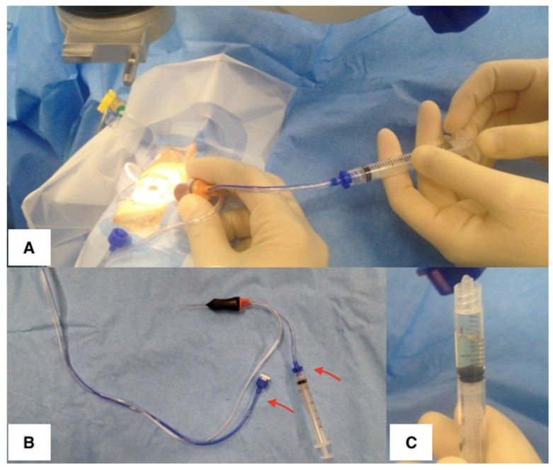
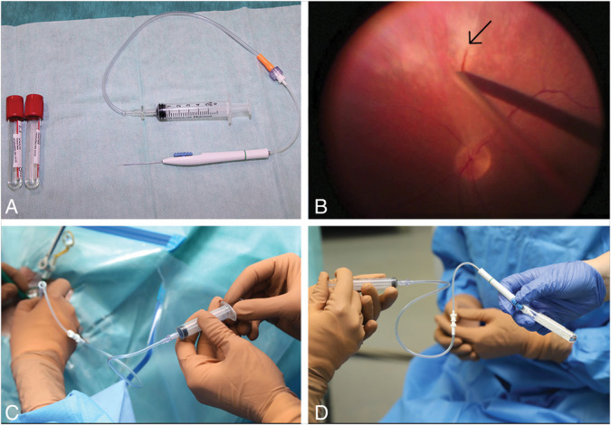
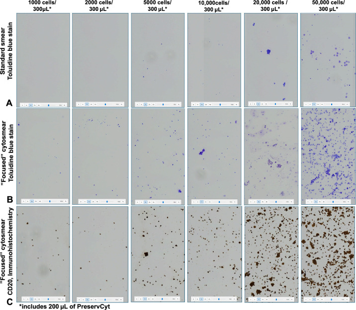
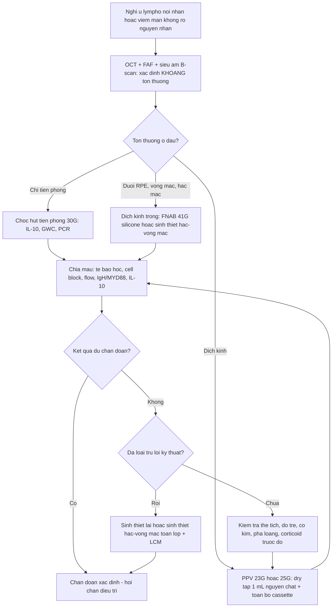
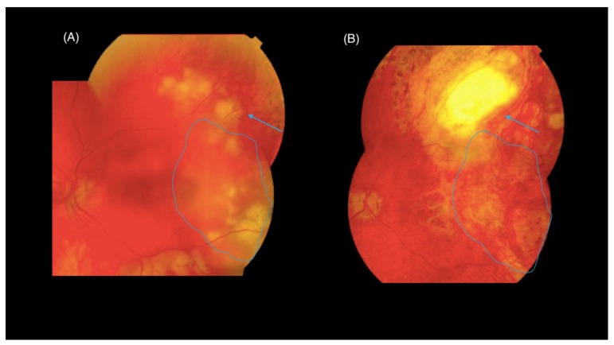
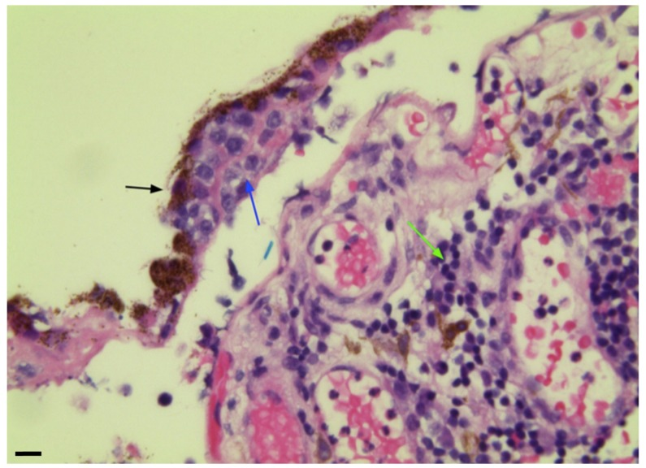

# 492 — Sinh thiết hắc–võng mạc & quy trình lấy mẫu dịch kính: kỹ thuật, xử lý mẫu, độ nhạy / Vitreous and chorioretinal biopsy — technique, specimen handling, diagnostic yield

**Tags:** `pattern:it-te-bao` `vung:dich-kinh` `vung:hac-vong-mac` `protocol:PPV-chan-doan` `protocol:sinh-thiet-hac-vong-mac` `protocol:cytology-cell-block` `score:IL-10-IL-6`
**Mức chắc chắn (certainty):** tổng hợp y văn (literature synthesis) — nhóm tự biên từ y văn mở (J Clin Med 2019 CC BY 4.0; Transl Vis Sci Technol 2025 CC BY-NC-ND 4.0; Transl Vis Sci Technol 2026 CC BY 4.0; J Clin Med 2026 CC BY 4.0; Retina 2024 CC BY-NC-ND 4.0), chưa gắn một ca nguyên văn xuyên suốt.

> **Vì sao bài này quan trọng:** bài [462](../462-u-lympho-noi-nhan-PVRL/lesson.md) nói **phải sinh thiết dịch kính**; bài [491](../491-pvrl-theo-doi-tai-phat/lesson.md) nói **phải sinh thiết lại khi tái phát**. Nhưng câu hỏi thực hành là: *lấy bao nhiêu? bằng kim bao nhiêu G? cho vào ống gì? gửi đi đâu? và khi nào phải mổ lấy mảnh hắc–võng mạc?* Đây là bài **quy trình** — và là nơi dễ mất chẩn đoán nhất: **tế bào lympho trong dịch kính mỏng manh, dễ ly giải**, tế bào học thường **âm tính giả 30–45%**, độ nhạy tế bào học dịch kính chỉ **25–44,5%**. Nghĩa là **kỹ thuật lấy mẫu quyết định chẩn đoán không kém gì mô bệnh học**.

## 1. Tổng quan — vì sao mẫu nội nhãn "nghèo tế bào" và ngưỡng nào phải nhớ

- **Bệnh học – sinh lý bệnh:** dịch kính là **gel trong suốt, gần như không có tế bào**; khi có u lympho, tế bào u **rơi vào dịch kính nhưng không sống dai** — DLBCL là tế bào lớn, **dễ apoptosis**, dễ vỡ khi bị cắt/hút. Vì vậy **cùng một bệnh**, mẫu lấy đúng cho **hàng nghìn tế bào**, mẫu lấy sai cho **vài chục tế bào** — đủ hay không đủ để chẩn đoán.
- **TẠI SAO (vật lý của "cô đặc mẫu"):** nồng độ tế bào trong dịch kính thấp (cỡ **10³–10⁵ tế bào/mL** trong u), nên **ly tâm** là bước biến "mẫu không đọc được" thành "mẫu đọc được": ly tâm **500 × g trong 5 phút**, dàn tế bào vào vòng **1000 tế bào/100 µL** trên lam tích điện. Kết quả thực nghiệm: ở nồng độ **1000–2000 tế bào/100 µL**, **lam nhuộm thường KHÔNG phát hiện được tế bào**, còn **lam cô đặc thì thấy rõ** — và **lượng DNA thu được 5,25 ng (1.000 tế bào) đến 143 ng (50.000 tế bào)**, đủ cho **PCR MYD88** (chỉ cần ~4 tế bào).
- **TẠI SAO (pha loãng = sai số định lượng):** cytokine (IL-10, IL-6) và qPCR là **phép đo nồng độ**; nếu mẫu bị **dịch truyền (BSS) pha loãng**, nồng độ đo được **thấp giả tạo** — mẫu "dịch kính pha loãng" **không dùng được** cho cytokine. Vì vậy mọi xét nghiệm định lượng phải lấy từ **mẫu nguyên chất (neat/undiluted) trước khi bật dịch truyền**.
- **Ngưỡng định lượng phải nhớ (4 cửa Argon):**

| Chỉ số | Con số | Nguồn |
|---|---|---|
| Thể tích mẫu nguyên chất lấy được qua vitrectomy | **0,5–1,0 mL** thường quy, tối đa **~2 mL** | J Clin Med 2019 (PMC6832563) |
| "Dry tap" trước khi bật dịch truyền | **~1 mL** dịch kính không pha loãng | J Clin Med 2026 (PMC13027321) |
| Độ nhạy tế bào học dịch kính (đơn thuần) | **25,0–44,5%**; một số nguồn **45–81%** | J Clin Med 2026 (PMC13027321); bài 462 |
| Độ nhạy của vitrectomy chẩn đoán | **77%** (độ đặc hiệu **73%**) | TVST 2026 (PMC12859710) |
| Âm tính giả của tế bào học không qua PPV | **30–45%** | TVST 2026 (PMC12859710) |
| Cỡ kim: ảnh hưởng sống sót tế bào u lympho | **27G thấp hơn có ý nghĩa** (Kendall τ = **−0,253**, P = **0,00048**); khuyến cáo **23G và 25G** | TVST 2026 (PMC12859710) |
| Tốc độ cắt 1500 vs 5000 cắt/phút | **Không khác biệt** về sống sót tế bào | TVST 2026 (PMC12859710) |
| Nộp thêm toàn bộ dịch trong cassette | Tế bào học **75% → 92%** | J Clin Med 2026 (PMC13027321) |
| Ly tâm cô đặc lam tế bào | **500 × g, 5 phút**, vòng **1000 tế bào/100 µL**; DNA **5,25–143 ng** | TVST 2025 (PMC12637000) |
| Kim 41G silicone lấy mảnh võng mạc | Chẩn đoán **6/7 ca**; võng mạc mỏng tới **231 µm**; **không biến chứng nặng** | Retina 2024 (PMC11332377) |
| PCR sau vi phẫu bằng laser (LCM) | Độ nhạy **~60% → gần 100%** | J Clin Med 2019 (PMC6832563) |
| Ngưỡng IL-10 | dịch tiền phòng **> 50 pg/mL**; dịch kính **> 400 pg/mL**; **IL-10:IL-6 > 1** | bài 462 (PMC12047895) |

## 2. Mẫu hình + chẩn đoán phân biệt theo vị trí (gamut)

**Nguyên tắc chọn đường lấy mẫu: lấy mẫu ở ĐÚNG khoang chứa tổn thương, với thể tích lớn nhất có thể, và chia mẫu cho nhiều kỹ thuật ngay từ đầu.**

**Gamut theo khoang tổn thương:**
- **Tiền phòng (anterior chamber):** chọc hút **~0,1 mL** dịch tiền phòng bằng kim **30G** — dùng cho **IL-10 (ngưỡng 50 pg/mL)**, **Goldmann–Witmer coefficient**, **PCR**; an toàn, biến chứng thấp (chảy máu tiền phòng hay gặp hơn khi nhãn áp cao).
- **Dịch kính (vitreous):** **chọc hút dịch kính (vitreous tap)** kim 25/27G — nhanh, ít xâm lấn, nhưng **thể tích nhỏ, dễ pha loãng, dễ âm tính**; **cắt dịch kính chẩn đoán (diagnostic pars plana vitrectomy, PPV)** — lấy **mẫu nguyên chất + toàn bộ cassette**, độ nhạy cao nhất, vừa chẩn đoán vừa điều trị (làm sạch dịch kính).
- **Dưới RPE / võng mạc / hắc mạc (sub-RPE, retina, choroid):** tổn thương **khu trú, dịch kính trong** → **sinh thiết hắc–võng mạc (chorioretinal biopsy)** hoặc **FNAB võng mạc 41G silicone** — đây là nơi PVRL **hay trú nhất** (khoang dưới RPE).
- **Mô tiền phòng/mống mắt/thể mi (iris, ciliary body):** FNAB **22–27G** qua giác mạc, hoặc cắt mống mắt; mô rất mỏng manh, chuyển ngay.
- **Không lấy được mô:** **metagenomic deep sequencing (MDS)** trên mẫu dịch kính ít tế bào — vừa tìm tác nhân nhiễm, vừa phát hiện đột biến/genrearrangement.

**Gamut của "mẫu âm dù bệnh thật" (vì sao âm tính giả):**
- **Quá ít tế bào** (mẫu < vài trăm tế bào) — lấy bằng tap thay vì PPV.
- **Tế bào đã ly giải** — chậm chuyển mẫu, không cố định đúng, kim nhỏ (27G), cắt tốc độ cao.
- **Corticoid trước sinh thiết** — tế bào u thoái triển, mô chỉ còn viêm.
- **Lấy trúng vùng hoại tử trung tâm** — mảnh sinh thiết chỉ có mô chết.
- **Pha loãng bởi dịch truyền** — cytokine thấp giả tạo.
- **Nhiễm vật liệu thủy tinh thể** khi mổ phối hợp đục thể thủy tinh — dùng **máy và đường hút riêng**.

## 3. Bảng so sánh phân biệt (ma trận đối chiếu)

| Thực thể / kỹ thuật | Hình ảnh – thể tích – xử lý | Chốt vào (rule-in) | Chốt loại (rule-out) | Gợi ý xác nhận |
|---|---|---|---|---|
| **Chọc hút dịch tiền phòng (AC tap)** | **~0,1 mL**, kim 30G; đo IL-10/IL-6, GWC, PCR | **Cần cytokine/kháng thể mà không muốn mổ**; **IL-10 tiền phòng > 50 pg/mL** | **Cần mô học/tế bào học** → không đủ | IL-10, IL-6, PCR; an toàn, biến chứng thấp |
| **Chọc hút dịch kính (vitreous tap)** | Kim **25/27G**, thể tích nhỏ, **dễ pha loãng** | **Ca không mổ được / cần cấy nhanh** | **Nghi u lympho** → 27G làm giảm sống sót tế bào | Cấy, PCR; nếu âm mà còn nghi → PPV |
| **Cắt dịch kính chẩn đoán (diagnostic PPV)** | **23G/25G**; **0,5–1,0 mL nguyên chất** trước infusion + **toàn bộ cassette** | **Nghi PVRL/masquerade** — độ nhạy **77%**, nộp cassette đưa tế bào học lên **92%** | **Tổn thương chỉ ở hắc mạc, dịch kính trong** → PPV một mình dễ âm | Tế bào học + cell block + flow + IgH/MYD88 + IL-10 |
| **FNAB võng mạc 41G silicone** | Kim **41G mềm**, hút qua ống nối; lấy được mảnh võng mạc **dày 231 µm** | **Tổn thương dưới võng mạc nhỏ, dịch kính trong**; **6/7 ca chẩn đoán được**, nhiều ca trước đó PPV âm | **Tổn thương lớn cần mô học đầy đủ** → chọn sinh thiết toàn lớp | Tế bào học + flow; không biến chứng nặng trong loạt 7 ca |
| **Sinh thiết hắc–võng mạc toàn lớp (transvitreal)** | Cắt **vùng ranh giới tổn thương–lành**, đốt mạch, laser giới hạn, cắt tới củng mạc, **gas/silicone** | **Thất bại nhiều lần với dịch kính**; tổn thương **hắc mạc/võng mạc** đơn thuần | **Bệnh toàn thân chưa loại trừ** → ưu tiên sinh thiết ngoài mắt | Mô học + IHC + PCR/LCM; **biến chứng cao nhất trong các kiểu sinh thiết** |
| **Sinh thiết qua củng mạc (transscleral)** | **Vạt củng mạc ~6 × 6 mm**, đốt mép hắc mạc, khâu **7-O Vicryl** | **Tổn thương trước xích đạo/gần ora** | **Tổn thương sau cực** → khó tiếp cận | Mô học; nguy cơ **xuất huyết trên hắc mạc** |

*(A) Trợ thủ hút **bằng tay** qua syringe trong khi phẫu thuật viên cắt bằng vitrector; (B) đầu cắt có **ống hút bị ngắt** (mũi tên đỏ) nối trực tiếp vào syringe 2 mL; (C) **mẫu dịch kính nguyên chất** thu được. Đây là cách lấy **0,5–1,0 mL (tối đa ~2 mL) không pha loãng** — điều kiện bắt buộc để đo IL-10/IL-6 và qPCR chính xác. Nguồn: Mastropasqua R et al., J Clin Med 2019 (PMC6832563) Fig. 5, CC BY 4.0.*

## 4. Protocol lấy mẫu – xử lý – gửi xét nghiệm

**Bước 0 — Chuẩn bị (quyết định trước khi vào phòng mổ):**
- Xác định **khoang tổn thương** trên OCT/FAF/siêu âm → chọn đường lấy mẫu (mục 2).
- **Ngừng/giảm corticoid** nếu an toàn, tối thiểu **vài ngày** trước lấy mẫu (corticoid làm tế bào ly giải/thoái triển).
- Đặt sẵn **bộ ống**: ống khô cho cytokine (không heparin, không môi trường), ống **PreservCyt** cho tế bào học, ống cho PCR (EDTA), ống cấy.
- Ghi tên xét nghiệm trên **từng ống** trước khi bắt đầu — mẫu ít không chia lại được.

**Bước 1 — Lấy mẫu nguyên chất (neat):**
- **PPV 23G hoặc 25G** (không chọn 27G cho ca nghi u lympho).
- **Chưa bật dịch truyền**: hút **~1 mL** dịch kính bằng tay qua đường hút nối syringe (Hình A–C) — gọi là **"dry tap"**.
- Giữ nhãn áp bằng ấn ngoài cầu (squint hook) trong khi hút; **rút đầu cắt trong lúc vẫn cắt**.
- **Sau đó** bật infusion, cắt dịch kính lõi/ toàn bộ, và **nộp toàn bộ dịch trong cassette** (chứa tế bào vỏ dịch kính — nơi tế bào lympho hay nằm).

**Bước 2 — Chia mẫu (tối thiểu 4 phần nếu đủ thể tích):**

| Phần | Xử lý | Xét nghiệm |
|---|---|---|
| 1 | **Không cố định**, chuyển ngay (đá, < 1 giờ) | Tế bào học, **cell block**, flow cytometry |
| 2 | Ly tâm **500 × g/5 phút** → dàn vòng 1000 tế bào/100 µL | Lam **cô đặc** + **CD20/CD79a/PAX5/Ki-67** |
| 3 | Đông lạnh / dung dịch bảo quản DNA | **IgH PCR, MYD88 L265P, CD79B, NGS** |
| 4 | Ống khô, ly tâm nhanh | **IL-10, IL-6** (tỉ lệ > 1) |

**Bước 3 — Sinh thiết hắc–võng mạc (khi dịch kính âm mà còn nghi):**
- **Đường transvitreal (ưu tiên):** chọn **ranh giới tổn thương–vùng lành** (mép có nhiều tế bào sống, trung tâm thường hoại tử) → **đốt mạch võng mạc** → **laser/diathermy giới hạn vùng hắc mạc** → cắt toàn lớp bằng kéo đến **củng mạc trần** → lấy mảnh qua sclerotomy mở rộng → **endolaser quanh chỗ lấy + gas/silicone**.
- **Đường transscleral:** vạt củng mạc **~6 × 6 mm**, đốt mép hắc mạc, lấy mảnh, khâu **7-O Vicryl** — dùng cho tổn thương **trước xích đạo**.
- **FNAB võng mạc 41G silicone:** kim mềm, hút qua ống nối **12–18 inch** (tránh rung tay), vào qua pars plana dưới quan sát trực tiếp; phù hợp tổn thương **nhỏ, dưới võng mạc**.

*(A) Bộ dụng cụ: **kim 41G silicone mềm** nối ống, syringe 5 mL và ống nghiệm; (B) đầu kim (mũi tên) tiếp cận tổn thương **dưới võng mạc** dưới quan sát trực tiếp; (C–D) hút bằng tay qua ống nối. Trong loạt 7 ca, kỹ thuật này chẩn đoán **6/7**, lấy được mô võng mạc **mỏng tới 231 µm**, và **4/5 ca trước đó đã có tế bào học dịch kính âm**. Nguồn: Globočnik Petrovič M et al., Retina 2024 (PMC11332377) Fig. 2, **CC BY-NC-ND 4.0** — giữ nguyên bản.*

**Bước 4 — Xử lý mô & chất lượng:**
- Mảnh mô chia **3**: **formalin** (mô học), **OCT/frozen** (hóa mô miễn dịch + phân tử), **môi trường cấy** (nếu nghi nhiễm).
- Nếu tế bào u **lẫn nhiều tế bào viêm/hoại tử** → **laser capture microdissection (LCM)** để tách tế bào u: độ nhạy PCR từ **~60% lên gần 100%**.

*Cùng mẫu DLBCL pha loãng: (A) **lam nhuộm thường** — rất ít/không thấy tế bào; (B) **lam cô đặc bằng ly tâm** — tế bào tập trung thành vòng, đếm được; (C) **CD20 dương** trên lam cô đặc, không mất tế bào. Đây là lý do **bước ly tâm 500 × g/5 phút** không được bỏ. Nguồn: Ho CEH et al., Transl Vis Sci Technol 2025 (PMC12637000) Fig. 2, **CC BY-NC-ND 4.0** — giữ nguyên bản.*

## 5. Biến thể bình thường và cạm bẫy

- **Cạm bẫy 1 — dùng mẫu pha loãng để đo cytokine:** BSS làm **IL-10 thấp giả tạo** → bỏ sót u lympho. Quy tắc: **mẫu nguyên chất cho mọi xét nghiệm định lượng**, mẫu cassette chỉ dùng cho tế bào học/flow.
- **Cạm bẫy 2 — chọn 27G vì "nhỏ thì an toàn hơn":** với **tế bào u lympho**, 27G làm **giảm sống sót tế bào có ý nghĩa** (τ = −0,253; P = 0,00048). Khuyến cáo **23G/25G**; **tốc độ cắt 1500 hay 5000 cắt/phút không ảnh hưởng** — nên **đừng hy sinh độ nhạy để "cắt chậm cho an toàn"**, niềm tin cũ "không quá 600 cắt/phút" **không còn giá trị với đầu cắt hiện đại**.
- **Cạm bẫy 3 — chỉ lấy "lõi" dịch kính rồi dừng:** tế bào lympho tập trung ở **vỏ dịch kính (cortical vitreous)**; cắt lõi đơn thuần dễ âm. Nên **cắt toàn bộ + nộp cassette** (tế bào học **75% → 92%**).
- **Cạm bẫy 4 — lấy trúng trung tâm tổn thương:** trung tâm thường **hoại tử**, không có tế bào sống → mô học "không kết luận". Chọn **ranh giới tổn thương–lành**, và với tổn thương dưới RPE thì lấy **sâu, gần choriocapillaris**.
- **Cạm bẫy 5 — mổ phối hợp đục thể thủy tinh làm nhiễm mảnh vụn thể thủy tinh:** dùng **máy và đường hút riêng** cho thì lấy mẫu, tránh mảnh vụn thủy tinh thể làm nhiễu tế bào học/phân tử.
- **Cạm bẫy 6 — tế bào học âm là "hết chuyện":** âm tính giả **30–45%**; độ nhạy PPV chỉ **77%**, đặc hiệu **73%**. Luôn **gửi song song cytokine + phân tử**, và **sinh thiết lại** khi còn nghi (giá trị tăng theo số lần).
- **Cạm bẫy 7 — "sinh thiết hắc–võng mạc là thủ thuật nhẹ":** đây là **kiểu sinh thiết nội nhãn nguy cơ cao nhất**: đục thể thủy tinh, **bong võng mạc, xuất huyết dịch kính, xuất huyết hắc mạc, PVR, viêm nội nhãn**; hiếm hơn là **tế bào u lan ra củng mạc qua đường mở (port-site extension)**. Chỉ định phải rõ: thất bại lấy mẫu dịch kính nhiều lần, hoặc tổn thương **chỉ ở hắc–võng mạc**.
- **Cạm bẫy 8 — bỏ qua thời gian vận chuyển:** tế bào thoái hóa nhanh nếu **không cố định/không vào môi trường nuôi cấy**; chuyển **ngay trong giờ**, không qua trung gian.

*(A) Trước: **thâm nhiễm vàng lan tỏa** nghi u lympho (đường xanh = ranh giới tổn thương). (B) Ba tháng sau sinh thiết, mắt **đầy dầu silicone**: vị trí lấy mảnh (mũi tên) và **tổn thương thoái triển** sau một đợt hóa trị — mảnh mô **chẩn đoán được "large B-cell lymphoma"**. Nguồn: Mastropasqua R et al., J Clin Med 2019 (PMC6832563) Fig. 8, CC BY 4.0.*

## 6. Tự lượng giá — Blind Quiz

**Ca 1 — Bác sĩ trợ thủ đang hút dịch kính trong lúc phẫu thuật viên cắt. Quan sát 3 ô ảnh:**

- Câu hỏi: vì sao phải hút **trước khi bật dịch truyền**? Ưu điểm của mẫu này so với chọc hút dịch kính bằng kim? Lấy được bao nhiêu?

<b>Bấm để hiện đáp án (findings + chẩn đoán)</b>

- Dấu hiệu (findings): (A) hút **bằng tay** qua syringe trong khi vitrector vẫn cắt; (B) **ống hút bị ngắt** nối trực tiếp syringe 2 mL — mẫu không đi qua bộ phận bơm/dịch truyền; (C) **mẫu dịch kính nguyên chất** đục, thể tích **0,5–1,0 mL** (tối đa ~2 mL).
- Chẩn đoán/ý nghĩa: đây là cách lấy **mẫu không pha loãng** — bắt buộc cho **IL-10/IL-6 và qPCR** (mẫu pha loãng cho kết quả **thấp giả tạo**). So với chọc hút bằng kim: **thể tích lớn hơn, nhiều tế bào hơn, ít âm tính giả hơn**, và có thêm tác dụng điều trị (làm sạch dịch kính).
- Nguồn ảnh: Mastropasqua R et al., J Clin Med 2019 (PMC6832563) Fig. 5, CC BY 4.0.

**Ca 2 — Bệnh nhân có thâm nhiễm vàng lan tỏa nghi u lympho, dịch kính tương đối trong. Ảnh trước và 3 tháng sau sinh thiết hắc–võng mạc:**

- Câu hỏi: vì sao chọn **sinh thiết hắc–võng mạc** thay vì chỉ cắt dịch kính? Lấy ở đâu trong tổn thương? Vì sao ảnh B có dầu silicone?

<b>Bấm để hiện đáp án (findings + chẩn đoán)</b>

- Dấu hiệu (findings): (A) **mảng thâm nhiễm vàng nhạt lan tỏa** ở cực sau, nghi u lympho; (B) sau sinh thiết — mắt **đầy dầu silicone**, **vị trí lấy mảnh** (mũi tên) đã đóng, **tổn thương thoái triển** sau hóa trị.
- Chẩn đoán (diagnosis): **u lympho tế bào B lớn** — mảnh sinh thiết hắc–võng mạc **chẩn đoán xác định** trong khi tổn thương **chỉ nằm dưới RPE/võng mạc**.
- Kỹ thuật: lấy ở **ranh giới tổn thương–vùng lành** (trung tâm hoại tử dễ "không kết luận"), sâu tới **gần choriocapillaris**; sau đó **endolaser + dầu silicone/gas** để chống bong võng mạc và chảy máu.
- Nguồn ảnh: Mastropasqua R et al., J Clin Med 2019 (PMC6832563) Fig. 8, CC BY 4.0.

**Ca 3 — Mảnh sinh thiết hắc–võng mạc của bệnh nhân 68 tuổi, H&E:**

- Câu hỏi: tế bào u nằm ở khoang nào? Vì sao đây là vị trí "vàng" để sinh thiết? Vì sao đôi khi vẫn cần **laser capture microdissection**?

<b>Bấm để hiện đáp án (findings + chẩn đoán)</b>

- Dấu hiệu (findings): **tế bào lympho đa hình thái (mũi tên xanh)** nằm **giữa biểu mô sắc tố (mũi tên đen) và hắc mạc bên dưới**; hắc mạc có **thâm nhiễm lympho phản ứng nhỏ (mũi tên xanh lá)**.
- Vì sao: PVRL **homing về khoang dưới RPE** → sinh thiết hắc–võng mạc có **tỷ lệ chẩn đoán cao**; nhưng tế bào u thường **lẫn tế bào viêm và mô hoại tử**, làm DNA bẩn → PCR không tin cậy.
- Giải pháp: **LCM** tách riêng tế bào u khỏi mô viêm → độ nhạy PCR từ **~60% lên gần 100%**.
- Nguồn ảnh: Mastropasqua R et al., J Clin Med 2019 (PMC6832563) Fig. 6, CC BY 4.0.

## Bài liên quan chéo
- [462 – U lympho nội nhãn (PVRL) vs viêm màng bồ đào giả danh](../462-u-lympho-noi-nhan-PVRL/lesson.md)
- [491 – Theo dõi & tái phát PVRL](../491-pvrl-theo-doi-tai-phat/lesson.md)
- [411 – Siêu âm nhãn cầu](../411-sieu-am-nhan-cau/lesson.md) (định hướng khi không thấy đáy mắt)
- [452 – Hoại tử võng mạc cấp (ARN) & CMV retinitis](../452-hoai-tu-vong-mac-ARN-CMV/lesson.md) (PCR dịch kính/tiền phòng)
- [463 – Viêm nội nhãn nội sinh do nấm](../463-viem-noi-nhan-noi-sinh-nam/lesson.md) (cấy & PCR dịch kính)
- [460 – Can thiệp mắt](../460-can-thiep-mat/lesson.md)
- [400 – Tổng quan Mắt & thị giác](../400-tong-quan-mat-thi-giac/lesson.md)

## Ảnh
- `492_lay-dich-kinh-khong-pha-loang_PMC6832563-Fig5-CCBY.jpg` — Mastropasqua R et al., J Clin Med 2019 (PMCID: PMC6832563) Fig. 5, CC BY 4.0.
- `492_sinh-thiet-hac-vong-mac_PMC6832563-Fig8-CCBY.jpg` — Mastropasqua R et al. (PMC6832563) Fig. 8, CC BY 4.0.
- `492_te-bao-duoi-RPE_PMC6832563-Fig6-CCBY.jpg` — Mastropasqua R et al. (PMC6832563) Fig. 6, CC BY 4.0.
- `492_S-FNAB-41G_PMC11332377-Fig2-CCBYNCND.jpg` — Globočnik Petrovič M et al., Retina 2024 (PMCID: PMC11332377) Fig. 2, **CC BY-NC-ND 4.0** (giữ nguyên bản) — kỹ thuật FNAB võng mạc 41G.
- `492_cytosmear-ly-tam_PMC12637000-Fig2-CCBYNCND.jpg` — Ho CEH et al., Transl Vis Sci Technol 2025 (PMCID: PMC12637000) Fig. 2, **CC BY-NC-ND 4.0** (giữ nguyên bản) — lam thường vs lam cô đặc.
- Chi tiết giấy phép từng ảnh trong `images/CREDITS.md`. AuntMinnie / Retina Image Bank: **chỉ dẫn link, không tải**.

> Không dùng để chẩn đoán độc lập khi chưa có người hướng dẫn.
